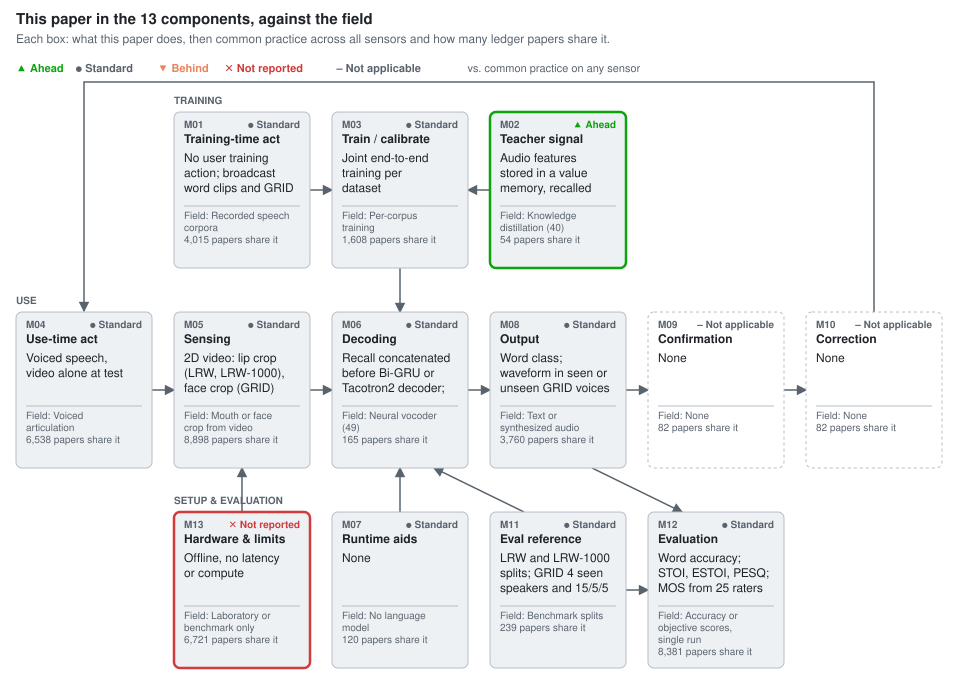

# Multi-modality Associative Bridging through Memory: Speech Sound Recollected from Face Video

Minsu Kim, Joanna Hong, Se Jin Park, Yong Man Ro. ICCV 2021 (arXiv April 2022). [arXiv:2204.01265](https://arxiv.org/abs/2204.01265)

**Section:** [Lip & face video](../../README.md#lip--face-video)

## Figures

### This paper in the 13 components, against the field

<picture><source media="(prefers-color-scheme: dark)" srcset="figures/components-dark.svg"></picture>

Verdicts compare the paper's choice for each component with common practice across 8,995 ledger entries on any sensor (silent speech, brain-to-text, lip reading).

Data

| Component | This paper | Common practice | Papers with this practice | Verdict |
| --- | --- | --- | --- | --- |
| M01 Training-time act | No user training action; broadcast word clips and GRID read sentences | Recorded speech corpora | 4,015 of 8,995 | ● Standard (Inherited.) |
| M02 Teacher signal | Audio features stored in a value memory, recalled from video | Knowledge distillation (40) | 54 of 8,995 | ▲ Ahead (No prior memory recall among 54; gains on LRW and LRW-1000; +0.91 points over distillation, one run.) |
| M03 Train / calibrate | Joint end-to-end training per dataset | Per-corpus training | 1,608 of 8,995 | ● Standard (Inherited.) |
| M04 Use-time act | Voiced speech, video alone at test | Voiced articulation | 6,538 of 8,995 | ● Standard (Inherited.) |
| M05 Sensing | 2D video: lip crop (LRW, LRW-1000), face crop (GRID) | Mouth or face crop from video | 8,898 of 8,995 | ● Standard (Inherited.) |
| M06 Decoding | Recall concatenated before Bi-GRU or Tacotron2 decoder; Griffin-Lim | Neural vocoder (49) | 165 of 8,995 | ● Standard (STOI 0.738 against 0.731 for Lip2Wav; no WER; Griffin-Lim from Lip2Wav.) |
| M07 Runtime aids | None | No language model | 120 of 8,995 | ● Standard (Inherited.) |
| M08 Output | Word class; waveform in seen or unseen GRID voices | Text or synthesized audio | 3,760 of 8,995 | ● Standard (Inherited.) |
| M09 Confirmation | None | None | 82 of 8,995 | – Not applicable (Offline study.) |
| M10 Correction | None | None | 82 of 8,995 | – Not applicable (Offline study.) |
| M11 Eval reference | LRW and LRW-1000 splits; GRID 4 seen speakers and 15/5/5 unseen split | Benchmark splits | 239 of 8,995 | ● Standard (Face Cutout comparison crosses LRW-1000 versions.) |
| M12 Evaluation | Word accuracy; STOI, ESTOI, PESQ; MOS from 25 raters | Accuracy or objective scores, single run | 8,381 of 8,995 | ● Standard (Best memory size, one run; no WER.) |
| M13 Hardware & limits | Offline, no latency or compute | Laboratory or benchmark only | 6,721 of 8,995 | ✕ Not reported (No latency or memory cost.) |

## Verdict

The paper [[1]](#ref-1) stores audio features in a memory during training and recalls them from video at test (M02), feeding them ahead of the backend (M06). The recall design is ahead: no earlier study among the 54 on audio-to-video knowledge transfer records it (pattern match, Appendix), and its gain over a no-memory baseline repeats on LRW and LRW-1000; its edge over distillation is one LRW run of 0.91 points. The state-of-the-art claim fails on LRW, where 85.41% sits 2.5 points below an uncited earlier single model at 87.9% [[2]](#ref-2); on public LRW-1000, 50.82% leads earlier models without word-boundary input by 2.8 points but not the 55.7% reached with boundaries [[3]](#ref-3) (inference). On GRID the objective lead over Lip2Wav is 0.007 STOI with no no-memory score in the main text, and the opinion-score jump toward ground truth comes from swapping Griffin-Lim for WaveNet, not from the memory.

## Against the field, component by component

### M02 Training-only supervision: audio recalled from a memory

**Usual approach:** Among 54 unique lip-reading and video-to-speech studies that bring audio into a video-only model (pattern match, Appendix), knowledge distillation is the most common design (40), against memory recall in 12 and audio-feature regression in 1. The deciding priors distil a speech recognizer into a sentence-level lip reader [[4]](#ref-4), [[5]](#ref-5). The paper departs by aligning memory addresses, not features: a KL loss matches the video's address over the audio memory to the audio's own (Sec. 3.4).

**State of the art:** At publication the best single LRW model reached 87.9% by self-distillation without audio (2020, [[2]](#ref-2)), 2.5 points above the paper's 85.41% (inference). Today a single model reaches 93.5% with word-boundary input and extra pre-training data, and 90.4% with neither [[6]](#ref-6) [later]: gaps of 8.1 and 5.0 points (inference). On public LRW-1000 the best earlier model without boundaries gives 48.0% [[3]](#ref-3); the same group's [concurrent] memory successor reaches 53.82% with a temporal-convolution backend [[7]](#ref-7).

None of the 12 memory-recall hits in the Appendix count is first public before the paper ([[7]](#ref-7) is [concurrent]), nor is the authors' journal memory [[8]](#ref-8), which is [concurrent]. Over its Bi-GRU baseline the memory adds 1.27 points on LRW (84.14% to 85.41%) and 5.89 points on LRW-1000; relative error falls 8% and 11% (inference). Against the authors' distillation build on the same baseline the gain is 0.91 points (84.50% to 85.41%, Table 5), one run, LRW only. Verdict: ahead as a design gaining on two datasets; an edge over distillation is not shown.

### M06 Processing: memory placement and waveform route

**Usual approach:** Of 165 unique video-to-speech studies (pattern match, Appendix), 49 name a neural vocoder, 41 a parametric vocoder and 16 Griffin-Lim. The paper keeps Lip2Wav's Tacotron2 decoder and Griffin-Lim for every objective score, using WaveNet in one opinion-score row (Sec. 4.2.3).

**State of the art:** On the four seen GRID speakers the lowest ASR WER in a 2023 comparison is 4.07%, from an end-to-end WGAN, below that work's own best of 4.54% [[9]](#ref-9) [later]. The paper's STOI 0.738 is a 1% relative gain over Lip2Wav's 0.731 (inference), with no WER. It re-scored released samples of the journal memory system [[8]](#ref-8) at STOI 0.643 and WER 6.08% [[9]](#ref-9), a different system, so this flags scorer effects only.

Table 3 makes the vocoder the dominant factor: naturalness is 2.93 against Lip2Wav's 2.83, while WaveNet lifts the same model to 4.37, a 14-fold larger step (inference). Verdict: standard: Griffin-Lim is inherited from Lip2Wav, and a 0.007 STOI gain is too small to call.

## The 13 components

| Component | This paper | Usual approach (count) | State of the art | Verdict |
|---|---|---|---|---|
| M01 Training-time action | No user training action; broadcast word clips and GRID read sentences | Recorded speech corpora (slot-filled 4,015) | – | standard |
| M02 Training-only supervision | Audio features stored in a value memory, recalled from video | Knowledge distillation (40) (pattern match 54) | LRW 93.5% (word boundaries, extra data) [[6]](#ref-6) | ahead |
| M03 Training and adaptation | Joint end-to-end training per dataset | Per-corpus training (slot-filled 1,608) | – | standard |
| M04 Use-time action | Voiced speech, video alone at test | Voiced articulation (slot-filled 6,538) | – | standard |
| M05 Sensors | 2D video: lip crop (LRW, LRW-1000), face crop (GRID) | Mouth or face crop from video (slot-filled 8,898) | – | standard |
| M06 Processing and decoding | Recall concatenated before Bi-GRU or Tacotron2 decoder; Griffin-Lim | Neural vocoder (49) (pattern match 165) | GRID-4 WER 4.07% (WGAN) [[9]](#ref-9) | standard |
| M07 Lexicon and LM | None | No language model (slot-filled 120) | – | standard |
| M08 Output | Word class; waveform in seen or unseen GRID voices | Text or synthesized audio (slot-filled 3,760) | – | standard |
| M09 Confirmation | None | None (slot-filled 82) | – | not applicable |
| M10 Correction | None | None (slot-filled 82) | – | not applicable |
| M11 Reference construction | LRW and LRW-1000 splits; GRID 4 seen speakers and 15/5/5 unseen split | Benchmark splits (slot-filled 239) | – | standard |
| M12 Evaluation | Word accuracy; STOI, ESTOI, PESQ; MOS from 25 raters | Accuracy or objective scores, single run (slot-filled 8,381) | – | standard |
| M13 Device and cost | Offline, no latency or compute | Laboratory or benchmark only (slot-filled 6,721) | – | not reported |

## Where the claims outrun the evidence

- "Highest accuracies among the previous approaches on both datasets" (Sec. 4.1.3) omits [[2]](#ref-2) (87.9% on LRW, 15 months earlier) and [[3]](#ref-3) (inference).
- The 5.58-point lead on LRW-1000 is measured against Face Cutout at 45.24% (Table 1), which used the non-public full-face version [[2]](#ref-2); the paper uses the cropped version (Sec. 4.1.1).
- Memory size is picked as the best of the ablation (N=88, 112 and 150; Sec. 4.1.3, Sec. 4.2.3), with scores only in the supplement, no validation rule and no repeated runs.
- The claim that the bridge does not depend on the downstream architecture (Sec. 4.1.3) is tested on Bi-GRU only.
- The opinion scores give no scale, no definition of the ± values and 6 clips per speaker (Sec. 4.2.3, Table 3).

## What the field needs next

- M02: memory recall, distillation and audio-feature regression on one temporal-convolution backbone, several seeds, memory size chosen on validation data, on LRW and LRW-1000.
- M06: a no-memory baseline and the memory model through the same neural vocoder, scored by ASR WER as well as STOI and ESTOI.
- M11/M12: unseen-speaker sentence data scored by WER.

## Questions for the authors

- Which data selected N, and what is the run-to-run spread of the LRW, LRW-1000 and GRID scores?
- What does the GRID model score without the memory in the main setting?
- What rating scale and interval do the opinion scores use, and on which data was WaveNet trained?

## Appendix: literature search

- M02 audio-knowledge-transfer-to-video (new topic table). Inclusion rule: lip-reading and video-to-speech studies that take only lip or face video at test and use paired audio or a speech model during training to enrich the visual model, by knowledge distillation, audio-feature regression or a learned memory of audio representations; audio-visual models needing audio at test and talking-head generation excluded; versions counted once. Slot-filled 31 unique studies; pattern match 54 unique studies (67 folders). Usual design: knowledge distillation, 40 (pattern match, full text, mentions included). Design counts: knowledge distillation 40, memory recall 12, audio-feature regression 1. Read in full: [[2]](#ref-2), [[3]](#ref-3), [[5]](#ref-5), [[4]](#ref-4), [[7]](#ref-7) [concurrent], [[6]](#ref-6) [later], [[10]](#ref-10) [later], target. Known-item recall 0.67 (2 of 3 seeds).
- M06 video-to-speech-synthesis (published topic table, appended). Inclusion rule: studies that synthesize a speech waveform from talking-face or lip video and state the acoustic representation and how it becomes a waveform; audio-visual enhancement with noisy audio at test, talking-head generation, text-only lip reading and video-to-text-to-TTS pipelines excluded; versions counted once. Slot-filled 7,345 unique studies; pattern match 165 unique studies (187 folders). Usual design: neural vocoder, 49 (pattern match, full text). Design counts: neural vocoder 49, parametric vocoder 41, Griffin-Lim 16, auditory spectrogram 3. Read in full: [[9]](#ref-9) [later], target. Known-item recall 1.0 (3 of 3 seeds).

## References

Numbered by first citation. BibTeX in the same order and keys: [refs.bib](refs.bib).

1. Kim, M., Hong, J., Park, S. J., Ro, Y. M. “Multi-modality Associative Bridging through Memory: Speech Sound Recollected from Face Video.” *Proceedings of the IEEE/CVF International Conference on Computer Vision (ICCV)*, 2021. arXiv:[2204.01265](https://arxiv.org/abs/2204.01265). Target. Read as arXiv v1 (April 2022). [review](https://github.com/supernaiter/silent-speech-review/tree/main/reviews/multi-modality-associative-bridging-through-memory-speech-sound-recollected-from-face-video) [wiki: arxiv-2204.01265](https://github.com/supernaiter/deep-research-wiki-for-silent-speech/blob/main/papers/arxiv-2204.01265/article.md) [wiki: cvf-kim21-mabm](https://github.com/supernaiter/deep-research-wiki-for-silent-speech/blob/main/papers/cvf-kim21-mabm/article.md)
2. Ma, P., Martinez, B., Petridis, S., Pantic, M. “Towards Practical Lipreading with Distilled and Efficient Models.” *2021 IEEE International Conference on Acoustics, Speech and Signal Processing (ICASSP)*, 2021, 7608-7612. doi:[10.1109/ICASSP39728.2021.9415063](https://doi.org/10.1109/ICASSP39728.2021.9415063). arXiv:[2007.06504](https://arxiv.org/abs/2007.06504). [wiki: arxiv-2007.06504](https://github.com/supernaiter/deep-research-wiki-for-silent-speech/blob/main/papers/arxiv-2007.06504/article.md)
3. Feng, D., Yang, S., Shan, S., Chen, X. “Learn an Effective Lip Reading Model without Pains.” *arXiv preprint*, 2020. arXiv:[2011.07557](https://arxiv.org/abs/2011.07557). [wiki: arxiv-2011.07557](https://github.com/supernaiter/deep-research-wiki-for-silent-speech/blob/main/papers/arxiv-2011.07557/article.md)
4. Afouras, T., Chung, J. S., Zisserman, A. “ASR is all you need: Cross-modal distillation for lip reading.” *2020 IEEE International Conference on Acoustics, Speech and Signal Processing (ICASSP)*, 2020. arXiv:[1911.12747](https://arxiv.org/abs/1911.12747). [wiki: arxiv-1911.12747](https://github.com/supernaiter/deep-research-wiki-for-silent-speech/blob/main/papers/arxiv-1911.12747/article.md)
5. Zhao, Y., Xu, R., Wang, X., Hou, P., Tang, H., Song, M. “Hearing Lips: Improving Lip Reading by Distilling Speech Recognizers.” *Proceedings of the AAAI Conference on Artificial Intelligence*, 2020, 34(04). doi:[10.1609/aaai.v34i04.6174](https://doi.org/10.1609/aaai.v34i04.6174). arXiv:[1911.11502](https://arxiv.org/abs/1911.11502). [wiki: doi-10.1609-aaai.v34i04.6174](https://github.com/supernaiter/deep-research-wiki-for-silent-speech/blob/main/papers/doi-10.1609-aaai.v34i04.6174/article.md)
6. Ma, P., Wang, Y., Petridis, S., Shen, J., Pantic, M. “Training Strategies for Improved Lip-reading.” *2022 IEEE International Conference on Acoustics, Speech and Signal Processing (ICASSP)*, 2022, 8472-8476. doi:[10.1109/ICASSP43922.2022.9746706](https://doi.org/10.1109/ICASSP43922.2022.9746706). arXiv:[2209.01383](https://arxiv.org/abs/2209.01383). [later] [wiki: arxiv-2209.01383](https://github.com/supernaiter/deep-research-wiki-for-silent-speech/blob/main/papers/arxiv-2209.01383/article.md)
7. Kim, M., Yeo, J. H., Ro, Y. M. “Distinguishing Homophenes Using Multi-Head Visual-Audio Memory for Lip Reading.” *Proceedings of the AAAI Conference on Artificial Intelligence*, 2022. arXiv:[2204.01725](https://arxiv.org/abs/2204.01725). [concurrent] [wiki: arxiv-2204.01725](https://github.com/supernaiter/deep-research-wiki-for-silent-speech/blob/main/papers/arxiv-2204.01725/article.md)
8. Hong, J., Kim, M., Park, S. J., Ro, Y. M. “Speech Reconstruction With Reminiscent Sound Via Visual Voice Memory.” *IEEE/ACM Transactions on Audio, Speech, and Language Processing*, 2021, 29, 3654-3667. doi:[10.1109/TASLP.2021.3126925](https://doi.org/10.1109/TASLP.2021.3126925). [concurrent]
9. Kefalas, T., Panagakis, Y., Pantic, M. “Large-scale unsupervised audio pre-training for video-to-speech synthesis.” *IEEE/ACM Transactions on Audio, Speech, and Language Processing*, 2024, 32, 2255-2268. doi:[10.1109/TASLP.2024.3382500](https://doi.org/10.1109/TASLP.2024.3382500). arXiv:[2306.15464](https://arxiv.org/abs/2306.15464). Read as arXiv:2306.15464 v1; journal version cited. [later] [review](https://github.com/supernaiter/silent-speech-review/tree/main/reviews/large-scale-unsupervised-audio-pre-training-for-video-to-speech-synthesis) [wiki: arxiv-2306.15464-v2apretrain](https://github.com/supernaiter/deep-research-wiki-for-silent-speech/blob/main/papers/arxiv-2306.15464-v2apretrain/article.md)
10. Hao, B., Zhou, D., Li, X., Zhang, X., Xie, L., Wu, J., et al. “LipGen: Viseme-Guided Lip Video Generation for Enhancing Visual Speech Recognition.” *arXiv preprint*, 2025. arXiv:[2501.04204](https://arxiv.org/abs/2501.04204). [later] [wiki: arxiv-2501.04204](https://github.com/supernaiter/deep-research-wiki-for-silent-speech/blob/main/papers/arxiv-2501.04204/article.md)

## Materials

Data behind this review. Full texts of the papers are not included.

- [`review.md`](review.md): the review text (source)
- [`refs.bib`](refs.bib): references (BibTeX)
- [`slots.json`](slots.json): for each of the 13 components: this paper's choice, field practice, number of matching papers, verdict
- [`figures.json`](figures.json): figure definitions
- [`evaluation.md`](evaluation.md): independent evaluation by a second reviewer
- [`triage.md`](triage.md): how each evaluation finding was checked against the sources and resolved
- [`components/M02/audio-knowledge-transfer-to-video.csv`](../../components/M02/audio-knowledge-transfer-to-video.csv): M02 topic "audio-knowledge-transfer-to-video", every candidate paper with its decision (31 slot-filled, 54 pattern match, usual design in 40, 8 read in full)
- [`components/M06/video-to-speech-synthesis.csv`](../../components/M06/video-to-speech-synthesis.csv): M06 topic "video-to-speech-synthesis", every candidate paper with its decision (7345 slot-filled, 165 pattern match, usual design in 49, 3 read in full)

## More reviews in Lip & face video

- [Speaker disentanglement in video-to-speech conversion](../speaker-disentanglement-in-video-to-speech-conversion/) (2021). Speaker-conditioned video-to-speech with adversarial identity removal: both standard (gradient reversal on GRID lips dates from 2017); EER uses the training embedding network; one run.
- [FastLTS: Non-Autoregressive End-to-End Unconstrained Lip-to-Speech Synthesis](../fastlts-non-autoregressive-end-to-end-unconstrained-lip-to-speech-synthesis/) (2022). FastLTS is a non-autoregressive end-to-end lip-to-speech system that makes unconstrained synthesis substantially faster without obvious quality loss, evaluated on Lip2Wav and GRID.
- [Learning Audio-Visual Speech Representation by Masked Multimodal Cluster Prediction](../learning-audio-visual-speech-representation-by-masked-multimodal-cluster-prediction/) (2022). AV-HuBERT's masked audio-visual cluster pre-training (M03) was a large step past distillation, but its LRS3 gains lack repeated runs and later work beats it at matched budgets.
- [Lip-to-Speech Synthesis for Arbitrary Speakers in the Wild](../lip-to-speech-synthesis-for-arbitrary-speakers-in-the-wild/) (2022). VAE-GAN lip-to-speech with a reference-audio voice: a standard design whose gains are in distribution and sync metrics; no WER is reported, behind its own lineage on evaluation.
- [Sub-word Level Lip Reading With Visual Attention](../sub-word-level-lip-reading-with-visual-attention/) (2022). Attention pooling of the lip map (M06) was ahead in 2021 but not the route to later SOTA; WordPiece output (M08) was preceded by BPE in 2020; the SOTA table mixes data budgets.
- [SVTS: Scalable Video-to-Speech Synthesis](../svts-scalable-video-to-speech-synthesis/) (2022). SVTS shows a simple spectrogram predictor with a pretrained vocoder outperforms prior complex video-to-speech models and scales to large datasets such as LRS3+VoxCeleb2.

---

Part of the [Silent Speech Interface Review](https://github.com/supernaiter/silent-speech-review). Found an error? [Open an issue](https://github.com/supernaiter/silent-speech-review/issues/new?template=correction.yml).
