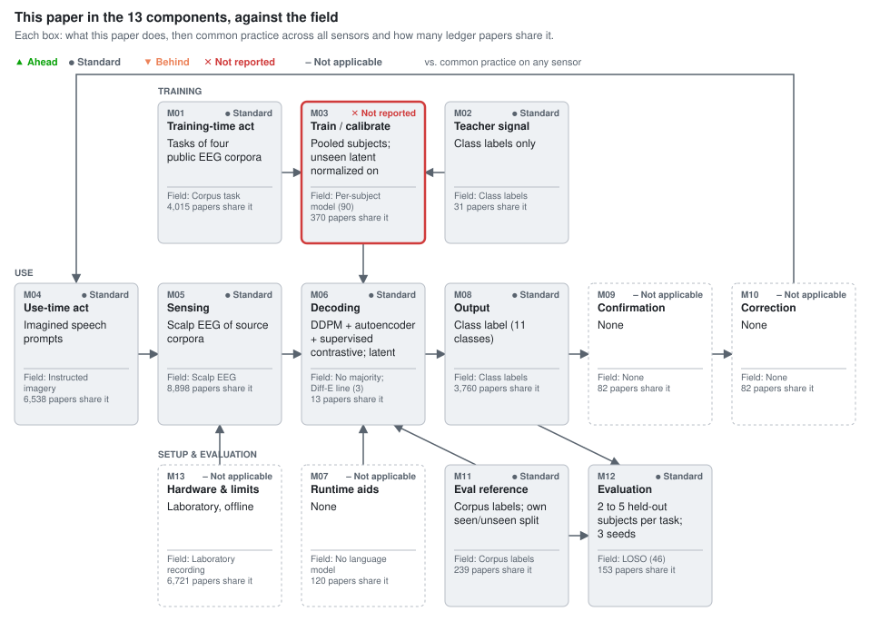

# MultiDiffNet: A Multi-Objective Diffusion Framework for Generalizable Brain Decoding

Mengchun Zhang, Kateryna Shapovalenko, Yucheng Shao, Eddie Guo, Parusha Pradhan. NeurIPS 2025 Workshop: Foundation Models (preliminary version); arXiv preprint, 2025. [arXiv:2511.18294](https://arxiv.org/abs/2511.18294)

**Section:** [Brain signals (EEG, MEG, intracortical)](../../README.md#brain-signals-eeg-meg-intracortical)

## Figures

### This paper in the 13 components, against the field

<picture><source media="(prefers-color-scheme: dark)" srcset="figures/components-dark.svg"></picture>

Verdicts compare the paper's choice for each component with common practice across 8,995 ledger entries on any sensor (silent speech, brain-to-text, lip reading).

Data

| Component | This paper | Common practice | Papers with this practice | Verdict |
| --- | --- | --- | --- | --- |
| M01 Training-time act | Tasks of four public EEG corpora | Corpus task | 4,015 of 8,995 | ● Standard (Inherited.) |
| M02 Teacher signal | Class labels only | Class labels | 31 of 8,995 | ● Standard (Inherited; no training-only signal.) |
| M03 Train / calibrate | Pooled subjects; unseen latent normalized on scored trials | Per-subject model (90) | 370 of 8,995 | ✕ Not reported (Calibration count and exclusion from scoring not stated.) |
| M04 Use-time act | Imagined speech prompts | Instructed imagery | 6,538 of 8,995 | ● Standard (Inherited.) |
| M05 Sensing | Scalp EEG of source corpora | Scalp EEG | 8,898 of 8,995 | ● Standard (Inherited.) |
| M06 Decoding | DDPM + autoencoder + supervised contrastive; latent classifier | No majority; Diff-E line (3) | 13 of 8,995 | ● Standard (Own ablation: no-DDPM rows within SD of the full model.) |
| M07 Runtime aids | None | No language model | 120 of 8,995 | – Not applicable (Closed-set classifier.) |
| M08 Output | Class label (11 classes) | Class labels | 3,760 of 8,995 | ● Standard (Inherited.) |
| M09 Confirmation | None | None | 82 of 8,995 | – Not applicable (Offline study.) |
| M10 Correction | None | None | 82 of 8,995 | – Not applicable (Offline study.) |
| M11 Eval reference | Corpus labels; own seen/unseen split | Corpus labels | 239 of 8,995 | ● Standard (Inherited labels.) |
| M12 Evaluation | 2 to 5 held-out subjects per task; 3 seeds | LOSO (46) | 153 of 8,995 | ● Standard (Fixed held-out sets are common (41); unseen sets are tiny.) |
| M13 Hardware & limits | Laboratory, offline | Laboratory recording | 6,721 of 8,995 | – Not applicable (Offline study.) |

## Verdict

MultiDiffNet [[1]](#ref-1) changes the decoder (M06) and the evaluation protocol (M12); both are standard, the decoder continuing the Diff-E design [[2]](#ref-2). The main claim, that the diffusion latent drives generalization, is not supported by the paper's own ablation: without the diffusion model, unseen imagined-speech accuracy is 13.76% against 11.62% (Tables 13 and 17), unlike the within-subject drops in this design family [[2]](#ref-2), [[3]](#ref-3). The base model gains 1.01 points over EEGNet on two unseen imagined-speech subjects (1.51 with Mixup), about 2.5 points above 11-class chance (inference). Unseen-subject normalization takes label-free latent statistics from trials that are then scored (M03).

## Against the field, component by component

### M06 Decoder: diffusion model trained with the classifier

**Usual approach:** No design holds a majority among 13 unique ledger studies with a diffusion model in an EEG decoder (pattern match, Appendix). Generated-sample augmentation matches 6 folders, two of them MultiDiffNet; a conditional autoencoder with a latent classifier matches 3 studies, all from one group [[2]](#ref-2), [[3]](#ref-3), [[4]](#ref-4). MultiDiffNet keeps that structure and adds a supervised contrastive projection.

**State of the art:** Diff-E (2023) reached 60.63% on 13-class imagined speech from 22 subjects against 32.78% for EEGNet [[2]](#ref-2), within-subject on one 20% split, no yardstick for a cross-subject claim; the later ensemble reports overt speech only [[3]](#ref-3).

In both priors, removing the diffusion model costs within-subject accuracy: 60.63% to 46.59% (23% relative, inference) [[2]](#ref-2) and 85.47% to 68.12% on overt speech [[3]](#ref-3). Sec. 4.4 itself reports the ablation bests (85.58% SSVEP, 13.76% imagined speech, unseen) without saying they lack diffusion. Per Table 13, the two configurations without diffusion score, against the full model: SSVEP 84.94%/85.58% vs 84.72%; imagined speech 13.76%/11.36% vs 11.62%; P300 78.84%/79.46% vs 79.47%; motor imagery 36.49%/38.54% vs 39.24%. With standard deviations up to 8.16 points, diffusion is not shown to help, nor to hurt. Verdict: standard.

### M12 Evaluation: held-out-subject test

**Usual approach:** Among 153 unique ledger studies testing EEG decoders on unseen subjects (pattern match, Appendix), 46 use leave-one-subject-out and 41 fixed held-out subjects; the paper takes the latter, calling LOSO computationally expensive (Sec. 4.1).

**State of the art:** The best held-out-subject imagined-word figure in the ledger is 82.4% for 8 words by LOSO over 4 participants (2025) [[5]](#ref-5) [concurrent], on a bimodal EEG-fMRI corpus; its authors concede the small sample.

The paper gives no unseen-subject counts. In the code they are 2 of 35 SSVEP, 2 of 9 motor-imagery, 5 of 41 eligible P300 and 2 of 14 imagined-speech subjects, drawn at random under the run seed (config.py, dataset.py). LOSO would give 14 imagined-speech test folds instead of 2 (inference). Verdict: standard.

### M03 Training and adaptation: unseen-subject normalization

**Usual approach:** Per-subject models lead the cross-subject training table (90 unique studies, pattern match, Appendix); MultiDiffNet pools seen subjects and normalizes the latent per subject.

**State of the art:** The best tabled pooled-training result is 61.3% top-10 for MEG with fine-tuning on the target subject (2026) [[6]](#ref-6) [later], a different task.

The paper says unseen-subject statistics come from "their own calibration trials" (Sec. 3.3) without a count. In the code they are label-free latent means and standard deviations from the first 104 SSVEP samples or the first half of each unseen imagined-speech subject's samples, all of which are then scored (main.py). This is transductive normalization, not label leakage, but calibration and scored sets overlap unreported. Verdict: not reported.

## The 13 components

| Component | This paper | Usual approach (count) | State of the art | Verdict |
|---|---|---|---|---|
| M01 Training-time action | Tasks of four public EEG corpora | Corpus task (slot-filled 4,015) | – | standard |
| M02 Training-only supervision | Class labels only | Class labels (slot-filled 31) | – | standard |
| M03 Training and adaptation | Pooled subjects; unseen latent normalized on scored trials | Per-subject model (90) (pattern match 370) | 61.3% top-10, MEG [[6]](#ref-6) | not reported |
| M04 Use-time action | Imagined speech prompts | Instructed imagery (slot-filled 6,538) | – | standard |
| M05 Sensors | Scalp EEG of source corpora | Scalp EEG (slot-filled 8,898) | – | standard |
| M06 Processing and decoding | DDPM + autoencoder + supervised contrastive; latent classifier | No majority; Diff-E line (3) (pattern match 13) | 60.63%, 13-class, within-subject [[2]](#ref-2) | standard |
| M07 Lexicon and LM | None | No language model (slot-filled 120) | – | not applicable |
| M08 Output | Class label (11 classes) | Class labels (slot-filled 3,760) | – | standard |
| M09 Confirmation | None | None (slot-filled 82) | – | not applicable |
| M10 Correction | None | None (slot-filled 82) | – | not applicable |
| M11 Reference construction | Corpus labels; own seen/unseen split | Corpus labels (slot-filled 239) | – | standard |
| M12 Evaluation | 2 to 5 held-out subjects per task; 3 seeds | LOSO (46) (pattern match 153) | 82.4%, 8 words, LOSO, 4 people [[5]](#ref-5) [concurrent] | standard |
| M13 Device and cost | Laboratory, offline | Laboratory recording (slot-filled 6,721) | – | not applicable |

## Where the claims outrun the evidence

- "State-of-the-art generalization" (Abstract) holds for SSVEP (84.72% vs 81.08% for EEGNet) and narrowly for imagined speech: on P300 MultiDiffNet is below all five baselines on unseen subjects (79.47% vs 85.63–87.24%), on motor imagery below EEGNet (39.24% vs 46.18%) (Table 1).
- "Consistently reduces the seen–unseen accuracy gap across all tasks" (Sec. 4.3) fails against EEGNet on P300: 5.88 vs 1.55 points (Table 1) (inference). On imagined speech the gap is 3.93 points (5.45 with Mixup) against 0.65, but near-chance EEGNet has a small gap by construction (inference).
- No chance level is given, though the imagined-speech gain is called meaningful and baselines near chance (Sec. 4.3).
- Appendix Table 2 gives MultiDiffNet 85.24%/76.26% seen/unseen P300 accuracy against 85.35%/79.47% in Table 1, while its EEGNet row matches (87.24% unseen): an unidentified separate run, as for motor imagery.

## What the field needs next

- M06: full model, the same network without diffusion, and EEGNet on imagined speech under one protocol.
- M12: LOSO on all 14 imagined-speech subjects, with chance level and a label-permutation null.
- M03: normalization from a calibration block excluded from scoring, across calibration sizes.

## Questions for the authors

- Which subjects form the unseen sets, and do they change across seeds?
- How many calibration trials per unseen subject, and are they removed from the scored set?
- Which of Table 1 and Appendix Table 2 is final for P300 and motor imagery?

## Appendix: literature search

- M06 diffusion-model-eeg-decoding. Inclusion rule: EEG decoding studies that train a denoising diffusion model as part of the decoder, jointly with a classifier, as a feature learner or to generate training samples; diffusion used only to synthesize EEG without decoding, reviews and non-generative uses of the word excluded; versions counted once. Slot-filled 7,345 unique studies; pattern match 13 unique studies. Usual design: no majority; most frequent outside the target, conditional autoencoder with latent classifier, 3 (pattern match, full text) [[2]](#ref-2), [[3]](#ref-3), [[4]](#ref-4). Design counts (full text, folders): generated-sample augmentation 6 (two are target versions), conditional autoencoder 3, supervised contrastive 3 (all target versions). Read in full: [[2]](#ref-2), [[3]](#ref-3), target. Known-item recall 1.0.
- M12 eeg-held-out-subject-test. Inclusion rule: EEG decoding studies that report accuracy on subjects not used to train the decoder (LOSO, fixed held-out subjects or subject-independent cross-validation); within-subject-only evaluation and reviews excluded, test-subject fine-tuning recorded as calibrated transfer; versions counted once. Slot-filled 6,960 unique studies; pattern match 153 unique studies. Design counts (pattern match, full text): leave-one-subject-out 46, fixed held-out subjects 41. Read in full: [[5]](#ref-5), target.
- M03 cross-subject-pooled-training (published topic table, appended). Inclusion rule: speech or language decoders from neural or other biosignals that train one model on data pooled across participants, with or without participant-specific layers; per-participant models excluded. Slot-filled 1,526 unique studies; pattern match 370 unique studies. Usual design: per-subject model, 90 (pattern match). Design counts: per-subject model 90, leave-one-subject-out 75, subject-specific layer 34. Known-item recall 1.0.

## References

Numbered by first citation. BibTeX in the same order and keys: [refs.bib](refs.bib).

1. Zhang, M., Shapovalenko, K., Shao, Y., Guo, E., Pradhan, P. “MultiDiffNet: A Multi-Objective Diffusion Framework for Generalizable Brain Decoding.” *arXiv preprint; preliminary version at the NeurIPS 2025 Workshop: Foundation Models*, 2025. arXiv:[2511.18294](https://arxiv.org/abs/2511.18294). Target. Read as arXiv v1 (49 pages); code at https://github.com/eddieguo-1128/DualDiff. [review](https://github.com/supernaiter/silent-speech-review/tree/main/reviews/multidiffnet-a-multi-objective-diffusion-framework-for-generalizable-brain-decoding) [wiki: arxiv-2511.18294](https://github.com/supernaiter/deep-research-wiki-for-silent-speech/blob/main/papers/arxiv-2511.18294/article.md) [wiki: arxiv-2511-18294-multidiff](https://github.com/supernaiter/deep-research-wiki-for-silent-speech/blob/main/papers/arxiv-2511-18294-multidiff/article.md) [wiki: arxiv-2511.18294-multidiff](https://github.com/supernaiter/deep-research-wiki-for-silent-speech/blob/main/papers/arxiv-2511.18294-multidiff/article.md)
2. Kim, S., Lee, Y., Lee, S., Lee, S. “Diff-E: Diffusion-based Learning for Decoding Imagined Speech EEG.” *Interspeech*, 2023. arXiv:[2307.14389](https://arxiv.org/abs/2307.14389). Read as arXiv v1 (26 Jul 2023). [wiki: arxiv-2307.14389](https://github.com/supernaiter/deep-research-wiki-for-silent-speech/blob/main/papers/arxiv-2307.14389/article.md) [wiki: isca-kim23g-diffe](https://github.com/supernaiter/deep-research-wiki-for-silent-speech/blob/main/papers/isca-kim23g-diffe/article.md) [wiki: arxiv-2307-14389-diffe](https://github.com/supernaiter/deep-research-wiki-for-silent-speech/blob/main/papers/arxiv-2307-14389-diffe/article.md) [wiki: isca-kim23g_interspeech](https://github.com/supernaiter/deep-research-wiki-for-silent-speech/blob/main/papers/isca-kim23g_interspeech/article.md)
3. Kim, S., Jo, H., Ko, E. “EEG-Based Speech Decoding: A Novel Approach Using Multi-Kernel Ensemble Diffusion Models.” *arXiv preprint*, 2024. arXiv:[2411.09302](https://arxiv.org/abs/2411.09302). [wiki: arxiv-2411.09302](https://github.com/supernaiter/deep-research-wiki-for-silent-speech/blob/main/papers/arxiv-2411.09302/article.md)
4. Park, J., Lee, S., Kim, S., Lee, S. “Towards Dynamic Neural Communication and Speech Neuroprosthesis Based on Viseme Decoding.” *arXiv preprint*, 2025. arXiv:[2501.14790](https://arxiv.org/abs/2501.14790). [wiki: arxiv-2501.14790](https://github.com/supernaiter/deep-research-wiki-for-silent-speech/blob/main/papers/arxiv-2501.14790/article.md)
5. Attar, E. T. “Deep learning for inner speech recognition: a pilot comparative study of EEGNet and a spectro-temporal Transformer on bimodal EEG-fMRI data.” *Frontiers in Human Neuroscience*, 2025. doi:[10.3389/fnhum.2025.1668935](https://doi.org/10.3389/fnhum.2025.1668935). Received 21 Jul 2025, accepted 3 Sep 2025. [concurrent] [wiki: doi-10.3389-fnhum.2025.1668935](https://github.com/supernaiter/deep-research-wiki-for-silent-speech/blob/main/papers/doi-10.3389-fnhum.2025.1668935/article.md)
6. Zhang, A., Wang, B., Wu, X., Cheng, H., Chen, J. “Cross-Subject Generalization in Decoding Perceived Speech from Non-Invasive Brain Recordings.” *arXiv preprint*, 2026. arXiv:[2608.22420](https://arxiv.org/abs/2608.22420). [later] [wiki: arxiv-2608.22420](https://github.com/supernaiter/deep-research-wiki-for-silent-speech/blob/main/papers/arxiv-2608.22420/article.md)

## Materials

Data behind this review. Full texts of the papers are not included.

- [`review.md`](review.md): the review text (source)
- [`refs.bib`](refs.bib): references (BibTeX)
- [`slots.json`](slots.json): for each of the 13 components: this paper's choice, field practice, number of matching papers, verdict
- [`figures.json`](figures.json): figure definitions
- [`evaluation.md`](evaluation.md): independent evaluation by a second reviewer
- [`triage.md`](triage.md): how each evaluation finding was checked against the sources and resolved
- [`components/M03/cross-subject-pooled-training.csv`](../../components/M03/cross-subject-pooled-training.csv): M03 topic "cross-subject-pooled-training", every candidate paper with its decision (1526 slot-filled, 370 pattern match, usual design in 90, 4 read in full)
- [`components/M06/diffusion-model-eeg-decoding.csv`](../../components/M06/diffusion-model-eeg-decoding.csv): M06 topic "diffusion-model-eeg-decoding", every candidate paper with its decision (7345 slot-filled, 13 pattern match, usual design in 3, 3 read in full)
- [`components/M12/eeg-held-out-subject-test.csv`](../../components/M12/eeg-held-out-subject-test.csv): M12 topic "eeg-held-out-subject-test", every candidate paper with its decision (6960 slot-filled, 153 pattern match, usual design in 46, 2 read in full)

## More reviews in Brain signals (EEG, MEG, intracortical)

- [A Convolutional Framework for Mapping Imagined Auditory MEG into Listened Brain Responses](../a-convolutional-framework-for-mapping-imagined-auditory-meg-into-listened-brain-responses/) (2025). Mapping imagined onto listened MEG (M06) is ahead in design, but the subject-calibrated CNN gain is unproven: no ablation, a channel-shuffling null, and r 0.0113 against 0.0063.
- [An instantaneous voice-synthesis neuroprosthesis](../an-instantaneous-voice-synthesis-neuroprosthesis/) (2025). Closed-loop sentence voice from intracortical arrays holds for one participant; the design is standard, forced-choice and proxy-target metrics overstate intelligibility.
- [Brain-to-Text Decoding: A Non-invasive Approach via Typing](../brain-to-text-decoding-a-non-invasive-approach-via-typing/) (2025). Executed typing as the decoded action (M04) was ahead for MEG/EEG in 2025; keystroke-locked decoding (M06) and an n-gram LM (M07) are standard, and decoding needs known keystroke times.
- [Distinct Theta Synchrony across Speech Modes: Perceived, Spoken, Whispered, and Imagined](../distinct-theta-synchrony-across-speech-modes-perceived-spoken-whispered-and-imagined/) (2025). Exploratory comparison of EEG theta-band functional connectivity across perceived, spoken, whispered and imagined speech in ten healthy subjects; no recognition performance is measured.
- [EEG-to-Voice Decoding of Spoken and Imagined speech Using Non-Invasive EEG](../eeg-to-voice-decoding-of-spoken-and-imagined-speech-using-non-invasive-eeg/) (2025). Reconstructs cued overt and imagined speech audio and text from 130-channel wet EEG with subject-specific models; imagined-speech WER is 47.48% (2 s) and 43.46% (4 s) before language correction.
- [Lightweight Diffusion-based Framework for Online Imagined Speech Decoding in Aphasia](../lightweight-diffusion-based-framework-for-online-imagined-speech-decoding-in-aphasia/) (2025). Real-time diffusion-based EEG decoder for one person with aphasia classifying three imagined Korean words plus rest, reporting 65% top-1 and 70% top-2 accuracy over 20 online trials.

---

Part of the [Silent Speech Interface Review](https://github.com/supernaiter/silent-speech-review). Found an error? [Open an issue](https://github.com/supernaiter/silent-speech-review/issues/new?template=correction.yml).
