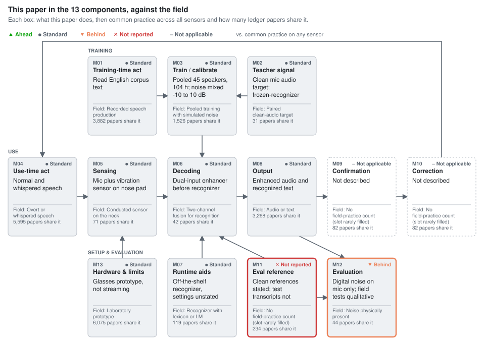

# NasoVoce: A Nose-Mounted Low-Audibility Speech Interface for Always-Available Speech Interaction

Rekimoto, J., Nishimura, Y., Yang, B. · CHI '26 · 2026 · [DOI](https://doi.org/10.1145/3772318.3791397) · [arXiv:2603.10324](https://arxiv.org/abs/2603.10324)

**Section:** [Acoustic, whisper & wearable motion sensors](../../README.md#acoustic-whisper--wearable-motion-sensors)

## Figures

### This paper in the 13 components, against the field

<picture><source media="(prefers-color-scheme: dark)" srcset="figures/components-dark.svg"></picture>

Verdicts compare the paper's choice for each component with common practice across 8,995 ledger entries on any sensor (silent speech, brain-to-text, lip reading).

Data

| Component | This paper | Common practice | Papers with this practice | Verdict |
| --- | --- | --- | --- | --- |
| M01 Training-time act | Read English corpus text | Recorded speech production | 3,882 of 8,995 | ● Standard (Inherited.) |
| M02 Teacher signal | Clean mic audio target; frozen-recognizer distillation | Paired clean-audio target | 31 of 8,995 | ● Standard (Distillation not ablated.) |
| M03 Train / calibrate | Pooled 45 speakers, 104 h; noise mixed -10 to 10 dB | Pooled training with simulated noise | 1,526 of 8,995 | ● Standard (Seeds and model selection not stated.) |
| M04 Use-time act | Normal and whispered speech | Overt or whispered speech | 5,595 of 8,995 | ● Standard (Inherited.) |
| M05 Sensing | Mic plus vibration sensor on nose pad | Conducted sensor on the neck | 71 of 8,995 | ● Standard (Nose site 0 of 123 (pattern match); no site compared.) |
| M06 Decoding | Dual-input enhancer before recognizer | Two-channel fusion for recognition | 42 of 8,995 | ● Standard (Fusion for recognition since 2004; no single-input control.) |
| M07 Runtime aids | Off-the-shelf recognizer, settings unstated | Recognizer with lexicon or LM | 119 of 8,995 | ● Standard (Decoding options not stated.) |
| M08 Output | Enhanced audio and recognized text | Audio or text | 3,268 of 8,995 | ● Standard (Inherited.) |
| M09 Confirmation | Not described | No field-practice count (slot rarely filled) | 82 of 8,995 | – Not applicable (Offline study; slot filled in 82 ledger papers, too few for a usual approach.) |
| M10 Correction | Not described | No field-practice count (slot rarely filled) | 82 of 8,995 | – Not applicable (Offline study; slot filled in 82 ledger papers, too few for a usual approach.) |
| M11 Eval reference | Clean references stated; test transcripts not | No field-practice count (slot rarely filled) | 234 of 8,995 | ✕ Not reported (Clean audio is the reference; test transcript source and item counts not stated.) |
| M12 Evaluation | Digital noise on mic only; field tests qualitative | Noise physically present | 44 of 8,995 | ▼ Behind (Vibration channel never noise-corrupted.) |
| M13 Hardware & limits | Glasses prototype, not streaming | Laboratory prototype | 6,075 of 8,995 | ● Standard (Streaming and phone integration future work.) |

## Verdict

The paper [[1]](#ref-1) changes the sensor site (M05), a microphone plus vibration sensor in the nose pad of glasses, and the fusion model (M06), a dual-input enhancer trained against a frozen recognizer (§4.1). Both are standard: talker-worn conducted sensors paired with an air microphone were in use by 2004 [[2]](#ref-2), [[3]](#ref-3), and fusing the two channels for recognition [[2]](#ref-2) and for whispered-murmur enhancement in noise [[4]](#ref-4) predates it, refuting the §2 claim of no prior fusion for recognition. With one site measured, the §1 claim that throat or skull sensors miss whisper is untested, and for the throat it is contradicted by soft-whisper recognition with a throat microphone [[3]](#ref-3). The strongest confound is the noise protocol (M12): every quantitative test adds noise to the microphone only and feeds the vibration channel clean (Eq. 1, Fig. 6), building part of the credited robustness into the test. M12 is behind the field, where 44 of 123 studies name physically present noise against 15 digital (pattern match, Appendix) and the closest works expose the conducted sensor to noise [[2]](#ref-2), [[4]](#ref-4), [[5]](#ref-5).

## Against the field, component by component

### M05 Sensors: conducted sensor site and whispered input

**Usual approach:** Of 123 unique studies pairing a conducted sensor with an air microphone (pattern match, Appendix), 71 place it on the neck (slot-filled) and 23 at the ear; 82 name whispered or murmured input. None of the 123 names a nose-pad site (Appendix), but the paper concedes a 2018 nose-pad vibration sensor on glasses [[6]](#ref-6), which it describes as improving SNR over an air microphone (§2); the departure is fusing it with a co-located microphone.

**State of the art:** In 2025 an in-ear microphone kept bone-conducted whispered WER mostly below 10% with noise played at up to about 80 dB(A), for one speaker [[5]](#ref-5). The paper gives no WER under physical noise, so the gap cannot be sized.

A throat microphone recognized soft whisper in 2004, from 99.3% to 32.9% WER after adaptation, with four speakers in a quiet room [[3]](#ref-3). The authors expect the pair to work on the throat too (§6), undercutting §1. Verdict: standard.

### M06 Processing: fusion of air and conducted channels

**Usual approach:** Of 68 unique studies feeding both channels into one model (pattern match, Appendix), 42 name recognition, 32 enhancement or conversion and 23 deep-network fusion.

**State of the art:** For recognition, the best confirmed result is from 2004: a standard plus a throat microphone cut WER at 0 dB SNR from 95.6% to 52.6% (45% relative, inference) [[2]](#ref-2). Deep fusion that the paper cites beat single-sensor enhancement [[7]](#ref-7), [[8]](#ref-8) (§2). The paper gives WER only as curves (Fig. 7), so no figure compares.

For murmur, a two-channel model gave 32.9% U/V error at -11.4 dB against 38.1% (conducted only) and 52.7% (air only), with one speaker [[4]](#ref-4). No control runs the same enhancer on the microphone alone, so the fusion gain is not separated from enhancement itself; under the strongest noise the vibration channel alone beats the fused output on PESQ and STOI (§5.2). Verdict: standard.

### M12 Evaluation: noise protocol

**Usual approach:** Of the same 123 studies, 44 name noise physically present while recording and 15 noise added digitally (pattern match, Appendix).

**State of the art:** Noise played around the wearer with WER per level in 2025 [[5]](#ref-5); noise recorded through both sensors in 2015 [[4]](#ref-4).

In a vehicle at about 100 dB SPL the throat microphone itself was corrupted by noise [[2]](#ref-2). Here the vibration channel never sees noise, yet the authors concede that whispered enhancement degrades considerably under noise (§6). Verdict: behind typical practice in the field (44 against 15, Appendix).

## The 13 components

| Component | This paper | Usual approach (count) | State of the art | Verdict |
|---|---|---|---|---|
| M01 Training-time action | Read English corpus text | Recorded speech production (slot-filled 3,882) | – | standard |
| M02 Training-only supervision | Clean mic audio target; frozen-recognizer distillation | Paired clean-audio target (slot-filled 31) | – | standard |
| M03 Training and adaptation | Pooled 45 speakers, 104 h; noise mixed -10 to 10 dB | Pooled training with simulated noise (slot-filled 1,526) | – | standard |
| M04 Use-time action | Normal and whispered speech | Overt or whispered speech (slot-filled 5,595) | – | standard |
| M05 Sensors | Mic plus vibration sensor on nose pad | Conducted sensor on the neck (slot-filled 71) | Whispered WER mostly below 10% at 80 dB(A), one speaker [[5]](#ref-5) (2025) | standard |
| M06 Processing and decoding | Dual-input enhancer before recognizer | Two-channel fusion for recognition (pattern match 42) | 0 dB WER 95.6% to 52.6% with throat mic [[2]](#ref-2) (2004) | standard |
| M07 Lexicon and LM | Off-the-shelf recognizer, settings unstated | Recognizer with lexicon or LM (slot-filled 119) | – | standard |
| M08 Output | Enhanced audio and recognized text | Audio or text (slot-filled 3,268) | – | standard |
| M09 Confirmation | Not described | No field-practice count (slot rarely filled) (slot-filled 82) | – | not applicable |
| M10 Correction | Not described | No field-practice count (slot rarely filled) (slot-filled 82) | – | not applicable |
| M11 Reference construction | Clean references stated; test transcripts not | No field-practice count (slot rarely filled) (slot-filled 234) | – | not reported |
| M12 Evaluation | Digital noise on mic only; field tests qualitative | Noise physically present (pattern match 44) | Played noise up to 80 dB(A) with WER [[5]](#ref-5) (2025) | behind |
| M13 Device and cost | Glasses prototype, not streaming | Laboratory prototype (slot-filled 6,075) | – | standard |

## Where the claims outrun the evidence

- "Reliably recognize whispered speech even under noisy conditions" (§5.1) rests on digital noise with no point values, dispersion or test (Fig. 7).
- The 1,000 evaluation items (§5) are not reconciled with four speakers at 200 utterances each, 800 (§5.1).
- Axes run 20 to -10 dB SNR (Figs. 7, 8) while the prose calls 10 dB very strong noise (§5.2, §5.3).
- The MUSHRA gain at 0 dB (68.7 versus 37.6, 50 raters, Fig. 9), +31.1 points (inference), is against the microphone signal with added noise (Fig. 9 caption), not single-channel enhancement.
- "Always-available" use is not shown: streaming is future work (§4).

## What the field needs next

- M12: whispered WER with noise played around the wearer.
- M05: nose, throat, ear canal and philtrum on the same speakers.
- M06: single-input and vibration-only enhancers under the same loss.

## Questions for the authors

- How do the 1,000 items relate to the 800 test utterances, and how many were whispered?
- Do the dB labels in Figs. 7 to 9 denote SNR or noise level?
- Which sentences form the test set, and how was the checkpoint selected?
- How many training runs and seeds were used?
- Were the field recordings decoded, and with what error rate?

## Appendix: literature search

- M05, body-conducted-sensor-with-air-microphone. Inclusion rule: speech studies that record a skin-, bone- or tissue-conducted sensor from the talker together with an air microphone; design compared is the body site and whether whispered or murmured input is used; sensors only named in related work still match (upper bound); versions count once. Ledger: 7,329 unique studies slot-filled for M05; 123 unique studies pattern match (134 folders). Designs: body site neck 71, ear 23, face 20 (slot-filled); whispered or murmured input 82, neck or throat 61, ear 38, nose pad or nasal bridge 0 (pattern match). Read in full: [[3]](#ref-3), [[5]](#ref-5). Known-item recall 0.83 (5 of 6 seeds; the target's own ledger lacks the air-microphone field).
- M06, air-and-body-conducted-channel-fusion. Inclusion rule: speech studies that feed an air-microphone channel and a conducted channel from the same talker into one model or feature mapping; voice-activity-only use counts by pattern only; versions count once. Ledger: 7,345 unique studies slot-filled for M06; 68 unique studies pattern match (72 folders). Designs (pattern match): whispered or murmured wording 43, recognition 42, enhancement or conversion 32, deep-network fusion 23. Read in full: [[2]](#ref-2), [[4]](#ref-4). Known-item recall 0.75 (3 of 4 seeds).
- M12, body-conducted-sensor-noise-test-protocol. Inclusion rule: the M05 population; design compared is whether quantitative noise tests expose the conducted sensor to the noise or add noise digitally to the air channel only; a paper naming both is counted under each; qualitative field recordings do not count. Ledger: 6,960 unique studies slot-filled for M12; 123 unique studies pattern match. Designs (pattern match): noise physically present 44, statistical test or dispersion named 37, noise added digitally 15. Read in full: [[2]](#ref-2), [[4]](#ref-4), [[5]](#ref-5). Known-item recall 0.75 (3 of 4 seeds).

## References

Numbered by first citation. BibTeX in the same order and keys: [refs.bib](refs.bib).

1. Rekimoto, J., Nishimura, Y., Yang, B. “NasoVoce: A Nose-Mounted Low-Audibility Speech Interface for Always-Available Speech Interaction.” *Proceedings of the 2026 CHI Conference on Human Factors in Computing Systems (CHI '26)*, 2026. doi:[10.1145/3772318.3791397](https://doi.org/10.1145/3772318.3791397). arXiv:[2603.10324](https://arxiv.org/abs/2603.10324). Target. Read as arXiv v1. [review](https://github.com/supernaiter/silent-speech-review/tree/main/reviews/nasovoce) [wiki: arxiv-2603.10324](https://github.com/supernaiter/deep-research-wiki-for-silent-speech/blob/main/papers/arxiv-2603.10324/article.md)
2. Graciarena, M., Franco, H., Myers, G., Cowan, C., Cesari, F., Abrash, V. “Combination of Standard and Throat Microphones for Robust Speech Recognition in Highly Noisy Environments.” *Proc. INTERSPEECH 2004 - ICSLP*, 2004. doi:[10.21437/Interspeech.2004-302](https://doi.org/10.21437/Interspeech.2004-302). Prior; deciding prior for M06 and M12; state of the art for M06. [wiki: isca-graciarena04_interspeech](https://github.com/supernaiter/deep-research-wiki-for-silent-speech/blob/main/papers/isca-graciarena04_interspeech/article.md)
3. Jou, S., Schultz, T., Waibel, A. “Adaptation for Soft Whisper Recognition Using a Throat Microphone.” *Proc. INTERSPEECH 2004 - ICSLP*, 2004. doi:[10.21437/Interspeech.2004-565](https://doi.org/10.21437/Interspeech.2004-565). Prior; deciding prior for M05. [wiki: isca-jou04_interspeech](https://github.com/supernaiter/deep-research-wiki-for-silent-speech/blob/main/papers/isca-jou04_interspeech/article.md)
4. Tajiri, Y., Tanaka, K., Toda, T., Neubig, G., Sakti, S., Nakamura, S. “Non-Audible Murmur Enhancement based on Statistical Conversion using Air- and Body-Conductive Microphones in Noisy Environments.” *Proc. INTERSPEECH 2015*, 2015, 2769–2773. doi:[10.21437/Interspeech.2015-583](https://doi.org/10.21437/Interspeech.2015-583). Prior; deciding prior for M06 and M12. [wiki: doi-10.21437-interspeech.2015-583](https://github.com/supernaiter/deep-research-wiki-for-silent-speech/blob/main/papers/doi-10.21437-interspeech.2015-583/article.md)
5. Fukumoto, M. “Whisphone: Whispering Input Earbuds.” *arXiv preprint*, 2025. doi:[10.48550/arXiv.2501.01636](https://doi.org/10.48550/arXiv.2501.01636). arXiv:[2501.01636](https://arxiv.org/abs/2501.01636). Prior; state of the art for M05 and M12. [wiki: arxiv-2501.01636](https://github.com/supernaiter/deep-research-wiki-for-silent-speech/blob/main/papers/arxiv-2501.01636/article.md)
6. Cordourier Maruri, H. A., Lopez-Meyer, P., Huang, J., Beltman, W. M., Nachman, L., Lu, H. “V-Speech: Noise-Robust Speech Capturing Glasses Using Vibration Sensors.” *Proceedings of the ACM on Interactive, Mobile, Wearable and Ubiquitous Technologies*, 2018, 2(4), 180. doi:[10.1145/3287058](https://doi.org/10.1145/3287058). Prior; nose-pad vibration sensor conceded by the target (Sec. 2); not in the wiki, not read in full.
7. Yu, C., Hung, K., Wang, S., Fu, S., Tsao, Y., Hung, J. “Time-Domain Multi-modal Bone/air Conducted Speech Enhancement.” *IEEE Signal Processing Letters*, 2020, 27, 1035–1039. doi:[10.1109/LSP.2020.3000968](https://doi.org/10.1109/LSP.2020.3000968). Prior; deep air/bone fusion cited by the target (Sec. 2); not in the wiki, not read in full.
8. Wang, H., Zhang, X., Wang, D. “Fusing Bone-Conduction and Air-Conduction Sensors for Complex-Domain Speech Enhancement.” *IEEE/ACM Transactions on Audio, Speech, and Language Processing*, 2022, 30, 3134–3143. doi:[10.1109/TASLP.2022.3209943](https://doi.org/10.1109/TASLP.2022.3209943). Prior; deep air/bone fusion cited by the target (Sec. 2); not in the wiki, not read in full.

## Materials

Data behind this review. Full texts of the papers are not included.

- [`review.md`](review.md): the review text (source)
- [`refs.bib`](refs.bib): references (BibTeX)
- [`slots.json`](slots.json): for each of the 13 components: this paper's choice, field practice, number of matching papers, verdict
- [`figures.json`](figures.json): figure definitions
- [`evaluation.md`](evaluation.md): independent evaluation by a second reviewer
- [`triage.md`](triage.md): how each evaluation finding was checked against the sources and resolved
- [`components/M05/body-conducted-sensor-with-air-microphone.csv`](../../components/M05/body-conducted-sensor-with-air-microphone.csv): M05 topic "body-conducted-sensor-with-air-microphone", every candidate paper with its decision (7329 slot-filled, 123 pattern match, usual design in 71, 2 read in full)
- [`components/M06/air-and-body-conducted-channel-fusion.csv`](../../components/M06/air-and-body-conducted-channel-fusion.csv): M06 topic "air-and-body-conducted-channel-fusion", every candidate paper with its decision (7345 slot-filled, 68 pattern match, usual design in 42, 2 read in full)
- [`components/M12/body-conducted-sensor-noise-test-protocol.csv`](../../components/M12/body-conducted-sensor-noise-test-protocol.csv): M12 topic "body-conducted-sensor-noise-test-protocol", every candidate paper with its decision (6960 slot-filled, 123 pattern match, usual design in 44, 3 read in full)

## More reviews in Acoustic, whisper & wearable motion sensors

- [SoniSpeech: A Large-Scale Open-Vocabulary Tri-Modal Dataset for Wearable Silent Speech Interfaces](../sonispeech-a-large-scale-open-vocabulary-tri-modal-dataset-for-wearable-silent-speech-interfaces/) (2026). Open-vocabulary acoustic sensing on glasses (M05) and a one-speaker paired corpus (M11) are standard; voiced-data gains follow 2020 EMG work; one-speaker, one-run tests lag the field (M12).
- [Poster: Recognizing Hidden-in-the-Ear Private Key for Reliable Silent Speech Interface Using Multi-Task Learning](../poster-recognizing-hidden-in-the-ear-private-key-for-reliable-silent-speech-interface-using-mult/) (2025). Sensing, shared model and joint word-plus-identity output are each standard; whisper adds nothing over the 91.4% ultrasonic-only baseline, and impostors are training participants (M12 behind).
- [Silent Speech Sentence Recognition with Six-Axis Accelerometers using Conformer and CTC Algorithm](../silent-speech-sentence-recognition-with-six-axis-accelerometers-using-conformer-and-ctc-algorith/) (2025). Uses six wearable 6-axis IMUs (accelerometer plus gyroscope) on the face and neck with a Conformer-CTC model to recognize silently articulated words and word sequences. Reports 97.17% word-level accuracy in a 4-participant study.
- [Unvoiced: Designing an LLM-assisted Unvoiced User Interface using Earables](../unvoiced-designing-an-llm-assisted-unvoiced-user-interface-using-earables/) (2024). Twin-IMU earable captures jaw motion during unvoiced speech; spectrograms are transcribed by Whisper and gaps filled by GPT-4, giving 93-99% task completion and 0.07-0.14 WER across 19 users.
- [EchoSpeech: Continuous Silent Speech Recognition on Minimally-obtrusive Eyewear Powered by Acoustic Sensing](../echospeech-continuous-silent-speech-recognition-on-minimally-obtrusive-eyewear-powered-by-acoustic/) (2023). Glasses-mounted inaudible FMCW sonar recognizes silent speech from facial skin echoes: 4.5% WER on 31 commands and 6.1% on connected digits in 12 users, with walking/noise tests and a 73.3 mW demo.
- [WESPER: Zero-shot and Realtime Whisper to Normal Voice Conversion for Whisper-based Speech Interactions](../wesper-zero-shot-and-realtime-whisper-to-normal-voice-conversion-for-whisper-based-speech-interactions/) (2023). WESPER trains a whisper-to-normal converter with no paired data (M02, ahead); its unit route (M06) is untested against baselines, and its ASR gain trails a recognizer fine-tuned on labelled whisper.

---

Part of the [Silent Speech Interface Review](https://github.com/supernaiter/silent-speech-review). Found an error? [Open an issue](https://github.com/supernaiter/silent-speech-review/issues/new?template=correction.yml).
