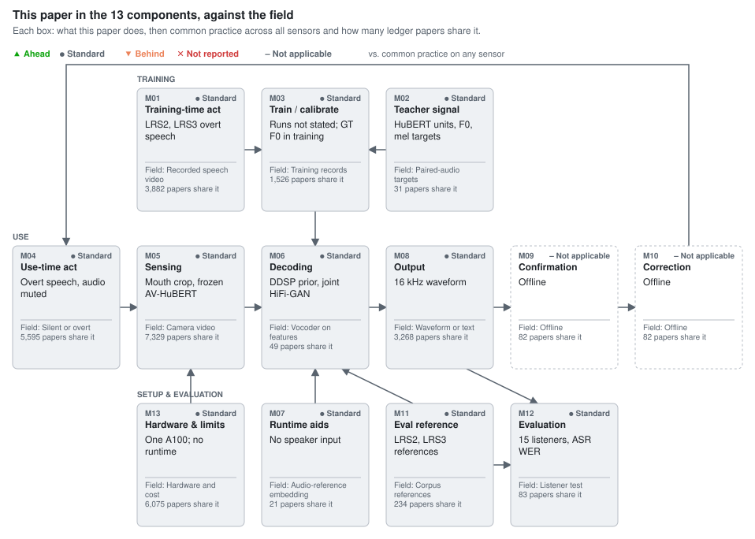

# NaturalL2S: End-to-End High-quality Multispeaker Lip-to-Speech Synthesis with Differential Digital Signal Processing

Liang, Y., Liu, F., Li, A., Li, X., Zheng, C. · arXiv preprint · 2025 · [arXiv:2502.12002](https://arxiv.org/abs/2502.12002)

**Section:** [Lip & face video](../../README.md#lip--face-video)

## Figures

### This paper in the 13 components, against the field

<picture><source media="(prefers-color-scheme: dark)" srcset="figures/components-dark.svg"></picture>

Verdicts compare the paper's choice for each component with common practice across 8,995 ledger entries on any sensor (silent speech, brain-to-text, lip reading).

Data

| Component | This paper | Common practice | Papers with this practice | Verdict |
| --- | --- | --- | --- | --- |
| M01 Training-time act | LRS2, LRS3 overt speech | Recorded speech video | 3,882 of 8,995 | ● Standard (Inherited.) |
| M02 Teacher signal | HuBERT units, F0, mel targets | Paired-audio targets | 31 of 8,995 | ● Standard (Inherited (Lip2Speech Unit lineage).) |
| M03 Train / calibrate | Runs not stated; GT F0 in training | Training records | 1,526 of 8,995 | ● Standard (No seeds; F0 train-test gap unmeasured.) |
| M04 Use-time act | Overt speech, audio muted | Silent or overt | 5,595 of 8,995 | ● Standard (Inherited.) |
| M05 Sensing | Mouth crop, frozen AV-HuBERT | Camera video | 7,329 of 8,995 | ● Standard (Inherited.) |
| M06 Decoding | DDSP prior, joint HiFi-GAN | Vocoder on features | 49 of 8,995 | ● Standard (Joint waveform training predates it.) |
| M07 Runtime aids | No speaker input | Audio-reference embedding | 21 of 8,995 | ● Standard (Reference-free use predates it.) |
| M08 Output | 16 kHz waveform | Waveform or text | 3,268 of 8,995 | ● Standard (Folded into M06.) |
| M09 Confirmation | Offline | Offline | 82 of 8,995 | – Not applicable (Offline study.) |
| M10 Correction | Offline | Offline | 82 of 8,995 | – Not applicable (Offline study.) |
| M11 Eval reference | LRS2, LRS3 references | Corpus references | 234 of 8,995 | ● Standard (Speaker overlap not stated.) |
| M12 Evaluation | 15 listeners, ASR WER | Listener test | 83 of 8,995 | ● Standard (LipVoicer omitted; MOS pooled.) |
| M13 Hardware & limits | One A100; no runtime | Hardware and cost | 6,075 of 8,995 | ● Standard (Authors concede model size.) |

## Verdict

NaturalL2S [[1]](#ref-1) changes the waveform generator (M06), a DDSP harmonic-and-noise prior feeding a conditional HiFi-GAN trained jointly behind a frozen AV-HuBERT, and drops use-time speaker input (M07). Both are standard: joint end-to-end waveform generation for many speakers predates it, on word-level LRW and 33-speaker GRID [[2]](#ref-2), [[3]](#ref-3), so the "first attempt" claim (§I) fails as worded, and reference-free use follows DiffV2S [[4]](#ref-4). The quality lead over the four compared systems (Tables I–III) recurs in a [later] same-group test [[5]](#ref-5). Content does not: LRS3 WER is 30.4%, behind Lip2Speech Unit (27.7%, Table II), as the authors concede (§V-B), and behind the cited but uncompared LipVoicer (21.4% under its own ASR) [[6]](#ref-6). The joint-training ablation also removes DDSP and changes the vocoder corpus, and removing DDSP alone lowers DNS-MOS only from 2.95 to 2.89 (Table IV), so the source of the gain is not isolated.

## Against the field, component by component

### M06 Waveform generation: DDSP prior and joint vocoder

**Usual approach:** Of 165 video-to-speech studies (pattern match, Appendix), 49 name a neural vocoder on predicted acoustic features and 15 a pre-trained or separately trained vocoder. NaturalL2S instead trains a DDSP-conditioned HiFi-GAN with the generators.

**State of the art:** LipVoicer (ICLR 2024): LRS3 WER 21.4%, STOI-Net 0.92, DNSMOS 3.11 (Table 4) [[6]](#ref-6). NaturalL2S is 0.02 STOI-Net and 0.12 DNS-MOS higher and 9.0 WER points (42% relative) worse (inference); a [later] one-ASR table keeps the order, 30.37% against 20.62%, and SLD-L2S itself reaches 30.22% [[5]](#ref-5).

Mira et al. already generate waveforms end-to-end on LRW (500 words, hundreds of speakers) [[2]](#ref-2), and Facetron trains a face-to-waveform GAN end-to-end on 33 GRID speakers [[3]](#ref-3). Harmonic-plus-noise vocoders appear in four 2008–2015 studies among the 165, and the only other DDSP study is the [concurrent] same-group LightL2S [[7]](#ref-7) (Appendix); new is only a differentiable prior trained with the vocoder. The LRS2 ablations (§V-C), with no run count or seeds stated, do not separate the two: wo-e2e also drops DDSP and uses a vanilla HiFi-GAN trained on LRS3; DNS-MOS falls from 2.95 to 2.39 at equal WER (36.3% against 36.5%); wo-DDSP keeps joint training and scores 2.89 DNS-MOS and 37.0% WER (Table IV). Verdict: standard.

### M07 Use-time speaker information: none

**Usual approach:** Of the 165 studies (pattern match, Appendix), 21 name a speaker embedding from reference audio and 16 one derived from the face or video; NaturalL2S uses neither (§I).

**State of the art:** V2SFlow (2024, [concurrent]): on unseen LRS3 speakers SECS 0.664 from a video-derived and 0.851 from a reference-audio embedding, both at 28.5% WER (Table I) [[8]](#ref-8).

DiffV2S derives the speaker embedding from video alone and needs no reference audio, which decides the verdict [[4]](#ref-4). Without any speaker input NaturalL2S reaches voice similarity 0.63 on both sets, against 0.58 and 0.63 for DiffV2S and 0.72 and 0.76 for the reference-embedding Lip2Speech Unit (Tables I–II); the [later] re-score gives 0.628 against 0.627 (LRS3) and 0.562 against 0.569 (LRS2) for DiffV2S [[5]](#ref-5). Verdict: standard.

### M12 Evaluation: comparison set and listener test

**Usual approach:** Of 165 studies (pattern match, published counts), 83 name a listener test, 38 ASR WER, 51 unseen speakers and 40 confidence intervals or significance tests. NaturalL2S gives Auto-AVSR WER, predicted quality and a 15-listener test with MOS standard deviations, but no confidence intervals or significance tests (Tables I–IV, §V-B).

**State of the art:** LipVoicer (ICLR 2024), 21.4% LRS3 WER with its own ASR [[6]](#ref-6); 20.62% against 30.37% for NaturalL2S in a [later] AUTO-AVSR table [[5]](#ref-5).

LipVoicer is set aside for relying on text (§I), yet its text comes from a lip reader on the same silent video [[6]](#ref-6). DiffV2S and the LRS2 Lip2Speech Unit are scored on author-supplied samples (§V); MOS pools LRS2 and LRS3 (Table III). STOI-Net rates NaturalL2S above ground truth (0.92 against 0.91, 0.94 against 0.93), a ceiling (inference). The [later] LRS3 listener test puts NaturalL2S (naturalness 3.54) above DiffV2S (2.95) and LipVoicer (2.51), below V2SFlow (3.88) [[5]](#ref-5). Verdict: standard.

## The 13 components

| Component | This paper | Usual approach (count) | State of the art | Verdict |
|---|---|---|---|---|
| M01 Training-time action | LRS2, LRS3 overt speech | Recorded speech video (slot-filled 3,882) | – | standard |
| M02 Training-only supervision | HuBERT units, F0, mel targets | Paired-audio targets (slot-filled 31) | – | standard |
| M03 Training and adaptation | Runs not stated; GT F0 in training | Training records (slot-filled 1,526) | – | standard |
| M04 Use-time action | Overt speech, audio muted | Silent or overt (slot-filled 5,595) | – | standard |
| M05 Sensors | Mouth crop, frozen AV-HuBERT | Camera video (slot-filled 7,329) | – | standard |
| M06 Processing and decoding | DDSP prior, joint HiFi-GAN | Vocoder on features (pattern match 49) | [[6]](#ref-6) (2024): WER 21.4% | standard |
| M07 Lexicon and LM | No speaker input | Audio-reference embedding (pattern match 21) | [[8]](#ref-8) (2024): SECS 0.664 | standard |
| M08 Output | 16 kHz waveform | Waveform or text (slot-filled 3,268) | – | standard |
| M09 Confirmation | Offline | Offline (slot-filled 82) | – | not applicable |
| M10 Correction | Offline | Offline (slot-filled 82) | – | not applicable |
| M11 Reference construction | LRS2, LRS3 references | Corpus references (slot-filled 234) | – | standard |
| M12 Evaluation | 15 listeners, ASR WER | Listener test (pattern match 83) | [[6]](#ref-6) (2024): LRS3 WER 21.4% | standard |
| M13 Device and cost | One A100; no runtime | Hardware and cost (slot-filled 6,075) | – | standard |

## Where the claims outrun the evidence

- "The first attempt to jointly train the vocoder for the multi-speaker lip-to-speech task" (§I): see M06 [[2]](#ref-2), [[3]](#ref-3).
- §V-A calls voice similarity best on LRS3 and equal to DiffV2S on LRS2; Tables I–II show the reverse (0.63 against 0.58 on LRS2, 0.63 each on LRS3).
- "State-of-the-art performance in terms of speech quality" (§VI) holds even against the omitted LipVoicer: DNSMOS 3.23 against 3.11 across papers, and the [later] listener test (M12). The omission hides intelligibility (WER 30.4% against 21.4%).
- DDSP gets ground-truth F0 in training, predicted F0 at inference (§IV-D), an unmeasured gap.

## What the field needs next

- M06: a factorial LRS3 ablation (joint or staged vocoder, with or without DDSP, same vocoder corpus) over several seeds.
- M07: SECS and WER for one generator with no speaker input, a video-derived and a reference-audio embedding, on unseen speakers.
- M12: one ASR and full test sets, with LipVoicer and V2SFlow.

## Questions for the authors

- Do test speakers appear in training or AV-HuBERT pre-training?
- How many clips enter Tables I–II, including supplied samples?
- Which Auto-AVSR decoding and normalization were used?
- How many runs underlie Table IV?

## Appendix: literature search

- M06, video-to-speech-synthesis (published table, reused). Inclusion rule: studies that synthesize a speech waveform from talking-face or lip video and report the acoustic representation and how it becomes a waveform; enhancement with noisy audio at test, talking-head generation, text-only lip reading and video-to-text-to-speech pipelines excluded; versions count once. Ledger: 7,345 unique studies slot-filled for M06; 165 unique studies pattern match. Usual design: neural vocoder on predicted acoustic features 49; parametric vocoder 41, Griffin-Lim 16 (pattern match, published counts). Read in full: [[6]](#ref-6), [[2]](#ref-2), [[3]](#ref-3). Known-item recall 1.0.
- M06, joint-end-to-end-lip-to-speech-training (new). Inclusion rule: the same 165 studies, classified by whether the waveform generator is trained with the visual-to-acoustic path or is a pre-trained or separately trained vocoder, and by use of a DDSP or harmonic-plus-noise model; a study counts under every design its full text names (upper bound); end-to-end training that stops at mel or units before a separate vocoder is not joint waveform training. Ledger: 165 unique studies pattern match. Pre-trained or separately trained vocoder 15; joint end-to-end waveform generation 11 (designs in [[2]](#ref-2), [[3]](#ref-3) and the target, the rest related-work mentions); DDSP or harmonic-plus-noise 6 (the target, the [concurrent] same-group LightL2S [[7]](#ref-7), four harmonic-plus-noise vocoders of 2008–2015) (pattern match). Read in full: [[2]](#ref-2), [[3]](#ref-3), [[6]](#ref-6). Known-item recall 1.0 (4 seeds).
- M07, reference-speaker-conditioning-at-inference (new). Inclusion rule: the same 165 studies, classified by the speaker information supplied at use time (reference-audio embedding, face- or video-derived embedding, none); training-only or scoring-only embeddings excluded; every named design counts (upper bound). Ledger: 119 unique studies slot-filled for M07; 165 unique studies pattern match. Reference-audio embedding 21, video- or face-derived 16, reference audio stated as unnecessary 2 (the target, and [[4]](#ref-4), whose embedding is video-derived) (pattern match). Read in full: [[4]](#ref-4), [[3]](#ref-3), [[8]](#ref-8). Known-item recall 1.0.
- M12, video-to-speech-output-evaluation (published table, reused). Inclusion rule: the same video-to-speech population, counting the evaluation protocols its full text names. Ledger: 6,960 unique studies slot-filled for M12; 165 unique studies pattern match. Protocols: listener test 83, unseen speakers 51, ASR WER on output 38; confidence interval or significance 40, reference-free MOS predictor 21 (pattern match, published counts). Read in full: [[8]](#ref-8), [[5]](#ref-5), [[6]](#ref-6). Known-item recall 1.0.

## References

Numbered by first citation. BibTeX in the same order and keys: [refs.bib](refs.bib).

1. Liang, Y., Liu, F., Li, A., Li, X., Zheng, C. “NaturalL2S: End-to-End High-quality Multispeaker Lip-to-Speech Synthesis with Differential Digital Signal Processing.” *arXiv preprint*, 2025. doi:[10.48550/arXiv.2502.12002](https://doi.org/10.48550/arXiv.2502.12002). arXiv:[2502.12002](https://arxiv.org/abs/2502.12002). Target. Read as arXiv v1. [review](https://github.com/supernaiter/silent-speech-review/tree/main/reviews/naturall2s-end-to-end-high-quality-multispeaker-lip-to-speech-synthesis-with-differential-digita) [wiki: arxiv-2502.12002](https://github.com/supernaiter/deep-research-wiki-for-silent-speech/blob/main/papers/arxiv-2502.12002/article.md)
2. Mira, R., Vougioukas, K., Ma, P., Petridis, S., Schuller, B. W., Pantic, M. “End-to-End Video-To-Speech Synthesis using Generative Adversarial Networks.” *IEEE Transactions on Cybernetics*, 2023, 53(6), 3454-3466. arXiv:[2104.13332](https://arxiv.org/abs/2104.13332). Prior; deciding prior for M06 (end-to-end waveform generation on LRW). Read as arXiv version in the wiki. [wiki: arxiv-2104.13332](https://github.com/supernaiter/deep-research-wiki-for-silent-speech/blob/main/papers/arxiv-2104.13332/article.md)
3. Um, S., Kim, J., Lee, J., Kang, H. “Facetron: A Multi-speaker Face-to-Speech Model based on Cross-Modal Latent Representations.” *arXiv preprint*, 2021. arXiv:[2107.12003](https://arxiv.org/abs/2107.12003). Prior; deciding prior for M06 and M07 (end-to-end face-to-waveform GAN, face-derived speaker features). Read as arXiv v3. [wiki: arxiv-2107.12003](https://github.com/supernaiter/deep-research-wiki-for-silent-speech/blob/main/papers/arxiv-2107.12003/article.md)
4. Choi, J., Hong, J., Ro, Y. M. “DiffV2S: Diffusion-based Video-to-Speech Synthesis with Vision-guided Speaker Embedding.” *2023 IEEE/CVF International Conference on Computer Vision (ICCV)*, 2023, 6692-6701. doi:[10.1109/ICCV51070.2023.00618](https://doi.org/10.1109/ICCV51070.2023.00618). arXiv:[2308.07787](https://arxiv.org/abs/2308.07787). Prior; baseline of the target; deciding prior for M07 (vision-guided speaker embedding). [wiki: arxiv-2308.07787-diffv2s](https://github.com/supernaiter/deep-research-wiki-for-silent-speech/blob/main/papers/arxiv-2308.07787-diffv2s/article.md) [wiki: cvf23-choi_diffv2s](https://github.com/supernaiter/deep-research-wiki-for-silent-speech/blob/main/papers/cvf23-choi_diffv2s/article.md)
5. Liang, Y., Li, A., Yang, K., Yu, G., Liu, F., Dai, L., et al. “SLD-L2S: Hierarchical Subspace Latent Diffusion for High-Fidelity Lip to Speech Synthesis.” *arXiv preprint (AAAI 2026 copyright line)*, 2026. doi:[10.48550/arXiv.2602.11477](https://doi.org/10.48550/arXiv.2602.11477). arXiv:[2602.11477](https://arxiv.org/abs/2602.11477). Same-group follow-up that re-scores the target with AUTO-AVSR (Tables 1-2). Read as arXiv v1. [later] [review](https://github.com/supernaiter/silent-speech-review/tree/main/reviews/sld-l2s-hierarchical-subspace-latent-diffusion-for-high-fidelity-lip-to-speech-synthesis) [wiki: arxiv-2602.11477](https://github.com/supernaiter/deep-research-wiki-for-silent-speech/blob/main/papers/arxiv-2602.11477/article.md) [wiki: arxiv-2602.11477-sldl2s](https://github.com/supernaiter/deep-research-wiki-for-silent-speech/blob/main/papers/arxiv-2602.11477-sldl2s/article.md)
6. Yemini, Y., Shamsian, A., Bracha, L., Gannot, S., Fetaya, E. “LipVoicer: Generating Speech from Silent Videos Guided by Lip Reading.” *International Conference on Learning Representations (ICLR)*, 2024. arXiv:[2306.03258](https://arxiv.org/abs/2306.03258). Prior; cited by the target but not compared; state of the art for M06 and M12. [review](https://github.com/supernaiter/silent-speech-review/tree/main/reviews/lipvoicer-generating-speech-from-silent-videos-guided-by-lip-reading) [wiki: arxiv-2306.03258](https://github.com/supernaiter/deep-research-wiki-for-silent-speech/blob/main/papers/arxiv-2306.03258/article.md)
7. Liang, Y., Yang, K., Liu, F., Li, A., Li, X., Zheng, C. “LightL2S: Ultra-Low Complexity Lip-to-Speech Synthesis for Multi-Speaker Scenarios.” *Interspeech 2025*, 2025. doi:[10.21437/Interspeech.2025-1478](https://doi.org/10.21437/Interspeech.2025-1478). [concurrent] same-group study with a DDSP vocoder; named in the M06 DDSP tally (abstract checked). [concurrent] [wiki: isca-liang25d-lightl2s](https://github.com/supernaiter/deep-research-wiki-for-silent-speech/blob/main/papers/isca-liang25d-lightl2s/article.md)
8. Choi, J., Kim, J., Li, J., Chung, J. S., Liu, S. “V2SFlow: Video-to-Speech Generation with Speech Decomposition and Rectified Flow.” *arXiv preprint*, 2024. arXiv:[2411.19486](https://arxiv.org/abs/2411.19486). State of the art for M07 (speaker embedding source at equal WER). Read as arXiv v2. [concurrent] [wiki: arxiv-2411.19486](https://github.com/supernaiter/deep-research-wiki-for-silent-speech/blob/main/papers/arxiv-2411.19486/article.md)

## Materials

Data behind this review. Full texts of the papers are not included.

- [`review.md`](review.md): the review text (source)
- [`refs.bib`](refs.bib): references (BibTeX)
- [`slots.json`](slots.json): for each of the 13 components: this paper's choice, field practice, number of matching papers, verdict
- [`figures.json`](figures.json): figure definitions
- [`evaluation.md`](evaluation.md): independent evaluation by a second reviewer
- [`triage.md`](triage.md): how each evaluation finding was checked against the sources and resolved
- [`process/log.json`](process/log.json): process record: each step, who did it (reader, script, writer, evaluator), when, the checks run and the input versions
- [`process/notes.json`](process/notes.json): reading notes on the target and comparator papers: claims, numbers, conditions and what is not stated, with locations
- [`process/plan.json`](process/plan.json): plan: which components the paper changes and the topics it is compared on
- [`process/draft.md`](process/draft.md): the review as first written, before the independent evaluation
- [`process/claims-draft.md`](process/claims-draft.md): claim table of the draft: every claim mapped to a note or a count
- [`process/claims.md`](process/claims.md): claim table of the published review
- [`components/M06/joint-end-to-end-lip-to-speech-training.csv`](../../components/M06/joint-end-to-end-lip-to-speech-training.csv): M06 topic "joint-end-to-end-lip-to-speech-training", every candidate paper with its decision (7345 slot-filled, 165 pattern match, usual design in 15, 3 read in full)
- [`components/M06/video-to-speech-synthesis.csv`](../../components/M06/video-to-speech-synthesis.csv): M06 topic "video-to-speech-synthesis", every candidate paper with its decision (7345 slot-filled, 165 pattern match, usual design in 49, 3 read in full)
- [`components/M07/reference-speaker-conditioning-at-inference.csv`](../../components/M07/reference-speaker-conditioning-at-inference.csv): M07 topic "reference-speaker-conditioning-at-inference", every candidate paper with its decision (119 slot-filled, 165 pattern match, usual design in 21, 3 read in full)
- [`components/M12/video-to-speech-output-evaluation.csv`](../../components/M12/video-to-speech-output-evaluation.csv): M12 topic "video-to-speech-output-evaluation", every candidate paper with its decision (6960 slot-filled, 165 pattern match, usual design in 83, 5 read in full)

## More reviews in Lip & face video

- [Landmark Guided Visual Feature Extractor for Visual Speech Recognition with Limited Resource](../landmark-guided-visual-feature-extractor-for-visual-speech-recognition-with-limited-resource/) (2025). Lip-landmark graph plus pixel fusion is a standard design (2020 precedent); the 0.90-point low-data gain comes from one unseeded run, and LRW 91.69% stays below 95.0%.
- [LipDiffuser: Lip-to-Speech Generation with Conditional Diffusion Models](../lipdiffuser-lip-to-speech-generation-with-conditional-diffusion-models/) (2025). Diffusion decoder with per-frame MP-FiLM (M06) and audio-only pretraining (M02) are standard; quality and speaker-similarity leads rest on enhanced targets and a clean-reference enrollment.
- [LTA-L2S: Lexical Tone-Aware Lip-to-Speech Synthesis for Mandarin with Cross-Lingual Transfer Learning](../lta-l2s-lexical-tone-aware-lip-to-speech-synthesis-for-mandarin-with-cross-lingual-transfer-lear/) (2025). Mandarin lip-to-speech whose gain over Intelligible matches its English-initialization ablation; the tone components move CER little with no repeats reported, and pitch removal leaves TER at 40.9%.
- [RESOUND: Speech Reconstruction from Silent Videos via Acoustic-Semantic Decomposed Modeling](../resound-speech-reconstruction-from-silent-videos-via-acoustic-semantic-decomposed-modeling/) (2025). Decoder split (M06) and lip-reader text plus audio prompt (M07) are standard; WER gain comes from the lip reader, LRS3 WER level with LipVoicer, prosody leads confounded by the prompt.
- [VSpeechLM: A Visual Speech Language Model for Visual Text-to-Speech Task](../vspeechlm-a-visual-speech-language-model-for-visual-text-to-speech-task/) (2025). Lip-timed phonemes into a codec LM (M06) are standard; Chem WER edges EmoDubber 12.5% vs 12.8%, no SyncNet scores, and the stated sync gains do not follow from Table 1.
- [A First Exploration of Neuromorphic OT-CFM for Multi-Speaker VSR](../lipsflow-a-first-exploration-of-neuromorphic-ot-cfm-for-multi-speaker-vsr/) (2026). Event input and a two-step OT-CFM decoder are standard; the DVS-Lip evaluation is behind: WER on an isolated-word set with no split details or seeds, and baselines that do not match their sources.

---

Part of the [Silent Speech Interface Review](https://github.com/supernaiter/silent-speech-review). Found an error? [Open an issue](https://github.com/supernaiter/silent-speech-review/issues/new?template=correction.yml).
