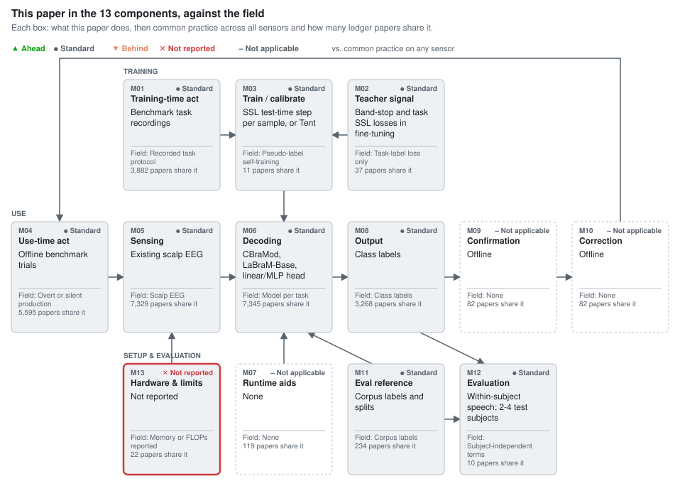

# NeuroTTT: Bridging Pretrain–Downstream Task Misalignment in EEG Foundation Models via Test-Time Training

Wang S, Deng Y, Bao Z, Zhan X, Duan Y. arXiv, 2025. [arXiv:2509.26301](https://arxiv.org/abs/2509.26301)

**Section:** [Brain signals (EEG, MEG, intracortical)](../../README.md#brain-signals-eeg-meg-intracortical)

## Figures

### This paper in the 13 components, against the field

<picture><source media="(prefers-color-scheme: dark)" srcset="figures/components-dark.svg"></picture>

Verdicts compare the paper's choice for each component with common practice across 8,995 ledger entries on any sensor (silent speech, brain-to-text, lip reading).

Data

| Component | This paper | Common practice | Papers with this practice | Verdict |
| --- | --- | --- | --- | --- |
| M01 Training-time act | Benchmark task recordings | Recorded task protocol | 3,882 of 8,995 | ● Standard (Inherited.) |
| M02 Teacher signal | Band-stop and task SSL losses in fine-tuning | Task-label loss only | 37 of 8,995 | ● Standard (Not isolated (Fig. 3).) |
| M03 Train / calibrate | SSL test-time step per sample, or Tent | Pseudo-label self-training | 11 of 8,995 | ● Standard (Tent at least as good.) |
| M04 Use-time act | Offline benchmark trials | Overt or silent production | 5,595 of 8,995 | ● Standard (Inherited.) |
| M05 Sensing | Existing scalp EEG | Scalp EEG | 7,329 of 8,995 | ● Standard (Inherited.) |
| M06 Decoding | CBraMod, LaBraM-Base, linear/MLP head | Model per task | 7,345 of 8,995 | ● Standard (Inherited.) |
| M07 Runtime aids | None | None | 119 of 8,995 | – Not applicable (Closed set.) |
| M08 Output | Class labels | Class labels | 3,268 of 8,995 | ● Standard (Inherited.) |
| M09 Confirmation | Offline | None | 82 of 8,995 | – Not applicable (Offline.) |
| M10 Correction | Offline | None | 82 of 8,995 | – Not applicable (Offline.) |
| M11 Eval reference | Corpus labels and splits | Corpus labels | 234 of 8,995 | ● Standard (Inherited.) |
| M12 Evaluation | Within-subject speech; 2-4 test subjects | Subject-independent terms | 10 of 8,995 | ● Standard (No external baseline.) |
| M13 Hardware & limits | Not reported | Memory or FLOPs reported | 22 of 8,995 | ✕ Not reported (No TTT cost.) |

## Verdict

NeuroTTT [[1]](#ref-1) adds self-supervised losses to EEG foundation-model fine-tuning (M02) and unlabeled test-time updates (M03); both are standard. The M02 design is rare (Appendix), but its effect appears only in a CBraMod figure (Fig. 3). The proposed self-supervised test-time step never beats off-the-shelf Tent on balanced accuracy (Tables 1–3). The state-of-the-art claim rests on internal baselines: if its imagined-speech test trials are the competition's released test set, as Appendix B.1 implies, its best balanced accuracy, 0.5898, is 23.6 points below the 82.6% winner [[2]](#ref-2) (inference). Test-time cost is not reported (M13).

## Against the field, component by component

### M02 Training-only supervision: self-supervised losses during fine-tuning

**Usual approach:** Of 40 unique ledger studies that fine-tune a neural foundation model (pattern match, Appendix), 37 show no added self-supervised loss, and the band, jigsaw and flip pretext tasks match only the target. The paper trains stopped-band prediction plus one task transform jointly with the task loss (Sec. 3.1).

**State of the art:** The two other studies with an added loss are [later] (2026; Appendix); the reference is the paper's MLP-head row, 0.4733 on BCIC2020-III (Table 1).

Every "TTT" row is Stage I plus a test-time method (Sec. 4.1). Imagined-speech runs with the added losses train 150 epochs against 100 for supervised runs (Sec. 4.1), so length and objective are confounded. Verdict: standard, because the effect is not shown in numbers and the ledger holds no prior comparator (Appendix).

### M03 Adaptation: self-supervised test-time training and Tent

**Usual approach:** Among 26 unique ledger studies of unlabeled use-time adaptation (pattern match; 38 with full-text hits, upper bound; Appendix), pseudo-label self-training is named in 11, entropy minimization in 6 and self-supervised test-time training in 6; the last two full-text counts include the target and a [concurrent] sEEG decoder whose design is entropy minimization [[3]](#ref-3).

**State of the art:** On this corpus the reference is fine-tuning without adaptation: a [later] benchmark (2026) reaches 27.7% balanced accuracy with LaBraM-Base and 30.2% with EEGConformer, on the official validation split [[4]](#ref-4); the paper's LaBraM rows are level (0.2720, 0.2742; Table 1).

With the same Stage-I model, Tent exceeds the self-supervised step on CBraMod (0.5898 vs 0.5887 speech, 0.7280 vs 0.7196 stress, 0.5674 vs 0.5435 motor imagery) and on LaBraM (0.2742 vs 0.2720, 0.7269 vs 0.7161, 0.45110 vs 0.43835; Tables 1–3), as the authors note (Sec. 4.2); five of the six gaps are smaller than the reported ±, and none is tested (inference). On speech the authors call the TTT effect modest (Sec. 4.3), so most of the 11.7-point lead over the MLP row comes from the Stage-I objective plus 50 extra epochs (inference). SHOT starts from a classifier trained on a fixed backbone (Appendix B.4). Verdict: standard.

### M12 Evaluation: BCIC2020-III and external comparison

**Usual approach:** Of 16 unique ledger studies on this corpus (pattern match, Appendix), 10 mention a subject-independent or cross-subject term and 4 cross-validation (term counts, not designs). The paper tests within subject on the competition's per-subject split (Appendix B.1).

**State of the art:** The 2020 competition winner (2022) reached 82.6% on the released test data, 10 trials per class [[2]](#ref-2). A [later] study says the official test labels are not public [[4]](#ref-4), and the paper does not name its test trials; if they are the released set, accuracy equals balanced accuracy and the paper's best is 23.6 points (29% relative) lower (inference).

The paper tabulates no prior result (Tables 1–3). Cross-subject gains rest on test subjects 8–9 (motor imagery) and 33–36 (stress), with no seed count, no definition of ± and no significance test (Secs. 4.1–4.2). Verdict: standard.

### M13 Operating cost: per-sample updates of a full backbone

**Usual approach:** Of 64 unique ledger studies tying use-time adaptation or inference to cost (pattern match, Appendix), 22 report memory or FLOPs and 19 a latency in ms. The paper calls Stage I free at deployment (Sec. 1) but gives no cost for one Adam step per test sample (Table 7).

**State of the art:** A [concurrent] intracortical decoder (2025) adapts to a new session by training under 1% of its parameters on that session's data and infers at about 2.44 ms per chunk on a CPU [[5]](#ref-5) Verdict: not reported.

## The 13 components

| Component | This paper | Usual approach (count) | State of the art | Verdict |
|---|---|---|---|---|
| M01 Training-time action | Benchmark task recordings | Recorded task protocol (slot-filled 3,882) | – | standard |
| M02 Training-only supervision | Band-stop and task SSL losses in fine-tuning | Task-label loss only (pattern match 37) | – | standard |
| M03 Training and adaptation | SSL test-time step per sample, or Tent | Pseudo-label self-training (pattern match 11) | [[4]](#ref-4) (2026): 30.2% BAcc, fine-tuning, no adaptation | standard |
| M04 Use-time action | Offline benchmark trials | Overt or silent production (slot-filled 5,595) | – | standard |
| M05 Sensors | Existing scalp EEG | Scalp EEG (slot-filled 7,329) | – | standard |
| M06 Processing and decoding | CBraMod, LaBraM-Base, linear/MLP head | Model per task (slot-filled 7,345) | – | standard |
| M07 Lexicon and LM | None | None (slot-filled 119) | – | not applicable |
| M08 Output | Class labels | Class labels (slot-filled 3,268) | – | standard |
| M09 Confirmation | Offline | None (slot-filled 82) | – | not applicable |
| M10 Correction | Offline | None (slot-filled 82) | – | not applicable |
| M11 Reference construction | Corpus labels and splits | Corpus labels (slot-filled 234) | – | standard |
| M12 Evaluation | Within-subject speech; 2-4 test subjects | Subject-independent terms (pattern match 10) | [[2]](#ref-2) (2022): 82.6% | standard |
| M13 Device and cost | Not reported | Memory or FLOPs reported (pattern match 22) | [[5]](#ref-5) (2025): <1% parameters adapted | not reported |

## Where the claims outrun the evidence

- "State-of-the-art performance" (Sec. 5) is internal; 82.6% on the same data predates it [[2]](#ref-2).
- "Markedly higher" (Abstract) fails for LaBraM on speech: 0.2742 against 0.2529 for its own linear row (Table 1), with chance at 20% [[4]](#ref-4).

## What the field needs next

- M03: Tent, self-supervised TTT and pseudo-labels on one Stage-I model, with seeds and paired tests.
- M02: Stage I against supervised fine-tuning at matched epochs, both backbones, with numbers.
- M12: BCIC2020-III released test trials beside the competition results.
- M13: per-sample adaptation latency and memory on wearable-class hardware.

## Questions for the authors

- How many seeds underlie Tables 1–3, and what does ± denote?
- Which BCIC2020-III trials are validation and test, and whose test labels were used?
- Was the Table 3 checkpoint selected on subjects 6–7 or on the test subjects?

## Appendix: literature search

- M02, auxiliary-ssl-loss-in-neural-fine-tuning (new). Inclusion rule: neural-signal decoders that start from a checkpoint pretrained on large neural corpora and add a training-only self-supervised loss to supervised fine-tuning; pretraining-only objectives and use-time updates excluded; versions once; full-text hits are an upper bound. Ledger: 31 unique studies slot-filled for M02; 40 unique studies pattern match (neural foundation-model population). Self-supervised loss added to fine-tuning 3 unique studies (the target and two [later] 2026 studies); domain-specific pretext task (stopped band, temporal jigsaw, A–P flip) 1 (the target); remainder 37 (pattern match).
- M03, unlabeled-test-time-adaptation (new). Inclusion rule: decoders of speech-related or neural signals that update weights or normalization state from unlabeled test data (self-supervised test-time training, entropy minimization, pseudo-label self-training, source-free adaptation); training-only losses, labeled recalibration and update-free test-time augmentation excluded; versions once. Ledger: 1,526 unique studies slot-filled for M03; 26 unique studies pattern match in the ledger, 38 with full-text hits. Pseudo-label self-training 11, entropy minimization 6, self-supervised test-time training 6, unsupervised re-centering 1 (pattern match). Read in full: [[3]](#ref-3), [[4]](#ref-4).
- M12, bci2020-imagined-speech-benchmark (published table, reused). Inclusion rule: studies reporting classification on the 2020 International BCI Competition Track 3 imagined-speech data, classified by the test data scored; citation-only papers are pattern matches; versions once. Ledger: 6,960 unique studies slot-filled for M12; 16 unique studies pattern match. Subject-independent or cross-subject term 10, k-fold cross-validation 4 (pattern match, published counts). Read in full: [[2]](#ref-2) and two earlier same-corpus studies (published table). Known-item recall 0.33.
- M13, use-time-adaptation-cost (new). Inclusion rule: speech-related or neural-signal decoders whose text ties test-time adaptation or inference to latency, runtime, memory, compute, power or wearability; training-only cost excluded; unmeasured privacy or edge claims are pattern matches only. Ledger: 6,075 unique studies slot-filled for M13; 64 unique studies pattern match. Memory or FLOPs reported 22, latency in ms reported 19, embedded or edge device named 12 (pattern match). Read in full: [[5]](#ref-5) and one EEG edge-latency study.

## References

Numbered by first citation. BibTeX in the same order and keys: [refs.bib](refs.bib).

1. Wang, S., Deng, Y., Bao, Z., Zhan, X., Duan, Y. “NeuroTTT: Bridging Pretrain–Downstream Task Misalignment in EEG Foundation Models via Test-Time Training.” *arXiv preprint*, 2025. doi:[10.48550/arXiv.2509.26301](https://doi.org/10.48550/arXiv.2509.26301). arXiv:[2509.26301](https://arxiv.org/abs/2509.26301). Target. Read as arXiv v2. [review](https://github.com/supernaiter/silent-speech-review/tree/main/reviews/neurottt-bridging-pretraining-downstream-task-misalignment-in-eeg-foundation-models-via-test-tim) [wiki: arxiv-2509.26301](https://github.com/supernaiter/deep-research-wiki-for-silent-speech/blob/main/papers/arxiv-2509.26301/article.md) [wiki: arxiv-2509-26301-neurottt](https://github.com/supernaiter/deep-research-wiki-for-silent-speech/blob/main/papers/arxiv-2509-26301-neurottt/article.md)
2. Jeong, J., Cho, J., Lee, Y., Lee, S., Shin, G., Kweon, Y., et al. “2020 International Brain-Computer Interface Competition: A Review.” *Frontiers in Human Neuroscience*, 2022, 16, 898300. doi:[10.3389/fnhum.2022.898300](https://doi.org/10.3389/fnhum.2022.898300). Prior; state of the art for M12 (Track 3 imagined speech). [wiki: pmc-9354666-bcicomp](https://github.com/supernaiter/deep-research-wiki-for-silent-speech/blob/main/papers/pmc-9354666-bcicomp/article.md) [wiki: doi-10.3389-fnhum.2022.898300](https://github.com/supernaiter/deep-research-wiki-for-silent-speech/blob/main/papers/doi-10.3389-fnhum.2022.898300/article.md) [wiki: pmc-9354666-bci2020](https://github.com/supernaiter/deep-research-wiki-for-silent-speech/blob/main/papers/pmc-9354666-bci2020/article.md)
3. Wang, S., Li, Y., Cai, S., Li, H. “A Robust Multi-Scale Framework with Test-Time Adaptation for sEEG-Based Speech Decoding.” *arXiv preprint*, 2025. arXiv:[2509.24700](https://arxiv.org/abs/2509.24700). Tent on sEEG word decoding. [concurrent] [wiki: arxiv-2509.24700](https://github.com/supernaiter/deep-research-wiki-for-silent-speech/blob/main/papers/arxiv-2509.24700/article.md)
4. Khanday, O. M., Ben Ticha, M. B., Belfrouh, S., Ouellet, M., Gonzalez-Lopez, J. A. “Do EEG Foundation Models Transfer to Speech? A Benchmark on Overt and Imagined Speech Decoding.” *arXiv preprint*, 2026. doi:[10.48550/arXiv.2607.27268](https://doi.org/10.48550/arXiv.2607.27268). arXiv:[2607.27268](https://arxiv.org/abs/2607.27268). neural-checkpoint benchmark on the same BCIC2020-T3 data. [later] [review](https://github.com/supernaiter/silent-speech-review/tree/main/reviews/do-eeg-foundation-models-transfer-to-speech-a-benchmark-on-overt-and-imagined-speech-decoding) [wiki: arxiv-2607.27268](https://github.com/supernaiter/deep-research-wiki-for-silent-speech/blob/main/papers/arxiv-2607.27268/article.md) [wiki: arxiv-2607-27268-eegfm](https://github.com/supernaiter/deep-research-wiki-for-silent-speech/blob/main/papers/arxiv-2607-27268-eegfm/article.md) [wiki: arxiv-2607-27268-eegfmspeech](https://github.com/supernaiter/deep-research-wiki-for-silent-speech/blob/main/papers/arxiv-2607-27268-eegfmspeech/article.md)
5. Ryoo, A. H., Krishna, N. H., Mao, X., Azabou, M., Dyer, E. L., Perich, M. G., et al. “Generalizable, real-time neural decoding with hybrid state-space models.” *Advances in Neural Information Processing Systems (NeurIPS 2025)*, 2025. arXiv:[2506.05320](https://arxiv.org/abs/2506.05320). adaptation share and inference latency for M13. [concurrent] [wiki: arxiv-2506.05320](https://github.com/supernaiter/deep-research-wiki-for-silent-speech/blob/main/papers/arxiv-2506.05320/article.md)

## Materials

Data behind this review. Full texts of the papers are not included.

- [`review.md`](review.md): the review text (source)
- [`refs.bib`](refs.bib): references (BibTeX)
- [`slots.json`](slots.json): for each of the 13 components: this paper's choice, field practice, number of matching papers, verdict
- [`figures.json`](figures.json): figure definitions
- [`evaluation.md`](evaluation.md): independent evaluation by a second reviewer
- [`triage.md`](triage.md): how each evaluation finding was checked against the sources and resolved
- [`process/log.json`](process/log.json): process record: each step, who did it (reader, script, writer, evaluator), when, the checks run and the input versions
- [`process/notes.json`](process/notes.json): reading notes on the target and comparator papers: claims, numbers, conditions and what is not stated, with locations
- [`process/plan.json`](process/plan.json): plan: which components the paper changes and the topics it is compared on
- [`process/draft.md`](process/draft.md): the review as first written, before the independent evaluation
- [`process/claims-draft.md`](process/claims-draft.md): claim table of the draft: every claim mapped to a note or a count
- [`process/claims.md`](process/claims.md): claim table of the published review
- [`components/M02/auxiliary-ssl-loss-in-neural-fine-tuning.csv`](../../components/M02/auxiliary-ssl-loss-in-neural-fine-tuning.csv): M02 topic "auxiliary-ssl-loss-in-neural-fine-tuning", every candidate paper with its decision (31 slot-filled, 40 pattern match, usual design in 37, 0 read in full)
- [`components/M03/unlabeled-test-time-adaptation.csv`](../../components/M03/unlabeled-test-time-adaptation.csv): M03 topic "unlabeled-test-time-adaptation", every candidate paper with its decision (1526 slot-filled, 26 pattern match, usual design in 11, 2 read in full)
- [`components/M12/bci2020-imagined-speech-benchmark.csv`](../../components/M12/bci2020-imagined-speech-benchmark.csv): M12 topic "bci2020-imagined-speech-benchmark", every candidate paper with its decision (6960 slot-filled, 16 pattern match, usual design in 10, 2 read in full)
- [`components/M13/use-time-adaptation-cost.csv`](../../components/M13/use-time-adaptation-cost.csv): M13 topic "use-time-adaptation-cost", every candidate paper with its decision (6075 slot-filled, 64 pattern match, usual design in 22, 2 read in full)

## More reviews in Brain signals (EEG, MEG, intracortical)

- [A Convolutional Framework for Mapping Imagined Auditory MEG into Listened Brain Responses](../a-convolutional-framework-for-mapping-imagined-auditory-meg-into-listened-brain-responses/) (2025). Mapping imagined onto listened MEG (M06) is ahead in design, but the subject-calibrated CNN gain is unproven: no ablation, a channel-shuffling null, and r 0.0113 against 0.0063.
- [An instantaneous voice-synthesis neuroprosthesis](../an-instantaneous-voice-synthesis-neuroprosthesis/) (2025). Closed-loop sentence voice from intracortical arrays holds for one participant; the design is standard, forced-choice and proxy-target metrics overstate intelligibility.
- [Brain-to-Text Decoding: A Non-invasive Approach via Typing](../brain-to-text-decoding-a-non-invasive-approach-via-typing/) (2025). Executed typing as the decoded action (M04) was ahead for MEG/EEG in 2025; keystroke-locked decoding (M06) and an n-gram LM (M07) are standard, and decoding needs known keystroke times.
- [Distinct Theta Synchrony across Speech Modes: Perceived, Spoken, Whispered, and Imagined](../distinct-theta-synchrony-across-speech-modes-perceived-spoken-whispered-and-imagined/) (2025). Exploratory comparison of EEG theta-band functional connectivity across perceived, spoken, whispered and imagined speech in ten healthy subjects; no recognition performance is measured.
- [EEG-to-Voice Decoding of Spoken and Imagined speech Using Non-Invasive EEG](../eeg-to-voice-decoding-of-spoken-and-imagined-speech-using-non-invasive-eeg/) (2025). Drops DTW from an EEG-to-Mel generator (M06, standard) but tests only the ten trained classes (M12, behind); one frozen ASR both trains and scores it, and EEG output beats recorded-speech WER.
- [Lightweight Diffusion-based Framework for Online Imagined Speech Decoding in Aphasia](../lightweight-diffusion-based-framework-for-online-imagined-speech-decoding-in-aphasia/) (2025). Diffusion EEG decoder (M06) standard: Diff-E lineage, no ablation, not smaller. Online use (M13) standard: one patient, 20 trials. M12: Table I overall row disagrees with class rows.

---

Part of the [Silent Speech Interface Review](https://github.com/supernaiter/silent-speech-review). Found an error? [Open an issue](https://github.com/supernaiter/silent-speech-review/issues/new?template=correction.yml).
