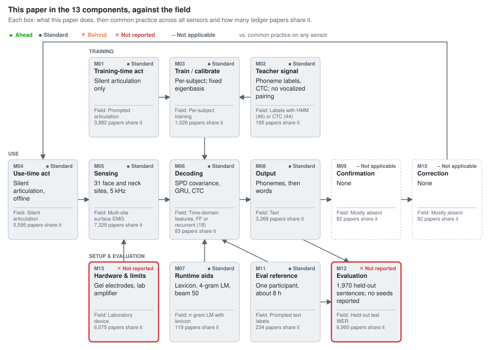

# Non-invasive electromyographic speech neuroprosthesis: a geometric perspective

Gowda, Miller. arXiv preprint, 2025. [arXiv:2502.05762](https://arxiv.org/abs/2502.05762)

**Section:** [Surface EMG](../../README.md#surface-emg)

## Figures

### This paper in the 13 components, against the field

<picture><source media="(prefers-color-scheme: dark)" srcset="figures/components-dark.svg"></picture>

Verdicts compare the paper's choice for each component with common practice across 8,995 ledger entries on any sensor (silent speech, brain-to-text, lip reading).

Data

| Component | This paper | Common practice | Papers with this practice | Verdict |
| --- | --- | --- | --- | --- |
| M01 Training-time act | Silent articulation only | Prompted articulation | 3,882 of 8,995 | ● Standard (Silent-only training data, as in [@meltzner2018].) |
| M02 Teacher signal | Phoneme labels, CTC; no vocalized pairing | Labels with HMM (46) or CTC (44) | 195 of 8,995 | ● Standard (Subvocal-only label training predates it.) |
| M03 Train / calibrate | Per-subject; fixed eigenbasis | Per-subject training | 1,526 of 8,995 | ● Standard (Released code fits the basis on training plus validation sentences.) |
| M04 Use-time act | Silent articulation, offline | Silent articulation | 5,595 of 8,995 | ● Standard (Bidirectional model; no streaming.) |
| M05 Sensing | 31 face and neck sites, 5 kHz | Multi-site surface EMG | 7,329 of 8,995 | ● Standard (No channel-count analysis.) |
| M06 Decoding | SPD covariance, GRU, CTC | Time-domain features, FF or recurrent (18) | 83 of 8,995 | ● Standard (Same group's [concurrent] SPD work; one near-chance baseline.) |
| M07 Runtime aids | Lexicon, 4-gram LM, beam 50 | n-gram LM with lexicon | 119 of 8,995 | ● Standard (LM-test sentence overlap not stated.) |
| M08 Output | Phonemes, then words | Text | 3,268 of 8,995 | ● Standard (Inherited.) |
| M09 Confirmation | None | Mostly absent | 82 of 8,995 | – Not applicable (Offline study.) |
| M10 Correction | None | Mostly absent | 82 of 8,995 | – Not applicable (Offline study.) |
| M11 Eval reference | One participant, about 8 h | Prompted text labels | 234 of 8,995 | ● Standard (Released corpus; split by corpus order.) |
| M12 Evaluation | 1,970 held-out sentences; no seeds reported | Held-out test WER | 6,960 of 8,995 | ✕ Not reported (No seeds or repeated runs; no public benchmark run.) |
| M13 Hardware & limits | Gel electrodes, lab amplifier | Laboratory device | 6,075 of 8,995 | ✕ Not reported (Authors defer stability and streaming (Sec. 7).) |

## Verdict

The paper [[1]](#ref-1) changes training-only supervision, using phoneme transcriptions of silent EMG with no vocalized recording (M02), and the input, feeding covariance (SPD) matrices to a GRU with CTC (M06). Both are standard. Subvocal-only phoneme models for continuous English phrases were trained without vocalized pairing by 2018, at 8.9% mean WER over four phrase sets [[2]](#ref-2), so the authors' priority claim (Sec. 7) rests on its qualifiers, general English and modern methods. The SPD gain is measured against one spectrogram baseline at 100% WER and 89.25% PER, near the 97.5% chance PER (Table 1, Appendix B). At 73.53% WER from one participant with no repeated runs reported, and never run on the public silent-EMG benchmark where text decoding reaches 12.2% WER [[3]](#ref-3), the cost of dropping vocalized supervision stays unmeasured.

## Against the field, component by component

### M02 Training-only supervision: phoneme labels without vocalized pairing

**Usual approach:** Among 195 unique studies of silently articulated sequence decoding (pattern match, Appendix), labels with HMMs (46) or CTC (44) are the common training targets; DTW-transferred vocalized targets appear in 34. The paper takes the label route and records no vocalized speech (Sec. 2.1).

**State of the art:** With vocalized pairing, open-vocabulary silent EMG reaches 12.2% WER (2024) on the Gaddy test set, down from 28.8% [[3]](#ref-3). Without it, five subjects averaged 8.9% WER across four phrase sets drawn from a 2,200-word vocabulary (Table 2 of [[2]](#ref-2)). The paper's 73.53% is about six times the first figure (inference).

The deciding prior [[2]](#ref-2) recorded its large-vocabulary corpus in subvocal mode only and trained per-subject triphone HMMs on it to recognize unseen words. Its grammar is far tighter than an open 4-gram LM, so 8.9% and 73.53% are not comparable, but the supervision scheme is the same. The paper cites it (Appendix A) only as grammar-based recognition over a ∼200-word vocabulary, omitting the 2,200-word unseen-word result. Verdict: standard. What is new is one speaker's scale (about 8 hours, over 6,500 words; Sec. 2.1) and a CTC recurrent decoder.

### M06 Processing: SPD covariance input to a recurrent CTC decoder

**Usual approach:** Among 83 unique surface-EMG speech studies (pattern match, Appendix), time-domain features with a feed-forward or recurrent model are the usual design (18); Transformer or Conformer encoders lead later work (26). The paper uses 31×31 channel covariance matrices on a shared eigenbasis (Sec. 3.1, Sec. 5).

**State of the art:** On the shared silent-EMG test set, 11.89% WER (2026, [later]) for ASR-scored synthesis [[4]](#ref-4) and 12.2% for text [[3]](#ref-3), both with learned encoders.

The SPD embedding comes from the same group's [concurrent] classification paper [[5]](#ref-5). The evidence is one ablation: PER 89.25% to 48.47% and WER 100% to 73.53% (Table 1), a 46% relative PER cut (inference), against a spectrogram input, not the time-domain features or learned encoders above, in one participant, no seeds reported. On EMG2QWERTY wrist typing, test CER falls from 15.38% to 14.03% without an LM and 9.55% to 7.95% with one (Table 2), but the run also trains 250 epochs against 150 and adds weight decay (Sec. 5.1), confounding the 8.8% and 16.8% relative gains; it also omits the baseline's SpecAugment, which the authors note works against them. Verdict: standard.

## The 13 components

| Component | This paper | Usual approach (count) | State of the art | Verdict |
|---|---|---|---|---|
| M01 Training-time action | Silent articulation only | Prompted articulation (slot-filled 3,882) | – | standard |
| M02 Training-only supervision | Phoneme labels, CTC; no vocalized pairing | Labels with HMM (46) or CTC (44) (pattern match 195) | 12.2% WER, paired [[3]](#ref-3); 8.9%, unpaired [[2]](#ref-2) | standard |
| M03 Training and adaptation | Per-subject; fixed eigenbasis | Per-subject training (slot-filled 1,526) | – | standard |
| M04 Use-time action | Silent articulation, offline | Silent articulation (slot-filled 5,595) | – | standard |
| M05 Sensors | 31 face and neck sites, 5 kHz | Multi-site surface EMG (slot-filled 7,329) | – | standard |
| M06 Processing and decoding | SPD covariance, GRU, CTC | Time-domain features, FF or recurrent (18) (pattern match 83) | 11.89% WER [later] [[4]](#ref-4) | standard |
| M07 Lexicon and LM | Lexicon, 4-gram LM, beam 50 | n-gram LM with lexicon (slot-filled 119) | – | standard |
| M08 Output | Phonemes, then words | Text (slot-filled 3,268) | – | standard |
| M09 Confirmation | None | Mostly absent (slot-filled 82) | – | not applicable |
| M10 Correction | None | Mostly absent (slot-filled 82) | – | not applicable |
| M11 Reference construction | One participant, about 8 h | Prompted text labels (slot-filled 234) | – | standard |
| M12 Evaluation | 1,970 held-out sentences; no seeds reported | Held-out test WER (slot-filled 6,960) | – | not reported |
| M13 Device and cost | Gel electrodes, lab amplifier | Laboratory device (slot-filled 6,075) | – | not reported |

## Where the claims outrun the evidence

- "No existing benchmark" permits comparison (Sec. 2.1): the Gaddy corpus [[6]](#ref-6) pairs each silent utterance with its text label (Table 1 of [[3]](#ref-3)), so a transcript-only model could be scored on its test split (inference).
- The representation claim (Sec. 5) rests on a baseline at 89.25% PER against 97.5% chance (Table 1, Appendix B).
- The text fits the Fréchet mean on training data (Sec. 3.1); the released notebook uses the first 9,000 sentences, training plus validation (largeVocabTrainWithIcefall.ipynb:241-253, 307-323). Test data stay out, but text and code differ.
- The NATO appendix (Appendix C.2) reuses the task and 416/104/1,968 split of [[5]](#ref-5).
- "Minimum-viable" feasibility (Appendix C.3) rests on one participant's 67-word closed set (Appendix C.1, Table 3).
- EMG2QWERTY's p<0.015 names no test (Table 2); one of eight users does not improve (Fig. 5).

## What the field needs next

- M02: train the transcript-only route on the Gaddy silent utterances and report WER beside DTW-paired models [[3]](#ref-3).
- M06: compare SPD inputs with time-domain features and a learned encoder under one decoder, several speakers, three seeds.
- M03: test the fixed eigenbasis across electrode re-application and days.
- M04: a causal model with measured latency; the bidirectional GRU needs the whole sentence (Sec. 7).

## Questions for the authors

- Where do the 11,000 sentences come from, do test sentences occur in the LibriSpeech-100 LM text, and does the split separate sessions?
- How many seeds stand behind Table 1 and Figs. 3–4, and with what spread?
- Which test gives p<0.015 in Table 2, and which split produced the EMG2QWERTY Fréchet means?

## Appendix: literature search

- M02, silent-articulation-text-label-supervision. Inclusion rule: decoders mapping silently articulated non-acoustic signals to phoneme, word or sentence sequences, classified by training-only target (labels of the silent utterance with HMM or CTC, or targets transferred from a parallel vocalized recording by DTW); isolated-word classifiers, train-on-vocalized-only, imagined speech and synthesis-only studies are outside the comparison. Ledger counts: M02 slot-filled 31 unique studies (sparse slot); pattern match 195 unique studies. Usual design: labels with HMM decoding, 46 (pattern match); CTC 44; DTW-transferred vocalized targets 34; M03 supervision_kind among 39 slot-filled: text_prompt 8, paired_audio 6, phoneme_label 5. Read in full: [[2]](#ref-2) (prior), [[3]](#ref-3) (state of the art). Known-item recall 0.33.
- M06, emg-speech-encoder-input-and-sequence-model (published topic table, appended). Inclusion rule: surface-EMG speech decoders classified by input representation and sequence model; EMG only as an auxiliary channel, gesture EMG and reviews excluded. Ledger counts: slot-filled 7,345 unique studies; pattern match 83 unique studies. Usual design: time-domain features with a feed-forward or recurrent model, 18 (pattern match); Transformer or Conformer 26; LSTM or GRU 18. Read in full: [[5]](#ref-5) (prior design, [concurrent]), [[3]](#ref-3) (text-output state of the art); earlier reads include [[4]](#ref-4). Known-item recall 0.5.

## References

Numbered by first citation. BibTeX in the same order and keys: [refs.bib](refs.bib).

1. Gowda, H. T., Miller, L. M. “Non-invasive electromyographic speech neuroprosthesis: a geometric perspective.” *arXiv preprint*, 2025. arXiv:[2502.05762](https://arxiv.org/abs/2502.05762). arXiv v3 read [review](https://github.com/supernaiter/silent-speech-review/tree/main/reviews/non-invasive-electromyographic-speech-neuroprosthesis-a-geometric-perspective) [wiki: arxiv-2502.05762](https://github.com/supernaiter/deep-research-wiki-for-silent-speech/blob/main/papers/arxiv-2502.05762/article.md)
2. Meltzner, G. S., Heaton, J. T., Deng, Y., De Luca, G., Roy, S. H., Kline, J. C. “Development of sEMG sensors and algorithms for silent speech recognition.” *Journal of Neural Engineering*, 2018, 15(4), 046031. doi:[10.1088/1741-2552/aac965](https://doi.org/10.1088/1741-2552/aac965). [review](https://github.com/supernaiter/silent-speech-review/tree/main/reviews/development-of-semg-sensors-and-algorithms-for-silent-speech-recognition) [wiki: doi-10.1088-1741-2552-aac965](https://github.com/supernaiter/deep-research-wiki-for-silent-speech/blob/main/papers/doi-10.1088-1741-2552-aac965/article.md)
3. Benster, T., Wilson, G., Elisha, R., Willett, F. R., Druckmann, S. “A Cross-Modal Approach to Silent Speech with LLM-Enhanced Recognition.” *arXiv preprint*, 2024. arXiv:[2403.05583](https://arxiv.org/abs/2403.05583). [wiki: arxiv-2403.05583](https://github.com/supernaiter/deep-research-wiki-for-silent-speech/blob/main/papers/arxiv-2403.05583/article.md)
4. Lee, J., Lee, J., Lee, K. “GETS: Guiding EMG-to-Speech Synthesis via Silent Speech Recognition.” *Proc. Interspeech 2026*, 2026. doi:[10.21437/Interspeech.2026-1938](https://doi.org/10.21437/Interspeech.2026-1938). [later] [wiki: isca-lee26r_interspeech](https://github.com/supernaiter/deep-research-wiki-for-silent-speech/blob/main/papers/isca-lee26r_interspeech/article.md)
5. Gowda, H. T., McNaughton, Z. D., Miller, L. M. “Geometry of orofacial neuromuscular signals: speech articulation decoding using surface electromyography.” *arXiv preprint*, 2024. arXiv:[2411.02591](https://arxiv.org/abs/2411.02591). [concurrent] [wiki: arxiv-2411.02591](https://github.com/supernaiter/deep-research-wiki-for-silent-speech/blob/main/papers/arxiv-2411.02591/article.md) [wiki: doi-10.48550-arxiv.2411.02591](https://github.com/supernaiter/deep-research-wiki-for-silent-speech/blob/main/papers/doi-10.48550-arxiv.2411.02591/article.md)
6. Gaddy, D., Klein, D. “Digital Voicing of Silent Speech.” *Proceedings of the 2020 Conference on Empirical Methods in Natural Language Processing (EMNLP)*, 2020, 5521–5530. doi:[10.18653/v1/2020.emnlp-main.445](https://doi.org/10.18653/v1/2020.emnlp-main.445). arXiv:[2010.02960](https://arxiv.org/abs/2010.02960). [review](https://github.com/supernaiter/silent-speech-review/tree/main/reviews/digital-voicing-of-silent-speech) [wiki: doi-10.18653-v1-2020.emnlp-main.445](https://github.com/supernaiter/deep-research-wiki-for-silent-speech/blob/main/papers/doi-10.18653-v1-2020.emnlp-main.445/article.md) [wiki: arxiv-2010.02960](https://github.com/supernaiter/deep-research-wiki-for-silent-speech/blob/main/papers/arxiv-2010.02960/article.md)

## Materials

Data behind this review. Full texts of the papers are not included.

- [`review.md`](review.md): the review text (source)
- [`refs.bib`](refs.bib): references (BibTeX)
- [`slots.json`](slots.json): for each of the 13 components: this paper's choice, field practice, number of matching papers, verdict
- [`figures.json`](figures.json): figure definitions
- [`evaluation.md`](evaluation.md): independent evaluation by a second reviewer
- [`triage.md`](triage.md): how each evaluation finding was checked against the sources and resolved
- [`components/M02/silent-articulation-text-label-supervision.csv`](../../components/M02/silent-articulation-text-label-supervision.csv): M02 topic "silent-articulation-text-label-supervision", every candidate paper with its decision (31 slot-filled, 195 pattern match, usual design in 46, 3 read in full)
- [`components/M06/emg-speech-encoder-input-and-sequence-model.csv`](../../components/M06/emg-speech-encoder-input-and-sequence-model.csv): M06 topic "emg-speech-encoder-input-and-sequence-model", every candidate paper with its decision (7345 slot-filled, 83 pattern match, usual design in 18, 3 read in full)

## More reviews in Surface EMG

- [A Parallel Ultra-Low Power Silent Speech Interface based on a Wearable, Fully-dry EMG Neckband](../a-parallel-ultra-low-power-silent-speech-interface-based-on-a-wearable-fully-dry-emg-neckband/) (2025). A fully dry wearable EMG neckband with ultra-low-power BioGAP-Ultra classifies 8 silently articulated words for one healthy user at 68% accuracy, dropping to 54% on an unseen re-wearing session; acquisition plus BLE uses 22.2 mW.
- [A Silent Speech Decoding System from EEG and EMG with Heterogenous Electrode Configurations](../a-silent-speech-decoding-system-from-eeg-and-emg-with-heterogenous-electrode-configurations/) (2025). Pooled EEG/EMG pretraining lifts 64-word accuracy, but each test subject's training sessions, the patient's included, are in pretraining; the coordinate kernel is neither new nor best.
- [Articulatory Feature Prediction from Surface EMG during Speech Production](../articulatory-feature-prediction-from-surface-emg-during-speech-production/) (2025). Articulatory route works on vocalized EMG but trails the mel baseline on WER; it exists for ECoG since 2019, and the electrode subset is never tested against equal-size alternatives.
- [CAT-Net: A Cross-Attention Tone Network for Cross-Subject EEG-EMG Fusion Tone Decoding](../cat-net-a-cross-attention-tone-network-for-cross-subject-eeg-emg-fusion-tone-decoding/) (2025). CAT-Net fuses EEG and surface EMG with cross-attention to classify Mandarin lexical tones in silent articulation, reporting 85.10% leave-one-subject-out accuracy over 4 tones.
- [Confidence-Based Self-Training for EMG-to-Speech: Leveraging Synthetic EMG for Robust Modeling](../confidence-based-self-training-for-emg-to-speech-leveraging-synthetic-emg-for-robust-modeling/) (2025). Synthetic EMG with confidence filtering (M03, standard) gives a small real-EMG gain, 23.30% to 21.87% WER on one speaker; large gains appear only on synthetic test EMG.
- [emg2speech: Synthesizing speech from electromyography using self-supervised speech models](../emg2speech-synthesizing-speech-from-electromyography-using-self-supervised-speech-models/) (2025). emg2speech synthesizes speech from face and neck surface EMG via HuBERT units without the user's own recordings; silent speech from one ALS participant gives 50.82% human-transcribed WER.

---

Part of the [Silent Speech Interface Review](https://github.com/supernaiter/silent-speech-review). Found an error? [Open an issue](https://github.com/supernaiter/silent-speech-review/issues/new?template=correction.yml).
