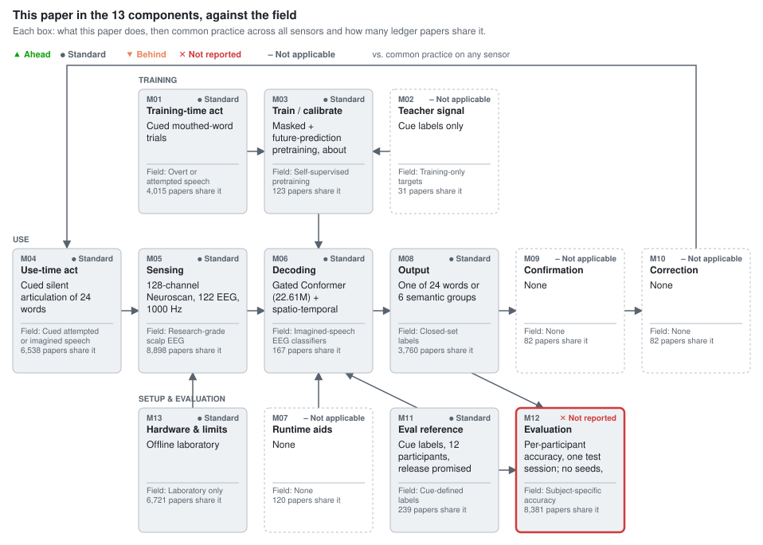

# Pretraining Large Brain Language Model for Active BCI: Silent Speech

Jinzhao Zhou, Zehong Cao, Yiqun Duan, Connor Barkley, Daniel Leong, Xiaowei Jiang, Quoc-Toan Nguyen, Ziyi Zhao, Thomas Do, Yu-Cheng Chang, Sheng-Fu Liang, Chin-Teng Lin. ACM Multimedia (MM '25), 2025. [doi:10.1145/3746027.3754810](https://doi.org/10.1145/3746027.3754810) [arXiv:2504.21214](https://arxiv.org/abs/2504.21214)

**Section:** [Brain signals (EEG, MEG, intracortical)](../../README.md#brain-signals-eeg-meg-intracortical)

## Figures

### This paper in the 13 components, against the field

<picture><source media="(prefers-color-scheme: dark)" srcset="figures/components-dark.svg"></picture>

Verdicts compare the paper's choice for each component with common practice across 8,995 ledger entries on any sensor (silent speech, brain-to-text, lip reading).

Data

| Component | This paper | Common practice | Papers with this practice | Verdict |
| --- | --- | --- | --- | --- |
| M01 Training-time act | Cued mouthed-word trials | Overt or attempted speech | 4,015 of 8,995 | ● Standard (24 words, five repetitions per session, 16 sessions per participant (Table 7).) |
| M02 Teacher signal | Cue labels only | Training-only targets | 31 of 8,995 | – Not applicable (Closed-set classification with cue labels.) |
| M03 Train / calibrate | Masked + future-prediction pretraining, about 105 h of own participants' EEG | Self-supervised pretraining | 123 of 8,995 | ● Standard (Word gain 35.3% to 39.6% without seeds; Du-IN shows a similar relative gain with six seeds.) |
| M04 Use-time act | Cued silent articulation of 24 words | Cued attempted or imagined speech | 6,538 of 8,995 | ● Standard (Prompted, not spontaneous; mouth moves.) |
| M05 Sensing | 128-channel Neuroscan, 122 EEG, 1000 Hz | Research-grade scalp EEG | 8,898 of 8,995 | ● Standard (Muscle-noise electrodes recorded, not used as a control (Appendix B.2).) |
| M06 Decoding | Gated Conformer (22.61M) + spatio-temporal classifier | Imagined-speech EEG classifiers | 167 of 8,995 | ● Standard (Without pretraining 35.3% vs TCNet 32.3% at 78.62K parameters.) |
| M07 Runtime aids | None | None | 120 of 8,995 | – Not applicable (Closed-set labels need no language model.) |
| M08 Output | One of 24 words or 6 semantic groups | Closed-set labels | 3,760 of 8,995 | ● Standard (Softmax over closed classes.) |
| M09 Confirmation | None | None | 82 of 8,995 | – Not applicable (Offline study.) |
| M10 Correction | None | None | 82 of 8,995 | – Not applicable (Offline study.) |
| M11 Eval reference | Cue labels, 12 participants, release promised | Cue-defined labels | 239 of 8,995 | ● Standard (No data link in the paper (§1).) |
| M12 Evaluation | Per-participant accuracy, one test session; no seeds, chance or test | Subject-specific accuracy | 8,381 of 8,995 | ✕ Not reported (Semantic mean 42.8% in §5.1 vs 47.0% in Table 2.) |
| M13 Hardware & limits | Offline laboratory | Laboratory only | 6,721 of 8,995 | ● Standard (Hardware-saving use of forecasting proposed, not tested (§5.3).) |

## Verdict

The paper [[1]](#ref-1) changes training (M03), pretraining a 22.61M-parameter model with masked and future-prediction objectives on about 105 h of unlabeled EEG from its own 12 participants, and the decoder (M06), a gated Conformer. Both are standard: in-domain masked pretraining for speech decoding, with a from-scratch control and six seeds, was shown earlier in sEEG [[2]](#ref-2), and here the gain over the same model from scratch is 35.3% to 39.6% on 24 words, from one test session per participant with no seed count reported (Table 1, §4.2.1). The headline 7.3-point margin over TCNet (§5.1) adds that gain to a 3.0-point gain from a model about 288 times larger (inference). The strongest confound is articulation: participants mouth the words (Appendix B.1), and the recorded muscle-noise electrodes are not used to separate cortical from facial muscle activity (Appendix B.2). Transfer to new users or datasets, which the "large brain language model" label implies, is not tested.

## Against the field, component by component

### M03 Training: self-supervised pretraining on in-domain EEG

**Usual approach:** Of 123 unique studies on self-supervised pretraining for non-audio speech decoding (pattern match), 75 have the training slot filled and 31 of them pretrain self-supervised (slot-filled; Appendix). The paper adds autoregressive future prediction (ASTP) and pretrains only on the participants, task and cap it tests on (§4.2.1).

**State of the art:** In neural speech decoding, Du-IN (2024, prior) pretrained on its participants' own sEEG and raised 61-word accuracy from 56.29% to 62.70%, over subjects and six seeds [[2]](#ref-2). That is 6.4 points (11.4% relative) against 4.3 points (12.2% relative) here (inference): similar relative gains on different tasks (61-word sEEG, 24-word EEG) and chance levels, with weaker evidence here.

The gain is uneven: four of 12 participants fall slightly (S01, S03, S04, S06), S09 and S10 gain 18.4 and 14.5 points, and without them the mean gain is 1.9 points (Table 1) (inference). ASTP adds 2.7 word points (36.9% to 39.6%, Table 1) and 2.2 semantic points (44.8% to 47.0%; 42.2% unpretrained, Table 2) over masked prediction alone. These are single-run differences. The paper does not cite Du-IN. The generic EEG model LaBraM trails from-scratch models in both: 20.6% here (Table 1) and 11.53% in Du-IN. A [later] benchmark finds large-scale EEG pretraining no better than a 16K-parameter CNN on speech tasks, and all five models at chance on unseen subjects (five-class imagined speech) [[3]](#ref-3). Verdict: standard.

### M06 Processing: gated Conformer with spatio-temporal classifier

**Usual approach:** Of 167 unique covert-speech EEG classification studies (pattern match; 165 with the model slot filled), model families are other 48, CNN 37, SVM 17, linear 16, recurrent 16 and transformer 12 (slot-filled; Appendix). Mouthed articulation counts as covert but carries muscle activity that imagined speech lacks.

**State of the art:** The best value read in its source is 96.4% on four covert syllables, 64-channel EEG, 10 participants, published 2019 [[4]](#ref-4), with one class per recording run; with 25% chance there against 4.2% for 24 words here, neither accuracy ranks the other (inference).

From scratch, the backbone reaches 35.3% against 30.5% for EEGNet at 8.54K parameters and 32.3% for TCNet at 78.62K (Table 1): about 3 points from 22.61M parameters. Verdict: standard.

## The 13 components

| Component | This paper | Usual approach (count) | State of the art | Verdict |
|---|---|---|---|---|
| M01 Training-time action | Cued mouthed-word trials | Overt or attempted speech (slot-filled 4,015) | – | standard |
| M02 Training-only supervision | Cue labels only | Training-only targets (slot-filled 31) | – | not applicable |
| M03 Training and adaptation | Masked + future-prediction pretraining, about 105 h of own participants' EEG | Self-supervised, 31 of 75 (pattern match 123) | sEEG, 61 words: 56.29% to 62.70% [[2]](#ref-2) | standard |
| M04 Use-time action | Cued silent articulation of 24 words | Cued attempted or imagined speech (slot-filled 6,538) | – | standard |
| M05 Sensors | 128-channel Neuroscan, 122 EEG, 1000 Hz | Research-grade scalp EEG (slot-filled 8,898) | – | standard |
| M06 Processing and decoding | Gated Conformer (22.61M) + spatio-temporal classifier | Other 48, CNN 37, SVM 17, transformer 12 (of 165) (pattern match 167) | 96.4%, four covert syllables [[4]](#ref-4) | standard |
| M07 Lexicon and LM | None | None (slot-filled 120) | – | not applicable |
| M08 Output | One of 24 words or 6 semantic groups | Closed-set labels (slot-filled 3,760) | – | standard |
| M09 Confirmation | None | None (slot-filled 82) | – | not applicable |
| M10 Correction | None | None (slot-filled 82) | – | not applicable |
| M11 Reference construction | Cue labels, 12 participants, release promised | Cue-defined labels (slot-filled 239) | – | standard |
| M12 Evaluation | Per-participant accuracy, one test session; no seeds, chance or test | Subject-specific accuracy (slot-filled 8,381) | Chance, intervals and tests reported [[3]](#ref-3) | not reported |
| M13 Device and cost | Offline laboratory | Laboratory only (slot-filled 6,721) | – | standard |

## Where the claims outrun the evidence

- "Significant improvement of +7.3%" (§5.1): no test, seed count or interval; per-participant accuracy runs from 11.7% to 73.8% (Table 1).
- §5.1 gives a semantic mean of 42.8%, but the Table 2 per-participant values average to 47.0%, as in the Abstract (inference).
- "Large brain language model" (§1): pretraining data come from the 12 test participants (§4.2.1), with no external corpus, unseen participant or second dataset. Test sessions are excluded from pretraining (§4.2.1): no leakage, but no transfer test either.
- Mouthed articulation (Appendix B.1), a 1–75 Hz band and ICA rejection at 90% confidence (Appendix B.2) leave facial EMG as a source of class information; the six muscle-noise reference electrodes are not used to test it, and no imagined-only condition exists.
- The priority claim for future EEG prediction (§3.3.4) holds at most for scalp EEG: Du-IN describes Brant, an sEEG model evaluated on forecasting [[2]](#ref-2). The forecasts diverge beyond about 120 ms (§5.3), and the proposed hardware savings (§5.3) are not tested.

## What the field needs next

- M03: pretraining on other people's or public EEG, tested on held-out participants against from-scratch training, over several seeds.
- M05: mouthed and imagined-only trials with simultaneous facial EMG.
- M12: chance level, per-participant intervals and a paired test for every ablation row.

## Questions for the authors

- Which sessions were held out, and which rule selected checkpoints?
- Which part of the trial (reading, preparation, production) was classified?
- How many seeds underlie each table entry, and what masking ratio did pretraining use?
- Is 42.8% in §5.1 a typo for 47.0%, and when will the data be released?

## Appendix: literature search

- M03 self-supervised-pretraining (published topic table, appended). Inclusion rule: studies that pre-train an encoder on unlabelled non-audio-only input (video, audio-visual, biosignal or neural recordings) with a self-supervised or teacher-generated objective before supervised fine-tuning for speech or text decoding; audio-only self-supervised ASR and reuse of a released checkpoint without a new objective excluded; versions counted once. Slot-filled 1,526 unique studies; pattern match 123 unique studies. Usual design: supervision kind self-supervised, 31 of 75 with the training slot filled (slot-filled), then paired audio 17. State of the art across modalities: 23.7% WER for lip reading on LRS3 [[5]](#ref-5) [later]; for neural speech decoding, Du-IN [[2]](#ref-2). Read in full for this review: [[2]](#ref-2) (prior), [[3]](#ref-3) [later], target. Known-item recall 1.0.
- M06 imagined-speech-eeg-word-classification (published topic table, appended). Inclusion rule: studies that classify imagined, covert or inner speech from scalp EEG into a closed set of words, syllables or commands and report accuracy; overt-only EEG, EEG-EMG fusion without an EEG-only result, perception decoding, intracranial recordings and reviews excluded; mouthed silent articulation included as covert; versions counted once. Slot-filled 7,345 unique studies; pattern match 167 unique studies (165 with the model slot filled). Usual design: model family other 48, then CNN 37, SVM 17, linear 16, recurrent 16, transformer 12 (slot-filled). State of the art: 96.4% [[4]](#ref-4). Known-item recall 1.0.

## References

Numbered by first citation. BibTeX in the same order and keys: [refs.bib](refs.bib).

1. Zhou, J., Cao, Z., Duan, Y., Barkley, C., Leong, D., Jiang, X., et al. “Pretraining Large Brain Language Model for Active BCI: Silent Speech.” *Proceedings of the 33rd ACM International Conference on Multimedia (MM '25)*, 2025, 5883-5892. doi:[10.1145/3746027.3754810](https://doi.org/10.1145/3746027.3754810). arXiv:[2504.21214](https://arxiv.org/abs/2504.21214). Target. Read as arXiv v2 (3 May 2025). [review](https://github.com/supernaiter/silent-speech-review/tree/main/reviews/pretraining-large-brain-language-model-for-active-bci-silent-speech) [wiki: arxiv-2504.21214](https://github.com/supernaiter/deep-research-wiki-for-silent-speech/blob/main/papers/arxiv-2504.21214/article.md)
2. Zheng, H., Wang, H., Jiang, W., Chen, Z., He, L., Lin, P., et al. “Du-IN: Discrete units-guided mask modeling for decoding speech from Intracranial Neural signals.” *Advances in Neural Information Processing Systems (NeurIPS)*, 2024. arXiv:[2405.11459](https://arxiv.org/abs/2405.11459). [wiki: arxiv-2405.11459](https://github.com/supernaiter/deep-research-wiki-for-silent-speech/blob/main/papers/arxiv-2405.11459/article.md)
3. Khanday, O. M., Ben Ticha, M. B., Belfrouh, S., Ouellet, M., Gonzalez-Lopez, J. A. “Do EEG Foundation Models Transfer to Speech? A Benchmark on Overt and Imagined Speech Decoding.” *arXiv preprint*, 2026. arXiv:[2607.27268](https://arxiv.org/abs/2607.27268). Submitted to IberSPEECH 2026. [later] [review](https://github.com/supernaiter/silent-speech-review/tree/main/reviews/do-eeg-foundation-models-transfer-to-speech-a-benchmark-on-overt-and-imagined-speech-decoding) [wiki: arxiv-2607.27268](https://github.com/supernaiter/deep-research-wiki-for-silent-speech/blob/main/papers/arxiv-2607.27268/article.md) [wiki: arxiv-2607-27268-eegfm](https://github.com/supernaiter/deep-research-wiki-for-silent-speech/blob/main/papers/arxiv-2607-27268-eegfm/article.md) [wiki: arxiv-2607-27268-eegfmspeech](https://github.com/supernaiter/deep-research-wiki-for-silent-speech/blob/main/papers/arxiv-2607-27268-eegfmspeech/article.md) [wiki: arxiv-2607.27268-eegf](https://github.com/supernaiter/deep-research-wiki-for-silent-speech/blob/main/papers/arxiv-2607.27268-eegf/article.md)
4. Jahangiri, A., Sepulveda, F. “The Relative Contribution of High-Gamma Linguistic Processing Stages of Word Production, and Motor Imagery of Articulation in Class Separability of Covert Speech Tasks in EEG Data.” *Journal of Medical Systems*, 2019, 43(2), 20. doi:[10.1007/s10916-018-1137-9](https://doi.org/10.1007/s10916-018-1137-9). [wiki: doi-10.1007-s10916-018-1137-9](https://github.com/supernaiter/deep-research-wiki-for-silent-speech/blob/main/papers/doi-10.1007-s10916-018-1137-9/article.md)
5. Haliassos, A., Mira, R., Petridis, S. “Pay Attention to CTC: Fast and Robust Pseudo-Labelling for Unified Speech Recognition.” *International Conference on Learning Representations (ICLR)*, 2026. arXiv:[2602.19316](https://arxiv.org/abs/2602.19316). [later] [wiki: arxiv-2602.19316](https://github.com/supernaiter/deep-research-wiki-for-silent-speech/blob/main/papers/arxiv-2602.19316/article.md)

## Materials

Data behind this review. Full texts of the papers are not included.

- [`review.md`](review.md): the review text (source)
- [`refs.bib`](refs.bib): references (BibTeX)
- [`slots.json`](slots.json): for each of the 13 components: this paper's choice, field practice, number of matching papers, verdict
- [`figures.json`](figures.json): figure definitions
- [`evaluation.md`](evaluation.md): independent evaluation by a second reviewer
- [`triage.md`](triage.md): how each evaluation finding was checked against the sources and resolved
- [`components/M03/self-supervised-pretraining.csv`](../../components/M03/self-supervised-pretraining.csv): M03 topic "self-supervised-pretraining", every candidate paper with its decision (1526 slot-filled, 123 pattern match, usual design in 31, 3 read in full)
- [`components/M06/imagined-speech-eeg-word-classification.csv`](../../components/M06/imagined-speech-eeg-word-classification.csv): M06 topic "imagined-speech-eeg-word-classification", every candidate paper with its decision (7345 slot-filled, 167 pattern match, usual design in 48, 2 read in full)

## More reviews in Brain signals (EEG, MEG, intracortical)

- [A Convolutional Framework for Mapping Imagined Auditory MEG into Listened Brain Responses](../a-convolutional-framework-for-mapping-imagined-auditory-meg-into-listened-brain-responses/) (2025). Mapping imagined onto listened MEG (M06) is ahead in design, but the subject-calibrated CNN gain is unproven: no ablation, a channel-shuffling null, and r 0.0113 against 0.0063.
- [An instantaneous voice-synthesis neuroprosthesis](../an-instantaneous-voice-synthesis-neuroprosthesis/) (2025). Closed-loop sentence voice from intracortical arrays holds for one participant; the design is standard, forced-choice and proxy-target metrics overstate intelligibility.
- [Brain-to-Text Decoding: A Non-invasive Approach via Typing](../brain-to-text-decoding-a-non-invasive-approach-via-typing/) (2025). Executed typing as the decoded action (M04) was ahead for MEG/EEG in 2025; keystroke-locked decoding (M06) and an n-gram LM (M07) are standard, and decoding needs known keystroke times.
- [Distinct Theta Synchrony across Speech Modes: Perceived, Spoken, Whispered, and Imagined](../distinct-theta-synchrony-across-speech-modes-perceived-spoken-whispered-and-imagined/) (2025). Exploratory comparison of EEG theta-band functional connectivity across perceived, spoken, whispered and imagined speech in ten healthy subjects; no recognition performance is measured.
- [EEG-to-Voice Decoding of Spoken and Imagined speech Using Non-Invasive EEG](../eeg-to-voice-decoding-of-spoken-and-imagined-speech-using-non-invasive-eeg/) (2025). Drops DTW from an EEG-to-Mel generator (M06, standard) but tests only the ten trained classes (M12, behind); one frozen ASR both trains and scores it, and EEG output beats recorded-speech WER.
- [Lightweight Diffusion-based Framework for Online Imagined Speech Decoding in Aphasia](../lightweight-diffusion-based-framework-for-online-imagined-speech-decoding-in-aphasia/) (2025). Real-time diffusion-based EEG decoder for one person with aphasia classifying three imagined Korean words plus rest, reporting 65% top-1 and 70% top-2 accuracy over 20 online trials.

---

Part of the [Silent Speech Interface Review](https://github.com/supernaiter/silent-speech-review). Found an error? [Open an issue](https://github.com/supernaiter/silent-speech-review/issues/new?template=correction.yml).
