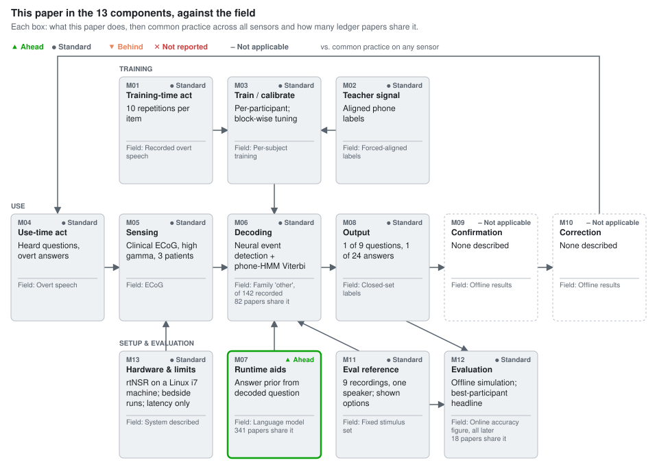

# Real-time decoding of question-and-answer speech dialogue using human cortical activity

Moses, D. A.; Leonard, M. K.; Makin, J. G.; Chang, E. F. Nature Communications 10, 3096 (2019). [doi:10.1038/s41467-019-10994-4](https://doi.org/10.1038/s41467-019-10994-4)

**Section:** [Other sensors](../../README.md#other-sensors)

## Figures

### This paper in the 13 components, against the field

<picture><source media="(prefers-color-scheme: dark)" srcset="figures/components-dark.svg"></picture>

Verdicts compare the paper's choice for each component with common practice across 8,995 ledger entries on any sensor (silent speech, brain-to-text, lip reading).

Data

| Component | This paper | Common practice | Papers with this practice | Verdict |
| --- | --- | --- | --- | --- |
| M01 Training-time act | 10 repetitions per item | Recorded overt speech |  | ● Standard (Inherited; per participant.) |
| M02 Teacher signal | Aligned phone labels | Forced-aligned labels |  | ● Standard (Inherited from the same group's perception decoders.) |
| M03 Train / calibrate | Per-participant; block-wise tuning | Per-subject training |  | ● Standard (Block counts and seeds not stated.) |
| M04 Use-time act | Heard questions, overt answers | Overt speech |  | ● Standard (Both directions decoded; no attempted or imagined speech.) |
| M05 Sensing | Clinical ECoG, high gamma, 3 patients | ECoG |  | ● Standard (Inherited clinical grids.) |
| M06 Decoding | Neural event detection + phone-HMM Viterbi | Family 'other', of 142 recorded | 82 of 142 | ● Standard (Same-group HMM lineage extended to produced speech.) |
| M07 Runtime aids | Answer prior from decoded question | Language model | 341 of 1,280 | ▲ Ahead (No earlier study in the 36 dialogue-context matches; gain in 3 of 3 participants.) |
| M08 Output | 1 of 9 questions, 1 of 24 answers | Closed-set labels |  | ● Standard (Closed set.) |
| M09 Confirmation | None described | Offline results |  | – Not applicable (All reported results are offline simulations.) |
| M10 Correction | None described | Offline results |  | – Not applicable (All reported results are offline simulations.) |
| M11 Eval reference | 9 recordings, one speaker; shown options | Fixed stimulus set |  | ● Standard (Question decoding re-identifies the training recordings.) |
| M12 Evaluation | Offline simulation; best-participant headline | Online accuracy figure, all later | 18 of 134 | ● Standard (Regex counts; no reporting practice dominates. No online accuracy or latency figure.) |
| M13 Hardware & limits | rtNSR on a Linux i7 machine; bedside runs; latency only "negligible" | System described |  | ● Standard (System described; online accuracy and latency gaps are under M12.) |

## Verdict

The paper [[1]](#ref-1) changes two components. Its use-time context (M07), a soft answer prior from the decoded likelihoods of the perceived question, is ahead: no study among the 36 dialogue-context matches in 1,280 brain-signal decoding studies (pattern match, Appendix) used such a prior earlier, the deciding priors constrain output only with a fixed sentence set or an n-gram model [[2]](#ref-2), [[3]](#ref-3), and the gain is significant in each of three participants. Its decoder (M06), neural speech-event detection plus phone-HMM Viterbi utterance scoring, is standard, extending the group's perception decoders [[4]](#ref-4) to produced speech. The authors state that all results are offline simulations and that online runs differed only in hyperparameters (§Methods, Real-time decoding), but no online accuracy or latency is measured. Set restriction is an untested confound for the context gain, since answers outside the decoded question's set get zero prior.

## Against the field, component by component

### M07 Lexicon and LM: context from a decoded utterance

**Usual approach:** Among 1,280 brain-signal speech decoding studies (pattern match), full texts most often name a language model (341), then a pronunciation lexicon (116) and a grammar or finite-state network (103) [[3]](#ref-3). Speller priors from the user's own previous selections [[5]](#ref-5) are linguistic too; the paper's prior comes from the decoded partner utterance.

**State of the art:** Card et al. (2024) [[6]](#ref-6) [later] reach 90.2% word accuracy with a 125,000-word vocabulary on day 2. The nearest design, Meunier et al. (2024) [[7]](#ref-7) [later], feeds the partner's question as context but transcribes it from audio instead of decoding it from the brain.

All 36 dialogue-context matches were inspected as snippets; those before July 2019 use the words in unrelated senses (Appendix). Full-system answer accuracy rises with context in all three participants (p = 1.9×10⁻³, 7.9×10⁻⁵ and 0.029, §Results). Verdict: ahead on the design, not on the size of the gain: restricting answers by the predicted question gave no improvement, and the true question improved classification in only one of three participants (§Discussion).

### M06 Processing and decoding: event detection plus phone-HMM utterance scoring

**Usual approach:** Of 360 closed-vocabulary studies (pattern match), 142 have a recorded model family: "other" 82, CNN 35, HMM 25 (slot-filled). Over the same 360 full texts, deep networks are named in 183 and HMM or Viterbi in 142 (pattern match).

**State of the art:** Card et al. (2024) [[6]](#ref-6) [later] reach 99.6% accuracy on 50 words on the first day of use; the paper's best is 61% over 24 answers, under a different signal, population and task (inference).

Phone-HMM scoring is inherited from [[4]](#ref-4) and the per-sentence HMMs of [[2]](#ref-2); new are a neural event detector, replacing the 2018 audio onset trigger, and produced speech. Phone accuracy is 25.12% over 37 phones against 2.70% chance (pooled, §Results), so utterance accuracy rests on a small closed set. The [later] same-group system replaced phone HMMs with word classifiers [[8]](#ref-8). Verdict: standard.

### M12 Evaluation: what a real-time claim reports

**Usual approach:** Among 134 intracranial speech studies that mention real-time, online or closed-loop operation (pattern match), no reporting practice dominates: regex counts give an online accuracy figure in 18, a latency figure in 18 and an offline simulation in 12, none of the 18 accuracy hits before the target (Appendix).

**State of the art:** Card et al. (2024) [[6]](#ref-6) [later] report 99.6% accuracy on 50 words from the first day of system use, and Moses et al. (2021) [[8]](#ref-8) [later] a median word error rate of 25.6% at 15.2 words per minute; the group's 2018 system already reported real-time accuracy of 90% or higher for each of two subjects [[2]](#ref-2). Verdict: standard for the field, below the group's 2018 practice.

## The 13 components

| Component | This paper | Usual approach (count) | State of the art | Verdict |
|---|---|---|---|---|
| M01 Training-time action | 10 repetitions per item | Recorded overt speech | – | standard |
| M02 Training-only supervision | Aligned phone labels | Forced-aligned labels | – | standard |
| M03 Training and adaptation | Per-participant; block-wise tuning | Per-subject training | – | standard |
| M04 Use-time action | Heard questions, overt answers | Overt speech | – | standard |
| M05 Sensors | Clinical ECoG, high gamma, 3 patients | ECoG | – | standard |
| M06 Processing and decoding | Neural event detection + phone-HMM Viterbi | Family 'other', of 142 recorded (slot-filled 82) | [[6]](#ref-6) (2024) [later]: 99.6% on 50 words | standard |
| M07 Lexicon and LM | Answer prior from decoded question | Language model (pattern match 341) | [[6]](#ref-6) (2024) [later]: 90.2% with a 125,000-word vocabulary, day 2 | ahead |
| M08 Output | 1 of 9 questions, 1 of 24 answers | Closed-set labels | – | standard |
| M09 Confirmation | None described | Offline results | – | not applicable |
| M10 Correction | None described | Offline results | – | not applicable |
| M11 Reference construction | 9 recordings, one speaker; shown options | Fixed stimulus set | – | standard |
| M12 Evaluation | Offline simulation; best-participant headline | Online accuracy figure, all later (pattern match 18) | [[6]](#ref-6) (2024) [later]: 99.6% on 50 words, day 1 | standard |
| M13 Device and cost | rtNSR on a Linux i7 machine; bedside runs; latency only "negligible" | System described | – | standard |

## Where the claims outrun the evidence

- Latency is called negligible without a number, and the claim that online equals offline is untested (§Methods, Real-time decoding).
- 61% (answers) and 76% (questions) are maxima over three participants, unnamed in the main text; answer ratios to chance span 3.5–7.2 (§Results).
- Question decoding re-identifies the same nine recordings by one speaker heard in training (§Methods, Experimental task design): repeated stimuli, not new speech.
- Answers were read aloud in training and chosen from displayed options at test; the authors report no evidence of an effect and propose tests without visual cues (§Discussion).
- Finalization before speech offset (94 correct trials) uses transcribed event times, not the detector (§Results).

## What the field needs next

- M07: an ablation separating set restriction from soft likelihood weighting, and questions that vary in wording and speaker.
- M12 and M13: online accuracy and end-to-end latency with hyperparameters fixed before the session.
- M04: the same paradigm with attempted or imagined speech in paralysis (§Discussion).

## Questions for the authors

- How many test blocks did each participant contribute, and who reached 61% and 76%?
- What were the bedside online accuracy and latency?
- How were the z-score statistics initialized between blocks?
- What seeds were used for the bootstrap, sample draws and hyperparameter search?
- How accurate is answer decoding with a flat prior over the valid answers?

## Appendix: literature search

- M07, task-context-prior-from-decoded-utterance. Inclusion rule: brain-signal (ECoG, sEEG, intracortical, EEG, MEG) speech or language decoders whose ledger text names a speech unit and decoding or classification; designs counted from full text: language model, grammar or finite-state network, pronunciation lexicon, context prior from another decoded utterance; training-only priors excluded; versions once. Ledger counts: 119 slot-filled; 1,274 pattern match (unique studies), 1,280 with full-text additions. Usual design: language model, 341 (pattern match); lexicon 116; grammar or finite-state 103; dialogue context 36, none earlier than the target with the design. Read in full: [[3]](#ref-3), [[2]](#ref-2), [[4]](#ref-4); state of the art [[6]](#ref-6). Dialogue-context regex and the 36 inspected studies are stored in the audit. Read in full also: [[5]](#ref-5) (Sec. 2). Known-item recall 1.0 (3 seeds).
- M06, closed-vocabulary-word-classification (published table reused). Inclusion rule: decoding of words or utterances from non-acoustic signals by classifying each detected segment into a closed set of at most a few hundred items, with or without a language-model or context prior; open-vocabulary decoders without a closed-set test and acoustic-only ASR excluded. Ledger counts: 7,345 slot-filled; 360 pattern match (unique studies). Bases: 360 studies; 355 with a recorded decoder; 142 with a recorded model family. Usual design: "other", 82 of 142 (slot-filled); HMM 25 (slot-filled); full texts name deep networks in 183 and HMM or Viterbi in 142 of 360 (pattern match). Read in full: [[2]](#ref-2), [[4]](#ref-4), [[3]](#ref-3); state of the art [[6]](#ref-6). Known-item recall 0.5 (2 seeds).
- M12, real-time-intracranial-speech-online-evaluation. Inclusion rule: intracranial speech decoding studies whose ledger text mentions real-time, online or closed-loop operation; designs counted from full text: online accuracy figure, offline simulation or replay, latency figure; listening-only and review papers enter through the pattern; versions once. Ledger counts: 6,960 slot-filled; 134 pattern match (unique studies). Designs: online accuracy figure 18 of 134 (pattern match, all later than the target); latency figure 18; offline simulation 12; the regex misses Moses et al. 2018, which reports real-time accuracy. Read in full: [[2]](#ref-2), [[3]](#ref-3); state of the art [[6]](#ref-6). Known-item recall 1.0 (3 seeds).

## References

Numbered by first citation. BibTeX in the same order and keys: [refs.bib](refs.bib).

1. Moses, D. A., Leonard, M. K., Makin, J. G., Chang, E. F. “Real-time decoding of question-and-answer speech dialogue using human cortical activity.” *Nature Communications*, 2019, 10, 3096. doi:[10.1038/s41467-019-10994-4](https://doi.org/10.1038/s41467-019-10994-4). Target. Read as the published open-access article. [wiki: doi-10.1038-s41467-019-10994-4](https://github.com/supernaiter/deep-research-wiki-for-silent-speech/blob/main/papers/doi-10.1038-s41467-019-10994-4/article.md) [wiki: pmc-6667454-qa](https://github.com/supernaiter/deep-research-wiki-for-silent-speech/blob/main/papers/pmc-6667454-qa/article.md) [wiki: pmc-6667454-qadecode](https://github.com/supernaiter/deep-research-wiki-for-silent-speech/blob/main/papers/pmc-6667454-qadecode/article.md) [wiki: pmc-6667454-qadialogue](https://github.com/supernaiter/deep-research-wiki-for-silent-speech/blob/main/papers/pmc-6667454-qadialogue/article.md)
2. Moses, D. A., Leonard, M. K., Chang, E. F. “Real-time classification of auditory sentences using evoked cortical activity in humans.” *Journal of Neural Engineering*, 2018, 15(3), 036005. doi:[10.1088/1741-2552/aaab6f](https://doi.org/10.1088/1741-2552/aaab6f). Prior; deciding prior for M06, M07 and M12. [wiki: doi-10.1088-1741-2552-aaab6f](https://github.com/supernaiter/deep-research-wiki-for-silent-speech/blob/main/papers/doi-10.1088-1741-2552-aaab6f/article.md)
3. Herff, C., Heger, D., de Pesters, A., Telaar, D., Brunner, P., Schalk, G., et al. “Brain-to-text: decoding spoken phrases from phone representations in the brain.” *Frontiers in Neuroscience*, 2015, 9, 217. doi:[10.3389/fnins.2015.00217](https://doi.org/10.3389/fnins.2015.00217). Prior; deciding prior for M06 and M07. [review](https://github.com/supernaiter/silent-speech-review/tree/main/reviews/brain-to-text-decoding-spoken-phrases-from-phone-representations-in-the-brain) [wiki: pmc-4464168-brain2text](https://github.com/supernaiter/deep-research-wiki-for-silent-speech/blob/main/papers/pmc-4464168-brain2text/article.md)
4. Moses, D. A., Mesgarani, N., Leonard, M. K., Chang, E. F. “Neural speech recognition: continuous phoneme decoding using spatiotemporal representations of human cortical activity.” *Journal of Neural Engineering*, 2016, 13(5), 056004. doi:[10.1088/1741-2560/13/5/056004](https://doi.org/10.1088/1741-2560/13/5/056004). Prior; deciding prior for M06. [wiki: pmc-5031534-nsr](https://github.com/supernaiter/deep-research-wiki-for-silent-speech/blob/main/papers/pmc-5031534-nsr/article.md)
5. Speier, W., Arnold, C., Pouratian, N. “Integrating language models into classifiers for BCI communication: a review.” *Journal of Neural Engineering*, 2016, 13(3), 031002. doi:[10.1088/1741-2560/13/3/031002](https://doi.org/10.1088/1741-2560/13/3/031002). Prior; review of speller language-model priors (closest other class for M07). [wiki: pmc-5495144-lmbci](https://github.com/supernaiter/deep-research-wiki-for-silent-speech/blob/main/papers/pmc-5495144-lmbci/article.md)
6. Card, N. S., Wairagkar, M., Iacobacci, C., Hou, X., Singer-Clark, T. “An accurate and rapidly calibrating speech neuroprosthesis.” *New England Journal of Medicine*, 2024, 391(7), 609-618. doi:[10.1056/NEJMoa2314132](https://doi.org/10.1056/NEJMoa2314132). Later; state of the art for M06, M07 and M12. [later] [review](https://github.com/supernaiter/silent-speech-review/tree/main/reviews/an-accurate-and-rapidly-calibrating-speech-neuroprosthesis) [wiki: doi-10.1056-nejmoa2314132](https://github.com/supernaiter/deep-research-wiki-for-silent-speech/blob/main/papers/doi-10.1056-nejmoa2314132/article.md) [wiki: doi-10.1056-NEJMoa2314132](https://github.com/supernaiter/deep-research-wiki-for-silent-speech/blob/main/papers/doi-10.1056-NEJMoa2314132/article.md) [wiki: pmc-11328962-rapidcal](https://github.com/supernaiter/deep-research-wiki-for-silent-speech/blob/main/papers/pmc-11328962-rapidcal/article.md)
7. Meunier, A., Žák, M. R., Munz, L., Garkot, S., Eder, M., Xu, J., et al. “A Conversational Brain-Artificial Intelligence Interface.” *arXiv preprint*, 2024. arXiv:[2402.15011](https://arxiv.org/abs/2402.15011). Later; conversation-partner question as use-time context. [later] [wiki: arxiv-2402.15011](https://github.com/supernaiter/deep-research-wiki-for-silent-speech/blob/main/papers/arxiv-2402.15011/article.md)
8. Moses, D. A., Metzger, S. L., Liu, J. R., Anumanchipalli, G. K., Makin, J. G., Sun, P. F., et al. “Neuroprosthesis for decoding speech in a paralyzed person with anarthria.” *New England Journal of Medicine*, 2021, 385(3), 217-227. doi:[10.1056/NEJMoa2027540](https://doi.org/10.1056/NEJMoa2027540). Later; same group, online decoding of attempted speech. [later] [review](https://github.com/supernaiter/silent-speech-review/tree/main/reviews/neuroprosthesis-for-decoding-speech-in-a-paralyzed-person-with-anarthria) [wiki: doi-10.1056-nejmoa2027540](https://github.com/supernaiter/deep-research-wiki-for-silent-speech/blob/main/papers/doi-10.1056-nejmoa2027540/article.md) [wiki: pmc-8972947-nejmspeech](https://github.com/supernaiter/deep-research-wiki-for-silent-speech/blob/main/papers/pmc-8972947-nejmspeech/article.md)

## Materials

Data behind this review. Full texts of the papers are not included.

- [`review.md`](review.md): the review text (source)
- [`refs.bib`](refs.bib): references (BibTeX)
- [`slots.json`](slots.json): for each of the 13 components: this paper's choice, field practice, number of matching papers, verdict
- [`figures.json`](figures.json): figure definitions
- [`evaluation.md`](evaluation.md): independent evaluation by a second reviewer
- [`triage.md`](triage.md): how each evaluation finding was checked against the sources and resolved
- [`process/log.json`](process/log.json): process record: each step, who did it (reader, script, writer, evaluator), when, the checks run and the input versions
- [`process/notes.json`](process/notes.json): reading notes on the target and comparator papers: claims, numbers, conditions and what is not stated, with locations
- [`process/plan.json`](process/plan.json): plan: which components the paper changes and the topics it is compared on
- [`process/draft.md`](process/draft.md): the review as first written, before the independent evaluation
- [`process/claims-draft.md`](process/claims-draft.md): claim table of the draft: every claim mapped to a note or a count
- [`process/claims.md`](process/claims.md): claim table of the published review
- [`components/M06/closed-vocabulary-word-classification.csv`](../../components/M06/closed-vocabulary-word-classification.csv): M06 topic "closed-vocabulary-word-classification", every candidate paper with its decision (7345 slot-filled, 360 pattern match, usual design in 82, 2 read in full)
- [`components/M07/task-context-prior-from-decoded-utterance.csv`](../../components/M07/task-context-prior-from-decoded-utterance.csv): M07 topic "task-context-prior-from-decoded-utterance", every candidate paper with its decision (119 slot-filled, 1274 pattern match, usual design in 341, 5 read in full)
- [`components/M12/real-time-intracranial-speech-online-evaluation.csv`](../../components/M12/real-time-intracranial-speech-online-evaluation.csv): M12 topic "real-time-intracranial-speech-online-evaluation", every candidate paper with its decision (6960 slot-filled, 134 pattern match, usual design in 18, 3 read in full)

## More reviews in Other sensors

- [Speech Synthesis from ECoG using Densely Connected 3D Convolutional Neural Networks](../speech-synthesis-from-ecog-using-densely-connected-3d-convolutional-neural-networks/) (2019). 3D DenseNet regressor (M06) and LJ-Speech WaveNet (M08) are standard: no in-paper baseline, mixed later head-to-heads, and no listener test behind the quality claims.
- [Machine translation of cortical activity to text with an encoder-decoder framework](../machine-translation-of-cortical-activity-to-text-with-an-encoder-decoder-framework/) (2020). Word-level ECoG encoder-decoder; all changed components standard. 3% WER is on repeats of 50 sentences; unseen sentences and participants were never tested.
- [End-to-End Audiovisual Speech Recognition](../end-to-end-audiovisual-speech-recognition/) (2018). Raw-waveform front end and BGRU fusion (M06) depart from the usual approach but are standard: they tie MFCC in clean LRW audio (97.7%); noise gains lack repeated runs and use matched babble.
- [End-to-End Audio-Visual Speech Recognition with Conformers](../end-to-end-audio-visual-speech-recognition-with-conformers/) (2021). Conformer back-end on raw inputs (M06) and Transformer LM (M07) are standard: raw-input AVSR predates it, and the Conformer gain is one unrepeated step confounded with a decoder swap.
- [Brain-to-text: decoding spoken phrases from phone representations in the brain](../brain-to-text-decoding-spoken-phrases-from-phone-representations-in-the-brain/) (2015). Phone-model decoder (M06) is the EMG recognizer moved to ECoG: standard. 25% WER uses per-phrase dictionaries holding the spoken words (M07); the time-shift null (M12) is sound.
- [Ultrasensitive Textile Strain Sensors Redefine Wearable Silent Speech Interfaces with High Machine Learning Efficiency](../ultrasensitive-textile-strain-sensors-redefine-wearable-silent-speech-interfaces-with-high-machine-learning-efficiency/) (2024). Standard sensor (M05) and decoder (M06): one throat strain channel, small CNN. 95.25% on 20 words, with split grouping and production mode unstated, does not show silent, session-independent decoding.

---

Part of the [Silent Speech Interface Review](https://github.com/supernaiter/silent-speech-review). Found an error? [Open an issue](https://github.com/supernaiter/silent-speech-review/issues/new?template=correction.yml).
