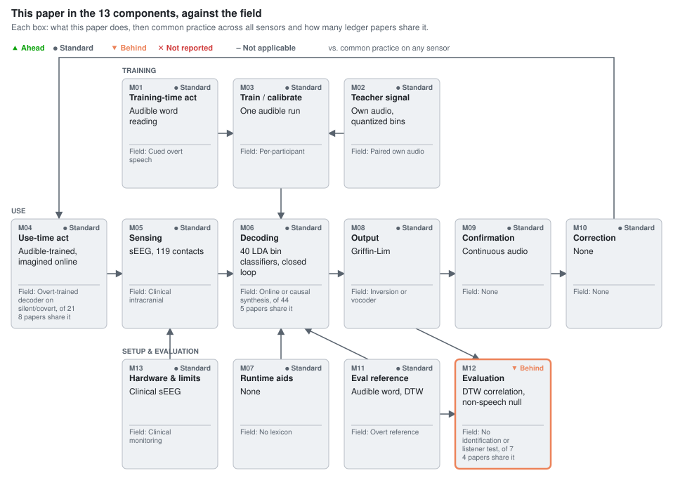

# Real-time synthesis of imagined speech processes from minimally invasive recordings of neural activity

Angrick M, Ottenhoff MC, Diener L, Ivucic D, Ivucic G, Goulis S, Saal J, Colon AJ, Wagner L, Krusienski DJ, Kubben PL, Schultz T, Herff C. Communications Biology 4, 1055 (2021). [doi:10.1038/s42003-021-02578-0](https://doi.org/10.1038/s42003-021-02578-0)

**Section:** [Other sensors](../../README.md#other-sensors)

## Figures

### This paper in the 13 components, against the field

<picture><source media="(prefers-color-scheme: dark)" srcset="figures/components-dark.svg"></picture>

Verdicts compare the paper's choice for each component with common practice across 8,995 ledger entries on any sensor (silent speech, brain-to-text, lip reading).

Data

| Component | This paper | Common practice | Papers with this practice | Verdict |
| --- | --- | --- | --- | --- |
| M01 Training-time act | Audible word reading | Cued overt speech |  | ● Standard (Inherited.) |
| M02 Teacher signal | Own audio, quantized bins | Paired own audio |  | ● Standard (Inherited.) |
| M03 Train / calibrate | One audible run | Per-participant |  | ● Standard (Inherited.) |
| M04 Use-time act | Audible-trained, imagined online | Overt-trained decoder on silent/covert, of 21 | 8 of 21 | ● Standard (Martin 2014 transfer design, online.) |
| M05 Sensing | sEEG, 119 contacts | Clinical intracranial |  | ● Standard (Inherited.) |
| M06 Decoding | 40 LDA bin classifiers, closed loop | Online or causal synthesis, of 44 | 5 of 44 | ● Standard (4 closed loops, 2 neural (vowels); no repetition.) |
| M07 Runtime aids | None | No lexicon |  | ● Standard (Inherited.) |
| M08 Output | Griffin-Lim | Inversion or vocoder |  | ● Standard (Inherited.) |
| M09 Confirmation | Continuous audio | None |  | ● Standard (Not studied.) |
| M10 Correction | None | None |  | ● Standard (Not studied.) |
| M11 Eval reference | Audible word, DTW | Overt reference |  | ● Standard (Inherited.) |
| M12 Evaluation | DTW correlation, non-speech null | No identification or listener test, of 7 | 4 of 7 | ▼ Behind (Martin 2014 ranked covert output; best comparable.) |
| M13 Hardware & limits | Clinical sEEG | Clinical monitoring |  | ● Standard (Inherited.) |

## Verdict

The paper [[1]](#ref-1) changes two components, closed-loop spectral word synthesis from sEEG (M06) and online use of an audible-trained decoder for whispered and imagined words (M04). Both are standard: 4 prior closed loops existed, 2 of them neural and both limited to vowel formants [[2]](#ref-2), [[3]](#ref-3), and 8 prior studies applied overt-trained decoders to silent or covert speech [[4]](#ref-4) (Appendix). Word-level output is the advance; one participant in three short runs gives no repetition. Imagined output is scored by DTW correlation against a null from a separate non-speech session and by VAD gating; neither tests word content (M12, behind [[4]](#ref-4)). The main claim, "models trained on audible speech can be used to synthesize imagined speech processes in real-time" (Results), therefore outruns the design.

## Against the field, component by component

### M06 Decoding: closed-loop synthesis

**Usual approach:** The topic admits any non-acoustic signal. Of 44 prior pattern-match studies, 5 synthesized online or under simulated causal inference and 4 closed the loop with playback (Appendix): two-formant vowels from intracortical units [[2]](#ref-2) or EEG limb motor imagery [[3]](#ref-3), and articulatory synthesis from articulography [[5]](#ref-5). The paper outputs word spectrograms.

**State of the art:** Brain2voice 2.0 reached a 5.24% median listener WER on intracortical attempted speech under simulated causal inference [[6]](#ref-6) (2026) [later, preprint]; the best closed loop, 10-ms causal voice synthesis, reached 43.75% [[7]](#ref-7) (2025) [later]. Neither uses imagined speech.

The authors state that "all studies synthesizing speech from the neural activity are based on open-loop experiments and apply the decoding pipelines to these data in offline analyses" (Introduction), then name Guenther 2009 as addressing both issues, so the paper contradicts itself; it also omits Brumberg et al.'s EEG closed loop [[3]](#ref-3). Articulography [[5]](#ref-5) lies outside that sentence. Processing of 7.331 ms per 10 ms frame (Table 1) supports the real-time claim. Verdict: standard, because the step from vowel formants to words has no repetition across participants or sessions, which the ahead rule requires.

### M04 Use-time action: imagined words with an audible-trained decoder

**Usual approach:** 8 of 21 prior candidates confirmed applying an overt-trained decoder without retraining to silent, mouthed or covert speech (Appendix): EMG [[8]](#ref-8), ultrasound and video, and ECoG for mimed [[9]](#ref-9) and covert speech [[4]](#ref-4). The paper runs it online.

**State of the art:** A Transformer trained only on overt ECoG reached 46.3% token error on covert sentences across 16 patients [[10]](#ref-10) (2024) [later], offline.

Imagined trials reached a DTW correlation of 0.32 ± 0.26, called a mean, against a 0.17 ± 0.22 null, below whispered trials at a median 0.64 ± 0.15 (Results), 75 trials of one person. Verdict: standard; the design is Martin et al.'s [[4]](#ref-4), run in closed loop with a different regressor.

### M12 Evaluation: identification of the synthesized word

**Usual approach:** Of 7 prior reconstructions of produced, mimed or imagined speech, 4 report no identification or listener test (Appendix). Martin et al. ranked covert reconstructions among 24–140 candidate segments against DTW-aligned overt references, a group rank of 0.55 against 0.5 chance, above chance in 1 of 7 subjects [[4]](#ref-4); for overt speech, listeners chose among four words at 66.1% (chance 25%) [[11]](#ref-11) or transcribed at a median 31% WER [[9]](#ref-9).

**State of the art:** 80% listener recognition over 6 keywords [[12]](#ref-12) (2024) [later]; 92-100% identification of 12 words from reconstructed spectrograms [[13]](#ref-13) (2023) [later].

The authors drop STOI because trials may lack 400 ms of consecutive speech and report the audio as not intelligible (Results). A rank test needs no intelligibility and, even if weak, tests word content. Verdict: behind, against the best comparable work, Martin et al. [[4]](#ref-4).

## The 13 components

| Component | This paper | Usual approach (count) | State of the art | Verdict |
|---|---|---|---|---|
| M01 Training-time action | Audible word reading | Cued overt speech | – | standard |
| M02 Training-only supervision | Own audio, quantized bins | Paired own audio | – | standard |
| M03 Training and adaptation | One audible run | Per-participant | – | standard |
| M04 Use-time action | Audible-trained, imagined online | Overt-trained decoder on silent/covert, of 21 (confirmed 8) | [[10]](#ref-10) (2024): 46.3% TER | standard |
| M05 Sensors | sEEG, 119 contacts | Clinical intracranial | – | standard |
| M06 Processing and decoding | 40 LDA bin classifiers, closed loop | Online or causal synthesis, of 44 (pattern match 5) | [[6]](#ref-6) (2026): WER 5.24%, simulated | standard |
| M07 Lexicon and LM | None | No lexicon | – | standard |
| M08 Output | Griffin-Lim | Inversion or vocoder | – | standard |
| M09 Confirmation | Continuous audio | None | – | standard |
| M10 Correction | None | None | – | standard |
| M11 Reference construction | Audible word, DTW | Overt reference | – | standard |
| M12 Evaluation | DTW correlation, non-speech null | No identification or listener test, of 7 (pattern match 4) | [[12]](#ref-12) (2024): 80%, 6 words | behind |
| M13 Device and cost | Clinical sEEG | Clinical monitoring | – | standard |

## Where the claims outrun the evidence

- The null, 1,000 2-s segments from a separate grasping and eye-fixation session (Fig. 4), separates speech-task activity from another task, not one imagined word from others.
- Every imagined trial followed a visual word prompt and no prompt-without-imagery run was recorded, so output gated to trials does not by itself show imagery (inference). The authors attribute extra intertrial detections to uncertain imagery performance (Fig. 4).
- She heard the synthesized output in both closed-loop runs; without a feedback-off imagined run, responses to it inside the 200 ms feature context are not separated from imagery (inference, Fig. 4).
- The whispered value is reported as a median and the imagined as a mean, while Fig. 4 plots medians; the released figure script (commit f80da45) computes medians, and the Fig. 3 test pools 1,000 chance values where the paper states 100.
- The paper's VAD threshold 4 and mean scaling 0.5 match neither config/evaluation.ini (0.5, 1) nor a value its script can read for the integer mean scale (commit f80da45), so the settings behind Fig. 4 are unclear.

## What the field needs next

- M12: rank identification of each imagined trial among the ~75 words with audible references, against a mismatched-word null.
- M04: audible-trained versus imagined-adapted decoders across participants and sessions.
- M06: alternate feedback-on and feedback-off imagined blocks.

## Questions for the authors

- How much time separated the training run from the closed-loop runs?
- Is the imagined 0.32 ± 0.26 a mean or a median, and which n2 underlies the open-loop test?
- Was a prompt-without-imagery condition recorded?

## Appendix: literature search

- M06, causal-closed-loop-speech-synthesis. Inclusion rule: Studies that synthesize speech acoustics from a non-acoustic signal (neural, EMG, articulography, ultrasound, video) online, in real time, with the audio played back to the user while or right after they speak. Boundary: include formant or vocoder synthesis of vowels, words or sentences, and offline studies only when they simulate causal frame-level inference; exclude offline acausal reconstruction, text decoding read out by TTS, and conversion from acoustic input; count versions once. Ledger counts: slot-filled 7,345 unique studies; pattern match 87 unique studies (all years). At the target's time (first public before 2021-03; no candidate dated 2021-01 or 2021-02): 44 prior pattern-match unique studies (target excluded, versions merged); boundary: any non-acoustic signal; 5 meet the rule (Bocquelet 2015 pilot and 2016 counted once), 4 of them closed loops with playback (intracortical 1, articulography 2, scalp EEG 1; neural 2, both vowel formants); [concurrent] 2021-03 to 2022-03: 0 meeting the rule. Read in full: [[2]](#ref-2), [[5]](#ref-5), [[3]](#ref-3), [[7]](#ref-7), [[6]](#ref-6). Known-item recall 1.0 (4 seeds).
- M04, overt-to-silent-transfer. Inclusion rule: Include studies that apply a decoder trained only on overt (or attempted overt) speech to silent speech (mouthed, silently articulated, inner or imagined speech) without retraining and report the results. Any signal qualifies (neural, EMG, ultrasound, video, etc.). Boundary: those that also train on silent data (such as methods that transfer audible-side targets) are included if they separately report an audible-training-only baseline condition. Exclude those that use an audible model only for time alignment or initialization of silent data. Exclude transfer between whispered and normal voice in acoustic speech. Exclude transfer from listening (perception) to inner speech. Exclude those that only analyse similarity of neural activity without applying a decoder. Exclude matches in reviews or citations only. Count different versions of the same study as one item. Ledger counts: slot-filled 5,595; pattern match 33 unique studies; confirmed 23 (all years). At the target's time: 21 prior candidate studies, 8 confirmed (EMG 4, ultrasound or video 2, ECoG 2); [concurrent] 1. Read in full: [[4]](#ref-4), [[8]](#ref-8), [[9]](#ref-9), [[10]](#ref-10).
- M12, neural-speech-reconstruction-identification-test. Inclusion rule: Studies that reconstruct a continuous acoustic speech representation (spectrogram, mel features, envelope or waveform) from neural recordings (EEG, MEG, ECoG, sEEG or intracortical) during perceived, produced, mimed or imagined speech and evaluate the reconstruction. Boundary: classification-only and text-only decoders are excluded; auditory attention decoding that only tracks an envelope to select a talker is counted by the ledger pattern but is not a reconstruction study; versions of one study count once. Design categories are full-text pattern matches and overlap: correlation, identification among candidates, mel-cepstral distortion, human listening test, STOI. Ledger counts: slot-filled 6,960; pattern match 173 unique studies (all years). At the target's time: 7 prior reconstructions of produced, mimed or imagined speech; 3 with identification among candidates or a listener test, 4 without; deciding prior Martin et al. [[4]](#ref-4). Read in full: [[4]](#ref-4), [[11]](#ref-11), [[9]](#ref-9), [[12]](#ref-12). Known-item recall 0.67.

## References

Numbered by first citation. BibTeX in the same order and keys: [refs.bib](refs.bib).

1. Angrick, M., Ottenhoff, M. C., Diener, L., Ivucic, D., Ivucic, G., Goulis, S., et al. “Real-time synthesis of imagined speech processes from minimally invasive recordings of neural activity.” *Communications Biology*, 2021, 4, 1055. doi:[10.1038/s42003-021-02578-0](https://doi.org/10.1038/s42003-021-02578-0). [wiki: doi-10.1038-s42003-021-02578-0](https://github.com/supernaiter/deep-research-wiki-for-silent-speech/blob/main/papers/doi-10.1038-s42003-021-02578-0/article.md) [wiki: pmc-8460739-realtimesynth](https://github.com/supernaiter/deep-research-wiki-for-silent-speech/blob/main/papers/pmc-8460739-realtimesynth/article.md)
2. Guenther, F. H., Brumberg, J. S., Wright, E. J., Nieto-Castanon, A., Tourville, J. A., Panko, M., et al. “A Wireless Brain-Machine Interface for Real-Time Speech Synthesis.” *PLoS ONE*, 2009, 4(12), e8218. doi:[10.1371/journal.pone.0008218](https://doi.org/10.1371/journal.pone.0008218). [review](https://github.com/supernaiter/silent-speech-review/tree/main/reviews/a-wireless-brain-machine-interface-for-real-time-speech-synthesis) [wiki: pmc-2784218-wireless](https://github.com/supernaiter/deep-research-wiki-for-silent-speech/blob/main/papers/pmc-2784218-wireless/article.md) [wiki: pmc-2784218-wirelesssynth](https://github.com/supernaiter/deep-research-wiki-for-silent-speech/blob/main/papers/pmc-2784218-wirelesssynth/article.md) [wiki: doi-10.1371-journal.pone.0008218](https://github.com/supernaiter/deep-research-wiki-for-silent-speech/blob/main/papers/doi-10.1371-journal.pone.0008218/article.md)
3. Brumberg, J. S., Pitt, K. M., Burnison, J. D. “A Non-Invasive Brain-Computer Interface for Real-Time Speech Synthesis: The Importance of Multimodal Feedback.” *IEEE Transactions on Neural Systems and Rehabilitation Engineering*, 2018, 26(4), 874-881. doi:[10.1109/TNSRE.2018.2808425](https://doi.org/10.1109/TNSRE.2018.2808425). [wiki: doi-10.1109-tnsre.2018.2808425](https://github.com/supernaiter/deep-research-wiki-for-silent-speech/blob/main/papers/doi-10.1109-tnsre.2018.2808425/article.md) [wiki: pmc-5906041-kennedy](https://github.com/supernaiter/deep-research-wiki-for-silent-speech/blob/main/papers/pmc-5906041-kennedy/article.md)
4. Martin, S., Brunner, P., Holdgraf, C., Heinze, H., Crone, N. E., Rieger, J., et al. “Decoding spectrotemporal features of overt and covert speech from the human cortex.” *Frontiers in Neuroengineering*, 2014, 7, 14. doi:[10.3389/fneng.2014.00014](https://doi.org/10.3389/fneng.2014.00014). [review](https://github.com/supernaiter/silent-speech-review/tree/main/reviews/decoding-spectrotemporal-features-of-overt-and-covert-speech-from-the-human-cortex) [wiki: doi-10.3389-fneng.2014.00014](https://github.com/supernaiter/deep-research-wiki-for-silent-speech/blob/main/papers/doi-10.3389-fneng.2014.00014/article.md) [wiki: pmc-4034498-overtcovert](https://github.com/supernaiter/deep-research-wiki-for-silent-speech/blob/main/papers/pmc-4034498-overtcovert/article.md) [wiki: pmc-4034498-spectemp](https://github.com/supernaiter/deep-research-wiki-for-silent-speech/blob/main/papers/pmc-4034498-spectemp/article.md)
5. Bocquelet, F., Hueber, T., Girin, L., Savariaux, C., Yvert, B. “Real-Time Control of an Articulatory-Based Speech Synthesizer for Brain Computer Interfaces.” *PLoS Computational Biology*, 2016, 12(11), e1005119. doi:[10.1371/journal.pcbi.1005119](https://doi.org/10.1371/journal.pcbi.1005119). [wiki: doi-10.1371-journal.pcbi.1005119](https://github.com/supernaiter/deep-research-wiki-for-silent-speech/blob/main/papers/doi-10.1371-journal.pcbi.1005119/article.md)
6. Wairagkar, M., Srinivasan, A., Card, N. S., Singer-Clark, T., Hou, X., Iacobacci, C., et al. “Brain2voice 2.0: High-performance voice synthesis brain-computer interface.” *bioRxiv*, 2026. doi:[10.64898/2026.06.30.735633](https://doi.org/10.64898/2026.06.30.735633). [later] [wiki: doi-10.64898-2026.06.30.735633](https://github.com/supernaiter/deep-research-wiki-for-silent-speech/blob/main/papers/doi-10.64898-2026.06.30.735633/article.md)
7. Wairagkar, M., Card, N. S., Singer-Clark, T., Hou, X., Iacobacci, C., Miller, L. M., et al. “An instantaneous voice-synthesis neuroprosthesis.” *Nature*, 2025. doi:[10.1038/s41586-025-09127-3](https://doi.org/10.1038/s41586-025-09127-3). [later] [review](https://github.com/supernaiter/silent-speech-review/tree/main/reviews/an-instantaneous-voice-synthesis-neuroprosthesis) [wiki: doi-10.1038-s41586-025-09127-3](https://github.com/supernaiter/deep-research-wiki-for-silent-speech/blob/main/papers/doi-10.1038-s41586-025-09127-3/article.md) [wiki: doi-10.1101-2024.08.14.607690](https://github.com/supernaiter/deep-research-wiki-for-silent-speech/blob/main/papers/doi-10.1101-2024.08.14.607690/article.md) [wiki: pmc-12369848-voicesynth](https://github.com/supernaiter/deep-research-wiki-for-silent-speech/blob/main/papers/pmc-12369848-voicesynth/article.md) [wiki: pmc-12369848-voice-synth-np](https://github.com/supernaiter/deep-research-wiki-for-silent-speech/blob/main/papers/pmc-12369848-voice-synth-np/article.md) [wiki: pmc-11370360-instvoice](https://github.com/supernaiter/deep-research-wiki-for-silent-speech/blob/main/papers/pmc-11370360-instvoice/article.md)
8. Janke, M., Diener, L. “EMG-to-Speech: Direct Generation of Speech From Facial Electromyographic Signals.” *IEEE/ACM Transactions on Audio, Speech, and Language Processing*, 2017, 25(12), 2375-2385. doi:[10.1109/TASLP.2017.2738568](https://doi.org/10.1109/TASLP.2017.2738568). [wiki: doi-10.1109-taslp-2017-2738568](https://github.com/supernaiter/deep-research-wiki-for-silent-speech/blob/main/papers/doi-10.1109-taslp-2017-2738568/article.md)
9. Anumanchipalli, G. K., Chartier, J., Chang, E. F. “Speech synthesis from neural decoding of spoken sentences.” *Nature*, 2019, 568(7753), 493–498. doi:[10.1038/s41586-019-1119-1](https://doi.org/10.1038/s41586-019-1119-1). [review](https://github.com/supernaiter/silent-speech-review/tree/main/reviews/speech-synthesis-from-neural-decoding-of-spoken-sentences) [wiki: doi-10.1038-s41586-019-1119-1](https://github.com/supernaiter/deep-research-wiki-for-silent-speech/blob/main/papers/doi-10.1038-s41586-019-1119-1/article.md) [wiki: pmc-9714519-speechsynth](https://github.com/supernaiter/deep-research-wiki-for-silent-speech/blob/main/papers/pmc-9714519-speechsynth/article.md)
10. Komeiji, S., Mitsuhashi, T., Iimura, Y., Suzuki, H., Sugano, H., Shinoda, K., et al. “Feasibility of decoding covert speech in ECoG with a Transformer trained on overt speech.” *Scientific Reports*, 2024, 14, 11491. doi:[10.1038/s41598-024-62230-9](https://doi.org/10.1038/s41598-024-62230-9). [later] [wiki: doi-10.1038-s41598-024-62230-9](https://github.com/supernaiter/deep-research-wiki-for-silent-speech/blob/main/papers/doi-10.1038-s41598-024-62230-9/article.md) [wiki: pmc-11106343-ecogtransformer](https://github.com/supernaiter/deep-research-wiki-for-silent-speech/blob/main/papers/pmc-11106343-ecogtransformer/article.md) [wiki: doi-10.1101-2024.02.05.578911](https://github.com/supernaiter/deep-research-wiki-for-silent-speech/blob/main/papers/doi-10.1101-2024.02.05.578911/article.md) [wiki: doi-10.21203-rs.3.rs-3927907-v1](https://github.com/supernaiter/deep-research-wiki-for-silent-speech/blob/main/papers/doi-10.21203-rs.3.rs-3927907-v1/article.md)
11. Herff, C., Diener, L., Angrick, M., Mugler, E., Tate, M. C., Goldrick, M. A., et al. “Generating Natural, Intelligible Speech From Brain Activity in Motor, Premotor, and Inferior Frontal Cortices.” *Frontiers in Neuroscience*, 2019, 13, 1267. doi:[10.3389/fnins.2019.01267](https://doi.org/10.3389/fnins.2019.01267). [wiki: doi-10.3389-fnins.2019.01267](https://github.com/supernaiter/deep-research-wiki-for-silent-speech/blob/main/papers/doi-10.3389-fnins.2019.01267/article.md) [wiki: pmc-6882773-b2speech](https://github.com/supernaiter/deep-research-wiki-for-silent-speech/blob/main/papers/pmc-6882773-b2speech/article.md) [wiki: pmc-6882773-braintospeech](https://github.com/supernaiter/deep-research-wiki-for-silent-speech/blob/main/papers/pmc-6882773-braintospeech/article.md)
12. Angrick, M., Luo, S., Rabbani, Q., Candrea, D. N., Shah, S., Milsap, G. W., et al. “Online speech synthesis using a chronically implanted brain-computer interface in an individual with ALS.” *Scientific Reports*, 2024, 14, 9617. doi:[10.1038/s41598-024-60277-2](https://doi.org/10.1038/s41598-024-60277-2). [later] [wiki: doi-10.1038-s41598-024-60277-2](https://github.com/supernaiter/deep-research-wiki-for-silent-speech/blob/main/papers/doi-10.1038-s41598-024-60277-2/article.md) [wiki: pmc-11053081-als-ecog-synth](https://github.com/supernaiter/deep-research-wiki-for-silent-speech/blob/main/papers/pmc-11053081-als-ecog-synth/article.md) [wiki: pmc-11053081-onlinesyn](https://github.com/supernaiter/deep-research-wiki-for-silent-speech/blob/main/papers/pmc-11053081-onlinesyn/article.md)
13. Berezutskaya, J., Freudenburg, Z. V., Vansteensel, M. J., Aarnoutse, E. J., Ramsey, N. F., van Gerven, M. A. J. “Direct speech reconstruction from sensorimotor brain activity with optimized deep learning models.” *Journal of Neural Engineering*, 2023, 20, 056010. doi:[10.1088/1741-2552/ace8be](https://doi.org/10.1088/1741-2552/ace8be). [later] [wiki: doi-10.1088-1741-2552-ace8be](https://github.com/supernaiter/deep-research-wiki-for-silent-speech/blob/main/papers/doi-10.1088-1741-2552-ace8be/article.md) [wiki: pmc-10510111-berezutskaya](https://github.com/supernaiter/deep-research-wiki-for-silent-speech/blob/main/papers/pmc-10510111-berezutskaya/article.md) [wiki: pmc-10510111-recon](https://github.com/supernaiter/deep-research-wiki-for-silent-speech/blob/main/papers/pmc-10510111-recon/article.md)

## Materials

Data behind this review. Full texts of the papers are not included.

- [`review.md`](review.md): the review text (source)
- [`refs.bib`](refs.bib): references (BibTeX)
- [`slots.json`](slots.json): for each of the 13 components: this paper's choice, field practice, number of matching papers, verdict
- [`figures.json`](figures.json): figure definitions
- [`evaluation.md`](evaluation.md): independent evaluation by a second reviewer
- [`triage.md`](triage.md): how each evaluation finding was checked against the sources and resolved
- [`process/log.json`](process/log.json): process record: each step, who did it (reader, script, writer, evaluator), when, the checks run and the input versions
- [`process/notes.json`](process/notes.json): reading notes on the target and comparator papers: claims, numbers, conditions and what is not stated, with locations
- [`process/plan.json`](process/plan.json): plan: which components the paper changes and the topics it is compared on
- [`process/draft.md`](process/draft.md): the review as first written, before the independent evaluation
- [`process/claims-draft.md`](process/claims-draft.md): claim table of the draft: every claim mapped to a note or a count
- [`process/claims.md`](process/claims.md): claim table of the published review
- [`components/M04/overt-to-silent-transfer.csv`](../../components/M04/overt-to-silent-transfer.csv): M04 topic "overt-to-silent-transfer", every candidate paper with its decision (5595 slot-filled, 33 pattern match, usual design in 23, 104 read in full)
- [`components/M06/causal-closed-loop-speech-synthesis.csv`](../../components/M06/causal-closed-loop-speech-synthesis.csv): M06 topic "causal-closed-loop-speech-synthesis", every candidate paper with its decision (7345 slot-filled, 87 pattern match, usual design in 24, 3 read in full)
- [`components/M12/neural-speech-reconstruction-identification-test.csv`](../../components/M12/neural-speech-reconstruction-identification-test.csv): M12 topic "neural-speech-reconstruction-identification-test", every candidate paper with its decision (6960 slot-filled, 173 pattern match, usual design in 122, 4 read in full)

## More reviews in Other sensors

- [End-to-End Audio-Visual Speech Recognition with Conformers](../end-to-end-audio-visual-speech-recognition-with-conformers/) (2021). Conformer back-end on raw inputs (M06) and Transformer LM (M07) are standard: raw-input AVSR predates it, and the Conformer gain is one unrepeated step confounded with a decoder swap.
- [Learning from the Master: Distilling Cross-modal Advanced Knowledge for Lip Reading](../learning-from-the-master-distilling-cross-modal-advanced-knowledge-for-lip-reading/) (2021). Look-ahead audio-visual master (M02) is new for lip reading but shown on one LRS2 run; confidence curriculum (M03) adds 0.1-1.1 WER points; SOTA claim fails on LRW and LRS3.
- [LiRA: Learning Visual Speech Representations from Audio through Self-supervision](../lira-learning-visual-speech-representations-from-audio-through-self-supervision/) (2021). LiRA's audio-feature pre-training (M02, M03) is standard: it helps at 1% of labels but adds 0.7 points on LRW and 0.3 on LRS2 with all labels; its lead over other self-supervised work is the backbone.
- [Distinguishing Homophenes Using Multi-Head Visual-Audio Memory for Lip Reading](../distinguishing-homophenes-using-multi-head-visual-audio-memory-for-lip-reading/) (2022). Audio memory (M02) and multi-head, multi-depth addressing (M06) are standard: the memory is the same group's ICCV design, head and depth gains are single LRW runs, and the LRW SOTA margin is 0.1.
- [Generalizable spelling using a speech neuroprosthesis in an individual with severe limb and vocal paralysis](../generalizable-spelling-using-a-speech-neuroprosthesis-in-an-individual-with-severe-limb-and-vocal-pa/) (2022). Silent NATO code-word spelling (M04), closed-lexicon beam search (M07) and a hand-squeeze stop (M09) are standard; one participant, and >9,000 words only offline.
- [Imagined speech can be decoded from low- and cross-frequency intracranial EEG features](../imagined-speech-can-be-decoded-from-low-and-cross-frequency-intracranial-eeg-features/) (2022). Adds low-frequency power (precedent: Pei 2011, Ikeda 2014) and phase-amplitude coupling (new) to imagined-speech ECoG decoding (M06); CFC effect unshown: 12 of 144 uncorrected tests.

---

Part of the [Silent Speech Interface Review](https://github.com/supernaiter/silent-speech-review). Found an error? [Open an issue](https://github.com/supernaiter/silent-speech-review/issues/new?template=correction.yml).
