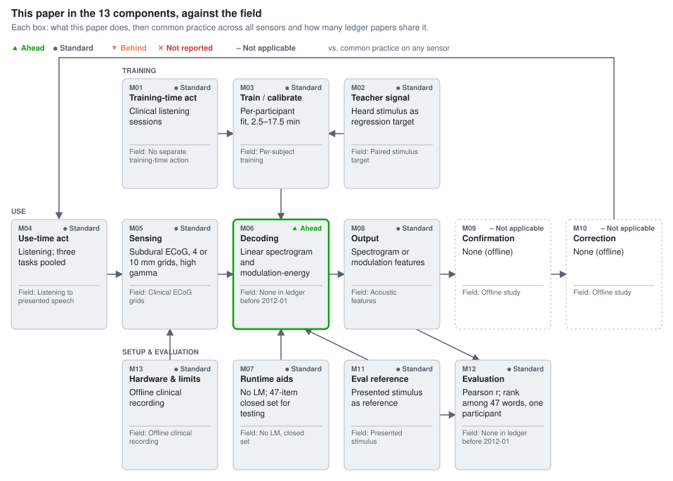

# Reconstructing Speech from Human Auditory Cortex

Pasley, David, Mesgarani, Flinker, Shamma, Crone, Knight, Chang. PLoS Biology 10(1): e1001251, 2012. [doi:10.1371/journal.pbio.1001251](https://doi.org/10.1371/journal.pbio.1001251)

**Section:** [Other sensors](../../README.md#other-sensors)

## Figures

### This paper in the 13 components, against the field

<picture><source media="(prefers-color-scheme: dark)" srcset="figures/components-dark.svg"></picture>

Verdicts compare the paper's choice for each component with common practice across 8,995 ledger entries on any sensor (silent speech, brain-to-text, lip reading).

Data

| Component | This paper | Common practice | Papers with this practice | Verdict |
| --- | --- | --- | --- | --- |
| M01 Training-time act | Clinical listening sessions | No separate training-time action |  | ● Standard (Inherited.) |
| M02 Teacher signal | Heard stimulus as regression target | Paired stimulus target |  | ● Standard (Inherent to stimulus reconstruction.) |
| M03 Train / calibrate | Per-participant fit, 2.5–17.5 min | Per-subject training |  | ● Standard (Normalization scope not stated.) |
| M04 Use-time act | Listening; three tasks pooled | Listening to presented speech |  | ● Standard (No per-task accuracy.) |
| M05 Sensing | Subdural ECoG, 4 or 10 mm grids, high gamma | Clinical ECoG grids |  | ● Standard (Density confounded with amplifier (inference).) |
| M06 Decoding | Linear spectrogram and modulation-energy targets | None in ledger before 2012-01 |  | ▲ Ahead (Spectrogram per participant; modulation a group effect.) |
| M07 Runtime aids | No LM; 47-item closed set for testing | No LM, closed set |  | ● Standard (Candidate set serves M12 only.) |
| M08 Output | Spectrogram or modulation features | Acoustic features |  | ● Standard (Audio only via phase retrieval.) |
| M09 Confirmation | None (offline) | Offline study |  | – Not applicable (Offline study.) |
| M10 Correction | None (offline) | Offline study |  | – Not applicable (Offline study.) |
| M11 Eval reference | Presented stimulus as reference | Presented stimulus |  | ● Standard (Inherited.) |
| M12 Evaluation | Pearson r; rank among 47 words, one participant | None in ledger before 2012-01 |  | ● Standard (No noise ceiling; same-speaker test items.) |
| M13 Hardware & limits | Offline clinical recording | Offline clinical recording |  | ● Standard (Inherited.) |

## Verdict

Among the ledger's pattern matches, the paper [[1]](#ref-1) is the earliest heard-speech reconstruction from human intracranial recordings (M06, Appendix); the authors claim findings, not priority. Its linear spectrogram reconstruction is ahead for 2012 and repeats per participant, above zero in all 15, while the read human priors classified syllable responses [[2]](#ref-2) or decoded formants during attempted production [[3]](#ref-3). The modulation-energy target rests on a group effect (F(1,14) = 33.36) without a per-participant count and was reused only within its lineage. The evaluation (M12), correlation scoring plus candidate identification, is standard against the priors the authors cite. The word readout overreaches: one participant, 47 candidates from one speaker, a median rank of 0.76, not an accuracy. No listener test is reported; [later] vocoder-parameter decoding reached 75% listener digit accuracy, 67% above a linear spectrogram baseline [[4]](#ref-4).

## Against the field, component by component

### M06 Processing and decoding: what is reconstructed

**Usual approach:** none in the ledger before 2012-01. Of 63 pattern matches (versions merged, target excluded, not all reconstruction studies), the 2 dated earlier are behavioural perception studies, and a full-text check for envelope or spectrogram reconstruction in neural papers dated 2012 or earlier finds only the target (Appendix). Chang et al. classified pSTG responses of four intraoperative patients on a 4-mm array [[2]](#ref-2); the target's 4-mm group (N = 4) cites it, so they likely share participants (inference). Guenther et al. decoded an acoustic target, two formants, but during attempted production [[3]](#ref-3). The authors credit spectrogram reconstruction to non-human work (refs 14, 15). Ding and Simon's MEG study [[5]](#ref-5) is [concurrent] (online October 2011) and models encoding.

**State of the art:** Akbari et al. (2019) [later], five ECoG patients, digits and speakers absent from training: a network predicting vocoder parameters reached 75% listener digit accuracy, 67% above linear regression to the auditory spectrogram (Results; the Abstract says 65%; baseline about 45%, inference) [[4]](#ref-4).

Later adoption among the 63 matches (all years, pattern match): spectrogram target 20, vocoder parameters 14, envelope 12, modulation 2. The modulation advantage is a group effect with a rate interaction (F(5,70) = 3.33), largest at 16 Hz and above (Figure S3), where the linear model sits near r = 0.10; no overall r is given, it uses 3 resamples against 10, and audio needs phase estimation that adds artifacts (Figure S7). Reuse stays in one group [[6]](#ref-6). Verdict: ahead, for the per-participant heard-speech spectrogram reconstruction; the modulation target alone would not meet the repetition rule.

### M12 Evaluation: correlation plus identification rank

**Usual approach:** no speech-reconstruction evaluation in the ledger before 2012-01 (2 earlier matches, a review and a phoneme classifier; Appendix). The authors take correlation scoring from non-human stimulus reconstruction (refs 12–15, Introduction) and cite fMRI image identification by Kay et al. 2008 (ref 49, Discussion). Correlation later dominates (122 of 173 keys, versions not merged).

**State of the art:** for heard speech, Défossez et al. (2023) [later] identify 3-s segments among 1,594 at up to 72.5% top-10 accuracy from MEG, without acoustic reconstruction [[7]](#ref-7); for produced speech, Berezutskaya et al. classify 12 words from reconstructions at 92–100% against 8% chance in five subjects [[8]](#ref-8). The target tests new words from one speaker's set (Results) and, as the authors state, has no noise ceiling because more than 5 repeats were generally unavailable. Verdict: standard; identification uses one participant.

## The 13 components

| Component | This paper | Usual approach (count) | State of the art | Verdict |
|---|---|---|---|---|
| M01 Training-time action | Clinical listening sessions | No separate training-time action | – | standard |
| M02 Training-only supervision | Heard stimulus as regression target | Paired stimulus target | – | standard |
| M03 Training and adaptation | Per-participant fit, 2.5–17.5 min | Per-subject training | – | standard |
| M04 Use-time action | Listening; three tasks pooled | Listening to presented speech | – | standard |
| M05 Sensors | Subdural ECoG, 4 or 10 mm grids, high gamma | Clinical ECoG grids | – | standard |
| M06 Processing and decoding | Linear spectrogram and modulation-energy targets | None in ledger before 2012-01 | [[4]](#ref-4) (2019): 75% listener digit accuracy | ahead |
| M07 Lexicon and LM | No LM; 47-item closed set for testing | No LM, closed set | – | standard |
| M08 Output | Spectrogram or modulation features | Acoustic features | – | standard |
| M09 Confirmation | None (offline) | Offline study | – | not applicable |
| M10 Correction | None (offline) | Offline study | – | not applicable |
| M11 Reference construction | Presented stimulus as reference | Presented stimulus | – | standard |
| M12 Evaluation | Pearson r; rank among 47 words, one participant | None in ledger before 2012-01 | [[7]](#ref-7) (2023): 72.5% top-10 of 1,594 segments | standard |
| M13 Device and cost | Offline clinical recording | Offline clinical recording | – | standard |

## Where the claims outrun the evidence

- Word readout (Abstract): one participant, 47 words and pseudowords from one speaker, median rank 0.89 averaged and 0.76 single-trial against 0.5 chance (Figure 8). Rank 0.76 puts the correct word above about 35 of 46 alternatives (inference), not an identification rate. The smoothing width is the best-performing one (Figure 8); the validation split is described only for model fitting (Methods).
- Intelligibility: the Abstract links accuracy to intelligibility through cited psychoacoustics; the authors concede single trials are generally not intelligible; listeners scored such output only later [[4]](#ref-4).
- Electrode density (M05): r = 0.43 for 4-mm grids (N = 4) against 0.19 with five or fewer responsive electrodes (N = 6) (Figure 4C). The 4-mm and 3,052 Hz groups both cite Chang et al. [[2]](#ref-2), so density travels with intraoperative recording and amplifier (inference).
- Pooling: mean r = 0.28 pools three tasks (5 participants each); Figure 3 groups by density and stimulus set, not task.

## What the field needs next

- M06: spectrogram, modulation and vocoder targets compared by listeners in the same participants.
- M12: speaker-disjoint tests with a noise ceiling; identification in several participants, smoothing fixed on validation data.
- M05: grid density varied with recording setting fixed.

## Questions for the authors

- Were standardization statistics estimated on training partitions only?
- Results describe leave-one-out over words, Methods random trial subsampling: which produced each headline number?
- Can you confirm that the 4-mm, 3,052 Hz participants are those of Chang et al. 2010?
- How was the smoothing width chosen, with which seeds and sessions?

## Appendix: literature search

- **M06 / heard-speech-reconstruction-target-representation.** Inclusion rule: ledger text names intracranial or auditory-cortex recordings, a listening or perception condition, an acoustic representation and reconstruction, decoding or synthesis; design of interest: the reconstructed representation; the pattern also admits production, encoding and behavioural studies; designs overlap; versions count once. Ledger counts: pattern match 64 keys, 63 studies after merging versions and excluding the target, plus 5 full-text-only folders. First public before 2012-01: 2 matches, both behavioural; neural reconstruction 0. All years: spectrogram 20, vocoder parameters 14, envelope 12, modulation 2 (pattern match). Recall checks: envelope or spectrogram reconstruction in neural full texts dated 2012 or earlier, 3 folders (two target versions, one fMRI study describing vocoded stimuli); modulation-energy reconstruction over the wiki, 8 folders, all target versions or [later]. Read in full: [[2]](#ref-2), [[3]](#ref-3), [[4]](#ref-4). Known-item recall 1.0 (3 seeds).
- **M12 / neural-speech-reconstruction-identification-test** (published table, reused). Inclusion rule: studies that reconstruct a continuous acoustic speech representation from neural recordings and evaluate it; design categories overlap; the pattern also admits attention-decoding studies. Ledger counts: pattern match 173 keys, versions not merged; correlation 122, listening test 45, mel-cepstral distortion 31, STOI 23, identification among candidates 20. First public before 2012-01: 2 matches (a review and a phoneme classifier), reconstruction evaluations 0. Read: [[8]](#ref-8), [[7]](#ref-7). Known-item recall 0.67.

## References

Numbered by first citation. BibTeX in the same order and keys: [refs.bib](refs.bib).

1. Pasley, B. N., David, S. V., Mesgarani, N., Flinker, A., Shamma, S. A., Crone, N. E., et al. “Reconstructing Speech from Human Auditory Cortex.” *PLoS Biology*, 2012, 10(1), e1001251. doi:[10.1371/journal.pbio.1001251](https://doi.org/10.1371/journal.pbio.1001251). Target. Read as the published article. [wiki: doi-10.1371-journal.pbio.1001251](https://github.com/supernaiter/deep-research-wiki-for-silent-speech/blob/main/papers/doi-10.1371-journal.pbio.1001251/article.md) [wiki: pmc-3269422-pasley](https://github.com/supernaiter/deep-research-wiki-for-silent-speech/blob/main/papers/pmc-3269422-pasley/article.md) [wiki: pmc-3269422-speechrecon](https://github.com/supernaiter/deep-research-wiki-for-silent-speech/blob/main/papers/pmc-3269422-speechrecon/article.md)
2. Chang, E. F., Rieger, J. W., Johnson, K., Berger, M. S., Barbaro, N. M., Knight, R. T. “Categorical Speech Representation in Human Superior Temporal Gyrus.” *Nature Neuroscience*, 2010, 13(11), 1428-1432. doi:[10.1038/nn.2641](https://doi.org/10.1038/nn.2641). Prior; deciding prior for M06 (pSTG ECoG, passive listening, classification, no reconstruction). [wiki: pmc-2967728-categoricalstg](https://github.com/supernaiter/deep-research-wiki-for-silent-speech/blob/main/papers/pmc-2967728-categoricalstg/article.md)
3. Guenther, F. H., Brumberg, J. S., Wright, E. J., Nieto-Castanon, A., Tourville, J. A., Panko, M., et al. “A Wireless Brain-Machine Interface for Real-Time Speech Synthesis.” *PLoS ONE*, 2009, 4(12), e8218. doi:[10.1371/journal.pone.0008218](https://doi.org/10.1371/journal.pone.0008218). Prior; deciding prior for M06 (attempted production, Kalman-filter formant decoding). [review](https://github.com/supernaiter/silent-speech-review/tree/main/reviews/a-wireless-brain-machine-interface-for-real-time-speech-synthesis) [wiki: pmc-2784218-wireless](https://github.com/supernaiter/deep-research-wiki-for-silent-speech/blob/main/papers/pmc-2784218-wireless/article.md)
4. Akbari, H., Khalighinejad, B., Herrero, J. L., Mehta, A. D., Mesgarani, N. “Towards reconstructing intelligible speech from the human auditory cortex.” *Scientific Reports*, 2019, 9, 874. doi:[10.1038/s41598-018-37359-z](https://doi.org/10.1038/s41598-018-37359-z). Later; state of the art for M06 (heard-speech reconstruction judged by listeners). [later] [wiki: doi-10.1038-s41598-018-37359-z](https://github.com/supernaiter/deep-research-wiki-for-silent-speech/blob/main/papers/doi-10.1038-s41598-018-37359-z/article.md) [wiki: pmc-6351601-audrecon](https://github.com/supernaiter/deep-research-wiki-for-silent-speech/blob/main/papers/pmc-6351601-audrecon/article.md) [wiki: pmc-6351601-intelligible](https://github.com/supernaiter/deep-research-wiki-for-silent-speech/blob/main/papers/pmc-6351601-intelligible/article.md)
5. Ding, N., Simon, J. Z. “Neural coding of continuous speech in auditory cortex during monaural and dichotic listening.” *Journal of Neurophysiology*, 2012, 107(1), 78-89. doi:[10.1152/jn.00297.2011](https://doi.org/10.1152/jn.00297.2011). Concurrent (online 5 October 2011, PubMed 21975452); not in the wiki; abstract read. [concurrent]
6. Martin, S., Brunner, P., Holdgraf, C., Heinze, H., Crone, N. E., Rieger, J., et al. “Decoding spectrotemporal features of overt and covert speech from the human cortex.” *Frontiers in Neuroengineering*, 2014, 7, 14. doi:[10.3389/fneng.2014.00014](https://doi.org/10.3389/fneng.2014.00014). Later; reuses the modulation-based reconstruction model. [later] [wiki: doi-10.3389-fneng.2014.00014](https://github.com/supernaiter/deep-research-wiki-for-silent-speech/blob/main/papers/doi-10.3389-fneng.2014.00014/article.md) [wiki: pmc-4034498-overtcovert](https://github.com/supernaiter/deep-research-wiki-for-silent-speech/blob/main/papers/pmc-4034498-overtcovert/article.md) [wiki: pmc-4034498-spectemp](https://github.com/supernaiter/deep-research-wiki-for-silent-speech/blob/main/papers/pmc-4034498-spectemp/article.md)
7. Défossez, A., Caucheteux, C., Rapin, J., Kabeli, O., King, J. “Decoding speech perception from non-invasive brain recordings.” *Nature Machine Intelligence*, 2023. doi:[10.1038/s42256-023-00714-5](https://doi.org/10.1038/s42256-023-00714-5). arXiv:[2208.12266](https://arxiv.org/abs/2208.12266). Later; heard-speech segment identification for M12 (contrastive, no acoustic reconstruction). Read as arXiv v2. [later] [review](https://github.com/supernaiter/silent-speech-review/tree/main/reviews/decoding-speech-perception-from-non-invasive-brain-recordings) [wiki: arxiv-2208.12266-natmi](https://github.com/supernaiter/deep-research-wiki-for-silent-speech/blob/main/papers/arxiv-2208.12266-natmi/article.md)
8. Berezutskaya, J., Freudenburg, Z. V., Vansteensel, M. J., Aarnoutse, E. J., Ramsey, N. F., van Gerven, M. A. J. “Direct speech reconstruction from sensorimotor brain activity with optimized deep learning models.” *Journal of Neural Engineering*, 2023, 20, 056010. doi:[10.1088/1741-2552/ace8be](https://doi.org/10.1088/1741-2552/ace8be). Later; state of the art of the published M12 table. [later] [wiki: doi-10.1088-1741-2552-ace8be](https://github.com/supernaiter/deep-research-wiki-for-silent-speech/blob/main/papers/doi-10.1088-1741-2552-ace8be/article.md) [wiki: pmc-10510111-berezutskaya](https://github.com/supernaiter/deep-research-wiki-for-silent-speech/blob/main/papers/pmc-10510111-berezutskaya/article.md) [wiki: pmc-10510111-recon](https://github.com/supernaiter/deep-research-wiki-for-silent-speech/blob/main/papers/pmc-10510111-recon/article.md)

## Materials

Data behind this review. Full texts of the papers are not included.

- [`review.md`](review.md): the review text (source)
- [`refs.bib`](refs.bib): references (BibTeX)
- [`slots.json`](slots.json): for each of the 13 components: this paper's choice, field practice, number of matching papers, verdict
- [`figures.json`](figures.json): figure definitions
- [`evaluation.md`](evaluation.md): independent evaluation by a second reviewer
- [`triage.md`](triage.md): how each evaluation finding was checked against the sources and resolved
- [`process/log.json`](process/log.json): process record: each step, who did it (reader, script, writer, evaluator), when, the checks run and the input versions
- [`process/notes.json`](process/notes.json): reading notes on the target and comparator papers: claims, numbers, conditions and what is not stated, with locations
- [`process/plan.json`](process/plan.json): plan: which components the paper changes and the topics it is compared on
- [`process/draft.md`](process/draft.md): the review as first written, before the independent evaluation
- [`process/claims-draft.md`](process/claims-draft.md): claim table of the draft: every claim mapped to a note or a count
- [`process/claims.md`](process/claims.md): claim table of the published review
- [`components/M06/heard-speech-reconstruction-target-representation.csv`](../../components/M06/heard-speech-reconstruction-target-representation.csv): M06 topic "heard-speech-reconstruction-target-representation", every candidate paper with its decision (7345 slot-filled, 64 pattern match, usual design in 24, 4 read in full)
- [`components/M12/neural-speech-reconstruction-identification-test.csv`](../../components/M12/neural-speech-reconstruction-identification-test.csv): M12 topic "neural-speech-reconstruction-identification-test", every candidate paper with its decision (6960 slot-filled, 173 pattern match, usual design in 122, 4 read in full)

## More reviews in Other sensors

- [Decoding Vowels and Consonants in Spoken and Imagined Words Using Electrocorticographic Signals in Humans](../decoding-vowels-and-consonants-in-spoken-and-imagined-words-using-electrocorticographic-signals-in-h/) (2011). Paired covert/overt vowel and consonant-class decoding on ECoG (M04) is ahead as a 2011 protocol; best-of-47–64-electrode selection and prompt-only covert labels make its gains upper bounds.
- [Decoding spectrotemporal features of overt and covert speech from the human cortex](../decoding-spectrotemporal-features-of-overt-and-covert-speech-from-the-human-cortex/) (2014). Overt-trained ECoG decoding of covert reading (M04), spectral outputs (M08) and the overt-recording covert reference (M11) are standard; DTW-aligned rest reaches r 0.30 vs covert 0.34.
- [Direct classification of all American English phonemes using signals from functional speech motor cortex](../direct-classification-of-all-american-english-phonemes-using-signals-from-functional-speech-motor-co/) (2014). Phoneme-onset events within words (M06) are ahead as a protocol; full-inventory classification predates it (Brumberg 2011); the 36% headline is consonants only, on hand-labelled onsets.
- [Decoding spoken words using local field potentials recorded from the cortical surface](../decoding-spoken-words-using-local-field-potentials-recorded-from-the-cortical-surface/) (2010). Micro-ECoG closed-set word decoding (M05, M06) departs from 2009 intracortical formant decoding and clinical grids but stays standard: one patient, one split, selection on test data.
- [Brain-to-text: decoding spoken phrases from phone representations in the brain](../brain-to-text-decoding-spoken-phrases-from-phone-representations-in-the-brain/) (2015). Phone-model decoder (M06) is the EMG recognizer moved to ECoG: standard. 25% WER uses per-phrase dictionaries holding the spoken words (M07); the time-shift null (M12) is sound.
- [A Wireless Brain-Machine Interface for Real-Time Speech Synthesis](../a-wireless-brain-machine-interface-for-real-time-speech-synthesis/) (2009). Closed-loop formant decoding (M06) and F1/F2 output (M08) are standard: gesture-driven formant synthesis came first; one user learns vowels; hit rate lacks a chance level; no speech measured.

---

Part of the [Silent Speech Interface Review](https://github.com/supernaiter/silent-speech-review). Found an error? [Open an issue](https://github.com/supernaiter/silent-speech-review/issues/new?template=correction.yml).
