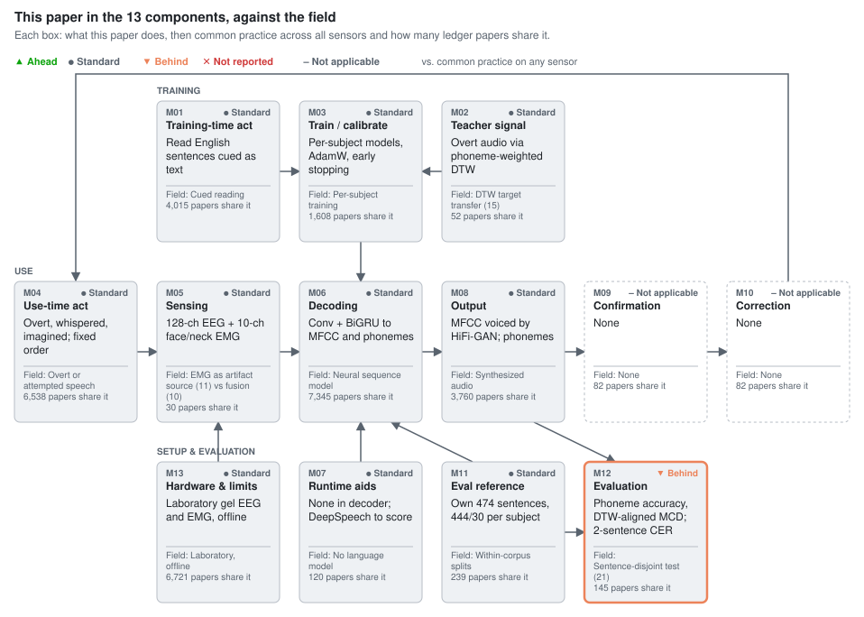

# Reconstructing Unseen Sentences from Speech-related Biosignals for Open-vocabulary Neural Communication

Deok-Seon Kim, Seo-Hyun Lee, Kang Yin, Seong-Whan Lee. arXiv preprint, 2025. [arXiv:2510.27247](https://arxiv.org/abs/2510.27247)

**Section:** [Surface EMG](../../README.md#surface-emg)

## Figures

### This paper in the 13 components, against the field

<picture><source media="(prefers-color-scheme: dark)" srcset="figures/components-dark.svg"></picture>

Verdicts compare the paper's choice for each component with common practice across 8,995 ledger entries on any sensor (silent speech, brain-to-text, lip reading).

Data

| Component | This paper | Common practice | Papers with this practice | Verdict |
| --- | --- | --- | --- | --- |
| M01 Training-time act | Read English sentences cued as text | Cued reading | 4,015 of 8,995 | ● Standard (Inherited.) |
| M02 Teacher signal | Overt audio via phoneme-weighted DTW | DTW target transfer (15) | 52 of 8,995 | ● Standard (Recipe of [@gaddy2021improved].) |
| M03 Train / calibrate | Per-subject models, AdamW, early stopping | Per-subject training | 1,608 of 8,995 | ● Standard (Inherited; no seeds.) |
| M04 Use-time act | Overt, whispered, imagined; fixed order | Overt or attempted speech | 6,538 of 8,995 | ● Standard (Order not counterbalanced.) |
| M05 Sensing | 128-ch EEG + 10-ch face/neck EMG | EMG as artifact source (11) vs fusion (10) | 30 of 8,995 | ● Standard (Prior fusion uncited; no EMG-only arm.) |
| M06 Decoding | Conv + BiGRU to MFCC and phonemes | Neural sequence model | 7,345 of 8,995 | ● Standard (Inherited from EMG voicing.) |
| M07 Runtime aids | None in decoder; DeepSpeech to score | No language model | 120 of 8,995 | ● Standard (Inherited.) |
| M08 Output | MFCC voiced by HiFi-GAN; phonemes | Synthesized audio | 3,760 of 8,995 | ● Standard (Inherited.) |
| M09 Confirmation | None | None | 82 of 8,995 | – Not applicable (Offline study.) |
| M10 Correction | None | None | 82 of 8,995 | – Not applicable (Offline study.) |
| M11 Eval reference | Own 474 sentences, 444/30 per subject | Within-corpus splits | 239 of 8,995 | ● Standard (One patient, 145/10.) |
| M12 Evaluation | Phoneme accuracy, DTW-aligned MCD; 2-sentence CER | Sentence-disjoint test (21) | 145 of 8,995 | ▼ Behind (No cohort WER or CER; behind best comparable work.) |
| M13 Hardware & limits | Laboratory gel EEG and EMG, offline | Laboratory, offline | 6,721 of 8,995 | ● Standard (Inherited.) |

## Verdict

The paper [[1]](#ref-1) changes two components: it adds 10 face and neck EMG channels to 128-channel EEG (M05), and it trains whispered and imagined inputs on the overt recording of the same sentence through phoneme-weighted DTW (M02). Both are standard: EEG and sEMG fusion for silent-speech synthesis, with single-modality ablations, appeared in 2023 [[2]](#ref-2) and is not among the paper's 53 references, and the training recipe is the EMG voicing recipe [[3]](#ref-3) that NeuroTalk had moved to imagined EEG [[4]](#ref-4). The sentence-disjoint test (M12) follows field practice, but the evaluation is behind the best comparable work: the open-vocabulary claim rests on phoneme accuracy and DTW-aligned MFCC distances, with no cohort word or character error rate. The strongest confound is muscle: overt EEG is kept at 0.5–200 Hz with no regression of the simultaneously recorded EMG [[5]](#ref-5), and there is no EMG-only arm, so what EEG adds to EMG is not measured.

## Against the field, component by component

### M05 Sensors: EEG with surface EMG

**Usual approach:** Of 30 unique studies whose ledger lists both scalp EEG and surface EMG (pattern match, Appendix), 11 treat EMG as an artifact source and 10 fuse the two. The paper concatenates channels (§III-C).

**State of the art:** Decision-level fusion of 57 EEG and 5 sEMG channels gave 7.22% CER over eight speakers in 2023, against 38.85% for EEG only and 10.52% for sEMG only (Table 3) [[2]](#ref-2); its test items are held-out repeats of training sentences, so its numbers do not transfer to unseen sentences.

In that prior, EMG carries most of the information: adding EEG to sEMG lowers CER from 10.52% to 7.22%, 3.30 points or 31% relative (inference); its own "31.63% reduction" is the drop from EEG only. Here the only comparison is EEG versus EEG+EMG (Fig. 3; §IV-A): overt phoneme accuracy rises from 36.83% to 48.58% and whispered from 30.54% to 40.97%, with whispered RMSE unchanged (0.58) and whispered MCD 4.73 with EMG vs 4.71 without. Without an EMG-only arm these gains cannot be credited to fusion rather than to EMG. Verdict: standard.

### M02 Training-only supervision: overt audio transferred to whispered and imagined inputs

**Usual approach:** 15 confirmed studies (of 52 unique, pattern match, Appendix) train silent signals on targets transferred from a vocalized recording; DTW transfer is the default on the open EMG corpus. The paper uses a phoneme-weighted DTW cost plus CTC (§III-B).

**State of the art:** On silent EMG, a [later] 2026 synthesizer with DTW-transferred targets reaches 11.89% WER scored by Whisper-medium (21.32% by DeepSpeech) [[6]](#ref-6), guided by a 2024 text recognizer at 12.2% WER with language-model rescoring [[7]](#ref-7); for EEG, NeuroTalk (2023) trained imagined EEG on DTW-aligned spoken audio with CTC, on 12 words [[4]](#ref-4).

The phoneme term in the DTW cost and the forced-aligner labels come from [[3]](#ref-3), which the paper cites. The step from words to 474 sentences is the increment, but imagined speech has no all-participant result (Table V is one subject). Verdict: standard.

### M12 Evaluation: unseen sentences without a text error rate

**Usual approach:** Of 145 unique neural text-decoding studies (pattern match, Appendix), 21 name a sentence-disjoint test and 10 repeated training sentences; the 444/30 split (§II-A) follows the majority.

**State of the art:** Intracortical decoding reached 2.5% WER over all evaluation sentences with a 125,000-word vocabulary in one participant (2024) [[8]](#ref-8), after 23.8% on never-duplicated held-out sentences (2023) [[9]](#ref-9). The nearest non-invasive yardstick, open-vocabulary silent-EMG voicing scored with the same DeepSpeech recognizer, reported 42.2% WER over its whole test set (2021) [[3]](#ref-3).

The paper gives phoneme accuracy against an 11% majority-class baseline, DTW-aligned RMSE and MCD, and CER for two sentences of one subject (0.18–0.50, Table II). DTW-aligned distances reward a plausible spectral envelope even when content is wrong (inference). Verdict: behind the best comparable work, which reports an error rate over every test sentence [[3]](#ref-3), [[9]](#ref-9), [[8]](#ref-8), [[2]](#ref-2).

## The 13 components

| Component | This paper | Usual approach (count) | State of the art | Verdict |
|---|---|---|---|---|
| M01 Training-time action | Read English sentences cued as text | Cued reading (slot-filled 4,015) | – | standard |
| M02 Training-only supervision | Overt audio via phoneme-weighted DTW | DTW target transfer (15) (pattern match 52) | 11.89% WER (Whisper-medium) [[6]](#ref-6) | standard |
| M03 Training and adaptation | Per-subject models, AdamW, early stopping | Per-subject training (slot-filled 1,608) | – | standard |
| M04 Use-time action | Overt, whispered, imagined; fixed order | Overt or attempted speech (slot-filled 6,538) | – | standard |
| M05 Sensors | 128-ch EEG + 10-ch face/neck EMG | EMG as artifact source (11) vs fusion (10) (pattern match 30) | 7.22% CER, EEG+sEMG, repeats [[2]](#ref-2) | standard |
| M06 Processing and decoding | Conv + BiGRU to MFCC and phonemes | Neural sequence model (slot-filled 7,345) | – | standard |
| M07 Lexicon and LM | None in decoder; DeepSpeech to score | No language model (slot-filled 120) | – | standard |
| M08 Output | MFCC voiced by HiFi-GAN; phonemes | Synthesized audio (slot-filled 3,760) | – | standard |
| M09 Confirmation | None | None (slot-filled 82) | – | not applicable |
| M10 Correction | None | None (slot-filled 82) | – | not applicable |
| M11 Reference construction | Own 474 sentences, 444/30 per subject | Within-corpus splits (slot-filled 239) | – | standard |
| M12 Evaluation | Phoneme accuracy, DTW-aligned MCD; 2-sentence CER | Sentence-disjoint test (21) (pattern match 145) | 2.5% WER, 125k words, intracortical [[8]](#ref-8) | behind |
| M13 Device and cost | Laboratory gel EEG and EMG, offline | Laboratory, offline (slot-filled 6,721) | – | standard |

## Where the claims outrun the evidence

- "Open-vocabulary" means 30 held-out sentences from one 474-sentence set (§II-A); word overlap with training is not reported.
- EEG-only overt decoding at up to 200 Hz without EMG regression (§II-B) can be partly myogenic; [[5]](#ref-5) subtracts EMG-predicted components first. Table V's high-gamma rows share the confound.
- "Multimodal integration improves decoding even in patients" (§IV-B) rests on one patient and 10 test sentences.
- The authors concede that the fixed mode order may leak echoic traces into imagined trials (§V-E); no seeds or repeated runs are given (§III-C).

## What the field needs next

- M05: an EMG-only arm, and EEG with EMG-predicted components regressed out.
- M12: CER and WER over every test sentence of every participant, with word-overlap statistics.
- M02: an all-participant imagined-speech result, with mode order counterbalanced.

## Questions for the authors

- What data drove early stopping?
- How many test-sentence words also occur in training sentences?
- What are the cohort CER and WER after DeepSpeech, and which checkpoint and decoder settings were used?

## Appendix: literature search

- M05 eeg-emg-fusion-speech-decoding (new topic). Inclusion rule: speech-decoding studies that record scalp or around-ear EEG with surface EMG of the speech muscles and decode from either or both; EMG recorded only as an artifact reference is counted as artifact control, not fusion; limb-movement fusion, reviews and decoding-free datasets excluded; versions counted once. Slot-filled 7,329 unique studies; pattern match 30 unique studies (M05 modalities). Design counts (pattern match, full text): EMG artifact or contamination 11, EEG and EMG fusion 10. Read in full: [[2]](#ref-2), [[5]](#ref-5), target. Known-item recall 0.67.
- M02 silent-target-transfer (published topic table, appended). Inclusion rule: studies that train a decoder or synthesizer on silently articulated non-acoustic signals with acoustic or label targets transferred from a separate vocalized recording of the same utterance by time alignment; train-vocalized-test-silent, alignment only for scoring, acoustic whisper conversion and imagined speech excluded. Slot-filled 31 unique studies; pattern match 52 unique studies. Usual design: DTW target transfer, 15 (confirmed). Read in full for this review: [[3]](#ref-3), [[4]](#ref-4), [[6]](#ref-6), [[7]](#ref-7). Known-item recall 0.67.
- M12 neural-text-unseen-sentence-test (published topic table, appended). Inclusion rule: neural text-decoding studies (ECoG, intracortical, sEEG, EEG or MEG) reporting WER or CER, compared by whether the test sentences are absent from training. Slot-filled 6,960 unique studies; pattern match 145 unique studies. Usual design: sentence-disjoint test, 21 (pattern match); repeated training sentences 10. Read in full for this review: [[9]](#ref-9), [[8]](#ref-8); also cited: [[3]](#ref-3), [[2]](#ref-2). Known-item recall 0.8.

## References

Numbered by first citation. BibTeX in the same order and keys: [refs.bib](refs.bib).

1. Kim, D., Lee, S., Yin, K., Lee, S. “Reconstructing Unseen Sentences from Speech-related Biosignals for Open-vocabulary Neural Communication.” *arXiv preprint*, 2025. arXiv:[2510.27247](https://arxiv.org/abs/2510.27247). Target. Read as arXiv v1 (31 Oct 2025). [review](https://github.com/supernaiter/silent-speech-review/tree/main/reviews/reconstructing-unseen-sentences-from-speech-related-biosignals-for-open-vocabulary-neural-commun) [wiki: arxiv-2510.27247](https://github.com/supernaiter/deep-research-wiki-for-silent-speech/blob/main/papers/arxiv-2510.27247/article.md)
2. Li, H., Wang, M., Gao, H., Zhao, S., Li, G., Wang, Y. “Hybrid Silent Speech Interface Through Fusion of Electroencephalography and Electromyography.” *Interspeech 2023*, 2023, 1184-1188. doi:[10.21437/Interspeech.2023-805](https://doi.org/10.21437/Interspeech.2023-805). [wiki: isca-li23l-eegemgssi](https://github.com/supernaiter/deep-research-wiki-for-silent-speech/blob/main/papers/isca-li23l-eegemgssi/article.md) [wiki: isca-li23l_interspeech](https://github.com/supernaiter/deep-research-wiki-for-silent-speech/blob/main/papers/isca-li23l_interspeech/article.md)
3. Gaddy, D., Klein, D. “An Improved Model for Voicing Silent Speech.” *Proceedings of the 59th Annual Meeting of the Association for Computational Linguistics (ACL)*, 2021, 175-181. doi:[10.18653/v1/2021.acl-short.23](https://doi.org/10.18653/v1/2021.acl-short.23). arXiv:[2106.01933](https://arxiv.org/abs/2106.01933). [review](https://github.com/supernaiter/silent-speech-review/tree/main/reviews/an-improved-model-for-voicing-silent-speech) [wiki: arxiv-2106.01933](https://github.com/supernaiter/deep-research-wiki-for-silent-speech/blob/main/papers/arxiv-2106.01933/article.md) [wiki: doi-10.18653-v1-2021.acl-short.23](https://github.com/supernaiter/deep-research-wiki-for-silent-speech/blob/main/papers/doi-10.18653-v1-2021.acl-short.23/article.md)
4. Lee, Y., Lee, S., Kim, S., Lee, S. “Towards Voice Reconstruction from EEG during Imagined Speech.” *Proceedings of the AAAI Conference on Artificial Intelligence*, 2023, 37(5). doi:[10.1609/aaai.v37i5.25745](https://doi.org/10.1609/aaai.v37i5.25745). arXiv:[2301.07173](https://arxiv.org/abs/2301.07173). [wiki: arxiv-2301.07173](https://github.com/supernaiter/deep-research-wiki-for-silent-speech/blob/main/papers/arxiv-2301.07173/article.md) [wiki: doi-10.1609-aaai.v37i5.25745](https://github.com/supernaiter/deep-research-wiki-for-silent-speech/blob/main/papers/doi-10.1609-aaai.v37i5.25745/article.md)
5. Sato, M., Kabe, Y., Nobe, S., Yoshida, A., Inoue, M., Shimizu, M., et al. “Delineating neural contributions to electroencephalogram-based speech decoding.” *bioRxiv preprint*, 2024. doi:[10.1101/2024.05.09.591996](https://doi.org/10.1101/2024.05.09.591996). [wiki: doi-10.1101-2024.05.09.591996](https://github.com/supernaiter/deep-research-wiki-for-silent-speech/blob/main/papers/doi-10.1101-2024.05.09.591996/article.md)
6. Lee, J., Lee, J., Lee, K. “GETS: Guiding EMG-to-Speech Synthesis via Silent Speech Recognition.” *Interspeech 2026*, 2026. doi:[10.21437/Interspeech.2026-1938](https://doi.org/10.21437/Interspeech.2026-1938). [later] [wiki: isca-lee26r_interspeech](https://github.com/supernaiter/deep-research-wiki-for-silent-speech/blob/main/papers/isca-lee26r_interspeech/article.md)
7. Benster, T., Wilson, G., Elisha, R., Willett, F. R., Druckmann, S. “A Cross-Modal Approach to Silent Speech with LLM-Enhanced Recognition.” *arXiv preprint*, 2024. arXiv:[2403.05583](https://arxiv.org/abs/2403.05583). [wiki: arxiv-2403.05583](https://github.com/supernaiter/deep-research-wiki-for-silent-speech/blob/main/papers/arxiv-2403.05583/article.md)
8. Card, N. S., Wairagkar, M., Iacobacci, C., Hou, X., Singer-Clark, T., Willett, F. R., et al. “An accurate and rapidly calibrating speech neuroprosthesis.” *New England Journal of Medicine*, 2024, 391(7), 609-618. doi:[10.1056/NEJMoa2314132](https://doi.org/10.1056/NEJMoa2314132). [review](https://github.com/supernaiter/silent-speech-review/tree/main/reviews/an-accurate-and-rapidly-calibrating-speech-neuroprosthesis) [wiki: doi-10.1056-nejmoa2314132](https://github.com/supernaiter/deep-research-wiki-for-silent-speech/blob/main/papers/doi-10.1056-nejmoa2314132/article.md) [wiki: doi-10.1056-NEJMoa2314132](https://github.com/supernaiter/deep-research-wiki-for-silent-speech/blob/main/papers/doi-10.1056-NEJMoa2314132/article.md) [wiki: pmc-11328962-rapidcal](https://github.com/supernaiter/deep-research-wiki-for-silent-speech/blob/main/papers/pmc-11328962-rapidcal/article.md)
9. Willett, F. R., Kunz, E. M., Fan, C., Avansino, D. T., Wilson, G. H., Choi, E. Y., et al. “A high-performance speech neuroprosthesis.” *Nature*, 2023, 620, 1031-1036. doi:[10.1038/s41586-023-06377-x](https://doi.org/10.1038/s41586-023-06377-x). [review](https://github.com/supernaiter/silent-speech-review/tree/main/reviews/a-high-performance-speech-neuroprosthesis) [wiki: doi-10.1038-s41586-023-06377-x](https://github.com/supernaiter/deep-research-wiki-for-silent-speech/blob/main/papers/doi-10.1038-s41586-023-06377-x/article.md) [wiki: pmc-10468393-neuroprosthesis](https://github.com/supernaiter/deep-research-wiki-for-silent-speech/blob/main/papers/pmc-10468393-neuroprosthesis/article.md)

## Materials

Data behind this review. Full texts of the papers are not included.

- [`review.md`](review.md): the review text (source)
- [`refs.bib`](refs.bib): references (BibTeX)
- [`slots.json`](slots.json): for each of the 13 components: this paper's choice, field practice, number of matching papers, verdict
- [`figures.json`](figures.json): figure definitions
- [`evaluation.md`](evaluation.md): independent evaluation by a second reviewer
- [`triage.md`](triage.md): how each evaluation finding was checked against the sources and resolved
- [`components/M02/silent-target-transfer.csv`](../../components/M02/silent-target-transfer.csv): M02 topic "silent-target-transfer", every candidate paper with its decision (31 slot-filled, 52 pattern match, usual design in 15, 4 read in full)
- [`components/M05/eeg-emg-fusion-speech-decoding.csv`](../../components/M05/eeg-emg-fusion-speech-decoding.csv): M05 topic "eeg-emg-fusion-speech-decoding", every candidate paper with its decision (0 confirmed, 0 candidates read, 0 unread)
- [`components/M12/neural-text-unseen-sentence-test.csv`](../../components/M12/neural-text-unseen-sentence-test.csv): M12 topic "neural-text-unseen-sentence-test", every candidate paper with its decision (6960 slot-filled, 145 pattern match, usual design in 21, 4 read in full)

## More reviews in Surface EMG

- [A Parallel Ultra-Low Power Silent Speech Interface based on a Wearable, Fully-dry EMG Neckband](../a-parallel-ultra-low-power-silent-speech-interface-based-on-a-wearable-fully-dry-emg-neckband/) (2025). A fully dry wearable EMG neckband with ultra-low-power BioGAP-Ultra classifies 8 silently articulated words for one healthy user at 68% accuracy, dropping to 54% on an unseen re-wearing session; acquisition plus BLE uses 22.2 mW.
- [A Silent Speech Decoding System from EEG and EMG with Heterogenous Electrode Configurations](../a-silent-speech-decoding-system-from-eeg-and-emg-with-heterogenous-electrode-configurations/) (2025). Pooled EEG/EMG pretraining lifts 64-word accuracy, but each test subject's training sessions, the patient's included, are in pretraining; the coordinate kernel is neither new nor best.
- [Articulatory Feature Prediction from Surface EMG during Speech Production](../articulatory-feature-prediction-from-surface-emg-during-speech-production/) (2025). Articulatory route works on vocalized EMG but trails the mel baseline on WER; it exists for ECoG since 2019, and the electrode subset is never tested against equal-size alternatives.
- [CAT-Net: A Cross-Attention Tone Network for Cross-Subject EEG-EMG Fusion Tone Decoding](../cat-net-a-cross-attention-tone-network-for-cross-subject-eeg-emg-fusion-tone-decoding/) (2025). Cross-attention EEG-EMG fusion is new among EEG-EMG decoders but rests on a five-fold ablation with no seed count; no EEG-only result, and the subject adversary adds 0.41 points.
- [Confidence-Based Self-Training for EMG-to-Speech: Leveraging Synthetic EMG for Robust Modeling](../confidence-based-self-training-for-emg-to-speech-leveraging-synthetic-emg-for-robust-modeling/) (2025). Synthetic EMG with confidence filtering (M03, standard) gives a small real-EMG gain, 23.30% to 21.87% WER on one speaker; large gains appear only on synthetic test EMG.
- [emg2speech: Synthesizing speech from electromyography using self-supervised speech models](../emg2speech-synthesizing-speech-from-electromyography-using-self-supervised-speech-models/) (2025). Ports a 2023 ECoG recipe (text-to-speech HuBERT units, CTC) to EMG; phoneme guidance (M02) and covariance input (M06) are standard. Table 6 mixes listener and decoder scoring, so it ranks no route.

---

Part of the [Silent Speech Interface Review](https://github.com/supernaiter/silent-speech-review). Found an error? [Open an issue](https://github.com/supernaiter/silent-speech-review/issues/new?template=correction.yml).
