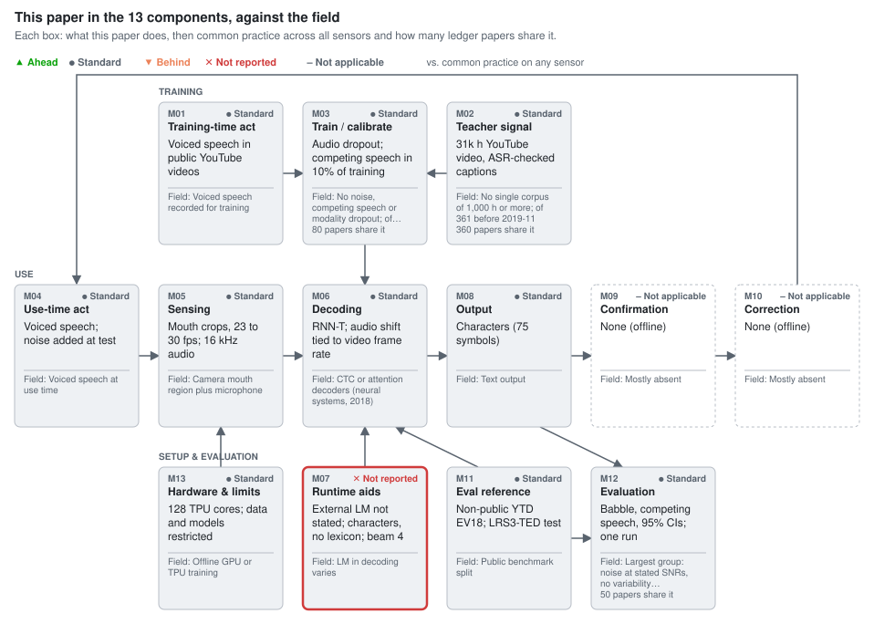

# Recurrent Neural Network Transducer for Audio-Visual Speech Recognition

Takaki Makino, Hank Liao, Yannis Assael, Brendan Shillingford, Basilio Garcia, Otavio Braga, Olivier Siohan. ASRU 2019. [doi:10.1109/ASRU46091.2019.9004036](https://doi.org/10.1109/ASRU46091.2019.9004036) [arXiv:1911.04890](https://arxiv.org/abs/1911.04890)

**Section:** [Other sensors](../../README.md#other-sensors)

## Figures

### This paper in the 13 components, against the field

<picture><source media="(prefers-color-scheme: dark)" srcset="figures/components-dark.svg"></picture>

Verdicts compare the paper's choice for each component with common practice across 8,995 ledger entries on any sensor (silent speech, brain-to-text, lip reading).

Data

| Component | This paper | Common practice | Papers with this practice | Verdict |
| --- | --- | --- | --- | --- |
| M01 Training-time act | Voiced speech in public YouTube videos | Voiced speech recorded for training |  | ● Standard (Inherited.) |
| M02 Teacher signal | 31k h YouTube video, ASR-checked captions | No single corpus of 1,000 h or more; of 361 before 2019-11 | 360 of 361 | ● Standard (Scale-up of the V2P pipeline (3,886 h) [@shillingford2018v2p]; corpus not released.) |
| M03 Train / calibrate | Audio dropout; competing speech in 10% of training | No noise, competing speech or modality dropout; of 107 before 2019-11 | 80 of 107 | ● Standard (Competing-speaker training predates it on GRID [@chao2016speaker]; modality dropout credited to the authors' ref. [32]; one run, one test set.) |
| M04 Use-time act | Voiced speech; noise added at test | Voiced speech at use time |  | ● Standard (Inherited.) |
| M05 Sensing | Mouth crops, 23 to 30 fps; 16 kHz audio | Camera mouth region plus microphone |  | ● Standard (Inherited from the V2P front end.) |
| M06 Decoding | RNN-T; audio shift tied to video frame rate | CTC or attention decoders (neural systems, 2018) |  | ● Standard (No earlier neural transducer in the ledger (Appendix), but no comparison with CTC or attention on the same data.) |
| M07 Runtime aids | External LM not stated; characters, no lexicon; beam 4 | LM in decoding varies |  | ✕ Not reported (Character outputs and beam width are reported; external LM use is not (Sec. 1, Sec. 4).) |
| M08 Output | Characters (75 symbols) | Text output |  | ● Standard (Inherited.) |
| M09 Confirmation | None (offline) | Mostly absent |  | – Not applicable (Offline study.) |
| M10 Correction | None (offline) | Mostly absent |  | – Not applicable (Offline study.) |
| M11 Eval reference | Non-public YTD EV18; LRS3-TED test | Public benchmark split |  | ● Standard (Video-ID exclusion only; speakers not reported.) |
| M12 Evaluation | Babble, competing speech, 95% CIs; one run | Largest group: noise at stated SNRs, no variability estimate; of 107 before 2019-11 | 50 of 107 | ● Standard (Test-set intervals are rare before 2019-11 (Appendix); no seeds or repeated runs.) |
| M13 Hardware & limits | 128 TPU cores; data and models restricted | Offline GPU or TPU training |  | ● Standard (Inherited.) |

## Verdict

The paper [[1]](#ref-1) changes three components, all standard. M06: the first neural transducer for visual or audio-visual speech in the ledger (0 of 123 earlier sentence-level studies, Appendix), a design still at 0.9% LRS3 AVSR WER [[2]](#ref-2) [later]; but no CTC or attention baseline on the same data, as [[3]](#ref-3) ran. M02 scales the V2P caption-mining pipeline [[4]](#ref-4) to 31k hours. M03 mixes competing speech into 10% of training utterances, a step from GRID-scale work [[5]](#ref-5) to large-vocabulary training, on one run and one test set. The LRS3 claim (Abstract) sets 31k hours against 1.4k and 4k hours (Table 7), confounding data and decoder, as the authors say (Sec. 4.5).

## Against the field, component by component

### M06 Processing: transducer decoder and frame-rate alignment

**Usual approach:** The 2018 neural systems used CTC with FSTs [[4]](#ref-4), CTC and seq2seq [[3]](#ref-3), hybrid CTC/attention [[6]](#ref-6) or attention [[7]](#ref-7), which names RNN-T without using it. None of 123 earlier sentence-level studies trains a neural transducer (Appendix). For alignment, 11 of 107 earlier AVSR studies upsample video to the audio rate (pattern match), e.g. to 50 fps [[6]](#ref-6); [[3]](#ref-3) fixes 25 fps. The authors present variable-rate audio as a departure from previous AV-ASR work (Sec. 1); none of the 107 keeps the variable rate (Appendix).

**State of the art:** An LSTM RNN-T decoder on 100k hours gives 0.9% LRS3 AVSR WER (2023) [[2]](#ref-2) [later], first reached by a 2022 VGG Conformer (its Table 2); the lowest, 0.76% (2024), uses Whisper's attention decoder [[8]](#ref-8) [later].

Comparison with attention models is deferred (Sec. 6), so the 33.6% LRS3 visual WER is not attributable to the decoder. Variable-rate audio gives 19.8% A/V WER against 20.1% to 20.4% at fixed rates, ±0.5 (Table 4); the authors call it not significant, and fixed 30 fps was slightly better under another learning-rate schedule (Sec. 4.3). Standard.

### M02 Training-only supervision: caption-mined corpus scale

**Usual approach:** Of 361 VSR and AVSR studies before the target, 360 use no single video corpus of 1,000 hours or more (pattern match, Appendix); the exception, [[4]](#ref-4), has 3,886 hours from the same Liao et al. (2013) pipeline, and [[3]](#ref-3) combines corpora to 1.4k hours (Table 7). The authors believe their larger yield than V2P comes mainly from wider face pan and tilt angles (Sec. 2).

**State of the art:** In 2023, 100k hours give 12.8% LRS3 VSR WER [[2]](#ref-2) [later], against 33.6% here (Table 7).

Sec. 2 calls the corpus 5 times the V2P and 10 times the TM-seq2seq data (with a wrong citation); Table 7's 4k and 1.4k hours give about 7.8 and 22 times (inference). Data and models stay unreleased (Sec. 5). Standard.

### M03 Training: modality dropout and overlapping-speech augmentation

**Usual approach:** Of 107 AVSR studies before the target, at least 80 name no noise, competing speech or modality dropout in training (pattern match, Appendix). Training noise predates it: babble from 20 LRS2 speech signals [[3]](#ref-3), NOISEX babble [[6]](#ref-6), four SNRs [[7]](#ref-7); [[5]](#ref-5) mixed a background speaker into GRID training audio. The target mixes one utterance at 0 to 20 dB into 10% of large-vocabulary training (Sec. 4.4) and credits modality dropout to its reference 32 (Sec. 4.2).

**State of the art:** In 2023 [[2]](#ref-2) [later] trains with 50% video dropout and reaches 0.9% AVSR WER (Sec. 5.3).

Overlap mixing cuts A/V WER on competing speech from 37.4% to 25.6% (Tables 5, 6), 32% relative (inference). Audio dropout lowers visual-only WER from 98.8% to 50.3% but raises audio-only from 24.0% to 46.0% (Table 3), which the authors read as non-robust fusion (Sec. 4.2). Standard.

### M12 Evaluation: noise protocol and intervals

**Usual approach:** Of 107 AVSR studies before the target, 51 state no SNR test and 50, the largest group, test noise at stated SNRs without a variability estimate (pattern match, Appendix); the 9 with one date from 2017 or earlier. The paper adds 95% test-set intervals (Sec. 4) but no seeds or repeated runs.

**State of the art:** At 0 dB babble on LRS3, [[8]](#ref-8) (2024) [later] lists 1.9% AVSR WER for [[2]](#ref-2) and 5.6% for itself, with different noise sets (Table 3). Here noisy tests use only the non-public YTD EV18. Standard.

## The 13 components

| Component | This paper | Usual approach (count) | State of the art | Verdict |
|---|---|---|---|---|
| M01 Training-time action | Voiced speech in public YouTube videos | Voiced speech recorded for training | – | standard |
| M02 Training-only supervision | 31k h YouTube video, ASR-checked captions | No single corpus of 1,000 h or more; of 361 before 2019-11 (pattern match 360) | [[2]](#ref-2) 100k h, 12.8% LRS3 VSR WER | standard |
| M03 Training and adaptation | Audio dropout; competing speech in 10% of training | No noise, competing speech or modality dropout; of 107 before 2019-11 (pattern match 80) | [[2]](#ref-2) 50% video dropout, 0.9% | standard |
| M04 Use-time action | Voiced speech; noise added at test | Voiced speech at use time | – | standard |
| M05 Sensors | Mouth crops, 23 to 30 fps; 16 kHz audio | Camera mouth region plus microphone | – | standard |
| M06 Processing and decoding | RNN-T; audio shift tied to video frame rate | CTC or attention decoders (neural systems, 2018) | [[8]](#ref-8) 0.76% (attention); RNN-T [[2]](#ref-2) 0.9% | standard |
| M07 Lexicon and LM | External LM not stated; characters, no lexicon; beam 4 | LM in decoding varies | – | not reported |
| M08 Output | Characters (75 symbols) | Text output | – | standard |
| M09 Confirmation | None (offline) | Mostly absent | – | not applicable |
| M10 Correction | None (offline) | Mostly absent | – | not applicable |
| M11 Reference construction | Non-public YTD EV18; LRS3-TED test | Public benchmark split | – | standard |
| M12 Evaluation | Babble, competing speech, 95% CIs; one run | Largest group: noise at stated SNRs, no variability estimate; of 107 before 2019-11 (pattern match 50) | [[2]](#ref-2) 1.9% at 0 dB babble | standard |
| M13 Device and cost | 128 TPU cores; data and models restricted | Offline GPU or TPU training | – | standard |

## Where the claims outrun the evidence

- "Significantly improves the state-of-the-art on LRS3-TED" (Abstract): 33.6% against 55.1% visual-only is 39% lower (inference), 4.5% against 7.2% A/V 38% lower (inference), with 31k against 4k and 1.4k training hours (Table 7). The 7.2% and 58.9% are external-LM results of [[3]](#ref-3), V2P decodes with FSTs, and the paper states no LM. The authors credit "far more data and a RNN-T model" (Sec. 4.5); neither is isolated.
- The authors call the clean A/V gain slight (Sec. 6), about 5% relative (Sec. 4.4); at 0 dB babble A/V (57.4%) is worse than visual-only (48.5%), as they report (Sec. 4.4).

## What the field needs next

- M06: RNN-T, CTC and attention on the same 31k hours and front end, three or more seeds.
- M03: fusion that keeps A/V WER at or below the better single modality at 0 dB, on recorded noise.

## Questions for the authors

- Was an external language model used for Table 7?
- Do any YTD EV18 speakers appear in training?

## Appendix: literature search

- M06, sentence-lipreading-sequence-objective (published table, appended). Inclusion rule: studies that decode sentence-level or open-vocabulary speech from lip or face video (lip reading, VSR, AVSR or LRS2/LRS3 with sentence-level recognition), classified by the sequence objective their full text names; a study counts under every objective it names (upper bound); versions once. Ledger counts: 7,345 unique studies slot-filled for M06; 633 unique studies pattern match. Before 2019-11 (123 dated), studies naming each objective anywhere in the text (mentions, upper bound): HMM 79, CTC 20, attention or seq2seq 16, "transducer" 16; the 16 include no neural transducer (snippets read: finite-state transducers, ultrasound probes, mentions); 21 studies dated only to 2019 name no RNN-T. All dates: CTC 288, attention or seq2seq 281, HMM 196, transducer 119. Recall check over 2,671 wiki studies dated before 2019-11: 2 RNN-T hits, [[7]](#ref-7) (mention) and an EEG study first public 2019-08 ([concurrent]). Read: [[3]](#ref-3), [[4]](#ref-4), [[7]](#ref-7), [[6]](#ref-6) (prior); [[2]](#ref-2) (state of the art); [[9]](#ref-9) ([later]). Known-item recall 1.0.
- M06, avsr-audio-stream-input-representation (published table, appended). Inclusion rule: studies whose ledger names AVSR, classified by the audio input and audio-video rate alignment their full text names. Ledger counts: 349 unique studies pattern match. Before 2019-11 (107 dated): filterbank or MFCC 67, video upsampled or interpolated 11, variable frame rate 0; all dates: variable frame rate 2 (the target and [[9]](#ref-9)). Known-item recall 0.8.
- M02, asr-transcribed-unlabelled-video-training (published table, appended). Inclusion rule: studies whose ledger names lip reading, VSR or AVSR, classified by training-label source and, here, by a named corpus of 1,000 hours or more. Ledger counts: 31 unique studies slot-filled for M02; 1,049 unique studies pattern match. Before 2019-11 (361 dated): 5 hits for 1,000 hours or more, read: one single video training corpus ([[4]](#ref-4)); two convolution formulas, one audio-only voicemail corpus, one citation; 360 without. All dates: 147. Known-item recall 1.0.
- M03, avsr-self-supervised-and-noise-augmented-training (published table, appended). Inclusion rule: the 349-study AVSR population classified by training regime; here modality dropout, noise added in training and interfering speech added in training. Ledger counts: 1,526 unique studies slot-filled for M03; 349 unique studies pattern match. Before 2019-11 (107 dated, broadened patterns): noise in training 25, competing speaker in training 2 (read: [[5]](#ref-5) for recognition, one speech-enhancement study), modality dropout 0; 27 with any, at least 80 with none; all dates 117, 26 and 31. Recall check over 2,671 wiki studies before 2019-11: 0 modality-dropout hits; competing-speaker mixing 15 hits, one a recognizer ([[5]](#ref-5)), the rest speech separation or enhancement, voice conversion and perception studies. Read: [[3]](#ref-3), [[6]](#ref-6), [[7]](#ref-7), [[5]](#ref-5) (prior); [[2]](#ref-2) (state of the art). Known-item recall 0.5.
- M12, avsr-noise-and-run-variability-protocol (published table, appended). Inclusion rule: the 349-study AVSR population classified by evaluation protocol with the table's published patterns. Ledger counts: 6,960 unique studies slot-filled for M12; 349 unique studies pattern match. Before 2019-11 (107 dated): additive noise at stated SNRs 56 (51 without), of which 50 without a variability estimate; variability estimate 9; babble 38; interfering speech 10. Read: [[3]](#ref-3) (prior); [[8]](#ref-8) (state of the art). Known-item recall 1.0.

## References

Numbered by first citation. BibTeX in the same order and keys: [refs.bib](refs.bib).

1. Makino, T., Liao, H., Assael, Y., Shillingford, B., Garcia, B., Braga, O., et al. “Recurrent Neural Network Transducer for Audio-Visual Speech Recognition.” *IEEE Automatic Speech Recognition and Understanding Workshop (ASRU)*, 2019. doi:[10.1109/ASRU46091.2019.9004036](https://doi.org/10.1109/ASRU46091.2019.9004036). arXiv:[1911.04890](https://arxiv.org/abs/1911.04890). First public as arXiv:1911.04890 (2019-11). [wiki: arxiv-1911.04890](https://github.com/supernaiter/deep-research-wiki-for-silent-speech/blob/main/papers/arxiv-1911.04890/article.md) [wiki: doi-10.1109-asru46091.2019.9004036](https://github.com/supernaiter/deep-research-wiki-for-silent-speech/blob/main/papers/doi-10.1109-asru46091.2019.9004036/article.md)
2. Chang, O., Liao, H., Serdyuk, D., Shah, A., Siohan, O. “Conformers are All You Need for Visual Speech Recognition.” *IEEE International Conference on Acoustics, Speech and Signal Processing (ICASSP)*, 2024, 10136-10140. arXiv:[2302.10915](https://arxiv.org/abs/2302.10915). First public as arXiv:2302.10915 (2023-02). State of the art for the RNN-T AVSR lineage (M06) and 0 dB babble (M12). [later] [wiki: arxiv-2302.10915](https://github.com/supernaiter/deep-research-wiki-for-silent-speech/blob/main/papers/arxiv-2302.10915/article.md)
3. Afouras, T., Chung, J. S., Senior, A., Vinyals, O., Zisserman, A. “Deep Audio-Visual Speech Recognition.” *IEEE Transactions on Pattern Analysis and Machine Intelligence*, 2018. doi:[10.1109/TPAMI.2018.2889052](https://doi.org/10.1109/TPAMI.2018.2889052). arXiv:[1809.02108](https://arxiv.org/abs/1809.02108). Prior; deciding prior for M06 (CTC and seq2seq on one front end; video at 25 fps), M03 (speech babble in training) and M12 (external-LM LRS3 results in the target's Table 7). [review](https://github.com/supernaiter/silent-speech-review/tree/main/reviews/deep-audio-visual-speech-recognition) [wiki: arxiv-1809.02108](https://github.com/supernaiter/deep-research-wiki-for-silent-speech/blob/main/papers/arxiv-1809.02108/article.md) [wiki: doi-10.1109-tpami.2018.2889052](https://github.com/supernaiter/deep-research-wiki-for-silent-speech/blob/main/papers/doi-10.1109-tpami.2018.2889052/article.md)
4. Shillingford, B., Assael, Y., Hoffman, M. W., Paine, T., Hughes, C., Prabhu, U., et al. “Large-Scale Visual Speech Recognition.” *arXiv preprint*, 2018. arXiv:[1807.05162](https://arxiv.org/abs/1807.05162). Prior; deciding prior for M02 (3,886 h YouTube corpus from the same caption-mining pipeline; CTC with FST decoding). [wiki: arxiv-1807.05162](https://github.com/supernaiter/deep-research-wiki-for-silent-speech/blob/main/papers/arxiv-1807.05162/article.md) [wiki: isca-shillingford19-largescale](https://github.com/supernaiter/deep-research-wiki-for-silent-speech/blob/main/papers/isca-shillingford19-largescale/article.md)
5. Chao, G., Chan, W., Lane, I. “Speaker-Targeted Audio-Visual Models for Speech Recognition in Cocktail-Party Environments.” *Interspeech 2016*, 2016. doi:[10.21437/Interspeech.2016-599](https://doi.org/10.21437/Interspeech.2016-599). Prior; deciding prior for M03 (competing speaker mixed into GRID training audio for audio-visual DNN-HMMs). [wiki: isca-chao16-spktarget](https://github.com/supernaiter/deep-research-wiki-for-silent-speech/blob/main/papers/isca-chao16-spktarget/article.md) [wiki: isca-chao16_interspeech](https://github.com/supernaiter/deep-research-wiki-for-silent-speech/blob/main/papers/isca-chao16_interspeech/article.md)
6. Petridis, S., Stafylakis, T., Ma, P., Tzimiropoulos, G., Pantic, M. “Audio-Visual Speech Recognition with a Hybrid CTC/Attention Architecture.” *IEEE Spoken Language Technology Workshop (SLT)*, 2018. doi:[10.1109/SLT.2018.8639643](https://doi.org/10.1109/SLT.2018.8639643). arXiv:[1810.00108](https://arxiv.org/abs/1810.00108). Prior; deciding prior for M06 (hybrid CTC/attention AVSR; visual features upsampled to 50 fps) and M03 (NOISEX babble in training). [wiki: arxiv-1810.00108](https://github.com/supernaiter/deep-research-wiki-for-silent-speech/blob/main/papers/arxiv-1810.00108/article.md) [wiki: doi-10.1109-slt.2018.8639643](https://github.com/supernaiter/deep-research-wiki-for-silent-speech/blob/main/papers/doi-10.1109-slt.2018.8639643/article.md)
7. Zhou, P., Yang, W., Chen, W., Wang, Y., Jia, J. “Modality Attention for End-to-End Audio-Visual Speech Recognition.” *IEEE International Conference on Acoustics, Speech and Signal Processing (ICASSP)*, 2019. arXiv:[1811.05250](https://arxiv.org/abs/1811.05250). Prior; deciding prior for M06 (names RNN-T, uses attention) and M03 (multi-condition noisy training). [wiki: arxiv-1811.05250](https://github.com/supernaiter/deep-research-wiki-for-silent-speech/blob/main/papers/arxiv-1811.05250/article.md)
8. Rouditchenko, A., Gong, Y., Thomas, S., Karlinsky, L., Kuehne, H., Feris, R., et al. “Whisper-Flamingo: Integrating Visual Features into Whisper for Audio-Visual Speech Recognition and Translation.” *Interspeech 2024*, 2024. arXiv:[2406.10082](https://arxiv.org/abs/2406.10082). LRS3 AVSR state of the art (M12). [later] [wiki: arxiv-2406.10082](https://github.com/supernaiter/deep-research-wiki-for-silent-speech/blob/main/papers/arxiv-2406.10082/article.md) [wiki: isca-rouditchenko24-whisperflamingo](https://github.com/supernaiter/deep-research-wiki-for-silent-speech/blob/main/papers/isca-rouditchenko24-whisperflamingo/article.md) [wiki: in24-whisperflamingo](https://github.com/supernaiter/deep-research-wiki-for-silent-speech/blob/main/papers/in24-whisperflamingo/article.md) [wiki: isca-rouditchenko24_interspeech](https://github.com/supernaiter/deep-research-wiki-for-silent-speech/blob/main/papers/isca-rouditchenko24_interspeech/article.md)
9. Sterpu, G., Harte, N. “AV Taris: Online Audio-Visual Speech Recognition.” *arXiv preprint*, 2020. arXiv:[2012.07467](https://arxiv.org/abs/2012.07467). Discusses the target's variable-rate audio features and RNN-T training difficulty (M06). [later] [wiki: arxiv-2012.07467](https://github.com/supernaiter/deep-research-wiki-for-silent-speech/blob/main/papers/arxiv-2012.07467/article.md)

## Materials

Data behind this review. Full texts of the papers are not included.

- [`review.md`](review.md): the review text (source)
- [`refs.bib`](refs.bib): references (BibTeX)
- [`slots.json`](slots.json): for each of the 13 components: this paper's choice, field practice, number of matching papers, verdict
- [`figures.json`](figures.json): figure definitions
- [`evaluation.md`](evaluation.md): independent evaluation by a second reviewer
- [`triage.md`](triage.md): how each evaluation finding was checked against the sources and resolved
- [`process/log.json`](process/log.json): process record: each step, who did it (reader, script, writer, evaluator), when, the checks run and the input versions
- [`process/notes.json`](process/notes.json): reading notes on the target and comparator papers: claims, numbers, conditions and what is not stated, with locations
- [`process/plan.json`](process/plan.json): plan: which components the paper changes and the topics it is compared on
- [`process/draft.md`](process/draft.md): the review as first written, before the independent evaluation
- [`process/claims-draft.md`](process/claims-draft.md): claim table of the draft: every claim mapped to a note or a count
- [`process/claims.md`](process/claims.md): claim table of the published review
- [`components/M02/asr-transcribed-unlabelled-video-training.csv`](../../components/M02/asr-transcribed-unlabelled-video-training.csv): M02 topic "asr-transcribed-unlabelled-video-training", every candidate paper with its decision (31 slot-filled, 1049 pattern match, usual design in 45, 4 read in full)
- [`components/M03/avsr-self-supervised-and-noise-augmented-training.csv`](../../components/M03/avsr-self-supervised-and-noise-augmented-training.csv): M03 topic "avsr-self-supervised-and-noise-augmented-training", every candidate paper with its decision (1526 slot-filled, 349 pattern match, usual design in 141, 4 read in full)
- [`components/M06/avsr-audio-stream-input-representation.csv`](../../components/M06/avsr-audio-stream-input-representation.csv): M06 topic "avsr-audio-stream-input-representation", every candidate paper with its decision (7345 slot-filled, 349 pattern match, usual design in 182, 4 read in full)
- [`components/M06/sentence-lipreading-sequence-objective.csv`](../../components/M06/sentence-lipreading-sequence-objective.csv): M06 topic "sentence-lipreading-sequence-objective", every candidate paper with its decision (7345 slot-filled, 633 pattern match, usual design in 291, 6 read in full)
- [`components/M12/avsr-noise-and-run-variability-protocol.csv`](../../components/M12/avsr-noise-and-run-variability-protocol.csv): M12 topic "avsr-noise-and-run-variability-protocol", every candidate paper with its decision (6960 slot-filled, 349 pattern match, usual design in 183, 3 read in full)

## More reviews in Other sensors

- [Generating Natural, Intelligible Speech From Brain Activity in Motor, Premotor, and Inferior Frontal Cortices](../generating-natural-intelligible-speech-from-brain-activity-in-motor-premotor-and-inferior-frontal-co/) (2019). Unit selection (M06) and own-voice concatenation (M08) are standard: an EMG design new to ECoG, never compared on its folds; 4-choice test (M12) on 30 best words; naturalness unmeasured.
- [Real-time decoding of question-and-answer speech dialogue using human cortical activity](../real-time-decoding-of-question-and-answer-speech-dialogue-using-human-cortical-activity/) (2019). Context prior from the decoded question (M07) is ahead, gaining in 3 of 3 participants; HMM decoder (M06) is standard; no online accuracy or latency backs the real-time claim.
- [Speech Synthesis from ECoG using Densely Connected 3D Convolutional Neural Networks](../speech-synthesis-from-ecog-using-densely-connected-3d-convolutional-neural-networks/) (2019). 3D DenseNet regressor (M06) and LJ-Speech WaveNet (M08) are standard: no in-paper baseline, mixed later head-to-heads, and no listener test behind the quality claims.
- [Towards reconstructing intelligible speech from the human auditory cortex](../towards-reconstructing-intelligible-speech-from-the-human-auditory-cortex/) (2019). M06 ahead for heard speech: a pretrained autoencoder code of vocoder parameters beats spectrograms in all five patients; synthesizer decoding dates to 2009; M12 listener test unrepeated.
- [ASR is all you need: cross-modal distillation for lip reading](../asr-is-all-you-need-cross-modal-distillation-for-lip-reading/) (2020). ASR-teacher labels (M02) replaced transcribed-data alignment targets; standard: LRS2 parity holds, but effects differ across datasets, one WER each, and distillation is not isolated.
- [Decoding Imagined and Spoken Phrases From Non-invasive Neural (MEG) Signals](../decoding-imagined-and-spoken-phrases-from-non-invasive-neural-meg-signals/) (2020). Scalogram CNNs (M06) and ImageNet weights (M03) were new for imagined speech but standard: effects not isolated; 93% imagination sits on a 43.77% pre-stimulus floor (Table 1).

---

Part of the [Silent Speech Interface Review](https://github.com/supernaiter/silent-speech-review). Found an error? [Open an issue](https://github.com/supernaiter/silent-speech-review/issues/new?template=correction.yml).
