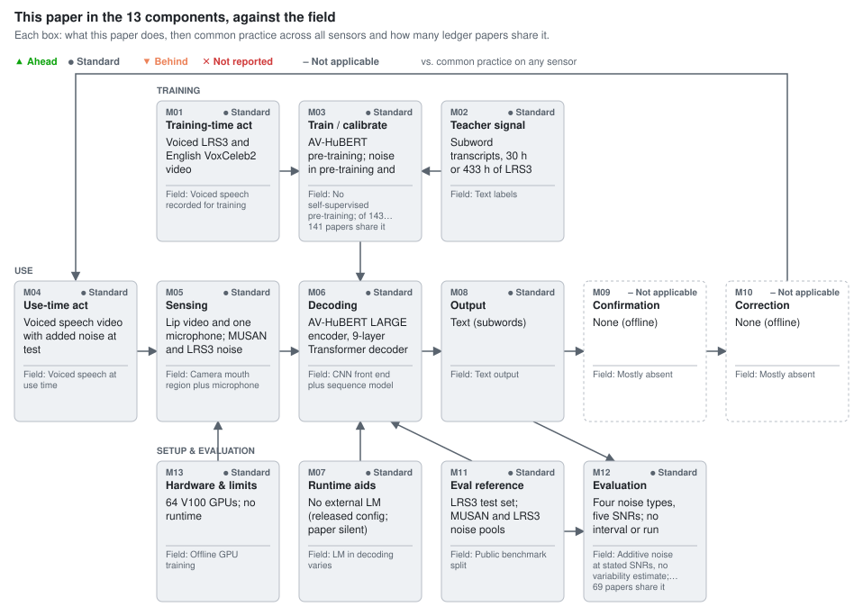

# Robust Self-Supervised Audio-Visual Speech Recognition

Bowen Shi, Wei-Ning Hsu, Abdelrahman Mohamed. Interspeech 2022. [doi:10.21437/Interspeech.2022-99](https://doi.org/10.21437/Interspeech.2022-99) [arXiv:2201.01763](https://arxiv.org/abs/2201.01763)

**Section:** [Other sensors](../../README.md#other-sensors)

## Figures

### This paper in the 13 components, against the field

<picture><source media="(prefers-color-scheme: dark)" srcset="figures/components-dark.svg"></picture>

Verdicts compare the paper's choice for each component with common practice across 8,995 ledger entries on any sensor (silent speech, brain-to-text, lip reading).

Data

| Component | This paper | Common practice | Papers with this practice | Verdict |
| --- | --- | --- | --- | --- |
| M01 Training-time act | Voiced LRS3 and English VoxCeleb2 video | Voiced speech recorded for training |  | ● Standard (Inherited.) |
| M02 Teacher signal | Subword transcripts, 30 h or 433 h of LRS3 | Text labels |  | ● Standard (Inherited; audio is a use-time input, not training-only supervision.) |
| M03 Train / calibrate | AV-HuBERT pre-training; noise in pre-training and fine-tuning; no run count | No self-supervised pre-training; of 143 AVSR studies before 2022-01 | 141 of 143 | ● Standard (New design (0 of 143 earlier AVSR studies); one test set, no seeds or run count, so not ahead.) |
| M04 Use-time act | Voiced speech video with added noise at test | Voiced speech at use time |  | ● Standard (Inherited.) |
| M05 Sensing | Lip video and one microphone; MUSAN and LRS3 noise | Camera mouth region plus microphone |  | ● Standard (Inherited from AV-HuBERT preprocessing.) |
| M06 Decoding | AV-HuBERT LARGE encoder, 9-layer Transformer decoder | CNN front end plus sequence model |  | ● Standard (Inherited (AV-HuBERT lineage).) |
| M07 Runtime aids | No external LM (released config; paper silent) | LM in decoding varies |  | ● Standard (Paper does not state it; code sets LM weight 0.) |
| M08 Output | Text (subwords) | Text output |  | ● Standard (Inherited.) |
| M09 Confirmation | None (offline) | Mostly absent |  | – Not applicable (Offline benchmark.) |
| M10 Correction | None (offline) | Mostly absent |  | – Not applicable (Offline benchmark.) |
| M11 Eval reference | LRS3 test set; MUSAN and LRS3 noise pools | Public benchmark split |  | ● Standard (Validation and test babble share one file in the released code.) |
| M12 Evaluation | Four noise types, five SNRs; no interval or run count | Additive noise at stated SNRs, no variability estimate; of 143 AVSR studies before 2022-01 | 69 of 143 | ● Standard (Matches the field; a test-set interval as in Makino et al. 2019 was available.) |
| M13 Hardware & limits | 64 V100 GPUs; no runtime | Offline GPU training |  | ● Standard (Inherited.) |

## Verdict

The paper [[1]](#ref-1) changes training (M03): self-supervised audio-visual pre-training with noise mixed into pre-training and fine-tuning. The authors call it a first (Sec. 4), and the ledger agrees: none of the 143 AVSR studies dated before it pre-trains self-supervised or adds noise in pre-training (pattern match, Appendix). M03 is still standard, not ahead: both effects, pre-training and noise in pre-training, rest on one test set with no run count or seed reported (Sec. 3.1). M12 is standard, matching the field, with one avoidable gap: no test-set interval, which [[2]](#ref-2) computed from the test set alone (inference). The headline 49.6% babble reduction over [[3]](#ref-3) sets 30 h of labels plus unlabelled pre-training and a LARGE model against a 433 h supervised system: it measures the whole recipe.

## Against the field, component by component

### M03 Training: self-supervised pre-training with added noise

**Usual approach:** Of 349 AVSR ledger studies, 143 predate the target; 141 of the 143 have no self-supervised pre-training (pattern match, Appendix), and the other two only cite it. Noise came in supervised training (14 of 143, upper bound): babble at 0 dB with probability 0.25 [[4]](#ref-4), -10 to 10 dB from 30 LRS3 clips [[3]](#ref-3), NOISEX at -5 to 20 dB [[5]](#ref-5). None of the 143 adds noise in pre-training (Appendix). The paper cites [[3]](#ref-3) for its 0 dB, 0.25 mixing (Sec. 3.1), a recipe that matches [[4]](#ref-4), and moves it into AV-HuBERT pre-training [[6]](#ref-6) [concurrent]; it names concurrent audio-only utterance mixing (WavLM) as similar (Sec. 2.2).

**State of the art:** In 2026, at the same budget (Large, LRS3 and VoxCeleb2 unlabelled, 30 h labels), pseudo-labelling reaches 2.2% clean AVSR WER against 3.3% for AV-HuBERT, a third lower (inference) [[7]](#ref-7) [later]. In NOISEX babble at 10 to -5 dB (Base, LRS3-only unlabelled, 30 h, no noise augmentation for any model) it averages 14.1% against 24.4%, 42% lower (inference).

Pre-training cuts noisy WER from 42.9% from scratch to 9.3% at 30 h (Table 3), against a weak baseline: 3.5% clean at 433 h (Table 3) versus 2.3% for [[5]](#ref-5) at 595 h (Table 2). Noise in pre-training lowers it from 9.3% to 7.8% (30 h) and 6.9% to 5.8% (433 h) (Table 3), and for BASE from 28.2% to 12.5% with clean and 13.1% to 10.3% with noisy fine-tuning (Table 4). Budgets, model sizes and fine-tuning types repeat the direction, but none is a seed or dataset: standard.

### M12 Evaluation: noise categories and variability

**Usual approach:** Before the target, 69 of 143 AVSR studies test additive noise at stated SNRs with no variability estimate; 15 of 143 give any (pattern match, upper bound, Appendix). The paper matches the majority: four noise types at five SNRs (Sec. 3.1), no interval, no run count.

**State of the art:** In 2026 [[7]](#ref-7) reports mean ± SD over three seeds (2.9 ± 0.1% AVSR WER, Base, 30 h, Table 13). In 0 dB babble with 433 h labels, Whisper-Flamingo (2024, trained with noise, beam 15) reaches 5.6% against 5.8% listed for AV-HuBERT, with different noise files that it calls not directly comparable [[8]](#ref-8) [later].

The best comparable prior is [[2]](#ref-2): 95% test-set confidence intervals for babble and overlapping speech (Table 5), on its own YouTube test set. [[9]](#ref-9) repeated each experiment 5 times; [[10]](#ref-10) repeated one auxiliary experiment. This paper gives neither (Sec. 3.1; the released configs fix seed 1337), so its 1.1-point noisy pre-training gain at 433 h has no error bar (inference). Standard, with that gap.

## The 13 components

| Component | This paper | Usual approach (count) | State of the art | Verdict |
|---|---|---|---|---|
| M01 Training-time action | Voiced LRS3 and English VoxCeleb2 video | Voiced speech recorded for training | – | standard |
| M02 Training-only supervision | Subword transcripts, 30 h or 433 h of LRS3 | Text labels | – | standard |
| M03 Training and adaptation | AV-HuBERT pre-training; noise in pre-training and fine-tuning; no run count | No self-supervised pre-training; of 143 AVSR studies before 2022-01 (pattern match 141) | [[7]](#ref-7) 2.2% clean AVSR WER at 30 h (Large) | standard |
| M04 Use-time action | Voiced speech video with added noise at test | Voiced speech at use time | – | standard |
| M05 Sensors | Lip video and one microphone; MUSAN and LRS3 noise | Camera mouth region plus microphone | – | standard |
| M06 Processing and decoding | AV-HuBERT LARGE encoder, 9-layer Transformer decoder | CNN front end plus sequence model | – | standard |
| M07 Lexicon and LM | No external LM (released config; paper silent) | LM in decoding varies | – | standard |
| M08 Output | Text (subwords) | Text output | – | standard |
| M09 Confirmation | None (offline) | Mostly absent | – | not applicable |
| M10 Correction | None (offline) | Mostly absent | – | not applicable |
| M11 Reference construction | LRS3 test set; MUSAN and LRS3 noise pools | Public benchmark split | – | standard |
| M12 Evaluation | Four noise types, five SNRs; no interval or run count | Additive noise at stated SNRs, no variability estimate; of 143 AVSR studies before 2022-01 (pattern match 69) | [[7]](#ref-7) mean ± SD over 3 seeds | standard |
| M13 Device and cost | 64 V100 GPUs; no runtime | Offline GPU training | – | standard |

## Where the claims outrun the evidence

- The 49.6% babble reduction (14.1% against 28.0%, Table 2) sets 30 h of labels plus pre-training on 433 h of LRS3 and 1,326 h of VoxCeleb2 against a 433 h supervised system [[3]](#ref-3). Xu et al. trained on LRS3 babble, the test source, this paper on MUSAN (Sec. 3.2): noise favours the comparator, data and model size the target.
- The 39.0% clean gain over [[5]](#ref-5) (1.4% against 2.3%, Table 2) is credited "while using fewer labeled data" (Sec. 3.2), leaving out the unlabelled VoxCeleb2 hours.
- Sec. 1 says robustness to noise types has "not been studied in prior work"; [[2]](#ref-2) tested babble and overlapping speech in 2019.
- In the released code, validation and test babble are one file and the checkpoint is chosen on validation accuracy (cf. Table 1).
- Sec. 3.1 states no speaker overlap among noise partitions, but the released code splits LRS3 speech-noise clips 60/20/20 by list order, without speaker grouping.
- The authors concede the MUSAN and LRS3 babble mismatch (Sec. 3.2), the missing LRS2 audio of [[4]](#ref-4) (footnote 2), and leave real noisy use to future work (Sec. 4).

## What the field needs next

- M03: clean against noisy pre-training over at least three seeds and on a second test set with recorded noise.
- M03: noise-augmented pre-training combined with pseudo-labelling at 30 h [[7]](#ref-7).
- M12: test-set intervals and run counts, separate validation and test noise, speaker-disjoint interferers.

## Questions for the authors

- How many runs underlie each cell of Tables 2-4?
- Was the checkpoint selected on clean or noisy validation data?
- How was the speaker-disjoint split of Sec. 3.1 enforced for LRS3 speech noise?
- Was an external language model used? The released config sets its weight to 0.

## Appendix: literature search

- M03, avsr-self-supervised-and-noise-augmented-training. Inclusion rule: studies whose ledger names audio-visual speech recognition (the 349-study AVSR population), classified by the training regime their full text names (self-supervised pre-training, noise added during training, noise added during pre-training); the state at the target's time uses the studies dated before 2022-01; related-work mentions included (upper bound); visual-only lip reading out; versions once. Ledger counts: 1,526 unique studies slot-filled for M03; 349 unique studies pattern match. Before 2022-01: 143 studies; no self-supervised pre-training 141 (the two matches are citations, read); noise added during training 14; noise in pre-training 0 (pattern match). All dates: self-supervised pre-training 160, noise added during training 61, noise in pre-training 8 of 349 (pattern match). Read in full: [[4]](#ref-4), [[3]](#ref-3), [[5]](#ref-5) (prior), [[7]](#ref-7) (state of the art). Known-item recall 0.5.
- M12, avsr-noise-and-run-variability-protocol (published table, appended). Inclusion rule: the same 349-study AVSR population, classified by the evaluation protocol its full text names (additive noise at stated SNRs, babble, interfering speech, a variability estimate: test-set interval or repeated runs); a study counts under every protocol it names; same date rule as M03. Ledger counts: 6,960 unique studies slot-filled for M12; 349 unique studies pattern match. Before 2022-01, of 143: additive noise at stated SNRs 80, of which 69 without a variability estimate; variability estimate 15; babble 47; interfering speech 19. All dates, of 349: additive noise 167, variability estimate 38, babble 128, interfering speech 91 (pattern match). Published all-date counts with the table's own patterns: additive noise 183, run variability 33. Read: [[2]](#ref-2), [[9]](#ref-9), [[10]](#ref-10) (prior); [[7]](#ref-7), [[8]](#ref-8) (state of the art). Known-item recall 1.0.

## References

Numbered by first citation. BibTeX in the same order and keys: [refs.bib](refs.bib).

1. Shi, B., Hsu, W., Mohamed, A. “Robust Self-Supervised Audio-Visual Speech Recognition.” *Interspeech 2022*, 2022. doi:[10.21437/Interspeech.2022-99](https://doi.org/10.21437/Interspeech.2022-99). arXiv:[2201.01763](https://arxiv.org/abs/2201.01763). First public as arXiv:2201.01763 (2022-01). [wiki: isca-shi22-robustav](https://github.com/supernaiter/deep-research-wiki-for-silent-speech/blob/main/papers/isca-shi22-robustav/article.md) [wiki: isca-shi22_interspeech](https://github.com/supernaiter/deep-research-wiki-for-silent-speech/blob/main/papers/isca-shi22_interspeech/article.md) [wiki: arxiv-2201.01763](https://github.com/supernaiter/deep-research-wiki-for-silent-speech/blob/main/papers/arxiv-2201.01763/article.md)
2. Makino, T., Liao, H., Assael, Y., Shillingford, B., Garcia, B., Braga, O., et al. “Recurrent Neural Network Transducer for Audio-Visual Speech Recognition.” *IEEE Automatic Speech Recognition and Understanding Workshop (ASRU)*, 2019. doi:[10.1109/ASRU46091.2019.9004036](https://doi.org/10.1109/ASRU46091.2019.9004036). arXiv:[1911.04890](https://arxiv.org/abs/1911.04890). Prior; deciding prior for M12 (95% CIs, babble and overlapping-speech tests). [wiki: arxiv-1911.04890](https://github.com/supernaiter/deep-research-wiki-for-silent-speech/blob/main/papers/arxiv-1911.04890/article.md) [wiki: doi-10.1109-asru46091.2019.9004036](https://github.com/supernaiter/deep-research-wiki-for-silent-speech/blob/main/papers/doi-10.1109-asru46091.2019.9004036/article.md)
3. Xu, B., Lu, C., Guo, Y., Wang, J. “Discriminative Multi-Modality Speech Recognition.” *IEEE/CVF Conference on Computer Vision and Pattern Recognition (CVPR)*, 2020. doi:[10.1109/CVPR42600.2020.01444](https://doi.org/10.1109/CVPR42600.2020.01444). Prior; babble comparator in the target's Table 2. [wiki: cvf-xu20-msr](https://github.com/supernaiter/deep-research-wiki-for-silent-speech/blob/main/papers/cvf-xu20-msr/article.md) [wiki: cvf-xu20-aemsr](https://github.com/supernaiter/deep-research-wiki-for-silent-speech/blob/main/papers/cvf-xu20-aemsr/article.md)
4. Afouras, T., Chung, J. S., Senior, A., Vinyals, O., Zisserman, A. “Deep Audio-Visual Speech Recognition.” *IEEE Transactions on Pattern Analysis and Machine Intelligence*, 2018. doi:[10.1109/TPAMI.2018.2889052](https://doi.org/10.1109/TPAMI.2018.2889052). arXiv:[1809.02108](https://arxiv.org/abs/1809.02108). Prior; deciding prior for M03 (babble at 0 dB, probability 0.25, during supervised training). [review](https://github.com/supernaiter/silent-speech-review/tree/main/reviews/deep-audio-visual-speech-recognition) [wiki: arxiv-1809.02108](https://github.com/supernaiter/deep-research-wiki-for-silent-speech/blob/main/papers/arxiv-1809.02108/article.md) [wiki: doi-10.1109-tpami.2018.2889052](https://github.com/supernaiter/deep-research-wiki-for-silent-speech/blob/main/papers/doi-10.1109-tpami.2018.2889052/article.md)
5. Ma, P., Petridis, S., Pantic, M. “End-to-End Audio-Visual Speech Recognition with Conformers.” *IEEE International Conference on Acoustics, Speech and Signal Processing (ICASSP)*, 2021, 7613-7617. arXiv:[2102.06657](https://arxiv.org/abs/2102.06657). Prior; supervised AVSR with NOISEX babble augmentation; clean LRS3 comparator. [review](https://github.com/supernaiter/silent-speech-review/tree/main/reviews/end-to-end-audio-visual-speech-recognition-with-conformers) [wiki: arxiv-2102.06657](https://github.com/supernaiter/deep-research-wiki-for-silent-speech/blob/main/papers/arxiv-2102.06657/article.md)
6. Shi, B., Hsu, W., Lakhotia, K., Mohamed, A. “Learning Audio-Visual Speech Representation by Masked Multimodal Cluster Prediction.” *International Conference on Learning Representations (ICLR)*, 2022. arXiv:[2201.02184](https://arxiv.org/abs/2201.02184). The pre-training method the target builds on. [concurrent] [review](https://github.com/supernaiter/silent-speech-review/tree/main/reviews/learning-audio-visual-speech-representation-by-masked-multimodal-cluster-prediction) [wiki: arxiv-2201.02184](https://github.com/supernaiter/deep-research-wiki-for-silent-speech/blob/main/papers/arxiv-2201.02184/article.md)
7. Haliassos, A., Mira, R., Petridis, S. “Pay Attention to CTC: Fast and Robust Pseudo-Labelling for Unified Speech Recognition.” *International Conference on Learning Representations (ICLR)*, 2026. arXiv:[2602.19316](https://arxiv.org/abs/2602.19316). State of the art for M03 at the 30 h budget. [later] [wiki: arxiv-2602.19316](https://github.com/supernaiter/deep-research-wiki-for-silent-speech/blob/main/papers/arxiv-2602.19316/article.md)
8. Rouditchenko, A., Gong, Y., Thomas, S., Karlinsky, L., Kuehne, H., Feris, R., et al. “Whisper-Flamingo: Integrating Visual Features into Whisper for Audio-Visual Speech Recognition and Translation.” *Interspeech 2024*, 2024. arXiv:[2406.10082](https://arxiv.org/abs/2406.10082). LRS3 AVSR state of the art and 0 dB babble comparison table (M12). [later] [wiki: arxiv-2406.10082](https://github.com/supernaiter/deep-research-wiki-for-silent-speech/blob/main/papers/arxiv-2406.10082/article.md) [wiki: isca-rouditchenko24-whisperflamingo](https://github.com/supernaiter/deep-research-wiki-for-silent-speech/blob/main/papers/isca-rouditchenko24-whisperflamingo/article.md) [wiki: in24-whisperflamingo](https://github.com/supernaiter/deep-research-wiki-for-silent-speech/blob/main/papers/in24-whisperflamingo/article.md) [wiki: isca-rouditchenko24_interspeech](https://github.com/supernaiter/deep-research-wiki-for-silent-speech/blob/main/papers/isca-rouditchenko24_interspeech/article.md)
9. Sterpu, G., Saam, C., Harte, N. “How to Teach DNNs to Pay Attention to the Visual Modality in Speech Recognition.” *IEEE/ACM Transactions on Audio, Speech, and Language Processing*, 2020. doi:[10.1109/TASLP.2020.2980436](https://doi.org/10.1109/TASLP.2020.2980436). arXiv:[2004.08250](https://arxiv.org/abs/2004.08250). Prior; five repetitions with 95% CIs (M12). [wiki: arxiv-2004.08250](https://github.com/supernaiter/deep-research-wiki-for-silent-speech/blob/main/papers/arxiv-2004.08250/article.md)
10. Sterpu, G., Harte, N. “AV Taris: Online Audio-Visual Speech Recognition.” *arXiv preprint*, 2020. arXiv:[2012.07467](https://arxiv.org/abs/2012.07467). Prior; five random initialisations on LRS2 (M12). [wiki: arxiv-2012.07467](https://github.com/supernaiter/deep-research-wiki-for-silent-speech/blob/main/papers/arxiv-2012.07467/article.md)

## Materials

Data behind this review. Full texts of the papers are not included.

- [`review.md`](review.md): the review text (source)
- [`refs.bib`](refs.bib): references (BibTeX)
- [`slots.json`](slots.json): for each of the 13 components: this paper's choice, field practice, number of matching papers, verdict
- [`figures.json`](figures.json): figure definitions
- [`evaluation.md`](evaluation.md): independent evaluation by a second reviewer
- [`triage.md`](triage.md): how each evaluation finding was checked against the sources and resolved
- [`process/log.json`](process/log.json): process record: each step, who did it (reader, script, writer, evaluator), when, the checks run and the input versions
- [`process/notes.json`](process/notes.json): reading notes on the target and comparator papers: claims, numbers, conditions and what is not stated, with locations
- [`process/plan.json`](process/plan.json): plan: which components the paper changes and the topics it is compared on
- [`process/draft.md`](process/draft.md): the review as first written, before the independent evaluation
- [`process/claims-draft.md`](process/claims-draft.md): claim table of the draft: every claim mapped to a note or a count
- [`process/claims.md`](process/claims.md): claim table of the published review
- [`components/M03/avsr-self-supervised-and-noise-augmented-training.csv`](../../components/M03/avsr-self-supervised-and-noise-augmented-training.csv): M03 topic "avsr-self-supervised-and-noise-augmented-training", every candidate paper with its decision (1526 slot-filled, 349 pattern match, usual design in 141, 4 read in full)
- [`components/M12/avsr-noise-and-run-variability-protocol.csv`](../../components/M12/avsr-noise-and-run-variability-protocol.csv): M12 topic "avsr-noise-and-run-variability-protocol", every candidate paper with its decision (6960 slot-filled, 349 pattern match, usual design in 183, 3 read in full)

## More reviews in Other sensors

- [Imagined speech can be decoded from low- and cross-frequency intracranial EEG features](../imagined-speech-can-be-decoded-from-low-and-cross-frequency-intracranial-eeg-features/) (2022). Adds low-frequency power (precedent: Pei 2011, Ikeda 2014) and phase-amplitude coupling (new) to imagined-speech ECoG decoding (M06); CFC effect unshown: 12 of 144 uncorrected tests.
- [Semantic reconstruction of continuous language from non-invasive brain recordings](../semantic-reconstruction-of-continuous-language-from-non-invasive-brain-recordings/) (2023). LM candidates scored by encoding-model likelihood (M06) were ahead in 2022, as the authors claim; the scorer is now overtaken. GPT prior (M07) is standard; one pilot-touched test story limits M12.
- [End-to-End Audio-Visual Speech Recognition with Conformers](../end-to-end-audio-visual-speech-recognition-with-conformers/) (2021). Conformer back-end on raw inputs (M06) and Transformer LM (M07) are standard: raw-input AVSR predates it, and the Conformer gain is one unrepeated step confounded with a decoder swap.
- [Ultrasensitive Textile Strain Sensors Redefine Wearable Silent Speech Interfaces with High Machine Learning Efficiency](../ultrasensitive-textile-strain-sensors-redefine-wearable-silent-speech-interfaces-with-high-machine-learning-efficiency/) (2024). Standard sensor (M05) and decoder (M06): one throat strain channel, small CNN. 95.25% on 20 words, with split grouping and production mode unstated, does not show silent, session-independent decoding.
- [Lipreading using Temporal Convolutional Networks](../lipreading-using-temporal-convolutional-networks/) (2020). Multi-scale TCN (M06) and variable-length cropping (M03) are standard: head and augmentation are not separated, no run counts, robustness comes from the cropping; 85.3% LRW trails 93.2% today.
- [Machine translation of cortical activity to text with an encoder-decoder framework](../machine-translation-of-cortical-activity-to-text-with-an-encoder-decoder-framework/) (2020). Word-level ECoG encoder-decoder; all changed components standard. 3% WER is on repeats of 50 sentences; unseen sentences and participants were never tested.

---

Part of the [Silent Speech Interface Review](https://github.com/supernaiter/silent-speech-review). Found an error? [Open an issue](https://github.com/supernaiter/silent-speech-review/issues/new?template=correction.yml).
