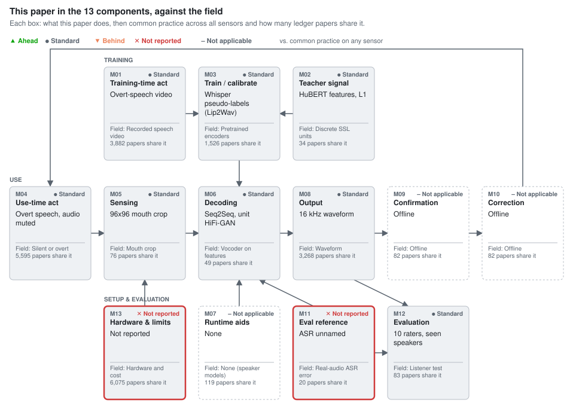

# RobustL2S: Speaker-Specific Lip-to-Speech Synthesis exploiting Self-Supervised Representations

Sahipjohn, N., Shah, N., Tambrahalli, V., Gandhi, V. · arXiv preprint · 2023 · [arXiv:2307.01233](https://arxiv.org/abs/2307.01233)

**Section:** [Lip & face video](../../README.md#lip--face-video)

## Figures

### This paper in the 13 components, against the field

<picture><source media="(prefers-color-scheme: dark)" srcset="figures/components-dark.svg"></picture>

Verdicts compare the paper's choice for each component with common practice across 8,995 ledger entries on any sensor (silent speech, brain-to-text, lip reading).

Data

| Component | This paper | Common practice | Papers with this practice | Verdict |
| --- | --- | --- | --- | --- |
| M01 Training-time act | Overt-speech video | Recorded speech video | 3,882 of 8,995 | ● Standard (Inherited.) |
| M02 Teacher signal | HuBERT features, L1 | Discrete SSL units | 34 of 8,995 | ● Standard (ReVISE predicts units.) |
| M03 Train / calibrate | Whisper pseudo-labels (Lip2Wav) | Pretrained encoders | 1,526 of 8,995 | ● Standard (Runs not stated.) |
| M04 Use-time act | Overt speech, audio muted | Silent or overt | 5,595 of 8,995 | ● Standard (Inherited.) |
| M05 Sensing | 96x96 mouth crop | Mouth crop | 76 of 8,995 | ● Standard (Inherited.) |
| M06 Decoding | Seq2Seq, unit HiFi-GAN | Vocoder on features | 49 of 8,995 | ● Standard (ReVISE plus regression.) |
| M07 Runtime aids | None | None (speaker models) | 119 of 8,995 | – Not applicable (Speaker-specific.) |
| M08 Output | 16 kHz waveform | Waveform | 3,268 of 8,995 | ● Standard (Per-dataset vocoders.) |
| M09 Confirmation | Offline | Offline | 82 of 8,995 | – Not applicable (Offline study.) |
| M10 Correction | Offline | Offline | 82 of 8,995 | – Not applicable (Offline study.) |
| M11 Eval reference | ASR unnamed | Real-audio ASR error | 20 of 8,995 | ✕ Not reported (No ceiling row.) |
| M12 Evaluation | 10 raters, seen speakers | Listener test | 83 of 8,995 | ● Standard (Comparators not stated as rerun.) |
| M13 Hardware & limits | Not reported | Hardware and cost | 6,075 of 8,995 | ✕ Not reported (Efficiency claim unmeasured.) |

## Verdict

RobustL2S [[1]](#ref-1) changes the training target (M02), regressing continuous HuBERT features, and the decoder (M06), a Seq2Seq stage before a unit HiFi-GAN. Both are standard because the vocoder input is still HuBERT units: RobustL2S quantizes its predictions back to 100 units (§IV.B.4), and ReVISE already linked an AV-HuBERT-initialized predictor to such units and a unit HiFi-GAN [[2]](#ref-2). Features beat units on one Lip2Wav speaker, against a unit variant that also changes the input and scores below the model without Seq2Seq (STOI 0.18 against 0.50, Table I). The state-of-the-art claim rests on unrerun comparator values and an unnamed ASR: GRID-4S WER 11.21% against VCA-GAN's listed 12.25%, while the cited, uncompared GAN of Mira et al. reports 7.03% and 4.07% when Kefalas et al. score it [[3]](#ref-3), [[4]](#ref-4).

## Against the field, component by component

### M02 Training target: continuous HuBERT features

**Usual approach:** Of 54 studies training a non-acoustic encoder on SSL speech targets (pattern match, Appendix), 34 name discrete units or k-means, 5 continuous features. RobustL2S regresses 768-dimensional HuBERT features (L1, §IV.B) and clusters them into 100 units only at inference.

**State of the art:** V2SFlow (2024, [later]) predicts HuBERT tokens from video for 28.5% WER on unseen LRS3 speakers [[5]](#ref-5); ReVISE (arXiv 2022, prior) reported 33.9% on LRS3 [[2]](#ref-2). RobustL2S reports no LRS3 result.

VCVTS (prior) transferred discrete units to lips [[6]](#ref-6); ReVISE predicts 2000 HuBERT-derived units from an AV-HuBERT-initialized model [[2]](#ref-2); Choi et al. ([concurrent], cited by the target) add 200 HuBERT units beside mel and reach 29.8% LRS3 WER with AV-HuBERT [[7]](#ref-7). The authors call ReVISE their closest work (§II.B) but omit it from Tables I–IV. Their unit variant maps 2000 AV-HuBERT cluster IDs, not features, to units (§III), a weaker ReVISE; ESTOI 0.013 against 0.397 (Table I). CTC helps GRID-4S and TCD-TIMIT-3S by 0.02, yet is dropped (§V.A). Verdict: standard.

### M06 Decoding: Seq2Seq, then a unit vocoder

**Usual approach:** Of 165 video-to-speech studies (pattern match, Appendix), 49 name a neural vocoder on predicted acoustic features. RobustL2S does so on re-quantized SSL units after a transformer stage.

**State of the art:** on GRID four seen speakers, the prior GAN of Mira et al. reports 7.03% with an ASR at 4.23% on real audio [[3]](#ref-3); Kefalas et al. (2023, [concurrent]) score authors' test samples with one ASR (0.1% on real audio) and list it at 4.07%, VCA-GAN at 5.62% [[4]](#ref-4). RobustL2S lists 11.21% under an unnamed ASR. One model at 7.03% and 4.07%, and VCA-GAN at 12.25% and 5.62%, show how far the evaluator shifts GRID WER. On STOI RobustL2S leads (0.754 against 0.662).

Seq2Seq adds 0.08 STOI and 0.12 ESTOI over vocoding AV-HuBERT features directly, on one speaker (Table I). Over the five Lip2Wav speakers (inference), mean STOI is 0.546 against 0.523, ESTOI 0.354 against 0.361 for Hong et al. Verdict: standard.

### M11 Evaluation reference: the ASR behind WER

**Usual approach:** Of 165 studies (pattern match, Appendix), 20 state the ASR error on real test audio. RobustL2S names no ASR or real-audio WER (§IV.C).

**State of the art:** Kefalas et al. (2023, [concurrent]) state 0.1% on real GRID audio [[4]](#ref-4); V2SFlow (2024) 2.5% on LRS3 [[5]](#ref-5).

Mira et al. gave 4.23% and noted that Lip2Wav's GRID WER, the 14.08% in RobustL2S Table II, came from Google Speech-to-Text [[3]](#ref-3), so that column mixes ASRs; ReVISE gave 5.6% on real audio and 10.6% for unit resynthesis [[2]](#ref-2), a ceiling missing from Tables I–IV. Verdict: not reported.

### M12 Evaluation: comparison set and listener test

**Usual approach:** Of 165 studies (pattern match, Appendix), 83 name a listener test and 51 unseen speakers; RobustL2S has the first, not the second.

**State of the art:** ReVISE (2022, prior): MOS on 50 files, at least 15 raters each, with 95% confidence intervals [[2]](#ref-2); RobustL2S has ten raters on five samples per method (§V.D).

FastLTS and VCVTS, claimed beaten "on all three datasets" (§I), appear only in one MOS figure each (Figs. 2–3). Verdict: standard.

## The 13 components

| Component | This paper | Usual approach (count) | State of the art | Verdict |
|---|---|---|---|---|
| M01 Training-time action | Overt-speech video | Recorded speech video (slot-filled 3,882) | – | standard |
| M02 Training-only supervision | HuBERT features, L1 | Discrete SSL units (pattern match 34) | [[5]](#ref-5) (2024): LRS3 WER 28.5% | standard |
| M03 Training and adaptation | Whisper pseudo-labels (Lip2Wav) | Pretrained encoders (slot-filled 1,526) | – | standard |
| M04 Use-time action | Overt speech, audio muted | Silent or overt (slot-filled 5,595) | – | standard |
| M05 Sensors | 96x96 mouth crop | Mouth crop (pattern match 76) | – | standard |
| M06 Processing and decoding | Seq2Seq, unit HiFi-GAN | Vocoder on features (pattern match 49) | [[3]](#ref-3) scored in [[4]](#ref-4) (2023): GRID-4S WER 4.07% | standard |
| M07 Lexicon and LM | None | None (speaker models) (slot-filled 119) | – | not applicable |
| M08 Output | 16 kHz waveform | Waveform (slot-filled 3,268) | – | standard |
| M09 Confirmation | Offline | Offline (slot-filled 82) | – | not applicable |
| M10 Correction | Offline | Offline (slot-filled 82) | – | not applicable |
| M11 Reference construction | ASR unnamed | Real-audio ASR error (pattern match 20) | [[4]](#ref-4) (2023): ASR 0.1% | not reported |
| M12 Evaluation | 10 raters, seen speakers | Listener test (pattern match 83) | [[2]](#ref-2) (2022): 50 files, 15+ raters, 95% CI | standard |
| M13 Device and cost | Not reported | Hardware and cost (slot-filled 6,075) | – | not reported |

## Where the claims outrun the evidence

- "A notable improvement across all metrics" on Lip2Wav (§V.C): ESTOI trails Hong et al. for chemistry (0.397 against 0.429) and ethical hacking (0.277 against 0.304); the authors concede only the latter and a tie (Table IV).
- "State-of-the-art performance in constrained settings" (§VI): GRID-4S ESTOI 0.571 trails VCA-GAN (0.609) and Kim et al. (0.579), Table II.
- The 0.39 gap as "information lost" by units (§V.A): inference also passes through 100 units (§IV.B.4), and the unit variant changes input and loss together.
- Robustness to head pose, noise and speaker variation (§I): no condition controls them. A 0.02 STOI drop is "statistically insignificant" untested (§V.A).
- Fig. 2 and Fig. 3 cite VCVTS and FastLTS under the reference numbers of VQTTS and Lip2AudSpec.

## What the field needs next

- M02/M06: ReVISE-style unit prediction against regression, same vocoder, five Lip2Wav speakers, several seeds.
- M11: one named ASR with its real-audio WER and a ground-truth-unit row.
- M12: controlled pose and noise tests; unseen GRID speakers.

## Questions for the authors

- Which ASR and normalization produced WER, and what is its WER on real test audio?
- What conditions the "speaker-conditioned" vocoder (§I), given no speaker input in §IV.B.4?
- How many runs underlie Tables I–IV, and were comparators rerun?

## Appendix: literature search

- M02, ssl-speech-unit-target (published table, reused). Inclusion rule: studies that synthesize speech from a non-acoustic signal and train the encoder to predict self-supervised speech representations (HuBERT units, soft units, ContentVec, wav2vec features) from paired audio; recognition-only studies, self-generated targets and acoustic-input conversion excluded; versions count once. Ledger: 31 unique studies slot-filled for M02; 54 unique studies pattern match. Usual design: supervision_kind paired_audio 11 of 22 (slot-filled, M03); full-text patterns over the 54: discrete units or k-means 34, unit HiFi-GAN or speech resynthesis 17, AV-HuBERT 15, continuous SSL-feature target 5 (pattern match). Read in full: [[2]](#ref-2), [[6]](#ref-6), [[7]](#ref-7), [[5]](#ref-5). Known-item recall 1.0 (published seeds); 0.33 for this review's three seeds (AV-HuBERT and VCVTS not matched by the ledger pattern).
- M06, video-to-speech-synthesis (published table, reused). Inclusion rule: studies that synthesize a speech waveform from talking-face or lip video and report the acoustic representation and how it becomes a waveform; enhancement with noisy audio at test, talking-head generation, text-only lip reading and video-to-text-to-speech pipelines excluded; versions count once. Ledger: 7,345 unique studies slot-filled for M06; 165 unique studies pattern match. Usual design: neural vocoder on predicted acoustic features 49; parametric vocoder 41, Griffin-Lim 16 (pattern match, published counts). Read in full: [[3]](#ref-3), [[4]](#ref-4), [[2]](#ref-2). Known-item recall 1.0.
- M11, asr-retranscribed-evaluation-reference (published table, reused). Inclusion rule: the same video-to-speech population, classified by how the text reference for ASR-scored intelligibility is built and whether the ASR error on real test audio is reported; every named design counts (upper bound). Ledger: 234 unique studies slot-filled for M11; 165 unique studies pattern match. Real-audio ASR error reported 20, ASR transcripts as reference 2 (pattern match). Read in full: [[3]](#ref-3), [[2]](#ref-2), [[4]](#ref-4), [[5]](#ref-5). Known-item recall 1.0.
- M12, video-to-speech-output-evaluation (published table, reused). Inclusion rule: the same population, counting the evaluation protocols its full text names (upper bound). Ledger: 6,960 unique studies slot-filled for M12; 165 unique studies pattern match. Protocols: listener test 83, unseen speakers 51, ASR WER on output 38, GRID unseen split 19 (pattern match). Read in full: [[2]](#ref-2), [[4]](#ref-4). Known-item recall 1.0.

## References

Numbered by first citation. BibTeX in the same order and keys: [refs.bib](refs.bib).

1. Sahipjohn, N., Shah, N., Tambrahalli, V., Gandhi, V. “RobustL2S: Speaker-Specific Lip-to-Speech Synthesis exploiting Self-Supervised Representations.” *arXiv preprint*, 2023. arXiv:[2307.01233](https://arxiv.org/abs/2307.01233). Target. Read as arXiv v1 (3 July 2023). [review](https://github.com/supernaiter/silent-speech-review/tree/main/reviews/robustl2s-speaker-specific-lip-to-speech-synthesis-exploiting-self-supervised-representations) [wiki: arxiv-2307.01233](https://github.com/supernaiter/deep-research-wiki-for-silent-speech/blob/main/papers/arxiv-2307.01233/article.md)
2. Hsu, W., Remez, T., Shi, B., Donley, J., Adi, Y. “ReVISE: Self-Supervised Speech Resynthesis with Visual Input for Universal and Generalized Speech Enhancement.” *IEEE/CVF Conference on Computer Vision and Pattern Recognition (CVPR)*, 2023. arXiv:[2212.11377](https://arxiv.org/abs/2212.11377). Prior; deciding prior for M02 and M06 (AV-HuBERT-initialized unit prediction with a unit HiFi-GAN). Cited by the target as [31]. [wiki: arxiv-2212.11377](https://github.com/supernaiter/deep-research-wiki-for-silent-speech/blob/main/papers/arxiv-2212.11377/article.md)
3. Mira, R., Vougioukas, K., Ma, P., Petridis, S., Schuller, B. W., Pantic, M. “End-to-End Video-To-Speech Synthesis using Generative Adversarial Networks.” *IEEE Transactions on Cybernetics*, 2023, 53(6), 3454-3466. doi:[10.1109/TCYB.2022.3162495](https://doi.org/10.1109/TCYB.2022.3162495). arXiv:[2104.13332](https://arxiv.org/abs/2104.13332). Prior; GRID 4-speaker seen result cited by the target as [18] but not compared. [wiki: arxiv-2104.13332](https://github.com/supernaiter/deep-research-wiki-for-silent-speech/blob/main/papers/arxiv-2104.13332/article.md)
4. Kefalas, T., Panagakis, Y., Pantic, M. “Large-scale unsupervised audio pre-training for video-to-speech synthesis.” *IEEE/ACM Transactions on Audio, Speech, and Language Processing*, 2024, 32, 2255-2268. doi:[10.1109/TASLP.2024.3382500](https://doi.org/10.1109/TASLP.2024.3382500). arXiv:[2306.15464](https://arxiv.org/abs/2306.15464). Concurrent; one-ASR GRID table (Table IV). Read as arXiv v1 (2023). [concurrent] [review](https://github.com/supernaiter/silent-speech-review/tree/main/reviews/large-scale-unsupervised-audio-pre-training-for-video-to-speech-synthesis) [wiki: arxiv-2306.15464-v2apretrain](https://github.com/supernaiter/deep-research-wiki-for-silent-speech/blob/main/papers/arxiv-2306.15464-v2apretrain/article.md)
5. Choi, J., Kim, J., Li, J., Chung, J. S., Liu, S. “V2SFlow: Video-to-Speech Generation with Speech Decomposition and Rectified Flow.” *arXiv preprint*, 2024. arXiv:[2411.19486](https://arxiv.org/abs/2411.19486). Later; state of the art for SSL-unit video-to-speech on LRS3. Read as arXiv v2 (30 May 2025). [later] [wiki: arxiv-2411.19486](https://github.com/supernaiter/deep-research-wiki-for-silent-speech/blob/main/papers/arxiv-2411.19486/article.md)
6. Wang, D., Yang, S., Su, D., Liu, X., Yu, D., Meng, H. “VCVTS: Multi-Speaker Video-to-Speech Synthesis via Cross-Modal Knowledge Transfer from Voice Conversion.” *ICASSP 2022 - IEEE International Conference on Acoustics, Speech and Signal Processing*, 2022, 7252-7256. doi:[10.1109/ICASSP43922.2022.9747427](https://doi.org/10.1109/ICASSP43922.2022.9747427). arXiv:[2202.09081](https://arxiv.org/abs/2202.09081). Prior; discrete-unit transfer to lip video. Cited by the target as [12]. [review](https://github.com/supernaiter/silent-speech-review/tree/main/reviews/vcvts-multi-speaker-video-to-speech-synthesis-via-cross-modal-knowledge-transfer-from-voice-conversion) [wiki: arxiv-2202.09081-vcvts](https://github.com/supernaiter/deep-research-wiki-for-silent-speech/blob/main/papers/arxiv-2202.09081-vcvts/article.md)
7. Choi, J., Kim, M., Ro, Y. M. “Intelligible Lip-to-Speech Synthesis with Speech Units.” *Interspeech 2023*, 2023, 4349-4353. doi:[10.21437/Interspeech.2023-194](https://doi.org/10.21437/Interspeech.2023-194). arXiv:[2305.19603](https://arxiv.org/abs/2305.19603). Concurrent; speech-unit target with mel for lip-to-speech. Cited by the target as [8]. Read: Abstract, Sec. 3.1, Table 1. [concurrent] [review](https://github.com/supernaiter/silent-speech-review/tree/main/reviews/intelligible-lip-to-speech-synthesis-with-speech-units) [wiki: arxiv-2305.19603](https://github.com/supernaiter/deep-research-wiki-for-silent-speech/blob/main/papers/arxiv-2305.19603/article.md) [wiki: isca-choi23-liptospeech](https://github.com/supernaiter/deep-research-wiki-for-silent-speech/blob/main/papers/isca-choi23-liptospeech/article.md) [wiki: isca-choi23_interspeech](https://github.com/supernaiter/deep-research-wiki-for-silent-speech/blob/main/papers/isca-choi23_interspeech/article.md)

## Materials

Data behind this review. Full texts of the papers are not included.

- [`review.md`](review.md): the review text (source)
- [`refs.bib`](refs.bib): references (BibTeX)
- [`slots.json`](slots.json): for each of the 13 components: this paper's choice, field practice, number of matching papers, verdict
- [`figures.json`](figures.json): figure definitions
- [`evaluation.md`](evaluation.md): independent evaluation by a second reviewer
- [`triage.md`](triage.md): how each evaluation finding was checked against the sources and resolved
- [`process/log.json`](process/log.json): process record: each step, who did it (reader, script, writer, evaluator), when, the checks run and the input versions
- [`process/notes.json`](process/notes.json): reading notes on the target and comparator papers: claims, numbers, conditions and what is not stated, with locations
- [`process/plan.json`](process/plan.json): plan: which components the paper changes and the topics it is compared on
- [`process/draft.md`](process/draft.md): the review as first written, before the independent evaluation
- [`process/claims-draft.md`](process/claims-draft.md): claim table of the draft: every claim mapped to a note or a count
- [`process/claims.md`](process/claims.md): claim table of the published review
- [`components/M02/ssl-speech-unit-target.csv`](../../components/M02/ssl-speech-unit-target.csv): M02 topic "ssl-speech-unit-target", every candidate paper with its decision (31 slot-filled, 54 pattern match, usual design in 11, 2 read in full)
- [`components/M06/video-to-speech-synthesis.csv`](../../components/M06/video-to-speech-synthesis.csv): M06 topic "video-to-speech-synthesis", every candidate paper with its decision (7345 slot-filled, 165 pattern match, usual design in 49, 3 read in full)
- [`components/M11/asr-retranscribed-evaluation-reference.csv`](../../components/M11/asr-retranscribed-evaluation-reference.csv): M11 topic "asr-retranscribed-evaluation-reference", every candidate paper with its decision (234 slot-filled, 165 pattern match, usual design in 20, 5 read in full)
- [`components/M12/video-to-speech-output-evaluation.csv`](../../components/M12/video-to-speech-output-evaluation.csv): M12 topic "video-to-speech-output-evaluation", every candidate paper with its decision (6960 slot-filled, 165 pattern match, usual design in 83, 5 read in full)

## More reviews in Lip & face video

- [Audio-visual video-to-speech synthesis with synthesized input audio](../audio-visual-video-to-speech-synthesis-with-synthesized-input-audio/) (2023). A second synthesis pass on first-pass speech (M06) and modality dropout (M03) are standard; gains are small and inconsistent, earlier systems keep lower WER, and no equal-training control exists.
- [Auto-AVSR: Audio-Visual Speech Recognition with Automatic Labels](../auto-avsr-audio-visual-speech-recognition-with-automatic-labels/) (2023). ASR transcripts as training labels (M02) are standard (Afouras 2020, Ma 2022); scale cuts LRS3 VSR WER to 19.1%, but no run spread is reported and USR 2.0 reaches 17.6%.
- [High-Quality Automatic Voice Over with Accurate Alignment: Supervision through Self-Supervised Discrete Speech Units](../high-quality-automatic-voice-over-with-accurate-alignment-supervision-through-self-supervised-discrete-speech-units/) (2023). An automatic voice-over system that supervises alignment by predicting self-supervised discrete speech units from text and lip video, improving lip-sync and speech quality on a single-speaker dataset. Not an SSI paper.
- [Improving the Gap in Visual Speech Recognition Between Normal and Silent Speech Based on Metric Learning](../improving-the-gap-in-visual-speech-recognition-between-normal-and-silent-speech-based-on-metric-learning/) (2023). Joint normal-silent training does most of the gap closing; the viseme KL terms add 0.93 WER points with no run count reported, so the metric-learning gain is not established.
- [Intelligible Lip-to-Speech Synthesis with Speech Units](../intelligible-lip-to-speech-synthesis-with-speech-units/) (2023). Unit target (M02) and unit-conditioned vocoder (M06) are standard; units cut LRS3 WER 21.8 points, AV-HuBERT 20.4 more, the vocoder 0.3; unit gain untested on AV-HuBERT, single runs.
- [Large-scale unsupervised audio pre-training for video-to-speech synthesis](../large-scale-unsupervised-audio-pre-training-for-video-to-speech-synthesis/) (2023). Audio-only decoder pre-training (M03) is standard after TTS decoder transfer; it lowers WER in 7 of 16 pairs, earlier systems keep lower WER, and no equal-training control or listener test exists.

---

Part of the [Silent Speech Interface Review](https://github.com/supernaiter/silent-speech-review). Found an error? [Open an issue](https://github.com/supernaiter/silent-speech-review/issues/new?template=correction.yml).
