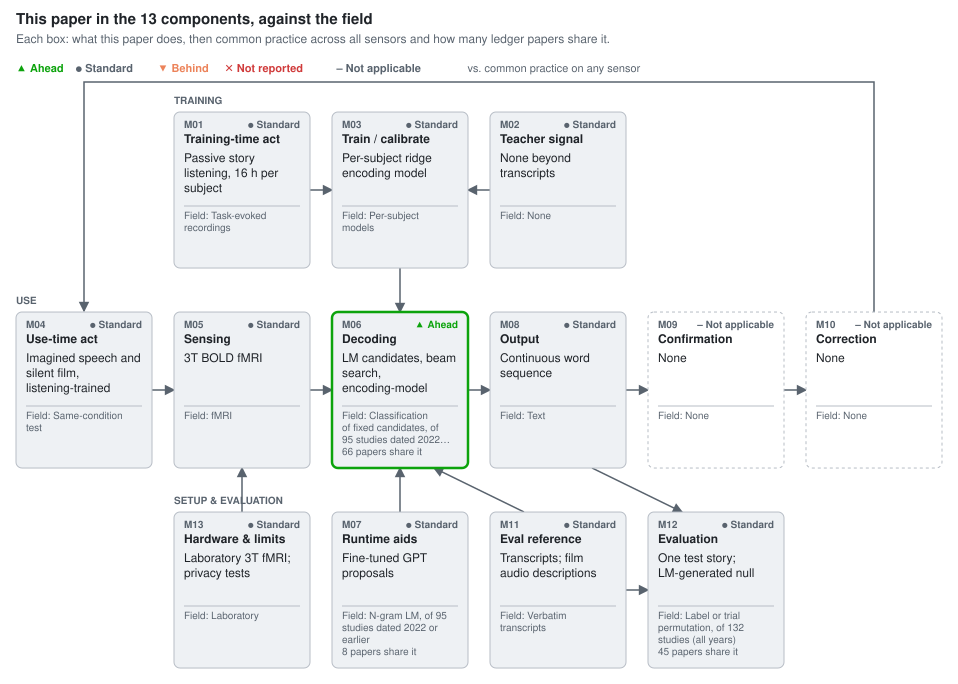

# Semantic reconstruction of continuous language from non-invasive brain recordings

Tang J, LeBel A, Jain S, Huth AG. Nature Neuroscience, 2023. [doi:10.1038/s41593-023-01304-9](https://doi.org/10.1038/s41593-023-01304-9) · [bioRxiv:10.1101/2022.09.29.509744](https://doi.org/10.1101/2022.09.29.509744)

**Section:** [Other sensors](../../README.md#other-sensors)

## Figures

### This paper in the 13 components, against the field

<picture><source media="(prefers-color-scheme: dark)" srcset="figures/components-dark.svg"></picture>

Verdicts compare the paper's choice for each component with common practice across 8,995 ledger entries on any sensor (silent speech, brain-to-text, lip reading).

Data

| Component | This paper | Common practice | Papers with this practice | Verdict |
| --- | --- | --- | --- | --- |
| M01 Training-time act | Passive story listening, 16 h per subject | Task-evoked recordings |  | ● Standard (Inherited.) |
| M02 Teacher signal | None beyond transcripts | None |  | ● Standard (Inherited.) |
| M03 Train / calibrate | Per-subject ridge encoding model | Per-subject models |  | ● Standard (Seed only in code.) |
| M04 Use-time act | Imagined speech and silent film, listening-trained | Same-condition test |  | ● Standard (Precedent within production: overt-to-covert ECoG.) |
| M05 Sensing | 3T BOLD fMRI | fMRI |  | ● Standard (fNIRS only simulated.) |
| M06 Decoding | LM candidates, beam search, encoding-model likelihood | Classification of fixed candidates, of 95 studies dated 2022 or earlier | 66 of 95 | ▲ Ahead (Ahead for LM candidates + beam + encoding likelihood.) |
| M07 Runtime aids | Fine-tuned GPT proposals | N-gram LM, of 95 studies dated 2022 or earlier | 8 of 95 | ● Standard (GPT-2 from fMRI earlier.) |
| M08 Output | Continuous word sequence | Text |  | ● Standard (Gist, not words.) |
| M09 Confirmation | None | None |  | – Not applicable (Offline.) |
| M10 Correction | None | None |  | – Not applicable (Offline.) |
| M11 Eval reference | Transcripts; film audio descriptions | Verbatim transcripts |  | ● Standard (No verbatim film reference.) |
| M12 Evaluation | One test story; LM-generated null | Label or trial permutation, of 132 studies (all years) | 45 of 132 | ● Standard (Single story, three subjects.) |
| M13 Hardware & limits | Laboratory 3T fMRI; privacy tests | Laboratory |  | ● Standard (Cooperation claim holds; consent caveat.) |

## Verdict

The paper [[1]](#ref-1) changed the decoding search (M06), the use-time prior (M07) and the use-time action (M04). M06 is ahead in the narrow sense the authors claim: language-model candidates searched by beam and scored by encoding-model likelihood, absent from earlier non-invasive language studies in the ledger (Appendix); decoding exceeds the null in all three subjects and relies on the fMRI likelihoods (Extended Data Fig. 9). Encoding-model scoring itself is older [[2]](#ref-2). M07 is standard: GPT-2 had generated text from fMRI before [[3]](#ref-3); M04 is standard: imagery transfer rests on identification among five stories. All perceived-speech numbers come from one test story used in S3's pilots.

## Against the field, component by component

### M06 Decoding: language-model candidates scored by an encoding model

**Usual approach:** in 2022 decoders classified or ranked fixed candidates (classification in up to 66 of 95 studies dated 2022 or earlier; 251 of 335 over all years; pattern match, Appendix). The authors trace the scorer to Bayesian image and video decoders; their stated departures are a generative language-model prior and beam search (§Methods).

**State of the art:** MapGuide (2024) [[4]](#ref-4) [later] keeps this paper's GPT beam search but scores candidates against a brain-predicted text embedding; story z-score BERTScore 13.81/12.36/16.57 against 9.53/7.79/15.21 for its reproduction of this decoder (S1/S2/S3, one test story). The scorer, not the search, was overtaken.

Wehbe et al. [[2]](#ref-2) already used encoding-model predictions to choose between two given passages (74% two-way, chance 50%); Brain2Word [[3]](#ref-3) steered GPT-2 with 180-way word classification and DC-LDM [[5]](#ref-5) captioned image-evoked activity, without encoding-model scoring. No earlier study among the 18 encoding-model-scoring matches or the 30 recall snippets scores generated candidates (Appendix). Verdict: ahead (narrowed design), repeated in three subjects.

### M07 Lexicon and LM: fine-tuned GPT proposals

**Usual approach:** in 2022 a named n-gram model (8 of 95) was more common than a pretrained neural model (3 of 95); over all years neural models lead (112 of 335; pattern match, Appendix).

**State of the art:** MapGuide (2024) [[4]](#ref-4) [later] reaches story z-score BLEU 11.14/10.31/11.27 against 4.77/6.87/7.61 for this decoder, reusing this paper's GPT.

The brain likelihood keeps such a prior in check: a later fMRI-to-Llama decoder without one kept 42.86% Top-1 on a 1-in-100 ranking (chance 1%) with fMRI zeroed, in a blind control its authors ran (2026) [[6]](#ref-6) [later]. Verdict: standard.

### M04 Use-time action: imagined speech and silent film

**Usual approach:** decoders are mostly tested in their training condition (inference); Martin et al. [[7]](#ref-7) moved an overt-speech ECoG model to covert speech, within production. Here a listening decoder meets imagined stories and silent films.

**State of the art:** Tang and Huth (2025) [[8]](#ref-8) [later] move decoders across participants via alignment fitted on 70 minutes of silent movies or stories, at about half of within-participant performance.

Imagined speech: five one-minute stories, scored by identification among five references (100%, Fig. 3a; chance 20%, inference); films are scored against audio descriptions (Extended Data Fig. 5a). Verdict: standard.

### M12 Evaluation: one test story and a language-model null

**Usual approach:** label or trial permutation (45 of 132 unique studies, all years, pattern match, Appendix). The paper scores 200 sequences generated by the language model without brain data (Table 1).

**State of the art:** the best null in the published table (2026) [[9]](#ref-9) [later] retrains models with shuffled trial pairings; a brain-free generator tests a generative decoder more directly (inference).

One story serves all quantitative perceived-speech analyses; the total number of test stories is not given (§Methods). WER is 0.92–0.94 against a null of 0.9637 (Table 1). Verdict: standard.

## The 13 components

| Component | This paper | Usual approach (count) | State of the art | Verdict |
|---|---|---|---|---|
| M01 Training-time action | Passive story listening, 16 h per subject | Task-evoked recordings | – | standard |
| M02 Training-only supervision | None beyond transcripts | None | – | standard |
| M03 Training and adaptation | Per-subject ridge encoding model | Per-subject models | – | standard |
| M04 Use-time action | Imagined speech and silent film, listening-trained | Same-condition test | Cross-participant transfer at about half of within-participant performance [[8]](#ref-8) | standard |
| M05 Sensors | 3T BOLD fMRI | fMRI | – | standard |
| M06 Processing and decoding | LM candidates, beam search, encoding-model likelihood | Classification of fixed candidates, of 95 studies dated 2022 or earlier (pattern match 66) | Same beam search, embedding scorer; story z-score BERTScore 13.81/12.36/16.57 [[4]](#ref-4) | ahead |
| M07 Lexicon and LM | Fine-tuned GPT proposals | N-gram LM, of 95 studies dated 2022 or earlier (pattern match 8) | Story z-score BLEU 11.14/10.31/11.27 with this GPT [[4]](#ref-4) | standard |
| M08 Output | Continuous word sequence | Text | – | standard |
| M09 Confirmation | None | None | – | not applicable |
| M10 Correction | None | None | – | not applicable |
| M11 Reference construction | Transcripts; film audio descriptions | Verbatim transcripts | – | standard |
| M12 Evaluation | One test story; LM-generated null | Label or trial permutation, of 132 studies (all years) (pattern match 45) | Shuffled trial-pairing null [[9]](#ref-9) | standard |
| M13 Device and cost | Laboratory 3T fMRI; privacy tests | Laboratory | Functional alignment across participants [[8]](#ref-8) | standard |

## Where the claims outrun the evidence

- Words. Exact words are rarely recovered, as conceded (§Discussion); BERTScore reaches about 20% of a machine-translation ceiling above the floor (Table 1).
- Invasive parity. The WER is compared with out-of-set invasive decoders (§Discussion), across studies.
- Test-story reuse. Qualitative pilots were restricted to S3 on the test story (§Methods), so S3's test numbers are not untouched.
- Mental privacy. "Subject cooperation is required both to train and to apply the decoder" was tested with anatomical alignment only (§Privacy implications). Tang and Huth [[8]](#ref-8) [later] reach half of within-participant performance with functional alignment and judge that the claim still holds, as alignment needs the participant's cooperation; their caveat is consent to silent-video recordings.

## What the field needs next

- M12: several held-out stories per subject, untouched by pilots, with a brain-free language-model null.
- M06: encoding-model and embedding scorers [[4]](#ref-4) compared on new stories and subjects.

## Questions for the authors

- How did the pilots shape S3's test-story results?
- Was the nucleus mass (0.9, given only in the code) tuned on the calibration story?
- How does decoding vary with the ridge seed (42 in the code)?

## Appendix: literature search

- M06 noninvasive-language-decoder-search. Inclusion rule: language, text or semantic decoding studies whose ledger names fMRI/BOLD, fNIRS, MEG or scalp EEG; the design compared is the decoding search (forward encoding-model scoring of candidates, classification, contrastive retrieval, sequence-to-sequence generation); encoding-only studies and reviews match but are not deciding priors; versions counted once. Slot-filled 7,345 unique studies; pattern match 335 unique studies (95 dated 2022 or earlier). Design counts over the 335 (pattern match): classification 251, contrastive retrieval 101, sequence-to-sequence generation 52, encoding-model scoring of candidates 18; dated 2022 or earlier: 66, 11, 3 and 2. All 18 encoding-model-scoring studies are listed in the audit: the target's versions, a 2019 EEG thesis that only measures encoding accuracy, and later work. Full-text recall pattern (language model or beam search near "encoding model"): 35 folders outside the ledger match, 30 sampled snippets read, none an earlier decoder of the narrowed design. Read in full: [[2]](#ref-2), [[3]](#ref-3), [[5]](#ref-5), [[4]](#ref-4), target [[1]](#ref-1). Known-item recall 1.0.
- M07 noninvasive-language-decoding-lm-prior. Inclusion rule: same population; the design compared is the use-time language prior (pretrained neural language model, n-gram model, beam search); a model used only for training features also matches. Slot-filled 119 unique studies (sparse slot); pattern match 335 unique studies. Design counts over the 335 (pattern match): pretrained neural language model 112, n-gram 49, beam search 30; dated 2022 or earlier (of 95): 3, 8 and 3. Read in full: [[3]](#ref-3), [[6]](#ref-6), [[4]](#ref-4), target [[1]](#ref-1). Known-item recall 1.0.
- M12 null-model-construction-neural-decoding (published table, appended). Inclusion rule: neural decoding or response-prediction studies that test against an empirical null built by shuffling or permuting the data. Slot-filled 6,960 unique studies; pattern match 132 unique studies. Usual design: label or trial permutation, 45 of 132 (pattern match, all years). Read in full: the priors already in the table, including [[9]](#ref-9), target [[1]](#ref-1). Known-item recall 0.0 on the published seed set.
- M04 and M13: no topic audit. Read in full: [[8]](#ref-8); [[7]](#ref-7) was read for the published perception-imagery table.

## References

Numbered by first citation. BibTeX in the same order and keys: [refs.bib](refs.bib).

1. Tang, J., LeBel, A., Jain, S., Huth, A. G. “Semantic reconstruction of continuous language from non-invasive brain recordings.” *Nature Neuroscience*, 2023, 26(5), 858–866. doi:[10.1038/s41593-023-01304-9](https://doi.org/10.1038/s41593-023-01304-9). bioRxiv preprint 10.1101/2022.09.29.509744 (2022-09) first public; version of record read [wiki: doi-10.1038-s41593-023-01304-9](https://github.com/supernaiter/deep-research-wiki-for-silent-speech/blob/main/papers/doi-10.1038-s41593-023-01304-9/article.md) [wiki: doi-10.1101-2022.09.29.509744](https://github.com/supernaiter/deep-research-wiki-for-silent-speech/blob/main/papers/doi-10.1101-2022.09.29.509744/article.md) [wiki: pmc-11304553-fmri-semrec](https://github.com/supernaiter/deep-research-wiki-for-silent-speech/blob/main/papers/pmc-11304553-fmri-semrec/article.md)
2. Wehbe, L., Murphy, B., Talukdar, P., Fyshe, A., Ramdas, A., Mitchell, T. “Simultaneously uncovering the patterns of brain regions involved in different story reading subprocesses.” *PLoS ONE*, 2014, 9(11), e112575. doi:[10.1371/journal.pone.0112575](https://doi.org/10.1371/journal.pone.0112575). [wiki: pmc-4245107-storyfmri](https://github.com/supernaiter/deep-research-wiki-for-silent-speech/blob/main/papers/pmc-4245107-storyfmri/article.md)
3. Affolter, N., Egressy, B., Pascual, D., Wattenhofer, R. “Brain2Word: Decoding Brain Activity for Language Generation.” *arXiv preprint*, 2020. arXiv:[2009.04765](https://arxiv.org/abs/2009.04765). [wiki: arxiv-2009.04765](https://github.com/supernaiter/deep-research-wiki-for-silent-speech/blob/main/papers/arxiv-2009.04765/article.md)
4. Zhao, X., Sun, J., Wang, S., Ye, J., Zhang, X., Zong, C. “MapGuide: A Simple yet Effective Method to Reconstruct Continuous Language from Brain Activities.” *arXiv preprint (v2)*, 2024. arXiv:[2403.17516](https://arxiv.org/abs/2403.17516). [later] [wiki: arxiv-2403.17516](https://github.com/supernaiter/deep-research-wiki-for-silent-speech/blob/main/papers/arxiv-2403.17516/article.md)
5. Huang, W., Yan, H., Cheng, K., Wang, Y., Wang, C., Li, J., et al. “A dual-channel language decoding from brain activity with progressive transfer training.” *Human Brain Mapping*, 2021, 42(15), 5089–5100. doi:[10.1002/hbm.25603](https://doi.org/10.1002/hbm.25603). [wiki: doi-10.1002-hbm.25603](https://github.com/supernaiter/deep-research-wiki-for-silent-speech/blob/main/papers/doi-10.1002-hbm.25603/article.md)
6. Suvakovic, M., Marhoefer, D., Grant-Richards, G., Pinero, A. “The Capacity of Thought: Benchmarking Llama 3.2 in Semantic fMRI Neural Language Decoding and Improving the Huth Encoding-Model Baseline.” *arXiv preprint*, 2026. arXiv:[2607.12079](https://arxiv.org/abs/2607.12079). [later] [wiki: arxiv-2607.12079](https://github.com/supernaiter/deep-research-wiki-for-silent-speech/blob/main/papers/arxiv-2607.12079/article.md)
7. Martin, S., Brunner, P., Holdgraf, C., Heinze, H., Crone, N. E., Rieger, J., et al. “Decoding spectrotemporal features of overt and covert speech from the human cortex.” *Frontiers in Neuroengineering*, 2014, 7, 14. doi:[10.3389/fneng.2014.00014](https://doi.org/10.3389/fneng.2014.00014). [wiki: pmc-4034498-spectemp](https://github.com/supernaiter/deep-research-wiki-for-silent-speech/blob/main/papers/pmc-4034498-spectemp/article.md)
8. Tang, J., Huth, A. G. “Semantic language decoding across participants and stimulus modalities.” *Current Biology*, 2025, 35(5), 1023–1032.e6. doi:[10.1016/j.cub.2025.01.024](https://doi.org/10.1016/j.cub.2025.01.024). [later] [wiki: pmc-11903136-cub](https://github.com/supernaiter/deep-research-wiki-for-silent-speech/blob/main/papers/pmc-11903136-cub/article.md)
9. Maghsoudi, M., Shamma, S. “Zero-Shot Imagined Speech Decoding via Imagined-to-Listened MEG Mapping.” *arXiv preprint*, 2026. arXiv:[2605.08075](https://arxiv.org/abs/2605.08075). [later] [review](https://github.com/supernaiter/silent-speech-review/tree/main/reviews/zero-shot-imagined-speech-decoding-via-imagined-to-listened-meg-mapping) [wiki: arxiv-2605.08075](https://github.com/supernaiter/deep-research-wiki-for-silent-speech/blob/main/papers/arxiv-2605.08075/article.md)

## Materials

Data behind this review. Full texts of the papers are not included.

- [`review.md`](review.md): the review text (source)
- [`refs.bib`](refs.bib): references (BibTeX)
- [`slots.json`](slots.json): for each of the 13 components: this paper's choice, field practice, number of matching papers, verdict
- [`figures.json`](figures.json): figure definitions
- [`evaluation.md`](evaluation.md): independent evaluation by a second reviewer
- [`triage.md`](triage.md): how each evaluation finding was checked against the sources and resolved
- [`process/log.json`](process/log.json): process record: each step, who did it (reader, script, writer, evaluator), when, the checks run and the input versions
- [`process/notes.json`](process/notes.json): reading notes on the target and comparator papers: claims, numbers, conditions and what is not stated, with locations
- [`process/plan.json`](process/plan.json): plan: which components the paper changes and the topics it is compared on
- [`process/draft.md`](process/draft.md): the review as first written, before the independent evaluation
- [`process/claims-draft.md`](process/claims-draft.md): claim table of the draft: every claim mapped to a note or a count
- [`process/claims.md`](process/claims.md): claim table of the published review
- [`components/M06/noninvasive-language-decoder-search.csv`](../../components/M06/noninvasive-language-decoder-search.csv): M06 topic "noninvasive-language-decoder-search", every candidate paper with its decision (7345 slot-filled, 335 pattern match, usual design in 251, 5 read in full)
- [`components/M07/noninvasive-language-decoding-lm-prior.csv`](../../components/M07/noninvasive-language-decoding-lm-prior.csv): M07 topic "noninvasive-language-decoding-lm-prior", every candidate paper with its decision (119 slot-filled, 335 pattern match, usual design in 112, 4 read in full)
- [`components/M12/null-model-construction-neural-decoding.csv`](../../components/M12/null-model-construction-neural-decoding.csv): M12 topic "null-model-construction-neural-decoding", every candidate paper with its decision (6960 slot-filled, 132 pattern match, usual design in 45, 2 read in full)

## More reviews in Other sensors

- [Jointly Learning Visual and Auditory Speech Representations from Raw Data](../jointly-learning-visual-and-auditory-speech-representations-from-raw-data/) (2023). RAVEn's asymmetric momentum-teacher objective (M03) ties AV-HuBERT at Large with 30 h (32.5%); its lead comes with self-training (M02), whose pseudo-label decoding is not stated.
- [A neural speech decoding framework leveraging deep learning and speech synthesis](../a-neural-speech-decoding-framework-leveraging-deep-learning-and-speech-synthesis/) (2024). Differentiable-synthesizer decoding (M06) and autoencoder guidance (M02) are standard: the group posted both in 2021. New: 48 participants, mostly low-density grids; no listener test.
- [Online speech synthesis using a chronically implanted brain–computer interface in an individual with ALS](../online-speech-synthesis-using-a-chronically-implanted-brain-computer-interface-in-an-individual-with/) (2024). Closed-loop word synthesis (M06) from a chronic ECoG implant in ALS (M13) holds on six keywords at 80% listener accuracy; standard designs, one participant, stability untested.
- [Ultrasensitive Textile Strain Sensors Redefine Wearable Silent Speech Interfaces with High Machine Learning Efficiency](../ultrasensitive-textile-strain-sensors-redefine-wearable-silent-speech-interfaces-with-high-machine-learning-efficiency/) (2024). Standard sensor (M05) and decoder (M06): one throat strain channel, small CNN. 95.25% on 20 words, with split grouping and production mode unstated, does not show silent, session-independent decoding.
- [Whisper-Flamingo: Integrating Visual Features into Whisper for Audio-Visual Speech Recognition and Translation](../whisper-flamingo-integrating-visual-features-into-whisper-for-audio-visual-speech-recognition-and-tr/) (2024). Whisper-Flamingo is a well-engineered combination of prior parts; its clean LRS3 gain disappears at beam 1, and one model trails per-pair models in noisy translation (20.5 vs 20.8 BLEU).
- [Distinguishing Homophenes Using Multi-Head Visual-Audio Memory for Lip Reading](../distinguishing-homophenes-using-multi-head-visual-audio-memory-for-lip-reading/) (2022). Audio memory (M02) and multi-head, multi-depth addressing (M06) are standard: the memory is the same group's ICCV design, head and depth gains are single LRW runs, and the LRW SOTA margin is 0.1.

---

Part of the [Silent Speech Interface Review](https://github.com/supernaiter/silent-speech-review). Found an error? [Open an issue](https://github.com/supernaiter/silent-speech-review/issues/new?template=correction.yml).
