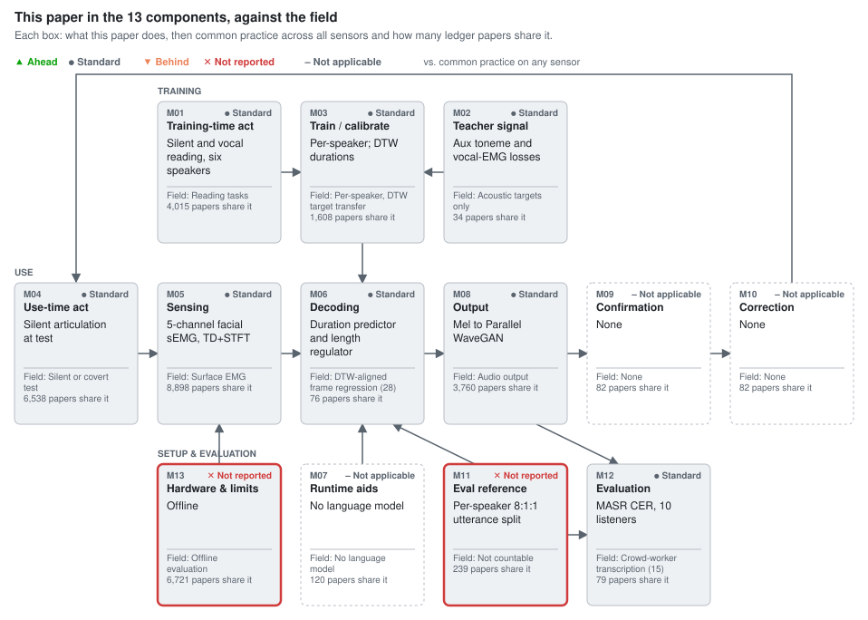

# Sequence-to-Sequence Voice Reconstruction for Silent Speech in a Tonal Language

Li, H., Lin, H., Wang, Y., Wang, H., Zhang, M., Gao, H., Ai, Q., Luo, Z., Li, G. Brain Sciences 12(7):818, 2022. doi:[10.3390/brainsci12070818](https://doi.org/10.3390/brainsci12070818). arXiv:[2108.00190](https://arxiv.org/abs/2108.00190).

**Section:** [Surface EMG](../../README.md#surface-emg)

## Figures

### This paper in the 13 components, against the field

<picture><source media="(prefers-color-scheme: dark)" srcset="figures/components-dark.svg"></picture>

Verdicts compare the paper's choice for each component with common practice across 8,995 ledger entries on any sensor (silent speech, brain-to-text, lip reading).

Data

| Component | This paper | Common practice | Papers with this practice | Verdict |
| --- | --- | --- | --- | --- |
| M01 Training-time act | Silent and vocal reading, six speakers | Reading tasks | 4,015 of 8,995 | ● Standard (Five silent repetitions per prompt.) |
| M02 Teacher signal | Aux toneme and vocal-EMG losses | Acoustic targets only | 34 of 8,995 | ● Standard (Phonetic aux loss is prior [@toth2018multitask]; tone changes CER by +6.51, one run.) |
| M03 Train / calibrate | Per-speaker; DTW durations | Per-speaker, DTW target transfer | 1,608 of 8,995 | ● Standard (Alignment cost inherited from [@gaddy2020digital].) |
| M04 Use-time act | Silent articulation at test | Silent or covert test | 6,538 of 8,995 | ● Standard (Inherited.) |
| M05 Sensing | 5-channel facial sEMG, TD+STFT | Surface EMG | 8,898 of 8,995 | ● Standard (Inherited.) |
| M06 Decoding | Duration predictor and length regulator | DTW-aligned frame regression (28) | 76 of 8,995 | ● Standard (Length regulator never ablated; fails without toneme loss.) |
| M07 Runtime aids | No language model | No language model | 120 of 8,995 | – Not applicable (Synthesis uses no lexicon.) |
| M08 Output | Mel to Parallel WaveGAN | Audio output | 3,760 of 8,995 | ● Standard (Vocoder schedule inconsistent (Table IV vs Sec. IV-A).) |
| M09 Confirmation | None | None | 82 of 8,995 | – Not applicable (Offline study.) |
| M10 Correction | None | None | 82 of 8,995 | – Not applicable (Offline study.) |
| M11 Eval reference | Per-speaker 8:1:1 utterance split | Not countable | 239 of 8,995 | ✕ Not reported (Prompt grouping of the five repetitions across splits not reported.) |
| M12 Evaluation | MASR CER, 10 listeners | Crowd-worker transcription (15) | 79 of 8,995 | ● Standard (No seeds or significance test.) |
| M13 Hardware & limits | Offline | Offline evaluation | 6,721 of 8,995 | ✕ Not reported (Real-time named as future work.) |

## Verdict

The paper changes two components of silent-EMG voicing: the timing map from EMG frames to audio frames (M06), now a duration predictor with a length regulator, and training-only supervision (M02), extended from phonemes to Mandarin tonemes [[1]](#ref-1). Both are standard against the field: the duration-regulated model is rare but fails without the auxiliary loss, and auxiliary phonetic losses predate it [[2]](#ref-2). The headline result, 21.99% objective CER and a gain stated as 24.63% over the baseline (§IV-B.1), is confounded because the baseline [[3]](#ref-3) has no auxiliary loss. Tone itself changes CER by +6.51 in a single run (§IV-C.3), and no CER change in the paper says whether it is absolute or relative. The largest unaddressed risk is the split: five silent repetitions per prompt are divided 8:1:1 by utterance with no stated prompt grouping, so test sentences can occur in training. The results show in-speaker Mandarin voicing on read prompts, not tone-preserving silent speech in general.

## Against the field, component by component

### M06 Decoding: timing map from silent EMG to audio frames

**Usual approach:** frame-synchronous regression on DTW-transferred audio targets, as in [[3]](#ref-3); DTW alignment appears in 28 of 76 EMG synthesis studies (pattern match, unique studies, Appendix). The paper predicts per-frame durations and expands the encoder output to the audio length.

**State of the art:** the authors' 2023 follow-up keeps the length regulator and reaches 10.52% CER from sEMG alone over eight Mandarin speakers [[4]](#ref-4) [later] (other speakers and ASR scorer). English best: 11.89% WER (2026), with DTW used only in training [[5]](#ref-5) [later].

Only 3 of the 76 studies mention a duration predictor or length regulator (pattern match, Appendix): this paper, its follow-up and a later thesis describing it. No ablation removes the length regulator. Removing the toneme loss instead changes CER by +132.75 (Table VI); the authors blame lost context after the length regulator (§IV-C.1). In the [concurrent] frame-synchronous Transformer of [[6]](#ref-6), dropping the phoneme loss only moves WER from 42.2% to 51.7%. Verdict standard: rare design, unisolated effect.

### M02 Training-only supervision: toneme classification

**Usual approach:** acoustic targets only; an auxiliary phoneme, phone-state or CTC loss appears in 10 synthesis studies among 34 pattern-match studies (unique studies, Appendix). Here: forced-aligned toneme labels, discarded at inference (§III-D).

**State of the art:** 25.14 ± 0.90% WER, mean over 10 seeds, with a training-only alignment loss on the English benchmark (2026) [[7]](#ref-7) [later]. The lower 11.89% of [[5]](#ref-5) uses recognition guidance at inference, not training only.

Multi-task synthesis with recognition targets is prior work: ultrasound-to-speech with HMM-state targets gained about 7% relative [[2]](#ref-2). The new element is tone: toneless phonemes change CER by +6.51 (Table VI), one run each. Phonetic supervision is essential here; tone adds a modest gain. Verdict standard.

### M12 Evaluation: listener transcription

**Usual approach:** transcription by crowd workers, in 15 of 79 listener studies (pattern match in ledger and full text, unique studies, Appendix); here 10 native listeners with 60 samples each (§IV-B.2).

**State of the art:** median open-transcription WER of 43.75% for synthesized speech from an intracortical interface (2025) [[8]](#ref-8) [later], from attempted speech; in silent EMG, two listeners transcribed English voicing at 36.1% and 28.5% WER [[6]](#ref-6) [concurrent].

Listener CER (6.41%) is below the MASR CER of ground-truth audio (11.30%): either the scorer underestimates intelligibility, as [[6]](#ref-6) found for its automatic metric, or the listeners heard a small, repeated prompt set (inference). Listener SDs reach 41.62 points for the baseline (Table V), and "significantly" (§IV-B.1) rests on no statistical test. Verdict standard.

## The 13 components

| Component | This paper | Usual approach (count) | State of the art | Verdict |
|---|---|---|---|---|
| M01 Training-time action | Silent and vocal reading, six speakers | Reading tasks (slot-filled 4,015) | – | standard |
| M02 Training-only supervision | Aux toneme and vocal-EMG losses | Acoustic targets only (pattern match 34) | 25.14% WER, 10 seeds [[7]](#ref-7) | standard |
| M03 Training and adaptation | Per-speaker; DTW durations | Per-speaker, DTW target transfer (slot-filled 1,608) | – | standard |
| M04 Use-time action | Silent articulation at test | Silent or covert test (slot-filled 6,538) | – | standard |
| M05 Sensors | 5-channel facial sEMG, TD+STFT | Surface EMG (slot-filled 8,898) | – | standard |
| M06 Processing and decoding | Duration predictor and length regulator | DTW-aligned frame regression (28) (pattern match 76) | 10.52% CER [[4]](#ref-4) | standard |
| M07 Lexicon and LM | No language model | No language model (slot-filled 120) | – | not applicable |
| M08 Output | Mel to Parallel WaveGAN | Audio output (slot-filled 3,760) | – | standard |
| M09 Confirmation | None | None (slot-filled 82) | – | not applicable |
| M10 Correction | None | None (slot-filled 82) | – | not applicable |
| M11 Reference construction | Per-speaker 8:1:1 utterance split | Not countable (slot-filled 239) | – | not reported |
| M12 Evaluation | MASR CER, 10 listeners | Crowd-worker transcription (15) (pattern match 79) | 43.75% WER [[8]](#ref-8) | standard |
| M13 Device and cost | Offline | Offline evaluation (slot-filled 6,721) | – | not reported |

## Where the claims outrun the evidence

- Seq2Seq against baseline (§IV-B.1): the baseline [[3]](#ref-3) has no auxiliary loss, which alone is worth 42.2% against 51.7% in the [concurrent] model [[6]](#ref-6). The 24.63% gain is not the sequence-to-sequence design's.
- Data split (§II-B): splitting by silent utterance with five repetitions per prompt lets test sentences appear in training; the grouping of repetitions is not reported.
- Alignment ablation (§IV-C.4): Table VI lists +81.18 as a CER change, the prose calls it a relative reduction "of over 81.18%"; no Table VI change has a stated unit. The predicted-audio alignment term is inherited: [[3]](#ref-3) reported 76.5% WER without it and 68.0% with it.
- Tone claim (§IV-C.3): "needs tone information" rests on one single-run change of +6.51.

## What the field needs next

- M06: ablate the length regulator against a frame-synchronous decoder with the same toneme loss, encoder and data.
- M11: a prompt-disjoint, session-disjoint split of the Mandarin corpus, with seeds.
- M02: toneme against phoneme loss across seeds and speakers, with tone accuracy on synthesized audio.
- M12: listener tests with stated sample allocation and significance testing.

## Questions for the authors

- Were repetitions of one prompt kept within a single split?
- Is +81.18 in Table VI an absolute or a relative CER change?
- Which MASR checkpoint, decoding and normalization were used?
- How were the 60 listener samples allocated?

## Appendix: literature search

- M06 emg-to-speech-timing-alignment. Inclusion rule: surface-EMG-to-speech synthesis studies (audio or acoustic-feature output), classified by how the EMG time axis is mapped to the audio target (frame-synchronous regression on DTW-aligned targets, duration prediction with a length regulator, or attention-based sequence-to-sequence); EMG-to-text recognition, EMG as an auxiliary channel to audio, and reviews excluded; versions counted once. Ledger counts: slot-filled 7,345 unique studies (M06); pattern match 76 unique studies. Design counts (pattern match, full text; a study can match several): DTW-aligned targets 28, duration predictor or length regulator 3, attention-based sequence-to-sequence 3. Read in full: [[3]](#ref-3) (prior), [[4]](#ref-4), [[5]](#ref-5). Known-item recall 1.0 (4 seeds).
- M02 auxiliary-phoneme-loss-in-speech-synthesis (published table, reused). Inclusion rule: speech synthesis from a non-acoustic signal whose training adds a phoneme, phone-state, CTC or text classification loss on a shared encoder that is discarded or used only as guidance at synthesis time; recognition-only models, recognize-then-TTS cascades and regression-only auxiliary targets excluded; versions counted once. Ledger counts: slot-filled 31 unique studies (M02); pattern match 34 unique studies, 10 of them synthesis by ledger text; this paper added (toneme labels, missed by the pattern). Read in full: [[2]](#ref-2) (prior), [[6]](#ref-6) [concurrent], [[7]](#ref-7). Known-item recall 1.0.
- M12 listener-intelligibility-test (published table, reused). Inclusion rule: speech synthesized from non-acoustic signals evaluated by human listeners who transcribe it or identify words or sentences; naturalness-only ratings and conversion from acoustic input excluded; versions counted once. Ledger counts: slot-filled 6,960 unique studies; pattern match 37 unique studies; listener-type counts over 79 unique studies (pattern match): crowd workers 15. Read in full: [[8]](#ref-8), [[6]](#ref-6) [concurrent]. Known-item recall 1.0.

## References

Numbered by first citation. BibTeX in the same order and keys: [refs.bib](refs.bib).

1. Li, H., Lin, H., Wang, Y., Wang, H., Zhang, M., Gao, H., et al. “Sequence-to-Sequence Voice Reconstruction for Silent Speech in a Tonal Language.” *Brain Sciences*, 2022, 12(7), 818. doi:[10.3390/brainsci12070818](https://doi.org/10.3390/brainsci12070818). arXiv:[2108.00190](https://arxiv.org/abs/2108.00190). Target. Section and table locators refer to arXiv:2108.00190 v3; the Brain Sciences 12(7):818 version numbers sections differently (e.g. 4.2.1 for IV-B.1). [review](https://github.com/supernaiter/silent-speech-review/tree/main/reviews/sequence-to-sequence-voice-reconstruction-for-silent-speech-in-a-tonal-language) [wiki: arxiv-2108.00190](https://github.com/supernaiter/deep-research-wiki-for-silent-speech/blob/main/papers/arxiv-2108.00190/article.md) [wiki: doi-10.3390-brainsci12070818](https://github.com/supernaiter/deep-research-wiki-for-silent-speech/blob/main/papers/doi-10.3390-brainsci12070818/article.md) [wiki: pmc-9312762-semgmandarin](https://github.com/supernaiter/deep-research-wiki-for-silent-speech/blob/main/papers/pmc-9312762-semgmandarin/article.md) [wiki: pmc-9312762-ssrnet-tonal](https://github.com/supernaiter/deep-research-wiki-for-silent-speech/blob/main/papers/pmc-9312762-ssrnet-tonal/article.md)
2. Tóth, L., Gosztolya, G., Grósz, T., Markó, A., Csapó, T. G. “Multi-Task Learning of Speech Recognition and Speech Synthesis Parameters for Ultrasound-based Silent Speech Interfaces.” *Proc. Interspeech 2018*, 2018, 3172–3176. doi:[10.21437/Interspeech.2018-1078](https://doi.org/10.21437/Interspeech.2018-1078). [wiki: isca-toth18-multitask](https://github.com/supernaiter/deep-research-wiki-for-silent-speech/blob/main/papers/isca-toth18-multitask/article.md) [wiki: isca-toth18_interspeech](https://github.com/supernaiter/deep-research-wiki-for-silent-speech/blob/main/papers/isca-toth18_interspeech/article.md) [wiki: isca-toth18_mtlussi](https://github.com/supernaiter/deep-research-wiki-for-silent-speech/blob/main/papers/isca-toth18_mtlussi/article.md)
3. Gaddy, D., Klein, D. “Digital Voicing of Silent Speech.” *Proceedings of the 2020 Conference on Empirical Methods in Natural Language Processing (EMNLP)*, 2020, 5521–5530. doi:[10.18653/v1/2020.emnlp-main.445](https://doi.org/10.18653/v1/2020.emnlp-main.445). arXiv:[2010.02960](https://arxiv.org/abs/2010.02960). [review](https://github.com/supernaiter/silent-speech-review/tree/main/reviews/digital-voicing-of-silent-speech) [wiki: doi-10.18653-v1-2020.emnlp-main.445](https://github.com/supernaiter/deep-research-wiki-for-silent-speech/blob/main/papers/doi-10.18653-v1-2020.emnlp-main.445/article.md) [wiki: arxiv-2010.02960](https://github.com/supernaiter/deep-research-wiki-for-silent-speech/blob/main/papers/arxiv-2010.02960/article.md)
4. Li, H., Wang, M., Gao, H., Zhao, S., Li, G., Wang, Y. “Hybrid Silent Speech Interface Through Fusion of Electroencephalography and Electromyography.” *Proc. Interspeech 2023*, 2023, 1184–1188. doi:[10.21437/Interspeech.2023-805](https://doi.org/10.21437/Interspeech.2023-805). [later] [wiki: isca-li23l_interspeech](https://github.com/supernaiter/deep-research-wiki-for-silent-speech/blob/main/papers/isca-li23l_interspeech/article.md)
5. Lee, J., Lee, J., Lee, K. “GETS: Guiding EMG-to-Speech Synthesis via Silent Speech Recognition.” *Proc. Interspeech 2026*, 2026. doi:[10.21437/Interspeech.2026-1938](https://doi.org/10.21437/Interspeech.2026-1938). [later] [wiki: isca-lee26r_interspeech](https://github.com/supernaiter/deep-research-wiki-for-silent-speech/blob/main/papers/isca-lee26r_interspeech/article.md)
6. Gaddy, D., Klein, D. “An Improved Model for Voicing Silent Speech.” *Proceedings of the 59th Annual Meeting of the Association for Computational Linguistics and the 11th International Joint Conference on Natural Language Processing (Volume 2: Short Papers)*, 2021, 175–181. doi:[10.18653/v1/2021.acl-short.23](https://doi.org/10.18653/v1/2021.acl-short.23). arXiv:[2106.01933](https://arxiv.org/abs/2106.01933). [concurrent] [review](https://github.com/supernaiter/silent-speech-review/tree/main/reviews/an-improved-model-for-voicing-silent-speech) [wiki: arxiv-2106.01933](https://github.com/supernaiter/deep-research-wiki-for-silent-speech/blob/main/papers/arxiv-2106.01933/article.md) [wiki: doi-10.18653-v1-2021.acl-short.23](https://github.com/supernaiter/deep-research-wiki-for-silent-speech/blob/main/papers/doi-10.18653-v1-2021.acl-short.23/article.md)
7. Lee, J., Hwang, I., Lee, J., Kim, E., Han, D., Lee, K. “Enhancing EMG-to-Speech via Silent-Voiced Representation Alignment.” *Proc. Interspeech 2026*, 2026. doi:[10.21437/Interspeech.2026-2931](https://doi.org/10.21437/Interspeech.2026-2931). [later] [wiki: isca-lee26v_interspeech](https://github.com/supernaiter/deep-research-wiki-for-silent-speech/blob/main/papers/isca-lee26v_interspeech/article.md)
8. Wairagkar, M., Card, N. S., Singer-Clark, T., Hou, X., Iacobacci, C., Miller, L. M., et al. “An instantaneous voice-synthesis neuroprosthesis.” *Nature*, 2025. doi:[10.1038/s41586-025-09127-3](https://doi.org/10.1038/s41586-025-09127-3). [later] [review](https://github.com/supernaiter/silent-speech-review/tree/main/reviews/an-instantaneous-voice-synthesis-neuroprosthesis) [wiki: doi-10.1038-s41586-025-09127-3](https://github.com/supernaiter/deep-research-wiki-for-silent-speech/blob/main/papers/doi-10.1038-s41586-025-09127-3/article.md) [wiki: doi-10.1101-2024.08.14.607690](https://github.com/supernaiter/deep-research-wiki-for-silent-speech/blob/main/papers/doi-10.1101-2024.08.14.607690/article.md) [wiki: pmc-12369848-voicesynth](https://github.com/supernaiter/deep-research-wiki-for-silent-speech/blob/main/papers/pmc-12369848-voicesynth/article.md) [wiki: pmc-12369848-voice-synth-np](https://github.com/supernaiter/deep-research-wiki-for-silent-speech/blob/main/papers/pmc-12369848-voice-synth-np/article.md) [wiki: pmc-11370360-instvoice](https://github.com/supernaiter/deep-research-wiki-for-silent-speech/blob/main/papers/pmc-11370360-instvoice/article.md)

## Materials

Data behind this review. Full texts of the papers are not included.

- [`review.md`](review.md): the review text (source)
- [`refs.bib`](refs.bib): references (BibTeX)
- [`slots.json`](slots.json): for each of the 13 components: this paper's choice, field practice, number of matching papers, verdict
- [`figures.json`](figures.json): figure definitions
- [`evaluation.md`](evaluation.md): independent evaluation by a second reviewer
- [`triage.md`](triage.md): how each evaluation finding was checked against the sources and resolved
- [`components/M02/auxiliary-phoneme-loss-in-speech-synthesis.csv`](../../components/M02/auxiliary-phoneme-loss-in-speech-synthesis.csv): M02 topic "auxiliary-phoneme-loss-in-speech-synthesis", every candidate paper with its decision (31 slot-filled, 34 pattern match, usual design in 10, 3 read in full)
- [`components/M06/emg-to-speech-timing-alignment.csv`](../../components/M06/emg-to-speech-timing-alignment.csv): M06 topic "emg-to-speech-timing-alignment", every candidate paper with its decision (7345 slot-filled, 76 pattern match, usual design in 28, 4 read in full)
- [`components/M12/listener-intelligibility-test.csv`](../../components/M12/listener-intelligibility-test.csv): M12 topic "listener-intelligibility-test", every candidate paper with its decision (6960 slot-filled, 37 pattern match, usual design in 15, 5 read in full)

## More reviews in Surface EMG

- [Knowledge Distilled Ensemble Model for sEMG-based Silent Speech Interface](../knowledge-distilled-ensemble-model-for-semg-based-silent-speech-interface/) (2023). Distills a ResNet ensemble into a lightweight model for spelling via the NATO phonetic alphabet from 3-channel facial sEMG on portable hardware. KDE-SSI reaches 85.9% accuracy on 26 classes with 0.12 ms inference per sample.
- [An Improved Model for Voicing Silent Speech](../an-improved-model-for-voicing-silent-speech/) (2021). Conv-plus-Transformer EMG encoder (M06) is reused by the 2026 state of the art; the phoneme loss (M02) follows 2018 ultrasound work. Single runs; ablations explain 16.3 of 25.8 points.
- [Digital Voicing of Silent Speech](../digital-voicing-of-silent-speech/) (2020). Silent-EMG target transfer (M02) extends a 2016 DTW recipe; the open corpus scored by WER (M12) became the shared test bed. Headline 94% gain is closed-vocabulary, 20 clips, one evaluator.
- [A Parallel Ultra-Low Power Silent Speech Interface based on a Wearable, Fully-dry EMG Neckband](../a-parallel-ultra-low-power-silent-speech-interface-based-on-a-wearable-fully-dry-emg-neckband/) (2025). A fully dry wearable EMG neckband with ultra-low-power BioGAP-Ultra classifies 8 silently articulated words for one healthy user at 68% accuracy, dropping to 54% on an unseen re-wearing session; acquisition plus BLE uses 22.2 mW.
- [A Silent Speech Decoding System from EEG and EMG with Heterogenous Electrode Configurations](../a-silent-speech-decoding-system-from-eeg-and-emg-with-heterogenous-electrode-configurations/) (2025). Jointly trains on EEG and EMG data with heterogeneous electrode configurations for silent Japanese 64-word classification, reaching 95.3% for eight healthy subjects and 54.5% for one patient (chance 1.6%).
- [Articulatory Feature Prediction from Surface EMG during Speech Production](../articulatory-feature-prediction-from-surface-emg-during-speech-production/) (2025). Predicts 12-dim articulatory features, pitch and loudness from vocalized-speech sEMG and resynthesizes audio with an articulatory synthesizer. Feature correlation is about 0.9 against audio-derived proxy targets, but WER is 15.5% versus 12.6% for the Gaddy baseline (one male speaker).

---

Part of the [Silent Speech Interface Review](https://github.com/supernaiter/silent-speech-review). Found an error? [Open an issue](https://github.com/supernaiter/silent-speech-review/issues/new?template=correction.yml).
