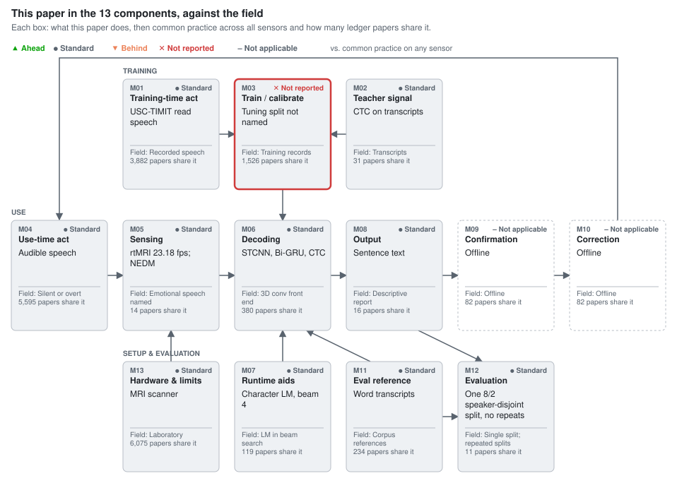

# Silent Speech and Emotion Recognition from Vocal Tract Shape Dynamics in Real-Time MRI

Pandey, L., Arif, A. S. · SIGGRAPH 2021 (arXiv preprint) · 2021 · [arXiv:2106.08706](https://arxiv.org/abs/2106.08706)

**Section:** [Brain signals (EEG, MEG, intracortical)](../../README.md#brain-signals-eeg-meg-intracortical)

## Figures

### This paper in the 13 components, against the field

<picture><source media="(prefers-color-scheme: dark)" srcset="figures/components-dark.svg"></picture>

Verdicts compare the paper's choice for each component with common practice across 8,995 ledger entries on any sensor (silent speech, brain-to-text, lip reading).

Data

| Component | This paper | Common practice | Papers with this practice | Verdict |
| --- | --- | --- | --- | --- |
| M01 Training-time act | USC-TIMIT read speech | Recorded speech | 3,882 of 8,995 | ● Standard (Inherited corpus; mirroring as augmentation.) |
| M02 Teacher signal | CTC on transcripts | Transcripts | 31 of 8,995 | ● Standard (Inherited CTC lineage.) |
| M03 Train / calibrate | Tuning split not named | Training records | 1,526 of 8,995 | ✕ Not reported (Selection data, epochs and seeds not stated (§4.2).) |
| M04 Use-time act | Audible speech | Silent or overt | 5,595 of 8,995 | ● Standard (No silent condition despite the title.) |
| M05 Sensing | rtMRI 23.18 fps; NEDM | Emotional speech named | 14 of 8,995 | ● Standard (NEDM follows Kim et al. 2014 methodology; two words, no test.) |
| M06 Decoding | STCNN, Bi-GRU, CTC | 3D conv front end | 380 of 8,995 | ● Standard (Architecture taken over from LipNet.) |
| M07 Runtime aids | Character LM, beam 4 | LM in beam search | 119 of 8,995 | ● Standard (Inherited from LipNet; LM described two ways.) |
| M08 Output | Sentence text | Descriptive report | 16 of 8,995 | ● Standard (New among 88 vocal-tract MRI studies; ahead rule unmet (one split).) |
| M09 Confirmation | Offline | Offline | 82 of 8,995 | – Not applicable (Offline study.) |
| M10 Correction | Offline | Offline | 82 of 8,995 | – Not applicable (Offline study.) |
| M11 Eval reference | Word transcripts | Corpus references | 234 of 8,995 | ● Standard (Alignment by word duration times frame rate.) |
| M12 Evaluation | One 8/2 speaker-disjoint split, no repeats | Single split; repeated splits | 11 of 8,995 | ● Standard (Unseen-speaker test credited; no repeats; sentence overlap likely.) |
| M13 Hardware & limits | MRI scanner | Laboratory | 6,075 of 8,995 | ● Standard (No latency or device measures; authors concede.) |

## Verdict

The paper moves the LipNet decoder onto real-time MRI (M06) and makes sentence text the output of a vocal-tract MRI decoder (M08) [[1]](#ref-1). The decoder is standard, the field's most common articulator-video design [[2]](#ref-2). The text output is new among 88 vocal-tract MRI studies (Appendix), beyond HMM sequence recognition of rtMRI speech [[3]](#ref-3), but stays standard: one split without repeats fails the ahead rule. The evaluation (M12) is standard: unseen speakers, unlike that one-speaker prior, but no repeats. The strongest confound: every USC-TIMIT speaker reads the same 460 sentences [[4]](#ref-4), so the 40.6% PER most likely measures speaker transfer on a closed list (inference). The title overreaches: the speech is audible (§4.1), and nothing recognizes emotion (§6).

## Against the field, component by component

### M06 Decoder: LipNet on rtMRI

**Usual approach:** Of 1,342 articulator-video decoding studies (pattern match, published table, Appendix), 380 use a 3D convolution front end with a recurrent or temporal back end. The paper uses exactly this, STCNN, Bi-GRUs and CTC (Fig. 1), from LipNet [[2]](#ref-2); only the input, rtMRI at 23.18 frames per second (§4.1), is new.

**State of the art:** Tongue2Speech (2026, [later]) keeps the 3D front end with a Transformer, 15.93% WER (ASR on synthesized speech, one speaker) [[5]](#ref-5); lip reading reaches 19.1% visual-only WER on LRS3 (2023) [[6]](#ref-6); on rtMRI, Otani et al. (2026) use EfficientNetV2 frames and an E-Branchformer [[7]](#ref-7).

The "first end-to-end sentence-level" claim (§1) repeats LipNet's wording [[2]](#ref-2). Saha et al. judged 3D temporal pooling too weak for rtMRI clips of about 3 seconds [[8]](#ref-8); the paper feeds 75-frame, about 3-second windows to a 3D front end (§4.2) untested. Verdict: standard.

### M08 Output: sentence text from vocal-tract MRI

**Usual approach:** Of 75 vocal-tract MRI studies with an output recorded, the most common output, a descriptive report, appears in 16 (slot-filled); of 88, 21 name class recognition and 18 speech synthesis, and only this paper emits text (pattern match, Appendix).

**State of the art:** No [later] MRI study outputs text (Appendix); synthesis replaced it: 8.2% to 23.5% dWER on four unseen speakers, against ASR of the original speech (2026) [[7]](#ref-7).

The "first study" claim (Abstract) omits Katsamanis et al., who recognized sequences of 30 articulation classes in 460 TIMIT utterances of one speaker at 49.4% accuracy over 10 random 95/5 splits [[3]](#ref-3). The step to words is new (Appendix); the verdict is standard only because the ahead rule needs repeated evidence, and there is one split, two pooled speakers and no repeats (§4.1–4.2).

### M12 Evaluation: split, repeats and comparison

**Usual approach:** A single split; of 88 vocal-tract MRI studies only 11 name repeated splits or cross-validation, 10 unseen test speakers and 3 sentence-disjoint tests (pattern match, upper bounds, Appendix). The paper holds out two of ten speakers once, with no repeat, seed or interval (§4.1, §5.2).

**State of the art:** Otani et al. (2026) also use one split, holding out 4 speakers (43/4/4), and report each, 8.2% to 23.5% dWER, read speech 4.5% to 11.1% [[7]](#ref-7).

The only earlier continuous rtMRI recognizer averaged 10 random splits of one speaker [[3]](#ref-3); other MRI repeats are in different tasks [[9]](#ref-9), [[10]](#ref-10). On the same corpus Csapó held out 10 test sentences per speaker [[4]](#ref-4); the paper's 3,680 videos from eight speakers and 920 from two are 460 per speaker (inference), the full shared list. Table 2 ranks sentence PER against converted accuracies of VCV and phoneme classifiers on another corpus [[8]](#ref-8); the caption concedes the tasks differ, yet the Abstract calls 40.6% "much better". Verdict: standard; ahead of the 2011 prior on speakers, behind it on repetition and sentence-disjointness.

### M05 Emotion geometry (incidental)

**Usual approach:** Of 88 vocal-tract MRI studies, 14 name emotional speech and 4 compare boundary geometry with a neutral reference (pattern match, Appendix); the NEDM follows the paper's reference 10, Kim et al. 2014 (§6).

**State of the art:** No [later] ledger study (Appendix); the prior is Lee et al. (2006): one speaker, five productions of "doctor" per emotion, called preliminary [[11]](#ref-11).

With two words, averages only (Table 3) and no test, the gender claim rests on gaps such as 1.00 against 0.91 (lower boundary, angry, velar, "clock"). Verdict: standard.

## The 13 components

| Component | This paper | Usual approach (count) | State of the art | Verdict |
|---|---|---|---|---|
| M01 Training-time action | USC-TIMIT read speech | Recorded speech (slot-filled 3,882) | – | standard |
| M02 Training-only supervision | CTC on transcripts | Transcripts (slot-filled 31) | – | standard |
| M03 Training and adaptation | Tuning split not named | Training records (slot-filled 1,526) | – | not reported |
| M04 Use-time action | Audible speech | Silent or overt (slot-filled 5,595) | – | standard |
| M05 Sensors | rtMRI 23.18 fps; NEDM | Emotional speech named (pattern match 14) | [[11]](#ref-11) (2006): 1 speaker | standard |
| M06 Processing and decoding | STCNN, Bi-GRU, CTC | 3D conv front end (pattern match 380) | [[6]](#ref-6) (2023): LRS3 VSR WER 19.1% | standard |
| M07 Lexicon and LM | Character LM, beam 4 | LM in beam search (slot-filled 119) | – | standard |
| M08 Output | Sentence text | Descriptive report (slot-filled 16) | [[7]](#ref-7) (2026): dWER 8.2-23.5% | standard |
| M09 Confirmation | Offline | Offline (slot-filled 82) | – | not applicable |
| M10 Correction | Offline | Offline (slot-filled 82) | – | not applicable |
| M11 Reference construction | Word transcripts | Corpus references (slot-filled 234) | – | standard |
| M12 Evaluation | One 8/2 speaker-disjoint split, no repeats | Single split; repeated splits (pattern match 11) | [[7]](#ref-7) (2026): per-speaker dWER | standard |
| M13 Device and cost | MRI scanner | Laboratory (slot-filled 6,075) | – | standard |

## Where the claims outrun the evidence

- "Silent speech" and "emotion recognition" (title): the speech is audible (§4.1); no emotion classifier exists (§6).
- The LM's training text is not stated (§3.2); with a closed list, its 3.5-point PER gain (Table 2) may reflect leaked test text (inference).
- PER is reported apart from CER (§5.2), though the model emits 28 characters (Table 1) with no grapheme-to-phoneme step; Fig. 3 labels letters as phonemes.
- The LM is a "5-gram" and also a recurrent network of 4 layers of 1,024 LSTM cells (§3.2); §4.2 copies LipNet [[2]](#ref-2).
- §2 says Saha et al. used the same dataset; Table 2 and their text name another database [[8]](#ref-8).

## What the field needs next

- M12: a USC-TIMIT split disjoint in speakers and sentences, repeated over folds or seeds, with per-speaker errors.
- M08: CTC text decoding against ASR on rtMRI-synthesized speech, same split [[7]](#ref-7).

## Questions for the authors

- Which speakers were tested, and did their sentences occur in training?
- On which text was the LM trained, and was it n-gram or LSTM?

## Appendix: literature search

- M06, articulator-video-spatiotemporal-front-end (published table, reused). Inclusion rule: studies that decode text, speech or acoustic features from video of the articulators (lip or face camera, ultrasound) with a trained network, classified by how temporal context enters the image front end; hand-crafted features, audio-only models and reviews count only as pattern matches; versions count once. Ledger: 7,345 unique studies slot-filled for M06; 1,342 unique studies pattern match. Usual design: 3D convolution front end 380; CNN followed by a recurrent layer 255; temporal convolution network 146 (pattern match, published counts). Read in full: [[2]](#ref-2), [[8]](#ref-8), [[7]](#ref-7); published tables also read [[5]](#ref-5) and [[6]](#ref-6) (M06 ctc-vs-attention). Known-item recall 1.0 (published).
- M08, rtmri-decoder-output (new). Inclusion rule: vocal-tract MRI studies (88 unique ledger studies naming rtMRI, real-time or dynamic MRI, MRI-TIMIT, USC-TIMIT or the Vocal Tract Morphology MRI database), classified by output: descriptive analysis, intermediate signal, class label or class sequence, synthesized speech, or text scored by WER, CER or PER; speech scored by ASR counts as speech; versions count once. Ledger: 3,268 unique studies slot-filled for M08; 88 unique studies pattern match. Usual design: descriptive report 16 of 75 slot-filled; class recognition 21, speech synthesis 18, WER or CER named 9, of which only the target outputs text (pattern match). Read in full: [[3]](#ref-3), [[8]](#ref-8), [[7]](#ref-7). Known-item recall 0.83 (6 seeds).
- M12, rtmri-decoding-test-split (new). Inclusion rule: the same 88 studies, counting the test protocols a trained decoder or classifier names: unseen test speakers, sentence-disjoint material, repeated splits, folds or seeds; a study counts under every protocol its full text names (upper bound). Ledger: 6,960 unique studies slot-filled for M12; 88 unique studies pattern match. Repeated splits or cross-validation 11; unseen test speakers 10; sentence-disjoint 3 (pattern match). Read in full: [[3]](#ref-3), [[9]](#ref-9), [[10]](#ref-10), [[4]](#ref-4), [[7]](#ref-7). Known-item recall 1.0 (6 seeds).
- M05, emotion-related-vocal-tract-shape-deviation (new). Inclusion rule: the same 88 studies, counting full texts naming emotional speech and those comparing boundary distances, apertures or constrictions with a neutral reference; related-work mentions match (upper bound). Ledger: 7,329 unique studies slot-filled for M05; 88 unique studies pattern match. Emotional speech 14; neutral-referenced geometry 4 (pattern match). Read in full: [[11]](#ref-11), outside the ledger pattern. Known-item recall 0.5 (2 seeds).

## References

Numbered by first citation. BibTeX in the same order and keys: [refs.bib](refs.bib).

1. Pandey, L., Arif, A. S. “Silent Speech and Emotion Recognition from Vocal Tract Shape Dynamics in Real-Time MRI.” *SIGGRAPH 2021 (arXiv preprint)*, 2021. arXiv:[2106.08706](https://arxiv.org/abs/2106.08706). Target. Read as arXiv v1. [review](https://github.com/supernaiter/silent-speech-review/tree/main/reviews/silent-speech-and-emotion-recognition-from-vocal-tract-shape-dynamics-in-real-time-mri) [wiki: arxiv-2106.08706](https://github.com/supernaiter/deep-research-wiki-for-silent-speech/blob/main/papers/arxiv-2106.08706/article.md)
2. Assael, Y. M., Shillingford, B., Whiteson, S., de Freitas, N. “LipNet: End-to-End Sentence-level Lipreading.” *arXiv preprint*, 2016. arXiv:[1611.01599](https://arxiv.org/abs/1611.01599). Prior; architecture and LM lineage (M06, M07). [review](https://github.com/supernaiter/silent-speech-review/tree/main/reviews/lipnet-end-to-end-sentence-level-lipreading) [wiki: arxiv-1611.01599](https://github.com/supernaiter/deep-research-wiki-for-silent-speech/blob/main/papers/arxiv-1611.01599/article.md)
3. Katsamanis, A., Bresch, E., Ramanarayanan, V., Narayanan, S. “Validating rt-MRI based articulatory representations via articulatory recognition.” *Proc. Interspeech 2011*, 2011, 2841-2844. doi:[10.21437/Interspeech.2011-711](https://doi.org/10.21437/Interspeech.2011-711). Prior; deciding prior for M08 and M12. [wiki: isca-katsamanis11_interspeech](https://github.com/supernaiter/deep-research-wiki-for-silent-speech/blob/main/papers/isca-katsamanis11_interspeech/article.md)
4. Csapó, T. G. “Speaker dependent articulatory-to-acoustic mapping using real-time MRI of the vocal tract.” *Proc. Interspeech 2020*, 2020. doi:[10.21437/Interspeech.2020-15](https://doi.org/10.21437/Interspeech.2020-15). arXiv:[2008.00889](https://arxiv.org/abs/2008.00889). Prior; USC-TIMIT sentence list and sentence-disjoint split (M12). [wiki: isca-csapo20_interspeech](https://github.com/supernaiter/deep-research-wiki-for-silent-speech/blob/main/papers/isca-csapo20_interspeech/article.md) [wiki: arxiv-2008.00889](https://github.com/supernaiter/deep-research-wiki-for-silent-speech/blob/main/papers/arxiv-2008.00889/article.md)
5. Sonkar, Y., Kilaru, Y., Yelimeli, S., Shah, N., Gandhi, V. “Tongue2Speech: Real-Time Speech Synthesis from Tongue Ultrasound Videos via Spatiotemporal Transformers.” *Proc. Interspeech 2026*, 2026. doi:[10.21437/Interspeech.2026-3023](https://doi.org/10.21437/Interspeech.2026-3023). Later; state of the art of the published M06 table. [later] [wiki: isca-sonkar26_interspeech](https://github.com/supernaiter/deep-research-wiki-for-silent-speech/blob/main/papers/isca-sonkar26_interspeech/article.md)
6. Ma, P., Haliassos, A., Fernandez-Lopez, A., Chen, H., Petridis, S., Pantic, M. “Auto-AVSR: Audio-Visual Speech Recognition with Automatic Labels.” *Proc. ICASSP 2023*, 2023. doi:[10.1109/ICASSP49357.2023.10096889](https://doi.org/10.1109/ICASSP49357.2023.10096889). arXiv:[2303.14307](https://arxiv.org/abs/2303.14307). Later; lip-reading state of the art for M06 (published table ctc-vs-attention). [later] [review](https://github.com/supernaiter/silent-speech-review/tree/main/reviews/auto-avsr-audio-visual-speech-recognition-with-automatic-labels) [wiki: arxiv-2303.14307](https://github.com/supernaiter/deep-research-wiki-for-silent-speech/blob/main/papers/arxiv-2303.14307/article.md)
7. Otani, Y., Sawada, S., Ohmura, H., Katsurada, K. “Speaker-Independent Speech Synthesis from Real-time MRI Articulatory Data.” *Proc. Interspeech 2026*, 2026. doi:[10.21437/Interspeech.2026-3379](https://doi.org/10.21437/Interspeech.2026-3379). Later; state of the art for M06, M08 and M12 on rtMRI. [later] [wiki: isca-otani26_interspeech](https://github.com/supernaiter/deep-research-wiki-for-silent-speech/blob/main/papers/isca-otani26_interspeech/article.md)
8. Saha, P., Srungarapu, P., Fels, S. “Towards Automatic Speech Identification from Vocal Tract Shape Dynamics in Real-time MRI.” *Proc. Interspeech 2018*, 2018, 1249-1253. doi:[10.21437/Interspeech.2018-2537](https://doi.org/10.21437/Interspeech.2018-2537). Prior; deciding prior for M06 and M08. [wiki: isca-saha18_rtmrivcv](https://github.com/supernaiter/deep-research-wiki-for-silent-speech/blob/main/papers/isca-saha18_rtmrivcv/article.md) [wiki: isca-saha18-vtmri](https://github.com/supernaiter/deep-research-wiki-for-silent-speech/blob/main/papers/isca-saha18-vtmri/article.md)
9. Prasad, A., Ghosh, P. K., Narayanan, S. S. “Selection of optimal vocal tract regions using real-time magnetic resonance imaging for robust voice activity detection.” *Proc. Interspeech 2014*, 2014. doi:[10.21437/Interspeech.2014-368](https://doi.org/10.21437/Interspeech.2014-368). Prior; repeated folds (M12). [wiki: isca-prasad14_interspeech](https://github.com/supernaiter/deep-research-wiki-for-silent-speech/blob/main/papers/isca-prasad14_interspeech/article.md)
10. van Leeuwen, K. G., Bos, P., Trebeschi, S., van Alphen, M. J. A., Voskuilen, L., Smeele, L. E., et al. “CNN-based phoneme classifier from vocal tract MRI learns embedding consistent with articulatory topology.” *Proc. Interspeech 2019*, 2019, 909-913. doi:[10.21437/Interspeech.2019-1173](https://doi.org/10.21437/Interspeech.2019-1173). Prior; repeated leave-one-subject-out (M12). [wiki: isca-leeuwen19_interspeech](https://github.com/supernaiter/deep-research-wiki-for-silent-speech/blob/main/papers/isca-leeuwen19_interspeech/article.md)
11. Lee, S., Bresch, E., Adams, J., Kazemzadeh, A., Narayanan, S. “A Study of Emotional Speech Articulation using a Fast Magnetic Resonance Imaging Technique.” *Proc. Interspeech 2006 - ICSLP*, 2006, 2234-2237. doi:[10.21437/Interspeech.2006-320](https://doi.org/10.21437/Interspeech.2006-320). Prior; deciding prior for M05. [wiki: isca-lee06d_interspeech](https://github.com/supernaiter/deep-research-wiki-for-silent-speech/blob/main/papers/isca-lee06d_interspeech/article.md)

## Materials

Data behind this review. Full texts of the papers are not included.

- [`review.md`](review.md): the review text (source)
- [`refs.bib`](refs.bib): references (BibTeX)
- [`slots.json`](slots.json): for each of the 13 components: this paper's choice, field practice, number of matching papers, verdict
- [`figures.json`](figures.json): figure definitions
- [`evaluation.md`](evaluation.md): independent evaluation by a second reviewer
- [`triage.md`](triage.md): how each evaluation finding was checked against the sources and resolved
- [`process/log.json`](process/log.json): process record: each step, who did it (reader, script, writer, evaluator), when, the checks run and the input versions
- [`process/notes.json`](process/notes.json): reading notes on the target and comparator papers: claims, numbers, conditions and what is not stated, with locations
- [`process/plan.json`](process/plan.json): plan: which components the paper changes and the topics it is compared on
- [`process/draft.md`](process/draft.md): the review as first written, before the independent evaluation
- [`process/claims-draft.md`](process/claims-draft.md): claim table of the draft: every claim mapped to a note or a count
- [`process/claims.md`](process/claims.md): claim table of the published review
- [`components/M05/emotion-related-vocal-tract-shape-deviation.csv`](../../components/M05/emotion-related-vocal-tract-shape-deviation.csv): M05 topic "emotion-related-vocal-tract-shape-deviation", every candidate paper with its decision (7329 slot-filled, 88 pattern match, usual design in 14, 1 read in full)
- [`components/M06/articulator-video-spatiotemporal-front-end.csv`](../../components/M06/articulator-video-spatiotemporal-front-end.csv): M06 topic "articulator-video-spatiotemporal-front-end", every candidate paper with its decision (7345 slot-filled, 1342 pattern match, usual design in 380, 5 read in full)
- [`components/M08/rtmri-decoder-output.csv`](../../components/M08/rtmri-decoder-output.csv): M08 topic "rtmri-decoder-output", every candidate paper with its decision (3268 slot-filled, 88 pattern match, usual design in 16, 3 read in full)
- [`components/M12/rtmri-decoding-test-split.csv`](../../components/M12/rtmri-decoding-test-split.csv): M12 topic "rtmri-decoding-test-split", every candidate paper with its decision (6960 slot-filled, 88 pattern match, usual design in 11, 5 read in full)

## More reviews in Brain signals (EEG, MEG, intracortical)

- [EMA2S: An End-to-End Multimodal Articulatory-to-Speech System](../ema2s-an-end-to-end-multimodal-articulatory-to-speech-system/) (2021). Speech-latent target (M02) has a 2017 precedent and small, mixed single-run gains; spectrogram-loss-only end-to-end loses to WORLD (M06); a preference test replaces listener transcription (M12).
- [Neuroprosthesis for decoding speech in a paralyzed person with anarthria](../neuroprosthesis-for-decoding-speech-in-a-paralyzed-person-with-anarthria/) (2021). Sentence decoding from a person who cannot speak holds for 50 words and one participant; the decoder is standard for 2021, and an LM restricted to the test vocabulary drives the gain.
- [Towards Neural Decoding of Imagined Speech based on Spoken Speech](../towards-neural-decoding-of-imagined-speech-based-on-spoken-speech/) (2022). Spoken-to-imagined EEG transfer (M04) is the standard overt-to-covert design; 26.8% vs 30.5% on 5 classes, no chance level, and "comparable" rests on a non-significant omnibus test.
- [A comparison of oscillatory characteristics in covert speech and speech perception](../a-comparison-of-oscillatory-characteristics-in-covert-speech-and-speech-perception/) (2020). EEG analysis comparing oscillatory activity in covert speech and speech perception in eight participants; finds stronger low-gamma for covert speech, stronger delta/theta for perception, and theta-gamma coupling.
- [Brain2Char: a deep architecture for decoding text from brain recordings](../brain2char-a-deep-architecture-for-decoding-text-from-brain-recordings/) (2020). Character CTC decoding from ECoG; all changes are standard. The 7.0-10.6% WER relies on repeated sentences, as the authors concede, and unseen sentences average 80% WER.
- [Continuous Silent Speech Recognition using EEG](../continuous-silent-speech-recognition-using-eeg/) (2020). Standard on silent reading (M04) and CTC decoding (M06); 83% WER on 30 sentences repeated in training, with an undisclosed 4-gram LM and no chance baseline, does not show EEG decoding.

---

Part of the [Silent Speech Interface Review](https://github.com/supernaiter/silent-speech-review). Found an error? [Open an issue](https://github.com/supernaiter/silent-speech-review/issues/new?template=correction.yml).
