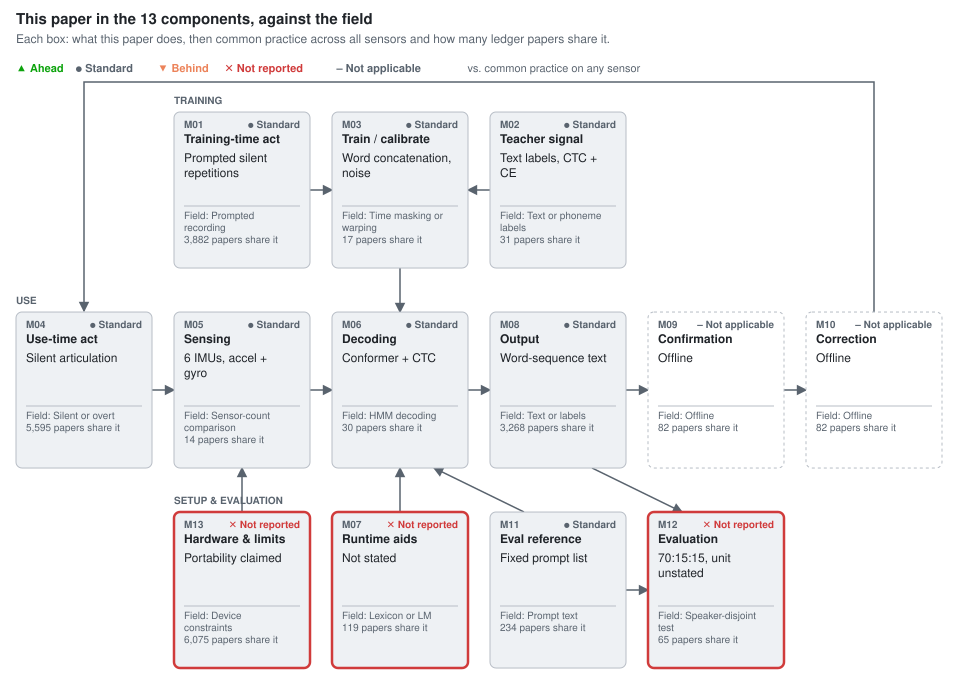

# Silent Speech Sentence Recognition with Six-Axis Accelerometers using Conformer and CTC Algorithm

Xie, Y., Han, Z., Xiao, Q., Liang, L., Tao, L.-Q., Ren, T.-L. · arXiv preprint · 2025 · [arXiv:2502.17829](https://arxiv.org/abs/2502.17829)

**Section:** [Acoustic, whisper & wearable motion sensors](../../README.md#acoustic-whisper--wearable-motion-sensors)

## Figures

### This paper in the 13 components, against the field

<picture><source media="(prefers-color-scheme: dark)" srcset="figures/components-dark.svg"></picture>

Verdicts compare the paper's choice for each component with common practice across 8,995 ledger entries on any sensor (silent speech, brain-to-text, lip reading).

Data

| Component | This paper | Common practice | Papers with this practice | Verdict |
| --- | --- | --- | --- | --- |
| M01 Training-time act | Prompted silent repetitions | Prompted recording | 3,882 of 8,995 | ● Standard (Inherited.) |
| M02 Teacher signal | Text labels, CTC + CE | Text or phoneme labels | 31 of 8,995 | ● Standard (Inherited CTC-text design.) |
| M03 Train / calibrate | Word concatenation, noise | Time masking or warping | 17 of 8,995 | ● Standard (Concatenation predates it.) |
| M04 Use-time act | Silent articulation | Silent or overt | 5,595 of 8,995 | ● Standard (Inherited.) |
| M05 Sensing | 6 IMUs, accel + gyro | Sensor-count comparison | 14 of 8,995 | ● Standard (Gyroscope result new, small n.) |
| M06 Decoding | Conformer + CTC | HMM decoding | 30 of 8,995 | ● Standard (CTC sentence decoding predates it.) |
| M07 Runtime aids | Not stated | Lexicon or LM | 119 of 8,995 | ✕ Not reported (CTC search and LM unstated.) |
| M08 Output | Word-sequence text | Text or labels | 3,268 of 8,995 | ● Standard (Inherited.) |
| M09 Confirmation | Offline | Offline | 82 of 8,995 | – Not applicable (Offline study.) |
| M10 Correction | Offline | Offline | 82 of 8,995 | – Not applicable (Offline study.) |
| M11 Eval reference | Fixed prompt list | Prompt text | 234 of 8,995 | ● Standard (Sessions not stated.) |
| M12 Evaluation | 70:15:15, unit unstated | Speaker-disjoint test | 65 of 8,995 | ✕ Not reported (Split and overlap unstated.) |
| M13 Hardware & limits | Portability claimed | Device constraints | 6,075 of 8,995 | ✕ Not reported (No wear, latency measure.) |

## Verdict

The paper [[1]](#ref-1) changes the decoder (M06, Conformer with CTC), the training data (M03, concatenated words plus noise) and the sensing (M05, six six-axis IMUs); all three are standard. Continuous silent recognition (8.9% WER, 2,200 words) [[2]](#ref-2) and CTC decoding of silent phrases [[3]](#ref-3), [[4]](#ref-4) predate it, and the cited Luo et al. already trained CTC for silent sentences [[5]](#ref-5), so the §1 novelty claim fails (Appendix). Liu et al. trained IMU decoders on concatenated sentences and tested on spoken ones [[6]](#ref-6); this paper does not say whether its length curve (Fig. 3a) scores recorded or concatenated sequences. The headline 97.17% is a word ratio on 4 participants with a 70:15:15 split of unstated unit; repetition leakage across it is not excluded (M12).

## Against the field, component by component

### M06 Sentence decoder: Conformer with CTC

**Usual approach:** Of 54 silent sentence-recognition studies with body-worn or contact sensors (pattern match, Appendix), 30 name HMM decoding, 16 CTC and 9 attention sequence-to-sequence decoders. The paper takes the CTC route plus a cross-entropy loss (§2.3).

**State of the art:** for a closed phrase set, Chen et al. (2023): CTC syllable decoding from four 64-channel HD-sEMG arrays, 33 Chinese phrases, 15 subjects, phrase accuracy 97.17 ± 1.53%, character error rate 3.11 ± 1.46% [[3]](#ref-3). The target reports the same number on 4 participants with a word ratio, a different metric.

Luo et al. trained CTC against attention for 54 silent sentences (§4.4) [[5]](#ref-5); with open vocabulary, a CTC model with rescoring reaches 12.2% WER on silent EMG [[4]](#ref-4). The target reports no second decoder, CTC search or language model (§2–3) and no held-out word combination. Verdict: standard.

### M03 Training data: concatenated words plus noise

**Usual approach:** In the same 54 studies (pattern match, Appendix), 17 name time masking or warping and 4 records match word-concatenation synthesis; one study uses it [[6]](#ref-6). The target adds tenfold concatenation and Gaussian noise (§2.1.2).

**State of the art:** Liu et al. (2024): trained only on concatenations of segmented words, 92.0% on 93 spoken fluent sentences (n = 7), 96.4% with individual segmentation parameters, 25.1% without segmentation [[6]](#ref-6).

The target describes no segmentation; dropping it cost Liu et al. 66.9 points, 73% relative (inference). A [later] study shows that concatenation misses coarticulation [[7]](#ref-7). Lengths up to 19 exceed every recorded item in Table 1, so the curve most likely scores concatenations (inference); Liu et al. are not cited. Verdict: standard.

### M05 Sensors: six six-axis IMUs, channel and axis ablation

**Usual approach:** Of 20 inertial silent-speech studies (pattern match, Appendix, mostly reviews), 14 name a sensor-count comparison and 9 a gyroscope. The accelerometer lineage uses acceleration only [[8]](#ref-8); Liu et al. add gyroscopes and a head reference IMU [[6]](#ref-6). The target records both at 50 Hz on the face (Fig. 1).

**State of the art:** Choi et al. (2026, [later]): all combinations of ten accelerometers, 100 silent words, 20 participants, subject-dependent; plateau at five sensors, 92.30 ± 4.64% [[8]](#ref-8).

Its useful result is Fig. 4(c): single gyroscope axes 92.39–93.39% against accelerometer axes 87.62–92.42%, which argues against discarding the gyroscope; motion is handled only by a 2 Hz high-pass filter (§2.2). Verdict: standard.

### M12 Evaluation: split and metric

**Usual approach:** Of 143 wearable-sensor word-classification studies (pattern match, published counts), 65 name a speaker-disjoint test, 58 a random split and 44 a session-disjoint test. The target states neither the unit of its 70:15:15 split nor speaker overlap (§2.1.2); blind scores appear only in Fig. 3(b).

**State of the art:** Hong et al. (2026, [later]): 85.8% for 26 words, subject-independent 5-fold cross-validation, plus re-attachment after two weeks [[9]](#ref-9).

With 100 repetitions per word (§2.1.2) and training sentences built from word recordings, a sample-level split would put near-identical repetitions on both sides (inference); this is the main obstacle to comparing 97.17%. Accuracy counts correct words (§3.1). Sessions are not reported, though repositioning cut EMG accuracy from 97.3% to 76.2% [[10]](#ref-10). Verdict: not reported.

## The 13 components

| Component | This paper | Usual approach (count) | State of the art | Verdict |
|---|---|---|---|---|
| M01 Training-time action | Prompted silent repetitions | Prompted recording (slot-filled 3,882) | – | standard |
| M02 Training-only supervision | Text labels, CTC + CE | Text or phoneme labels (slot-filled 31) | – | standard |
| M03 Training and adaptation | Word concatenation, noise | Time masking or warping (pattern match 17) | [[6]](#ref-6) (2024): 92.0% on spoken sentences | standard |
| M04 Use-time action | Silent articulation | Silent or overt (slot-filled 5,595) | – | standard |
| M05 Sensors | 6 IMUs, accel + gyro | Sensor-count comparison (pattern match 14) | [[8]](#ref-8) (2026): 92.30%, 5 sensors | standard |
| M06 Processing and decoding | Conformer + CTC | HMM decoding (pattern match 30) | [[3]](#ref-3) (2023): 97.17%, CER 3.11% | standard |
| M07 Lexicon and LM | Not stated | Lexicon or LM (slot-filled 119) | – | not reported |
| M08 Output | Word-sequence text | Text or labels (slot-filled 3,268) | – | standard |
| M09 Confirmation | Offline | Offline (slot-filled 82) | – | not applicable |
| M10 Correction | Offline | Offline (slot-filled 82) | – | not applicable |
| M11 Reference construction | Fixed prompt list | Prompt text (slot-filled 234) | – | standard |
| M12 Evaluation | 70:15:15, unit unstated | Speaker-disjoint test (pattern match 65) | [[9]](#ref-9) (2026): 85.8%, subject-independent | not reported |
| M13 Device and cost | Portability claimed | Device constraints (slot-filled 6,075) | – | not reported |

## Where the claims outrun the evidence

- §1 novelty: see M06 (Appendix).
- "Arbitrary silent sentences" (§4) rests on 16 words, two sentences and eight phrases (Table 1); the authors concede the small dataset (§4).
- §5 gives 97.17% "at both word and sentence levels"; §3.1 gives 97.24% and 97.16%.
- "CTC decoding effectively mitigates the impact of sentence length" (§3.2) has no non-CTC control.
- Inputs are 36 × window (§2.2), the first block takes 30 channels (§2.3.1).
- Daily-use "portability" (§5): one laryngectomized participant, no wear-time or latency measure.

## What the field needs next

- M03: train on concatenated words, test on articulated held-out sequences with WER [[5]](#ref-5).
- M05: gyroscope against accelerometer axes under movement and re-attachment.
- M06: CTC, attention and whole-sentence classification on the same split.
- M12: speaker- and session-disjoint tests with exact blind scores and chance level.

## Questions for the authors

- Is the 70:15:15 split by sample, session or participant?
- Are the Fig. 3(a) sequences recorded or concatenated?
- Greedy or beam CTC decoding; any lexicon or language model?

## Appendix: literature search

- M06, wearable-silent-sentence-decoding (new). Inclusion rule: sentence or phrase recognition from silently articulated speech measured by body-worn or contact non-video sensors (EMG, inertial, strain, triboelectric, magnetic, EMA, ultrasound, active acoustic), classified by decoder: whole-sentence classification, HMM, CTC or attention sequence-to-sequence; lip video, imagined, overt-only and synthesis-only studies excluded; a study counts under every decoder its full text names (upper bound). Ledger: 7,345 unique studies slot-filled for M06; 54 unique studies pattern match. HMM 30, CTC 16, attention sequence-to-sequence 9, word-concatenation synthesis 4, whole-sentence classification 1 (pattern match, all years). Read in full: [[3]](#ref-3), [[5]](#ref-5), [[6]](#ref-6), [[4]](#ref-4), [[2]](#ref-2). Known-item recall 1.0 (5 seeds).
- M03, word-concatenation-sentence-training-data (new). Inclusion rule: the same 54 studies, classified by how sentence training data are obtained or enlarged (concatenated word recordings, additive noise, time masking or warping; every named design counts). Ledger: 1,526 unique studies slot-filled for M03; 54 unique studies pattern match. Time masking or warping 17, word-concatenation synthesis 4 (two wiki records of [[6]](#ref-6) counted separately, one [later] study rejecting it, one false hit), additive noise 3 (pattern match). Read in full: [[6]](#ref-6), [[7]](#ref-7). Known-item recall 1.0 (3 seeds).
- M05, wearable-inertial-silent-speech-sensing (new). Inclusion rule: silent-speech studies naming wearable accelerometers, gyroscopes or IMUs on the face, jaw or neck, classified by inertial quantity and by whether sensor count, subsets or axes are compared; vibration pickups for voiced speech, EMA without inertial sensors and gesture IMUs excluded. Ledger: 7,329 unique studies slot-filled for M05; 13 unique studies pattern match in the ledger and 8 full-text-only folders, 20 unique studies combined (folders overlap). Sensor-count or subset comparison 14, gyroscope 9, axis comparison 4 records, 2 studies (the target and [[6]](#ref-6), where it is a calibration test) (pattern match). Read in full: [[8]](#ref-8), [[6]](#ref-6). Known-item recall 1.0 (3 seeds).
- M12, wearable-sensor-word-test-split (published table, reused). Inclusion rule: word or command classification with a wearable non-acoustic face or neck sensor, classified by how test samples are separated from training samples. Ledger: 6,960 unique studies slot-filled for M12; 143 unique studies pattern match. Speaker-disjoint 65, random or k-fold 58, session- or day-disjoint 44 (pattern match, published counts). Read in full: [[9]](#ref-9), [[10]](#ref-10).

## References

Numbered by first citation. BibTeX in the same order and keys: [refs.bib](refs.bib).

1. Xie, Y., Han, Z., Xiao, Q., Liang, L., Tao, L., Ren, T. “Silent Speech Sentence Recognition with Six-Axis Accelerometers using Conformer and CTC Algorithm.” *arXiv preprint*, 2025. doi:[10.48550/arXiv.2502.17829](https://doi.org/10.48550/arXiv.2502.17829). arXiv:[2502.17829](https://arxiv.org/abs/2502.17829). Target. Read as arXiv v3. [review](https://github.com/supernaiter/silent-speech-review/tree/main/reviews/silent-speech-sentence-recognition-with-six-axis-accelerometers-using-conformer-and-ctc-algorith) [wiki: arxiv-2502.17829](https://github.com/supernaiter/deep-research-wiki-for-silent-speech/blob/main/papers/arxiv-2502.17829/article.md)
2. Meltzner, G. S., Heaton, J. T., Deng, Y., De Luca, G., Roy, S. H., Kline, J. C. “Development of sEMG sensors and algorithms for silent speech recognition.” *Journal of Neural Engineering*, 2018, 15(4), 046031. doi:[10.1088/1741-2552/aac965](https://doi.org/10.1088/1741-2552/aac965). Prior; deciding prior for M06 (continuous subvocal recognition, 2,200-word vocabulary). [review](https://github.com/supernaiter/silent-speech-review/tree/main/reviews/development-of-semg-sensors-and-algorithms-for-silent-speech-recognition) [wiki: doi-10.1088-1741-2552-aac965](https://github.com/supernaiter/deep-research-wiki-for-silent-speech/blob/main/papers/doi-10.1088-1741-2552-aac965/article.md)
3. Chen, X., Zhang, X., Chen, X., Chen, X. “Decoding Silent Speech Based on High-Density Surface Electromyogram Using Spatiotemporal Neural Network.” *IEEE Transactions on Neural Systems and Rehabilitation Engineering*, 2023, 31. doi:[10.1109/TNSRE.2023.3266299](https://doi.org/10.1109/TNSRE.2023.3266299). Prior; state of the art and deciding prior for M06 (CTC decoding of silent phrases). [wiki: tnsre-3266299-hdsemg](https://github.com/supernaiter/deep-research-wiki-for-silent-speech/blob/main/papers/tnsre-3266299-hdsemg/article.md) [wiki: doi-10.1109-tnsre.2023.3266299](https://github.com/supernaiter/deep-research-wiki-for-silent-speech/blob/main/papers/doi-10.1109-tnsre.2023.3266299/article.md)
4. Benster, T., Wilson, G., Elisha, R., Willett, F. R., Druckmann, S. “A Cross-Modal Approach to Silent Speech with LLM-Enhanced Recognition.” *arXiv preprint*, 2024. arXiv:[2403.05583](https://arxiv.org/abs/2403.05583). Prior; deciding prior for M06 (CTC open-vocabulary silent EMG). [wiki: arxiv-2403.05583](https://github.com/supernaiter/deep-research-wiki-for-silent-speech/blob/main/papers/arxiv-2403.05583/article.md)
5. Luo, J., Wang, J., Cheng, N., Jiang, G., Xiao, J. “End-to-end Silent Speech Recognition with Acoustic Sensing.” *arXiv preprint*, 2020. arXiv:[2011.11315](https://arxiv.org/abs/2011.11315). Prior; cited by the target; deciding prior for M06 (CTC compared for silent sentences). [review](https://github.com/supernaiter/silent-speech-review/tree/main/reviews/end-to-end-silent-speech-recognition-with-acoustic-sensing) [wiki: arxiv-2011.11315](https://github.com/supernaiter/deep-research-wiki-for-silent-speech/blob/main/papers/arxiv-2011.11315/article.md)
6. Liu, S., Fawden, T., Zhu, R., Malliaras, G. G., Bance, M. “A data-efficient and easy-to-use lip language interface based on wearable motion capture and speech movement reconstruction.” *Science Advances*, 2024, 10(26), eado9576. doi:[10.1126/sciadv.ado9576](https://doi.org/10.1126/sciadv.ado9576). Prior; state of the art for M03, deciding prior for M05 and M06; not cited by the target. [wiki: pmc-11204283-liplang-wearable](https://github.com/supernaiter/deep-research-wiki-for-silent-speech/blob/main/papers/pmc-11204283-liplang-wearable/article.md) [wiki: doi-10.1126-sciadv.ado9576](https://github.com/supernaiter/deep-research-wiki-for-silent-speech/blob/main/papers/doi-10.1126-sciadv.ado9576/article.md) [wiki: pmc-11204283-lip-mocap](https://github.com/supernaiter/deep-research-wiki-for-silent-speech/blob/main/papers/pmc-11204283-lip-mocap/article.md) [wiki: pmc-11204283-wearlip](https://github.com/supernaiter/deep-research-wiki-for-silent-speech/blob/main/papers/pmc-11204283-wearlip/article.md) [wiki: pmc-11204283-wearlipiface](https://github.com/supernaiter/deep-research-wiki-for-silent-speech/blob/main/papers/pmc-11204283-wearlipiface/article.md)
7. Satterlee, N., Zuo, X., Moon, K., Lee, S. Q., Peterson, M., Kang, J. S. “Sentence-Level Silent Speech Recognition Using a Wearable EMG/EEG Sensor System with AI-Driven Sensor Fusion and Language Model.” *Sensors*, 2025, 25(19), 6168. doi:[10.3390/s25196168](https://doi.org/10.3390/s25196168). Later work; shows that concatenated word signals do not reproduce sentence signals (M03). [later] [wiki: doi-10.3390-s25196168](https://github.com/supernaiter/deep-research-wiki-for-silent-speech/blob/main/papers/doi-10.3390-s25196168/article.md) [wiki: pmc-12526642-emg-eeg-ssi](https://github.com/supernaiter/deep-research-wiki-for-silent-speech/blob/main/papers/pmc-12526642-emg-eeg-ssi/article.md) [wiki: pmc-12526642-emgeeg-snn](https://github.com/supernaiter/deep-research-wiki-for-silent-speech/blob/main/papers/pmc-12526642-emgeeg-snn/article.md)
8. Choi, H., Jung, S., Sohn, J., Im, C. “Efficient Sensor Configuration for Accelerometer-based Silent Speech Interfaces: Regionally Distributed Sensor Placement Strategy Considering Articulatory Dynamics.” *Research Square preprint*, 2026. doi:[10.21203/rs.3.rs-10442598/v1](https://doi.org/10.21203/rs.3.rs-10442598/v1). Later work; state of the art for M05. [later] [wiki: rs-10442598-accssi](https://github.com/supernaiter/deep-research-wiki-for-silent-speech/blob/main/papers/rs-10442598-accssi/article.md)
9. Hong, S., Yoo, J., Park, S. “Soft Multiaxial Strain Mapping Interface with AI-Driven Decoding for Silent Speech in Noise.” *Cyborg and Bionic Systems*, 2026. doi:[10.34133/cbsystems.0536](https://doi.org/10.34133/cbsystems.0536). Later work; state of the art for M12 (published table). [later] [wiki: pmc-13006734-cvos-ssi](https://github.com/supernaiter/deep-research-wiki-for-silent-speech/blob/main/papers/pmc-13006734-cvos-ssi/article.md) [wiki: doi-10.34133-cbsystems.0536](https://github.com/supernaiter/deep-research-wiki-for-silent-speech/blob/main/papers/doi-10.34133-cbsystems.0536/article.md)
10. Maier-Hein, L., Metze, F., Schultz, T., Waibel, A. “Session Independent Non-Audible Speech Recognition Using Surface Electromyography.” *Proc. IEEE ASRU 2005*, 2005. doi:[10.1109/ASRU.2005.1566521](https://doi.org/10.1109/ASRU.2005.1566521). Prior; session effect for M12 (published table). [wiki: doi-10.1109-asru.2005.1566521](https://github.com/supernaiter/deep-research-wiki-for-silent-speech/blob/main/papers/doi-10.1109-asru.2005.1566521/article.md)

## Materials

Data behind this review. Full texts of the papers are not included.

- [`review.md`](review.md): the review text (source)
- [`refs.bib`](refs.bib): references (BibTeX)
- [`slots.json`](slots.json): for each of the 13 components: this paper's choice, field practice, number of matching papers, verdict
- [`figures.json`](figures.json): figure definitions
- [`evaluation.md`](evaluation.md): independent evaluation by a second reviewer
- [`triage.md`](triage.md): how each evaluation finding was checked against the sources and resolved
- [`process/log.json`](process/log.json): process record: each step, who did it (reader, script, writer, evaluator), when, the checks run and the input versions
- [`process/notes.json`](process/notes.json): reading notes on the target and comparator papers: claims, numbers, conditions and what is not stated, with locations
- [`process/plan.json`](process/plan.json): plan: which components the paper changes and the topics it is compared on
- [`process/draft.md`](process/draft.md): the review as first written, before the independent evaluation
- [`process/claims-draft.md`](process/claims-draft.md): claim table of the draft: every claim mapped to a note or a count
- [`process/claims.md`](process/claims.md): claim table of the published review
- [`components/M03/word-concatenation-sentence-training-data.csv`](../../components/M03/word-concatenation-sentence-training-data.csv): M03 topic "word-concatenation-sentence-training-data", every candidate paper with its decision (1526 slot-filled, 54 pattern match, usual design in 17, 3 read in full)
- [`components/M05/wearable-inertial-silent-speech-sensing.csv`](../../components/M05/wearable-inertial-silent-speech-sensing.csv): M05 topic "wearable-inertial-silent-speech-sensing", every candidate paper with its decision (7329 slot-filled, 13 pattern match, usual design in 14, 3 read in full)
- [`components/M06/wearable-silent-sentence-decoding.csv`](../../components/M06/wearable-silent-sentence-decoding.csv): M06 topic "wearable-silent-sentence-decoding", every candidate paper with its decision (7345 slot-filled, 54 pattern match, usual design in 30, 6 read in full)
- [`components/M12/wearable-sensor-word-test-split.csv`](../../components/M12/wearable-sensor-word-test-split.csv): M12 topic "wearable-sensor-word-test-split", every candidate paper with its decision (6960 slot-filled, 143 pattern match, usual design in 65, 3 read in full)

## More reviews in Acoustic, whisper & wearable motion sensors

- [Poster: Recognizing Hidden-in-the-Ear Private Key for Reliable Silent Speech Interface Using Multi-Task Learning](../poster-recognizing-hidden-in-the-ear-private-key-for-reliable-silent-speech-interface-using-mult/) (2025). Sensing, shared model and joint word-plus-identity output are each standard; whisper adds nothing over the 91.4% ultrasonic-only baseline, and impostors are training participants (M12 behind).
- [NasoVoce: A Nose-Mounted Low-Audibility Speech Interface for Always-Available Speech Interaction](../nasovoce/) (2026). Nose-pad mic plus vibration sensor (M05) and dual-input fusion (M06) are standard; noise is added to the mic only, so the robustness claim is untested in real noise (M12, behind).
- [SoniSpeech: A Large-Scale Open-Vocabulary Tri-Modal Dataset for Wearable Silent Speech Interfaces](../sonispeech-a-large-scale-open-vocabulary-tri-modal-dataset-for-wearable-silent-speech-interfaces/) (2026). Open-vocabulary acoustic sensing on glasses (M05) and a one-speaker paired corpus (M11) are standard; voiced-data gains follow 2020 EMG work; one-speaker, one-run tests lag the field (M12).
- [Unvoiced: Designing an LLM-assisted Unvoiced User Interface using Earables](../unvoiced-designing-an-llm-assisted-unvoiced-user-interface-using-earables/) (2024). Twin-IMU earable captures jaw motion during unvoiced speech; spectrograms are transcribed by Whisper and gaps filled by GPT-4, giving 93-99% task completion and 0.07-0.14 WER across 19 users.
- [EchoSpeech: Continuous Silent Speech Recognition on Minimally-obtrusive Eyewear Powered by Acoustic Sensing](../echospeech-continuous-silent-speech-recognition-on-minimally-obtrusive-eyewear-powered-by-acoustic/) (2023). Glasses-mounted inaudible FMCW sonar recognizes silent speech from facial skin echoes: 4.5% WER on 31 commands and 6.1% on connected digits in 12 users, with walking/noise tests and a 73.3 mW demo.
- [WESPER: Zero-shot and Realtime Whisper to Normal Voice Conversion for Whisper-based Speech Interactions](../wesper-zero-shot-and-realtime-whisper-to-normal-voice-conversion-for-whisper-based-speech-interactions/) (2023). WESPER trains a whisper-to-normal converter with no paired data (M02, ahead); its unit route (M06) is untested against baselines, and its ASR gain trails a recognizer fine-tuned on labelled whisper.

---

Part of the [Silent Speech Interface Review](https://github.com/supernaiter/silent-speech-review). Found an error? [Open an issue](https://github.com/supernaiter/silent-speech-review/issues/new?template=correction.yml).
