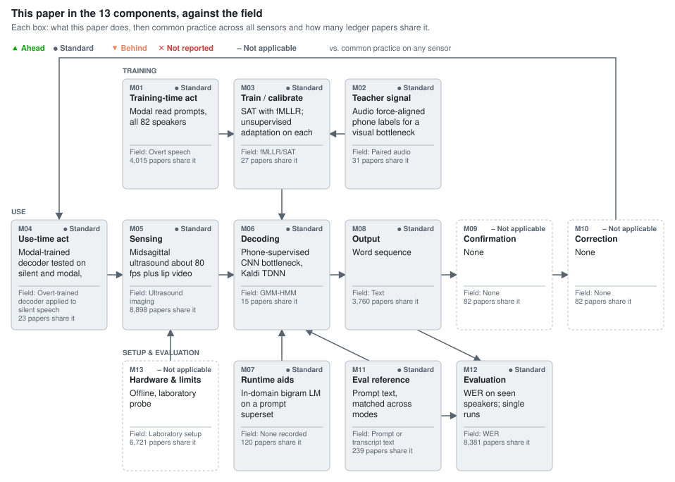

# Silent versus modal multi-speaker speech recognition from ultrasound and video

Ribeiro, M. S., Eshky, A., Richmond, K., Renals, S. · Interspeech 2021 · 2021 · [doi:10.21437/Interspeech.2021-23](https://doi.org/10.21437/Interspeech.2021-23) · [arXiv:2103.00333](https://arxiv.org/abs/2103.00333)

**Section:** [Ultrasound & tongue imaging](../../README.md#ultrasound--tongue-imaging)

## Figures

### This paper in the 13 components, against the field

<picture><source media="(prefers-color-scheme: dark)" srcset="figures/components-dark.svg"></picture>

Verdicts compare the paper's choice for each component with common practice across 8,995 ledger entries on any sensor (silent speech, brain-to-text, lip reading).

Data

| Component | This paper | Common practice | Papers with this practice | Verdict |
| --- | --- | --- | --- | --- |
| M01 Training-time act | Modal read prompts, all 82 speakers | Overt speech | 4,015 of 8,995 | ● Standard (Silent speech is never used for training.) |
| M02 Teacher signal | Audio force-aligned phone labels for a visual bottleneck | Paired audio | 31 of 8,995 | ● Standard (49 phone classes from modal audio alignment.) |
| M03 Train / calibrate | SAT with fMLLR; unsupervised adaptation on each test set | fMLLR/SAT | 27 of 8,995 | ● Standard (Unsupervised adaptation was prior work [@wand2014towards]; here scored on its own adaptation data.) |
| M04 Use-time act | Modal-trained decoder tested on silent and modal, prompt-matched | Overt-trained decoder applied to silent speech | 23 of 8,995 | ● Standard (Degradation shown for ultrasound in 2010 [@florescu2010silent].) |
| M05 Sensing | Midsagittal ultrasound about 80 fps plus lip video | Ultrasound imaging | 8,898 of 8,995 | ● Standard (TaL corpus hardware.) |
| M06 Decoding | Phone-supervised CNN bottleneck, Kaldi TDNN | GMM-HMM | 15 of 8,995 | ● Standard (DNN-HMM line.) |
| M07 Runtime aids | In-domain bigram LM on a prompt superset | None recorded | 120 of 8,995 | ● Standard (Test-prompt inclusion not stated.) |
| M08 Output | Word sequence | Text | 3,760 of 8,995 | ● Standard (Scored by WER.) |
| M09 Confirmation | None | None | 82 of 8,995 | – Not applicable (Offline corpus study.) |
| M10 Correction | None | None | 82 of 8,995 | – Not applicable (Offline corpus study.) |
| M11 Eval reference | Prompt text, matched across modes | Prompt or transcript text | 239 of 8,995 | ● Standard (Same sentences read silently and aloud.) |
| M12 Evaluation | WER on seen speakers; single runs | WER | 8,381 of 8,995 | ● Standard (No speaker held out and no seeds or tests; [@wang2015speaker] held speakers out.) |
| M13 Hardware & limits | Offline, laboratory probe | Laboratory setup | 6,721 of 8,995 | – Not applicable (No deployment claim.) |

## Verdict

The paper [[1]](#ref-1) tests an ultrasound-plus-lip recognizer trained on modal speech on silent speech (M04) across 82 speakers, and applies fMLLR and unsupervised test-set adaptation to the mismatch (M03). Both are standard: ultrasound modal-to-silent degradation dates from 2010 [[2]](#ref-2), and fMLLR/SAT is the most frequent adaptation for non-acoustic recognizers (Appendix). The durable result is the size of the gap: with fMLLR, silent WER on TaL80 is 30.42 points (76%) above modal; a later system on the same corpus cuts the gap to 20.28 points but leaves the ratio near 1.75 (inference) [[3]](#ref-3). The adaptation claim rests on single runs, silent gains of 0.37 to 3.36 points against modal losses up to 2.42 points, adaptation on the scored test set, and no significance test. Every test speaker is in training, so nothing is shown for new users.

## Against the field, component by component

### M04 Use-time action: modal training, silent test

**Usual approach:** an overt-trained decoder applied to silent or covert speech without retraining, reported as a degradation: 23 studies across neural, EMG, video and ultrasound signals (confirmed, 7 prior; Appendix). The paper follows it (Sec. 3.1).

**State of the art:** in 2023, 47.15% silent and 26.87% modal WER on TaL, fMLLR, voiced-only training, 1,179 filtered test utterances (not 1,374) [[3]](#ref-3) [later]. The closest prior, 4 speakers and DTW isolated-word matching, fell from 75.3% to 45.7% words correct on silent tests [[2]](#ref-2), a 39% relative loss (inference).

The paper cites [[2]](#ref-2) for the degradation (Sec. 3.3); its contribution is scale and continuous speech. The 2010 and 2021 gaps do not rank: isolated-word DTW and a TDNN with a bigram LM start from different points. Against [[3]](#ref-3) the absolute gap falls by a third, from 30.42 to 20.28 points, while the ratio holds only with fMLLR: 1.76 against 1.75, but 1.98 against 1.86 on raw features, and 1.69 after unsupervised adaptation (inference). Better features shrink the absolute gap, not the fMLLR ratio; two systems on different test sets cannot locate the cause. Verdict: standard.

### M03 Training and adaptation: fMLLR and unsupervised adaptation

**Usual approach:** fMLLR with speaker adaptive training in an HMM recognizer, 27 of 48 studies on adapting non-acoustic recognizers (pattern match; Appendix), as in [[4]](#ref-4); the paper follows it (Sec. 3.3).

**State of the art:** in 2023, fMLLR lowered TaL silent WER from 62.60 to 47.15, 15.45 points or 24.7% relative (inference) [[3]](#ref-3) [later]. Here it takes TaL80 silent WER from 77.79 to 70.21, 9.7% relative (inference), and unsupervised adaptation adds 0.37 points (Table 1).

Unsupervised adaptation is prior work: Wand and Schultz [[5]](#ref-5) weighted audible-EMG adaptation data by lattice confidence, adapted on SPEC sentences and tested on BASE sentences, and reported a paired t-test as WER fell from 34.9% to 30.2%. This paper adapts all parameters on each test set and scores that same set (Sec. 3.3), without confidence weighting, schedule or test. Wang and Hahm [[4]](#ref-4) held out each of 5 silent-articulating speakers; this paper holds out none. Verdict: standard, on a weaker protocol than the 2014 prior.

### M06 Processing: ultrasound recognizer

**Usual approach:** GMM-HMM on compressed ultrasound and lip features, 15 of 38 ultrasound recognition studies across all years (pattern match; Appendix); later work uses DNN-HMM (8) or end-to-end CTC/attention (13). The paper's Kaldi TDNN is the DNN-HMM line.

**State of the art:** in 2019, 6.17% WER on the single-speaker Silent Speech Challenge [[6]](#ref-6), with no mode gap measured. Verdict: standard.

## The 13 components

| Component | This paper | Usual approach (count) | State of the art | Verdict |
|---|---|---|---|---|
| M01 Training-time action | Modal read prompts, all 82 speakers | Overt speech (slot-filled 4,015) | – | standard |
| M02 Training-only supervision | Audio force-aligned phone labels for a visual bottleneck | Paired audio (slot-filled 31) | – | standard |
| M03 Training and adaptation | SAT with fMLLR; unsupervised adaptation on each test set | fMLLR/SAT (pattern match 27) | 15.45-point silent WER drop from fMLLR, 2023 [[3]](#ref-3) [later] | standard |
| M04 Use-time action | Modal-trained decoder tested on silent and modal, prompt-matched | Overt-trained decoder applied to silent speech (confirmed 23) | 47.15% silent, 26.87% modal WER on TaL, 2023 [[3]](#ref-3) [later] | standard |
| M05 Sensors | Midsagittal ultrasound about 80 fps plus lip video | Ultrasound imaging (slot-filled 8,898) | – | standard |
| M06 Processing and decoding | Phone-supervised CNN bottleneck, Kaldi TDNN | GMM-HMM (pattern match 15) | 6.17% WER, single-speaker SSC, 2019 [[6]](#ref-6) | standard |
| M07 Lexicon and LM | In-domain bigram LM on a prompt superset | None recorded (slot-filled 120) | – | standard |
| M08 Output | Word sequence | Text (slot-filled 3,760) | – | standard |
| M09 Confirmation | None | None (slot-filled 82) | – | not applicable |
| M10 Correction | None | None (slot-filled 82) | – | not applicable |
| M11 Reference construction | Prompt text, matched across modes | Prompt or transcript text (slot-filled 239) | – | standard |
| M12 Evaluation | WER on seen speakers; single runs | WER (slot-filled 8,381) | – | standard |
| M13 Device and cost | Offline, laboratory probe | Laboratory setup (slot-filled 6,721) | – | not applicable |

## Where the claims outrun the evidence

- Training uses all 82 speakers (Sec. 3.1), every test speaker included; the closing remark on speaker-independent recognition (Sec. 4) has no experiment behind it.
- The abstract credits unsupervised adaptation for silent gains of 0.37 to 3.36 points (Table 1): single runs, no seeds or test, TaL1 sets of 106 utterances. Both techniques raise modal WER in the same table (fMLLR 39.34 to 39.79; adaptation +2.42, +1.58 on TaL80), as the authors concede (Sec. 3.3).
- The bigram LM uses a superset of the corpus prompts (Sec. 3.3); only acoustic training is said to exclude test prompts.
- "Do not directly correlate with WER" rests on r = -0.009 and r = -0.1682 across 81 speakers (Fig. 5) without intervals; [[3]](#ref-3) [later] finds trajectory distance explains R² 0.060 of per-utterance WER difference, r about 0.24 (inference): equally weak, it fits the authors' missed-target idea (Sec. 4) without confirming it.

## What the field needs next

- M03: speaker-held-out TaL80 tests with and without fMLLR, test-disjoint adaptation data and repeated seeds.
- M01: modal-only against mixed modal-silent training at fixed data size, the remedy the authors propose (Sec. 4).
- M12: the mode gap as a ratio with per-speaker intervals, tied to per-utterance articulatory error [[3]](#ref-3).

## Questions for the authors

- Does the bigram LM contain the test prompts?
- How many adaptation epochs, and what stopping rule?
- Which TaL1 sessions form the test sets, and are they excluded from training?
- What is the WER spread across seeds and across the 145 sampled TaL1 utterances?

## Appendix: literature search

- M04 overt-to-silent-transfer (published topic table, appended). Inclusion rule unchanged: decoders trained only on overt speech and applied to silent, mouthed, inner or imagined speech without retraining, any signal; versions counted once. Slot-filled 5,595 unique studies; pattern match 33 unique studies; confirmed 23 unique studies (7 prior). Usual design: overt-trained decoder applied to silent speech and reported as a degradation, 23 (confirmed). Target added to the table. Read in full: [[2]](#ref-2), [[3]](#ref-3) [later], target. Known-item recall 1.0 (6 of 6, published table); 0.67 for this review's seeds (2 of 3, the target missed by the ledger pattern).
- M03 articulatory-recognizer-speaker-adaptation (new topic table). Inclusion rule: recognizers that decode text from non-acoustic speech signals (articulatory imaging, EMA, EMG, lip video, neural recordings) with speaker, session or mode adaptation (fMLLR/SAT, Procrustes, unsupervised or test-time adaptation) against an unadapted condition; acoustic-only ASR, synthesis, phonetics without a recognizer, reviews and full supervised retraining excluded; versions counted once. Slot-filled 1,526 unique studies; pattern match 48 unique studies. Full-text pattern counts: fMLLR/SAT 27, Procrustes 16, unsupervised adaptation or self-training 7, test-time adaptation 3. Read in full: [[5]](#ref-5), [[4]](#ref-4), [[3]](#ref-3) [later], target. Known-item recall 1.0 (4 of 4 seeds).
- M06 ultrasound-tongue-speech-recognition (published topic table, appended). Inclusion rule unchanged: recognition of phones, words or sentences from ultrasound tongue images, with or without lip video, with an error or accuracy score; versions counted once. Slot-filled 7,345 unique studies; pattern match 38 unique studies. Usual design: GMM-HMM, 15 (pattern match), counted across all years; DNN-HMM 8; CTC/attention 13. State of the art in the table: [[6]](#ref-6), 6.17% WER. Read in full: [[6]](#ref-6), [[3]](#ref-3) [later], target. Known-item recall 0.67 (published table); 1.0 for this review's seeds (4 of 4).

## References

Numbered by first citation. BibTeX in the same order and keys: [refs.bib](refs.bib).

1. Ribeiro, M. S., Eshky, A., Richmond, K., Renals, S. “Silent versus modal multi-speaker speech recognition from ultrasound and video.” *Proc. Interspeech 2021*, 2021. doi:[10.21437/Interspeech.2021-23](https://doi.org/10.21437/Interspeech.2021-23). arXiv:[2103.00333](https://arxiv.org/abs/2103.00333). Target. Read as arXiv v1. [review](https://github.com/supernaiter/silent-speech-review/tree/main/reviews/silent-versus-modal-multi-speaker-speech-recognition-from-ultrasound-and-video) [wiki: arxiv-2103.00333](https://github.com/supernaiter/deep-research-wiki-for-silent-speech/blob/main/papers/arxiv-2103.00333/article.md) [wiki: doi-10.21437-interspeech.2021-23](https://github.com/supernaiter/deep-research-wiki-for-silent-speech/blob/main/papers/doi-10.21437-interspeech.2021-23/article.md) [wiki: isca-ribeiro21_interspeech](https://github.com/supernaiter/deep-research-wiki-for-silent-speech/blob/main/papers/isca-ribeiro21_interspeech/article.md) [wiki: isca-ribeiro21-silentus](https://github.com/supernaiter/deep-research-wiki-for-silent-speech/blob/main/papers/isca-ribeiro21-silentus/article.md)
2. Florescu, V., Crevier-Buchman, L., Denby, B., Hueber, T., Colazo-Simon, A., Pillot-Loiseau, C., et al. “Silent vs Vocalized Articulation for a Portable Ultrasound-Based Silent Speech Interface.” *Proc. Interspeech 2010*, 2010, 450–453. doi:[10.21437/Interspeech.2010-195](https://doi.org/10.21437/Interspeech.2010-195). [wiki: isca-florescu10](https://github.com/supernaiter/deep-research-wiki-for-silent-speech/blob/main/papers/isca-florescu10/article.md) [wiki: isca-florescu10_interspeech](https://github.com/supernaiter/deep-research-wiki-for-silent-speech/blob/main/papers/isca-florescu10_interspeech/article.md) [wiki: isca-florescu10-silentvocal](https://github.com/supernaiter/deep-research-wiki-for-silent-speech/blob/main/papers/isca-florescu10-silentvocal/article.md)
3. Beeson, R., Richmond, K. “Silent Speech Recognition with Articulator Positions Estimated from Tongue Ultrasound and Lip Video.” *Proc. Interspeech 2023*, 2023, 1149–1153. doi:[10.21437/Interspeech.2023-1966](https://doi.org/10.21437/Interspeech.2023-1966). [later] [wiki: isca-beeson23_interspeech](https://github.com/supernaiter/deep-research-wiki-for-silent-speech/blob/main/papers/isca-beeson23_interspeech/article.md) [wiki: isca-beeson23-articssr](https://github.com/supernaiter/deep-research-wiki-for-silent-speech/blob/main/papers/isca-beeson23-articssr/article.md) [wiki: doi-10.21437-interspeech.2023-1966](https://github.com/supernaiter/deep-research-wiki-for-silent-speech/blob/main/papers/doi-10.21437-interspeech.2023-1966/article.md)
4. Wang, J., Hahm, S. “Speaker-Independent Silent Speech Recognition with Across-Speaker Articulatory Normalization and Speaker Adaptive Training.” *Proc. Interspeech 2015*, 2015, 2415–2419. doi:[10.21437/Interspeech.2015-522](https://doi.org/10.21437/Interspeech.2015-522). [wiki: isca-wang15g_interspeech](https://github.com/supernaiter/deep-research-wiki-for-silent-speech/blob/main/papers/isca-wang15g_interspeech/article.md) [wiki: isca-wang15g-spkindep](https://github.com/supernaiter/deep-research-wiki-for-silent-speech/blob/main/papers/isca-wang15g-spkindep/article.md)
5. Wand, M., Schultz, T. “Towards Real-life Application of EMG-based Speech Recognition by using Unsupervised Adaptation.” *Proc. Interspeech 2014*, 2014, 1189–1193. doi:[10.21437/Interspeech.2014-301](https://doi.org/10.21437/Interspeech.2014-301). [wiki: isca-wand14_interspeech](https://github.com/supernaiter/deep-research-wiki-for-silent-speech/blob/main/papers/isca-wand14_interspeech/article.md)
6. Li, B., Xu, K., Feng, D., Mi, H., Wang, H., Zhu, J. “Denoising Convolutional Autoencoder Based B-mode Ultrasound Tongue Image Feature Extraction.” *IEEE International Conference on Acoustics, Speech and Signal Processing (ICASSP)*, 2019, 7130–7134. doi:[10.1109/ICASSP.2019.8682806](https://doi.org/10.1109/ICASSP.2019.8682806). arXiv:[1903.00888](https://arxiv.org/abs/1903.00888). [review](https://github.com/supernaiter/silent-speech-review/tree/main/reviews/denoising-convolutional-autoencoder-based-b-mode-ultrasound-tongue-image-feature-extraction) [wiki: arxiv-1903.00888](https://github.com/supernaiter/deep-research-wiki-for-silent-speech/blob/main/papers/arxiv-1903.00888/article.md)

## Materials

Data behind this review. Full texts of the papers are not included.

- [`review.md`](review.md): the review text (source)
- [`refs.bib`](refs.bib): references (BibTeX)
- [`slots.json`](slots.json): for each of the 13 components: this paper's choice, field practice, number of matching papers, verdict
- [`figures.json`](figures.json): figure definitions
- [`evaluation.md`](evaluation.md): independent evaluation by a second reviewer
- [`triage.md`](triage.md): how each evaluation finding was checked against the sources and resolved
- [`components/M03/articulatory-recognizer-speaker-adaptation.csv`](../../components/M03/articulatory-recognizer-speaker-adaptation.csv): M03 topic "articulatory-recognizer-speaker-adaptation", every candidate paper with its decision (1526 slot-filled, 48 pattern match, usual design in 27, 4 read in full)
- [`components/M04/overt-to-silent-transfer.csv`](../../components/M04/overt-to-silent-transfer.csv): M04 topic "overt-to-silent-transfer", every candidate paper with its decision (23 confirmed, 104 candidates read, 0 unread)
- [`components/M06/ultrasound-tongue-speech-recognition.csv`](../../components/M06/ultrasound-tongue-speech-recognition.csv): M06 topic "ultrasound-tongue-speech-recognition", every candidate paper with its decision (7345 slot-filled, 38 pattern match, usual design in 15, 5 read in full)

## More reviews in Ultrasound & tongue imaging

- [3D Convolutional Neural Networks for Ultrasound-Based Silent Speech Interfaces](../3d-convolutional-neural-networks-for-ultrasound-based-silent-speech-interfaces/) (2021). Shows a compact (2+1)D 3D CNN outperforms 2D CNN and CNN+LSTM models for regressing 13 vocoder parameters from ultrasound tongue video, with lower complexity and training time.
- [Convolutional Neural Network-Based Age Estimation Using B-Mode Ultrasound Tongue Image](../convolutional-neural-network-based-age-estimation-using-b-mode-ultrasound-tongue-image/) (2021). Exploratory CNN regression of child age from tongue ultrasound images, reaching validation MSE 2.03 on UXTD versus 3.64 for a mean-age baseline.
- [Improving Neural Silent Speech Interface Models by Adversarial Training](../improving-neural-silent-speech-interface-models-by-adversarial-training/) (2021). Adds adversarial (GAN) loss to MSE training of a 3D CNN for ultrasound-to-mel-spectrogram mapping, giving modest objective quality improvements on Hungarian and English single-speaker corpora.
- [Neural Speaker Embeddings for Ultrasound-based Silent Speech Interfaces](../neural-speaker-embeddings-for-ultrasound-based-silent-speech-interfaces/) (2021). Standard on embedding conditioning (2.4% relative MSE gain on seen speakers); behind on speaker recognition, which never separates speaker from recording session.
- [Speech Synthesis from Text and Ultrasound Tongue Image-based Articulatory Input](../speech-synthesis-from-text-and-ultrasound-tongue-image-based-articulatory-input/) (2021). Limited-data TTS augmented with ultrasound tongue images; combined text plus ultrasound gives the lowest test MCD for all 8 speakers, while ultrasound-only input remains far worse.
- [Voice Activity Detection for Ultrasound-based Silent Speech Interfaces using Convolutional Neural Networks](../voice-activity-detection-for-ultrasound-based-silent-speech-interfaces-using-convolutional-neural-networks/) (2021). CNN speech-versus-silence detection from ultrasound tongue images on one speaker (TaL1), reaching 85.2% test accuracy; removing silence slightly improves downstream SSI reconstruction (MCD 3.05 vs 3.12).

---

Part of the [Silent Speech Interface Review](https://github.com/supernaiter/silent-speech-review). Found an error? [Open an issue](https://github.com/supernaiter/silent-speech-review/issues/new?template=correction.yml).
