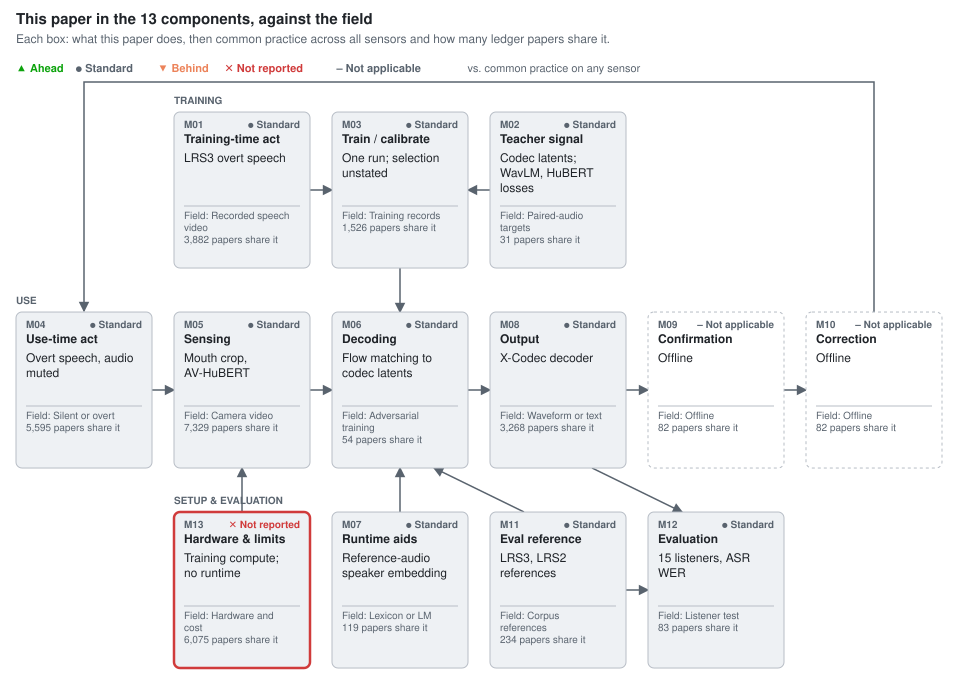

# SLD-L2S: Hierarchical Subspace Latent Diffusion for High-Fidelity Lip to Speech Synthesis

Liang, Y., Li, A., Yang, K., Yu, G., Liu, F., Dai, L., Li, X., Zheng, C. · arXiv preprint (AAAI 2026 copyright line) · 2026 · [arXiv:2602.11477](https://arxiv.org/abs/2602.11477)

**Section:** [Lip & face video](../../README.md#lip--face-video)

## Figures

### This paper in the 13 components, against the field

<picture><source media="(prefers-color-scheme: dark)" srcset="figures/components-dark.svg"></picture>

Verdicts compare the paper's choice for each component with common practice across 8,995 ledger entries on any sensor (silent speech, brain-to-text, lip reading).

Data

| Component | This paper | Common practice | Papers with this practice | Verdict |
| --- | --- | --- | --- | --- |
| M01 Training-time act | LRS3 overt speech | Recorded speech video | 3,882 of 8,995 | ● Standard (Inherited.) |
| M02 Teacher signal | Codec latents; WavLM, HuBERT losses | Paired-audio targets | 31 of 8,995 | ● Standard (SLM loss trades quality for content (Table 3).) |
| M03 Train / calibrate | One run; selection unstated | Training records | 1,526 of 8,995 | ● Standard (No seeds or selection rule.) |
| M04 Use-time act | Overt speech, audio muted | Silent or overt | 5,595 of 8,995 | ● Standard (Inherited.) |
| M05 Sensing | Mouth crop, AV-HuBERT | Camera video | 7,329 of 8,995 | ● Standard (Inherited.) |
| M06 Decoding | Flow matching to codec latents | Adversarial training | 54 of 8,995 | ● Standard (Continuous codec latent 1 of 165; effect not isolated.) |
| M07 Runtime aids | Reference-audio speaker embedding | Lexicon or LM | 119 of 8,995 | ● Standard (Audio-reference speaker embedding named in 21 of 165 video-to-speech studies (pattern match); three of five baselines lack it.) |
| M08 Output | X-Codec decoder | Waveform or text | 3,268 of 8,995 | ● Standard (See M06.) |
| M09 Confirmation | Offline | Offline | 82 of 8,995 | – Not applicable (Offline study.) |
| M10 Correction | Offline | Offline | 82 of 8,995 | – Not applicable (Offline study.) |
| M11 Eval reference | LRS3, LRS2 references | Corpus references | 234 of 8,995 | ● Standard (Inherited.) |
| M12 Evaluation | 15 listeners, ASR WER | Listener test | 83 of 8,995 | ● Standard (Unseen speakers not stated.) |
| M13 Hardware & limits | Training compute; no runtime | Hardware and cost | 6,075 of 8,995 | ✕ Not reported (Efficiency claimed without inference runtime.) |

## Verdict

SLD-L2S [[1]](#ref-1) changes the decoder (M06): flow matching on a convolutional subspace backbone that generates continuous neural-codec latents. That target appears in 1 of 165 video-to-speech studies, this one (pattern match, Appendix), after discrete codec-token generators [[2]](#ref-2), [[3]](#ref-3), but no control separates that target from the backbone or from the pretrained, LibriSpeech-trained X-Codec decoder, an untested source of the predictor-score gain (inference), so M06 is standard. The claimed state of the art in perceptual quality rests on reference-free predictors that score the output above the recordings (UTMOS 4.2096 against 3.5721 for ground truth, Table 1), a gap earlier systems traced to noise in LRS3 audio [[4]](#ref-4), [[5]](#ref-5). Faces-to-Voices, cited but missing from Table 1, reached UTMOS 4.031 at the same 10 steps with a speaker embedding from video [[5]](#ref-5). WER (30.22%) trails V2SFlow (27.55%) and LipVoicer (20.62%), and the second-best speaker similarity rests on a reference-audio embedding (M07) that three of five baselines lack. Evaluation (M12) is standard, but cross-paper WER needs one ASR: V2SFlow scores 27.55% in the target's table and 28.5% in its own paper; the efficiency claim (M13) gives training compute but no inference runtime.

## Against the field, component by component

### M06 Decoder: continuous codec latents with flow matching

**Usual approach:** Of 165 video-to-speech studies (pattern match), 54 use adversarial training, 22 a diffusion and 19 a flow decoder; 8 name neural-codec generation, and the 2 prior video-to-speech systems among them generate discrete tokens [[2]](#ref-2), [[3]](#ref-3). SLD-L2S keeps flow matching and makes continuous X-Codec latents the target.

**State of the art:** Faces-to-Voices (2025): LRS3 UTMOS 4.031 and 30.45% WER at 10 steps, speaker embedding from video (Table 2) [[5]](#ref-5). SLD-L2S is about 0.18 UTMOS higher with an audio reference and another ASR (inference); the WER gap is not interpretable. The [concurrent] HiCoDiT, a discrete RVQ codec diffusion model, reports 29.41% from video alone at 64 steps without LRS3 training [[6]](#ref-6).

The case for the latent target is argument (Abstract): Table 1 compares whole systems, and no ablation trains DiCB on mel or tokens. The ablations are single LRS3 runs: a parameter-matched DiT (57.7M against 57.8M) drops SECS from 0.804 to 0.618 but moves WER only to 30.70% (Table 3); velocity prediction lowers UTMOS to 3.9540 while WER improves to 29.70%. Verdict: standard.

### M12 Evaluation: quality predictors and the speaker reference

**Usual approach:** Of 165 video-to-speech studies (pattern match), 83 name a listener test, 38 ASR WER and 51 unseen speakers; 21 use a reference-free MOS predictor and 40 confidence intervals or significance tests (Appendix). SLD-L2S uses 15 listeners, 30 clips and ASR WER, and its Datasets section names the official LRS3 splits but not whether test speakers are unseen.

**State of the art:** V2SFlow (arXiv 2024): 28.5% LRS3 WER on unseen speakers with an audio- or a video-derived speaker embedding; SECS 0.851 against 0.664 (Table I) [[4]](#ref-4).

The target's V2SFlow row (SECS 0.851) is the audio-reference variant, and its own 0.804 also uses a reference utterance (Table 1 caption), while DiffV2S, LipVoicer and NaturalL2S (0.627, 0.588, 0.628) get none; the DiT ablation (0.618) falls to their level (inference). Five of the 165 studies state that output scores exceed ground truth; the target's results discussion does not comment, while its listeners rate it below ground truth (4.17 against 4.36, Table 2). The target scores every system with AUTO-AVSR, and its ground truth reaches 0.71% WER against 2.5% in V2SFlow's own table, so its baseline WERs are re-scored (inference) and not comparable with published ones. Verdict: standard; the overreach is in the conclusions (next section), not the protocol.

## The 13 components

| Component | This paper | Usual approach (count) | State of the art | Verdict |
|---|---|---|---|---|
| M01 Training-time action | LRS3 overt speech | Recorded speech video (slot-filled 3,882) | – | standard |
| M02 Training-only supervision | Codec latents; WavLM, HuBERT losses | Paired-audio targets (slot-filled 31) | – | standard |
| M03 Training and adaptation | One run; selection unstated | Training records (slot-filled 1,526) | – | standard |
| M04 Use-time action | Overt speech, audio muted | Silent or overt (slot-filled 5,595) | – | standard |
| M05 Sensors | Mouth crop, AV-HuBERT | Camera video (slot-filled 7,329) | – | standard |
| M06 Processing and decoding | Flow matching to codec latents | Adversarial training (pattern match 54) | [[5]](#ref-5) (2025): UTMOS 4.031, 10 steps | standard |
| M07 Lexicon and LM | Reference-audio speaker embedding | Lexicon or LM (slot-filled 119) | – | standard |
| M08 Output | X-Codec decoder | Waveform or text (slot-filled 3,268) | – | standard |
| M09 Confirmation | Offline | Offline (slot-filled 82) | – | not applicable |
| M10 Correction | Offline | Offline (slot-filled 82) | – | not applicable |
| M11 Reference construction | LRS3, LRS2 references | Corpus references (slot-filled 234) | – | standard |
| M12 Evaluation | 15 listeners, ASR WER | Listener test (pattern match 83) | [[4]](#ref-4) (arXiv 2024): 28.5% WER | standard |
| M13 Device and cost | Training compute; no runtime | Hardware and cost (slot-filled 6,075) | – | not reported |

## Where the claims outrun the evidence

- "New state-of-the-art in perceptual quality" (§Comparison) rests on predictors that rank output above real recordings (Table 1) and a 15-listener test with undefined ± (Table 2); listener intelligibility (3.65) and similarity (3.77) stay below V2SFlow (3.69, 3.90).
- "Higher efficiency than other diffusion-based methods" holds within Table 1 but omits the cited 10-step Faces-to-Voices [[5]](#ref-5); 10 NFE remains ten times the one-step Intelligible and NaturalL2S (Table 1).
- Table 3 prints "w/o Lsem" twice; the row removing both losses is unlabeled.
- The authors report the SLM-loss trade-off: without it UTMOS rises to 4.2885 and WER falls to 29.99%, while D-BERT and SECS drop (Table 3).

## What the field needs next

- M06: one DiCB backbone trained on mel, codec tokens and continuous codec latents, one ASR, the unseen-speaker split of [[4]](#ref-4).
- M07: rank speaker similarity only among systems with the same speaker source.
- M13: wall-clock latency at 10 NFE against one-step systems.

## Questions for the authors

- Are LRS3 test speakers unseen in training, and how many utterances were scored?
- Is the GE2E reference the target utterance itself?
- Were baselines retrained, and scored with the same ASR?
- What does ± in Table 2 denote?

## Appendix: literature search

- M06, video-to-speech-one-to-many-decoder (published table, reused). Inclusion rule: video-to-speech studies (speech synthesized from talking-face or lip video, audio muted at test), classified from full text by how the decoder handles the one-to-many mapping; enhancement with noisy audio at test, talking-head generation and video-to-text-to-speech pipelines excluded; a study counts under every design it names; versions count once. Ledger: 7,345 unique studies slot-filled for M06; 165 unique studies pattern match. Usual design: adversarial training 54; diffusion decoder 22, flow decoder 19 (pattern match, published counts). Added for this review (pattern match): any diffusion 36, flow matching 13, neural-codec generation 8 (prior video-to-speech 2: [[2]](#ref-2), [[3]](#ref-3); [concurrent] 3, among them [[6]](#ref-6); enhancement 2; the target), continuous codec-latent target 1 (the target). Read in full: [[5]](#ref-5), [[6]](#ref-6), [[3]](#ref-3), [[2]](#ref-2). Known-item recall 1.0.
- M12, video-to-speech-output-evaluation (published table, reused). Inclusion rule: the same video-to-speech population, counting the evaluation protocols its full text names. Ledger: 6,960 unique studies slot-filled for M12; 165 unique studies pattern match. Protocols: listener test 83, unseen speakers 51, ASR WER on output 38 (published counts); added: confidence interval or significance 40, reference-free MOS predictor 21, audio-reference speaker embedding 21, output stated to exceed ground truth 5 (pattern match). Read in full: [[4]](#ref-4), [[5]](#ref-5). Known-item recall 1.0.

## References

Numbered by first citation. BibTeX in the same order and keys: [refs.bib](refs.bib).

1. Liang, Y., Li, A., Yang, K., Yu, G., Liu, F., Dai, L., et al. “SLD-L2S: Hierarchical Subspace Latent Diffusion for High-Fidelity Lip to Speech Synthesis.” *arXiv preprint (AAAI 2026 copyright line)*, 2026. doi:[10.48550/arXiv.2602.11477](https://doi.org/10.48550/arXiv.2602.11477). arXiv:[2602.11477](https://arxiv.org/abs/2602.11477). Target. Read as arXiv v1. [review](https://github.com/supernaiter/silent-speech-review/tree/main/reviews/sld-l2s-hierarchical-subspace-latent-diffusion-for-high-fidelity-lip-to-speech-synthesis) [wiki: arxiv-2602.11477](https://github.com/supernaiter/deep-research-wiki-for-silent-speech/blob/main/papers/arxiv-2602.11477/article.md) [wiki: arxiv-2602.11477-sldl2s](https://github.com/supernaiter/deep-research-wiki-for-silent-speech/blob/main/papers/arxiv-2602.11477-sldl2s/article.md)
2. Wang, Y., Zheng, J., Zhang, J., Zhang, X., Liao, H., Wu, Z. “Metis: A Foundation Speech Generation Model with Masked Generative Pre-training.” *arXiv preprint*, 2025. arXiv:[2502.03128](https://arxiv.org/abs/2502.03128). Prior; deciding prior for M06 (discrete codec tokens, lip-to-speech fine-tuning). Read as arXiv v1. [wiki: arxiv-2502.03128](https://github.com/supernaiter/deep-research-wiki-for-silent-speech/blob/main/papers/arxiv-2502.03128/article.md)
3. Ye, J., Shan, H. “Shushing! Let's Imagine an Authentic Speech from the Silent Video.” *arXiv preprint*, 2025. arXiv:[2503.14928](https://arxiv.org/abs/2503.14928). Prior; deciding prior for M06 (ImaginTalk, discrete codec features). Read as arXiv v1. [wiki: arxiv-2503.14928](https://github.com/supernaiter/deep-research-wiki-for-silent-speech/blob/main/papers/arxiv-2503.14928/article.md)
4. Choi, J., Kim, J., Li, J., Chung, J. S., Liu, S. “V2SFlow: Video-to-Speech Generation with Speech Decomposition and Rectified Flow.” *ICASSP 2025 - IEEE International Conference on Acoustics, Speech and Signal Processing*, 2025. arXiv:[2411.19486](https://arxiv.org/abs/2411.19486). Prior; baseline of the target; state of the art for M12. Read as arXiv v2. [wiki: arxiv-2411.19486](https://github.com/supernaiter/deep-research-wiki-for-silent-speech/blob/main/papers/arxiv-2411.19486/article.md)
5. Kim, J., Choi, J., Kim, J., Jung, C., Chung, J. S. “From Faces to Voices: Learning Hierarchical Representations for High-quality Video-to-Speech.” *Proceedings of the IEEE/CVF Conference on Computer Vision and Pattern Recognition (CVPR)*, 2025, 15874-15884. arXiv:[2503.16956](https://arxiv.org/abs/2503.16956). Prior; cited by the target but not compared; state of the art for M06. Read as arXiv v1. [wiki: arxiv-2503.16956](https://github.com/supernaiter/deep-research-wiki-for-silent-speech/blob/main/papers/arxiv-2503.16956/article.md) [wiki: cvf-kim25-facesvoices](https://github.com/supernaiter/deep-research-wiki-for-silent-speech/blob/main/papers/cvf-kim25-facesvoices/article.md)
6. Ye, J., Cong, G., Wang, C., Wen, X., Li, Z., Cao, B., et al. “Hierarchical Codec Diffusion for Video-to-Speech Generation.” *arXiv preprint*, 2026. arXiv:[2604.15923](https://arxiv.org/abs/2604.15923). [concurrent]; discrete RVQ codec diffusion for video-to-speech (M06). Read as arXiv v1. [concurrent] [wiki: arxiv-2604.15923](https://github.com/supernaiter/deep-research-wiki-for-silent-speech/blob/main/papers/arxiv-2604.15923/article.md)

## Materials

Data behind this review. Full texts of the papers are not included.

- [`review.md`](review.md): the review text (source)
- [`refs.bib`](refs.bib): references (BibTeX)
- [`slots.json`](slots.json): for each of the 13 components: this paper's choice, field practice, number of matching papers, verdict
- [`figures.json`](figures.json): figure definitions
- [`evaluation.md`](evaluation.md): independent evaluation by a second reviewer
- [`triage.md`](triage.md): how each evaluation finding was checked against the sources and resolved
- [`components/M06/video-to-speech-one-to-many-decoder.csv`](../../components/M06/video-to-speech-one-to-many-decoder.csv): M06 topic "video-to-speech-one-to-many-decoder", every candidate paper with its decision (7345 slot-filled, 165 pattern match, usual design in 54, 4 read in full)
- [`components/M12/video-to-speech-output-evaluation.csv`](../../components/M12/video-to-speech-output-evaluation.csv): M12 topic "video-to-speech-output-evaluation", every candidate paper with its decision (6960 slot-filled, 165 pattern match, usual design in 83, 5 read in full)

## More reviews in Lip & face video

- [A First Exploration of Neuromorphic OT-CFM for Multi-Speaker VSR](../lipsflow-a-first-exploration-of-neuromorphic-ot-cfm-for-multi-speaker-vsr/) (2026). Event input and a two-step OT-CFM decoder are standard; the DVS-Lip evaluation is behind: WER on an isolated-word set with no split details or seeds, and baselines that do not match their sources.
- [AVSRBench: A Multi-Condition AVSR Benchmark](../avsrbench-a-multi-condition-avsr-benchmark/) (2026). Zero-shot cross-corpus AVSR testing (M12) and a video-call test set (M11) are standard after WildVSR; each condition mixes several shifts, without repeated runs.
- [LipSody: Lip-to-Speech Synthesis with Enhanced Prosody Consistency](../lipsody-lip-to-speech-synthesis-with-enhanced-prosody-consistency/) (2026). Pitch and energy predicted from lips, face and emotion (M06) is standard: Faces-to-Voices did it in 2025. Prosody metrics improve, WER does not; normalization change unablated.
- [Landmark Guided Visual Feature Extractor for Visual Speech Recognition with Limited Resource](../landmark-guided-visual-feature-extractor-for-visual-speech-recognition-with-limited-resource/) (2025). Lip-landmark graph plus pixel fusion is a standard design (2020 precedent); the 0.90-point low-data gain comes from one unseeded run, and LRW 91.69% stays below 95.0%.
- [LipDiffuser: Lip-to-Speech Generation with Conditional Diffusion Models](../lipdiffuser-lip-to-speech-generation-with-conditional-diffusion-models/) (2025). Diffusion decoder with per-frame MP-FiLM (M06) and audio-only pretraining (M02) are standard; quality and speaker-similarity leads rest on enhanced targets and a clean-reference enrollment.
- [LTA-L2S: Lexical Tone-Aware Lip-to-Speech Synthesis for Mandarin with Cross-Lingual Transfer Learning](../lta-l2s-lexical-tone-aware-lip-to-speech-synthesis-for-mandarin-with-cross-lingual-transfer-lear/) (2025). LTA-L2S synthesizes Mandarin speech from lip video using English pretraining and tone-aware generation, reducing character and tone errors versus baselines, but CER remains 61.2%.

---

Part of the [Silent Speech Interface Review](https://github.com/supernaiter/silent-speech-review). Found an error? [Open an issue](https://github.com/supernaiter/silent-speech-review/issues/new?template=correction.yml).
