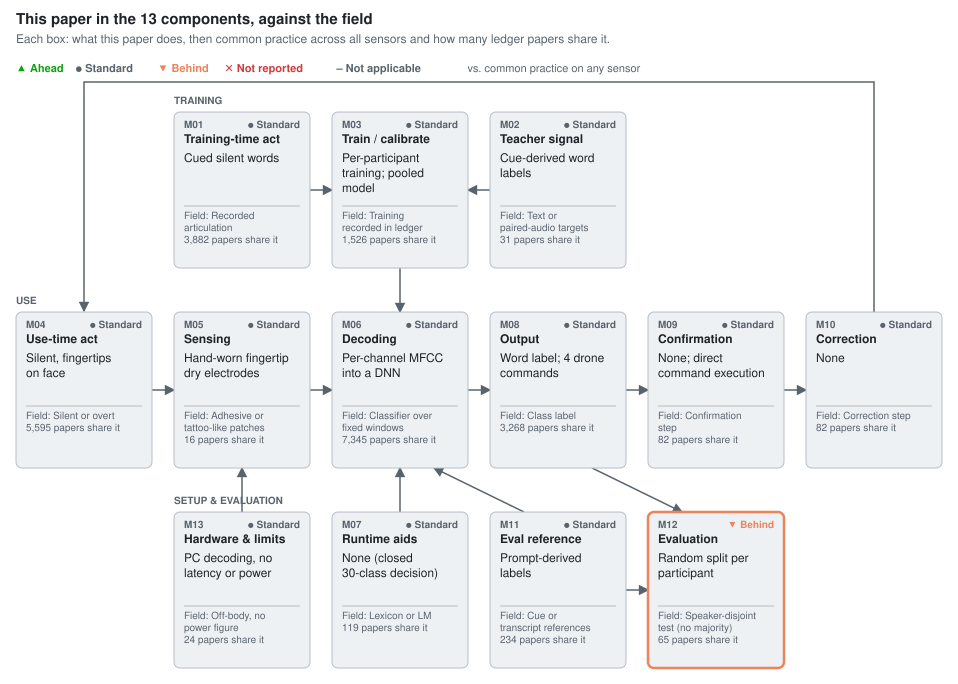

# Soft Active EMG Interface for Machine Learning-Enabled Silent Speech Recognition

Kurotaki, Y., Yamakoshi, S., Yoshida, R., Isoda, Y., Takano, T., Isano, Y., Miyake, Y., Kuribayashi, K., Ota, H. · arXiv preprint · 2026 · [arXiv:2608.27048](https://arxiv.org/abs/2608.27048)

**Section:** [Surface EMG](../../README.md#surface-emg)

## Figures

### This paper in the 13 components, against the field

<picture><source media="(prefers-color-scheme: dark)" srcset="figures/components-dark.svg"></picture>

Verdicts compare the paper's choice for each component with common practice across 8,995 ledger entries on any sensor (silent speech, brain-to-text, lip reading).

Data

| Component | This paper | Common practice | Papers with this practice | Verdict |
| --- | --- | --- | --- | --- |
| M01 Training-time act | Cued silent words | Recorded articulation | 3,882 of 8,995 | ● Standard (Inherited.) |
| M02 Teacher signal | Cue-derived word labels | Text or paired-audio targets | 31 of 8,995 | ● Standard (No audio or text supervision.) |
| M03 Train / calibrate | Per-participant training; pooled model | Training recorded in ledger | 1,526 of 8,995 | ● Standard (Calibration advised, unspecified.) |
| M04 Use-time act | Silent, fingertips on face | Silent or overt | 5,595 of 8,995 | ● Standard (Inherited.) |
| M05 Sensing | Hand-worn fingertip dry electrodes | Adhesive or tattoo-like patches | 16 of 8,995 | ● Standard (Benefits argued, not measured.) |
| M06 Decoding | Per-channel MFCC into a DNN | Classifier over fixed windows | 7,345 of 8,995 | ● Standard (Conformer not tuning-matched.) |
| M07 Runtime aids | None (closed 30-class decision) | Lexicon or LM | 119 of 8,995 | ● Standard (Closed vocabulary.) |
| M08 Output | Word label; 4 drone commands | Class label | 3,268 of 8,995 | ● Standard (Inherited.) |
| M09 Confirmation | None; direct command execution | Confirmation step | 82 of 8,995 | ● Standard (Inherited.) |
| M10 Correction | None | Correction step | 82 of 8,995 | ● Standard (Inherited.) |
| M11 Eval reference | Prompt-derived labels | Cue or transcript references | 234 of 8,995 | ● Standard (Inherited.) |
| M12 Evaluation | Random split per participant | Speaker-disjoint test (no majority) | 65 of 8,995 | ▼ Behind (Behind best comparable work.) |
| M13 Hardware & limits | PC decoding, no latency or power | Off-body, no power figure | 24 of 8,995 | ● Standard (Drone demo unquantified.) |

## Verdict

The paper [[1]](#ref-1) changes one component, the sensor (M05): dry electrodes on four fingertips (one channel each) of a hand-worn soft package, pressed to the perioral skin only during input. Earlier neck- and ear-worn dry electrodes [[2]](#ref-2), [[3]](#ref-3) also avoid facial adhesives, and the claimed privacy and noise benefits are argued, not measured, so M05 is standard. The evaluation (M12) is behind the best comparable work: the 97.2% headline comes from a random class-stratified split within each participant, while worn sEMG systems tested on a held-out session lose 14 to 23 points on 8-word tasks [[4]](#ref-4), [[5]](#ref-5). The authors concede that hand pressing adds placement variability (§ Discussion), so the missing session-disjoint test is the strongest confound. Deployment (M13) is standard: PC decoding with no latency, power or command success figure.

## Against the field, component by component

### M05 Sensors: hand-worn fingertip dry electrodes

**Usual approach:** Of 21 dry or worn-object sEMG speech studies (pattern match, Appendix; the target's journal version included), 16 mention adhesive or tattoo-like patches (upper bound); 7 use ear-worn and 7 neck-worn mounts.

**State of the art:** 98.7% on five phrases from a textile scarf that decodes radio-frequency phase, with sEMG only as a reference [[6]](#ref-6) [concurrent] (2026). Read sEMG worn objects: 96% on 10 words in headphones [[3]](#ref-3) (2025) and 92.7% on 11 voiced words with 10 dry neck electrodes [[2]](#ref-2) (2024), both on random sample splits.

Under that split the target's 97.2% on 30 words leads (inference), but from per-participant rather than pooled models. The claim that third-party triggering is prevented (§ Results, Design for Intent-Driven SSR) has no trigger or unintended-activation test, and a user-operated switch on an attached sensor gives the same property (inference). Verdict: standard.

### M12 Evaluation: test split

**Usual approach:** Of 143 word-classification studies with a wearable face or neck sensor (pattern match, Appendix), 65 report a speaker-disjoint and 44 a session- or day-disjoint test; 58 report random or k-fold splits, as the target does (overlapping; none a majority).

**State of the art:** 85.8% on 26 words, subject-independent 5-fold cross-validation, neck strain choker, not EMG [[7]](#ref-7) [concurrent] (2026).

On 8 words, a dry EMG neckband fell from 87% (shuffled cross-validation) to 64% leave-one-session-out for vocalized words and from 68% to 54% for silent words [[4]](#ref-4), 23 and 14 points or 26% and 21% relative (inference); SilentWear fell from 77.5% to 59.3% silent on 8 commands on an unseen recording day [[5]](#ref-5). With no session grouping stated, train and test can share placements. The pooled 92.1% model mixes the same three participants (Supplementary Table 3). Verdict: behind the best comparable work [[4]](#ref-4) and the 44 session-disjoint studies (Appendix), not typical practice, as random splits are common.

### M13 Deployment: decoding off the body

**Usual approach:** 24 of 30 speech-wearable studies on the topic decode off the body with no energy, latency or power figure (pattern match, Appendix) [[3]](#ref-3), as the target does on a PC.

**State of the art:** On-body inference at 2.47 ms and 63.9 µJ, 20.5 mW in total [[5]](#ref-5) [concurrent] (2026).

The drone demonstration reports no success rate, false-trigger rate or latency, and drone control by silent speech is earlier work (§ Discussion, ref. 47). Verdict: standard.

## The 13 components

| Component | This paper | Usual approach (count) | State of the art | Verdict |
|---|---|---|---|---|
| M01 Training-time action | Cued silent words | Recorded articulation (slot-filled 3,882) | – | standard |
| M02 Training-only supervision | Cue-derived word labels | Text or paired-audio targets (slot-filled 31) | – | standard |
| M03 Training and adaptation | Per-participant training; pooled model | Training recorded in ledger (slot-filled 1,526) | – | standard |
| M04 Use-time action | Silent, fingertips on face | Silent or overt (slot-filled 5,595) | – | standard |
| M05 Sensors | Hand-worn fingertip dry electrodes | Adhesive or tattoo-like patches (pattern match 16) | 98.7% on 5 phrases, RF-phase scarf, sEMG only as reference [[6]](#ref-6) (2026) | standard |
| M06 Processing and decoding | Per-channel MFCC into a DNN | Classifier over fixed windows (slot-filled 7,345) | – | standard |
| M07 Lexicon and LM | None (closed 30-class decision) | Lexicon or LM (slot-filled 119) | – | standard |
| M08 Output | Word label; 4 drone commands | Class label (slot-filled 3,268) | – | standard |
| M09 Confirmation | None; direct command execution | Confirmation step (slot-filled 82) | – | standard |
| M10 Correction | None | Correction step (slot-filled 82) | – | standard |
| M11 Reference construction | Prompt-derived labels | Cue or transcript references (slot-filled 234) | – | standard |
| M12 Evaluation | Random split per participant | Speaker-disjoint test (no majority) (pattern match 65) | 85.8% on 26 words, subject-independent, strain sensor [[7]](#ref-7) (2026) | behind |
| M13 Device and cost | PC decoding, no latency or power | Off-body, no power figure (pattern match 24) | 20.5 mW with on-body inference [[5]](#ref-5) (2026) | standard |

## Where the claims outrun the evidence

- The authors read test accuracy above the CV score as showing representative test sets and no overfitting (§ Discussion). With training accuracy of 1.000 (Supplementary Fig. 9) and one fixed split, a test mean above the CV mean of .916 (Supplementary Table 3) says the split is easier than the folds, not that the model generalizes.
- Exactly 12 test samples per class is 360 of 1,800 (inference), yet the text states N = 300 test. For S02 and S03 (900 raw trials, 1,800 in Supplementary Table 3), 12 unaugmented test trials per word are 40% of the raw data (inference); a split after augmentation puts jittered copies of test trials in training.
- "Unaffected even in noisy environments" (§ Results) has no noise level or quiet-versus-noisy comparison.
- Four channels win (Supplementary Table 1), but only the top three combinations were tuned (footnote); the Conformer comparison (91.1%) states no matched tuning.

## What the field needs next

- M12: a session-disjoint test with the device re-pressed between sessions, as in [[4]](#ref-4), plus leave-one-participant-out.
- M05: adhesive electrodes at the same four sites and words, to price hand-pressed placement.
- M13: command success, false-trigger rate and latency over a fixed number of drone commands, including activations while eating.

## Questions for the authors

- Was the split made before augmentation for S02 and S03, and why is the test set N = 300 rather than 360 for 12 per class (inference)?
- Were trials of one session split across train and test, and was the device re-donned between sessions?
- Was the test set excluded from the tuner search, and what metric is the "5-fold CV" column?
- How were normalization statistics fitted, and what is the full 30-word list?

## Appendix: literature search

- **M05, wearable-integrated-dry-emg-speech-sensing** (reused published table). Inclusion rule: surface-EMG speech or silent-speech decoding with dry, textile or printed electrodes mounted on a worn object or garment; tattoo-like dry patches count as dry but not integrated; wet adhesive arrays and non-EMG wearables excluded; versions once. Hand-worn fingertip electrodes count as dry electrodes in a worn object. Ledger counts: slot-filled 7,329 unique studies; pattern match 21 unique studies. Usual design: adhesive or tattoo-like patch wording, 16 (pattern match, upper bound); textile 11, ear-worn 7, neck-worn 7. Read in full: [[2]](#ref-2), [[3]](#ref-3), [[4]](#ref-4), [[6]](#ref-6). Known-item recall of the published table: 0.5.
- **M12, wearable-sensor-word-test-split** (reused published table). Inclusion rule: word or command classification with a wearable non-acoustic face or neck sensor, classified by how test samples are separated from training samples; a paper counts under every split it reports. Ledger counts: slot-filled 6,960 unique studies; pattern match 143 unique studies. Designs: speaker-disjoint 65, random or k-fold 58, session-disjoint 44 (pattern match). Read in full: [[4]](#ref-4), [[5]](#ref-5), [[7]](#ref-7).
- **M13, wearable-speech-sensor-on-device-inference** (reused published table). Inclusion rule: non-acoustic silent-speech wearables whose decoder runs on an embedded processor on or near the body; design compared: whether latency, energy per inference and system power are measured. Ledger counts: slot-filled 6,075 unique studies; pattern match 30 unique studies. Usual design: off-body decoding with no such figure, 24 (pattern match). Read in full: [[3]](#ref-3), [[2]](#ref-2), [[4]](#ref-4), [[5]](#ref-5). Known-item recall of the published table: 1.0.

## References

Numbered by first citation. BibTeX in the same order and keys: [refs.bib](refs.bib).

1. Kurotaki, Y., Yamakoshi, S., Yoshida, R., Isoda, Y., Takano, T., Isano, Y., et al. “Soft Active EMG Interface for Machine Learning-Enabled Silent Speech Recognition.” *arXiv preprint*, 2026. doi:[10.48550/arXiv.2608.27048](https://doi.org/10.48550/arXiv.2608.27048). arXiv:[2608.27048](https://arxiv.org/abs/2608.27048). Target. Read as arXiv v1. [review](https://github.com/supernaiter/silent-speech-review/tree/main/reviews/soft-active-electromyography-interface-for-machine-learning-enabled-silent-speech-recognition) [wiki: arxiv-2608.27048](https://github.com/supernaiter/deep-research-wiki-for-silent-speech/blob/main/papers/arxiv-2608.27048/article.md) [wiki: doi-10.1002-aisy.70440](https://github.com/supernaiter/deep-research-wiki-for-silent-speech/blob/main/papers/doi-10.1002-aisy.70440/article.md)
2. Wu, P., Kaveh, R., Nautiyal, R., Zhang, C., Guo, A., Kachinthaya, A., et al. “Towards EMG-to-Speech with a Necklace Form Factor.” *Proc. Interspeech 2024*, 2024. doi:[10.21437/Interspeech.2024-1568](https://doi.org/10.21437/Interspeech.2024-1568). arXiv:[2407.21345](https://arxiv.org/abs/2407.21345). Prior; worn-object dry-electrode comparator for M05. [wiki: isca-wu24k_interspeech](https://github.com/supernaiter/deep-research-wiki-for-silent-speech/blob/main/papers/isca-wu24k_interspeech/article.md) [wiki: arxiv-2407.21345](https://github.com/supernaiter/deep-research-wiki-for-silent-speech/blob/main/papers/arxiv-2407.21345/article.md) [wiki: doi-10.48550-arxiv.2407.21345](https://github.com/supernaiter/deep-research-wiki-for-silent-speech/blob/main/papers/doi-10.48550-arxiv.2407.21345/article.md)
3. Tang, C., Mallah, J., Kazieczko, D., Yi, W., Kandukuri, T. R., Occhipinti, E., et al. “Wireless Silent Speech Interface Using Multi-Channel Textile EMG Sensors Integrated into Headphones.” *IEEE Transactions on Instrumentation and Measurement*, 2025. doi:[10.1109/TIM.2025.3583386](https://doi.org/10.1109/TIM.2025.3583386). arXiv:[2504.13921](https://arxiv.org/abs/2504.13921). Prior; worn-object textile-electrode comparator for M05 and off-body decoding for M13. [review](https://github.com/supernaiter/silent-speech-review/tree/main/reviews/wireless-silent-speech-interface-using-multi-channel-textile-emg-sensors-integrated-into-headpho) [wiki: arxiv-2504.13921](https://github.com/supernaiter/deep-research-wiki-for-silent-speech/blob/main/papers/arxiv-2504.13921/article.md) [wiki: doi-10.1109-tim.2025.3583386](https://github.com/supernaiter/deep-research-wiki-for-silent-speech/blob/main/papers/doi-10.1109-tim.2025.3583386/article.md)
4. Meier, F., Spacone, G., Frey, S., Benini, L., Cossettini, A. “A Parallel Ultra-Low Power Silent Speech Interface based on a Wearable, Fully-dry EMG Neckband.” *2025 IEEE SENSORS*, 2025. doi:[10.1109/SENSORS59705.2025.11330464](https://doi.org/10.1109/SENSORS59705.2025.11330464). arXiv:[2509.21964](https://arxiv.org/abs/2509.21964). Prior; deciding prior for M12 (shuffled versus leave-one-session-out) and M13. [review](https://github.com/supernaiter/silent-speech-review/tree/main/reviews/a-parallel-ultra-low-power-silent-speech-interface-based-on-a-wearable-fully-dry-emg-neckband) [wiki: arxiv-2509.21964](https://github.com/supernaiter/deep-research-wiki-for-silent-speech/blob/main/papers/arxiv-2509.21964/article.md)
5. Spacone, G., Frey, S., Pollo, G., Burrello, A., Jahier Pagliari, D., Kartsch, V., et al. “SilentWear: an Ultra-Low Power Wearable System for EMG-based Silent Speech Recognition.” *arXiv preprint (IEEE Sensors Journal format)*, 2026. doi:[10.48550/arXiv.2603.02847](https://doi.org/10.48550/arXiv.2603.02847). arXiv:[2603.02847](https://arxiv.org/abs/2603.02847). State of the art for M13; session-disjoint comparator for M12. [concurrent] [review](https://github.com/supernaiter/silent-speech-review/tree/main/reviews/silentwear-an-ultra-low-power-wearable-system-for-emg-based-silent-speech-recognition) [wiki: arxiv-2603.02847](https://github.com/supernaiter/deep-research-wiki-for-silent-speech/blob/main/papers/arxiv-2603.02847/article.md)
6. Lin, Y., Yu, S., Liu, L., Wang, H., Wang, Y., Jiang, M., et al. “An in-sensor communication electronic textile for imperceptible and ultrarobust silent speech communication.” *Nature Communications*, 2026. doi:[10.1038/s41467-026-74035-7](https://doi.org/10.1038/s41467-026-74035-7). State of the art for M05 (radio-frequency phase sensing, not sEMG). [concurrent] [wiki: pmc-13396449-insensortextile](https://github.com/supernaiter/deep-research-wiki-for-silent-speech/blob/main/papers/pmc-13396449-insensortextile/article.md) [wiki: pmc-13396449-etextile](https://github.com/supernaiter/deep-research-wiki-for-silent-speech/blob/main/papers/pmc-13396449-etextile/article.md)
7. Hong, S., Yoo, J., Park, S. “Soft Multiaxial Strain Mapping Interface with AI-Driven Decoding for Silent Speech in Noise.” *Cyborg and Bionic Systems*, 2026. doi:[10.34133/cbsystems.0536](https://doi.org/10.34133/cbsystems.0536). State of the art for M12. [concurrent] [wiki: pmc-13006734-cvos-ssi](https://github.com/supernaiter/deep-research-wiki-for-silent-speech/blob/main/papers/pmc-13006734-cvos-ssi/article.md) [wiki: doi-10.34133-cbsystems.0536](https://github.com/supernaiter/deep-research-wiki-for-silent-speech/blob/main/papers/doi-10.34133-cbsystems.0536/article.md)

## Materials

Data behind this review. Full texts of the papers are not included.

- [`review.md`](review.md): the review text (source)
- [`refs.bib`](refs.bib): references (BibTeX)
- [`slots.json`](slots.json): for each of the 13 components: this paper's choice, field practice, number of matching papers, verdict
- [`figures.json`](figures.json): figure definitions
- [`evaluation.md`](evaluation.md): independent evaluation by a second reviewer
- [`triage.md`](triage.md): how each evaluation finding was checked against the sources and resolved
- [`components/M05/wearable-integrated-dry-emg-speech-sensing.csv`](../../components/M05/wearable-integrated-dry-emg-speech-sensing.csv): M05 topic "wearable-integrated-dry-emg-speech-sensing", every candidate paper with its decision (7329 slot-filled, 21 pattern match, usual design in 16, 2 read in full)
- [`components/M12/wearable-sensor-word-test-split.csv`](../../components/M12/wearable-sensor-word-test-split.csv): M12 topic "wearable-sensor-word-test-split", every candidate paper with its decision (6960 slot-filled, 143 pattern match, usual design in 65, 3 read in full)
- [`components/M13/wearable-speech-sensor-on-device-inference.csv`](../../components/M13/wearable-speech-sensor-on-device-inference.csv): M13 topic "wearable-speech-sensor-on-device-inference", every candidate paper with its decision (6075 slot-filled, 30 pattern match, usual design in 24, 5 read in full)

## More reviews in Surface EMG

- [A 1000-hour EEG-EMG-audio dataset of Japanese speech production](../a-1000-hour-eeg-emg-audio-dataset-of-japanese-speech-production/) (2026). A 1020-hour EEG-EMG-audio dataset of Japanese overt speech from three participants, with signal-quality and physiological validation but no decoding benchmarks.
- [AESSI: An Around-Ear Silent Speech Interface for Cross-Day Online Reuse without Test-Day Calibration](../aessi-an-around-ear-silent-speech-interface-for-cross-day-online-reuse-without-test-day-calibrat/) (2026). Around-ear cEEGrid system recognizing 25 fixed Mandarin sentences from silent articulation without test-day calibration; 92.24% mean accuracy on held-out later-day sessions and 98.00% in 250 live trials 21+ days later.
- [Affect Decoding in Phonated and Silent Speech Production from Surface EMG](../affect-decoding-in-phonated-and-silent-speech-production-from-surface-emg/) (2026). Affect decoded from silent-articulation EMG, a design absent from 99 ledger studies (M08, ahead); it works within subject, nears chance across speakers, and is not separated from facial expression.
- [Comparison of sEMG Encoding Accuracy Across Speech Modes Using Articulatory and Phoneme Features](../comparison-of-semg-encoding-accuracy-across-speech-modes-using-articulatory-and-phoneme-features/) (2026). Applies an ECoG articulatory-versus-phoneme encoding comparison (Chartier 2018) to sEMG in three speech modes; the gain is small, mode contrasts are confounded, and no decoder is tested.
- [Cross-Modal Masking for Robust Silent Speech Synthesis Using sEMG and Lipreading](../cross-modal-masking-for-robust-silent-speech-synthesis-using-semg-and-lipreading/) (2026). Speech synthesis from fused sEMG and lip video is new to the ledger (M05, ahead); span masking (M03) adds a non-significant clean gain; seen speakers only (M12, behind).
- [CS-ETS: Chaos-Inspired Samba-Based EMG-To-Speech Synthesis with Nonlinear Chaotic Losses](../cs-ets-chaos-inspired-samba-based-emg-to-speech-synthesis-with-nonlinear-chaotic-losses/) (2026). Smaller chaos-inspired Samba-based EMG-to-speech model with nonlinear losses; WER improves modestly from 42.20% to 41.26% while parameters drop from 54.10M to 32.03M.

---

Part of the [Silent Speech Interface Review](https://github.com/supernaiter/silent-speech-review). Found an error? [Open an issue](https://github.com/supernaiter/silent-speech-review/issues/new?template=correction.yml).
