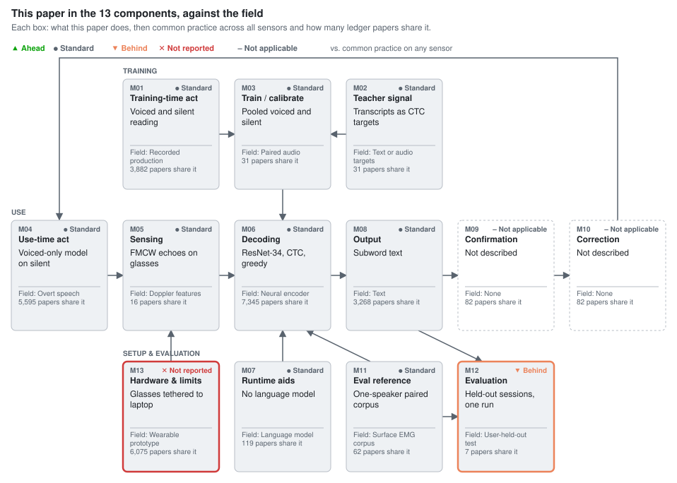

# SoniSpeech: A Large-Scale Open-Vocabulary Tri-Modal Dataset for Wearable Silent Speech Interfaces

Zhang, R., Liu, J., Guimbretière, F., Zhang, C. · arXiv preprint · 2026 · [arXiv:2608.00803](https://arxiv.org/abs/2608.00803)

**Section:** [Acoustic, whisper & wearable motion sensors](../../README.md#acoustic-whisper--wearable-motion-sensors)

## Figures

### This paper in the 13 components, against the field

<picture><source media="(prefers-color-scheme: dark)" srcset="figures/components-dark.svg"></picture>

Verdicts compare the paper's choice for each component with common practice across 8,995 ledger entries on any sensor (silent speech, brain-to-text, lip reading).

Data

| Component | This paper | Common practice | Papers with this practice | Verdict |
| --- | --- | --- | --- | --- |
| M01 Training-time act | Voiced and silent reading | Recorded production | 3,882 of 8,995 | ● Standard (Inherited.) |
| M02 Teacher signal | Transcripts as CTC targets | Text or audio targets | 31 of 8,995 | ● Standard (Inherited.) |
| M03 Train / calibrate | Pooled voiced and silent | Paired audio | 31 of 8,995 | ● Standard (One run.) |
| M04 Use-time act | Voiced-only model on silent | Overt speech | 5,595 of 8,995 | ● Standard (78.4% vs 16.9% WER.) |
| M05 Sensing | FMCW echoes on glasses | Doppler features | 16 of 8,995 | ● Standard (Sensor inherited.) |
| M06 Decoding | ResNet-34, CTC, greedy | Neural encoder | 7,345 of 8,995 | ● Standard (Inherited.) |
| M07 Runtime aids | No language model | Language model | 119 of 8,995 | ● Standard (Deliberate floor.) |
| M08 Output | Subword text | Text | 3,268 of 8,995 | ● Standard (Inherited.) |
| M09 Confirmation | Not described | None | 82 of 8,995 | – Not applicable (Offline.) |
| M10 Correction | Not described | None | 82 of 8,995 | – Not applicable (Offline.) |
| M11 Eval reference | One-speaker paired corpus | Surface EMG corpus | 62 of 8,995 | ● Standard (SSR7000-sized.) |
| M12 Evaluation | Held-out sessions, one run | User-held-out test | 7 of 8,995 | ▼ Behind (No users held out.) |
| M13 Hardware & limits | Glasses tethered to laptop | Wearable prototype | 6,075 of 8,995 | ✕ Not reported (No latency or power.) |

## Verdict

The paper [[1]](#ref-1) moves eyewear acoustic sensing (M05) from command sets to open-vocabulary sentences and releases a one-speaker paired voiced and silent corpus (M11). Both are standard: open vocabulary is new for acoustic sensing (closest earlier system: 54 sentences [[2]](#ref-2)), but one speaker and one run cannot support an ahead verdict, and the 9,000 silent utterances are 1.2 times SSR7000 [[3]](#ref-3). Its two findings, poor voiced-to-silent transfer (M04) and lower silent WER when voiced data are added (M03), follow the direction silent EMG showed in 2020 [[4]](#ref-4). The evaluation (M12) is behind: one speaker, held-out sessions and one run, where earlier acoustic-sensing work held users out [[5]](#ref-5), [[2]](#ref-2), [[6]](#ref-6). The 26.3% silent WER is a floor for this corpus, not evidence beyond this speaker.

## Against the field, component by component

### M05 Sensors: acoustic sensing at open vocabulary

**Usual approach:** Of 28 unique studies decoding speech from an emitted acoustic signal (topic population: pattern plus full-text match, Appendix), 16 use Doppler features and 12 FMCW or echo profiles. The paper inherits FMCW echo profiles from EchoSpeech, a 31-command eyewear system (Table 1, §3.5); its departure is open sentences.

**State of the art:** The paper's 26.3% silent WER over 5,356 word types (Table 2, Table 3) sets the open-vocabulary reference for acoustic sensing (2026). Earlier, 54 sentences reached 8.4% WER on held-out users and environments (2020) [[2]](#ref-2), and cross-user FMCW sensing 14.22–19.05% WER over 41 words after fine-tuning on 10 words per new user (2025) [[6]](#ref-6).

Those test unseen users on closed sets, this one speaker on open vocabulary; the WERs are not comparable. An ahead verdict needs a repeated effect; here one speaker gives one run per condition (Table 3). Verdict: standard.

### M11 Corpus: one-speaker paired voiced and silent sentences

**Usual approach:** Of 110 unique studies with silent sentence material and a WER (pattern match, Appendix), 62 name surface EMG, 54 video, 21 ultrasound tongue imaging and 4 acoustic sensing; 36 name a single speaker, as here (§6).

**State of the art:** On the one-speaker silent EMG benchmark [[4]](#ref-4), WER fell from 28.8% to 12.2% with LLM rescoring, and to 22.2% with a 4-gram language model alone (2024) [[7]](#ref-7). SoniSpeech decodes greedily without a language model (§5.1), so its 4-point gap to 22.2% (inference) mixes sensor, decoder, speaker, corpus and split.

SSR7000 released 7,484 silent utterances from one speaker [[3]](#ref-3); the EMG corpus has 3.6 hours of parallel silent speech and 9,828 word types [[4]](#ref-4). SoniSpeech's 9,000 silent utterances (Table 2) are 1.2 times SSR7000 and, at 5.41 s each, about 13.5 hours, 3.7 times the EMG silent data, with fewer word types (inference). New is the pairing of echoes, audio and video from one wearable. Verdict: standard.

### M03 Training: pooling voiced and silent data

**Usual approach:** Among 354 unique studies naming overt and silent production (pattern match, Appendix), paired audio is the most frequent supervision (31 of 138, slot-filled; text prompts 23); the paper pools both modes with no cross-mode term (§4.2).

**State of the art:** A [concurrent] silent-voiced alignment loss lowers silent EMG-to-speech WER from 26.75% to 25.14%, over 10 seeds, p = 0.002 (2026) [[8]](#ref-8).

Adding voiced data cuts silent WER from 33.7% to 26.3% (Table 3; 22% relative, inference). EMG showed the direction in 2020 on another metric: without vocalized-only data, ASR WER on synthesized audio rose from 68.0% to 71.6% [[4]](#ref-4). The voiced-only model's 78.4% silent WER against 16.9% voiced sizes a known direct-transfer degradation [[4]](#ref-4). Verdict: standard.

### M12 Evaluation: test split and repetition

**Usual approach:** Of 22 unique acoustic-sensing studies (pattern match, Appendix), 7 name a user-held-out test (the largest group), 6 a random split and 3 a session-held-out test, as here (§3.3).

**State of the art:** Cross-user FMCW sensing: 14.22–19.05% WER over 41 words (2025) [[6]](#ref-6).

The three prior acoustic-sensing works cited hold users out: voiced digits from 5 test speakers disjoint from 15 training ones [[5]](#ref-5), leave-one-domain-out over users [[2]](#ref-2), and cross-user tests [[6]](#ref-6). The verdict rests on what is missing: one speaker (§6), no seeds and no validation data (§4.2). Yardstick: typical of the field. Verdict: behind.

## The 13 components

| Component | This paper | Usual approach (count) | State of the art | Verdict |
|---|---|---|---|---|
| M01 Training-time action | Voiced and silent reading | Recorded production (slot-filled 3,882) | – | standard |
| M02 Training-only supervision | Transcripts as CTC targets | Text or audio targets (slot-filled 31) | – | standard |
| M03 Training and adaptation | Pooled voiced and silent | Paired audio (slot-filled 31) | 25.14% WER, 10 seeds [[8]](#ref-8) | standard |
| M04 Use-time action | Voiced-only model on silent | Overt speech (slot-filled 5,595) | – | standard |
| M05 Sensors | FMCW echoes on glasses | Doppler features (pattern match 16) | 26.3% WER, this paper | standard |
| M06 Processing and decoding | ResNet-34, CTC, greedy | Neural encoder (slot-filled 7,345) | – | standard |
| M07 Lexicon and LM | No language model | Language model (slot-filled 119) | 22.2% with 4-gram LM [[7]](#ref-7) | standard |
| M08 Output | Subword text | Text (slot-filled 3,268) | – | standard |
| M09 Confirmation | Not described | None (slot-filled 82) | – | not applicable |
| M10 Correction | Not described | None (slot-filled 82) | – | not applicable |
| M11 Reference construction | One-speaker paired corpus | Surface EMG corpus (pattern match 62) | 12.2% WER [[7]](#ref-7) | standard |
| M12 Evaluation | Held-out sessions, one run | User-held-out test (pattern match 7) | 14.22–19.05% cross-user [[6]](#ref-6) | behind |
| M13 Device and cost | Glasses tethered to laptop | Wearable prototype (slot-filled 6,075) | – | not reported |

## Where the claims outrun the evidence

- "Large-scale" holds against acoustic sensing and silent EMG, not SSR7000: 9,000 silent utterances (Table 2) against 7,484 [[3]](#ref-3).
- The abstract's 34 hours is session time (34.1 h, Table 2); valid utterances total 26.7 hours (§3.4).
- The voiced-data gain is called "significantly improved" (§5.1) without a test or seeds.
- Baselines use 140 of 160 training sessions per mode after a microphone channel failed (§3.3).
- No WER is given on the 242 unseen test word types (Table 2, Table 3).
- Robustness to walking, noise and other users is cited from EchoSpeech, a 31-command system (§6, Table 1), not measured.

## What the field needs next

- M12: held-out speakers and re-worn sessions, with seeds.
- M07: the baseline with an n-gram language model, against 22.2% on EMG [[7]](#ref-7).
- M03: a cross-mode alignment loss [[8]](#ref-8) against pooling on the paired data.
- M05: echo, video and fused models on one split.

## Questions for the authors

- How many seeds, and what spread per Table 3 value?
- Which data selected the checkpoint?
- How is text normalized before WER scoring?

## Appendix: literature search

- M05 active-acoustic-speech-sensing (published topic table, appended). Inclusion rule: studies that emit an acoustic signal and decode speech or mouth state from its reflection or Doppler shift; B-mode ultrasound, RF radar, Wi-Fi and laser excluded; reviews and datasets without decoding are pattern matches only. Ledger: 7,329 slot-filled, 22 pattern match (unique studies); topic population 28. Usual design: Doppler features, 16 (pattern match); FMCW or echo profile 12. Read in full: [[2]](#ref-2), [[1]](#ref-1).
- M11 open-vocabulary-silent-speech-corpus (new). Inclusion rule: ledger names silent speech, sentence-level or open-vocabulary material and a WER, any signal; imagined speech and silent reading stay in the upper-bound count; closed command sets excluded; versions once. Ledger: 234 slot-filled, 110 pattern match (unique studies). Usual design: surface EMG, 62 (pattern match); single speaker 36. Read in full: [[7]](#ref-7), [[4]](#ref-4), [[3]](#ref-3). Known-item recall 0.75 (3 of 4).
- M03 overt-silent-joint-training (published topic table, appended). Inclusion rule: how overt recordings enter the training of a silent-speech decoder (pooled, fine-tuned, target transfer, adversarial, explicit cross-mode distance). Ledger: 1,526 slot-filled, 354 pattern match (unique studies); population 138. Usual design: paired audio supervision, 31 (slot-filled). Read in full: [[4]](#ref-4), [[8]](#ref-8). Known-item recall 1.0.
- M12 acoustic-sensing-test-split (published topic table, appended). Inclusion rule: the M05 population; design compared is a user-held-out, session-held-out or random test split. Ledger: 6,960 slot-filled, 22 pattern match (unique studies). Usual design: user-held-out test, 7 (pattern match); random 6, session-held-out 3. Read in full: [[5]](#ref-5), [[2]](#ref-2), [[6]](#ref-6).

## References

Numbered by first citation. BibTeX in the same order and keys: [refs.bib](refs.bib).

1. Zhang, R., Liu, J., Guimbretière, F., Zhang, C. “SoniSpeech: A Large-Scale Open-Vocabulary Tri-Modal Dataset for Wearable Silent Speech Interfaces.” *arXiv preprint*, 2026. arXiv:[2608.00803](https://arxiv.org/abs/2608.00803). Target. Read as arXiv v1. [review](https://github.com/supernaiter/silent-speech-review/tree/main/reviews/sonispeech-a-large-scale-open-vocabulary-tri-modal-dataset-for-wearable-silent-speech-interfaces) [wiki: arxiv-2608.00803](https://github.com/supernaiter/deep-research-wiki-for-silent-speech/blob/main/papers/arxiv-2608.00803/article.md) [wiki: isca-zhang26y-sonispeech](https://github.com/supernaiter/deep-research-wiki-for-silent-speech/blob/main/papers/isca-zhang26y-sonispeech/article.md)
2. Luo, J., Wang, J., Cheng, N., Jiang, G., Xiao, J. “End-to-End Silent Speech Recognition with Acoustic Sensing.” *arXiv preprint*, 2020. arXiv:[2011.11315](https://arxiv.org/abs/2011.11315). Prior; deciding prior for M05 and M12. [review](https://github.com/supernaiter/silent-speech-review/tree/main/reviews/end-to-end-silent-speech-recognition-with-acoustic-sensing) [wiki: arxiv-2011.11315](https://github.com/supernaiter/deep-research-wiki-for-silent-speech/blob/main/papers/arxiv-2011.11315/article.md)
3. Kimura, N., Su, Z., Saeki, T., Rekimoto, J. “SSR7000: A Synchronized Corpus of Ultrasound Tongue Imaging for End-to-End Silent Speech Recognition.” *Proceedings of the 13th Language Resources and Evaluation Conference (LREC 2022)*, 2022, 6866–6873. doi:[10.63317/2b659u3p6oeh](https://doi.org/10.63317/2b659u3p6oeh). Prior; deciding prior for M11. [wiki: lrec22-ssr7000](https://github.com/supernaiter/deep-research-wiki-for-silent-speech/blob/main/papers/lrec22-ssr7000/article.md) [wiki: doi-10.63317-2b659u3p6oeh](https://github.com/supernaiter/deep-research-wiki-for-silent-speech/blob/main/papers/doi-10.63317-2b659u3p6oeh/article.md)
4. Gaddy, D., Klein, D. “Digital Voicing of Silent Speech.” *Proceedings of the 2020 Conference on Empirical Methods in Natural Language Processing (EMNLP)*, 2020, 5521–5530. doi:[10.18653/v1/2020.emnlp-main.445](https://doi.org/10.18653/v1/2020.emnlp-main.445). arXiv:[2010.02960](https://arxiv.org/abs/2010.02960). Prior; deciding prior for M03, M04 and M11. [review](https://github.com/supernaiter/silent-speech-review/tree/main/reviews/digital-voicing-of-silent-speech) [wiki: arxiv-2010.02960](https://github.com/supernaiter/deep-research-wiki-for-silent-speech/blob/main/papers/arxiv-2010.02960/article.md) [wiki: doi-10.18653-v1-2020.emnlp-main.445](https://github.com/supernaiter/deep-research-wiki-for-silent-speech/blob/main/papers/doi-10.18653-v1-2020.emnlp-main.445/article.md)
5. Zhu, B., Hazen, T. J., Glass, J. R. “Multimodal Speech Recognition with Ultrasonic Sensors.” *Proc. INTERSPEECH 2007*, 2007. doi:[10.21437/Interspeech.2007-284](https://doi.org/10.21437/Interspeech.2007-284). Prior; deciding prior for M12. [wiki: isca-zhu07_interspeech](https://github.com/supernaiter/deep-research-wiki-for-silent-speech/blob/main/papers/isca-zhu07_interspeech/article.md)
6. Zhou, M., Chen, Y., Xue, G. “M2SILENT: Enabling Multi-user Silent Speech Interactions via Multi-directional Speakers in Shared Spaces.” *Proceedings of the 2025 CHI Conference on Human Factors in Computing Systems (CHI '25)*, 2025. doi:[10.1145/3706598.3714174](https://doi.org/10.1145/3706598.3714174). Prior; state of the art for M12. [wiki: doi-10.1145-3706598.3714174](https://github.com/supernaiter/deep-research-wiki-for-silent-speech/blob/main/papers/doi-10.1145-3706598.3714174/article.md)
7. Benster, T., Wilson, G., Elisha, R., Willett, F. R., Druckmann, S. “A Cross-Modal Approach to Silent Speech with LLM-Enhanced Recognition.” *arXiv preprint*, 2024. arXiv:[2403.05583](https://arxiv.org/abs/2403.05583). Prior; state of the art for M11 and M07. [wiki: arxiv-2403.05583](https://github.com/supernaiter/deep-research-wiki-for-silent-speech/blob/main/papers/arxiv-2403.05583/article.md)
8. Lee, J., Hwang, I., Lee, J., Kim, E., Han, D., Lee, K. “Enhancing EMG-to-Speech via Silent-Voiced Representation Alignment.” *Proc. INTERSPEECH 2026*, 2026. doi:[10.21437/Interspeech.2026-2931](https://doi.org/10.21437/Interspeech.2026-2931). Concurrent; state of the art for M03. [concurrent] [wiki: isca-lee26v_interspeech](https://github.com/supernaiter/deep-research-wiki-for-silent-speech/blob/main/papers/isca-lee26v_interspeech/article.md)

## Materials

Data behind this review. Full texts of the papers are not included.

- [`review.md`](review.md): the review text (source)
- [`refs.bib`](refs.bib): references (BibTeX)
- [`slots.json`](slots.json): for each of the 13 components: this paper's choice, field practice, number of matching papers, verdict
- [`figures.json`](figures.json): figure definitions
- [`evaluation.md`](evaluation.md): independent evaluation by a second reviewer
- [`triage.md`](triage.md): how each evaluation finding was checked against the sources and resolved
- [`components/M03/overt-silent-joint-training.csv`](../../components/M03/overt-silent-joint-training.csv): M03 topic "overt-silent-joint-training", every candidate paper with its decision (1526 slot-filled, 354 pattern match, usual design in 31, 5 read in full)
- [`components/M05/active-acoustic-speech-sensing.csv`](../../components/M05/active-acoustic-speech-sensing.csv): M05 topic "active-acoustic-speech-sensing", every candidate paper with its decision (7329 slot-filled, 22 pattern match, usual design in 16, 3 read in full)
- [`components/M11/open-vocabulary-silent-speech-corpus.csv`](../../components/M11/open-vocabulary-silent-speech-corpus.csv): M11 topic "open-vocabulary-silent-speech-corpus", every candidate paper with its decision (234 slot-filled, 110 pattern match, usual design in 62, 4 read in full)
- [`components/M12/acoustic-sensing-test-split.csv`](../../components/M12/acoustic-sensing-test-split.csv): M12 topic "acoustic-sensing-test-split", every candidate paper with its decision (6960 slot-filled, 22 pattern match, usual design in 7, 3 read in full)

## More reviews in Acoustic, whisper & wearable motion sensors

- [NasoVoce: A Nose-Mounted Low-Audibility Speech Interface for Always-Available Speech Interaction](../nasovoce/) (2026). Nose-pad mic plus vibration sensor (M05) and dual-input fusion (M06) are standard; noise is added to the mic only, so the robustness claim is untested in real noise (M12, behind).
- [Poster: Recognizing Hidden-in-the-Ear Private Key for Reliable Silent Speech Interface Using Multi-Task Learning](../poster-recognizing-hidden-in-the-ear-private-key-for-reliable-silent-speech-interface-using-mult/) (2025). Sensing, shared model and joint word-plus-identity output are each standard; whisper adds nothing over the 91.4% ultrasonic-only baseline, and impostors are training participants (M12 behind).
- [Silent Speech Sentence Recognition with Six-Axis Accelerometers using Conformer and CTC Algorithm](../silent-speech-sentence-recognition-with-six-axis-accelerometers-using-conformer-and-ctc-algorith/) (2025). Uses six wearable 6-axis IMUs (accelerometer plus gyroscope) on the face and neck with a Conformer-CTC model to recognize silently articulated words and word sequences. Reports 97.17% word-level accuracy in a 4-participant study.
- [Unvoiced: Designing an LLM-assisted Unvoiced User Interface using Earables](../unvoiced-designing-an-llm-assisted-unvoiced-user-interface-using-earables/) (2024). Twin-IMU earable captures jaw motion during unvoiced speech; spectrograms are transcribed by Whisper and gaps filled by GPT-4, giving 93-99% task completion and 0.07-0.14 WER across 19 users.
- [EchoSpeech: Continuous Silent Speech Recognition on Minimally-obtrusive Eyewear Powered by Acoustic Sensing](../echospeech-continuous-silent-speech-recognition-on-minimally-obtrusive-eyewear-powered-by-acoustic/) (2023). Glasses-mounted inaudible FMCW sonar recognizes silent speech from facial skin echoes: 4.5% WER on 31 commands and 6.1% on connected digits in 12 users, with walking/noise tests and a 73.3 mW demo.
- [WESPER: Zero-shot and Realtime Whisper to Normal Voice Conversion for Whisper-based Speech Interactions](../wesper-zero-shot-and-realtime-whisper-to-normal-voice-conversion-for-whisper-based-speech-interactions/) (2023). WESPER trains a whisper-to-normal converter with no paired data (M02, ahead); its unit route (M06) is untested against baselines, and its ASR gain trails a recognizer fine-tuned on labelled whisper.

---

Part of the [Silent Speech Interface Review](https://github.com/supernaiter/silent-speech-review). Found an error? [Open an issue](https://github.com/supernaiter/silent-speech-review/issues/new?template=correction.yml).
