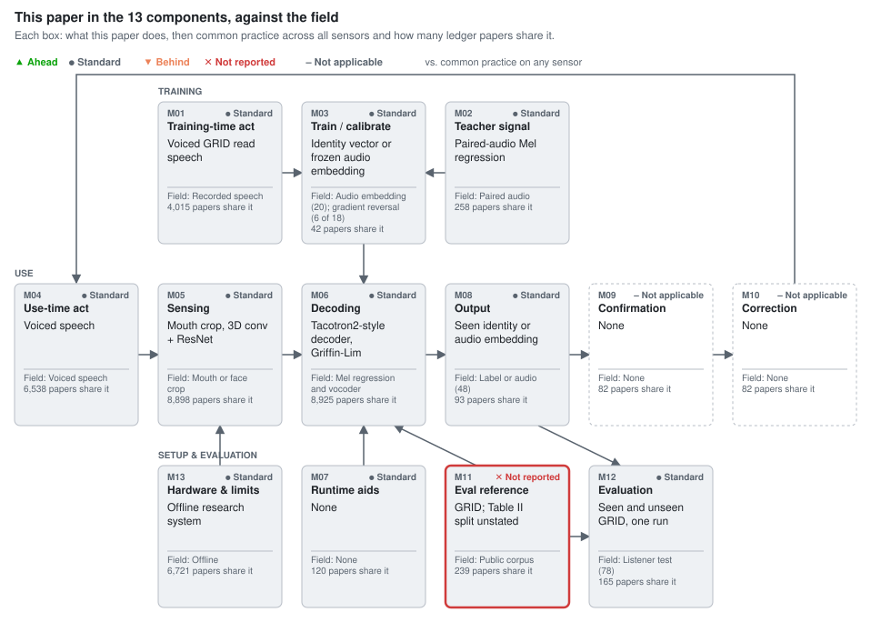

# Speaker disentanglement in video-to-speech conversion

Dan Oneață, Adriana Stan, Horia Cucu. arXiv preprint, 2021. [arXiv:2105.09652](https://arxiv.org/abs/2105.09652)

**Section:** [Lip & face video](../../README.md#lip--face-video)

## Figures

### This paper in the 13 components, against the field

<picture><source media="(prefers-color-scheme: dark)" srcset="figures/components-dark.svg"></picture>

Verdicts compare the paper's choice for each component with common practice across 8,995 ledger entries on any sensor (silent speech, brain-to-text, lip reading).

Data

| Component | This paper | Common practice | Papers with this practice | Verdict |
| --- | --- | --- | --- | --- |
| M01 Training-time act | Voiced GRID read speech | Recorded speech | 4,015 of 8,995 | ● Standard (Inherited.) |
| M02 Teacher signal | Paired-audio Mel regression | Paired audio | 258 of 8,995 | ● Standard (Inherited.) |
| M03 Train / calibrate | Identity vector or frozen audio embedding Adversarial speaker removal | Audio embedding (20); gradient reversal (6 of 18) | 42 of 8,995 | ● Standard (Removal device from 2017 lipreading.) |
| M04 Use-time act | Voiced speech | Voiced speech | 6,538 of 8,995 | ● Standard (Inherited.) |
| M05 Sensing | Mouth crop, 3D conv + ResNet | Mouth or face crop | 8,898 of 8,995 | ● Standard (Inherited.) |
| M06 Decoding | Tacotron2-style decoder, Griffin-Lim | Mel regression and vocoder | 8,925 of 8,995 | ● Standard (Inherited.) |
| M07 Runtime aids | None | None | 120 of 8,995 | ● Standard (Grammar only in the scoring ASR.) |
| M08 Output | Seen identity or audio embedding | Label or audio (48) | 93 of 8,995 | ● Standard (Seen voice on unseen video.) |
| M09 Confirmation | None | None | 82 of 8,995 | – Not applicable (Offline.) |
| M10 Correction | None | None | 82 of 8,995 | – Not applicable (Offline.) |
| M11 Eval reference | GRID; Table II split unstated | Public corpus | 239 of 8,995 | ✕ Not reported (Table II speaker list not stated.) |
| M12 Evaluation | Seen and unseen GRID, one run | Listener test (78) | 165 of 8,995 | ● Standard (EER on training network; Lip2Wav omitted.) |
| M13 Hardware & limits | Offline research system | Offline | 6,721 of 8,995 | ● Standard (Inherited.) |

## Verdict

The paper [[1]](#ref-1) changes the speaker input and its training (M03: an identity vector or frozen audio speaker embedding, plus an entropy or gradient-reversal speaker classifier stripping identity from the lip encoder) and the voice choice at inference (M08); both are standard. Its gradient-reversal variant is the device Wand and Schmidhuber put on a GRID lipreader in 2017 [[2]](#ref-2), absent from the paper's references, and Lip2Wav fed a speaker embedding to a lip-to-speech model a year earlier [[3]](#ref-3), which the paper calls "concurrent work" (Section II). The Abstract's "first" claim (voice control and unseen identities) therefore rests on adding identity removal, the feature the authors use to set Lip2Wav apart. The strongest confound: speaker control (EER) is scored with the embedding network that also feeds the SE models (Section IV.B). Seven of Table II's 18 speaker-conditioned rows (3-20) exceed baseline B's 41.9% unseen-speaker WER (inference), so "All these variants maintain or improve the content intelligibility" (Section V) is wrong.

## Against the field, component by component

### M03 Training: speaker identity input

**Usual approach:** Of 42 unique studies conditioning a shared non-acoustic decoder on a speaker embedding (pattern match, Appendix), 20 compute it from reference audio. SE follows them (frozen 512-d embedding projected to 32-d, Sec. III); SI learns an identity vector. Lip-derived speaker vectors came earlier [[4]](#ref-4); x-vector conditioning of ultrasound-to-speech appeared at the same time [[5]](#ref-5) [concurrent].

**State of the art:** In 2024 V2SFlow predicted the embedding from the silent video, reaching LRS3 unseen-speaker SECS 0.664 against 0.587 without its speaker component (Table III) [[6]](#ref-6) [later]. Verdict: standard.

### M03 Training: adversarial removal of identity

**Usual approach:** Of 18 unique studies naming adversarial or disentangling training on a non-acoustic encoder (pattern match, Appendix), 6 use gradient reversal. Wand and Schmidhuber's GRID lipreader learns "to confuse speakers" this way, gaining about 40% relative accuracy on a new speaker from 15-20 s of untranscribed speech [[2]](#ref-2); the paper moves it, plus an entropy ("dispel") variant, to synthesis.

**State of the art:** In 2023 ZS Lip2Speech's VAE identity split on 13 unseen GRID speakers gave EER 26.57% with a reference-speech embedding, 36.72% with a face-derived one against 43.13% without the split (Table 1) [[7]](#ref-7) [later].

For SE with frame dropping (row 10), dispel-MLP (row 11) cuts EER from 48.6% to 7.1% (85% relative) while WER rises from 31.2% to 41.9% (34% relative) (inference). For SI, EER stays at 6.8-7.5% against 7.1% without (Table II). The authors concede the trade-off (Sec. V). Verdict: standard.

### M08 Output: choosing the voice

**Usual approach:** Of 93 unique studies setting the voice of non-acoustic speech synthesis (pattern match, Appendix), 48 use a speaker label or reference-audio embedding, as the paper does, imposing a seen voice on an unseen speaker's video.

**State of the art:** In 2023 DiffV2S took the voice from video alone: MOS 3.91 for matching the actual voice on LRS3 (Table 2) [[8]](#ref-8) [later].

The most intelligible system in the listening test (Table II row 10, word accuracy 73.7) has the lowest speaker similarity, 33.5 against 99.3 for real speech (Fig. 3). Verdict: standard.

### M12 Evaluation: seen and unseen GRID speakers

**Usual approach:** Of 165 unique video-to-speech studies (pattern match, Appendix), 78 run a listener test, 65 score ASR WER, 52 test unseen speakers and 2 repeat runs. The paper has the first three, with no seeds or repeats reported (Sec. IV).

**State of the art:** In 2024 V2SFlow reached 28.5% WER on LRS3 unseen speakers [[6]](#ref-6) [later]. The best GRID figure before the paper is Lip2Wav's 14.08% on four seen speakers [[3]](#ref-3).

Table I omits Lip2Wav, below B-spk's 17.8% WER though scored by a cloud ASR, not the paper's GRID-grammar Kaldi model (2.8% on real speech). Table II row 1 gives the GAN 41.9%, identical to B and without Table I's recompute mark; the GAN paper reports 40.5% on 10 held-out subjects (Table 4) [[9]](#ref-9). Verdict: standard.

## The 13 components

| Component | This paper | Usual approach (count) | State of the art | Verdict |
|---|---|---|---|---|
| M01 Training-time action | Voiced GRID read speech | Recorded speech (slot-filled 4,015) | – | standard |
| M02 Training-only supervision | Paired-audio Mel regression | Paired audio (slot-filled 258) | – | standard |
| M03 Training and adaptation | Identity vector or frozen audio embedding; Adversarial speaker removal | Audio embedding (20); gradient reversal (6 of 18) (pattern match 42) | SECS 0.664, video-derived [[6]](#ref-6); VAE split [[7]](#ref-7) | standard |
| M04 Use-time action | Voiced speech | Voiced speech (slot-filled 6,538) | – | standard |
| M05 Sensors | Mouth crop, 3D conv + ResNet | Mouth or face crop (slot-filled 8,898) | – | standard |
| M06 Processing and decoding | Tacotron2-style decoder, Griffin-Lim | Mel regression and vocoder (slot-filled 8,925) | – | standard |
| M07 Lexicon and LM | None | None (slot-filled 120) | – | standard |
| M08 Output | Seen identity or audio embedding | Label or audio (48) (pattern match 93) | Voice-matching MOS 3.91 [[8]](#ref-8) | standard |
| M09 Confirmation | None | None (slot-filled 82) | – | not applicable |
| M10 Correction | None | None (slot-filled 82) | – | not applicable |
| M11 Reference construction | GRID; Table II split unstated | Public corpus (slot-filled 239) | – | not reported |
| M12 Evaluation | Seen and unseen GRID, one run | Listener test (78) (pattern match 165) | 28.5% WER, LRS3 [[6]](#ref-6) | standard |
| M13 Device and cost | Offline research system | Offline (slot-filled 6,721) | – | standard |

## Where the claims outrun the evidence

- EER uses "the same speaker embedding network used in the training process" (Sec. IV.B [[1]](#ref-1)); SE models are conditioned on it, so low EER may reflect fitting it, not an audible voice.
- All six SI rows (42.7-50.2%) and SE-norm dispel-MLP (49.6%) exceed B's 41.9% unseen-speaker WER (Table II row 2; Table I's 21.8% is seen speakers) [[1]](#ref-1), against the conclusion.
- "yielding best results in terms of PESQ and WER" (Sec. IV.A [[1]](#ref-1)) holds for WER only without Lip2Wav [[3]](#ref-3), whose 14.08% came from another ASR and split (M12).
- No uncertainty for the 18-listener test (Fig. 3); several Table II gaps are under one point [[1]](#ref-1).

## What the field needs next

- M12: EER from a speaker-verification network not used in training, on a named unseen-speaker list, over several seeds.
- M03: a probe of speaker information left in the lip features, with and without removal, at matched WER.
- M08: video-derived voice against audio-embedding control on one GRID unseen split.

## Questions for the authors

- Which speakers and utterances form the Table II test set, and where does row 1's 41.9% come from?
- Which utterances estimate the SE-norm mean and variance?
- How many clips did each listener rate, and in what order?

## Appendix: literature search

- M03 speaker-embedding-conditioning (published topic table, reused). Inclusion rule: studies decoding speech or text from a non-acoustic signal with one model shared across speakers conditioned on a per-speaker or per-utterance embedding; acoustic-only systems, audio-visual enhancement and metric-only embeddings excluded; versions counted once. Slot-filled 1,526 unique studies; pattern match 42 unique studies. Usual design: reference-audio embedding, 20 (pattern match); learned subject embedding 2. Read in full: [[5]](#ref-5), [[4]](#ref-4), [[6]](#ref-6) [later], target. Known-item recall 1.0.
- M03 adversarial-speaker-removal-from-signal-encoder (new topic table). Inclusion rule: studies decoding speech or text from a non-acoustic signal that train the encoder against a speaker, subject or session classifier (gradient reversal, entropy or confusion loss, mutual-information penalty, VAE identity split); output-audio discriminators, plain multi-speaker training and evaluation-only classifiers excluded; versions counted once. Slot-filled 1,526 unique studies; pattern match 18 unique studies. Usual design: gradient reversal, 6 (pattern match, target included); content-identity disentanglement 5, speaker or subject adversary 2, mutual-information penalty 0. Read in full: [[2]](#ref-2), [[7]](#ref-7) [later], target. Known-item recall 1.0.
- M08 biosignal-to-speech-voice-control (published topic table, reused). Inclusion rule: studies synthesizing speech from a non-acoustic signal that set the voice through reference audio, a speaker label or a face image; single-voice systems and text-to-speech after decoding excluded. Slot-filled 3,268 unique studies; pattern match 93 unique studies. Usual design: speaker label or reference-audio embedding, 48 (pattern match). Read in full: [[8]](#ref-8) [later], target. Known-item recall 1.0.
- M12 video-to-speech-speaker-held-out-test (published topic table, reused). Inclusion rule: the video-to-speech population (speech synthesized from talking-face or lip video, audio muted at test), counted by evaluation protocol named in full text with references removed; a study counts under every protocol it names. Slot-filled 6,960 unique studies; pattern match 165 unique studies. Usual design: listener test, 78 (pattern match); ASR WER 65, unseen-speaker test 52, repeated runs 2. Read in full: [[3]](#ref-3), [[9]](#ref-9), [[6]](#ref-6) [later], target. Known-item recall 1.0.

## References

Numbered by first citation. BibTeX in the same order and keys: [refs.bib](refs.bib).

1. Oneață, D., Stan, A., Cucu, H. “Speaker disentanglement in video-to-speech conversion.” *arXiv preprint*, 2021. arXiv:[2105.09652](https://arxiv.org/abs/2105.09652). Target. Read as arXiv v1 (20 May 2021). [review](https://github.com/supernaiter/silent-speech-review/tree/main/reviews/speaker-disentanglement-in-video-to-speech-conversion) [wiki: arxiv-2105.09652-spkdisent](https://github.com/supernaiter/deep-research-wiki-for-silent-speech/blob/main/papers/arxiv-2105.09652-spkdisent/article.md)
2. Wand, M., Schmidhuber, J. “Improving Speaker-Independent Lipreading with Domain-Adversarial Training.” *Interspeech 2017*, 2017. doi:[10.21437/Interspeech.2017-421](https://doi.org/10.21437/Interspeech.2017-421). arXiv:[1708.01565](https://arxiv.org/abs/1708.01565). Read as arXiv v1 (4 August 2017). [wiki: arxiv-1708.01565](https://github.com/supernaiter/deep-research-wiki-for-silent-speech/blob/main/papers/arxiv-1708.01565/article.md) [wiki: isca-wand17_dalip](https://github.com/supernaiter/deep-research-wiki-for-silent-speech/blob/main/papers/isca-wand17_dalip/article.md) [wiki: isca-wand17-domainadv](https://github.com/supernaiter/deep-research-wiki-for-silent-speech/blob/main/papers/isca-wand17-domainadv/article.md) [wiki: isca-wand17_lipread](https://github.com/supernaiter/deep-research-wiki-for-silent-speech/blob/main/papers/isca-wand17_lipread/article.md)
3. Prajwal, K. R., Mukhopadhyay, R., Namboodiri, V. P., Jawahar, C. V. “Learning Individual Speaking Styles for Accurate Lip to Speech Synthesis.” *2020 IEEE/CVF Conference on Computer Vision and Pattern Recognition (CVPR)*, 2020, 13793-13802. doi:[10.1109/CVPR42600.2020.01381](https://doi.org/10.1109/CVPR42600.2020.01381). arXiv:[2005.08209](https://arxiv.org/abs/2005.08209). Read as arXiv v1. [wiki: arxiv-2005.08209](https://github.com/supernaiter/deep-research-wiki-for-silent-speech/blob/main/papers/arxiv-2005.08209/article.md) [wiki: cvf-prajwal20-lip2wav](https://github.com/supernaiter/deep-research-wiki-for-silent-speech/blob/main/papers/cvf-prajwal20-lip2wav/article.md)
4. Kandala, P. A., Thanda, A., Margam, D. K., Aralikatti, R. C., Sharma, T., Roy, S., et al. “Speaker Adaptation for Lip-Reading Using Visual Identity Vectors.” *Proc. Interspeech 2019*, 2019, 2758–2762. doi:[10.21437/Interspeech.2019-3237](https://doi.org/10.21437/Interspeech.2019-3237). [wiki: isca-kandala19_interspeech](https://github.com/supernaiter/deep-research-wiki-for-silent-speech/blob/main/papers/isca-kandala19_interspeech/article.md) [wiki: isca-kandala19-vivectors](https://github.com/supernaiter/deep-research-wiki-for-silent-speech/blob/main/papers/isca-kandala19-vivectors/article.md)
5. Ribeiro, M. S., Sanger, J., Zhang, J., Eshky, A., Wrench, A., Richmond, K., et al. “TaL: A Synchronised Multi-Speaker Corpus of Ultrasound Tongue Imaging, Audio, and Lip Videos.” *Proc. IEEE Spoken Language Technology Workshop (SLT)*, 2021, 1109–1116. doi:[10.1109/SLT48900.2021.9383619](https://doi.org/10.1109/SLT48900.2021.9383619). arXiv:[2011.09804](https://arxiv.org/abs/2011.09804). [concurrent] [wiki: arxiv-2011.09804](https://github.com/supernaiter/deep-research-wiki-for-silent-speech/blob/main/papers/arxiv-2011.09804/article.md) [wiki: doi-10.1109-slt48900.2021.9383619](https://github.com/supernaiter/deep-research-wiki-for-silent-speech/blob/main/papers/doi-10.1109-slt48900.2021.9383619/article.md)
6. Choi, J., Kim, J., Li, J., Chung, J. S., Liu, S. “V2SFlow: Video-to-Speech Generation with Speech Decomposition and Rectified Flow.” *arXiv preprint*, 2024. arXiv:[2411.19486](https://arxiv.org/abs/2411.19486). Read as arXiv v2 (30 May 2025). [later] [wiki: arxiv-2411.19486](https://github.com/supernaiter/deep-research-wiki-for-silent-speech/blob/main/papers/arxiv-2411.19486/article.md)
7. Sheng, Z., Ai, Y., Ling, Z. “Zero-Shot Personalized Lip-to-Speech Synthesis with Face Image Based Voice Control.” *arXiv preprint*, 2023. arXiv:[2305.14359](https://arxiv.org/abs/2305.14359). [later] [review](https://github.com/supernaiter/silent-speech-review/tree/main/reviews/zero-shot-personalized-lip-to-speech-synthesis-with-face-image-based-voice-control) [wiki: arxiv-2305.14359](https://github.com/supernaiter/deep-research-wiki-for-silent-speech/blob/main/papers/arxiv-2305.14359/article.md)
8. Choi, J., Hong, J., Ro, Y. M. “DiffV2S: Diffusion-based Video-to-Speech Synthesis with Vision-guided Speaker Embedding.” *2023 IEEE/CVF International Conference on Computer Vision (ICCV)*, 2023, 6692-6701. doi:[10.1109/ICCV51070.2023.00618](https://doi.org/10.1109/ICCV51070.2023.00618). arXiv:[2308.07787](https://arxiv.org/abs/2308.07787). Venue, DOI and pages from the ICCV 2023 open-access version and Crossref. [later] [wiki: arxiv-2308.07787-diffv2s](https://github.com/supernaiter/deep-research-wiki-for-silent-speech/blob/main/papers/arxiv-2308.07787-diffv2s/article.md) [wiki: cvf23-choi_diffv2s](https://github.com/supernaiter/deep-research-wiki-for-silent-speech/blob/main/papers/cvf23-choi_diffv2s/article.md)
9. Vougioukas, K., Ma, P., Petridis, S., Pantic, M. “Video-Driven Speech Reconstruction using Generative Adversarial Networks.” *Interspeech 2019*, 2019, 4125-4129. doi:[10.21437/Interspeech.2019-1445](https://doi.org/10.21437/Interspeech.2019-1445). arXiv:[1906.06301](https://arxiv.org/abs/1906.06301). [review](https://github.com/supernaiter/silent-speech-review/tree/main/reviews/video-driven-speech-reconstruction-using-generative-adversarial-networks) [wiki: isca-vougioukas19_ganv2s](https://github.com/supernaiter/deep-research-wiki-for-silent-speech/blob/main/papers/isca-vougioukas19_ganv2s/article.md)

## Materials

Data behind this review. Full texts of the papers are not included.

- [`review.md`](review.md): the review text (source)
- [`refs.bib`](refs.bib): references (BibTeX)
- [`slots.json`](slots.json): for each of the 13 components: this paper's choice, field practice, number of matching papers, verdict
- [`figures.json`](figures.json): figure definitions
- [`evaluation.md`](evaluation.md): independent evaluation by a second reviewer
- [`triage.md`](triage.md): how each evaluation finding was checked against the sources and resolved
- [`components/M03/adversarial-speaker-removal-from-signal-encoder.csv`](../../components/M03/adversarial-speaker-removal-from-signal-encoder.csv): M03 topic "adversarial-speaker-removal-from-signal-encoder", every candidate paper with its decision (1526 slot-filled, 18 pattern match, usual design in 6, 3 read in full)
- [`components/M03/speaker-embedding-conditioning.csv`](../../components/M03/speaker-embedding-conditioning.csv): M03 topic "speaker-embedding-conditioning", every candidate paper with its decision (1526 slot-filled, 42 pattern match, usual design in 20, 4 read in full)
- [`components/M08/biosignal-to-speech-voice-control.csv`](../../components/M08/biosignal-to-speech-voice-control.csv): M08 topic "biosignal-to-speech-voice-control", every candidate paper with its decision (3268 slot-filled, 93 pattern match, usual design in 48, 4 read in full)
- [`components/M12/video-to-speech-speaker-held-out-test.csv`](../../components/M12/video-to-speech-speaker-held-out-test.csv): M12 topic "video-to-speech-speaker-held-out-test", every candidate paper with its decision (6960 slot-filled, 165 pattern match, usual design in 78, 5 read in full)

## More reviews in Lip & face video

- [Multi-modality Associative Bridging through Memory: Speech Sound Recollected from Face Video](../multi-modality-associative-bridging-through-memory-speech-sound-recollected-from-face-video/) (2021). Audio memory recall (M02) is ahead as a design, but the LRW state-of-the-art claim misses a prior 87.9% model, the edge over distillation is one run, and GRID gains are small.
- [FastLTS: Non-Autoregressive End-to-End Unconstrained Lip-to-Speech Synthesis](../fastlts-non-autoregressive-end-to-end-unconstrained-lip-to-speech-synthesis/) (2022). Parallel decoder, learned-feature GAN generator and transformer front end (M06) are standard; 9.14x mel speedup is real, but evaluation (M12) drops the STOI/ESTOI its Lip2Wav baseline reported.
- [Learning Audio-Visual Speech Representation by Masked Multimodal Cluster Prediction](../learning-audio-visual-speech-representation-by-masked-multimodal-cluster-prediction/) (2022). AV-HuBERT's masked audio-visual cluster pre-training (M03) was a large step past distillation, but its LRS3 gains lack repeated runs and later work beats it at matched budgets.
- [Lip-to-Speech Synthesis for Arbitrary Speakers in the Wild](../lip-to-speech-synthesis-for-arbitrary-speakers-in-the-wild/) (2022). VAE-GAN lip-to-speech with a reference-audio voice: a standard design whose gains are in distribution and sync metrics; no WER is reported, behind its own lineage on evaluation.
- [Sub-word Level Lip Reading With Visual Attention](../sub-word-level-lip-reading-with-visual-attention/) (2022). Attention pooling of the lip map (M06) was ahead in 2021 but not the route to later SOTA; WordPiece output (M08) was preceded by BPE in 2020; the SOTA table mixes data budgets.
- [SVTS: Scalable Video-to-Speech Synthesis](../svts-scalable-video-to-speech-synthesis/) (2022). Conformer mel predictor plus pretrained vocoder (M06) and data scaling (M03) are standard; GRID/LRW gains hold, but later tests put SVTS at 78-82% WER on LRS3.

---

Part of the [Silent Speech Interface Review](https://github.com/supernaiter/silent-speech-review). Found an error? [Open an issue](https://github.com/supernaiter/silent-speech-review/issues/new?template=correction.yml).
