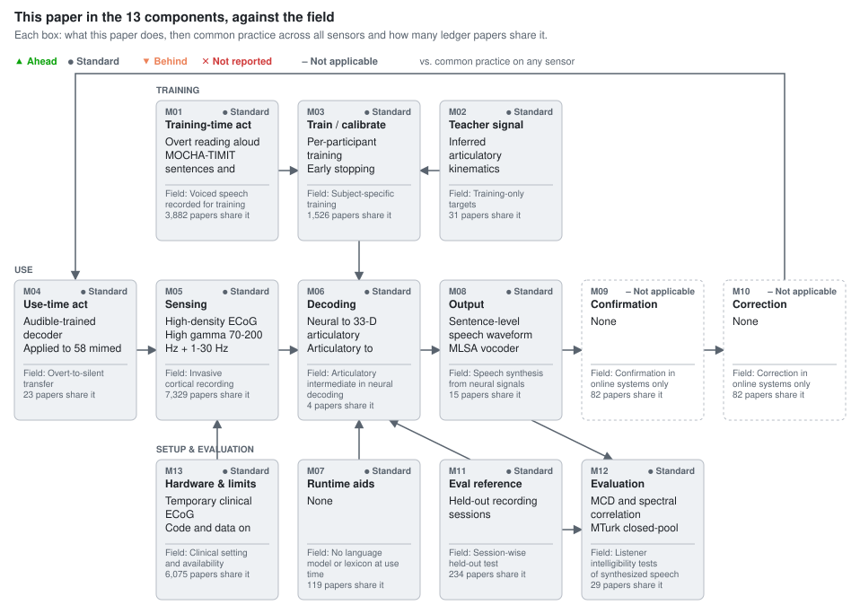

# Speech synthesis from neural decoding of spoken sentences

Anumanchipalli, G. K., Chartier, J., Chang, E. F. *Nature* 568:493–498, 2019 [[1]](#ref-1). doi:[10.1038/s41586-019-1119-1](https://doi.org/10.1038/s41586-019-1119-1); bioRxiv preprint (2018-11) doi:[10.1101/481267](https://doi.org/10.1101/481267).

**Section:** [Brain signals (EEG, MEG, intracortical)](../../README.md#brain-signals-eeg-meg-intracortical)

## Figures

### This paper in the 13 components, against the field

<picture><source media="(prefers-color-scheme: dark)" srcset="figures/components-dark.svg"></picture>

Verdicts compare the paper's choice for each component with common practice across 8,995 ledger entries on any sensor (silent speech, brain-to-text, lip reading).

Data

| Component | This paper | Common practice | Papers with this practice | Verdict |
| --- | --- | --- | --- | --- |
| M01 Training-time act | Overt reading aloud MOCHA-TIMIT sentences and stories | Voiced speech recorded for training | 3,882 of 8,995 | ● Standard (Overt reading inherited from the Chang-lab ECoG paradigm; nothing new here.) |
| M02 Teacher signal | Inferred articulatory kinematics Speaker-independent acoustic-to-articulatory inversion | Training-only targets | 31 of 8,995 | ● Standard (Inferred articulation inherited from Chartier et al. 2018, and it smuggles phoneme-label supervision into the stage-1 target.) |
| M03 Train / calibrate | Per-participant training Early stopping | Subject-specific training | 1,526 of 8,995 | ● Standard (Per-participant training with early stopping is ordinary for invasive decoding.) |
| M04 Use-time act | Audible-trained decoder Applied to 58 mimed trials of 10 sentences (P1) | Overt-to-silent transfer | 23 of 8,995 | ● Standard (Same audible-to-silent design as Martin et al. 2014, with mimed values only in figures and conflicting n, so the transfer is shown against chance but not quantified.) |
| M05 Sensing | High-density ECoG High gamma 70-200 Hz + 1-30 Hz | Invasive cortical recording | 7,329 of 8,995 | ● Standard (Standard clinical high-density ECoG features of the lineage.) |
| M06 Decoding | Neural to 33-D articulatory Articulatory to 32-D acoustic Two 3-layer bLSTMs | Articulatory intermediate in neural decoding | 4 of 8,995 | ● Standard (First implementation of a neural-to-articulatory-to-acoustic decoder, but the gain over direct decoding is one participant and confounded by extra phonetic supervision, and later work found direct decoding as good, so not ahead.) |
| M07 Runtime aids | None | No language model or lexicon at use time | 119 of 8,995 | ● Standard (Direct acoustic synthesis needs no language model.) |
| M08 Output | Sentence-level speech waveform MLSA vocoder | Speech synthesis from neural signals | 15 of 8,995 | ● Standard (Sentence waveforms with listener tests extend earlier formant and spectrogram decoding; the offline MLSA result is now far behind instantaneous intracortical synthesis.) |
| M09 Confirmation | None | Confirmation in online systems only | 82 of 8,995 | – Not applicable (Offline study.) |
| M10 Correction | None | Correction in online systems only | 82 of 8,995 | – Not applicable (Offline study.) |
| M11 Eval reference | Held-out recording sessions | Session-wise held-out test | 234 of 8,995 | ● Standard (Session-wise split is sound, but the Fig. 1 caption's 5-fold cross-validation contradicts Methods.) |
| M12 Evaluation | MCD and spectral correlation MTurk closed-pool transcription P1 only, repetitions not stated | Listener intelligibility tests of synthesized speech | 29 of 8,995 | ● Standard (Listener transcription was established practice, and closed word pools without a chance-level WER make this paper's intelligibility numbers uninterpretable.) |
| M13 Hardware & limits | Temporary clinical ECoG Code and data on request | Clinical setting and availability | 6,075 of 8,995 | ● Standard (Temporary clinical ECoG with code and data on request is typical of invasive studies.) |

## Verdict

All three changed components are standard: sentence waveforms (M08) extend formant synthesis [[2]](#ref-2) and spectrogram decoding [[3]](#ref-3); mimed transfer (M04) repeats [[3]](#ref-3); the articulatory pipeline (M06) first implements a proposed architecture [[4]](#ref-4), with its benefit shown in one participant. Its lasting contribution is sentence synthesis from ECoG. The mechanistic claim does not hold as tested: the intermediate is the bottleneck of an encoder-decoder fed phoneme labels and the participant's own MFCCs, so the 0.54 dB gain over the direct decoder mixes articulation with extra supervision, and a later linear comparison found direct decoding slightly better [[5]](#ref-5). Intelligibility is overstated by closed word pools with no chance level. Whether articulatory structure, not added supervision, helps neural speech decoding remains untested.

## Against the field, component by component

### M06 Articulatory intermediate (changed; standard)

**Usual approach:** decode acoustics or phonetic units directly; this paper inserts an inferred articulatory stage, a rare route (confirmed 4: 0 prior, 1 [concurrent], 2 [later]).

**State of the art:** Chen et al. 2024 [[6]](#ref-6) use interpretable synthesizer parameters from a speech auto-encoder as the intermediate, across a large cohort; Le Godais et al. 2023 [[5]](#ref-5) found direct decoding at least as good.

The design was proposed for speech BCIs [[4]](#ref-4), EMA-driven synthesis ran in real time [[7]](#ref-7), and the encoding result is the lab's own [[8]](#ref-8); the [concurrent] [[9]](#ref-9) classifies EEG via phonological categories. Not ahead: the comparison is P1 only, the direct decoder differs in learning rate (0.005 vs 0.001), and the stage-1 target carries 18 place-manner dimensions trained on phoneme labels (Methods). Depth is not the confound (a 6-layer direct decoder was tried and dropped); supervision is. Later EMG work keeps articulation as a target [[10]](#ref-10).

### M08 Sentence waveform (changed; standard)

**Usual approach:** before 2019, formants [[2]](#ref-2) or spectrograms without waveform or listeners [[3]](#ref-3); the [concurrent] [[11]](#ref-11) vocoded ECoG log-mel spectrograms with WaveNet. Sentence waveforms judged by listeners are the departure (confirmed 15: 2 prior, 1 [concurrent], 11 [later]).

**State of the art:** Wairagkar et al. 2025 [[12]](#ref-12) synthesize voice instantaneously from intracortical arrays in a participant with ALS; unit selection [[13]](#ref-13) and differentiable synthesis [[6]](#ref-6) came between. This offline result is far behind.

### M04 Audible-to-mimed transfer (changed; standard)

**Usual approach:** train on audible speech, test on silent, as in ECoG [[3]](#ref-3), EMG [[14]](#ref-14), [[15]](#ref-15), [[16]](#ref-16), ultrasound [[17]](#ref-17) and video [[18]](#ref-18) (confirmed 23: 6 prior, 16 [later]); the paper follows it.

**State of the art:** EMG now trains on silent data with targets transferred from audible speech and beats audible-only training [[19]](#ref-19); in ECoG, overt-trained models match covert-trained ones for covert decoding [[20]](#ref-20).

EMG quantifies the penalty (MCD 5.54 to 6.81 dB) [[16]](#ref-16); with no mimed MCD in the text, this paper cannot be placed on that scale.

### M12 Listener test (incidental; standard)

**Usual approach:** listener transcription, for video [[21]](#ref-21), [[22]](#ref-22), articulatory sensors [[23]](#ref-23), [[24]](#ref-24), [[7]](#ref-7) and vocal-tract imaging on MTurk [[25]](#ref-25); [[26]](#ref-26) is [concurrent] (confirmed 29: 9 prior, 3 [concurrent], 16 [later]).

**State of the art:** open transcription by naive listeners [[12]](#ref-12). Closed pools without a chance baseline leave this paper's WER uninterpretable.

Inherited components follow the lab's ECoG lineage and [[8]](#ref-8).

## The 13 components

| Component | This paper | Usual approach (count) | State of the art | Verdict |
|---|---|---|---|---|
| M01 Training behaviour | Overt reading | voiced (slot-filled 3,882 / 7,388) | same | standard |
| M02 Training-only targets | Inferred articulation | sparse (31) | same | standard |
| M03 Training | Per-participant | slot-filled 1,526 | same | standard |
| M04 Use-time behaviour | 58 mimed trials (P1) | audible-trained (confirmed 23) | silent training via transferred targets [[19]](#ref-19) | standard |
| M05 Sensing | High-density ECoG | slot-filled 7,329 | intracortical [[12]](#ref-12) | standard |
| M06 Decoding | Neural → articulatory → acoustic | direct; articulatory route confirmed 4 | synthesizer parameters [[6]](#ref-6) | standard |
| M07 Use-time aids | None | sparse (119) | same | standard |
| M08 Output | Sentence waveform (MLSA) | acoustic decoding (confirmed 15) | instantaneous voice [[12]](#ref-12) | standard |
| M09 Confirmation | None (offline) | slot-filled 82 | – | not applicable |
| M10 Correction | None (offline) | slot-filled 82 | – | not applicable |
| M11 Ground truth | Held-out sessions | sparse (234) | same | standard |
| M12 Evaluation | MCD, closed-pool MTurk | listener tests (confirmed 29) | open transcription [[12]](#ref-12) | standard |
| M13 Operation | Clinical ECoG | slot-filled 6,075 | chronic implant [[12]](#ref-12) | standard |

## Where the claims outrun the evidence

- "Intermediate articulatory dynamics enhanced performance even with limited data" (Abstract): P1 only, no stated seeds; "repeated 5 times" (Fig. 1, 3) is unexplained.
- Cross-speaker conservation (r>0.8) uses targets from one shared inversion, so part of it is built in (inference).
- "Immediately meaningful and practical for real world application" rests on median WER 31% (25-word pool) and 53% (50-word pool), P1 only, with no random-choice WER.
- Mimed n is 38 in the text, 58 in the Fig. 4e caption; scoring uses DTW to a separate audible trial.
- P3/P4 test sizes are 98/82 in Methods, 93/81 in captions; Fig. 1 cites 5-fold cross-validation, Methods a single session split; the direct-decoder gap is attributed to Fig. 3a but shown in Fig. 2e.

## What the field needs next

- M06: direct decoder given the same 18 place-manner targets as an auxiliary loss, across participants and seeds.
- M04: mimed vs audible MCD on the same sentences, as in EMG [[16]](#ref-16).
- M12: chance WER per pool and an open-vocabulary condition.

## Questions for the authors

- Does 0.54 dB survive matched supervision, and what is the direct decoder's absolute MCD?
- What WER does random choice within each pool give?
- What is the mimed MCD, and why were trials excluded?
- How was the early-stopping validation set drawn?

## Appendix: literature search

Scan: 8,995 ledger folders (7,388 unique works). Counts: slot-filled / pattern match / confirmed (works read and included, the paper itself counted, versions merged).

| Topic | Slot-filled | Pattern match | Confirmed | Candidates read / unread | Known-item recall | Recall estimate |
|---|---:|---:|---:|---|---|---|
| M06 Articulatory intermediate | 7,345 | 12 | 4 | 44 / 0 | 4/4 | 0.74 |
| M08 Speech synthesis from neural signals | 3,268 | 35 | 15 | 140 / 361 | 8/8 | 0.15 |
| M04 Audible-to-silent transfer | 5,595 | 33 | 23 | 104 / 0 | 6/6 | 0.35 |
| M12 Listener intelligibility test | 6,960 | 37 | 29 | 106 / 0 | 6/6 | 0.30 |

**M06.** Inclusion: a non-acoustic signal is decoded first into an explicit articulatory representation (measured or inferred articulator trajectories, articulatory features or phonological categories), which a second stage converts to acoustics, waveform or symbols. Excluded: input that is itself articulatory measurement; acoustic-to-articulatory-to-acoustic loops; articulation used only as an auxiliary loss; decoding of articulation with no second stage. Confirmed: this paper; [concurrent] [[9]](#ref-9) (classification, boundary case); [later] [[5]](#ref-5), [[10]](#ref-10) (EMG). A full-text search before 2019 with other terms (formant, kinematic, articulator trajectory) returned only citations of this paper and a 2010 review describing the idea. The design-level prior [[4]](#ref-4) proposes decoding articulatory features into an articulatory synthesizer but reports no neural decoding; the recall estimate applies to implementations. [[7]](#ref-7) is excluded because its input is not neural.

**M08.** Inclusion: continuous acoustic representations (spectrogram, MFCC or vocoder features, formants) decoded from neural activity during speech production (overt, mimed, attempted or imagined) and output or evaluated as speech. Excluded: reconstruction of perceived speech; text decoding read out by a fixed synthesizer; synthesizers driven by non-speech motor imagery. Confirmed: prior [[2]](#ref-2), [[3]](#ref-3); [concurrent] [[11]](#ref-11); [later] 11, including [[13]](#ref-13), [[6]](#ref-6), [[12]](#ref-12), two sEEG studies, epidural ECoG, MiSTR, Brain2Speech-Net, a prosody study and an EEG reconstruction. All 361 unread candidates date from 2020 or later or are undated; every candidate up to 2019 was read. [[26]](#ref-26) is excluded (perception). Later counts are a lower bound.

**M04.** Inclusion: a decoder trained only on audible (or attempted) speech applied without retraining to silent speech (mimed, silently articulated, inner or imagined), any signal. Studies that also train on silent data count if they report an audible-only baseline. Excluded: audible models used only for alignment or initialization; whisper-to-normal acoustic transfer; perception-to-imagery transfer; similarity analyses without decoding. Confirmed: prior 6 ([[3]](#ref-3), [[17]](#ref-17), [[14]](#ref-14), [[15]](#ref-15), [[16]](#ref-16), [[18]](#ref-18)); [later] 16, including [[19]](#ref-19), [[20]](#ref-20), [[12]](#ref-12), ultrasound, EEG, sEEG and intracortical transfer.

**M12.** Inclusion: speech synthesized from a non-acoustic signal (neural, EMG, EMA/PMA, ultrasound, lip video) evaluated by human listeners who transcribe or identify words or sentences, with accuracy or WER reported. Excluded: naturalness, preference or MOS ratings alone; acoustic input; text-to-speech or perception stimuli; ASR-only evaluation. Confirmed: prior 9 ([[21]](#ref-21), Lip2AudSpec, [[23]](#ref-23), [[22]](#ref-22) and its 2017 follow-up, [[24]](#ref-24), [[7]](#ref-7) and a 2014 study by the same group, [[25]](#ref-25)); [concurrent] 3 (Taguchi et al. 2018-09, Gonzalez and Green 2018, [[26]](#ref-26)); [later] 16, including Uttam et al. 2019-09.

## References

Numbered by first citation. BibTeX in the same order and keys: [refs.bib](refs.bib).

1. Anumanchipalli, G. K., Chartier, J., Chang, E. F. “Speech synthesis from neural decoding of spoken sentences.” *Nature*, 2019, 568(7753), 493–498. doi:[10.1038/s41586-019-1119-1](https://doi.org/10.1038/s41586-019-1119-1). Paper under review. First public as bioRxiv preprint doi:[10.1101/481267](https://doi.org/10.1101/481267) (2018-11-29), titled "Intelligible speech synthesis from neural decoding of spoken sentences". [review](https://github.com/supernaiter/silent-speech-review/tree/main/reviews/speech-synthesis-from-neural-decoding-of-spoken-sentences) [wiki: doi-10.1038-s41586-019-1119-1](https://github.com/supernaiter/deep-research-wiki-for-silent-speech/blob/main/papers/doi-10.1038-s41586-019-1119-1/article.md) [wiki: pmc-9714519-speechsynth](https://github.com/supernaiter/deep-research-wiki-for-silent-speech/blob/main/papers/pmc-9714519-speechsynth/article.md)
2. Guenther, F. H., Brumberg, J. S., Wright, E. J., Nieto-Castanon, A., Tourville, J. A., Panko, M., et al. “A Wireless Brain-Machine Interface for Real-Time Speech Synthesis.” *PLoS ONE*, 2009, 4(12), e8218. doi:[10.1371/journal.pone.0008218](https://doi.org/10.1371/journal.pone.0008218). [wiki: pmc-2784218-wireless](https://github.com/supernaiter/deep-research-wiki-for-silent-speech/blob/main/papers/pmc-2784218-wireless/article.md) [wiki: pmc-2784218-wirelesssynth](https://github.com/supernaiter/deep-research-wiki-for-silent-speech/blob/main/papers/pmc-2784218-wirelesssynth/article.md) [wiki: doi-10.1371-journal.pone.0008218](https://github.com/supernaiter/deep-research-wiki-for-silent-speech/blob/main/papers/doi-10.1371-journal.pone.0008218/article.md)
3. Martin, S., Brunner, P., Holdgraf, C., Heinze, H., Crone, N. E., Rieger, J., et al. “Decoding spectrotemporal features of overt and covert speech from the human cortex.” *Frontiers in Neuroengineering*, 2014, 7, 14. doi:[10.3389/fneng.2014.00014](https://doi.org/10.3389/fneng.2014.00014). [wiki: doi-10.3389-fneng.2014.00014](https://github.com/supernaiter/deep-research-wiki-for-silent-speech/blob/main/papers/doi-10.3389-fneng.2014.00014/article.md) [wiki: pmc-4034498-overtcovert](https://github.com/supernaiter/deep-research-wiki-for-silent-speech/blob/main/papers/pmc-4034498-overtcovert/article.md) [wiki: pmc-4034498-spectemp](https://github.com/supernaiter/deep-research-wiki-for-silent-speech/blob/main/papers/pmc-4034498-spectemp/article.md)
4. Bocquelet, F., Hueber, T., Girin, L., Chabardès, S., Yvert, B. “Key considerations in designing a speech brain-computer interface.” *Journal of Physiology-Paris*, 2016, 110(4), 392-401. doi:[10.1016/j.jphysparis.2017.07.002](https://doi.org/10.1016/j.jphysparis.2017.07.002). Print issue 2016-11 (vol. 110, no. 4); DOI registered 2017-08-07. [wiki: doi-10.1016-j.jphysparis.2017.07.002](https://github.com/supernaiter/deep-research-wiki-for-silent-speech/blob/main/papers/doi-10.1016-j.jphysparis.2017.07.002/article.md)
5. Le Godais, G., Roussel, P., Bocquelet, F., Aubert, M., Kahane, P., Chabardès, S., et al. “Overt speech decoding from cortical activity: a comparison of different linear methods.” *Frontiers in Human Neuroscience*, 2023, 17, 1124065. doi:[10.3389/fnhum.2023.1124065](https://doi.org/10.3389/fnhum.2023.1124065). [later] [wiki: doi-10.3389-fnhum.2023.1124065](https://github.com/supernaiter/deep-research-wiki-for-silent-speech/blob/main/papers/doi-10.3389-fnhum.2023.1124065/article.md) [wiki: pmc-10326283-overtdec](https://github.com/supernaiter/deep-research-wiki-for-silent-speech/blob/main/papers/pmc-10326283-overtdec/article.md) [wiki: pmc-10326283-lineardecode](https://github.com/supernaiter/deep-research-wiki-for-silent-speech/blob/main/papers/pmc-10326283-lineardecode/article.md)
6. Chen, X., Wang, R., Khalilian-Gourtani, A., Yu, L., Dugan, P., Friedman, D., et al. “A neural speech decoding framework leveraging deep learning and speech synthesis.” *Nature Machine Intelligence*, 2024. doi:[10.1038/s42256-024-00824-8](https://doi.org/10.1038/s42256-024-00824-8). First public on bioRxiv (2023-09). [later] [wiki: doi-10.1038-s42256-024-00824-8](https://github.com/supernaiter/deep-research-wiki-for-silent-speech/blob/main/papers/doi-10.1038-s42256-024-00824-8/article.md) [wiki: pmc-12965882-nsdecode](https://github.com/supernaiter/deep-research-wiki-for-silent-speech/blob/main/papers/pmc-12965882-nsdecode/article.md) [wiki: doi-10.1101-2023.09.16.558028](https://github.com/supernaiter/deep-research-wiki-for-silent-speech/blob/main/papers/doi-10.1101-2023.09.16.558028/article.md)
7. Bocquelet, F., Hueber, T., Girin, L., Savariaux, C., Yvert, B. “Real-Time Control of an Articulatory-Based Speech Synthesizer for Brain Computer Interfaces.” *PLoS Computational Biology*, 2016, 12(11), e1005119. doi:[10.1371/journal.pcbi.1005119](https://doi.org/10.1371/journal.pcbi.1005119). [wiki: doi-10.1371-journal.pcbi.1005119](https://github.com/supernaiter/deep-research-wiki-for-silent-speech/blob/main/papers/doi-10.1371-journal.pcbi.1005119/article.md)
8. Chartier, J., Anumanchipalli, G. K., Johnson, K., Chang, E. F. “Encoding of Articulatory Kinematic Trajectories in Human Speech Sensorimotor Cortex.” *Neuron*, 2018, 98(5), 1042–1054. doi:[10.1016/j.neuron.2018.04.031](https://doi.org/10.1016/j.neuron.2018.04.031). Online 2018-05-17. [concurrent] [wiki: pmc-5992088-articulkin](https://github.com/supernaiter/deep-research-wiki-for-silent-speech/blob/main/papers/pmc-5992088-articulkin/article.md)
9. Saha, P., Abdul-Mageed, M., Fels, S. “SPEAK YOUR MIND! Towards Imagined Speech Recognition With Hierarchical Deep Learning.” *Proc. Interspeech 2019*, 2019. arXiv:[1904.05746](https://arxiv.org/abs/1904.05746). arXiv version 2019-04-08. [concurrent] [wiki: isca-saha19_interspeech](https://github.com/supernaiter/deep-research-wiki-for-silent-speech/blob/main/papers/isca-saha19_interspeech/article.md)
10. Lee, J., Huang, K., Avramidis, K., Pistrosch, S., Gonzalez-Machorro, M., Lee, Y., et al. “Articulatory Feature Prediction from Surface EMG during Speech Production.” *arXiv preprint*, 2025. arXiv:[2505.13814](https://arxiv.org/abs/2505.13814). [later] [review](https://github.com/supernaiter/silent-speech-review/tree/main/reviews/articulatory-feature-prediction-from-surface-emg-during-speech-production) [wiki: arxiv-2505.13814](https://github.com/supernaiter/deep-research-wiki-for-silent-speech/blob/main/papers/arxiv-2505.13814/article.md)
11. Angrick, M., Herff, C., Mugler, E., Tate, M. C., Slutzky, M. W., Krusienski, D. J., et al. “Speech Synthesis from ECoG using Densely Connected 3D Convolutional Neural Networks.” *Journal of Neural Engineering*, 2019, 16(3), 036019. doi:[10.1088/1741-2552/ab0c59](https://doi.org/10.1088/1741-2552/ab0c59). First public as bioRxiv 478644 (2018-11). [concurrent] [wiki: doi-10.1101-478644](https://github.com/supernaiter/deep-research-wiki-for-silent-speech/blob/main/papers/doi-10.1101-478644/article.md) [wiki: pmc-6822609-3dcnn](https://github.com/supernaiter/deep-research-wiki-for-silent-speech/blob/main/papers/pmc-6822609-3dcnn/article.md) [wiki: doi-10.1088-1741-2552-ab0c59](https://github.com/supernaiter/deep-research-wiki-for-silent-speech/blob/main/papers/doi-10.1088-1741-2552-ab0c59/article.md)
12. Wairagkar, M., Card, N. S., Singer-Clark, T., Hou, X., Iacobacci, C., Miller, L. M., et al. “An instantaneous voice-synthesis neuroprosthesis.” *Nature*, 2025. doi:[10.1038/s41586-025-09127-3](https://doi.org/10.1038/s41586-025-09127-3). First public on bioRxiv (2024-08). [later] [review](https://github.com/supernaiter/silent-speech-review/tree/main/reviews/an-instantaneous-voice-synthesis-neuroprosthesis) [wiki: doi-10.1038-s41586-025-09127-3](https://github.com/supernaiter/deep-research-wiki-for-silent-speech/blob/main/papers/doi-10.1038-s41586-025-09127-3/article.md) [wiki: doi-10.1101-2024.08.14.607690](https://github.com/supernaiter/deep-research-wiki-for-silent-speech/blob/main/papers/doi-10.1101-2024.08.14.607690/article.md) [wiki: pmc-12369848-voicesynth](https://github.com/supernaiter/deep-research-wiki-for-silent-speech/blob/main/papers/pmc-12369848-voicesynth/article.md) [wiki: pmc-12369848-voice-synth-np](https://github.com/supernaiter/deep-research-wiki-for-silent-speech/blob/main/papers/pmc-12369848-voice-synth-np/article.md) [wiki: pmc-11370360-instvoice](https://github.com/supernaiter/deep-research-wiki-for-silent-speech/blob/main/papers/pmc-11370360-instvoice/article.md)
13. Herff, C., Diener, L., Angrick, M., Mugler, E., Tate, M. C., Goldrick, M. A., et al. “Generating Natural, Intelligible Speech From Brain Activity in Motor, Premotor, and Inferior Frontal Cortices.” *Frontiers in Neuroscience*, 2019, 13, 1267. doi:[10.3389/fnins.2019.01267](https://doi.org/10.3389/fnins.2019.01267). [later] [wiki: doi-10.3389-fnins.2019.01267](https://github.com/supernaiter/deep-research-wiki-for-silent-speech/blob/main/papers/doi-10.3389-fnins.2019.01267/article.md) [wiki: pmc-6882773-b2speech](https://github.com/supernaiter/deep-research-wiki-for-silent-speech/blob/main/papers/pmc-6882773-b2speech/article.md) [wiki: pmc-6882773-braintospeech](https://github.com/supernaiter/deep-research-wiki-for-silent-speech/blob/main/papers/pmc-6882773-braintospeech/article.md)
14. Janke, M., Wand, M., Schultz, T. “A Spectral Mapping Method for EMG-based Recognition of Silent Speech.” *Proc. BIOSIGNALS 2010*, 2010. doi:[10.5220/0002814100220031](https://doi.org/10.5220/0002814100220031). [wiki: doi-10.5220-0002814100220031](https://github.com/supernaiter/deep-research-wiki-for-silent-speech/blob/main/papers/doi-10.5220-0002814100220031/article.md)
15. Wand, M., Schultz, T. “Session-Independent EMG-Based Speech Recognition.” *Proc. BIOSIGNALS 2011*, 2011. doi:[10.5220/0003169702950300](https://doi.org/10.5220/0003169702950300). [wiki: doi-10.5220-0003169702950300](https://github.com/supernaiter/deep-research-wiki-for-silent-speech/blob/main/papers/doi-10.5220-0003169702950300/article.md)
16. Janke, M. “EMG-to-Speech: Direct Generation of Speech from Facial Electromyographic Signals.” *Karlsruher Institut für Technologie (KIT), Dissertation*, 2016. <https://publikationen.bibliothek.kit.edu/1000054490> Dissertation defended 2016-04-22; the wiki folder is named after the related journal article (Janke and Diener, IEEE/ACM TASLP 2017, doi:10.1109/TASLP.2017.2738568). [wiki: doi-10.1109-taslp-2017-2738568](https://github.com/supernaiter/deep-research-wiki-for-silent-speech/blob/main/papers/doi-10.1109-taslp-2017-2738568/article.md)
17. Florescu, V., Crevier-Buchman, L., Denby, B., Hueber, T., Colazo-Simon, A., Pillot-Loiseau, C., et al. “Silent vs Vocalized Articulation for a Portable Ultrasound-Based Silent Speech Interface.” *Proc. Interspeech 2010*, 2010. <https://www.isca-archive.org/interspeech_2010/florescu10_interspeech.html> [wiki: isca-florescu10_interspeech](https://github.com/supernaiter/deep-research-wiki-for-silent-speech/blob/main/papers/isca-florescu10_interspeech/article.md) [wiki: isca-florescu10-silentvocal](https://github.com/supernaiter/deep-research-wiki-for-silent-speech/blob/main/papers/isca-florescu10-silentvocal/article.md) [wiki: isca-florescu10](https://github.com/supernaiter/deep-research-wiki-for-silent-speech/blob/main/papers/isca-florescu10/article.md)
18. Petridis, S., Shen, J., Cetin, D., Pantic, M. “Visual-Only Recognition of Normal, Whispered and Silent Speech.” *Proc. IEEE ICASSP 2018*, 2018. doi:[10.1109/ICASSP.2018.8461596](https://doi.org/10.1109/ICASSP.2018.8461596). arXiv:[1802.06399](https://arxiv.org/abs/1802.06399). [review](https://github.com/supernaiter/silent-speech-review/tree/main/reviews/visual-only-recognition-of-normal-whispered-and-silent-speech) [wiki: doi-10.1109-icassp.2018.8461596](https://github.com/supernaiter/deep-research-wiki-for-silent-speech/blob/main/papers/doi-10.1109-icassp.2018.8461596/article.md) [wiki: arxiv-1802.06399](https://github.com/supernaiter/deep-research-wiki-for-silent-speech/blob/main/papers/arxiv-1802.06399/article.md)
19. Gaddy, D., Klein, D. “Digital Voicing of Silent Speech.” *Proc. EMNLP 2020*, 2020, 5521–5530. doi:[10.18653/v1/2020.emnlp-main.445](https://doi.org/10.18653/v1/2020.emnlp-main.445). arXiv:[2010.02960](https://arxiv.org/abs/2010.02960). [later] [review](https://github.com/supernaiter/silent-speech-review/tree/main/reviews/digital-voicing-of-silent-speech) [wiki: doi-10.18653-v1-2020.emnlp-main.445](https://github.com/supernaiter/deep-research-wiki-for-silent-speech/blob/main/papers/doi-10.18653-v1-2020.emnlp-main.445/article.md) [wiki: arxiv-2010.02960](https://github.com/supernaiter/deep-research-wiki-for-silent-speech/blob/main/papers/arxiv-2010.02960/article.md)
20. Komeiji, S., Mitsuhashi, T., Iimura, Y., Suzuki, H., Sugano, H., Shinoda, K., et al. “Feasibility of decoding covert speech in ECoG with a Transformer trained on overt speech.” *Scientific Reports*, 2024, 14, 11491. doi:[10.1038/s41598-024-62230-9](https://doi.org/10.1038/s41598-024-62230-9). [later] [wiki: doi-10.1038-s41598-024-62230-9](https://github.com/supernaiter/deep-research-wiki-for-silent-speech/blob/main/papers/doi-10.1038-s41598-024-62230-9/article.md) [wiki: pmc-11106343-ecogtransformer](https://github.com/supernaiter/deep-research-wiki-for-silent-speech/blob/main/papers/pmc-11106343-ecogtransformer/article.md) [wiki: doi-10.1101-2024.02.05.578911](https://github.com/supernaiter/deep-research-wiki-for-silent-speech/blob/main/papers/doi-10.1101-2024.02.05.578911/article.md) [wiki: doi-10.21203-rs.3.rs-3927907-v1](https://github.com/supernaiter/deep-research-wiki-for-silent-speech/blob/main/papers/doi-10.21203-rs.3.rs-3927907-v1/article.md)
21. Ephrat, A., Peleg, S. “Vid2speech: Speech Reconstruction from Silent Video.” *arXiv preprint*, 2017. arXiv:[1701.00495](https://arxiv.org/abs/1701.00495). [review](https://github.com/supernaiter/silent-speech-review/tree/main/reviews/vid2speech-speech-reconstruction-from-silent-video) [wiki: arxiv-1701.00495](https://github.com/supernaiter/deep-research-wiki-for-silent-speech/blob/main/papers/arxiv-1701.00495/article.md)
22. Le Cornu, T., Milner, B. “Reconstructing intelligible audio speech from visual speech features.” *Proc. Interspeech 2015*, 2015. doi:[10.21437/Interspeech.2015-139](https://doi.org/10.21437/Interspeech.2015-139). [wiki: isca-cornu15_interspeech](https://github.com/supernaiter/deep-research-wiki-for-silent-speech/blob/main/papers/isca-cornu15_interspeech/article.md) [wiki: isca-cornu15-v2speech](https://github.com/supernaiter/deep-research-wiki-for-silent-speech/blob/main/papers/isca-cornu15-v2speech/article.md) [wiki: doi-10.21437-interspeech.2015-139](https://github.com/supernaiter/deep-research-wiki-for-silent-speech/blob/main/papers/doi-10.21437-interspeech.2015-139/article.md)
23. Hueber, T., Bailly, G. “Statistical Conversion of Silent Articulation into Audible Speech using Full-Covariance HMM.” *Computer Speech & Language*, 2016. doi:[10.1016/j.csl.2015.09.008](https://doi.org/10.1016/j.csl.2015.09.008). [wiki: doi-10.1016-j.csl.2015.09.008](https://github.com/supernaiter/deep-research-wiki-for-silent-speech/blob/main/papers/doi-10.1016-j.csl.2015.09.008/article.md)
24. Gonzalez, J. A., Cheah, L. A., Gomez, A. M., others “Direct Speech Reconstruction From Articulatory Sensor Data by Machine Learning.” *IEEE/ACM Transactions on Audio, Speech, and Language Processing*, 2017, 25(12), 2362–2374. doi:[10.1109/TASLP.2017.2757263](https://doi.org/10.1109/TASLP.2017.2757263). [wiki: doi-10.1109-taslp-2017-2757263](https://github.com/supernaiter/deep-research-wiki-for-silent-speech/blob/main/papers/doi-10.1109-taslp-2017-2757263/article.md)
25. Bouchard, K. E., Conant, D. F., Anumanchipalli, G. K., Dichter, B., Chaisanguanthum, K. S., Johnson, K., et al. “High-Resolution, Non-Invasive Imaging of Upper Vocal Tract Articulators Compatible with Human Brain Recordings.” *PLoS ONE*, 2016. doi:[10.1371/journal.pone.0151327](https://doi.org/10.1371/journal.pone.0151327). [wiki: pmc-4809489-vocal](https://github.com/supernaiter/deep-research-wiki-for-silent-speech/blob/main/papers/pmc-4809489-vocal/article.md)
26. Akbari, H., Khalighinejad, B., Herrero, J. L., Mehta, A. D., Mesgarani, N. “Towards reconstructing intelligible speech from the human auditory cortex.” *Scientific Reports*, 2019, 9, 874. doi:[10.1038/s41598-018-37359-z](https://doi.org/10.1038/s41598-018-37359-z). First public as bioRxiv doi:10.1101/350124 (2018-06-19). [concurrent] [wiki: doi-10.1038-s41598-018-37359-z](https://github.com/supernaiter/deep-research-wiki-for-silent-speech/blob/main/papers/doi-10.1038-s41598-018-37359-z/article.md) [wiki: pmc-6351601-audrecon](https://github.com/supernaiter/deep-research-wiki-for-silent-speech/blob/main/papers/pmc-6351601-audrecon/article.md) [wiki: pmc-6351601-intelligible](https://github.com/supernaiter/deep-research-wiki-for-silent-speech/blob/main/papers/pmc-6351601-intelligible/article.md)

## Materials

Data behind this review. Full texts of the papers are not included.

- [`review.md`](review.md): the review text (source)
- [`refs.bib`](refs.bib): references (BibTeX)
- [`slots.json`](slots.json): for each of the 13 components: this paper's choice, field practice, number of matching papers, verdict
- [`figures.json`](figures.json): figure definitions
- [`components/M04/overt-to-silent-transfer.csv`](../../components/M04/overt-to-silent-transfer.csv): M04 topic "overt-to-silent-transfer", every candidate paper with its decision (23 confirmed, 104 candidates read, 0 unread)
- [`components/M06/articulatory-intermediate.csv`](../../components/M06/articulatory-intermediate.csv): M06 topic "articulatory-intermediate", every candidate paper with its decision (4 confirmed, 44 candidates read, 0 unread)
- [`components/M08/neural-speech-synthesis.csv`](../../components/M08/neural-speech-synthesis.csv): M08 topic "neural-speech-synthesis", every candidate paper with its decision (15 confirmed, 140 candidates read, 361 unread)
- [`components/M12/listener-intelligibility-test.csv`](../../components/M12/listener-intelligibility-test.csv): M12 topic "listener-intelligibility-test", every candidate paper with its decision (29 confirmed, 106 candidates read, 0 unread)

## More reviews in Brain signals (EEG, MEG, intracortical)

- [A Novel Task-Oriented Text Corpus in Silent Speech Recognition and its Natural Language Generation Construction Method](../a-novel-task-oriented-text-corpus-in-silent-speech-recognition-and-its-natural-language-generation-construction-method/) (2019). Proposes a task-oriented text corpus and a hybrid natural language generation method for building EEG silent speech recognition datasets; claims gains over template and neural NLG but gives no numeric benchmark.
- [Brain2Char: A Deep Architecture for Decoding Text from Brain Recordings](../brain2char-a-deep-architecture-for-decoding-text-from-brain-recordings/) (2019). Brain2Char decodes text at character level from invasive ECoG with neural sequence models, reaching 7.0-10.6% WER for three participants on 1200-1900 word vocabularies; silent speech WER is about 40% and 67%.
- [A comparison of oscillatory characteristics in covert speech and speech perception](../a-comparison-of-oscillatory-characteristics-in-covert-speech-and-speech-perception/) (2020). EEG analysis comparing oscillatory activity in covert speech and speech perception in eight participants; finds stronger low-gamma for covert speech, stronger delta/theta for perception, and theta-gamma coupling.
- [Continuous Silent Speech Recognition using EEG](../continuous-silent-speech-recognition-using-eeg/) (2020). Decodes continuous sentences from 31-channel scalp EEG recorded during silent reading using CTC and a 4-gram language model; WER is very high (about 75-84%), showing feasibility only.
- [EMA2S: An End-to-End Multimodal Articulatory-to-Speech System](../ema2s-an-end-to-end-multimodal-articulatory-to-speech-system/) (2021). End-to-end EMA-to-speech synthesis with multimodal joint loss and a neural vocoder, consistently improving objective and subjective quality over prior EMA-to-speech baselines.
- [Neuroprosthesis for Decoding Speech in a Paralyzed Person with Anarthria](../neuroprosthesis-for-decoding-speech-in-a-paralyzed-person-with-anarthria/) (2021). ECoG speech neuroprosthesis in a man with anarthria decodes attempted sentences from a 50-word vocabulary in real time: median 25.6% WER with a language model at 15.2 words per minute.

---

Part of the [Silent Speech Interface Review](https://github.com/supernaiter/silent-speech-review). Found an error? [Open an issue](https://github.com/supernaiter/silent-speech-review/issues/new?template=correction.yml).
