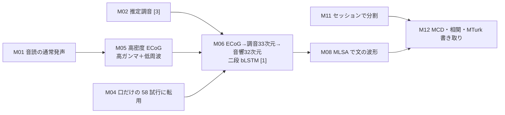

# Speech synthesis from neural decoding of spoken sentences（Anumanchipalli, Chartier, Chang, Nature 568:493–498, 2019）専門査読：構成要素別の全分野比較

対象：Anumanchipalli ら [[1]](#ref-1)。正本は Nature 刊行版（2019-04-24 オンライン、doi:10.1038/s41586-019-1119-1）とする。初出は bioRxiv 版（doi:10.1101/481267、2018-11-29、題は「Intelligible speech synthesis from neural decoding of spoken sentences」、Crossref で確認）で、同時期と後続の区分はこの 2018-11 を基準にした。bioRxiv 版は wiki になく、読んでいない。wiki に刊行版の組版本文もないため、本文は同じ論文の著者稿（PMC9714519、NIHMS1525169）の XML（SHA-256 `daae058d…5c8b7f`）で読み、方法・拡張データの説明文・表1 まで通読した。図の画像と補足資料は wiki になく、図は説明文だけを読んだ。wiki コミット `730b0b4`。
wiki の台帳（仕様 v2.1.0）の 13 構成要素（M01〜M13）ごとに、信号を問わず同じ要素を扱った論文と比べた。走査は 8,995 台帳フォルダ（版の重複を除くと 7,388 本）。件数は「枠記録」「文字列一致」（目安、上限）「確認済み」（読んで採った研究数）を区別し、数値の出所は「本文確認」「図読み」「台帳のみ」「査読者の計算」で示す。
**状態**：2026-11-14 改訂。採否と判定は原典の本文を読んで決め、独立評価の指摘は原典と Crossref で照合して反映した。「他に見つからない」は wiki 内の検索の範囲の話で、話題ごとの既知項目の再現率と再現率の目安は付録A に示す（M06 0.74、M08 0.15、M04 0.35、M12 0.30）。刊行版・bioRxiv 版と著者稿の文面の差は照合していない。

---

## 要点

変えたのは **M06 処理・復号**（ECoG → 推定した調音 33 次元 → 音響 32 次元の二段 bLSTM）、**M08 出力**（文単位の音声波形）、**M04 利用時の行為**（声に出した文で学習した復号器を、口だけ動かした文に当てる）である。M12（閉じた語群からの聴取書き取り）は付随して論じる。
5 人の MCD 中央値は 5.14〜6.58 dB、二段は直接法より 0.54 dB 良い（P1、全データ。0.2 dB で知覚できる差とされる。いずれも本文確認）。P1 の 101 文の書き取り WER 中央値は 25 語群で 31%、50 語群で 53% である（本文確認）。
最も強い交絡は比較の組み方にある。二段の中間目標には音素ラベルから作った調音位置・様式 18 次元が入り、直接法にはこの学習時の教師がない。層の数（3+3 層と 4 層）と学習率も違う。ただし著者は直接法を二段と同じ 6 層（MFCC を中間層に置く形）でも学習し、4 層のほうが良かったので 4 層を使ったと書いている（方法、本文確認）。比較は P1 一人で、学習の繰り返し回数と乱数種は書かれていない。0.54 dB を「調音を経ること」だけに帰すのは推測にとどまる。著者自身も「十分なデータがあれば二つは収束しうる」と書いている。後続の Le Godais ら [[2]](#ref-2)（後続）は線形法で「直接法と間接法は同等の性能で、直接法がやや有利」と報告した。
神経信号 → 調音 → 音響の二段は、wiki 内の検索では対象より前に見つからなかった（再現率の目安 0.74、既知項目 4/4、別の語での全文検索でも追加なし）。
口だけの発話の MCD は図にしか値がなく、口だけの状態空間の相関の n が本文 38、図 4e 説明 58 と食い違う。聴取試験は閉じた語群で、偶然水準の WER は示されていない。

## 何をしたか

てんかん外科で高密度 ECoG を留置した 5 人（右半球 1、左半球 4）が、MOCHA-TIMIT の文などを声に出して読んだ（方法、本文確認）。
ECoG は 3,052 Hz で記録し、高ガンマ（70〜200 Hz、ヒルベルト振幅）と低周波（1〜30 Hz）を 200 Hz に落として 30 秒窓で標準化した。
第 1 段の 3 層 bLSTM が 300 ms の入力から 33 次元の調音特徴を出す。33 次元は、話者非依存の音響→調音逆推定 [[3]](#ref-3) による EMA 型 12 次元、ピッチ・有声・包絡、WSJ で学習した回帰器による調音位置・様式 18 次元からなる。第 2 段の 3 層 bLSTM が音響 32 次元（MFCC 25、帯域別有声度 5、logF0、有声）を出し、Festvox の MLSA 混合励振で波形にする。第 2 段は第 1 段の出力で学習する。
訓練とテストは録音セッションで分けた。聴取試験は Amazon Mechanical Turk で、P1 の 101 文を使った。

| 対象論文の主要数値 | 値 | 出所 |
|---|---|---|
| 訓練／テストの発話時間（P1〜P5） | 92:15／4:46（101 文）、36:57／3:50（100）、107:42／4:44（98）、27:39／3:12（82）、44:31／2:51（44）。図 2c・2d・4e の説明ではテスト文数が 101・100・93・81・44 | 方法、図説明（本文確認） |
| MCD 中央値（5 人） | 5.14〜6.58 dB、偶然水準より良い（p<1e-18） | 本文（本文確認） |
| 直接法との差（P1、全データ） | 0.54 dB（p=1e-17、n=101） | 本文（本文確認） |
| 少ないデータ | 25 分の発話で頑健な性能 | 本文（本文確認） |
| 韻律の相関 | r>0.6（P2 の F0 は 0.49、P5 は全特徴で下回る） | 本文（本文確認） |
| 領域を一つ除く解析（P1） | どの領域を除いても悪化（p=3e-4、n=101）、vSMC を除くと最大の 1.13 dB | 本文（本文確認） |
| 口だけの発話 | 58 試行で偶然水準より良い（p<1e-11）、声に出した場合より劣る | 本文（本文確認）、値は図のみ |
| 書き取りで 1 人以上が完全正解 | 82/101 文（25 語群）、60/101 文（50 語群） | 本文（本文確認） |
| 全回答のうち完全正解 | 43%（25 語群）、21%（50 語群） | 本文（本文確認） |
| 書き取り WER 中央値 | 31%（25 語群）、53%（50 語群） | 本文（本文確認） |
| 聴取者 | 16 課題で計 1,755 人、1 試行 10〜20 人 | 方法（本文確認） |

本文に書かれていないこと：直接法の MCD の絶対値（差だけが本文にある）、書き取りの偶然水準、口だけの課題の文数の正しい値、学習の繰り返し回数と乱数種、P2〜P5 の聴取試験。

## それまでの到達点

**M06（調音を中間段に置く復号）**：同じ研究室の Chartier ら [[3]](#ref-3)（同時期、2018-05 オンライン）が、腹側感覚運動野（vSMC）が推定した調音運動を符号化することを示し、その逆推定を対象が中間目標に使った。調音から音声を作る側では、Bocquelet ら [[4]](#ref-4) が EMA 由来の調音を入力に DNN と MLSA で実時間合成し、脳コンピュータインタフェースへの応用を想定していた。ただし入力は神経信号ではない。
神経信号から調音を経て音響を出す二段は、wiki 内の検索では対象より前に見つからなかった（付録A、再現率の目安 0.74、既知項目 4/4）。Saha ら [[5]](#ref-5)（同時期、arXiv 2019-04）は EEG から音韻範疇を中間段にして分類しており、音声合成ではない。

**M08（神経信号から音声を合成する）**：先行は 2 件である。Guenther ら [[6]](#ref-6) は閉じ込め状態の 1 人で、皮質内電極から母音のフォルマントを実時間で復号して音にした。Martin ら [[7]](#ref-7) は発声中の ECoG から聴覚スペクトログラムを線形モデルで復号したが、波形の合成と聴取試験はない。同時期には Angrick ら [[8]](#ref-8)（同時期、bioRxiv 2018-11-27、対象の bioRxiv 版の 2 日前）が ECoG から対数メルスペクトログラムを 3D 畳み込みで復号し WaveNet で波形にした。
対象が足したのは、文単位の波形を作り、それを聴取者に書き取らせた点である。

**M04（声に出した学習を声なしに当てる）**：先行は 6 件ある。Martin ら [[7]](#ref-7) は ECoG で、発声で学習した線形モデルを声に出さない発話に当て、発声音声に DTW で合わせて安静時と比べた。評価の組み方は対象の口だけの評価と同じだが、Martin らの covert は「声に出さずに読む」課題で、口を動かす対象の課題とは行為が違う。EMG では Janke ら [[9]](#ref-9)、Wand ら [[10]](#ref-10)、Janke [[11]](#ref-11) が可聴で学習したモデルを無声 EMG に当てた。Janke の学位論文では EMG→音声の MCD が 5.54 から 6.81 dB に悪化した（本文確認、差 1.27 dB・相対 +23% は査読者の計算）。ただし原著は、可聴の参照が同時収録でないので MCD の妥当性は限られると注記している（6.3 節）。超音波と唇の Florescu ら [[12]](#ref-12)、映像の Petridis ら [[13]](#ref-13) も発声と無声を学習と試験で入れ替えている。

**M12（合成音声の聴取による明瞭度）**：先行は 9 件ある。映像からの再構成では Ephrat ら [[14]](#ref-14) が MTurk で書き取りを、Cornu と Milner [[15]](#ref-15) が語正答率を測った。調音センサでは Hueber と Bailly [[16]](#ref-16)、Gonzalez ら [[17]](#ref-17)（明瞭度最大 92%、本文確認）、Bocquelet ら [[4]](#ref-4)（聴取者 12 人、本文確認）がある。同じ研究室の Bouchard ら [[18]](#ref-18) は声道画像から合成した音声を MTurk で同定させていた。同時期に Akbari ら [[19]](#ref-19)（同時期、bioRxiv 2018-06）が聴取中の聴覚皮質から再構成した数字を 11 人に同定させている（本文確認）。

**継いだ部品**：M01・M05・M11・M13 は Chang 研究室の ECoG 研究の系譜（音読課題、高ガンマ、臨床の留置）、M02 は Chartier ら [[3]](#ref-3) の逆推定、M03 は参加者ごとの学習と早期終了である。

## 何が変わったか

**M06**：二段の利点として著者は、皮質が調音運動をよく表すこと、調音運動が低次元に乗ることを挙げる（考察、本文確認）。状態空間の解析では第 1〜10 主成分で分散の 85%、第 1〜2 主成分で 35% を説明した。参加者間の状態空間の相関は r>0.8（P1・P2・P4）である（本文確認）。
ただし、二段の第 1 段の目標は全員に同じ話者非依存の逆推定から作っている。参加者間でよく似ることの一部はこの共通の写像から来る可能性がある（推測）。直接法との差 0.54 dB は P1 一人・全データでの値で、学習の繰り返し回数は書かれていない。図 1f と図 3 の説明にある「5 回繰り返して同様の結果」が何の繰り返しかは本文から分からない。データを減らした曲線（8 段階、1 区画は約 50 文）も P1 である。

**M08**：MLSA の混合励振で文単位の波形を出し、MCD・スペクトル相関・聴取の三つで評価した。著者は MCD が話者の声質に敏感だと注記している（第 2 段を P1 から P2 へ移すと悪化）。
後続では、Herff ら [[20]](#ref-20)（後続）が単位選択、Chen ら [[21]](#ref-21)（後続）が微分可能な合成器を使い、Wairagkar ら [[22]](#ref-22)（後続）は ALS の 1 人で即時の合成に進んだ。

**M04**：P1 は 10 文を 12 回ずつ、声に出す試行と口だけの試行を交互に読んだ（方法）。口だけの各試行は、直前に声に出した同じ文に DTW で合わせて評価した。本文の「58 sentences」は、口だけの約 60 試行から 2 試行を除いた試行数と読める（推測、除いた理由の記載はない）。結果は「偶然水準より良いが声に出した場合に劣る」で、著者は発声の信号がないためと推測している（本文確認）。
先行の Martin ら [[7]](#ref-7) と比べると、文単位の波形を出した点が新しく、転用という組み方は同じである。EMG の Janke [[11]](#ref-11) の悪化幅（+23%、査読者の計算）と比べる数値は対象の本文になく、比べられない。後続では Gaddy と Klein [[23]](#ref-23)（後続）が EMG で、Komeiji ら [[24]](#ref-24)（後続）が ECoG で同じ転用を基準条件に置いた。

**M12（付随）**：書き取りは、正解語と無作為なテスト文の語からなる 25 語・50 語の語群から選ぶ閉じた課題である。著者は閉じた語群が必要だった理由を本文で述べている。語群の大きさで WER が 31% から 53% に上がること（本文確認）は、語群が結果を大きく左右することを示す。偶然水準が示されていないので、31% がどれだけ偶然から離れているかは読めない。

## 分野での位置づけ

| 枠 | 対象論文の選択 | 分野の通例（件数と層） | 判定 |
|---|---|---|---|
| M01 学習時の行為 | 音読の通常発声 | 枠記録 3,882／7,388 | standard |
| M02 学習専用の教師 | 推定調音（話者非依存の逆推定） | 枠記録が疎（31）、通例の数は出さない | standard |
| M03 学習・適応 | 参加者ごとの学習、早期終了 | 枠記録 1,526 | standard |
| M04 利用時の行為 | 声に出した学習を口だけの 58 試行（10 文の反復）に転用 | 確認済み 23（先行 6、後続 16） | standard |
| M05 計測 | 高密度 ECoG、高ガンマ＋低周波 | 枠記録 7,329 | standard |
| M06 処理・復号 | 神経→調音→音響の二段 bLSTM | 確認済み 4（先行 0、同時期 1、後続 2） | standard |
| M07 利用時の補助 | なし | 枠記録が疎（119）、通例の数は出さない | standard |
| M08 出力 | 文単位の音声波形（MLSA） | 確認済み 15（先行 2、同時期 1、後続 11） | standard |
| M09 確認 | なし（オフライン） | 枠記録 82 | not_applicable |
| M10 訂正 | なし（オフライン） | 枠記録 82 | not_applicable |
| M11 評価用の正解 | 録音セッションで分割 | 枠記録が疎（234）、通例の数は出さない | standard |
| M12 評価 | MCD、相関、MTurk の閉じた書き取り | 確認済み 29（先行 9、同時期 3、後続 16） | standard |
| M13 装置・運用 | 臨床の ECoG、コードとデータは要請により提供 | 枠記録 6,075 | standard |

M06 は先行例がないが、効果は 1 人の参加者で示され繰り返しの記載がなく、後続で直接法がやや有利という報告もあるので、`ahead` の条件（繰り返しで示された効果）を満たさない。

## 主張の範囲

「調音の中間段が性能を上げる」は、P1 での 0.54 dB と少ないデータでの差に支えられる。ただし中間段には音素ラベル由来の教師が入り、学習率も異なる。層の数は、著者が 6 層の直接法も試して良かった 4 層を選んでおり、直接法に不利な選び方ではない。調音そのものの効果か、追加の教師の効果かは本文の比較では分けられない。
「復号した調音表現は話者間でよく保たれる」は 3 人の状態空間の相関に基づく。共通の逆推定を目標にしたことと切り離した検証はない。
「聴取者が容易に書き取れる」は、語群から選ぶ閉じた課題での結果である。開いた語彙での明瞭度は示していない。

## 実用上の意味

声を失った人の発話補助として、文単位の波形を神経信号から作れることを示した。対象者は発話に障害のない人で、声に出した発話を学習に使っている。声の出ない利用者では、口だけの転用がどこまで効くかが鍵になるが、その値は図にしかない。
後続の研究は、声を出そうと試みる発話で学習する方向（Wairagkar ら [[22]](#ref-22)）に進み、筋電でも調音を中間段に置く試み（Lee ら [[25]](#ref-25)、後続）が続いた。

## 前進、未解決、後退した軸

- 前進：神経信号から文単位の音声波形、調音を経る二段の提案、大規模な聴取試験、口だけの発話への転用。
- 未解決：中間段の効果と追加の教師の切り分け、P1 以外での比較、開いた語彙での明瞭度、繰り返しによるばらつき。
- 後退：なし。

## 限界

- 著者自身の注記：十分なデータがあれば直接法と二段は収束しうる。口だけの発話は声に出した場合より劣り、発声の信号がないためと考えられる。MCD は話者の声質に敏感である。臨床では EMA を測れないので調音は推定した。
- 本文内の不一致：口だけの状態空間の相関で n が本文 38、図 4e 説明 58（p 値は同じ）。テスト文数が方法では P3 98・P4 82、図説明では 93・81。直接法との差の参照が「図 3a」だが図 3 は口だけの発話で、図 2e と読める。図 1 説明は「5 分割交差検証」、方法はセッションでの単一分割。文の長さの標準偏差「21.」は 4〜13 語の範囲ではありえない。共表現相関の「p=1e10」も 1e-10 の誤記と読める（推測）。標準偏差は 2.1 の誤記と読める（推測）。
- 版の差：wiki にあるのは著者稿だけで、刊行版の数値と照合していない。
- 台帳の読み方：刊行版側の台帳は語彙を open_vocabulary（原値「several hundred sentences」）と記録し、著者稿側の台帳にはこの記録がない。これは復号器が扱う発話の語彙を指すもので、聴取試験の条件として読んではいけない。書き取りは閉じた語群である。

## 残る問い

- 直接法の MCD の絶対値はいくつか。直接法に同じ音素由来の 18 次元を補助目標として与えたら差は残るか。
- 25 語・50 語の語群から無作為に選んだときの WER はいくつか。
- 口だけの 58 は異なる 10 文の反復試行か。除いた試行の理由は何か。MCD はいくつか。声に出した同じ文との差は何 dB か。
- P3・P4 のテスト文数は方法の 98・82 と図説明の 93・81 のどちらか。
- P2〜P5 でも二段は直接法より良いか。学習を繰り返したときのばらつきはどれくらいか。図の説明の「5 回繰り返して同様」は何を繰り返したのか。
- 参加者間の相関は、共通の逆推定を使わない目標でも保たれるか。
- 早期終了に使った検証データはどう取ったか（方法は「検証損失が下がらなくなったら止めた」とだけ書く）。

## 付録A　検討した論文

走査：wiki の全 8,995 台帳フォルダ（版の重複を除くと 7,388 本）を、枠の記入状態と台帳文字列への正規表現で数え、全文への正規表現で台帳が拾わない候補を探した。確認済みは原典を読んで採った研究数（版の重複は 1 件、対象論文を含む）。

| 話題 | 枠記録 | 文字列一致 | 確認済み | 読んだ候補／未読 | 既知項目の再現率 | 再現率の目安 |
|---|---:|---:|---:|---|---|---|
| M06 調音を中間段に置く復号 | 7,345 | 12 | 4 | 44／0 | 4/4 | 0.74 |
| M08 神経信号からの音声合成 | 3,268 | 35 | 15 | 140／361 | 8/8 | 0.15 |
| M04 声に出した学習の無声への転用 | 5,595 | 33 | 23 | 104／0 | 6/6 | 0.35 |
| M12 合成音声の聴取による明瞭度 | 6,960 | 37 | 29 | 106／0 | 6/6 | 0.30 |

M06 の確認済み：対象、Saha ら [[5]](#ref-5)（同時期、arXiv 2019-04、分類の境界例）、Le Godais ら [[2]](#ref-2)（後続）、Lee ら [[25]](#ref-25)（後続、EMG）。別の語（formant、kinematic、articulator trajectory など）で 2019 年以前の全文を探しても、対象の引用と 2010 年の総説（発火率からのフォルマント・調音軌跡の復号を構想として述べる）しか出なかった。独立評価の別検索で、Bocquelet ら [[26]](#ref-26) の設計論（先行、2017）が、調音特徴を復号して調音合成器で音にする段を脳コンピュータインタフェースの構成として論じていることが分かった（本文確認）。神経信号からの復号結果はなく、監査の候補にも入っていなかったので、再現率の目安 0.74 は実装例についての値として読む。Bocquelet ら [[4]](#ref-4) は入力が神経信号でないので規則で除いた。

M08 の確認済み：先行 Guenther ら [[6]](#ref-6)、Martin ら [[7]](#ref-7)。同時期 Angrick ら [[8]](#ref-8)。後続 11（Herff ら [[20]](#ref-20)、Chen ら [[21]](#ref-21)、Wairagkar ら [[22]](#ref-22)、sEEG 2 件、硬膜外 ECoG、MiSTR、Brain2Speech-Net、韻律、EEG からの再構成）。未読 361 本はすべて 2020 年以降か年不明で、2019 年以前の候補は全部読んだ。Akbari ら [[19]](#ref-19) は聴取中の知覚の復号なので M08 では除いた。Herff らの 2016 年の予備報告は wiki になく、引用でしか確認できない。再現率の目安が 0.15 と低いので、後続の件数は下限である。

M04 の確認済み：先行 6（Martin ら、Florescu ら、Janke ら 2010、Wand ら、Janke 2016、Petridis ら）。後続 16（Gaddy と Klein、Komeiji ら、Wairagkar ら、超音波の Beeson ら、EEG・sEEG・皮質内の転用など）。

M12 の確認済み：先行 9（Ephrat ら、Lip2AudSpec、Hueber と Bailly、Cornu と Milner 2015 と 2017、Gonzalez ら 2017、Bocquelet ら 2014 と 2016、Bouchard ら）。同時期 3（Taguchi ら 2018-09、Gonzalez と Green 2018〔喉頭摘出後の実時間系、21 人の評定、Crossref で DOI 登録 2018-09・冊子 2018-10〕、Akbari ら〔bioRxiv 2018-06〕）。後続 16（Uttam ら 2019-09 を含む）。

## 付録B　数値の出所

- 本文確認：参加者 5 人と半球、3,052 Hz、帯域、200 Hz、30 秒標準化、33 次元と 32 次元の内訳、層数・隠れ 100・Adam 0.001・ドロップアウト 50%／25%、直接法 4 層・学習率 0.005、訓練／テストの発話時間、MCD 5.14〜6.58 dB、0.54 dB、0.2 dB、25 分、データ量 8 段階、r>0.6 と 0.49、vSMC 1.13 dB、新規文と反復文の差なし（p=0.36、0.75、n=51）、口だけ 58 試行と p<1e-11、図説明のテスト文数 101・100・93・81・44、直接法 6 層版の記述（図説明では声 p=3e-11、口だけ p=5e-11）、主成分 85% と 35%、状態空間 r>0.72 と r=0.6（n=38）、参加者間 r>0.8、82/101 と 60/101、43% と 21%、WER 31% と 53%、325 語（音節別 75・158・68・24）、10・25・50 択、1,755 人・16 課題・10〜20 人、評価 98% 超、文の長さの中央値 7 語。先行研究の Janke 2016 の MCD 5.54 と 6.81 dB、Gonzalez ら 2017 の明瞭度最大 92%、Bocquelet ら 2016 の聴取者 12 人、Akbari ら 2019 の聴取者 11 人、Gonzalez と Green 2018 の評定者 21 人。
- 図読み：なし（図の画像は wiki にない）。
- 台帳のみ：M12 の open_vocabulary の記録（復号器の語彙を指すものとして言及）。
- 照合できなかったもの：単語同定の正答率、口だけの発話の MCD と相関、直接法の MCD の絶対値、P1 以外の比較（いずれも図にしかないか記載なし）。刊行版と bioRxiv 版での数値。
- 書誌の日付（Crossref・arXiv で確認）：対象の bioRxiv 版 2018-11-29、Angrick ら bioRxiv 2018-11-27、Akbari ら bioRxiv 2018-06-19、Chartier ら 2018-05-17 オンライン、Gonzalez と Green DOI 登録 2018-09-14・冊子 2018-10、Saha ら arXiv 2019-04-08、Herff ら 2019-11-22。
- 査読者の計算：Janke 2016 の悪化 1.27 dB・相対 +23%（(6.81−5.54)/5.54）。

## 参考文献

番号は本文での初出順。BibTeX は同じ番号順・同じキーで [speech-synthesis-from-neural-decoding-of-spoken-sentences.bib](speech-synthesis-from-neural-decoding-of-spoken-sentences.bib) にある。

1. Anumanchipalli, G. K., Chartier, J., Chang, E. F. “Speech synthesis from neural decoding of spoken sentences.” *Nature*, 2019, 568(7753), 493–498. doi:[10.1038/s41586-019-1119-1](https://doi.org/10.1038/s41586-019-1119-1). 本査読の対象論文。固定版は Nature 刊行版。本文は wiki の二つのフォルダにある同一の著者稿（NIHMS1525169、PMC9714519）で読んだ。 初出は bioRxiv 版 doi:10.1101/481267（2018-11-29、題「Intelligible speech synthesis from neural decoding of spoken sentences」、Crossref で確認、wiki になし）。wiki の本文は著者稿 PMC9714519。 [レビュー](https://github.com/supernaiter/silent-speech-review/tree/main/reviews/speech-synthesis-from-neural-decoding-of-spoken-sentences) [wiki: doi-10.1038-s41586-019-1119-1](https://github.com/supernaiter/deep-research-wiki-for-silent-speech/blob/main/papers/doi-10.1038-s41586-019-1119-1/article.md) [wiki: pmc-9714519-speechsynth](https://github.com/supernaiter/deep-research-wiki-for-silent-speech/blob/main/papers/pmc-9714519-speechsynth/article.md)
2. Le Godais, G., Roussel, P., Bocquelet, F., Aubert, M., Kahane, P., Chabardès, S., et al. “Overt speech decoding from cortical activity: a comparison of different linear methods.” *Frontiers in Human Neuroscience*, 2023, 17, 1124065. doi:[10.3389/fnhum.2023.1124065](https://doi.org/10.3389/fnhum.2023.1124065). ［後続］ [wiki: doi-10.3389-fnhum.2023.1124065](https://github.com/supernaiter/deep-research-wiki-for-silent-speech/blob/main/papers/doi-10.3389-fnhum.2023.1124065/article.md) [wiki: pmc-10326283-overtdec](https://github.com/supernaiter/deep-research-wiki-for-silent-speech/blob/main/papers/pmc-10326283-overtdec/article.md) [wiki: pmc-10326283-lineardecode](https://github.com/supernaiter/deep-research-wiki-for-silent-speech/blob/main/papers/pmc-10326283-lineardecode/article.md)
3. Chartier, J., Anumanchipalli, G. K., Johnson, K., Chang, E. F. “Encoding of Articulatory Kinematic Trajectories in Human Speech Sensorimotor Cortex.” *Neuron*, 2018, 98(5), 1042–1054. doi:[10.1016/j.neuron.2018.04.031](https://doi.org/10.1016/j.neuron.2018.04.031). Crossref でオンライン登録 2018-05-17。 ［同時期］ [wiki: pmc-5992088-articulkin](https://github.com/supernaiter/deep-research-wiki-for-silent-speech/blob/main/papers/pmc-5992088-articulkin/article.md)
4. Bocquelet, F., Hueber, T., Girin, L., Savariaux, C., Yvert, B. “Real-Time Control of an Articulatory-Based Speech Synthesizer for Brain Computer Interfaces.” *PLoS Computational Biology*, 2016, 12(11), e1005119. doi:[10.1371/journal.pcbi.1005119](https://doi.org/10.1371/journal.pcbi.1005119). [wiki: doi-10.1371-journal.pcbi.1005119](https://github.com/supernaiter/deep-research-wiki-for-silent-speech/blob/main/papers/doi-10.1371-journal.pcbi.1005119/article.md)
5. Saha, P., Abdul-Mageed, M., Fels, S. “SPEAK YOUR MIND! Towards Imagined Speech Recognition With Hierarchical Deep Learning.” *Proc. Interspeech 2019*, 2019. arXiv:[1904.05746](https://arxiv.org/abs/1904.05746). arXiv 版 2019-04-08（arXiv API で確認）。 ［同時期］ [wiki: isca-saha19_interspeech](https://github.com/supernaiter/deep-research-wiki-for-silent-speech/blob/main/papers/isca-saha19_interspeech/article.md)
6. Guenther, F. H., Brumberg, J. S., Wright, E. J., Nieto-Castanon, A., Tourville, J. A., Panko, M., et al. “A Wireless Brain-Machine Interface for Real-Time Speech Synthesis.” *PLoS ONE*, 2009, 4(12), e8218. doi:[10.1371/journal.pone.0008218](https://doi.org/10.1371/journal.pone.0008218). [wiki: pmc-2784218-wireless](https://github.com/supernaiter/deep-research-wiki-for-silent-speech/blob/main/papers/pmc-2784218-wireless/article.md) [wiki: pmc-2784218-wirelesssynth](https://github.com/supernaiter/deep-research-wiki-for-silent-speech/blob/main/papers/pmc-2784218-wirelesssynth/article.md) [wiki: doi-10.1371-journal.pone.0008218](https://github.com/supernaiter/deep-research-wiki-for-silent-speech/blob/main/papers/doi-10.1371-journal.pone.0008218/article.md)
7. Martin, S., Brunner, P., Holdgraf, C., Heinze, H., Crone, N. E., Rieger, J., et al. “Decoding spectrotemporal features of overt and covert speech from the human cortex.” *Frontiers in Neuroengineering*, 2014, 7, 14. doi:[10.3389/fneng.2014.00014](https://doi.org/10.3389/fneng.2014.00014). [wiki: doi-10.3389-fneng.2014.00014](https://github.com/supernaiter/deep-research-wiki-for-silent-speech/blob/main/papers/doi-10.3389-fneng.2014.00014/article.md) [wiki: pmc-4034498-overtcovert](https://github.com/supernaiter/deep-research-wiki-for-silent-speech/blob/main/papers/pmc-4034498-overtcovert/article.md) [wiki: pmc-4034498-spectemp](https://github.com/supernaiter/deep-research-wiki-for-silent-speech/blob/main/papers/pmc-4034498-spectemp/article.md)
8. Angrick, M., Herff, C., Mugler, E., Tate, M. C., Slutzky, M. W., Krusienski, D. J., et al. “Speech Synthesis from ECoG using Densely Connected 3D Convolutional Neural Networks.” *Journal of Neural Engineering*, 2019, 16(3), 036019. doi:[10.1088/1741-2552/ab0c59](https://doi.org/10.1088/1741-2552/ab0c59). 初出は bioRxiv 478644（2018-11）。 ［同時期］ [wiki: doi-10.1101-478644](https://github.com/supernaiter/deep-research-wiki-for-silent-speech/blob/main/papers/doi-10.1101-478644/article.md) [wiki: pmc-6822609-3dcnn](https://github.com/supernaiter/deep-research-wiki-for-silent-speech/blob/main/papers/pmc-6822609-3dcnn/article.md) [wiki: doi-10.1088-1741-2552-ab0c59](https://github.com/supernaiter/deep-research-wiki-for-silent-speech/blob/main/papers/doi-10.1088-1741-2552-ab0c59/article.md)
9. Janke, M., Wand, M., Schultz, T. “A Spectral Mapping Method for EMG-based Recognition of Silent Speech.” *Proc. BIOSIGNALS 2010*, 2010. doi:[10.5220/0002814100220031](https://doi.org/10.5220/0002814100220031). [wiki: doi-10.5220-0002814100220031](https://github.com/supernaiter/deep-research-wiki-for-silent-speech/blob/main/papers/doi-10.5220-0002814100220031/article.md)
10. Wand, M., Schultz, T. “Session-Independent EMG-Based Speech Recognition.” *Proc. BIOSIGNALS 2011*, 2011. doi:[10.5220/0003169702950300](https://doi.org/10.5220/0003169702950300). [wiki: doi-10.5220-0003169702950300](https://github.com/supernaiter/deep-research-wiki-for-silent-speech/blob/main/papers/doi-10.5220-0003169702950300/article.md)
11. Janke, M. “EMG-to-Speech: Direct Generation of Speech from Facial Electromyographic Signals.” *Karlsruher Institut für Technologie (KIT), Dissertation*, 2016. <https://publikationen.bibliothek.kit.edu/1000054490> wiki のフォルダ名は同名の雑誌論文（Janke と Diener、IEEE/ACM TASLP 2017、DOI 10.1109/TASLP.2017.2738568）だが、本文は KIT の学位論文（口頭試問 2016-04-22）。 [wiki: doi-10.1109-taslp-2017-2738568](https://github.com/supernaiter/deep-research-wiki-for-silent-speech/blob/main/papers/doi-10.1109-taslp-2017-2738568/article.md)
12. Florescu, V., Crevier-Buchman, L., Denby, B., Hueber, T., Colazo-Simon, A., Pillot-Loiseau, C., et al. “Silent vs Vocalized Articulation for a Portable Ultrasound-Based Silent Speech Interface.” *Proc. Interspeech 2010*, 2010. <https://www.isca-archive.org/interspeech_2010/florescu10_interspeech.html> [wiki: isca-florescu10_interspeech](https://github.com/supernaiter/deep-research-wiki-for-silent-speech/blob/main/papers/isca-florescu10_interspeech/article.md) [wiki: isca-florescu10-silentvocal](https://github.com/supernaiter/deep-research-wiki-for-silent-speech/blob/main/papers/isca-florescu10-silentvocal/article.md) [wiki: isca-florescu10](https://github.com/supernaiter/deep-research-wiki-for-silent-speech/blob/main/papers/isca-florescu10/article.md)
13. Petridis, S., Shen, J., Cetin, D., Pantic, M. “Visual-Only Recognition of Normal, Whispered and Silent Speech.” *Proc. IEEE ICASSP 2018*, 2018. doi:[10.1109/ICASSP.2018.8461596](https://doi.org/10.1109/ICASSP.2018.8461596). arXiv:[1802.06399](https://arxiv.org/abs/1802.06399). [レビュー](https://github.com/supernaiter/silent-speech-review/tree/main/reviews/visual-only-recognition-of-normal-whispered-and-silent-speech) [wiki: doi-10.1109-icassp.2018.8461596](https://github.com/supernaiter/deep-research-wiki-for-silent-speech/blob/main/papers/doi-10.1109-icassp.2018.8461596/article.md) [wiki: arxiv-1802.06399](https://github.com/supernaiter/deep-research-wiki-for-silent-speech/blob/main/papers/arxiv-1802.06399/article.md)
14. Ephrat, A., Peleg, S. “Vid2speech: Speech Reconstruction from Silent Video.” *arXiv preprint*, 2017. arXiv:[1701.00495](https://arxiv.org/abs/1701.00495). [レビュー](https://github.com/supernaiter/silent-speech-review/tree/main/reviews/vid2speech-speech-reconstruction-from-silent-video) [wiki: arxiv-1701.00495](https://github.com/supernaiter/deep-research-wiki-for-silent-speech/blob/main/papers/arxiv-1701.00495/article.md)
15. Le Cornu, T., Milner, B. “Reconstructing intelligible audio speech from visual speech features.” *Proc. Interspeech 2015*, 2015. doi:[10.21437/Interspeech.2015-139](https://doi.org/10.21437/Interspeech.2015-139). [wiki: isca-cornu15_interspeech](https://github.com/supernaiter/deep-research-wiki-for-silent-speech/blob/main/papers/isca-cornu15_interspeech/article.md) [wiki: isca-cornu15-v2speech](https://github.com/supernaiter/deep-research-wiki-for-silent-speech/blob/main/papers/isca-cornu15-v2speech/article.md) [wiki: doi-10.21437-interspeech.2015-139](https://github.com/supernaiter/deep-research-wiki-for-silent-speech/blob/main/papers/doi-10.21437-interspeech.2015-139/article.md)
16. Hueber, T., Bailly, G. “Statistical Conversion of Silent Articulation into Audible Speech using Full-Covariance HMM.” *Computer Speech & Language*, 2016. doi:[10.1016/j.csl.2015.09.008](https://doi.org/10.1016/j.csl.2015.09.008). [wiki: doi-10.1016-j.csl.2015.09.008](https://github.com/supernaiter/deep-research-wiki-for-silent-speech/blob/main/papers/doi-10.1016-j.csl.2015.09.008/article.md)
17. Gonzalez, J. A., Cheah, L. A., Gomez, A. M., others “Direct Speech Reconstruction From Articulatory Sensor Data by Machine Learning.” *IEEE/ACM Transactions on Audio, Speech, and Language Processing*, 2017, 25(12), 2362–2374. doi:[10.1109/TASLP.2017.2757263](https://doi.org/10.1109/TASLP.2017.2757263). [wiki: doi-10.1109-taslp-2017-2757263](https://github.com/supernaiter/deep-research-wiki-for-silent-speech/blob/main/papers/doi-10.1109-taslp-2017-2757263/article.md)
18. Bouchard, K. E., Conant, D. F., Anumanchipalli, G. K., Dichter, B., Chaisanguanthum, K. S., Johnson, K., et al. “High-Resolution, Non-Invasive Imaging of Upper Vocal Tract Articulators Compatible with Human Brain Recordings.” *PLoS ONE*, 2016. doi:[10.1371/journal.pone.0151327](https://doi.org/10.1371/journal.pone.0151327). [wiki: pmc-4809489-vocal](https://github.com/supernaiter/deep-research-wiki-for-silent-speech/blob/main/papers/pmc-4809489-vocal/article.md)
19. Akbari, H., Khalighinejad, B., Herrero, J. L., Mehta, A. D., Mesgarani, N. “Towards reconstructing intelligible speech from the human auditory cortex.” *Scientific Reports*, 2019, 9, 874. doi:[10.1038/s41598-018-37359-z](https://doi.org/10.1038/s41598-018-37359-z). 初出は bioRxiv 版 doi:10.1101/350124（2018-06-19、Crossref で確認、wiki になし）。 ［同時期］ [wiki: doi-10.1038-s41598-018-37359-z](https://github.com/supernaiter/deep-research-wiki-for-silent-speech/blob/main/papers/doi-10.1038-s41598-018-37359-z/article.md) [wiki: pmc-6351601-audrecon](https://github.com/supernaiter/deep-research-wiki-for-silent-speech/blob/main/papers/pmc-6351601-audrecon/article.md) [wiki: pmc-6351601-intelligible](https://github.com/supernaiter/deep-research-wiki-for-silent-speech/blob/main/papers/pmc-6351601-intelligible/article.md)
20. Herff, C., Diener, L., Angrick, M., Mugler, E., Tate, M. C., Goldrick, M. A., et al. “Generating Natural, Intelligible Speech From Brain Activity in Motor, Premotor, and Inferior Frontal Cortices.” *Frontiers in Neuroscience*, 2019, 13, 1267. doi:[10.3389/fnins.2019.01267](https://doi.org/10.3389/fnins.2019.01267). ［後続］ [wiki: doi-10.3389-fnins.2019.01267](https://github.com/supernaiter/deep-research-wiki-for-silent-speech/blob/main/papers/doi-10.3389-fnins.2019.01267/article.md) [wiki: pmc-6882773-b2speech](https://github.com/supernaiter/deep-research-wiki-for-silent-speech/blob/main/papers/pmc-6882773-b2speech/article.md) [wiki: pmc-6882773-braintospeech](https://github.com/supernaiter/deep-research-wiki-for-silent-speech/blob/main/papers/pmc-6882773-braintospeech/article.md)
21. Chen, X., Wang, R., Khalilian-Gourtani, A., Yu, L., Dugan, P., Friedman, D., et al. “A neural speech decoding framework leveraging deep learning and speech synthesis.” *Nature Machine Intelligence*, 2024. doi:[10.1038/s42256-024-00824-8](https://doi.org/10.1038/s42256-024-00824-8). 初出は bioRxiv（2023-09）。 ［後続］ [wiki: doi-10.1038-s42256-024-00824-8](https://github.com/supernaiter/deep-research-wiki-for-silent-speech/blob/main/papers/doi-10.1038-s42256-024-00824-8/article.md) [wiki: pmc-12965882-nsdecode](https://github.com/supernaiter/deep-research-wiki-for-silent-speech/blob/main/papers/pmc-12965882-nsdecode/article.md) [wiki: doi-10.1101-2023.09.16.558028](https://github.com/supernaiter/deep-research-wiki-for-silent-speech/blob/main/papers/doi-10.1101-2023.09.16.558028/article.md)
22. Wairagkar, M., Card, N. S., Singer-Clark, T., Hou, X., Iacobacci, C., Miller, L. M., et al. “An instantaneous voice-synthesis neuroprosthesis.” *Nature*, 2025. doi:[10.1038/s41586-025-09127-3](https://doi.org/10.1038/s41586-025-09127-3). 初出は bioRxiv（2024-08）。 ［後続］ [レビュー](https://github.com/supernaiter/silent-speech-review/tree/main/reviews/an-instantaneous-voice-synthesis-neuroprosthesis) [wiki: doi-10.1038-s41586-025-09127-3](https://github.com/supernaiter/deep-research-wiki-for-silent-speech/blob/main/papers/doi-10.1038-s41586-025-09127-3/article.md) [wiki: doi-10.1101-2024.08.14.607690](https://github.com/supernaiter/deep-research-wiki-for-silent-speech/blob/main/papers/doi-10.1101-2024.08.14.607690/article.md) [wiki: pmc-12369848-voicesynth](https://github.com/supernaiter/deep-research-wiki-for-silent-speech/blob/main/papers/pmc-12369848-voicesynth/article.md) [wiki: pmc-12369848-voice-synth-np](https://github.com/supernaiter/deep-research-wiki-for-silent-speech/blob/main/papers/pmc-12369848-voice-synth-np/article.md) [wiki: pmc-11370360-instvoice](https://github.com/supernaiter/deep-research-wiki-for-silent-speech/blob/main/papers/pmc-11370360-instvoice/article.md)
23. Gaddy, D., Klein, D. “Digital Voicing of Silent Speech.” *Proc. EMNLP 2020*, 2020, 5521–5530. doi:[10.18653/v1/2020.emnlp-main.445](https://doi.org/10.18653/v1/2020.emnlp-main.445). arXiv:[2010.02960](https://arxiv.org/abs/2010.02960). ［後続］ [レビュー](https://github.com/supernaiter/silent-speech-review/tree/main/reviews/digital-voicing-of-silent-speech) [wiki: doi-10.18653-v1-2020.emnlp-main.445](https://github.com/supernaiter/deep-research-wiki-for-silent-speech/blob/main/papers/doi-10.18653-v1-2020.emnlp-main.445/article.md) [wiki: arxiv-2010.02960](https://github.com/supernaiter/deep-research-wiki-for-silent-speech/blob/main/papers/arxiv-2010.02960/article.md)
24. Komeiji, S., Mitsuhashi, T., Iimura, Y., Suzuki, H., Sugano, H., Shinoda, K., et al. “Feasibility of decoding covert speech in ECoG with a Transformer trained on overt speech.” *Scientific Reports*, 2024, 14, 11491. doi:[10.1038/s41598-024-62230-9](https://doi.org/10.1038/s41598-024-62230-9). ［後続］ [wiki: doi-10.1038-s41598-024-62230-9](https://github.com/supernaiter/deep-research-wiki-for-silent-speech/blob/main/papers/doi-10.1038-s41598-024-62230-9/article.md) [wiki: pmc-11106343-ecogtransformer](https://github.com/supernaiter/deep-research-wiki-for-silent-speech/blob/main/papers/pmc-11106343-ecogtransformer/article.md) [wiki: doi-10.1101-2024.02.05.578911](https://github.com/supernaiter/deep-research-wiki-for-silent-speech/blob/main/papers/doi-10.1101-2024.02.05.578911/article.md) [wiki: doi-10.21203-rs.3.rs-3927907-v1](https://github.com/supernaiter/deep-research-wiki-for-silent-speech/blob/main/papers/doi-10.21203-rs.3.rs-3927907-v1/article.md)
25. Lee, J., Huang, K., Avramidis, K., Pistrosch, S., Gonzalez-Machorro, M., Lee, Y., et al. “Articulatory Feature Prediction from Surface EMG during Speech Production.” *arXiv preprint*, 2025. arXiv:[2505.13814](https://arxiv.org/abs/2505.13814). ［後続］ [レビュー](https://github.com/supernaiter/silent-speech-review/tree/main/reviews/articulatory-feature-prediction-from-surface-emg-during-speech-production) [wiki: arxiv-2505.13814](https://github.com/supernaiter/deep-research-wiki-for-silent-speech/blob/main/papers/arxiv-2505.13814/article.md)
26. Bocquelet, F., Hueber, T., Girin, L., Chabardès, S., Yvert, B. “Key considerations in designing a speech brain-computer interface.” *Journal of Physiology-Paris*, 2016, 110(4), 392-401. doi:[10.1016/j.jphysparis.2017.07.002](https://doi.org/10.1016/j.jphysparis.2017.07.002). Crossref では冊子 2016-11（巻 110 第 4 号）、DOI 登録 2017-08-07。wiki の本文は HAL 版。 [wiki: doi-10.1016-j.jphysparis.2017.07.002](https://github.com/supernaiter/deep-research-wiki-for-silent-speech/blob/main/papers/doi-10.1016-j.jphysparis.2017.07.002/article.md)
