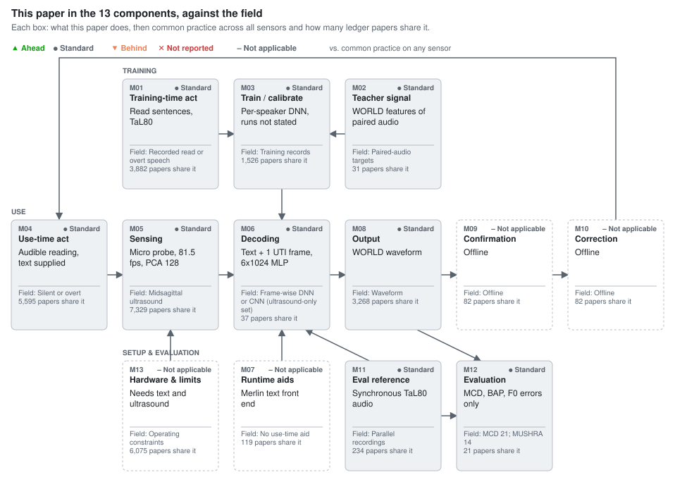

# Speech Synthesis from Text and Ultrasound Tongue Image-based Articulatory Input

Csapó, T. G., Tóth, L., Gosztolya, G., Markó, A. · arXiv preprint · 2021 · [arXiv:2107.02003](https://arxiv.org/abs/2107.02003)

**Section:** [Ultrasound & tongue imaging](../../README.md#ultrasound--tongue-imaging)

## Figures

### This paper in the 13 components, against the field

<picture><source media="(prefers-color-scheme: dark)" srcset="figures/components-dark.svg"></picture>

Verdicts compare the paper's choice for each component with common practice across 8,995 ledger entries on any sensor (silent speech, brain-to-text, lip reading).

Data

| Component | This paper | Common practice | Papers with this practice | Verdict |
| --- | --- | --- | --- | --- |
| M01 Training-time act | Read sentences, TaL80 | Recorded read or overt speech | 3,882 of 8,995 | ● Standard (Inherited (UltraSuite-TaL80).) |
| M02 Teacher signal | WORLD features of paired audio | Paired-audio targets | 31 of 8,995 | ● Standard (Inherited (Merlin recipe).) |
| M03 Train / calibrate | Per-speaker DNN, runs not stated | Training records | 1,526 of 8,995 | ● Standard (Seeds and repetitions not stated.) |
| M04 Use-time act | Audible reading, text supplied | Silent or overt | 5,595 of 8,995 | ● Standard (Inherited; articulation of the scored utterance.) |
| M05 Sensing | Micro probe, 81.5 fps, PCA 128 | Midsagittal ultrasound | 7,329 of 8,995 | ● Standard (Misalignment link only visual.) |
| M06 Decoding | Text + 1 UTI frame, 6x1024 MLP | Frame-wise DNN or CNN (ultrasound-only set) | 37 of 8,995 | ● Standard (Network usual; EMA input prior (Sec. 5).) |
| M07 Runtime aids | Merlin text front end | No use-time aid | 119 of 8,995 | – Not applicable (Synthesis, no decoding.) |
| M08 Output | WORLD waveform | Waveform | 3,268 of 8,995 | ● Standard (Inherited.) |
| M09 Confirmation | Offline | Offline | 82 of 8,995 | – Not applicable (Offline study.) |
| M10 Correction | Offline | Offline | 82 of 8,995 | – Not applicable (Offline study.) |
| M11 Eval reference | Synchronous TaL80 audio | Parallel recordings | 234 of 8,995 | ● Standard (Inherited.) |
| M12 Evaluation | MCD, BAP, F0 errors only | MCD 21; MUSHRA 14 | 21 of 8,995 | ● Standard (No listener test; naturalness claim unsupported.) |
| M13 Hardware & limits | Needs text and ultrasound | Operating constraints | 6,075 of 8,995 | – Not applicable (Authors concede no TTS or SSI use.) |

## Verdict

The paper changes one component: the acoustic model of a Merlin DNN-TTS receives 128 PCA coefficients of the ultrasound tongue image next to the linguistic features (M06) [[1]](#ref-1). The network is the usual frame-wise fully connected regression, and by the paper's own account EMA served earlier as input to articulatory TTS (Sec. 5), so M06 is standard and new only in its sensor. Test MCD falls for all 8 speakers, by 0.015 to 0.229 dB, about 2% on average (Table 1; inference), on roughly 10 test sentences each (inference), runs not reported. Excitation is mixed: test F0 correlation rises for 6 of 8 speakers (Table 4), BAP error rises for 6 of 8 by at most 0.014 (Table 2) and voicing error rises for all 8 (Table 5; inference). The paper reports no listening test, yet concludes the input "may increase the naturalness" (Sec. 5). The ultrasound comes from the very utterance being scored, and the authors state that needing both inputs makes the system unsuitable for direct TTS or a Silent Speech Interface (Sec. 5).

## Against the field, component by component

### M06 Acoustic model: text plus ultrasound input

**Usual approach:** The comparison set is ultrasound-to-speech mapping networks, which covers the paper's ultrasound branch, not the fusion. Of 51 such studies (pattern match, Appendix), 37 name a fully connected DNN, 31 a CNN [[2]](#ref-2), [[3]](#ref-3). The paper keeps that design, six hidden layers of 1,024 units (Sec. 2.3), and adds the ultrasound PCA stream, resampled to 200 Hz, to the text input (Sec. 2.2).

**State of the art:** The Appendix tallies hold no text-plus-ultrasound comparator. For the ultrasound-only task, Tongue2Speech [later] (2026) reaches 15.93% ASR WER on single-speaker TaL1 [[4]](#ref-4); the paper reports no intelligibility to compare.

The paper's EMA predecessors used articulatory data as input, target or internal representation (Sec. 5). Within the ultrasound branch, multi-frame input was established: the group's 2017 DNN took 5 images [[2]](#ref-2), and a 3D CNN cut test MSE by about 21% relative to a 2D CNN [[5]](#ref-5); the paper describes no context window (inference). Text carries most of the result: test MCD is 5.447 to 6.566 dB from text alone, 7.050 to 8.396 dB from ultrasound alone (Table 1). Verdict: standard.

### M05 Sensor: probe position (incidental)

**Usual approach:** Inherited: midsagittal Micro ultrasound at 81.5 fps from UltraSuite-TaL80 (Sec. 2.1), the same system the group used at 81.67 fps [[6]](#ref-6).

**State of the art:** The misalignment measure, MSE between per-utterance mean images, comes from 2020 work that used it to flag recordings corrupted by misalignment or lack of gel [[7]](#ref-7); this paper relates it to synthesis error.

Speakers whose test images differ from training (01fi, 04me, 05ms, 07me) show higher MCD (Fig. 2), an association the authors concede is unquantified (Sec. 4.2). The combined-system gain averages 0.099 dB for these four and 0.152 dB for the other four, which 4 speakers per group cannot decide (inference). Verdict: standard.

### M12 Evaluation: objective errors only (incidental)

**Usual approach:** Of the 51 ultrasound-to-speech studies, 21 report MCD and 14 a MUSHRA test (pattern match, Appendix).

**State of the art:** The Appendix tallies hold no text-plus-ultrasound comparator; for ultrasound-only synthesis, Tongue2Speech [later] (2026) reports 31.64% ASR WER on TaL80 [[4]](#ref-4).

The protocol matches usual MCD practice (standard), but the naturalness conclusion outruns it: the same group ran listening tests on ultrasound-to-speech with 23 listeners in 2017 [[2]](#ref-2), 24 in 2018 [[8]](#ref-8) and 23 in 2019 [[6]](#ref-6), and the published samples (Sec. 3) went unrated.

## The 13 components

| Component | This paper | Usual approach (count) | State of the art | Verdict |
|---|---|---|---|---|
| M01 Training-time action | Read sentences, TaL80 | Recorded read or overt speech (slot-filled 3,882) | – | standard |
| M02 Training-only supervision | WORLD features of paired audio | Paired-audio targets (slot-filled 31) | – | standard |
| M03 Training and adaptation | Per-speaker DNN, runs not stated | Training records (slot-filled 1,526) | – | standard |
| M04 Use-time action | Audible reading, text supplied | Silent or overt (slot-filled 5,595) | – | standard |
| M05 Sensors | Micro probe, 81.5 fps, PCA 128 | Midsagittal ultrasound (slot-filled 7,329) | – | standard |
| M06 Processing and decoding | Text + 1 UTI frame, 6x1024 MLP | Frame-wise DNN or CNN (ultrasound-only set) (pattern match 37) | [[4]](#ref-4) (2026, ultrasound-only): WER 15.93% TaL1 | standard |
| M07 Lexicon and LM | Merlin text front end | No use-time aid (slot-filled 119) | – | not applicable |
| M08 Output | WORLD waveform | Waveform (slot-filled 3,268) | – | standard |
| M09 Confirmation | Offline | Offline (slot-filled 82) | – | not applicable |
| M10 Correction | Offline | Offline (slot-filled 82) | – | not applicable |
| M11 Reference construction | Synchronous TaL80 audio | Parallel recordings (slot-filled 234) | – | standard |
| M12 Evaluation | MCD, BAP, F0 errors only | MCD 21; MUSHRA 14 (pattern match 21) | [[4]](#ref-4) (2026, ultrasound-only): WER 31.64% TaL80 | standard |
| M13 Device and cost | Needs text and ultrasound | Operating constraints (slot-filled 6,075) | – | not applicable |

## Where the claims outrun the evidence

- The authors find articulatory input "useful for the spectral and BAP prediction, and in some of the F0 measures" (Sec. 3). The BAP part holds on the development set for 6 of 8 speakers but reverses on test for 6 of 8 (Table 2; inference); the F0 part holds for correlation, 6 of 8 on test (Table 4; inference).
- Small differences cut both ways (Table 2): with about 10 test sentences and no reported repetitions, test-BAP rises of 0.001 to 0.014 and MCD falls of 0.015 to 0.080 dB are equally unresolved (inference); the MCD claim rests on sign consistency across 8 speakers.
- The authors say the articulatory input "did not help" voicing (Sec. 3); test voicing error is higher for all 8 speakers (Table 5; inference), so it hurt.
- Durations are not modelled (Sec. 2.3), so text-only and combined systems share the reference timing (inference). What the ultrasound adds is the within-frame articulation of the scored token; no mismatched-utterance or noise control separates that from articulatory knowledge or extra input capacity.

## What the field needs next

- M06: a mismatched-token control (ultrasound of another repetition, or predicted from text).
- M06: a multi-frame ultrasound encoder and a duration model.
- M12: MUSHRA or MOS and ASR WER on TaL80 output, with significance across speakers.
- M05: re-mount the probe between sessions and regress synthesis error on misalignment [[7]](#ref-7).

## Questions for the authors

- Which durations drive the systems at test time?
- How many runs and which seeds stand behind each cell, and what test supports "significantly lower" MCD (Sec. 3)?
- What are the units of BAP, F0-RMSE and voicing error in Tables 2 to 5?

## Appendix: literature search

- M06, ultrasound-to-speech-network-architecture (published table, reused). Inclusion rule: studies that map ultrasound tongue images (with or without lip video) to acoustic features or a waveform with a trained network and name the mapping architecture; ultrasound-to-text recognition, contour tracking, ultrasound prediction from other signals and reviews excluded; versions count once. Ledger: 7,345 unique studies slot-filled for M06; 51 unique studies pattern match. Usual design: frame-wise neural regression, fully connected DNN 37, CNN 31, recurrent 25, 3D CNN 19 (pattern match, published counts). Read in full: [[5]](#ref-5), [[2]](#ref-2), [[6]](#ref-6), [[4]](#ref-4). Known-item recall 1.0 (published seeds); 0.83 for this review's cited seeds.
- M12, ultrasound-to-speech-output-evaluation (published table, reused). Inclusion rule: the same ultrasound-to-speech population, classified by the output measures used (MCD or other spectral distance, MUSHRA or MOS, listener transcription, ASR on the output); recognition-only studies, contour tracking and reviews excluded; versions count once. Ledger: 6,960 unique studies slot-filled for M12; 51 unique studies pattern match. Measures: MCD 21, MUSHRA 14, listener intelligibility 5, MOS 4, ASR on the output 3 (pattern match, published counts); earlier listening-test studies from the target's group 4 (pattern match). Read in full: [[3]](#ref-3), [[2]](#ref-2), [[8]](#ref-8), [[4]](#ref-4). Known-item recall 0.57 (published seeds); 0.83 for this review's cited seeds.
- M05, transducer misalignment (no tally; incidental). Read in full: [[7]](#ref-7).

## References

Numbered by first citation. BibTeX in the same order and keys: [refs.bib](refs.bib).

1. Csapó, T. G., Tóth, L., Gosztolya, G., Markó, A. “Speech Synthesis from Text and Ultrasound Tongue Image-based Articulatory Input.” *arXiv preprint*, 2021. doi:[10.48550/arXiv.2107.02003](https://doi.org/10.48550/arXiv.2107.02003). arXiv:[2107.02003](https://arxiv.org/abs/2107.02003). Target. Read as arXiv v1. [review](https://github.com/supernaiter/silent-speech-review/tree/main/reviews/speech-synthesis-from-text-and-ultrasound-tongue-image-based-articulatory-input) [wiki: arxiv-2107.02003](https://github.com/supernaiter/deep-research-wiki-for-silent-speech/blob/main/papers/arxiv-2107.02003/article.md)
2. Csapó, T. G., Grósz, T., Gosztolya, G., Tóth, L., Markó, A. “DNN-Based Ultrasound-to-Speech Conversion for a Silent Speech Interface.” *Proc. Interspeech 2017*, 2017, 3672–3676. doi:[10.21437/Interspeech.2017-939](https://doi.org/10.21437/Interspeech.2017-939). Prior; read (published M06 and M12 tables). [wiki: isca-csapo17-us2speech](https://github.com/supernaiter/deep-research-wiki-for-silent-speech/blob/main/papers/isca-csapo17-us2speech/article.md) [wiki: isca-csapo17_interspeech](https://github.com/supernaiter/deep-research-wiki-for-silent-speech/blob/main/papers/isca-csapo17_interspeech/article.md) [wiki: isca-csapo17_ussynth](https://github.com/supernaiter/deep-research-wiki-for-silent-speech/blob/main/papers/isca-csapo17_ussynth/article.md) [wiki: isca-csapo17_ustospeech](https://github.com/supernaiter/deep-research-wiki-for-silent-speech/blob/main/papers/isca-csapo17_ustospeech/article.md)
3. Csapó, T. G., Zainkó, C., Tóth, L., Gosztolya, G., Markó, A. “Ultrasound-based Articulatory-to-Acoustic Mapping with WaveGlow Speech Synthesis.” *Proc. Interspeech 2020*, 2020, 2727–2731. doi:[10.21437/Interspeech.2020-1031](https://doi.org/10.21437/Interspeech.2020-1031). arXiv:[2008.03152](https://arxiv.org/abs/2008.03152). Prior; deciding prior for M12 (behind). [wiki: isca-csapo20b-uswaveglow](https://github.com/supernaiter/deep-research-wiki-for-silent-speech/blob/main/papers/isca-csapo20b-uswaveglow/article.md) [wiki: isca-csapo20b_interspeech](https://github.com/supernaiter/deep-research-wiki-for-silent-speech/blob/main/papers/isca-csapo20b_interspeech/article.md) [wiki: arxiv-2008.03152](https://github.com/supernaiter/deep-research-wiki-for-silent-speech/blob/main/papers/arxiv-2008.03152/article.md)
4. Sonkar, Y., Kilaru, Y., Yelimeli, S., Shah, N., Gandhi, V. “Tongue2Speech: Real-Time Speech Synthesis from Tongue Ultrasound Videos via Spatiotemporal Transformers.” *Proc. Interspeech 2026*, 2026, 6856–6860. doi:[10.21437/Interspeech.2026-3023](https://doi.org/10.21437/Interspeech.2026-3023). Later; state of the art for M06 and M12 (published tables). [later] [wiki: isca-sonkar26_interspeech](https://github.com/supernaiter/deep-research-wiki-for-silent-speech/blob/main/papers/isca-sonkar26_interspeech/article.md)
5. Tóth, L., Shandiz, A. H. “3D Convolutional Neural Networks for Ultrasound-Based Silent Speech Interfaces.” *Artificial Intelligence and Soft Computing (ICAISC 2020), Lecture Notes in Computer Science 12415*, 2020, 159–169. doi:[10.1007/978-3-030-61401-0_16](https://doi.org/10.1007/978-3-030-61401-0_16). arXiv:[2104.11532](https://arxiv.org/abs/2104.11532). Prior; multi-frame input (M06). [review](https://github.com/supernaiter/silent-speech-review/tree/main/reviews/3d-convolutional-neural-networks-for-ultrasound-based-silent-speech-interfaces) [wiki: arxiv-2104.11532](https://github.com/supernaiter/deep-research-wiki-for-silent-speech/blob/main/papers/arxiv-2104.11532/article.md)
6. Csapó, T. G., Al-Radhi, M. S., Németh, G., Gosztolya, G., Grósz, T., Tóth, L., et al. “Ultrasound-based Silent Speech Interface Built on a Continuous Vocoder.” *Proc. Interspeech 2019*, 2019. doi:[10.21437/Interspeech.2019-2046](https://doi.org/10.21437/Interspeech.2019-2046). Prior; read (M05 recording rate, M12 listening test). [review](https://github.com/supernaiter/silent-speech-review/tree/main/reviews/ultrasound-based-silent-speech-interface-built-on-a-continuous-vocoder) [wiki: isca-csapo19-usvocoder](https://github.com/supernaiter/deep-research-wiki-for-silent-speech/blob/main/papers/isca-csapo19-usvocoder/article.md) [wiki: doi-10.21437-interspeech.2019-2046](https://github.com/supernaiter/deep-research-wiki-for-silent-speech/blob/main/papers/doi-10.21437-interspeech.2019-2046/article.md) [wiki: isca-csapo19_interspeech](https://github.com/supernaiter/deep-research-wiki-for-silent-speech/blob/main/papers/isca-csapo19_interspeech/article.md)
7. Csapó, T. G., Xu, K. “Quantification of Transducer Misalignment in Ultrasound Tongue Imaging.” *arXiv preprint*, 2020. doi:[10.48550/arXiv.2008.02470](https://doi.org/10.48550/arXiv.2008.02470). arXiv:[2008.02470](https://arxiv.org/abs/2008.02470). Prior; misalignment measure (M05). [wiki: arxiv-2008.02470](https://github.com/supernaiter/deep-research-wiki-for-silent-speech/blob/main/papers/arxiv-2008.02470/article.md)
8. Grósz, T., Gosztolya, G., Tóth, L., Csapó, T. G., Markó, A. “F0 Estimation for DNN-Based Ultrasound Silent Speech Interfaces.” *Proc. IEEE ICASSP 2018*, 2018, 291–295. doi:[10.1109/ICASSP.2018.8461732](https://doi.org/10.1109/ICASSP.2018.8461732). Prior; listening test (M12). [wiki: doi-10-1109-icassp-2018-8461732](https://github.com/supernaiter/deep-research-wiki-for-silent-speech/blob/main/papers/doi-10-1109-icassp-2018-8461732/article.md)

## Materials

Data behind this review. Full texts of the papers are not included.

- [`review.md`](review.md): the review text (source)
- [`refs.bib`](refs.bib): references (BibTeX)
- [`slots.json`](slots.json): for each of the 13 components: this paper's choice, field practice, number of matching papers, verdict
- [`figures.json`](figures.json): figure definitions
- [`evaluation.md`](evaluation.md): independent evaluation by a second reviewer
- [`triage.md`](triage.md): how each evaluation finding was checked against the sources and resolved
- [`process/log.json`](process/log.json): process record: each step, who did it (reader, script, writer, evaluator), when, the checks run and the input versions
- [`process/notes.json`](process/notes.json): reading notes on the target and comparator papers: claims, numbers, conditions and what is not stated, with locations
- [`process/plan.json`](process/plan.json): plan: which components the paper changes and the topics it is compared on
- [`process/draft.md`](process/draft.md): the review as first written, before the independent evaluation
- [`process/claims-draft.md`](process/claims-draft.md): claim table of the draft: every claim mapped to a note or a count
- [`process/claims.md`](process/claims.md): claim table of the published review
- [`components/M06/ultrasound-to-speech-network-architecture.csv`](../../components/M06/ultrasound-to-speech-network-architecture.csv): M06 topic "ultrasound-to-speech-network-architecture", every candidate paper with its decision (7345 slot-filled, 51 pattern match, usual design in 37, 4 read in full)
- [`components/M12/ultrasound-to-speech-output-evaluation.csv`](../../components/M12/ultrasound-to-speech-output-evaluation.csv): M12 topic "ultrasound-to-speech-output-evaluation", every candidate paper with its decision (6960 slot-filled, 51 pattern match, usual design in 21, 3 read in full)

## More reviews in Ultrasound & tongue imaging

- [Convolutional Neural Network-Based Age Estimation Using B-Mode Ultrasound Tongue Image](../convolutional-neural-network-based-age-estimation-using-b-mode-ultrasound-tongue-image/) (2021). Age output from tongue ultrasound (M08) is new but unproven: the random frame split shares children between training and validation (M12), so speaker identity can explain the gain.
- [Improving Neural Silent Speech Interface Models by Adversarial Training](../improving-neural-silent-speech-interface-models-by-adversarial-training/) (2021). Standard on the adversarial loss (M02): it predates the paper in video-to-speech and its gains are small, with no variance reported; behind on evaluation (M12): no listening test.
- [Neural Speaker Embeddings for Ultrasound-based Silent Speech Interfaces](../neural-speaker-embeddings-for-ultrasound-based-silent-speech-interfaces/) (2021). Standard on embedding conditioning (2.4% relative MSE gain on seen speakers); behind on speaker recognition, which never separates speaker from recording session.
- [Silent versus modal multi-speaker speech recognition from ultrasound and video](../silent-versus-modal-multi-speaker-speech-recognition-from-ultrasound-and-video/) (2021). Standard on both changed components: modal-to-silent loss and fMLLR were known; later work narrows the absolute gap but not the fMLLR ratio, and adaptation gains rest on single runs.
- [Voice Activity Detection for Ultrasound-based Silent Speech Interfaces using Convolutional Neural Networks](../voice-activity-detection-for-ultrasound-based-silent-speech-interfaces-using-convolutional-neural-networks/) (2021). CNN speech-versus-silence detection from ultrasound tongue images on one speaker (TaL1), reaching 85.2% test accuracy; removing silence slightly improves downstream SSI reconstruction (MCD 3.05 vs 3.12).
- [Improved Processing of Ultrasound Tongue Videos by Combining ConvLSTM and 3D Convolutional Networks](../improved-processing-of-ultrasound-tongue-videos-by-combining-convlstm-and-3d-convolutional-networks/) (2022). ConvLSTM top layer (M06) is standard: new to ultrasound-to-speech, but a 2.1% MSE edge over BiLSTM, one speaker, one run; later work dropped it. No MCD or listener test (M12 behind).

---

Part of the [Silent Speech Interface Review](https://github.com/supernaiter/silent-speech-review). Found an error? [Open an issue](https://github.com/supernaiter/silent-speech-review/issues/new?template=correction.yml).
