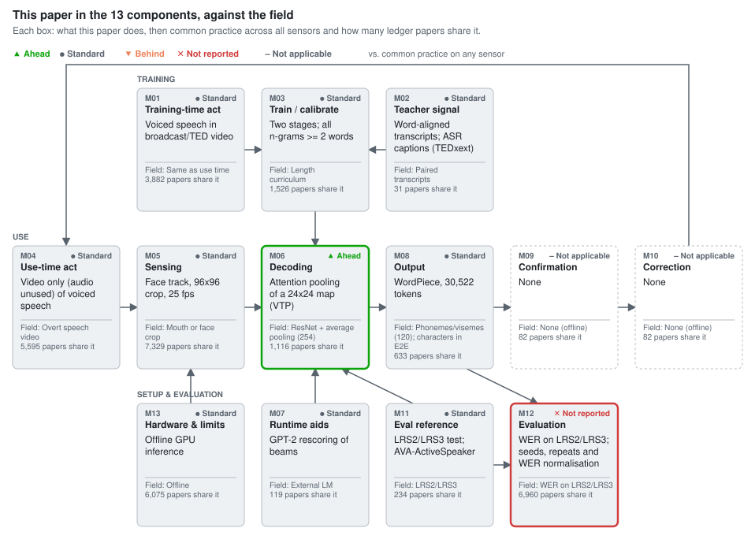

# Sub-word Level Lip Reading With Visual Attention

Prajwal KR, Afouras T, Zisserman A. CVPR 2022 (first public as arXiv:2110.07603, October 2021). [doi:10.1109/CVPR52688.2022.01850](https://doi.org/10.1109/CVPR52688.2022.01850) [arXiv:2110.07603](https://arxiv.org/abs/2110.07603)

**Section:** [Lip & face video](../../README.md#lip--face-video)

## Figures

### This paper in the 13 components, against the field

<picture><source media="(prefers-color-scheme: dark)" srcset="figures/components-dark.svg"></picture>

Verdicts compare the paper's choice for each component with common practice across 8,995 ledger entries on any sensor (silent speech, brain-to-text, lip reading).

Data

| Component | This paper | Common practice | Papers with this practice | Verdict |
| --- | --- | --- | --- | --- |
| M01 Training-time act | Voiced speech in broadcast/TED video | Same as use time | 3,882 of 8,995 | ● Standard (LRS lineage.) |
| M02 Teacher signal | Word-aligned transcripts; ASR captions (TEDxext) | Paired transcripts | 31 of 8,995 | ● Standard (ASR labels, as later [@ma2023autoavsr].) |
| M03 Train / calibrate | Two stages; all n-grams >= 2 words | Length curriculum | 1,526 of 8,995 | ● Standard (Equals curriculum (30.92 vs 30.91).) |
| M04 Use-time act | Video only (audio unused) of voiced speech | Overt speech video | 5,595 of 8,995 | ● Standard (Inherited.) |
| M05 Sensing | Face track, 96x96 crop, 25 fps | Mouth or face crop | 7,329 of 8,995 | ● Standard (LRS preprocessing.) |
| M06 Decoding | Attention pooling of a 24x24 map (VTP) | ResNet + average pooling (254) | 1,116 of 8,995 | ▲ Ahead (Not adopted by later best systems.) |
| M07 Runtime aids | GPT-2 rescoring of beams | External LM | 119 of 8,995 | ● Standard (Weight differs paper vs code.) |
| M08 Output | WordPiece, 30,522 tokens | Phonemes/visemes (120); characters in E2E | 633 of 8,995 | ● Standard (BPE used before [@liu2020fastlr].) |
| M09 Confirmation | None | None (offline) | 82 of 8,995 | – Not applicable (Offline benchmark.) |
| M10 Correction | None | None (offline) | 82 of 8,995 | – Not applicable (Offline benchmark.) |
| M11 Eval reference | LRS2/LRS3 test; AVA-ActiveSpeaker | LRS2/LRS3 | 234 of 8,995 | ● Standard (Speaker overlap not stated.) |
| M12 Evaluation | WER on LRS2/LRS3; seeds, repeats and WER normalisation unstated | WER on LRS2/LRS3 | 6,960 of 8,995 | ✕ Not reported (Training hours also unmatched across Table 1.) |
| M13 Hardware & limits | Offline GPU inference | Offline | 6,075 of 8,995 | ● Standard (No latency reported.) |

## Verdict

The paper [[1]](#ref-1) changes the visual front-end (M06), pooling a 24×24 feature map by learned attention instead of averaging it, and the output unit (M08), WordPiece instead of characters. The front-end was ahead in October 2021 (Appendix) and its gain holds on two tasks: 37.2 to 30.9% WER on LRS2 and 80.2 to 88.2 test mAP for speech detection. It did not lead to the state of the art: the lowest [later] LRS3 WER comes from a linear-projection front-end trained on 100,000 hours [[2]](#ref-2), and the best public-data systems keep ResNet-18 trunks and gain from data and semi-supervision. The sub-word output is not new, so it is standard: byte-pair outputs were used for LRS2 a year earlier [[3]](#ref-3), and the claim of first use is wrong. The "state of the art" table compares systems trained on 389 to 31,000 hours, so it ranks data budgets as much as designs.

## Against the field, component by component

### M06 Processing: spatial pooling of the visual front-end

**Usual approach:** a 3D-convolution plus ResNet trunk averaged to one vector per frame, the largest design count among 1,116 lip-reading, VSR and AVSR studies (254, pattern match, Appendix), as in [[4]](#ref-4). The paper replaces averaging with six attention layers over the map, so pooling can follow the lips across head pose.

**State of the art:** 12.8% visual-only LRS3 WER from a linear projection plus Conformer on 100,000 hours of mined YouTube video [[2]](#ref-2) [later]; with a ResNet-18 trunk, 17.6% in 2026 on 656 labelled plus 2,649 unlabelled hours [[5]](#ref-5) [later] and 19.1% at 3,448 hours in 2023 [[6]](#ref-6) [later]. The paper's best, 30.7% at 2,676 hours, sits 17.9 points above the lowest and 13.1 above the best ResNet-18 result, which are 58% and 43% lower (inference); both gaps mix design with data.

Earlier lip-reading uses of spatial attention fuse two streams for word classification [[7]](#ref-7) or insert CBAM in ResNet blocks while keeping average pooling, which left LRW accuracy at 83.14% against 83.10% [[4]](#ref-4) (Appendix). The paper's ablation is cleaner: WER falls as VTP pools at higher resolution (35.7, 33.8, 30.9%) at about equal front-end size (Table 3). Ahead at the time, then overtaken: on public data the [later] ResNet-18 plus Conformer model reaches 33.0% on LRS3 with 818 hours [[6]](#ref-6) against the paper's 40.6% with 698 hours. The 7.6-point gap comes with a newer recipe and 120 more hours (inference): VTP was not needed for later gains, but averaging is not shown better, since the ResNet plus Conformer of its own generation scored 43.3% at 639 hours [[8]](#ref-8) (Table 1). Averaging front-ends appear in 132 dated [later] studies against 38 for attention pooling (Appendix).

### M08 Output: token unit

**Usual approach:** phonemes or visemes are the most named units among 633 sentence-level studies (120, pattern match, Appendix), but the end-to-end LRS2/LRS3 systems the paper compares with output characters [[8]](#ref-8), 75 graphemes in RNN-T [[9]](#ref-9). The paper uses the 30,522-token BERT WordPiece vocabulary.

**State of the art:** sub-word units are now the default, SentencePiece 5,000 in 2023 [[6]](#ref-6) [later] and 1,000 at 17.6% in 2026 [[5]](#ref-5) [later]; sub-word tokens lead the dated [later] studies (56, Appendix).

Not new, hence standard (not ahead): FastLR split LRS2 words into a 1k byte-pair vocabulary and found BPE helped, to 75.7% WER [[3]](#ref-3) (Appendix). The paper adds the clean autoregressive ablation: 41.0 to 37.2% on LRS2, 3.8 points or 9% relative (inference). Its vocabulary size is untested: BPE "performed worse" with no number or vocabulary size given (Sec. 4.2), while the [later] systems cited use 1,000 [[5]](#ref-5) and 5,000 units [[6]](#ref-6).

Inherited components are standard: GPT-2 rescoring (M07) adds 1.1 points; all-n-gram training (M03) equals a curriculum, 30.92 against 30.91% (Sec. 4.4); TEDxext uses YouTube ASR captions (M02), the route [later] work scaled [[6]](#ref-6).

## The 13 components

| Component | This paper | Usual approach (count) | State of the art | Verdict |
|---|---|---|---|---|
| M01 Training-time action | Voiced speech in broadcast/TED video | Same as use time (slot-filled 3,882) | – | standard |
| M02 Training-only supervision | Word-aligned transcripts; ASR captions (TEDxext) | Paired transcripts (slot-filled 31) | – | standard |
| M03 Training and adaptation | Two stages; all n-grams >= 2 words | Length curriculum (slot-filled 1,526) | – | standard |
| M04 Use-time action | Video only (audio unused) of voiced speech | Overt speech video (slot-filled 5,595) | – | standard |
| M05 Sensors | Face track, 96x96 crop, 25 fps | Mouth or face crop (slot-filled 7,329) | – | standard |
| M06 Processing and decoding | Attention pooling of a 24x24 map (VTP) | ResNet + average pooling (254) (pattern match 1,116) | Linear projection, 12.8% LRS3 [[2]](#ref-2); ResNet-18, 17.6% [[5]](#ref-5) | ahead |
| M07 Lexicon and LM | GPT-2 rescoring of beams | External LM (slot-filled 119) | – | standard |
| M08 Output | WordPiece, 30,522 tokens | Phonemes/visemes (120); characters in E2E (pattern match 633) | SentencePiece 1,000 [[5]](#ref-5) | standard |
| M09 Confirmation | None | None (offline) (slot-filled 82) | – | not applicable |
| M10 Correction | None | None (offline) (slot-filled 82) | – | not applicable |
| M11 Reference construction | LRS2/LRS3 test; AVA-ActiveSpeaker | LRS2/LRS3 (slot-filled 234) | – | standard |
| M12 Evaluation | WER on LRS2/LRS3; seeds, repeats and WER normalisation unstated | WER on LRS2/LRS3 (slot-filled 6,960) | 12.8% LRS3 WER [[2]](#ref-2) | not reported |
| M13 Device and cost | Offline GPU inference | Offline (slot-filled 6,075) | – | standard |

## Where the claims outrun the evidence

- "State of the art" (Table 1) sets the 698-hour model against the hybrid Conformer at 389 and 639 hours [[8]](#ref-8); the 9- and 2.7-point gains (Sec. 4.3) mix design with data.
- "Ten times less data" than RNN-T (Sec. 4.3): 2,676 hours include non-public MV-LRS and ASR-labelled TEDxext against 31,000 hours of another corpus [[9]](#ref-9).
- "First use of sub-word units" (Abstract) is contradicted by [[3]](#ref-3).
- No seeds, repeats or error bars are reported (Sec. 4, Sec. 5), so the 1.1-point LM and 0.9-point horizontal-flip test-time-augmentation gains (Table 2) are of unknown reliability.
- The repository README runs the public-data models with LM weight 0.35, against 0.7 and 0.6 in Sec. 4.2, and labels its extended checkpoints as trained on internal LRS3v2, not TEDxext, with 22.3% instead of 22.6% LRS2 WER (Table 1).

## What the field needs next

- M06: VTP against average pooling in a fixed modern recipe (ResNet-18 plus Conformer, 818 hours), three seeds.
- M08: a vocabulary sweep (characters, 1,000, 5,000, 30,522 tokens) at fixed data, with WER and decoding cost.
- M12: LRS3 results at matched training hours with stated text normalisation.

## Questions for the authors

- Are LRS2/LRS3 test speakers disjoint from training speakers, including MV-LRS and TEDxext?
- Which data selected the LM weight and checkpoints?
- How is text normalised before WER?
- What WER did BPE give, at what vocabulary size?

## Appendix: literature search

- M06 visual-frontend-spatial-pooling. Inclusion rule: visual or audio-visual speech recognition studies (word or sentence level) whose ledger names lip reading, VSR, AVSR or an LRS/LRW benchmark; the design compared is how the per-frame spatial map is reduced to a vector (average pooling or flatten after a CNN/ResNet trunk, learned spatial attention or transformer pooling, ViT/patch front-ends); temporal attention, attention for audio-visual fusion and ROI cropping excluded; versions count once. Slot-filled 7,345 unique studies (M06); pattern match 1,116 unique studies. Design counts (pattern match, full text, of 1,116): ResNet trunk with average pooling 254, ViT or patch front-end 65, learned spatial attention pooling 58. By ledger year, average pooling 16 prior (to 2020), 132 [later] (2022 on); attention pooling 8 prior hits, all neuroscience papers on attention to the mouth, and 38 [later]. Deciding priors read in full: [[7]](#ref-7), [[4]](#ref-4). State of the art read: [[6]](#ref-6), [[5]](#ref-5), [[2]](#ref-2). Known-item recall 1.0.
- M08 vsr-output-token-unit. Inclusion rule: sentence-level lip-reading, VSR or AVSR studies; the design compared is the output unit (characters, sub-word tokens, phonemes or visemes, closed-set word classes); a paper counts under every unit its text names. Slot-filled 3,268 unique studies (M08); pattern match 633 unique studies. Unit counts (pattern match, of 633): phonemes or visemes 120, closed-set word classes 115, sub-word tokens 94, characters 80. Sub-word hits dated to 2020 or earlier: 9, of which the only end-to-end sentence-level lip reader is [[3]](#ref-3); [later] sub-word hits 56. Deciding priors read in full: [[3]](#ref-3), [[8]](#ref-8), [[9]](#ref-9). State of the art read: [[6]](#ref-6), [[5]](#ref-5). Known-item recall 1.0.

## References

Numbered by first citation. BibTeX in the same order and keys: [refs.bib](refs.bib).

1. Prajwal, K. R., Afouras, T., Zisserman, A. “Sub-word Level Lip Reading With Visual Attention.” *Proceedings of the IEEE/CVF Conference on Computer Vision and Pattern Recognition (CVPR)*, 2022, 5162-5172. doi:[10.1109/CVPR52688.2022.01850](https://doi.org/10.1109/CVPR52688.2022.01850). arXiv:[2110.07603](https://arxiv.org/abs/2110.07603). CVPR 2022 proceedings version; arXiv:2110.07603 first posted 2021-10 [review](https://github.com/supernaiter/silent-speech-review/tree/main/reviews/sub-word-level-lip-reading-with-visual-attention) [wiki: cvf-prajwal22-subword-vtp](https://github.com/supernaiter/deep-research-wiki-for-silent-speech/blob/main/papers/cvf-prajwal22-subword-vtp/article.md) [wiki: cvpr22-prajwal](https://github.com/supernaiter/deep-research-wiki-for-silent-speech/blob/main/papers/cvpr22-prajwal/article.md) [wiki: arxiv-2110.07603](https://github.com/supernaiter/deep-research-wiki-for-silent-speech/blob/main/papers/arxiv-2110.07603/article.md)
2. Chang, O., Liao, H., Serdyuk, D., Shah, A., Siohan, O. “Conformers are All You Need for Visual Speech Recognition.” *arXiv preprint*, 2023. arXiv:[2302.10915](https://arxiv.org/abs/2302.10915). [later] [wiki: arxiv-2302.10915](https://github.com/supernaiter/deep-research-wiki-for-silent-speech/blob/main/papers/arxiv-2302.10915/article.md)
3. Liu, J., Ren, Y., Zhao, Z., Zhang, C., Huai, B., Yuan, N. J. “FastLR: Non-Autoregressive Lipreading Model with Integrate-and-Fire.” *Proceedings of the 28th ACM International Conference on Multimedia*, 2020. doi:[10.1145/3394171.3413740](https://doi.org/10.1145/3394171.3413740). arXiv:[2008.02516](https://arxiv.org/abs/2008.02516). [wiki: arxiv-2008.02516](https://github.com/supernaiter/deep-research-wiki-for-silent-speech/blob/main/papers/arxiv-2008.02516/article.md)
4. Zhang, Y., Yang, S., Xiao, J., Shan, S., Chen, X. “Can We Read Speech Beyond the Lips? Rethinking RoI Selection for Deep Visual Speech Recognition.” *IEEE International Conference on Automatic Face and Gesture Recognition (FG)*, 2020. arXiv:[2003.03206](https://arxiv.org/abs/2003.03206). [wiki: arxiv-2003.03206](https://github.com/supernaiter/deep-research-wiki-for-silent-speech/blob/main/papers/arxiv-2003.03206/article.md)
5. Haliassos, A., Mira, R., Petridis, S. “Pay Attention to CTC: Fast and Robust Pseudo-Labelling for Unified Speech Recognition.” *International Conference on Learning Representations (ICLR)*, 2026. arXiv:[2602.19316](https://arxiv.org/abs/2602.19316). [later] [wiki: arxiv-2602.19316](https://github.com/supernaiter/deep-research-wiki-for-silent-speech/blob/main/papers/arxiv-2602.19316/article.md)
6. Ma, P., Haliassos, A., Fernandez-Lopez, A., Chen, H., Petridis, S., Pantic, M. “Auto-AVSR: Audio-Visual Speech Recognition with Automatic Labels.” *IEEE International Conference on Acoustics, Speech and Signal Processing (ICASSP)*, 2023. doi:[10.1109/ICASSP49357.2023.10096889](https://doi.org/10.1109/ICASSP49357.2023.10096889). arXiv:[2303.14307](https://arxiv.org/abs/2303.14307). [later] [review](https://github.com/supernaiter/silent-speech-review/tree/main/reviews/auto-avsr-audio-visual-speech-recognition-with-automatic-labels) [wiki: arxiv-2303.14307](https://github.com/supernaiter/deep-research-wiki-for-silent-speech/blob/main/papers/arxiv-2303.14307/article.md)
7. Wang, C. “Multi-Grained Spatio-temporal Modeling for Lip-reading.” *British Machine Vision Conference (BMVC)*, 2019. arXiv:[1908.11618](https://arxiv.org/abs/1908.11618). [wiki: arxiv-1908.11618](https://github.com/supernaiter/deep-research-wiki-for-silent-speech/blob/main/papers/arxiv-1908.11618/article.md)
8. Ma, P., Petridis, S., Pantic, M. “End-to-End Audio-Visual Speech Recognition with Conformers.” *IEEE International Conference on Acoustics, Speech and Signal Processing (ICASSP)*, 2021. doi:[10.1109/ICASSP39728.2021.9414567](https://doi.org/10.1109/ICASSP39728.2021.9414567). arXiv:[2102.06657](https://arxiv.org/abs/2102.06657). [wiki: arxiv-2102.06657](https://github.com/supernaiter/deep-research-wiki-for-silent-speech/blob/main/papers/arxiv-2102.06657/article.md)
9. Makino, T., Liao, H., Assael, Y., Shillingford, B., Garcia, B., Braga, O., et al. “Recurrent Neural Network Transducer for Audio-Visual Speech Recognition.” *IEEE Automatic Speech Recognition and Understanding Workshop (ASRU)*, 2019. doi:[10.1109/ASRU46091.2019.9004036](https://doi.org/10.1109/ASRU46091.2019.9004036). arXiv:[1911.04890](https://arxiv.org/abs/1911.04890). [wiki: doi-10.1109-asru46091.2019.9004036](https://github.com/supernaiter/deep-research-wiki-for-silent-speech/blob/main/papers/doi-10.1109-asru46091.2019.9004036/article.md) [wiki: arxiv-1911.04890](https://github.com/supernaiter/deep-research-wiki-for-silent-speech/blob/main/papers/arxiv-1911.04890/article.md)

## Materials

Data behind this review. Full texts of the papers are not included.

- [`review.md`](review.md): the review text (source)
- [`refs.bib`](refs.bib): references (BibTeX)
- [`slots.json`](slots.json): for each of the 13 components: this paper's choice, field practice, number of matching papers, verdict
- [`figures.json`](figures.json): figure definitions
- [`evaluation.md`](evaluation.md): independent evaluation by a second reviewer
- [`triage.md`](triage.md): how each evaluation finding was checked against the sources and resolved
- [`components/M06/visual-frontend-spatial-pooling.csv`](../../components/M06/visual-frontend-spatial-pooling.csv): M06 topic "visual-frontend-spatial-pooling", every candidate paper with its decision (7345 slot-filled, 1116 pattern match, usual design in 254, 5 read in full)
- [`components/M08/vsr-output-token-unit.csv`](../../components/M08/vsr-output-token-unit.csv): M08 topic "vsr-output-token-unit", every candidate paper with its decision (3268 slot-filled, 633 pattern match, usual design in 120, 5 read in full)

## More reviews in Lip & face video

- [FastLTS: Non-Autoregressive End-to-End Unconstrained Lip-to-Speech Synthesis](../fastlts-non-autoregressive-end-to-end-unconstrained-lip-to-speech-synthesis/) (2022). Parallel decoder, learned-feature GAN generator and transformer front end (M06) are standard; 9.14x mel speedup is real, but evaluation (M12) drops the STOI/ESTOI its Lip2Wav baseline reported.
- [Learning Audio-Visual Speech Representation by Masked Multimodal Cluster Prediction](../learning-audio-visual-speech-representation-by-masked-multimodal-cluster-prediction/) (2022). AV-HuBERT's masked audio-visual cluster pre-training (M03) was a large step past distillation, but its LRS3 gains lack repeated runs and later work beats it at matched budgets.
- [Lip-to-Speech Synthesis for Arbitrary Speakers in the Wild](../lip-to-speech-synthesis-for-arbitrary-speakers-in-the-wild/) (2022). VAE-GAN lip-to-speech with a reference-audio voice: a standard design whose gains are in distribution and sync metrics; no WER is reported, behind its own lineage on evaluation.
- [SVTS: Scalable Video-to-Speech Synthesis](../svts-scalable-video-to-speech-synthesis/) (2022). SVTS shows a simple spectrogram predictor with a pretrained vocoder outperforms prior complex video-to-speech models and scales to large datasets such as LRS3+VoxCeleb2.
- [VCVTS: Multi-speaker Video-to-Speech synthesis via cross-modal knowledge transfer from voice conversion](../vcvts-multi-speaker-video-to-speech-synthesis-via-cross-modal-knowledge-transfer-from-voice-conversion/) (2022). VCVTS performs multi-speaker video-to-speech synthesis by transferring knowledge from voice conversion, with speaker control from reference speech, on GRID and LRW.
- [VisageSynTalk: Unseen Speaker Video-to-Speech Synthesis via Speech-Visage Feature Selection](../visagesyntalk-unseen-speaker-video-to-speech-synthesis-via-speech-visage-feature-selection/) (2022). VisageSynTalk disentangles speech content and visage (identity) features for video-to-speech synthesis, yielding robust results for unseen speakers on benchmarks.

---

Part of the [Silent Speech Interface Review](https://github.com/supernaiter/silent-speech-review). Found an error? [Open an issue](https://github.com/supernaiter/silent-speech-review/issues/new?template=correction.yml).
