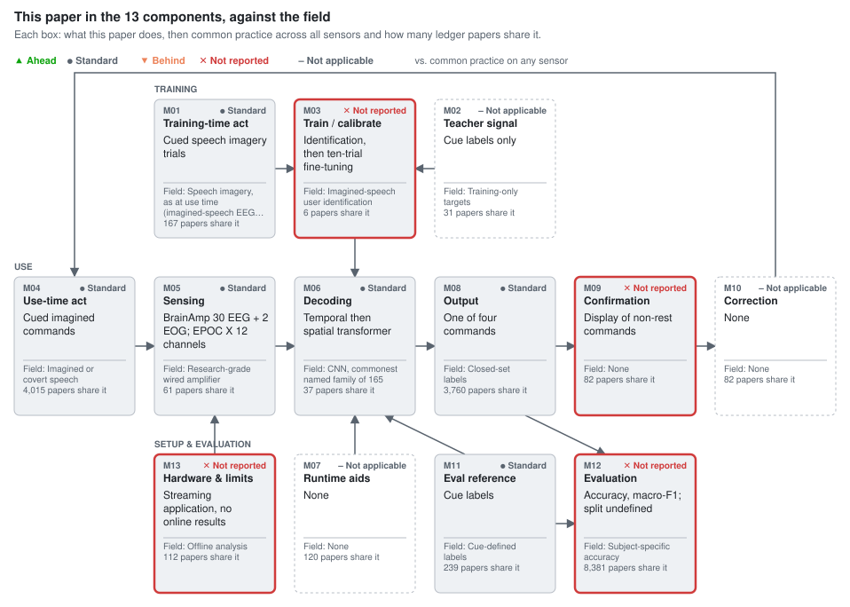

# Toward Practical BCI: A Real-time Wireless Imagined Speech EEG Decoding System

Ji-Ha Park, Heon-Gyu Kwak, Gi-Hwan Shin, Yoo-In Jeon, Sun-Min Park, Ji-Yeon Hwang, Seong-Whan Lee. 14th International Conference on Brain-Computer Interface (BCI), 2026. [doi:10.1109/BCI69045.2026.11435050](https://doi.org/10.1109/BCI69045.2026.11435050) [arXiv:2511.07936](https://arxiv.org/abs/2511.07936)

**Section:** [Brain signals (EEG, MEG, intracortical)](../../README.md#brain-signals-eeg-meg-intracortical)

## Figures

### This paper in the 13 components, against the field

<picture><source media="(prefers-color-scheme: dark)" srcset="figures/components-dark.svg"></picture>

Verdicts compare the paper's choice for each component with common practice across 8,995 ledger entries on any sensor (silent speech, brain-to-text, lip reading).

Data

| Component | This paper | Common practice | Papers with this practice | Verdict |
| --- | --- | --- | --- | --- |
| M01 Training-time act | Cued speech imagery trials | Speech imagery, as at use time (imagined-speech EEG studies) | 167 of 8,995 | ● Standard (Imagined-speech training trials from the group's own paradigm.) |
| M02 Teacher signal | Cue labels only | Training-only targets | 31 of 8,995 | – Not applicable (Closed-set classification with cue labels.) |
| M03 Train / calibrate | Identification, then ten-trial fine-tuning | Imagined-speech user identification | 6 of 8,995 | ✕ Not reported (No identification accuracy and no calibration result; same framework in [@kwak2025personalized].) |
| M04 Use-time act | Cued imagined commands | Imagined or covert speech | 4,015 of 8,995 | ● Standard (Four cued commands, 2-s trials.) |
| M05 Sensing | BrainAmp 30 EEG + 2 EOG; EPOC X 12 channels | Research-grade wired amplifier | 61 of 8,995 | ● Standard (Consumer-headset imagined speech predates 2018 (EPOC dataset protocol from 2013, per [@moctezuma2018subjects]); device not isolated.) |
| M06 Decoding | Temporal then spatial transformer | CNN, commonest named family of 165 | 37 of 8,995 | ● Standard (No baseline or ablation.) |
| M07 Runtime aids | None | None | 120 of 8,995 | – Not applicable (Closed four-class task.) |
| M08 Output | One of four commands | Closed-set labels | 3,760 of 8,995 | ● Standard (Typical of imagined-speech EEG.) |
| M09 Confirmation | Display of non-rest commands | None | 82 of 8,995 | ✕ Not reported (Display gated on a rest state the four-class decoder does not have.) |
| M10 Correction | None | None | 82 of 8,995 | – Not applicable (No correction step described.) |
| M11 Eval reference | Cue labels | Cue-defined labels | 239 of 8,995 | ● Standard (Instructed imagery without behavioural check.) |
| M12 Evaluation | Accuracy, macro-F1; split undefined | Subject-specific accuracy | 8,381 of 8,995 | ✕ Not reported (No split, no statistical test against chance, three participants.) |
| M13 Hardware & limits | Streaming application, no online results | Offline analysis | 112 of 8,995 | ✕ Not reported (Real-time claim without online results.) |

## Verdict

The paper [[1]](#ref-1) changes the sensor (M05), adaptation (M03), operation (M13) and decoder (M06), and is ahead on none: consumer headsets, imagined-speech user identification and the group's own identification-plus-intention framework came earlier [[2]](#ref-2), [[3]](#ref-3), [[4]](#ref-4). M03 and M13 are not reported: no identification accuracy, calibration result, latency or online accuracy is given. Table I (62.00% wired, 46.67% wireless, three participants, no stated split) shows neither real-time use nor a benefit of personalisation. The 15.33-point wireless drop, 24.7% relative (inference), mixes device, channel count, EOG input and recordings, so the claim of bridging laboratory and real-world use (§IV) does not hold.

## Against the field, component by component

### M05 Sensors: consumer wireless headset

**Usual approach:** Of 167 imagined-speech EEG studies (pattern match, unique studies), 61 name a research-grade wired amplifier and 21 a consumer headset (Appendix). The paper adds the Emotiv EPOC X to the BrainAmp of its predecessor [[4]](#ref-4) (§II.A.2).

**State of the art:** In 2026, an EPOC X study reports 98.10% on four commands plus neutral in 15 subjects with inference within 900 ms [[5]](#ref-5) [concurrent], from a random 80/20 sample split, so one recording can feed both sides (inference); neither it nor the paper reports a session hold-out.

Consumer headsets for imagined speech predate 2018: [[2]](#ref-2) uses 20 of 27 subjects from a 14-channel EPOC dataset whose protocol it attributes to a 2013 study. The device effect is not isolated: the wired input adds two EOG channels (§II.B), the paper lists 12 of the EPOC X's 14 electrodes, without AF3 and AF4 [[5]](#ref-5), and EPOC X preprocessing, sampling rate, participants and trials are not given. Verdict: standard.

### M03 Training and adaptation: user identification and calibration

**Usual approach:** Six studies identify the user from imagined-speech EEG (pattern match, unique studies, target included; Appendix); the paper uses 30 s of resting EEG, then ten-trial-per-class fine-tuning (§II.C.3).

**State of the art:** Derakhshesh et al. (arXiv 2025) identified 11 subjects at 99.44% accuracy with the last session held out [[3]](#ref-3). The group's 2024 study reports 0.995 [[4]](#ref-4) with all trials permuted, so test and training share sessions.

Without identification accuracy or a no-fine-tuning result, the wired result cannot confirm "the user identification and rapid fine-tuning process" (§III.A). The pretrained models' data are not stated, though the predecessor shares amplifier and ethics approval [[4]](#ref-4). Verdict: not reported.

### M13 Device and cost: real-time application

**Usual approach:** Of the same 167 studies, 112 use no online, real-time or closed-loop term (pattern match; Appendix): offline analysis is the default, and Table I is not labelled online.

**State of the art:** In 2024, Wu et al. reached 55.7% (adaptive) and 52.3% (static) online with two imagined syllables in 20 participants, chance 50% [[6]](#ref-6); the target's department reported 65% top-1 over 20 online trials in one participant, four classes including rest [[7]](#ref-7) [concurrent].

No latency, decision rate or false activation is reported (§II.C.3), and the "outside of a controlled lab" claim (§III.B) names no setting. Because Table I is not labelled online and has no latency or false-activation data, its 46.67% is not evidence of practical use; [[6]](#ref-6), at 50% chance, is no yardstick for a four-class result (inference). Verdict: not reported.

### M06 Processing: dual sequential transformer

**Usual approach:** Of 165 studies with the model slot filled, the commonest named family is CNN (37; 48 are other) (slot-filled; Appendix).

**State of the art:** 96.4% on four covert syllables with 1-s trials (94.5% without covert articulation), per-participant cross-validation, one class per recording run, 2019 [[8]](#ref-8).

No baseline or ablation is run; the predecessor's 0.47 [[4]](#ref-4) differs from 62.00% in words, participants and split. Verdict: standard.

## The 13 components

| Component | This paper | Usual approach (count) | State of the art | Verdict |
|---|---|---|---|---|
| M01 Training-time action | Cued speech imagery trials | Speech imagery, as at use time (imagined-speech EEG studies) (pattern match 167) | – | standard |
| M02 Training-only supervision | Cue labels only | Training-only targets (slot-filled 31) | – | not applicable |
| M03 Training and adaptation | Identification, then ten-trial fine-tuning | Imagined-speech user identification (pattern match 6) | 99.44%, session held out [[3]](#ref-3) | not reported |
| M04 Use-time action | Cued imagined commands | Imagined or covert speech (slot-filled 4,015) | – | standard |
| M05 Sensors | BrainAmp 30 EEG + 2 EOG; EPOC X 12 channels | Research-grade wired amplifier (pattern match 61) | 98.10%, random sample split [[5]](#ref-5) | standard |
| M06 Processing and decoding | Temporal then spatial transformer | CNN, commonest named family of 165 (slot-filled 37) | 96.4%, four covert syllables [[8]](#ref-8) | standard |
| M07 Lexicon and LM | None | None (slot-filled 120) | – | not applicable |
| M08 Output | One of four commands | Closed-set labels (slot-filled 3,760) | – | standard |
| M09 Confirmation | Display of non-rest commands | None (slot-filled 82) | – | not reported |
| M10 Correction | None | None (slot-filled 82) | – | not applicable |
| M11 Reference construction | Cue labels | Cue-defined labels (slot-filled 239) | – | standard |
| M12 Evaluation | Accuracy, macro-F1; split undefined | Subject-specific accuracy (slot-filled 8,381) | – | not reported |
| M13 Device and cost | Streaming application, no online results | Offline analysis (pattern match 112) | Online: 55.7% vs 50% chance [[6]](#ref-6) | not reported |

## Where the claims outrun the evidence

- "Significant and meaningful performance" (§III.A) rests on three participants and no statistical test against the 25% chance level the authors cite.
- Wireless average recall is 0.47±0.00 against 46.67±0.72% accuracy and per-class recall ± up to 0.26 (Table I, §III); ± is undefined.
- Only commands "other than the 'rest' state" are displayed (§II.C.3), but the decoder has no rest class (Table I).
- EOG enters the decoder with only a notch filter (§II.A.2, §II.B), so eye activity can carry class information (inference).
- Wireless practicality cites handwriting and crowd-scene papers (§I); the authors' headset caveat (§III.B) is dropped in the conclusion (§IV).

## What the field needs next

- M13: online EPOC X sessions outside the laboratory with accuracy, latency and false activations at rest.
- M05: the same participants on both devices, EOG removed.
- M03: identification on a new session; accuracy against calibration size versus a from-scratch model.

## Questions for the authors

- Are Table I values online, which trials were held out, and are the 800 trials per participant and device?
- What do the ± values summarise, and which data pretrained the models?
- How is rest detected, and what replaces EOG on the EPOC X?

## Appendix: literature search

- M05 imagined-speech-eeg-consumer-headset (new topic table). Inclusion rule: imagined-speech scalp-EEG classification studies (population of the M06 table); design compared is the acquisition hardware, a consumer-grade, low-channel or wireless headset against a research-grade wired amplifier named in the text; reviews counted but not deciding priors; intracranial excluded; versions counted once. Slot-filled 7,329 unique studies; pattern match 167 unique studies. Research-grade amplifier named 61, wireless 25, consumer headset 21 (pattern match, 4 reviews); prior primary consumer-headset studies 5. Read in full for this review: [[2]](#ref-2), [[5]](#ref-5) [concurrent]. Known-item recall 0.5 (1 of 2 seeds).
- M03 eeg-user-identification (new topic table). Inclusion rule: studies that identify the user from scalp EEG; design compared is identification from speech-imagery trials and its test protocol (session held out or trials permuted); identification used only as a nuisance factor excluded; versions counted once. Slot-filled 1,526 unique studies; pattern match 6 unique studies, the target included, 3 with a consumer headset. Read in full for this review: [[3]](#ref-3), [[4]](#ref-4), [[2]](#ref-2). Known-item recall 1.0 (2 of 2 seeds).
- M13 online-imagined-speech-eeg (new topic table). Inclusion rule: same population; design compared is online decoding with feedback and a reported online accuracy against offline analysis; a mention of real-time use as future work is a pattern match only. Slot-filled 6,075 unique studies; pattern match 167 unique studies, of which 55 use an online, real-time or closed-loop term (upper bound) and 112 do not. Read in full for this review: [[6]](#ref-6), [[7]](#ref-7) [concurrent], [[4]](#ref-4). Known-item recall 0.5 (1 of 2 seeds).
- M06 imagined-speech-eeg-word-classification (published topic table, appended). Inclusion rule unchanged: studies that classify imagined, covert or inner speech from scalp EEG into a closed set and report accuracy; overt-only EEG, EEG-EMG fusion without an EEG-only result, perception decoding, intracranial recordings and reviews excluded; versions counted once. Slot-filled 7,345 unique studies; pattern match 167 unique studies (165 with the model slot filled). Usual design: model family other 48, CNN 37 (slot-filled). State of the art from the published table: [[8]](#ref-8). Known-item recall 1.0 (4 of 4 seeds, published table).

## References

Numbered by first citation. BibTeX in the same order and keys: [refs.bib](refs.bib).

1. Park, J., Kwak, H., Shin, G., Jeon, Y., Park, S., Hwang, J., et al. “Toward Practical BCI: A Real-time Wireless Imagined Speech EEG Decoding System.” *14th International Conference on Brain-Computer Interface (BCI)*, 2026, 1–4. doi:[10.1109/BCI69045.2026.11435050](https://doi.org/10.1109/BCI69045.2026.11435050). arXiv:[2511.07936](https://arxiv.org/abs/2511.07936). Target. Read as arXiv v1 (11 November 2025). [review](https://github.com/supernaiter/silent-speech-review/tree/main/reviews/toward-practical-bci-a-real-time-wireless-imagined-speech-eeg-decoding-system) [wiki: arxiv-2511-07936-rtlwireless](https://github.com/supernaiter/deep-research-wiki-for-silent-speech/blob/main/papers/arxiv-2511-07936-rtlwireless/article.md) [wiki: arxiv-2511-07936-wirelessimg](https://github.com/supernaiter/deep-research-wiki-for-silent-speech/blob/main/papers/arxiv-2511-07936-wirelessimg/article.md) [wiki: arxiv-2511.07936](https://github.com/supernaiter/deep-research-wiki-for-silent-speech/blob/main/papers/arxiv-2511.07936/article.md)
2. Moctezuma, L. A., Molinas, M. “EEG-Based Subjects Identification Based on Biometrics of Imagined Speech Using EMD.” *Brain Informatics (BI 2018), Lecture Notes in Computer Science*, 2018, 458–467. doi:[10.1007/978-3-030-05587-5_43](https://doi.org/10.1007/978-3-030-05587-5_43). arXiv:[1809.06697](https://arxiv.org/abs/1809.06697). [wiki: arxiv-1809.06697](https://github.com/supernaiter/deep-research-wiki-for-silent-speech/blob/main/papers/arxiv-1809.06697/article.md)
3. Derakhshesh, A., Dehghanian, Z., Ebrahimpour, R., Rabiee, H. R. “Cueless EEG Imagined Speech for Subject Identification: Dataset and Benchmarks.” *IEEE Transactions on Biometrics, Behavior, and Identity Science*, 2026, 8(2), 207–217. doi:[10.1109/TBIOM.2025.3634273](https://doi.org/10.1109/TBIOM.2025.3634273). arXiv:[2501.09700](https://arxiv.org/abs/2501.09700). [wiki: arxiv-2501.09700](https://github.com/supernaiter/deep-research-wiki-for-silent-speech/blob/main/papers/arxiv-2501.09700/article.md) [wiki: arxiv-2501-09700-cueless](https://github.com/supernaiter/deep-research-wiki-for-silent-speech/blob/main/papers/arxiv-2501-09700-cueless/article.md)
4. Kwak, H., Shin, G., Choi, Y., Lee, D., Jeon, Y., Kang, J., et al. “Towards Personalized Brain-Computer Interface Application Based on Endogenous EEG Paradigms.” *13th International Conference on Brain-Computer Interface (BCI)*, 2025, 1–4. doi:[10.1109/BCI65088.2025.10931473](https://doi.org/10.1109/BCI65088.2025.10931473). arXiv:[2411.11302](https://arxiv.org/abs/2411.11302). Same group; cited by the target as [17]. [wiki: arxiv-2411.11302](https://github.com/supernaiter/deep-research-wiki-for-silent-speech/blob/main/papers/arxiv-2411.11302/article.md)
5. Adedotun, H., Akah, P., Ali, N. O. “A Lightweight Real-Time EEG-Based Brain–Computer Interface for Imagined Speech-Controlled Robotics via Machine Learning.” *Emerging Science Innovation*, 2026, 6, 32–49. doi:[10.46604/emsi.2026.15979](https://doi.org/10.46604/emsi.2026.15979). [concurrent] [wiki: emsi-15979-lightweight](https://github.com/supernaiter/deep-research-wiki-for-silent-speech/blob/main/papers/emsi-15979-lightweight/article.md)
6. Wu, S., Bhadra, K., Giraud, A., Marchesotti, S. “Adaptive LDA Classifier Enhances Real-Time Control of an EEG Brain–Computer Interface for Decoding Imagined Syllables.” *Brain Sciences*, 2024, 14(3), 196. doi:[10.3390/brainsci14030196](https://doi.org/10.3390/brainsci14030196). Preprint: bioRxiv, doi:10.1101/2023.12.12.571206. [wiki: doi-10.3390-brainsci14030196](https://github.com/supernaiter/deep-research-wiki-for-silent-speech/blob/main/papers/doi-10.3390-brainsci14030196/article.md) [wiki: pmc-10968180-adaptlda](https://github.com/supernaiter/deep-research-wiki-for-silent-speech/blob/main/papers/pmc-10968180-adaptlda/article.md) [wiki: doi-10.1101-2023.12.12.571206](https://github.com/supernaiter/deep-research-wiki-for-silent-speech/blob/main/papers/doi-10.1101-2023.12.12.571206/article.md)
7. Ko, E., Kim, S., Jo, H. “Lightweight Diffusion-based Framework for Online Imagined Speech Decoding in Aphasia.” *14th International Conference on Brain-Computer Interface (BCI)*, 2026, 1–4. doi:[10.1109/BCI69045.2026.11435091](https://doi.org/10.1109/BCI69045.2026.11435091). arXiv:[2511.07920](https://arxiv.org/abs/2511.07920). Same department as the target (Korea University). [concurrent] [review](https://github.com/supernaiter/silent-speech-review/tree/main/reviews/lightweight-diffusion-based-framework-for-online-imagined-speech-decoding-in-aphasia) [wiki: arxiv-2511.07920](https://github.com/supernaiter/deep-research-wiki-for-silent-speech/blob/main/papers/arxiv-2511.07920/article.md)
8. Jahangiri, A., Sepulveda, F. “The Relative Contribution of High-Gamma Linguistic Processing Stages of Word Production, and Motor Imagery of Articulation in Class Separability of Covert Speech Tasks in EEG Data.” *Journal of Medical Systems*, 2019, 43(2), 20. doi:[10.1007/s10916-018-1137-9](https://doi.org/10.1007/s10916-018-1137-9). [wiki: doi-10.1007-s10916-018-1137-9](https://github.com/supernaiter/deep-research-wiki-for-silent-speech/blob/main/papers/doi-10.1007-s10916-018-1137-9/article.md)

## Materials

Data behind this review. Full texts of the papers are not included.

- [`review.md`](review.md): the review text (source)
- [`refs.bib`](refs.bib): references (BibTeX)
- [`slots.json`](slots.json): for each of the 13 components: this paper's choice, field practice, number of matching papers, verdict
- [`figures.json`](figures.json): figure definitions
- [`evaluation.md`](evaluation.md): independent evaluation by a second reviewer
- [`triage.md`](triage.md): how each evaluation finding was checked against the sources and resolved
- [`components/M03/eeg-user-identification.csv`](../../components/M03/eeg-user-identification.csv): M03 topic "eeg-user-identification", every candidate paper with its decision (1526 slot-filled, 6 pattern match, usual design in 6, 3 read in full)
- [`components/M05/imagined-speech-eeg-consumer-headset.csv`](../../components/M05/imagined-speech-eeg-consumer-headset.csv): M05 topic "imagined-speech-eeg-consumer-headset", every candidate paper with its decision (7329 slot-filled, 167 pattern match, usual design in 61, 2 read in full)
- [`components/M06/imagined-speech-eeg-word-classification.csv`](../../components/M06/imagined-speech-eeg-word-classification.csv): M06 topic "imagined-speech-eeg-word-classification", every candidate paper with its decision (7345 slot-filled, 167 pattern match, usual design in 48, 2 read in full)
- [`components/M13/online-imagined-speech-eeg.csv`](../../components/M13/online-imagined-speech-eeg.csv): M13 topic "online-imagined-speech-eeg", every candidate paper with its decision (6075 slot-filled, 167 pattern match, usual design in 112, 3 read in full)

## More reviews in Brain signals (EEG, MEG, intracortical)

- [A cross-species neural foundation model for end-to-end speech decoding](../a-cross-species-neural-foundation-model-for-end-to-end-speech-decoding/) (2026). Cascaded decoding with the pretrained encoder is a strong standard result; the end-to-end audio-LLM path beats the prior end-to-end entry but trails RNN cascades, and the cross-species gain is small.
- [Brain-to-Speech: Prosody Feature Engineering and Transformer-Based Reconstruction](../brain-to-speech-prosody-feature-engineering-and-transformer-based-reconstruction/) (2026). Same three parts and same Table 1 values as MiSTR (2025, same first two authors), not cited. Features (M06) and phase vocoder (M08) standard, unablated; no listener test (M12, behind).
- [Brain2Speech-Net: Fast and Intelligible Brain-to-Speech Synthesis Without Text Decoding](../brain2speech-net-intelligible-real-time-brain-to-speech-synthesis-without-text-decoding/) (2026). Text-free synthesis is shown, but its real time is throughput, not causal synthesis, unseen-sentence WER is 2.3 times the cascade, and intelligibility rests on ratings and ASR.
- [Do EEG Foundation Models Transfer to Speech? A Benchmark on Overt and Imagined Speech Decoding](../do-eeg-foundation-models-transfer-to-speech-a-benchmark-on-overt-and-imagined-speech-decoding/) (2026). Benchmark of EEG foundation models versus conventional models for overt and imagined speech decoding on two datasets; general EEG pretraining shows no consistent advantage and word decoding stays near chance.
- [EEG-Based Imagined Speech Decoding Using a Hybrid CNN-SNN Architecture](../eeg-based-imagined-speech-decoding-using-a-hybrid-cnn-snn-architecture/) (2026). CNN-to-LIF decoder (M06) is standard: a 2024 SNN-CNN inner-speech decoder precedes it; 80.13% on the validation subset is not comparable with the 82.6% competition test score (M12); no SNN ablation.
- [iPhoneme: Brain-to-Text Communication for ALS Using ConformerXL Decoding](../iphoneme-brain-to-text-communication-for-als-using-conformerxl-decoding/) (2026). ConformerXL-based intracortical brain-to-text decoding for ALS with a proposed gaze-confirmation interface; WFST decoding reaches 7.86% phoneme error rate retrospectively in one participant.

---

Part of the [Silent Speech Interface Review](https://github.com/supernaiter/silent-speech-review). Found an error? [Open an issue](https://github.com/supernaiter/silent-speech-review/issues/new?template=correction.yml).
