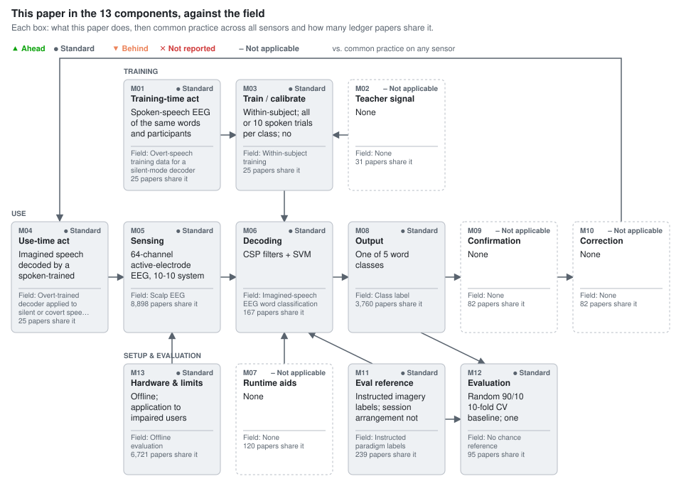

# Towards Neural Decoding of Imagined Speech based on Spoken Speech

Seo-Hyun Lee, Young-Eun Lee, Soowon Kim, Byung-Kwan Ko, Seong-Whan Lee. arXiv preprint, 2022. [arXiv:2212.02047](https://arxiv.org/abs/2212.02047)

**Section:** [Brain signals (EEG, MEG, intracortical)](../../README.md#brain-signals-eeg-meg-intracortical)

## Figures

### This paper in the 13 components, against the field

<picture><source media="(prefers-color-scheme: dark)" srcset="figures/components-dark.svg"></picture>

Verdicts compare the paper's choice for each component with common practice across 8,995 ledger entries on any sensor (silent speech, brain-to-text, lip reading).

Data

| Component | This paper | Common practice | Papers with this practice | Verdict |
| --- | --- | --- | --- | --- |
| M01 Training-time act | Spoken-speech EEG of the same words and participants | Overt-speech training data for a silent-mode decoder | 25 of 8,995 | ● Standard (Same design as M04; spoken data argued to be easier to acquire (§III.A).) |
| M02 Teacher signal | None | None | 31 of 8,995 | – Not applicable (Class labels only; no auxiliary training target.) |
| M03 Train / calibrate | Within-subject; all or 10 spoken trials per class; no fine-tuning | Within-subject training | 25 of 8,995 | ● Standard (10-trial model averages 28.0% vs 26.8% with all trials (Table I, untested); fine-tuning left to future work.) |
| M04 Use-time act | Imagined speech decoded by a spoken-trained model | Overt-trained decoder applied to silent or covert speech without retraining | 25 of 8,995 | ● Standard (26.8% vs 30.5% imagined baseline; prior: [@martin2014]; EEG [concurrent]: [@rekrut2022improving].) |
| M05 Sensing | 64-channel active-electrode EEG, 10-10 system | Scalp EEG | 8,898 of 8,995 | ● Standard (Dataset of earlier studies by the same group (§II.B).) |
| M06 Decoding | CSP filters + SVM | Imagined-speech EEG word classification | 167 of 8,995 | ● Standard (No preprocessing or classifier settings reported.) |
| M07 Runtime aids | None | None | 120 of 8,995 | – Not applicable (Closed five-class classification.) |
| M08 Output | One of 5 word classes | Class label | 3,760 of 8,995 | ● Standard (No speech output despite the vocalization claim (§IV).) |
| M09 Confirmation | None | None | 82 of 8,995 | – Not applicable (Offline study.) |
| M10 Correction | None | None | 82 of 8,995 | – Not applicable (Offline study.) |
| M11 Eval reference | Instructed imagery labels; session arrangement not stated | Instructed paradigm labels | 239 of 8,995 | ● Standard (Authors concede imagined content cannot be verified (§I).) |
| M12 Evaluation | Random 90/10 10-fold CV baseline; one Kruskal-Wallis test over 3 conditions; no chance level | No chance reference | 95 of 8,995 | ● Standard (Omnibus p = 0.0983 read as "comparable"; no pairwise or equivalence test.) |
| M13 Hardware & limits | Offline; application to impaired users proposed | Offline evaluation | 6,721 of 8,995 | ● Standard (No online use, latency or user study.) |

## Verdict

The paper [[1]](#ref-1) changes the use-time action (M04, with M01 and M03): a CSP+SVM model trained on spoken-speech EEG classifies the same participants' imagined speech. The design is standard: 25 confirmed studies apply an overt-trained decoder to silent or covert speech, 9 of them prior, Martin et al. for covert speech in ECoG [[2]](#ref-2) (Appendix), and Rekrut et al. ran it in scalp EEG [concurrent], outside the table [[3]](#ref-3). The transfer stays below the imagined-speech baseline, 26.8% against 30.5% on five classes and lower in 5 of 7 subjects (Table I), and 10 spoken trials per class average 1.2 points above all trials (28.0%, untested, inference). "Comparable performance" (§III.A) rests on a non-significant omnibus Kruskal–Wallis test over seven subjects, without equivalence test or chance level (M12). The claim that imagined speech is closer to spoken speech than visual imagery is unsupported: full-trial transfer reaches 26.8% on imagined speech and 26.3% on visual imagery (Tables I–II).

## Against the field, component by component

### M04 Use-time action: spoken-trained classifier applied to imagined speech (with M01, M03)

**Usual approach:** Of 33 unique pattern-matched studies, 25 (confirmed tier) apply an overt-trained decoder to silent or covert speech without retraining. Nine are prior (ultrasound, video, EMG, ECoG); one tests covert speech, Martin et al. in ECoG [[2]](#ref-2), and none uses scalp EEG (Appendix). The paper follows this design (§II.C.2), departing only in signal.

**State of the art:** At the time, Martin et al. scored the overt-trained model against a resting-state null, above it in 5 of 7 subjects [[2]](#ref-2); Rekrut et al. [concurrent] report 61.78% EEG transfer against 71.48% with silent training, 15 participants, 5 commands, above chance [[3]](#ref-3). The strictest [later] control, a non-peer-reviewed 2026 report with held-out sessions, finds spoken-to-imagined EEG transfer at 29.2% (p = 0.04) and 25.4% (p = 0.50) against 25% chance in two subjects [[4]](#ref-4) [later].

Against 20% chance, the baseline here is 10.5 points above chance and the transfer 6.8, keeping 65% of the margin against 81% for Rekrut and colleagues (inference). Full-trial transfer beats the baseline only in subjects 4 and 5 (baselines 28.7% and 23.7%), few-trial transfer only in subjects 5 and 6 (Table I). The baseline is a random 90/10 split inside imagined data (§II.C.1), transfer crosses paradigms, and sessions are not stated (§II.B.3); in [[4]](#ref-4) [later], testing on the training trials instead of a held-out session raised transfer on 16 phonemes (6.25% chance) from 6.7% to 9.0%. Verdict: standard: the design is the field's default and transfer near within-mode training is not shown.

### M12 Evaluation: chance reference and the "comparable" test

**Usual approach:** Among 167 unique imagined-speech EEG classification studies (pattern match, upper bounds, Appendix), 95 never use the word chance, 63 state a chance level and 14 use a permutation null. The paper is in the majority: five-class accuracies of 23.2% to 38.1% (Table I), no chance level, one Kruskal–Wallis test over three conditions (§II.D).

**State of the art:** Martin et al. (2014) scored the overt-trained model per subject against a resting-state null [[2]](#ref-2); a [later] online imagined-speech EEG study (2024) states its 50% chance level and uses a paired test, 55.7% against 52.3% [[5]](#ref-5).

The reported chi-square of 4.64 with p = 0.0983 fits 2 degrees of freedom, the omnibus over three conditions (inference); the bootstrap post-hoc analysis is stated (§II.D) but no pairwise result is reported (§III). Kruskal–Wallis also treats each subject's three scores as independent, where a Friedman or paired test applies (inference). Verdict: standard (majority practice), but here chance decides whether 26.8% carries word information.

## The 13 components

| Component | This paper | Usual approach (count) | State of the art | Verdict |
|---|---|---|---|---|
| M01 Training-time action | Spoken-speech EEG of the same words and participants | Overt-speech training data for a silent-mode decoder (confirmed 25) | – | standard |
| M02 Training-only supervision | None | None (slot-filled 31) | – | not applicable |
| M03 Training and adaptation | Within-subject; all or 10 spoken trials per class; no fine-tuning | Within-subject training (confirmed 25) | – | standard |
| M04 Use-time action | Imagined speech decoded by a spoken-trained model | Overt-trained decoder applied to silent or covert speech without retraining (confirmed 25) | Strictest [later] control: held-out-session transfer 25.4% vs 25% chance [[4]](#ref-4) | standard |
| M05 Sensors | 64-channel active-electrode EEG, 10-10 system | Scalp EEG (slot-filled 8,898) | – | standard |
| M06 Processing and decoding | CSP filters + SVM | Imagined-speech EEG word classification (pattern match 167) | 96.4% four-class covert EEG, subject-specific 10-fold CV, one class per recording run [[6]](#ref-6) | standard |
| M07 Lexicon and LM | None | None (slot-filled 120) | – | not applicable |
| M08 Output | One of 5 word classes | Class label (slot-filled 3,760) | – | standard |
| M09 Confirmation | None | None (slot-filled 82) | – | not applicable |
| M10 Correction | None | None (slot-filled 82) | – | not applicable |
| M11 Reference construction | Instructed imagery labels; session arrangement not stated | Instructed paradigm labels (slot-filled 239) | – | standard |
| M12 Evaluation | Random 90/10 10-fold CV baseline; one Kruskal-Wallis test over 3 conditions; no chance level | No chance reference (pattern match 95) | Stated 50% chance and paired test, 55.7% vs 52.3% online [[5]](#ref-5) [later] | standard |
| M13 Device and cost | Offline; application to impaired users proposed | Offline evaluation (slot-filled 6,721) | – | standard |

## Where the claims outrun the evidence

- "More related to the spoken speech than the visual imagery" (§IV): full-trial transfer differs by 0.5 points between paradigms; the significant p = 0.022 for visual imagery reflects its higher baseline (31.8% against 30.5%) and lower few-trial transfer (25.6% against 28.0%) (inference).
- Without the imagined test-trial count (§II.C.2), 26.8% has no test against 20% chance.
- The conclusion promises technology that "can produce actual vocalizations" (§IV); only classification is tested.
- The authors concede unverifiable imagery (§I) and untried fine-tuning (§IV).

## What the field needs next

- M04 and M12: transfer and imagined baseline on one held-out session, each against a per-subject permutation null, as in [[4]](#ref-4) [later].
- M03: imagined calibration curves with and without spoken pretraining.
- M04: a visual-imagery-trained model applied to imagined speech, testing speech specificity.

## Questions for the authors

- Which five words, chosen how?
- How many spoken and imagined trials per class?
- Were the paradigms recorded in separate sessions?
- Was the SVM trained on spoken speech, or only CSP (§II.C.2)?
- What did the bootstrap post-hoc analysis give per pair?

## Appendix: literature search

- M04 overt-to-silent-transfer (published topic table, appended). Inclusion rule: studies that apply a decoder trained only on overt (or attempted overt) speech to mouthed, silently articulated, inner or imagined speech without retraining, any signal; studies that also train on silent data count when they report an overt-only condition; alignment-only use, whisper conversion and perception-to-inner transfer excluded; versions counted once. Slot-filled 5,595 unique studies; pattern match 33 unique studies. Usual design: overt-trained decoder applied to silent or covert speech without retraining, 25 unique studies (confirmed tier); 9 prior to this paper (ultrasound and video 2010 and 2021, EMG 2010, 2011, 2016 and 2020, video 2018, ECoG 2014 covert and 2019 mouthed), 1 [concurrent] (sEEG); scalp-EEG studies in the table all [later]; Rekrut et al. [[3]](#ref-3) (scalp EEG, [concurrent]) is not in the table. Papers read in full: [[2]](#ref-2), [[4]](#ref-4) [later]; [[3]](#ref-3) [concurrent], abstract. Known-item recall 1.0 (6 of 6 seeds, published table).
- M12 imagined-speech-eeg-chance-reference (published topic table, appended). Inclusion rule: studies that classify imagined, covert or inner speech from scalp EEG; the design compared is whether accuracy is referenced against chance (stated chance level or above-chance test, or a permutation null); full-text pattern counts are upper bounds; versions counted once. Slot-filled 6,960 unique studies; pattern match 167 unique studies. Usual design: no chance term, 95 (pattern match); chance-level term 63; permutation or shuffle null 14. Papers read in full: [[5]](#ref-5) [later]. Known-item recall 0.0 (published table).

## References

Numbered by first citation. BibTeX in the same order and keys: [refs.bib](refs.bib).

1. Lee, S., Lee, Y., Kim, S., Ko, B., Lee, S. “Towards Neural Decoding of Imagined Speech based on Spoken Speech.” *arXiv preprint*, 2022. doi:[10.48550/arXiv.2212.02047](https://doi.org/10.48550/arXiv.2212.02047). arXiv:[2212.02047](https://arxiv.org/abs/2212.02047). Target. Read as arXiv v2 (15 Feb 2023). [review](https://github.com/supernaiter/silent-speech-review/tree/main/reviews/towards-neural-decoding-of-imagined-speech-based-on-spoken-speech) [wiki: arxiv-2212.02047](https://github.com/supernaiter/deep-research-wiki-for-silent-speech/blob/main/papers/arxiv-2212.02047/article.md)
2. Martin, S., Brunner, P., Holdgraf, C., Heinze, H., Crone, N. E., Rieger, J., et al. “Decoding spectrotemporal features of overt and covert speech from the human cortex.” *Frontiers in Neuroengineering*, 2014, 7, 14. doi:[10.3389/fneng.2014.00014](https://doi.org/10.3389/fneng.2014.00014). Prior; deciding prior for M04 and M12. [wiki: doi-10.3389-fneng.2014.00014](https://github.com/supernaiter/deep-research-wiki-for-silent-speech/blob/main/papers/doi-10.3389-fneng.2014.00014/article.md) [wiki: pmc-4034498-overtcovert](https://github.com/supernaiter/deep-research-wiki-for-silent-speech/blob/main/papers/pmc-4034498-overtcovert/article.md)
3. Rekrut, M., Selim, A. M., Krüger, A. “Improving Silent Speech BCI Training Procedures Through Transfer from Overt to Silent Speech.” *IEEE International Conference on Systems, Man, and Cybernetics (SMC)*, 2022, 2650–2656. doi:[10.1109/SMC53654.2022.9945447](https://doi.org/10.1109/SMC53654.2022.9945447). [concurrent]
4. Luporini, G. “Does spoken speech teach imagined speech? Leakage-controlled linear baselines on three public datasets (sEMG + EEG).” *Zenodo*, 2026. doi:[10.5281/zenodo.22441724](https://doi.org/10.5281/zenodo.22441724). Technical report, not peer reviewed. [later] [wiki: zenodo-22441724-leakctrl](https://github.com/supernaiter/deep-research-wiki-for-silent-speech/blob/main/papers/zenodo-22441724-leakctrl/article.md)
5. Wu, S., Bhadra, K., Giraud, A., Marchesotti, S. “Adaptive LDA Classifier Enhances Real-Time Control of an EEG Brain-Computer Interface for Decoding Imagined Syllables.” *Brain Sciences*, 2024, 14(3), 196. doi:[10.3390/brainsci14030196](https://doi.org/10.3390/brainsci14030196). [later] [wiki: doi-10.3390-brainsci14030196](https://github.com/supernaiter/deep-research-wiki-for-silent-speech/blob/main/papers/doi-10.3390-brainsci14030196/article.md)
6. Jahangiri, A., Sepulveda, F. “The Relative Contribution of High-Gamma Linguistic Processing Stages of Word Production, and Motor Imagery of Articulation in Class Separability of Covert Speech Tasks in EEG Data.” *Journal of Medical Systems*, 2019, 43(2), 20. doi:[10.1007/s10916-018-1137-9](https://doi.org/10.1007/s10916-018-1137-9). [wiki: doi-10.1007-s10916-018-1137-9](https://github.com/supernaiter/deep-research-wiki-for-silent-speech/blob/main/papers/doi-10.1007-s10916-018-1137-9/article.md) [wiki: pmc-6299054-highgammastage](https://github.com/supernaiter/deep-research-wiki-for-silent-speech/blob/main/papers/pmc-6299054-highgammastage/article.md)

## Materials

Data behind this review. Full texts of the papers are not included.

- [`review.md`](review.md): the review text (source)
- [`refs.bib`](refs.bib): references (BibTeX)
- [`slots.json`](slots.json): for each of the 13 components: this paper's choice, field practice, number of matching papers, verdict
- [`figures.json`](figures.json): figure definitions
- [`evaluation.md`](evaluation.md): independent evaluation by a second reviewer
- [`triage.md`](triage.md): how each evaluation finding was checked against the sources and resolved
- [`process/log.json`](process/log.json): process record: each step, who did it (reader, script, writer, evaluator), when, the checks run and the input versions
- [`process/notes.json`](process/notes.json): reading notes on the target and comparator papers: claims, numbers, conditions and what is not stated, with locations
- [`process/plan.json`](process/plan.json): plan: which components the paper changes and the topics it is compared on
- [`process/draft.md`](process/draft.md): the review as first written, before the independent evaluation
- [`process/claims-draft.md`](process/claims-draft.md): claim table of the draft: every claim mapped to a note or a count
- [`process/claims.md`](process/claims.md): claim table of the published review
- [`components/M04/overt-to-silent-transfer.csv`](../../components/M04/overt-to-silent-transfer.csv): M04 topic "overt-to-silent-transfer", every candidate paper with its decision (5595 slot-filled, 33 pattern match, usual design in 23, 104 read in full)
- [`components/M12/imagined-speech-eeg-chance-reference.csv`](../../components/M12/imagined-speech-eeg-chance-reference.csv): M12 topic "imagined-speech-eeg-chance-reference", every candidate paper with its decision (6960 slot-filled, 167 pattern match, usual design in 95, 2 read in full)

## More reviews in Brain signals (EEG, MEG, intracortical)

- [A high-performance neuroprosthesis for speech decoding and avatar control](../a-high-performance-neuroprosthesis-for-speech-decoding-and-avatar-control/) (2023). Text, voice and avatar from ECoG in one participant hold as a demonstration; sensor and decoder are standard, and an LM trained on the test pool inflates the text result.
- [A high-performance speech neuroprosthesis](../a-high-performance-speech-neuroprosthesis/) (2023). Large-vocabulary attempted-speech decoding in one participant holds; sensor, decoder and LM were already in the field, and the resolution attribution and cross-study ratios outrun the evidence.
- [Decoding speech perception from non-invasive brain recordings](../decoding-speech-perception-from-non-invasive-brain-recordings/) (2023). Contrastive M/EEG decoding (M06) and subject-layer pooling (M03) were ahead in 2022 and are now standard; tests reuse training participants, and EEG headline and EEG zero-shot claims outrun the data.
- [EMA2S: An End-to-End Multimodal Articulatory-to-Speech System](../ema2s-an-end-to-end-multimodal-articulatory-to-speech-system/) (2021). Speech-latent target (M02) has a 2017 precedent and small, mixed single-run gains; spectrogram-loss-only end-to-end loses to WORLD (M06); a preference test replaces listener transcription (M12).
- [Neuroprosthesis for decoding speech in a paralyzed person with anarthria](../neuroprosthesis-for-decoding-speech-in-a-paralyzed-person-with-anarthria/) (2021). Sentence decoding from a person who cannot speak holds for 50 words and one participant; the decoder is standard for 2021, and an LM restricted to the test vocabulary drives the gain.
- [Silent Speech and Emotion Recognition from Vocal Tract Shape Dynamics in Real-Time MRI](../silent-speech-and-emotion-recognition-from-vocal-tract-shape-dynamics-in-real-time-mri/) (2021). Sentence-level speech recognition from real-time MRI of the vocal tract, plus emotion and gender articulation analysis; reaches 40.6% PER on USC-TIMIT with a language model, beating earlier rtMRI baselines.

---

Part of the [Silent Speech Interface Review](https://github.com/supernaiter/silent-speech-review). Found an error? [Open an issue](https://github.com/supernaiter/silent-speech-review/issues/new?template=correction.yml).
