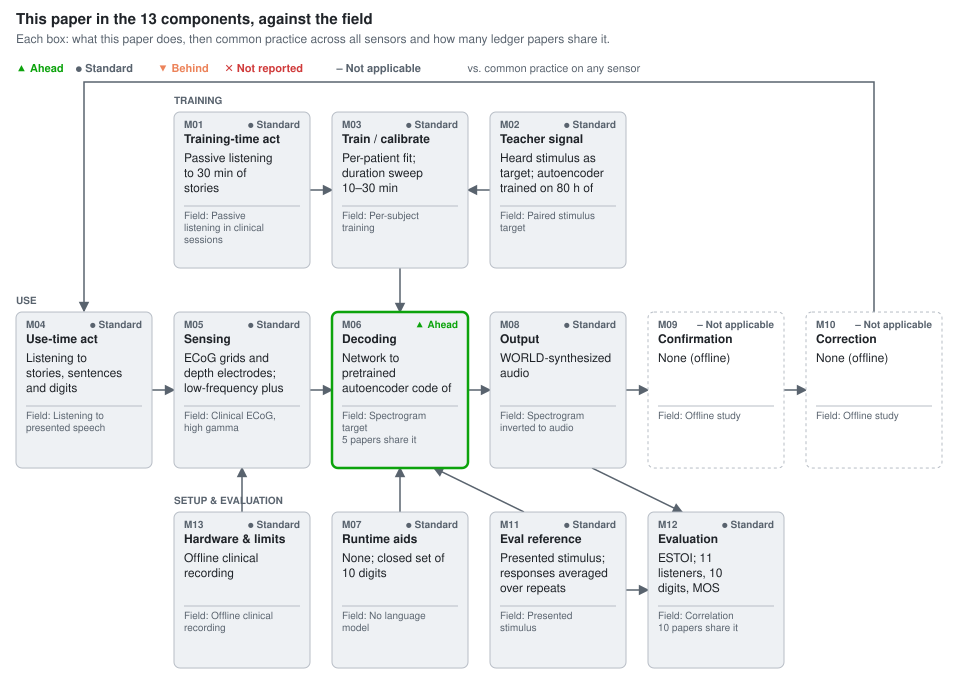

# Towards reconstructing intelligible speech from the human auditory cortex

Akbari, Khalighinejad, Herrero, Mehta, Mesgarani. Scientific Reports 9: 874, 2019. [doi:10.1038/s41598-018-37359-z](https://doi.org/10.1038/s41598-018-37359-z)

**Section:** [Other sensors](../../README.md#other-sensors)

## Figures

### This paper in the 13 components, against the field

<picture><source media="(prefers-color-scheme: dark)" srcset="figures/components-dark.svg"></picture>

Verdicts compare the paper's choice for each component with common practice across 8,995 ledger entries on any sensor (silent speech, brain-to-text, lip reading).

Data

| Component | This paper | Common practice | Papers with this practice | Verdict |
| --- | --- | --- | --- | --- |
| M01 Training-time act | Passive listening to 30 min of stories | Passive listening in clinical sessions |  | ● Standard (Inherited.) |
| M02 Teacher signal | Heard stimulus as target; autoencoder trained on 80 h of external speech | Paired stimulus target |  | ● Standard (External corpus shapes the target.) |
| M03 Train / calibrate | Per-patient fit; duration sweep 10–30 min | Per-subject training |  | ● Standard (Duration sweep uses 128 electrodes pooled across patients.) |
| M04 Use-time act | Listening to stories, sentences and digits | Listening to presented speech |  | ● Standard (Inherited.) |
| M05 Sensing | ECoG grids and depth electrodes; low-frequency plus high-gamma input | Clinical ECoG, high gamma |  | ● Standard (Both bands for all models; band gain shown for one model (Fig. 5A).) |
| M06 Decoding | Network to pretrained autoencoder code of WORLD parameters | Spectrogram target | 5 of 5 | ▲ Ahead (New for heard speech; gain isolates the coding step.) |
| M07 Runtime aids | None; closed set of 10 digits | No language model |  | ● Standard (Closed set serves M12 only.) |
| M08 Output | WORLD-synthesized audio | Spectrogram inverted to audio |  | ● Standard (Harmonics recovered only by the coded vocoder.) |
| M09 Confirmation | None (offline) | Offline study |  | – Not applicable (Offline study.) |
| M10 Correction | None (offline) | Offline study |  | – Not applicable (Offline study.) |
| M11 Eval reference | Presented stimulus; responses averaged over repeats | Presented stimulus |  | ● Standard (Six or eight repeats, text inconsistent.) |
| M12 Evaluation | ESTOI; 11 listeners, 10 digits, MOS | Correlation | 10 of 10 | ● Standard (Departs, but unrepeated across patients.) |
| M13 Hardware & limits | Offline clinical recording | Offline clinical recording |  | ● Standard (Inherited.) |

## Verdict

The paper [[1]](#ref-1) changes the decoding target (M06), adds listener scoring (M12) and uses low-frequency plus high-gamma input (M05, Fig. 5A). M06 is ahead for heard speech: none of the 5 earlier heard-speech intracranial reconstruction studies decodes vocoder parameters or a pretrained compressed code (Appendix), and the four-model ordering repeats in each of five patients (Fig. 4). The claim that synthesizer parameters had never been estimated from neural data does not hold: formant-synthesizer parameters were decoded in 2009 [[2]](#ref-2) and ten LPC coefficients from ECoG in 2015 [[3]](#ref-3), both during production. The strongest confound is the coding step: raw vocoder parameters score below the spectrogram (ESTOI 0.30 against 0.40, Supplementary Table 2), and only the autoencoder code reaches 0.47. M12 departs from correlation-only practice but stays standard: the listener result comes from one unnamed patient or aggregation, with no repetition across patients.

## Against the field, component by component

### M06 Processing and decoding: decoding target

**Usual approach:** among heard-speech intracranial reconstruction studies first public 2017 or earlier (target bioRxiv 2018-06; 2018 works counted as [concurrent]), all 5 decode a spectrogram, 4 by linear regression and 1 by a deep network, and Pasley et al. also decode modulation energy (pattern match, Appendix) [[4]](#ref-4), [[5]](#ref-5), [[6]](#ref-6). The paper departs in the target, an autoencoder code of WORLD parameters pretrained on 80 hours of external speech.

**State of the art:** for heard speech, Li et al. (2024) [later] decode a frozen pretrained wav2vec 2.0 latent from 9 participants listening to TIMIT sentences, and listeners transcribe 71.6% of words [[7]](#ref-7). Their ESTOI of 0.377 is below the target's 0.47, but the target averaged repeated responses (inference). For production, listeners match 94.34% of sentences among 6 and transcribe at a median 43.75% WER [[8]](#ref-8) (2025) [later].

Before the target, 5 studies decoded synthesizer-like parameters from neural signals, all during production and 4 from the Guenther lineage; none decoded a compressed code (Appendix). The evidence isolates the coding step, not the corpus: coded parameters gain +17.5% relative ESTOI over the network spectrogram (0.47 against 0.40) while raw parameters lose (0.30) (inference). A later heard-speech latent decoder correlated worse than direct mel decoding [[9]](#ref-9) [later]. Every model receives both bands (Fig. 1), so the band change does not confound the target comparison. Verdict: ahead for heard speech, credited to the externally pretrained compressed target, with the five-patient ESTOI ordering as repetition.

### M12 Evaluation: listener intelligibility test

**Usual approach:** correlation, as the authors themselves state (Introduction). All 10 reconstruction evaluations in the topic table first public 2017 or earlier score correlation, and none has listeners rate decoded audio (pattern match, Appendix).

**State of the art:** listeners match 94.34% of sentences among 6 and transcribe at a median 43.75% WER in production [[8]](#ref-8) (2025) [later]; for heard speech, 71.6% of words are transcribed [[7]](#ref-7) [later]; open transcription arrived concurrently, a median 31% WER with a 25-word pool [[10]](#ref-10) [concurrent].

The design departs from the field, but a difference not supported well enough stays standard: networks are per patient, the patient behind the 40 tokens per model is not named, and digits were repeated six times (Methods), so the result is not repeated across patients. Verdict: standard.

## The 13 components

| Component | This paper | Usual approach (count) | State of the art | Verdict |
|---|---|---|---|---|
| M01 Training-time action | Passive listening to 30 min of stories | Passive listening in clinical sessions | – | standard |
| M02 Training-only supervision | Heard stimulus as target; autoencoder trained on 80 h of external speech | Paired stimulus target | – | standard |
| M03 Training and adaptation | Per-patient fit; duration sweep 10–30 min | Per-subject training | – | standard |
| M04 Use-time action | Listening to stories, sentences and digits | Listening to presented speech | – | standard |
| M05 Sensors | ECoG grids and depth electrodes; low-frequency plus high-gamma input | Clinical ECoG, high gamma | – | standard |
| M06 Processing and decoding | Network to pretrained autoencoder code of WORLD parameters | Spectrogram target (pattern match 5) | [[7]](#ref-7) (2024): 71.6% heard-speech word transcription | ahead |
| M07 Lexicon and LM | None; closed set of 10 digits | No language model | – | standard |
| M08 Output | WORLD-synthesized audio | Spectrogram inverted to audio | – | standard |
| M09 Confirmation | None (offline) | Offline study | – | not applicable |
| M10 Correction | None (offline) | Offline study | – | not applicable |
| M11 Reference construction | Presented stimulus; responses averaged over repeats | Presented stimulus | – | standard |
| M12 Evaluation | ESTOI; 11 listeners, 10 digits, MOS | Correlation (pattern match 10) | [[8]](#ref-8) (2025): 94.34% six-sentence match | standard |
| M13 Device and cost | Offline clinical recording | Offline clinical recording | – | standard |

## Where the claims outrun the evidence

- Priority (Introduction): "this has not been attempted previously" is contradicted by production work [[2]](#ref-2), [[3]](#ref-3) (Appendix), although the reference list cites an ECoG speech-decoding review and Herff et al.'s direct-synthesis pilot.
- Coding (Supplementary Table 2): raw vocoder 0.30, network spectrogram 0.40, coded vocoder 0.47. No coded spectrogram was tested.
- Bottleneck (Supplementary Table 3): objective scores tie at 0.47 for 32, 128 and 256 nodes; the subjective comparison cited to pick 256 is not reported.
- Headline: 65% (Abstract) against 67% (Results, Fig. 3) over one baseline.
- Averaging (M11): objective sentences repeated six times (Results, Supp. Fig. 1) or eight (Methods), and averaged.
- Listeners: 11 (Fig. 3 caption) against "all the ten" in Results.
- Pooling (M05, M03): the electrode sweep and the 10 to 30 minute duration sweep both use up to 128 electrodes pooled across five patients (Fig. 5), a coverage no patient had.

## What the field needs next

- M06: coded spectrogram against coded vocoder, one corpus, same patients.
- M12: open-set listener transcription of single-trial heard-speech reconstructions, per patient.
- M06: latent against mel targets scored by listeners, settling the [later] correlation result [[9]](#ref-9).

## Questions for the authors

- Which patient, or which aggregation of the five per-patient models, produced the 40 tokens per model?
- Were listener tokens decoded from single trials or from the average of six digit repetitions?
- Were the objective sentences presented six or eight times?
- Which validation data, folds and seeds selected the bottleneck size and feature extractor?
- How were "uncertain" responses scored, and what chance levels apply to digit and gender identification?

## Appendix: literature search

- **M06 / heard-speech-reconstruction-target-representation** (published table, reused and appended). Inclusion rule: studies whose ledger text names intracranial or auditory-cortex recordings, a listening or perception condition, an acoustic representation and reconstruction, decoding or synthesis; design of interest: the representation the decoder reconstructs; versions count once. Ledger counts: slot-filled 7,345 unique studies; pattern match 64 unique studies (72 folders), plus 5 full-text-only folders. First public 2017 or earlier: 11 matches, 4 heard-speech intracranial reconstruction studies, 7 off-population, plus [[5]](#ref-5) (undated in the index); among the 5: spectrogram target 5, modulation energy 1, linear regression 4, deep regression 1, vocoder or synthesizer target 0, compressed latent 0 (pattern match). Whole-wiki full-text check to 2018 for synthesizer-like parameters near a neural-recording term: 18 keys, versions not merged; neural decoders first public before 2018-06: 5, all production (Guenther lineage 4, [[3]](#ref-3) 1); Brumberg 2018 (EEG imagery) [concurrent]; the rest reviews, mentions or non-neural. Autoencoder or bottleneck target to 2018: 0. Read in full: [[6]](#ref-6), [[2]](#ref-2), [[3]](#ref-3), [[5]](#ref-5), [[9]](#ref-9), [[7]](#ref-7); read for the published table: [[4]](#ref-4), [[11]](#ref-11). Known-item recall 1.0 (3 seeds).
- **M12 / neural-speech-reconstruction-identification-test** (published table, reused and appended). Inclusion rule: studies that reconstruct a continuous acoustic speech representation from neural recordings and evaluate it; attention decoding that selects a talker is excluded; versions count once. Ledger counts: pattern match 173 unique studies (221 folders). First public 2017 or earlier: 19 matches, 9 reconstruction evaluations plus [[5]](#ref-5), 10 excluded (reviews, classifiers, attention decoding, encoding or entrainment; ids in the audit); correlation 10 of 10, listener rating of decoded audio 0 of 10 (whole-wiki sentence-level check: 6 hits, none rating neural reconstructions). Read: [[8]](#ref-8), [[7]](#ref-7), [[10]](#ref-10). Known-item recall 0.67.

## References

Numbered by first citation. BibTeX in the same order and keys: [refs.bib](refs.bib).

1. Akbari, H., Khalighinejad, B., Herrero, J. L., Mehta, A. D., Mesgarani, N. “Towards reconstructing intelligible speech from the human auditory cortex.” *Scientific Reports*, 2019, 9, 874. doi:[10.1038/s41598-018-37359-z](https://doi.org/10.1038/s41598-018-37359-z). Target. Read as the Scientific Reports article with its supplement; first public as bioRxiv 10.1101/350124 (2018-06). [wiki: doi-10.1038-s41598-018-37359-z](https://github.com/supernaiter/deep-research-wiki-for-silent-speech/blob/main/papers/doi-10.1038-s41598-018-37359-z/article.md) [wiki: pmc-6351601-audrecon](https://github.com/supernaiter/deep-research-wiki-for-silent-speech/blob/main/papers/pmc-6351601-audrecon/article.md) [wiki: pmc-6351601-intelligible](https://github.com/supernaiter/deep-research-wiki-for-silent-speech/blob/main/papers/pmc-6351601-intelligible/article.md)
2. Guenther, F. H., Brumberg, J. S., Wright, E. J., Nieto-Castanon, A., Tourville, J. A., Panko, M., et al. “A Wireless Brain-Machine Interface for Real-Time Speech Synthesis.” *PLoS ONE*, 2009, 4(12), e8218. doi:[10.1371/journal.pone.0008218](https://doi.org/10.1371/journal.pone.0008218). Prior; deciding prior for M06 (formant-synthesizer parameters decoded during attempted production). [review](https://github.com/supernaiter/silent-speech-review/tree/main/reviews/a-wireless-brain-machine-interface-for-real-time-speech-synthesis) [wiki: pmc-2784218-wireless](https://github.com/supernaiter/deep-research-wiki-for-silent-speech/blob/main/papers/pmc-2784218-wireless/article.md)
3. Chakrabarti, S. “Characterization and Decoding of Speech Representations From the Electrocorticogram.” *Old Dominion University*, 2015. doi:[10.25777/he41-jj63](https://doi.org/10.25777/he41-jj63). Prior; deciding prior for M06 (LPC coefficients decoded from ECoG during overt speaking). Thesis dated Summer 2015. [wiki: doi-10.25777-he41-jj63](https://github.com/supernaiter/deep-research-wiki-for-silent-speech/blob/main/papers/doi-10.25777-he41-jj63/article.md)
4. Pasley, B. N., David, S. V., Mesgarani, N., Flinker, A., Shamma, S. A., Crone, N. E., et al. “Reconstructing Speech from Human Auditory Cortex.” *PLoS Biology*, 2012, 10(1), e1001251. doi:[10.1371/journal.pbio.1001251](https://doi.org/10.1371/journal.pbio.1001251). Prior; heard-speech linear spectrogram reconstruction. [review](https://github.com/supernaiter/silent-speech-review/tree/main/reviews/reconstructing-speech-from-human-auditory-cortex) [wiki: doi-10.1371-journal.pbio.1001251](https://github.com/supernaiter/deep-research-wiki-for-silent-speech/blob/main/papers/doi-10.1371-journal.pbio.1001251/article.md) [wiki: pmc-3269422-pasley](https://github.com/supernaiter/deep-research-wiki-for-silent-speech/blob/main/papers/pmc-3269422-pasley/article.md) [wiki: pmc-3269422-speechrecon](https://github.com/supernaiter/deep-research-wiki-for-silent-speech/blob/main/papers/pmc-3269422-speechrecon/article.md)
5. Mesgarani, N., Chang, E. F. “Selective cortical representation of attended speaker in multi-talker speech perception.” *Nature*, 2012, 485(7397), 233-236. doi:[10.1038/nature11020](https://doi.org/10.1038/nature11020). Prior; heard-speech spectrogram reconstruction from ECoG. [wiki: doi-10.1038-nature11020](https://github.com/supernaiter/deep-research-wiki-for-silent-speech/blob/main/papers/doi-10.1038-nature11020/article.md)
6. Yang, M., Sheth, S. A., Schevon, C. A., McKhann, G. M., Mesgarani, N. “Speech Reconstruction from Human Auditory Cortex with Deep Neural Networks.” *Proc. Interspeech 2015*, 2015. doi:[10.21437/Interspeech.2015-478](https://doi.org/10.21437/Interspeech.2015-478). Prior; deciding prior for M06 (heard speech, DNN versus linear regression, spectrogram target). [wiki: isca-yang15c_interspeech](https://github.com/supernaiter/deep-research-wiki-for-silent-speech/blob/main/papers/isca-yang15c_interspeech/article.md)
7. Li, J., Guo, C., Chang, E. F., Li, Y. “Natural speech re-synthesis from direct cortical recordings using a pre-trained encoder-decoder framework.” *bioRxiv*, 2024. doi:[10.1101/2024.12.16.628596](https://doi.org/10.1101/2024.12.16.628596). Later; heard-speech state of the art for M06 (pre-trained wav2vec 2.0 latent, listener transcription). [later] [wiki: doi-10.1101-2024.12.16.628596](https://github.com/supernaiter/deep-research-wiki-for-silent-speech/blob/main/papers/doi-10.1101-2024.12.16.628596/article.md)
8. Wairagkar, M., Card, N. S., Singer-Clark, T., Hou, X., Iacobacci, C., Miller, L. M., et al. “An instantaneous voice-synthesis neuroprosthesis.” *Nature*, 2025, 644(8075), 145–152. doi:[10.1038/s41586-025-09127-3](https://doi.org/10.1038/s41586-025-09127-3). Later; production listener state of the art for M12. [later] [review](https://github.com/supernaiter/silent-speech-review/tree/main/reviews/an-instantaneous-voice-synthesis-neuroprosthesis) [wiki: doi-10.1038-s41586-025-09127-3](https://github.com/supernaiter/deep-research-wiki-for-silent-speech/blob/main/papers/doi-10.1038-s41586-025-09127-3/article.md) [wiki: doi-10.1101-2024.08.14.607690](https://github.com/supernaiter/deep-research-wiki-for-silent-speech/blob/main/papers/doi-10.1101-2024.08.14.607690/article.md) [wiki: pmc-12369848-voicesynth](https://github.com/supernaiter/deep-research-wiki-for-silent-speech/blob/main/papers/pmc-12369848-voicesynth/article.md) [wiki: pmc-12369848-voice-synth-np](https://github.com/supernaiter/deep-research-wiki-for-silent-speech/blob/main/papers/pmc-12369848-voice-synth-np/article.md) [wiki: pmc-11370360-instvoice](https://github.com/supernaiter/deep-research-wiki-for-silent-speech/blob/main/papers/pmc-11370360-instvoice/article.md)
9. Berezutskaya, J., Ambrogioni, L., Ramsey, N. F., van Gerven, M. A. J. “Towards naturalistic speech decoding from intracranial brain data.” *2022 44th Annual International Conference of the IEEE Engineering in Medicine & Biology Society (EMBC)*, 2022, 3100-3104. doi:[10.1109/EMBC48229.2022.9871301](https://doi.org/10.1109/EMBC48229.2022.9871301). Later; heard-speech decoding of a compressed GAN latent. [later] [wiki: doi-10.1109-embc48229.2022.9871301](https://github.com/supernaiter/deep-research-wiki-for-silent-speech/blob/main/papers/doi-10.1109-embc48229.2022.9871301/article.md)
10. Anumanchipalli, G. K., Chartier, J., Chang, E. F. “Speech synthesis from neural decoding of spoken sentences.” *Nature*, 2019, 568(7753), 493-498. doi:[10.1038/s41586-019-1119-1](https://doi.org/10.1038/s41586-019-1119-1). Concurrent (bioRxiv 10.1101/481267, 2018-11); listener transcription of synthesized sentences. [concurrent] [review](https://github.com/supernaiter/silent-speech-review/tree/main/reviews/speech-synthesis-from-neural-decoding-of-spoken-sentences) [wiki: doi-10.1038-s41586-019-1119-1](https://github.com/supernaiter/deep-research-wiki-for-silent-speech/blob/main/papers/doi-10.1038-s41586-019-1119-1/article.md) [wiki: pmc-9714519-speechsynth](https://github.com/supernaiter/deep-research-wiki-for-silent-speech/blob/main/papers/pmc-9714519-speechsynth/article.md)
11. Chang, E. F., Rieger, J. W., Johnson, K., Berger, M. S., Barbaro, N. M., Knight, R. T. “Categorical Speech Representation in Human Superior Temporal Gyrus.” *Nature Neuroscience*, 2010, 13(11), 1428-1432. doi:[10.1038/nn.2641](https://doi.org/10.1038/nn.2641). Prior; read for the published M06 topic table (pSTG ECoG, passive listening, classification). [wiki: pmc-2967728-categoricalstg](https://github.com/supernaiter/deep-research-wiki-for-silent-speech/blob/main/papers/pmc-2967728-categoricalstg/article.md)

## Materials

Data behind this review. Full texts of the papers are not included.

- [`review.md`](review.md): the review text (source)
- [`refs.bib`](refs.bib): references (BibTeX)
- [`slots.json`](slots.json): for each of the 13 components: this paper's choice, field practice, number of matching papers, verdict
- [`figures.json`](figures.json): figure definitions
- [`evaluation.md`](evaluation.md): independent evaluation by a second reviewer
- [`triage.md`](triage.md): how each evaluation finding was checked against the sources and resolved
- [`process/log.json`](process/log.json): process record: each step, who did it (reader, script, writer, evaluator), when, the checks run and the input versions
- [`process/notes.json`](process/notes.json): reading notes on the target and comparator papers: claims, numbers, conditions and what is not stated, with locations
- [`process/plan.json`](process/plan.json): plan: which components the paper changes and the topics it is compared on
- [`process/draft.md`](process/draft.md): the review as first written, before the independent evaluation
- [`process/claims-draft.md`](process/claims-draft.md): claim table of the draft: every claim mapped to a note or a count
- [`process/claims.md`](process/claims.md): claim table of the published review
- [`components/M06/heard-speech-reconstruction-target-representation.csv`](../../components/M06/heard-speech-reconstruction-target-representation.csv): M06 topic "heard-speech-reconstruction-target-representation", every candidate paper with its decision (7345 slot-filled, 64 pattern match, usual design in 24, 4 read in full)
- [`components/M12/neural-speech-reconstruction-identification-test.csv`](../../components/M12/neural-speech-reconstruction-identification-test.csv): M12 topic "neural-speech-reconstruction-identification-test", every candidate paper with its decision (6960 slot-filled, 173 pattern match, usual design in 122, 4 read in full)

## More reviews in Other sensors

- [Real-time decoding of question-and-answer speech dialogue using human cortical activity](../real-time-decoding-of-question-and-answer-speech-dialogue-using-human-cortical-activity/) (2019). Context prior from the decoded question (M07) is ahead, gaining in 3 of 3 participants; HMM decoder (M06) is standard; no online accuracy or latency backs the real-time claim.
- [Recurrent Neural Network Transducer for Audio-Visual Speech Recognition](../recurrent-neural-network-transducer-for-audio-visual-speech-recognition/) (2019). First neural transducer for audio-visual speech in the ledger, but the LRS3 gain mixes 31k h of data, external-LM baselines and the decoder; one run, one test set: all changes standard.
- [Speech Synthesis from ECoG using Densely Connected 3D Convolutional Neural Networks](../speech-synthesis-from-ecog-using-densely-connected-3d-convolutional-neural-networks/) (2019). 3D DenseNet regressor (M06) and LJ-Speech WaveNet (M08) are standard: no in-paper baseline, mixed later head-to-heads, and no listener test behind the quality claims.
- [ASR is all you need: cross-modal distillation for lip reading](../asr-is-all-you-need-cross-modal-distillation-for-lip-reading/) (2020). ASR-teacher labels (M02) replaced transcribed-data alignment targets; standard: LRS2 parity holds, but effects differ across datasets, one WER each, and distillation is not isolated.
- [Lipreading using Temporal Convolutional Networks](../lipreading-using-temporal-convolutional-networks/) (2020). Multi-scale TCN (M06) and variable-length cropping (M03) are standard: head and augmentation are not separated, no run counts, robustness comes from the cropping; 85.3% LRW trails 93.2% today.
- [Machine translation of cortical activity to text with an encoder-decoder framework](../machine-translation-of-cortical-activity-to-text-with-an-encoder-decoder-framework/) (2020). Word-level ECoG encoder-decoder; all changed components standard. 3% WER is on repeats of 50 sentences; unseen sentences and participants were never tested.

---

Part of the [Silent Speech Interface Review](https://github.com/supernaiter/silent-speech-review). Found an error? [Open an issue](https://github.com/supernaiter/silent-speech-review/issues/new?template=correction.yml).
