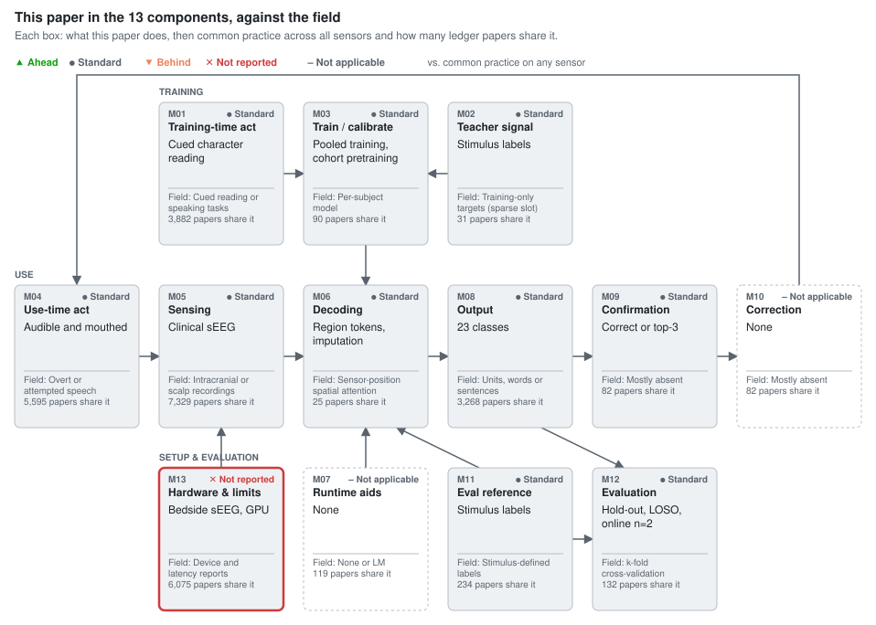

# Towards Unified Neural Decoding with Brain Functional Network Modeling

Wu, D., Bu, L., Jia, Y., et al. · arXiv preprint · 2025 · [arXiv:2506.12055](https://arxiv.org/abs/2506.12055)

**Section:** [Brain signals (EEG, MEG, intracortical)](../../README.md#brain-signals-eeg-meg-intracortical)

## Figures

### This paper in the 13 components, against the field

<picture><source media="(prefers-color-scheme: dark)" srcset="figures/components-dark.svg"></picture>

Verdicts compare the paper's choice for each component with common practice across 8,995 ledger entries on any sensor (silent speech, brain-to-text, lip reading).

Data

| Component | This paper | Common practice | Papers with this practice | Verdict |
| --- | --- | --- | --- | --- |
| M01 Training-time act | Cued character reading | Cued reading or speaking tasks | 3,882 of 8,995 | ● Standard (Inherited.) |
| M02 Teacher signal | Stimulus labels | Training-only targets (sparse slot) | 31 of 8,995 | ● Standard (Inherited.) |
| M03 Train / calibrate | Pooled training, cohort pretraining | Per-subject model | 90 of 8,995 | ● Standard (Both designs predate it.) |
| M04 Use-time act | Audible and mouthed | Overt or attempted speech | 5,595 of 8,995 | ● Standard (Inherited.) |
| M05 Sensing | Clinical sEEG | Intracranial or scalp recordings | 7,329 of 8,995 | ● Standard (Inherited.) |
| M06 Decoding | Region tokens, imputation | Sensor-position spatial attention | 25 of 8,995 | ● Standard (Voting for unseen subjects.) |
| M07 Runtime aids | None | None or LM | 119 of 8,995 | – Not applicable (Closed set.) |
| M08 Output | 23 classes | Units, words or sentences | 3,268 of 8,995 | ● Standard (Inherited.) |
| M09 Confirmation | Correct or top-3 | Mostly absent | 82 of 8,995 | ● Standard (Inherited.) |
| M10 Correction | None | Mostly absent | 82 of 8,995 | – Not applicable (None.) |
| M11 Eval reference | Stimulus labels | Stimulus-defined labels | 234 of 8,995 | ● Standard (Inherited.) |
| M12 Evaluation | Hold-out, LOSO, online n=2 | k-fold cross-validation | 132 of 8,995 | ● Standard (No absolute accuracy.) |
| M13 Hardware & limits | Bedside sEEG, GPU | Device and latency reports | 6,075 of 8,995 | ✕ Not reported (No latency.) |

## Verdict

MIBRAIN [[1]](#ref-1) changes training (M03), pooling 11 sEEG participants behind subject-specific encoders after masked pretraining, and the decoder input (M06), region tokens with prototypes for unrecorded regions. Both are standard: region-level masked pretraining for Mandarin sEEG speech predates it and is not cited [[2]](#ref-2), and so do pooled layout-agnostic intracranial decoders tested on held-out participants [[3]](#ref-3). The generalization claim is not supported: the text gives no absolute accuracy, and the online test, described as needing no subject-specific calibration or training, uses models trained on the test participants' data (Methods: Experimental setup). The only baselines, Brant and BrainBERT, were already known to fall far below region-level task pretraining on sEEG word decoding [[2]](#ref-2).

## Against the field, component by component

### M03 Training: pooled multi-subject training and task-cohort pretraining

**Usual approach:** Of 379 unique studies on pooled cross-subject training (pattern match incl. full text, Appendix), 90 name a per-subject model and 34 a subject-specific layer; of 40 that bring neural pretraining to speech decoding, 28 fine-tune a general checkpoint such as Brant or BrainBERT and 6 pretrain on speech-task recordings. MIBRAIN does both on its own task cohort.

**State of the art:** Du-IN (2024, prior): 62.70% top-1 on 61 spoken Mandarin words from sEEG in 12 subjects, with region-level masked pretraining; Brant scores 11.16% to 12.42% and BrainBERT 6.72% to 7.50% on the same task [[2]](#ref-2). For transfer, Singh et al. (2025, [concurrent]) lower phoneme error rate in 25 sEEG patients from 57% (within-subject) to 49% with one transfer subject and 45% after four [[4]](#ref-4).

MIBRAIN finds Brant and BrainBERT barely above chance on its 23 classes (p. 8); Du-IN had already shown them far below region-level pretraining [[2]](#ref-2), so beating them shows little. Du-IN also found cross-subject pretraining worse than per-subject masked pretraining, 59.18% against 62.70%, a 5.6% relative loss (inference) [[2]](#ref-2); MIBRAIN never tests its cross-subject prototypes against that alternative. The pooling gain is named for participants 10 and 11 only: 8.08% and 6.83% (audible) and 5.10% and 4.97% (silent) offline, without units (Results). Adding fewer than three participants significantly lowered audible accuracy for participant 11, with one enrollment order tested (Results: Integrating more participants' data). Verdict: standard.

### M06 Decoder input: region tokens and imputed regions

**Usual approach:** Of 98 unique studies that train one speech decoder across differing electrode layouts (pattern match, Appendix), 25 use sensor-position spatial attention, 12 a per-subject or per-dataset input layer and 6 a graph over electrodes. MIBRAIN uses per-subject input layers, adding prototypes for missing regions.

**State of the art:** Chen et al. (2024, prior): one transformer takes ECoG and sEEG of any layout and reaches mean spectrogram PCC 0.765 on participants left out of training [[3]](#ref-3). MIBRAIN decodes an unseen participant by majority voting through the other participants' encoders (Methods: Neural Decoding on Unseen Subject), as the authors concede (Discussion).

Imputation is validated only by correlation with recorded region features and by above-chance decoding from imputed regions, except participants 4 and 8 in the audible task (Results). The Discussion's claim that this beats state-of-the-art direct-recording methods has no number. Verdict: standard.

### M12 Evaluation: test partition

**Usual approach:** Of 618 unique intracranial speech studies (pattern match, Appendix), 132 name k-fold cross-validation, 68 a random trial split, 28 a held-out subject and 27 a held-out session or day. MIBRAIN holds out seven samples per class per subject, plus leave-one-subject-out and a two-participant online test.

**State of the art:** Chen et al. (2024) test on participants left out of training [[3]](#ref-3); MIBRAIN's leave-one-subject-out test matches this uncommon design. Verdict: standard.

## The 13 components

| Component | This paper | Usual approach (count) | State of the art | Verdict |
|---|---|---|---|---|
| M01 Training-time action | Cued character reading | Cued reading or speaking tasks (slot-filled 3,882) | – | standard |
| M02 Training-only supervision | Stimulus labels | Training-only targets (sparse slot) (slot-filled 31) | – | standard |
| M03 Training and adaptation | Pooled training, cohort pretraining | Per-subject model (pattern match 90) | [[2]](#ref-2) (2024): 62.70% top-1 | standard |
| M04 Use-time action | Audible and mouthed | Overt or attempted speech (slot-filled 5,595) | – | standard |
| M05 Sensors | Clinical sEEG | Intracranial or scalp recordings (slot-filled 7,329) | – | standard |
| M06 Processing and decoding | Region tokens, imputation | Sensor-position spatial attention (pattern match 25) | [[3]](#ref-3) (2024): PCC 0.765, unseen participants | standard |
| M07 Lexicon and LM | None | None or LM (slot-filled 119) | – | not applicable |
| M08 Output | 23 classes | Units, words or sentences (slot-filled 3,268) | – | standard |
| M09 Confirmation | Correct or top-3 | Mostly absent (slot-filled 82) | – | standard |
| M10 Correction | None | Mostly absent (slot-filled 82) | – | not applicable |
| M11 Reference construction | Stimulus labels | Stimulus-defined labels (slot-filled 234) | – | standard |
| M12 Evaluation | Hold-out, LOSO, online n=2 | k-fold cross-validation (pattern match 132) | [[3]](#ref-3) (2024): leave-one-out | standard |
| M13 Device and cost | Bedside sEEG, GPU | Device and latency reports (slot-filled 6,075) | – | not reported |

## Where the claims outrun the evidence

- Online accuracy is said to exceed chance without subject-specific calibration or training (p. 10), yet the single-subject model is trained on the participant's own data and the multi-subject model on all 11 participants (Methods, p. 28).
- No absolute accuracy or chance value appears in the text or Tables S1–S5, only bars (Fig. 2–3).
- Channel selection precedes the split, with no stated test-sample exclusion (p. 24; p. 28).
- No seeds or repeated runs are reported (p. 28).

## What the field needs next

- M03: on one sEEG cohort, compare pooled prototypes with per-subject masked pretraining and shared-latent transfer, with absolute accuracy and several participant orders.
- M06: decode unseen participants with one model, no voting; remove recorded regions to measure what imputation recovers.
- M12: hold out whole sessions, fit channel selection on training data only, report seeds.

## Questions for the authors

- What are the absolute accuracies and chance levels behind Fig. 2 and Fig. 3, and are the improvements percentage points or relative?
- Were the online sessions of participants 10 and 11 excluded from the data used to train both models?
- Were the 161 offline test samples per participant excluded from channel selection and pretraining?
- Why is Du-IN not among the baselines?

## Appendix: literature search

- M03, cross-subject-pooled-training (published table, reused). Inclusion rule: speech or language decoders from neural or other biosignals that train one model on data pooled across participants, with or without participant-specific layers or embeddings; per-participant models averaged over participants excluded; transfer by fine-tuning counts; versions count once. Ledger: 1,526 unique studies slot-filled for M03; 370 unique studies pattern match in the ledger, 379 with full-text-only matches added. Designs over the 379 (pattern match): per-subject model 90, leave-one-subject-out 75, subject-specific layer 34. Read in full: [[4]](#ref-4), [[2]](#ref-2), [[3]](#ref-3). Known-item recall 1.0.
- M03, neural-foundation-model-speech-transfer (published table, reused). Inclusion rule: speech or language decoders from EEG, MEG or intracranial recordings that initialize from a checkpoint pretrained on large neural corpora and fine-tune it for speech decoding; speech-audio or video foundation models excluded; mentions count as pattern matches (upper bound); versions count once. Ledger: 1,526 unique studies slot-filled for M03; 40 unique studies pattern match. General neural checkpoint 28, speech-specific pretraining 6 (pattern match). Read in full: [[2]](#ref-2). Known-item recall 1.0.
- M06, heterogeneous-electrode-configuration-input (published table, reused). Inclusion rule: speech or language decoders from EEG, MEG, ECoG, sEEG or EMG that train one model on recordings whose channel count or layout differs across participants, devices or datasets by mapping channels into a shared space; one fixed montage, within-array subset selection and non-speech models excluded; versions count once. Ledger: 7,345 unique studies slot-filled for M06; 98 unique studies pattern match. Sensor-position spatial attention 25, per-subject or per-dataset input layer 12, graph over electrodes 6 (pattern match). Read in full: [[3]](#ref-3), [[2]](#ref-2). Known-item recall 0.5.
- M12, intracranial-speech-test-partition (new). Inclusion rule: speech or language decoding studies from sEEG, ECoG or intracortical recordings, classified by how test data are separated from training data (random trial split, k-fold cross-validation, held-out session or day, held-out subject); the pattern also admits reviews and studies that only mention intracranial work, so counts are upper bounds; versions count once. Ledger: 6,960 unique studies slot-filled for M12; 618 unique studies pattern match. k-fold cross-validation 132, random trial split 68, held-out subject 28, held-out session or day 27 (pattern match). Read in full: [[3]](#ref-3), [[4]](#ref-4). Known-item recall 1.0.

## References

Numbered by first citation. BibTeX in the same order and keys: [refs.bib](refs.bib).

1. Wu, D., Bu, L., Jia, Y., Cao, L., Li, S., Chen, S., et al. “Towards Unified Neural Decoding with Brain Functional Network Modeling.” *arXiv preprint*, 2025. doi:[10.48550/arXiv.2506.12055](https://doi.org/10.48550/arXiv.2506.12055). arXiv:[2506.12055](https://arxiv.org/abs/2506.12055). Target. Read as arXiv v1. [review](https://github.com/supernaiter/silent-speech-review/tree/main/reviews/towards-unified-neural-decoding-with-brain-functional-network-modeling) [wiki: arxiv-2506.12055](https://github.com/supernaiter/deep-research-wiki-for-silent-speech/blob/main/papers/arxiv-2506.12055/article.md)
2. Zheng, H., Wang, H., Jiang, W., Chen, Z., He, L., Lin, P., et al. “Du-IN: Discrete units-guided mask modeling for decoding speech from Intracranial Neural signals.” *Advances in Neural Information Processing Systems (NeurIPS)*, 2024. arXiv:[2405.11459](https://arxiv.org/abs/2405.11459). Prior; deciding prior for M03 (masked self-supervised pretraining on sEEG speech, Mandarin, compared with Brant and BrainBERT). [wiki: arxiv-2405.11459](https://github.com/supernaiter/deep-research-wiki-for-silent-speech/blob/main/papers/arxiv-2405.11459/article.md)
3. Chen, J., Chen, X., Wang, R., Le, C., Khalilian-Gourtani, A., Jensen, E., et al. “Subject-Agnostic Transformer-Based Neural Speech Decoding from Surface and Depth Electrode Signals.” *bioRxiv*, 2024. doi:[10.1101/2024.03.11.584533](https://doi.org/10.1101/2024.03.11.584533). Prior; deciding prior and state of the art for M06 (layout-agnostic multi-subject intracranial speech decoder). [wiki: doi-10.1101-2024.03.11.584533](https://github.com/supernaiter/deep-research-wiki-for-silent-speech/blob/main/papers/doi-10.1101-2024.03.11.584533/article.md) [wiki: pmc-10980022-satrans-decode](https://github.com/supernaiter/deep-research-wiki-for-silent-speech/blob/main/papers/pmc-10980022-satrans-decode/article.md) [wiki: pmc-10980022-subjagn](https://github.com/supernaiter/deep-research-wiki-for-silent-speech/blob/main/papers/pmc-10980022-subjagn/article.md)
4. Singh, A., Thomas, T., Li, J., Hickok, G., Pitkow, X., Tandon, N. “Transfer learning via distributed brain recordings enables reliable speech decoding.” *Nature Communications*, 2025, 16. doi:[10.1038/s41467-025-63825-0](https://doi.org/10.1038/s41467-025-63825-0). State of the art for M03 cross-subject transfer in sEEG speech decoding. [concurrent] [wiki: doi-10.1038-s41467-025-63825-0](https://github.com/supernaiter/deep-research-wiki-for-silent-speech/blob/main/papers/doi-10.1038-s41467-025-63825-0/article.md) [wiki: pmc-12488916-tlseeg](https://github.com/supernaiter/deep-research-wiki-for-silent-speech/blob/main/papers/pmc-12488916-tlseeg/article.md) [wiki: pmc-12488916-distdec](https://github.com/supernaiter/deep-research-wiki-for-silent-speech/blob/main/papers/pmc-12488916-distdec/article.md) [wiki: pmc-12488916-distdecode](https://github.com/supernaiter/deep-research-wiki-for-silent-speech/blob/main/papers/pmc-12488916-distdecode/article.md) [wiki: pmc-12488916-disttl](https://github.com/supernaiter/deep-research-wiki-for-silent-speech/blob/main/papers/pmc-12488916-disttl/article.md) [wiki: pmc-12488916-transfersp](https://github.com/supernaiter/deep-research-wiki-for-silent-speech/blob/main/papers/pmc-12488916-transfersp/article.md)

## Materials

Data behind this review. Full texts of the papers are not included.

- [`review.md`](review.md): the review text (source)
- [`refs.bib`](refs.bib): references (BibTeX)
- [`slots.json`](slots.json): for each of the 13 components: this paper's choice, field practice, number of matching papers, verdict
- [`figures.json`](figures.json): figure definitions
- [`evaluation.md`](evaluation.md): independent evaluation by a second reviewer
- [`triage.md`](triage.md): how each evaluation finding was checked against the sources and resolved
- [`process/log.json`](process/log.json): process record: each step, who did it (reader, script, writer, evaluator), when, the checks run and the input versions
- [`process/notes.json`](process/notes.json): reading notes on the target and comparator papers: claims, numbers, conditions and what is not stated, with locations
- [`process/plan.json`](process/plan.json): plan: which components the paper changes and the topics it is compared on
- [`process/draft.md`](process/draft.md): the review as first written, before the independent evaluation
- [`process/claims-draft.md`](process/claims-draft.md): claim table of the draft: every claim mapped to a note or a count
- [`process/claims.md`](process/claims.md): claim table of the published review
- [`components/M03/cross-subject-pooled-training.csv`](../../components/M03/cross-subject-pooled-training.csv): M03 topic "cross-subject-pooled-training", every candidate paper with its decision (1526 slot-filled, 370 pattern match, usual design in 90, 4 read in full)
- [`components/M03/neural-foundation-model-speech-transfer.csv`](../../components/M03/neural-foundation-model-speech-transfer.csv): M03 topic "neural-foundation-model-speech-transfer", every candidate paper with its decision (1526 slot-filled, 40 pattern match, usual design in 28, 2 read in full)
- [`components/M06/heterogeneous-electrode-configuration-input.csv`](../../components/M06/heterogeneous-electrode-configuration-input.csv): M06 topic "heterogeneous-electrode-configuration-input", every candidate paper with its decision (7345 slot-filled, 98 pattern match, usual design in 25, 2 read in full)
- [`components/M12/intracranial-speech-test-partition.csv`](../../components/M12/intracranial-speech-test-partition.csv): M12 topic "intracranial-speech-test-partition", every candidate paper with its decision (6960 slot-filled, 618 pattern match, usual design in 132, 2 read in full)

## More reviews in Brain signals (EEG, MEG, intracortical)

- [A Convolutional Framework for Mapping Imagined Auditory MEG into Listened Brain Responses](../a-convolutional-framework-for-mapping-imagined-auditory-meg-into-listened-brain-responses/) (2025). Mapping imagined onto listened MEG (M06) is ahead in design, but the subject-calibrated CNN gain is unproven: no ablation, a channel-shuffling null, and r 0.0113 against 0.0063.
- [An instantaneous voice-synthesis neuroprosthesis](../an-instantaneous-voice-synthesis-neuroprosthesis/) (2025). Closed-loop sentence voice from intracortical arrays holds for one participant; the design is standard, forced-choice and proxy-target metrics overstate intelligibility.
- [Brain-to-Text Decoding: A Non-invasive Approach via Typing](../brain-to-text-decoding-a-non-invasive-approach-via-typing/) (2025). Executed typing as the decoded action (M04) was ahead for MEG/EEG in 2025; keystroke-locked decoding (M06) and an n-gram LM (M07) are standard, and decoding needs known keystroke times.
- [Distinct Theta Synchrony across Speech Modes: Perceived, Spoken, Whispered, and Imagined](../distinct-theta-synchrony-across-speech-modes-perceived-spoken-whispered-and-imagined/) (2025). Exploratory comparison of EEG theta-band functional connectivity across perceived, spoken, whispered and imagined speech in ten healthy subjects; no recognition performance is measured.
- [EEG-to-Voice Decoding of Spoken and Imagined speech Using Non-Invasive EEG](../eeg-to-voice-decoding-of-spoken-and-imagined-speech-using-non-invasive-eeg/) (2025). Drops DTW from an EEG-to-Mel generator (M06, standard) but tests only the ten trained classes (M12, behind); one frozen ASR both trains and scores it, and EEG output beats recorded-speech WER.
- [Lightweight Diffusion-based Framework for Online Imagined Speech Decoding in Aphasia](../lightweight-diffusion-based-framework-for-online-imagined-speech-decoding-in-aphasia/) (2025). Diffusion EEG decoder (M06) standard: Diff-E lineage, no ablation, not smaller. Online use (M13) standard: one patient, 20 trials. M12: Table I overall row disagrees with class rows.

---

Part of the [Silent Speech Interface Review](https://github.com/supernaiter/silent-speech-review). Found an error? [Open an issue](https://github.com/supernaiter/silent-speech-review/issues/new?template=correction.yml).
