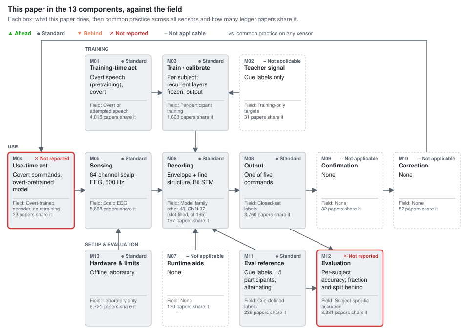

# Transfer Learning for Covert Speech Classification Using EEG Hilbert Envelope and Temporal Fine Structure

Saravanakumar Duraisamy, Mateusz Dubiel, Maurice Rekrut, Luis A. Leiva. IEEE ICASSP 2025. [doi:10.1109/ICASSP49660.2025.10888880](https://doi.org/10.1109/ICASSP49660.2025.10888880) [arXiv:2502.04132](https://arxiv.org/abs/2502.04132)

**Section:** [Brain signals (EEG, MEG, intracortical)](../../README.md#brain-signals-eeg-meg-intracortical)

## Figures

### This paper in the 13 components, against the field

<picture><source media="(prefers-color-scheme: dark)" srcset="figures/components-dark.svg"></picture>

Verdicts compare the paper's choice for each component with common practice across 8,995 ledger entries on any sensor (silent speech, brain-to-text, lip reading).

Data

| Component | This paper | Common practice | Papers with this practice | Verdict |
| --- | --- | --- | --- | --- |
| M01 Training-time act | Overt speech (pretraining), covert (fine-tuning) | Overt or attempted speech | 4,015 of 8,995 | ● Standard (Overt pretraining for covert decoding is prior practice (Lee et al., EEG).) |
| M02 Teacher signal | Cue labels only | Training-only targets | 31 of 8,995 | – Not applicable (Closed-set classification with cue labels.) |
| M03 Train / calibrate | Per subject; recurrent layers frozen, output layer re-trained on 15-30% covert | Per-participant training | 1,608 of 8,995 | ● Standard (Fine-tuning after plain transfer was named as the next step by Lee et al.; from-scratch data amount not stated.) |
| M04 Use-time act | Covert commands, overt-pretrained model | Overt-trained decoder, no retraining | 23 of 8,995 | ✕ Not reported (No overt-only condition, which prior studies and [@rekrut2022improving] report; novelty claim contradicted by both [@lee2023spoken] and [@rekrut2022improving].) |
| M05 Sensing | 64-channel scalp EEG, 500 Hz | Scalp EEG | 8,898 of 8,995 | ● Standard (Inherited from the dataset of [@rekrut2022improving].) |
| M06 Decoding | Envelope + fine structure, BiLSTM | Model family other 48, CNN 37 (slot-filled, of 165) | 167 of 8,995 | ● Standard (Recurrent model on hand-made features; no feature ablation.) |
| M07 Runtime aids | None | None | 120 of 8,995 | – Not applicable (Closed five-class task.) |
| M08 Output | One of five commands | Closed-set labels | 3,760 of 8,995 | ● Standard (Typical of imagined-speech EEG.) |
| M09 Confirmation | None | None | 82 of 8,995 | – Not applicable (Offline study.) |
| M10 Correction | None | None | 82 of 8,995 | – Not applicable (Offline study.) |
| M11 Eval reference | Cue labels, 15 participants, alternating sessions | Cue-defined labels | 239 of 8,995 | ● Standard (Covert execution is not verified; inherited protocol.) |
| M12 Evaluation | Per-subject accuracy; fraction and split behind 79.82% not stated | Subject-specific accuracy | 8,381 of 8,995 | ✕ Not reported (Printed means differ from row means; no seeds or chance level.) |
| M13 Hardware & limits | Offline laboratory | Laboratory only | 6,721 of 8,995 | ● Standard (No online or cross-day test.) |

## Verdict

The paper [[1]](#ref-1) changes the use-time action (M04, with M01 and M03): a BiLSTM trained on a person's overt-speech EEG is frozen and its output layer re-trained on 15-30% of that person's covert trials; Table II gives 79.82% on five commands against 66.94% from scratch, but not which fraction yields it. Its claim that no one had transferred an overt classifier to imagined speech is wrong: Lee et al. did so in EEG with five words [[2]](#ref-2), and the paper's own dataset study did so on these recordings, 61.78% against 71.48% for silent training [[3]](#ref-3). M04 is not reported: the overt-only condition both studies report is missing, so pretraining is not separated from covert fine-tuning. The 12.88-point gain (inference) is also confounded with an unstated from-scratch data amount and a within-person split. The features and BiLSTM (M06) are standard and never ablated.

## Against the field, component by component

### M04 Use-time action: overt-trained classifier for covert speech (with M01, M03)

**Usual approach:** Of 33 unique studies on overt-to-silent transfer (pattern match), 23 (confirmed tier), 13 of them prior to the paper, apply an overt-trained decoder to silent or covert speech without retraining and report the loss; the only prior scalp-EEG one among them is Lee et al., 7 participants and 5 words [[2]](#ref-2) (Appendix); the dataset study [[3]](#ref-3), not among the 33, ran it on these recordings. The paper skips it (§III.C).

**State of the art:** On these recordings, overt-only transfer reached 61.78% against 71.48% (2022) [[3]](#ref-3); in arXiv 2022, Lee et al. report 26.8% against 30.5% for imagined-only training [[2]](#ref-2). Neither transfer beat covert training. A 2026 technical report testing on held-out sessions found 29.2% (p = 0.04) and 25.4% (p = 0.50) against 25% chance in two subjects, and 6.7% against 6.25% over 21 subjects [[4]](#ref-4) [later]. The paper's 79.82%, 12.88 points (19.2% relative, inference) above its 66.94% from scratch (Tables II, III), mixes transfer with covert training; its from-scratch baseline is below that 71.48% (inference).

Fig. 3 rises from about 48% at 15% covert data to about 81% at 30% (inference), and Table III does not state the covert data used from scratch. In [[4]](#ref-4) [later], testing on the training trials inflated transfer through trial identity (9.0% vs 6.7%); here the covert test set is 20% of "unknown" data with no session boundary (§IV.B), so the same leak may apply (inference). Verdict: not reported: the transfer claim needs the overt-only control that prior studies report.

### M06 Processing: Hilbert envelope and fine structure into a BiLSTM

**Usual approach:** Of 167 unique imagined-speech EEG classification studies (pattern match; 165 with the model slot filled), model families are other 48, CNN 37, SVM 17, linear 16, recurrent 16 (Appendix). The paper feeds 1000 x 128 envelope and fine-structure features into a BiLSTM (§III.B).

**State of the art:** The best value read in its source is 96.4% for four covert syllables, 64-channel EEG, 10 participants, cross-validated within each person, published 2019 [[5]](#ref-5), with one class per recording run, a block design the paper avoids (§III.A.2). In 2025 on this dataset, the same authors' ENV+TFS BiLSTM with this 64-channel input reaches 30.63% with subjects pooled and 18.41% on a held-out subject (59.14% and 27.15% with 42 channels in three bands) [[6]](#ref-6) [concurrent], so the 79.82% holds only within a person.

The paper claims an advantage of ENV and TFS over wavelet, CSP and Riemannian features (§III.B) but runs no raw-EEG, ENV-only or TFS-only model, and the five overt-covert envelope correlations, 0.4791 (PICK) to 0.6607 (RIGHT) (§IV.A), are not linked to accuracy. Verdict: standard.

## The 13 components

| Component | This paper | Usual approach (count) | State of the art | Verdict |
|---|---|---|---|---|
| M01 Training-time action | Overt speech (pretraining), covert (fine-tuning) | Overt or attempted speech (slot-filled 4,015) | – | standard |
| M02 Training-only supervision | Cue labels only | Training-only targets (slot-filled 31) | – | not applicable |
| M03 Training and adaptation | Per subject; recurrent layers frozen, output layer re-trained on 15-30% covert | Per-participant training (slot-filled 1,608) | – | standard |
| M04 Use-time action | Covert commands, overt-pretrained model | Overt-trained decoder, no retraining (confirmed 23) | Overt-only on these data: 61.78% vs 71.48% silent-trained [[3]](#ref-3) | not reported |
| M05 Sensors | 64-channel scalp EEG, 500 Hz | Scalp EEG (slot-filled 8,898) | – | standard |
| M06 Processing and decoding | Envelope + fine structure, BiLSTM | Model family other 48, CNN 37 (slot-filled, of 165) (pattern match 167) | 96.4%, four covert syllables [[5]](#ref-5) | standard |
| M07 Lexicon and LM | None | None (slot-filled 120) | – | not applicable |
| M08 Output | One of five commands | Closed-set labels (slot-filled 3,760) | – | standard |
| M09 Confirmation | None | None (slot-filled 82) | – | not applicable |
| M10 Correction | None | None (slot-filled 82) | – | not applicable |
| M11 Reference construction | Cue labels, 15 participants, alternating sessions | Cue-defined labels (slot-filled 239) | – | standard |
| M12 Evaluation | Per-subject accuracy; fraction and split behind 79.82% not stated | Subject-specific accuracy (slot-filled 8,381) | Same dataset, held-out subject: 18.41% [[6]](#ref-6) | not reported |
| M13 Device and cost | Offline laboratory | Laboratory only (slot-filled 6,721) | – | standard |

## Where the claims outrun the evidence

- "No research has yet attempted a direct transfer" (§II): see [[2]](#ref-2) and the dataset study [[3]](#ref-3), which Table IV lists at 61.78%.
- "20 points below" (§IV.B): the tables give a 12.88-point transfer gain; 19.50 points is overt 86.44% minus 66.94% (inference).
- Recomputed from its 15 rows, the Table II means (§IV.B) are 79.07% covert and 86.07% overt against printed 79.82% and 86.44% (inference).
- "Did not deviate significantly (p<.05)" (§IV.B) states significance and its absence at once.
- "Outperforms previous methods" (§IV.B) compares 5-, 8- and 12-class tasks, ECoG and EEG, with no shared test set.
- Overt speech adds muscle activity to the 0.5-80 Hz band kept, and the ICA rule is not given (§III.B), so pretrained layers may carry artefact (inference).

## What the field needs next

- M04: an overt-only condition beside the fine-tuned model and a frozen random-weight control, at equal covert data.
- M03/M12: transfer against from-scratch at each covert fraction, testing on a different covert session, several seeds.
- M06: ENV, TFS, ENV+TFS and raw EEG through the same BiLSTM.

## Questions for the authors

- Which fine-tuning fraction, or which average over fractions, gives 79.82%?
- Were covert fine-tuning and test trials from the same session, and split before ICA?
- How many covert trials trained the Table III models?
- How were the Table II means computed, and what does the t-test pair?
- Which seeds, stopping rule and validation data?

## Appendix: literature search

- M04 overt-to-silent-transfer (published topic table, appended). Inclusion rule: studies that apply a decoder trained only on overt (or attempted overt) speech to mouthed, silently articulated, inner or imagined speech without retraining; studies that also train on silent data count when they report an overt-only condition; alignment-only use, whisper conversion and perception-to-inner transfer excluded; versions counted once. Slot-filled 5,595 unique studies; pattern match 33 unique studies. Usual design: overt-trained decoder applied to silent or covert speech without retraining, 23 (confirmed tier); relative to this paper 13 prior, 2 date unresolved. Modalities among candidates: microphone 11, scalp EEG 9, optical camera 8, ECoG 8 (slot-filled). Read in full for this review: [[2]](#ref-2), [[4]](#ref-4) [later], target. Known-item recall 1.0 (3 of 3 seeds).
- M06 imagined-speech-eeg-word-classification (new topic table). Inclusion rule: studies that classify imagined, covert or inner speech from scalp EEG into a closed set of words, syllables or commands and report accuracy; overt-only EEG, EEG-EMG fusion without an EEG-only result, perception decoding, intracranial recordings and reviews excluded; versions counted once. Slot-filled 7,345 unique studies; pattern match 167 unique studies (165 with the model slot filled). Usual design: model family other 48, then CNN 37, SVM 17, linear 16, recurrent 16 (slot-filled values among the 165). Read in full for this review: [[5]](#ref-5), [[6]](#ref-6) [concurrent], target. Known-item recall 1.0 (4 of 4 seeds).

## References

Numbered by first citation. BibTeX in the same order and keys: [refs.bib](refs.bib).

1. Duraisamy, S., Dubiel, M., Rekrut, M., Leiva, L. A. “Transfer Learning for Covert Speech Classification Using EEG Hilbert Envelope and Temporal Fine Structure.” *IEEE International Conference on Acoustics, Speech and Signal Processing (ICASSP)*, 2025, 1–5. doi:[10.1109/ICASSP49660.2025.10888880](https://doi.org/10.1109/ICASSP49660.2025.10888880). arXiv:[2502.04132](https://arxiv.org/abs/2502.04132). Target. Read as arXiv v1 (6 February 2025). [review](https://github.com/supernaiter/silent-speech-review/tree/main/reviews/transfer-learning-for-covert-speech-classification-using-eeg-hilbert-envelope-and-temporal-fine-) [wiki: arxiv-2502-04132-covtr](https://github.com/supernaiter/deep-research-wiki-for-silent-speech/blob/main/papers/arxiv-2502-04132-covtr/article.md) [wiki: arxiv-2502.04132](https://github.com/supernaiter/deep-research-wiki-for-silent-speech/blob/main/papers/arxiv-2502.04132/article.md)
2. Lee, S., Lee, Y., Kim, S., Ko, B., Lee, S. “Towards Neural Decoding of Imagined Speech based on Spoken Speech.” *11th International Winter Conference on Brain-Computer Interface (BCI)*, 2023, 1–4. doi:[10.1109/BCI57258.2023.10078707](https://doi.org/10.1109/BCI57258.2023.10078707). arXiv:[2212.02047](https://arxiv.org/abs/2212.02047). [review](https://github.com/supernaiter/silent-speech-review/tree/main/reviews/towards-neural-decoding-of-imagined-speech-based-on-spoken-speech) [wiki: arxiv-2212.02047](https://github.com/supernaiter/deep-research-wiki-for-silent-speech/blob/main/papers/arxiv-2212.02047/article.md)
3. Rekrut, M., Selim, A. M., Krüger, A. “Improving Silent Speech BCI Training Procedures Through Transfer from Overt to Silent Speech.” *IEEE International Conference on Systems, Man, and Cybernetics (SMC)*, 2022, 2650–2656. doi:[10.1109/SMC53654.2022.9945447](https://doi.org/10.1109/SMC53654.2022.9945447). Source of the target's dataset.
4. Luporini, G. “Does spoken speech teach imagined speech? Leakage-controlled linear baselines on three public datasets (sEMG + EEG).” *Zenodo*, 2026. doi:[10.5281/zenodo.22441724](https://doi.org/10.5281/zenodo.22441724). Technical report, not peer reviewed; revised 2026-09-07. [later] [wiki: zenodo-22441724-leakctrl](https://github.com/supernaiter/deep-research-wiki-for-silent-speech/blob/main/papers/zenodo-22441724-leakctrl/article.md)
5. Jahangiri, A., Sepulveda, F. “The Relative Contribution of High-Gamma Linguistic Processing Stages of Word Production, and Motor Imagery of Articulation in Class Separability of Covert Speech Tasks in EEG Data.” *Journal of Medical Systems*, 2019, 43(2), 20. doi:[10.1007/s10916-018-1137-9](https://doi.org/10.1007/s10916-018-1137-9). [wiki: doi-10.1007-s10916-018-1137-9](https://github.com/supernaiter/deep-research-wiki-for-silent-speech/blob/main/papers/doi-10.1007-s10916-018-1137-9/article.md)
6. Duraisamy, S., Rekrut, M., Leiva, L. A. “Functional Connectivity and Hilbert-Based Features for Covert Speech EEG Variability Analysis and Classification.” *Interspeech 2025*, 2025, 2915–2919. doi:[10.21437/Interspeech.2025-1986](https://doi.org/10.21437/Interspeech.2025-1986). [concurrent] [wiki: isca-duraisamy25-coverteeg](https://github.com/supernaiter/deep-research-wiki-for-silent-speech/blob/main/papers/isca-duraisamy25-coverteeg/article.md) [wiki: isca-duraisamy25_interspeech](https://github.com/supernaiter/deep-research-wiki-for-silent-speech/blob/main/papers/isca-duraisamy25_interspeech/article.md)

## Materials

Data behind this review. Full texts of the papers are not included.

- [`review.md`](review.md): the review text (source)
- [`refs.bib`](refs.bib): references (BibTeX)
- [`slots.json`](slots.json): for each of the 13 components: this paper's choice, field practice, number of matching papers, verdict
- [`figures.json`](figures.json): figure definitions
- [`evaluation.md`](evaluation.md): independent evaluation by a second reviewer
- [`triage.md`](triage.md): how each evaluation finding was checked against the sources and resolved
- [`components/M04/overt-to-silent-transfer.csv`](../../components/M04/overt-to-silent-transfer.csv): M04 topic "overt-to-silent-transfer", every candidate paper with its decision (23 confirmed, 104 candidates read, 0 unread)
- [`components/M06/imagined-speech-eeg-word-classification.csv`](../../components/M06/imagined-speech-eeg-word-classification.csv): M06 topic "imagined-speech-eeg-word-classification", every candidate paper with its decision (7345 slot-filled, 167 pattern match, usual design in 48, 2 read in full)

## More reviews in Brain signals (EEG, MEG, intracortical)

- [A Convolutional Framework for Mapping Imagined Auditory MEG into Listened Brain Responses](../a-convolutional-framework-for-mapping-imagined-auditory-meg-into-listened-brain-responses/) (2025). Mapping imagined onto listened MEG (M06) is ahead in design, but the subject-calibrated CNN gain is unproven: no ablation, a channel-shuffling null, and r 0.0113 against 0.0063.
- [An instantaneous voice-synthesis neuroprosthesis](../an-instantaneous-voice-synthesis-neuroprosthesis/) (2025). Closed-loop sentence voice from intracortical arrays holds for one participant; the design is standard, forced-choice and proxy-target metrics overstate intelligibility.
- [Brain-to-Text Decoding: A Non-invasive Approach via Typing](../brain-to-text-decoding-a-non-invasive-approach-via-typing/) (2025). Executed typing as the decoded action (M04) was ahead for MEG/EEG in 2025; keystroke-locked decoding (M06) and an n-gram LM (M07) are standard, and decoding needs known keystroke times.
- [Distinct Theta Synchrony across Speech Modes: Perceived, Spoken, Whispered, and Imagined](../distinct-theta-synchrony-across-speech-modes-perceived-spoken-whispered-and-imagined/) (2025). Exploratory comparison of EEG theta-band functional connectivity across perceived, spoken, whispered and imagined speech in ten healthy subjects; no recognition performance is measured.
- [EEG-to-Voice Decoding of Spoken and Imagined speech Using Non-Invasive EEG](../eeg-to-voice-decoding-of-spoken-and-imagined-speech-using-non-invasive-eeg/) (2025). Drops DTW from an EEG-to-Mel generator (M06, standard) but tests only the ten trained classes (M12, behind); one frozen ASR both trains and scores it, and EEG output beats recorded-speech WER.
- [Lightweight Diffusion-based Framework for Online Imagined Speech Decoding in Aphasia](../lightweight-diffusion-based-framework-for-online-imagined-speech-decoding-in-aphasia/) (2025). Diffusion EEG decoder (M06) standard: Diff-E lineage, no ablation, not smaller. Online use (M13) standard: one patient, 20 trials. M12: Table I overall row disagrees with class rows.

---

Part of the [Silent Speech Interface Review](https://github.com/supernaiter/silent-speech-review). Found an error? [Open an issue](https://github.com/supernaiter/silent-speech-review/issues/new?template=correction.yml).
