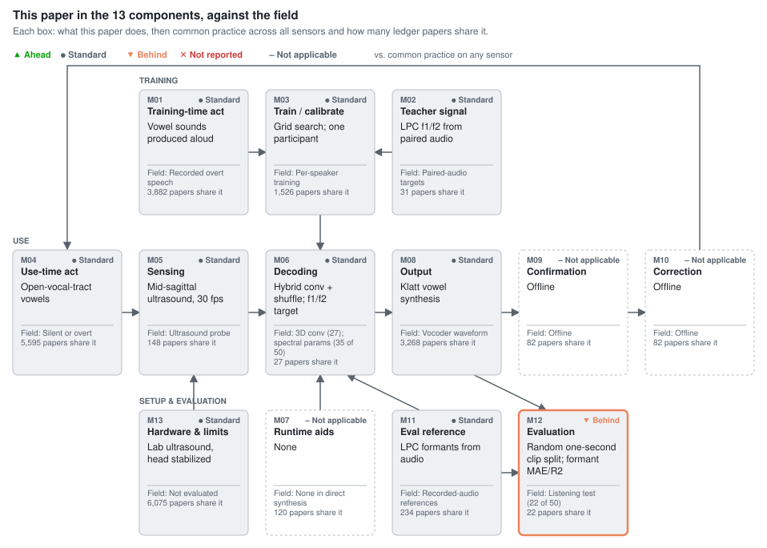

# Ultra2Speech - A Deep Learning Framework for Formant Frequency Estimation and Tracking from Ultrasound Tongue Images

Pramit Saha, Yadong Liu, Bryan Gick, Sidney Fels. arXiv preprint, 2020. [arXiv:2006.16367](https://arxiv.org/abs/2006.16367)

**Section:** [Ultrasound & tongue imaging](../../README.md#ultrasound--tongue-imaging)

## Figures

### This paper in the 13 components, against the field

<picture><source media="(prefers-color-scheme: dark)" srcset="figures/components-dark.svg"></picture>

Verdicts compare the paper's choice for each component with common practice across 8,995 ledger entries on any sensor (silent speech, brain-to-text, lip reading).

Data

| Component | This paper | Common practice | Papers with this practice | Verdict |
| --- | --- | --- | --- | --- |
| M01 Training-time act | Vowel sounds produced aloud | Recorded overt speech | 3,882 of 8,995 | ● Standard (Inherited; no silent articulation.) |
| M02 Teacher signal | LPC f1/f2 from paired audio | Paired-audio targets | 31 of 8,995 | ● Standard (Inherited paired-audio supervision.) |
| M03 Train / calibrate | Grid search; one participant | Per-speaker training | 1,526 of 8,995 | ● Standard (Selection data and seeds not stated.) |
| M04 Use-time act | Open-vocal-tract vowels | Silent or overt | 5,595 of 8,995 | ● Standard (Silent use not tested.) |
| M05 Sensing | Mid-sagittal ultrasound, 30 fps | Ultrasound probe | 148 of 8,995 | ● Standard (Inherited.) |
| M06 Decoding | Hybrid conv + shuffle; f1/f2 target | 3D conv (27); spectral params (35 of 50) | 27 of 8,995 | ● Standard (Formant target is a departure; no same-data spectral comparison.) |
| M07 Runtime aids | None | None in direct synthesis | 120 of 8,995 | – Not applicable (Direct synthesis.) |
| M08 Output | Klatt vowel synthesis | Vocoder waveform | 3,268 of 8,995 | ● Standard (Vowels only.) |
| M09 Confirmation | Offline | Offline | 82 of 8,995 | – Not applicable (Offline study.) |
| M10 Correction | Offline | Offline | 82 of 8,995 | – Not applicable (Offline study.) |
| M11 Eval reference | LPC formants from audio | Recorded-audio references | 234 of 8,995 | ● Standard (Inherited.) |
| M12 Evaluation | Random one-second clip split; formant MAE/R2 | Listening test (22 of 50) | 22 of 8,995 | ▼ Behind (Whole utterances held out in earlier work; clip-level split here.) |
| M13 Hardware & limits | Lab ultrasound, head stabilized | Not evaluated | 6,075 of 8,995 | ● Standard (No deployment evidence.) |

## Verdict

Ultra2Speech [[1]](#ref-1) changes the processing stage (M06) twice: a factorized spatial, temporal and joint 3D-convolution front end with channel shuffling, and the first two formants as the acoustic target where 35 of 50 ultrasound-to-speech studies name spectral vocoder parameters (pattern match, Appendix). The front end is standard: spatiotemporal convolution is the most frequent ultrasound front end. The formant target departs from the usual target, as no ledger ultrasound-to-speech study first public before it predicts formants (Appendix); it is rated standard because no spectral-target system is trained on its data (Table 1) and the data are vowel sequences only (Sec. 4.1). Evaluation (M12) is behind the best comparable work on protocol: earlier single-speaker ultrasound-to-acoustic studies held out whole utterances [[2]](#ref-2), [[3]](#ref-3), [[4]](#ref-4), while this paper shuffles one-second clips at random and scores only formant regression.

## Against the field, component by component

### M06 Processing: spatiotemporal front end

**Usual approach:** among 148 ultrasound studies, 3D convolution (27) and a CNN followed by a recurrent layer (24) are the common designs (pattern match, Appendix); earlier ultrasound-to-speech work fed 5 or 17 stacked frames to a feed-forward network [[5]](#ref-5). The target only splits each hybrid layer into 1×3×3 spatial, 3×1×1 temporal and 3×3×3 joint branches and shuffles their channels (Sec. 3.2–3.3).
**State of the art:** Tongue2Speech (2026) [later] puts a spatiotemporal CNN before a 6-layer Transformer and reaches 15.93% WER of ASR on synthesized speech, single speaker, TaL1 [[6]](#ref-6); the target has no speech-output measure to set against it.

Factorized kernels appeared [concurrent] in ultrasound-to-speech as a (2+1)D CNN [[7]](#ref-7). The reported decreases of 1.88%, 1.44% and 0.84% without spatial kernels, temporal kernels and shuffling (Sec. 4.2) equal absolute drops in joint Mean R2 from 99.96 to 98.08, 98.52 and 99.12 (Table 2); relative to joint MAE .0052, the ablated MAE (.0113, .0161, .0087) rises by 117%, 210% and 67% (inference), with no run count or seed stated. R2 ranks the spatial branch first, MAE the temporal one, so the ranking is unstable (Table 2). Verdict: standard.

### M06 Processing: acoustic target (formants)

**Usual approach:** of 50 ultrasound-to-speech studies, 35 name vocoder spectral parameters, 17 a mel-spectrogram and 6 formants (pattern match, Appendix); the read priors predict a 13-dimensional MGC-LSP vector with gain [[3]](#ref-3) or 24-order MGC-LSP with F0 and energy [[8]](#ref-8).
**State of the art:** mel-spectrogram targets with a HiFi-GAN vocoder, 15.93% WER on TaL1, single speaker (2026) [[6]](#ref-6) [later].

Of the 6 formant hits, one is the target, two mention formants without predicting them from ultrasound (a 2020 review, a 2018 cortical encoding study), and three are later (Appendix); the five priors read predict spectral parameters [[2]](#ref-2), [[3]](#ref-3), [[4]](#ref-4), [[8]](#ref-8), [[9]](#ref-9). The authors cite poor vowel transitions in 24-order MGC-LSP synthesis (Sec. 2), yet Table 1 scores every method on formants only, so that comparison is never run. F1 and F2 carry vowel quality but no F0 or voicing (inference), and the corpus holds vowel sequences only (Sec. 4.1). Verdict: standard, for lack of repetition and a same-data comparison.

### M12 Evaluation: split and speech output

**Usual approach:** of the same 50 studies, 22 name a listening test and 20 mel-cepstral distortion (pattern match, Appendix). Hueber et al. tested on 150 held-out sentences with MCD and listener transcription [[2]](#ref-2); Csapó et al. ran MUSHRA on sentences not used in training [[3]](#ref-3); Gosztolya et al. split 310/41/87 utterances and ran MUSHRA with 14 listeners on test sentences [[4]](#ref-4).
**State of the art:** ASR WER on synthesized speech, 15.93% on TaL1, single speaker (2026) [[6]](#ref-6) [later].

The target reports formant MAE and Mean R2 and one synthesized waveform (Fig. 3). Its 13,082 one-second clips were shuffled into 80/10/10 (Sec. 4.2); window overlap, session membership and the scored partition are not stated. Adjacent clips of one vowel sequence are near-duplicates, so this split favours memorization (inference). The vowel task differs from sentence synthesis, so the verdict rests on the task-independent split: behind the best comparable work, as the three studies above held out whole utterances, most completely Gosztolya et al. [[4]](#ref-4).

## The 13 components

| Component | This paper | Usual approach (count) | State of the art | Verdict |
|---|---|---|---|---|
| M01 Training-time action | Vowel sounds produced aloud | Recorded overt speech (slot-filled 3,882) | – | standard |
| M02 Training-only supervision | LPC f1/f2 from paired audio | Paired-audio targets (slot-filled 31) | – | standard |
| M03 Training and adaptation | Grid search; one participant | Per-speaker training (slot-filled 1,526) | – | standard |
| M04 Use-time action | Open-vocal-tract vowels | Silent or overt (slot-filled 5,595) | – | standard |
| M05 Sensors | Mid-sagittal ultrasound, 30 fps | Ultrasound probe (pattern match 148) | – | standard |
| M06 Processing and decoding | Hybrid conv + shuffle; f1/f2 target | 3D conv (27); spectral params (35 of 50) (pattern match 27) | [[6]](#ref-6) (2026): WER 15.93% | standard |
| M07 Lexicon and LM | None | None in direct synthesis (slot-filled 120) | – | not applicable |
| M08 Output | Klatt vowel synthesis | Vocoder waveform (slot-filled 3,268) | – | standard |
| M09 Confirmation | Offline | Offline (slot-filled 82) | – | not applicable |
| M10 Correction | Offline | Offline (slot-filled 82) | – | not applicable |
| M11 Reference construction | LPC formants from audio | Recorded-audio references (slot-filled 234) | – | standard |
| M12 Evaluation | Random one-second clip split; formant MAE/R2 | Listening test (22 of 50) (pattern match 22) | [[6]](#ref-6) (2026): WER 15.93% | behind |
| M13 Device and cost | Lab ultrasound, head stabilized | Not evaluated (slot-filled 6,075) | – | standard |

## Where the claims outrun the evidence

- "For the first time, we established a successful end-to-end mapping" (Sec. 5) holds in the ledger (Appendix), but "successful" rests on clip-level R2, not on speech.
- The Conv-BiLSTM is called the state of the art of its reference 11 (Sec. 4.2), which predicted 24-order MGC-LSP (Sec. 2); retrained on formants it reaches 90.01 joint Mean R2 (Table 1), which does not test the original system.
- "Despite having fewer parameters" (Sec. 4.2) comes without parameter counts; Table 1 MAE values carry no unit.

## What the field needs next

- M06: train formant, MGC-LSP and mel-spectrogram targets on the same data and compare the speech by MCD, MUSHRA and ASR WER.
- M12: hold out whole sessions, state window overlap, repeat over seeds, give error in Hz.

## Questions for the authors

- Do the 30-frame windows overlap, and can one session supply both train and test clips?
- Which partition produced Tables 1 and 2, and which data guided the grid search?
- How many parameters and runs back each value?

## Appendix: literature search

- M06, ultrasound-image-sequence-temporal-layer (published table, reused). Inclusion rule: studies whose ledger lists ultrasound imaging, classified by full-text pattern (reference list removed) by how frames are integrated over time: 3D convolution, CNN followed by a recurrent layer, ConvLSTM, Transformer/Conformer; related-work mentions and non-speech tasks count (upper bound); versions once. Ledger: 7,345 unique studies slot-filled for M06; 148 unique studies pattern match. 3D convolution 27, CNN then recurrent 24, ConvLSTM 9, Transformer/Conformer 8 (pattern match, published counts). Read in full: [[5]](#ref-5), [[7]](#ref-7), [[6]](#ref-6). Known-item recall 1.0.
- M06, ultrasound-to-speech-acoustic-target (new). Inclusion rule: studies whose ledger lists ultrasound imaging and speech synthesis, a vocoder or an acoustic or formant output, classified by full-text pattern by the predicted acoustic representation (vocoder spectral parameters, mel-spectrogram, formants); related-work mentions count (upper bound); a formant hit counts as a target only when the snippet shows prediction; versions once. Ledger: 7,345 unique studies slot-filled for M06; 50 unique studies pattern match. Vocoder spectral parameters 35, mel-spectrogram 17, neural vocoder 16, formants 6 (the target; a 2020 review and a 2018 cortical encoding study that mention formants without predicting them; three later works) (pattern match). Read in full: [[2]](#ref-2), [[3]](#ref-3), [[4]](#ref-4), [[8]](#ref-8), [[9]](#ref-9), [[6]](#ref-6). Known-item recall 1.0 (5 seeds).
- M12, ultrasound-to-speech-output-evaluation (new). Inclusion rule: the same 50-study population, classified by full-text pattern by whether the synthesized speech is evaluated: listening test, mel-cepstral distortion, intelligibility measure (STOI, WER); evaluation of intermediate parameters only does not count; related-work mentions count (upper bound). Ledger: 6,960 unique studies slot-filled for M12; 50 unique studies pattern match. Listening test 22, mel-cepstral distortion 20, intelligibility measure 20 (pattern match). Read in full: [[2]](#ref-2), [[3]](#ref-3), [[4]](#ref-4), [[8]](#ref-8), [[6]](#ref-6). Known-item recall 1.0 (4 seeds).

## References

Numbered by first citation. BibTeX in the same order and keys: [refs.bib](refs.bib).

1. Saha, P., Liu, Y., Gick, B., Fels, S. “Ultra2Speech - A Deep Learning Framework for Formant Frequency Estimation and Tracking from Ultrasound Tongue Images.” *arXiv preprint*, 2020. doi:[10.48550/arXiv.2006.16367](https://doi.org/10.48550/arXiv.2006.16367). arXiv:[2006.16367](https://arxiv.org/abs/2006.16367). Target. Read as arXiv v1. Later papers in the wiki cite a MICCAI 2020 version (pp. 473-482); not read. [review](https://github.com/supernaiter/silent-speech-review/tree/main/reviews/ultra2speech-a-deep-learning-framework-for-formant-frequency-estimation-and-tracking-from-ultrasound-tongue-images) [wiki: arxiv-2006.16367](https://github.com/supernaiter/deep-research-wiki-for-silent-speech/blob/main/papers/arxiv-2006.16367/article.md)
2. Hueber, T., Benaroya, E., Denby, B., Chollet, G. “Statistical Mapping between Articulatory and Acoustic Data for an Ultrasound-based Silent Speech Interface.” *Proc. Interspeech 2011*, 2011. doi:[10.21437/Interspeech.2011-239](https://doi.org/10.21437/Interspeech.2011-239). Prior; read (M06 spectral target, M12 MCD and listener transcription). [wiki: isca-hueber11-usmapping](https://github.com/supernaiter/deep-research-wiki-for-silent-speech/blob/main/papers/isca-hueber11-usmapping/article.md) [wiki: doi-10.21437-interspeech.2011-239](https://github.com/supernaiter/deep-research-wiki-for-silent-speech/blob/main/papers/doi-10.21437-interspeech.2011-239/article.md)
3. Csapó, T. G., Grósz, T., Gosztolya, G., Tóth, L., Markó, A. “DNN-Based Ultrasound-to-Speech Conversion for a Silent Speech Interface.” *Proc. Interspeech 2017*, 2017, 3672–3676. doi:[10.21437/Interspeech.2017-939](https://doi.org/10.21437/Interspeech.2017-939). Prior; deciding prior for M06 target and M12 (read). [wiki: isca-csapo17-us2speech](https://github.com/supernaiter/deep-research-wiki-for-silent-speech/blob/main/papers/isca-csapo17-us2speech/article.md) [wiki: isca-csapo17_interspeech](https://github.com/supernaiter/deep-research-wiki-for-silent-speech/blob/main/papers/isca-csapo17_interspeech/article.md) [wiki: isca-csapo17_ussynth](https://github.com/supernaiter/deep-research-wiki-for-silent-speech/blob/main/papers/isca-csapo17_ussynth/article.md) [wiki: isca-csapo17_ustospeech](https://github.com/supernaiter/deep-research-wiki-for-silent-speech/blob/main/papers/isca-csapo17_ustospeech/article.md)
4. Gosztolya, G., Pintér, Á., Tóth, L., Grósz, T., Markó, A., Csapó, T. G. “Autoencoder-Based Articulatory-to-Acoustic Mapping for Ultrasound Silent Speech Interfaces.” *Proc. International Joint Conference on Neural Networks (IJCNN 2019)*, 2019, 1–8. doi:[10.1109/IJCNN.2019.8852153](https://doi.org/10.1109/IJCNN.2019.8852153). arXiv:[1904.05259](https://arxiv.org/abs/1904.05259). Prior; deciding prior for M06 target and M12 (read). [review](https://github.com/supernaiter/silent-speech-review/tree/main/reviews/autoencoder-based-articulatory-to-acoustic-mapping-for-ultrasound-silent-speech-interfaces) [wiki: arxiv-1904.05259](https://github.com/supernaiter/deep-research-wiki-for-silent-speech/blob/main/papers/arxiv-1904.05259/article.md)
5. Tóth, L., Gosztolya, G., Grósz, T., Markó, A., Csapó, T. G. “Multi-Task Learning of Speech Recognition and Speech Synthesis Parameters for Ultrasound-based Silent Speech Interfaces.” *Proc. Interspeech 2018*, 2018, 3172–3176. doi:[10.21437/Interspeech.2018-1078](https://doi.org/10.21437/Interspeech.2018-1078). [wiki: isca-toth18-multitask](https://github.com/supernaiter/deep-research-wiki-for-silent-speech/blob/main/papers/isca-toth18-multitask/article.md) [wiki: isca-toth18_interspeech](https://github.com/supernaiter/deep-research-wiki-for-silent-speech/blob/main/papers/isca-toth18_interspeech/article.md) [wiki: isca-toth18_mtlussi](https://github.com/supernaiter/deep-research-wiki-for-silent-speech/blob/main/papers/isca-toth18_mtlussi/article.md)
6. Sonkar, Y., Kilaru, Y., Yelimeli, S., Shah, N., Gandhi, V. “Tongue2Speech: Real-Time Speech Synthesis from Tongue Ultrasound Videos via Spatiotemporal Transformers.” *Proc. Interspeech 2026*, 2026, 6856–6860. doi:[10.21437/Interspeech.2026-3023](https://doi.org/10.21437/Interspeech.2026-3023). Later; state of the art for M06 and M12 (read). [later] [wiki: isca-sonkar26_interspeech](https://github.com/supernaiter/deep-research-wiki-for-silent-speech/blob/main/papers/isca-sonkar26_interspeech/article.md)
7. Tóth, L., Honarmandi Shandiz, A. “3D Convolutional Neural Networks for Ultrasound-Based Silent Speech Interfaces.” *Artificial Intelligence and Soft Computing (ICAISC 2020), Lecture Notes in Computer Science 12415*, 2020. doi:[10.1007/978-3-030-61401-0_16](https://doi.org/10.1007/978-3-030-61401-0_16). arXiv:[2104.11532](https://arxiv.org/abs/2104.11532). [concurrent] [review](https://github.com/supernaiter/silent-speech-review/tree/main/reviews/3d-convolutional-neural-networks-for-ultrasound-based-silent-speech-interfaces) [wiki: arxiv-2104.11532](https://github.com/supernaiter/deep-research-wiki-for-silent-speech/blob/main/papers/arxiv-2104.11532/article.md)
8. Csapó, T. G., Al-Radhi, M. S., Németh, G., Gosztolya, G., Grósz, T., Tóth, L., et al. “Ultrasound-based Silent Speech Interface Built on a Continuous Vocoder.” *Proc. Interspeech 2019*, 2019. doi:[10.21437/Interspeech.2019-2046](https://doi.org/10.21437/Interspeech.2019-2046). Prior; read (M06 target, M12 listening test). [review](https://github.com/supernaiter/silent-speech-review/tree/main/reviews/ultrasound-based-silent-speech-interface-built-on-a-continuous-vocoder) [wiki: isca-csapo19-usvocoder](https://github.com/supernaiter/deep-research-wiki-for-silent-speech/blob/main/papers/isca-csapo19-usvocoder/article.md) [wiki: doi-10.21437-interspeech.2019-2046](https://github.com/supernaiter/deep-research-wiki-for-silent-speech/blob/main/papers/doi-10.21437-interspeech.2019-2046/article.md) [wiki: isca-csapo19_interspeech](https://github.com/supernaiter/deep-research-wiki-for-silent-speech/blob/main/papers/isca-csapo19_interspeech/article.md)
9. Jaumard-Hakoun, A., Xu, K., Leboullenger, C., Roussel-Ragot, P., Denby, B. “An Articulatory-Based Singing Voice Synthesis Using Tongue and Lips Imaging.” *Proc. Interspeech 2016*, 2016. doi:[10.21437/Interspeech.2016-1049](https://doi.org/10.21437/Interspeech.2016-1049). Prior; read (M06 target: LSF, not formants). [wiki: isca-jaumardhakoun16_interspeech](https://github.com/supernaiter/deep-research-wiki-for-silent-speech/blob/main/papers/isca-jaumardhakoun16_interspeech/article.md)

## Materials

Data behind this review. Full texts of the papers are not included.

- [`review.md`](review.md): the review text (source)
- [`refs.bib`](refs.bib): references (BibTeX)
- [`slots.json`](slots.json): for each of the 13 components: this paper's choice, field practice, number of matching papers, verdict
- [`figures.json`](figures.json): figure definitions
- [`evaluation.md`](evaluation.md): independent evaluation by a second reviewer
- [`triage.md`](triage.md): how each evaluation finding was checked against the sources and resolved
- [`process/log.json`](process/log.json): process record: each step, who did it (reader, script, writer, evaluator), when, the checks run and the input versions
- [`process/notes.json`](process/notes.json): reading notes on the target and comparator papers: claims, numbers, conditions and what is not stated, with locations
- [`process/plan.json`](process/plan.json): plan: which components the paper changes and the topics it is compared on
- [`process/draft.md`](process/draft.md): the review as first written, before the independent evaluation
- [`process/claims-draft.md`](process/claims-draft.md): claim table of the draft: every claim mapped to a note or a count
- [`process/claims.md`](process/claims.md): claim table of the published review
- [`components/M06/ultrasound-image-sequence-temporal-layer.csv`](../../components/M06/ultrasound-image-sequence-temporal-layer.csv): M06 topic "ultrasound-image-sequence-temporal-layer", every candidate paper with its decision (7345 slot-filled, 148 pattern match, usual design in 27, 4 read in full)
- [`components/M06/ultrasound-to-speech-acoustic-target.csv`](../../components/M06/ultrasound-to-speech-acoustic-target.csv): M06 topic "ultrasound-to-speech-acoustic-target", every candidate paper with its decision (7345 slot-filled, 50 pattern match, usual design in 35, 7 read in full)
- [`components/M12/ultrasound-to-speech-output-evaluation.csv`](../../components/M12/ultrasound-to-speech-output-evaluation.csv): M12 topic "ultrasound-to-speech-output-evaluation", every candidate paper with its decision (6960 slot-filled, 51 pattern match, usual design in 21, 3 read in full)

## More reviews in Ultrasound & tongue imaging

- [3D Convolutional Neural Networks for Ultrasound-Based Silent Speech Interfaces](../3d-convolutional-neural-networks-for-ultrasound-based-silent-speech-interfaces/) (2020). (2+1)D front end (M06) is standard: established in lip reading, ported to ultrasound; a 6.3% MSE edge over CNN+LSTM, one speaker, one run; MSE-only evaluation (M12 behind).
- [Convolutional Neural Network-Based Age Estimation Using B-Mode Ultrasound Tongue Image](../convolutional-neural-network-based-age-estimation-using-b-mode-ultrasound-tongue-image/) (2021). Age output from tongue ultrasound (M08) is new but unproven: the random frame split shares children between training and validation (M12), so speaker identity can explain the gain.
- [Improving Neural Silent Speech Interface Models by Adversarial Training](../improving-neural-silent-speech-interface-models-by-adversarial-training/) (2021). Standard on the adversarial loss (M02): it predates the paper in video-to-speech and its gains are small, with no variance reported; behind on evaluation (M12): no listening test.
- [Neural Speaker Embeddings for Ultrasound-based Silent Speech Interfaces](../neural-speaker-embeddings-for-ultrasound-based-silent-speech-interfaces/) (2021). Standard on embedding conditioning (2.4% relative MSE gain on seen speakers); behind on speaker recognition, which never separates speaker from recording session.
- [Silent versus modal multi-speaker speech recognition from ultrasound and video](../silent-versus-modal-multi-speaker-speech-recognition-from-ultrasound-and-video/) (2021). Standard on both changed components: modal-to-silent loss and fMLLR were known; later work narrows the absolute gap but not the fMLLR ratio, and adaptation gains rest on single runs.
- [Speech Synthesis from Text and Ultrasound Tongue Image-based Articulatory Input](../speech-synthesis-from-text-and-ultrasound-tongue-image-based-articulatory-input/) (2021). Limited-data TTS augmented with ultrasound tongue images; combined text plus ultrasound gives the lowest test MCD for all 8 speakers, while ultrasound-only input remains far worse.

---

Part of the [Silent Speech Interface Review](https://github.com/supernaiter/silent-speech-review). Found an error? [Open an issue](https://github.com/supernaiter/silent-speech-review/issues/new?template=correction.yml).
