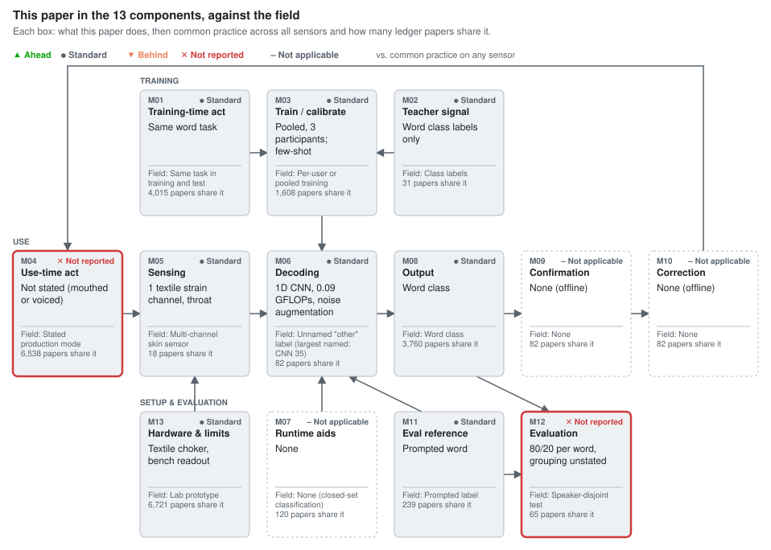

# Ultrasensitive Textile Strain Sensors Redefine Wearable Silent Speech Interfaces with High Machine Learning Efficiency

Tang, C., Xu, M., Yi, W., Zhang, Z., Occhipinti, E., Dong, C., Ravenscroft, D., Jung, S.-M., Lee, S., Gao, S., Kim, J. M., Occhipinti, L. G. · npj Flexible Electronics 8, 27 · 2024 (arXiv 2023) · [doi:10.1038/s41528-024-00315-1](https://doi.org/10.1038/s41528-024-00315-1) · [arXiv:2311.15683](https://arxiv.org/abs/2311.15683)

**Section:** [Other sensors](../../README.md#other-sensors)

## Figures

### This paper in the 13 components, against the field

<picture><source media="(prefers-color-scheme: dark)" srcset="figures/components-dark.svg"></picture>

Verdicts compare the paper's choice for each component with common practice across 8,995 ledger entries on any sensor (silent speech, brain-to-text, lip reading).

Data

| Component | This paper | Common practice | Papers with this practice | Verdict |
| --- | --- | --- | --- | --- |
| M01 Training-time act | Same word task | Same task in training and test | 4,015 of 8,995 | ● Standard (Training and test words come from the same recording task.) |
| M02 Teacher signal | Word class labels only | Class labels | 31 of 8,995 | ● Standard (No audio or articulatory target.) |
| M03 Train / calibrate | Pooled, 3 participants; few-shot fine-tuning | Per-user or pooled training | 1,608 of 8,995 | ● Standard (Validation and model-selection data not stated.) |
| M04 Use-time act | Not stated (mouthed or voiced) | Stated production mode | 6,538 of 8,995 | ✕ Not reported (Participants are listed with speaking levels in dB (Supp. Table 2).) |
| M05 Sensing | 1 textile strain channel, throat | Multi-channel skin sensor | 18 of 8,995 | ● Standard (Single throat strain channel already in the group's prior work.) |
| M06 Decoding | 1D CNN, 0.09 GFLOPs, noise augmentation | Unnamed "other" label (largest named: CNN 35) | 82 of 8,995 | ● Standard (No ablation of augmentation; cross-paper FLOPs table only. State of the art is intracortical, a cross-signal ceiling.) |
| M07 Runtime aids | None | None (closed-set classification) | 120 of 8,995 | – Not applicable (Closed-set classifier; no lexicon prior applies.) |
| M08 Output | Word class | Word class | 3,760 of 8,995 | ● Standard (Isolated words only.) |
| M09 Confirmation | None (offline) | None | 82 of 8,995 | – Not applicable (Offline study.) |
| M10 Correction | None (offline) | None | 82 of 8,995 | – Not applicable (Offline study.) |
| M11 Eval reference | Prompted word | Prompted label | 239 of 8,995 | ● Standard (Prompt is the reference.) |
| M12 Evaluation | 80/20 per word, grouping unstated | Speaker-disjoint test | 65 of 8,995 | ✕ Not reported (Session or speaker separation not stated; three participants pooled.) |
| M13 Hardware & limits | Textile choker, bench readout | Lab prototype | 6,721 of 8,995 | ● Standard (No on-device latency or power.) |

## Verdict

The paper [[1]](#ref-1) changes the sensor (M05), one graphene-textile strain channel in a throat choker, and the decoder (M06), a small 1D CNN with recorded-noise augmentation; both are standard. The single throat strain channel is the authors' own lineage [[2]](#ref-2), and the claim that sensor sensitivity lets one channel and a small network reach 95.25% is untested: no sensor, channel or augmentation ablation is run on the same words. The evaluation (M12) leaves the split grouping unstated and reports no chance level or repeated runs, so it does not show session- or speaker-independent decoding. The paper never states whether the words were mouthed or voiced (M04), which decides whether this is a silent speech interface.

## Against the field, component by component

### M05 Sensors: channel count and placement

**Usual approach:** several channels, 18 of 27 studies with skin-mounted strain, piezo or triboelectric sensors, against 2 with a single channel (pattern match; Appendix); 26 mention face or lip sites and 20 the throat or neck. The paper uses one channel on the throat.

**State of the art:** in 2026 a neck-worn strain choker reaches 85.8% on 26 words with subject-independent folds, and accuracy across graded tightness and vocal effort spans 100% to 29.41% [[3]](#ref-3) [later].

The same group's single graphene gauge on the throat classified 15 words at 54.6%, one subject, one sitting [[2]](#ref-2); what changes is the textile fabrication (gauge factor 317 within 5% strain, Sec. II). The authors place the 420% gain "in silent speech scenarios", but the Fig. 1c comparators are textile strain sensors for motion and health monitoring (References 33-47), not speech sensors. The link from sensitivity to accuracy is asserted, not measured: [[4]](#ref-4) varied channel count, from 49.87% with 2 channels to 87.53% with 8 on 100 words, and showed only waveforms in which a metal gauge gave almost indistinguishable changes. 95.25% on 20 words against 87.53% on 100 says nothing about the sensor (inference). Tightness robustness is read from varying DC offsets of the example waveforms in Fig. 4c; [[3]](#ref-3) [later] measures it across graded tightness. Verdict: standard.

### M06 Decoder: compact CNN

**Usual approach:** no family dominates among 355 closed-vocabulary word classifiers: the ledger's unnamed "other" label covers 82, and the largest named family is CNN with 35 (slot-filled; Appendix), so a 1D CNN is common practice.

**State of the art:** in 2024, 99.6% on 50 words on day one from intracortical arrays [[5]](#ref-5) [later]; a cross-signal ceiling, not a wearable comparator.

The efficiency claim rests on Supplementary Table 1: 0.09 GFLOPs against 1 GFLOPs for a system with 99% on 5 words, a 91% cut (inference) matching the stated 90%. Rows differ in vocabulary, channels and protocol; the only same-data comparison is a figure (Supplementary Fig. 10). No run without noise-window augmentation is reported. Verdict: standard.

### M12 Evaluation: test split

**Usual approach:** a speaker-disjoint test, a plurality of 65 of 143 wearable-sensor word-classification studies; 58 report random or k-fold splits and 44 a separate session or day, and a study counts under every split it reports (pattern match; Appendix).

**State of the art:** in 2026, subject-separated folds and a re-test 2 weeks after re-attachment [[3]](#ref-3) [later].

The 80/20 split of 100 samples per word (Sec. II) does not say whether one wearing session falls on both sides; that matches its lineage, one sitting [[2]](#ref-2), and [[4]](#ref-4) used randomly mixed folds. Transfer gives 80% with 15 to 20 samples per class, but the new-user task has 5 words (chance 20%, inference) and an undescribed test set (Fig. 5); [[3]](#ref-3) [later] reaches 80% with LoRA against 76% with fully connected fine-tuning, at 20 samples per class from a new user. Verdict: not reported.

## The 13 components

| Component | This paper | Usual approach (count) | State of the art | Verdict |
|---|---|---|---|---|
| M01 Training-time action | Same word task | Same task in training and test (slot-filled 4,015) | – | standard |
| M02 Training-only supervision | Word class labels only | Class labels (slot-filled 31) | – | standard |
| M03 Training and adaptation | Pooled, 3 participants; few-shot fine-tuning | Per-user or pooled training (slot-filled 1,608) | – | standard |
| M04 Use-time action | Not stated (mouthed or voiced) | Stated production mode (slot-filled 6,538) | – | not reported |
| M05 Sensors | 1 textile strain channel, throat | Multi-channel skin sensor (pattern match 18) | [[3]](#ref-3) [later]: 85.8%, 26 words | standard |
| M06 Processing and decoding | 1D CNN, 0.09 GFLOPs, noise augmentation | Unnamed "other" label (largest named: CNN 35) (slot-filled 82) | [[5]](#ref-5) [later]: 99.6%, 50 words | standard |
| M07 Lexicon and LM | None | None (closed-set classification) (slot-filled 120) | – | not applicable |
| M08 Output | Word class | Word class (slot-filled 3,760) | – | standard |
| M09 Confirmation | None (offline) | None (slot-filled 82) | – | not applicable |
| M10 Correction | None (offline) | None (slot-filled 82) | – | not applicable |
| M11 Reference construction | Prompted word | Prompted label (slot-filled 239) | – | standard |
| M12 Evaluation | 80/20 per word, grouping unstated | Speaker-disjoint test (pattern match 65) | [[3]](#ref-3) [later]: subject-independent | not reported |
| M13 Device and cost | Textile choker, bench readout | Lab prototype (slot-filled 6,721) | – | standard |

## Where the claims outrun the evidence

- "100% unresponsive" to sound (Sec. II) rests on one 100 dB demonstration (Fig. 3a).
- Supplementary Table 2 lists speaking levels of 54, 47 and 42 dB for the three main participants and 46 dB for the transfer participant, yet no section says the words were mouthed; if voiced, a throat sensor also picks up laryngeal vibration (inference).
- "Real-world application scenarios" (Abstract) rest on offline classification of 5 to 20 isolated words from three participants, with no on-device latency or power (Fig. 4, Supplementary Table 1).
- R-CAM maps (Fig. 4c) are read as attention to word micromovements without a quantitative test.
- The authors note accuracy had not saturated with training size (Supplementary Fig. 11).

## What the field needs next

- M12: session- and speaker-disjoint tests with chance level and repeated runs, as in [[3]](#ref-3) [later].
- M05: the same words with a lower-sensitivity sensor and added channels, as in [[4]](#ref-4).
- M04: mouthed and voiced conditions recorded separately, with a microphone.
- M06: augmentation and filtering ablations, with energy measured on a wearable processor.

## Questions for the authors

- Were the words mouthed, whispered or spoken aloud, and how was this checked?
- Did test samples share wearing sessions with training samples?
- Which comparator gives the 90% reduction in computational load?
- How were the few-shot test sets built, and how large were they?
- Which reading speeds of Dataset 3 were in training and which in test?

## Appendix: literature search

- M05 skin-strain-sensor-channel-count (new topic table). Inclusion rule: speech or silent-speech decoding studies whose ledger names a skin-mounted mechanical sensor (strain sensor or gauge, piezoresistive, piezoelectric or triboelectric film, textile or crack-based sensor, artificial throat); the design compared is the number of channels and the placement; contactless radar and palatal plates are excluded when read. Slot-filled 7,329 unique studies; pattern match 27 unique studies. Full-text pattern counts: multi-channel 18, single channel 2; placement: face or lips 26, throat or neck 20. Usual design: multi-channel, 18 (pattern match). State of the art: [[3]](#ref-3) [later]. Read in full for this topic: [[2]](#ref-2), [[4]](#ref-4), [[3]](#ref-3). Known-item recall 0.5.
- M06 closed-vocabulary-word-classification (published topic table, reused). Inclusion rule: studies that decode words or utterances from non-acoustic signals by classifying each segment into a closed set of at most a few hundred words or utterances; the design compared is the model family. Slot-filled 7,345 unique studies; pattern match 360 unique studies. Model families among 355 classifiers: other 82, CNN 35 (slot-filled). Usual design: other model family, 82 (slot-filled). State of the art: [[5]](#ref-5) [later]. Known-item recall 0.5.
- M12 wearable-sensor-word-test-split (new topic table). Inclusion rule: word or command classification studies whose ledger names a wearable non-acoustic sensor on the face or neck (strain, piezo or triboelectric sensor, surface EMG, accelerometer); the design compared is how test samples are separated from training: speaker-disjoint, session- or day-disjoint, or a random or per-class split; a paper counts under every split it reports. Slot-filled 6,960 unique studies; pattern match 143 unique studies. Full-text pattern counts: speaker-disjoint 65, random or k-fold split 58, session- or day-disjoint 44. Usual design: speaker-disjoint, 65 (pattern match). State of the art: [[3]](#ref-3) [later]. Read in full for this topic: [[4]](#ref-4), [[2]](#ref-2), [[3]](#ref-3).

## References

Numbered by first citation. BibTeX in the same order and keys: [refs.bib](refs.bib).

1. Tang, C., Xu, M., Yi, W., Zhang, Z., Occhipinti, E., Dong, C., et al. “Ultrasensitive Textile Strain Sensors Redefine Wearable Silent Speech Interfaces with High Machine Learning Efficiency.” *npj Flexible Electronics*, 2024, 8, 27. doi:[10.1038/s41528-024-00315-1](https://doi.org/10.1038/s41528-024-00315-1). arXiv:[2311.15683](https://arxiv.org/abs/2311.15683). Target. Read as arXiv v2; venue from Crossref (published 2024-05-07). [review](https://github.com/supernaiter/silent-speech-review/tree/main/reviews/ultrasensitive-textile-strain-sensors-redefine-wearable-silent-speech-interfaces-with-high-machine-learning-efficiency) [wiki: arxiv-2311.15683](https://github.com/supernaiter/deep-research-wiki-for-silent-speech/blob/main/papers/arxiv-2311.15683/article.md) [wiki: doi-10.1038-s41528-024-00315-1](https://github.com/supernaiter/deep-research-wiki-for-silent-speech/blob/main/papers/doi-10.1038-s41528-024-00315-1/article.md)
2. Ravenscroft, D., Prattis, I., Kandukuri, T., Samad, Y. A., Mallia, G., Occhipinti, L. G. “Machine Learning Methods for Automatic Silent Speech Recognition Using a Wearable Graphene Strain Gauge Sensor.” *Sensors*, 2022, 22(1), 299. doi:[10.3390/s22010299](https://doi.org/10.3390/s22010299). Prior; same group. Published online 2021-12-31. [wiki: doi-10.3390-s22010299](https://github.com/supernaiter/deep-research-wiki-for-silent-speech/blob/main/papers/doi-10.3390-s22010299/article.md) [wiki: pmc-8749657-graphene-throat](https://github.com/supernaiter/deep-research-wiki-for-silent-speech/blob/main/papers/pmc-8749657-graphene-throat/article.md)
3. Hong, S., Yoo, J., Park, S. “Soft Multiaxial Strain Mapping Interface with AI-Driven Decoding for Silent Speech in Noise.” *Cyborg and Bionic Systems*, 2026, 7, 0536. doi:[10.34133/cbsystems.0536](https://doi.org/10.34133/cbsystems.0536). Later; published online 2026-03-23. [later] [wiki: pmc-13006734-cvos-ssi](https://github.com/supernaiter/deep-research-wiki-for-silent-speech/blob/main/papers/pmc-13006734-cvos-ssi/article.md) [wiki: pmc-13006734-strainssi](https://github.com/supernaiter/deep-research-wiki-for-silent-speech/blob/main/papers/pmc-13006734-strainssi/article.md) [wiki: doi-10.34133-cbsystems.0536](https://github.com/supernaiter/deep-research-wiki-for-silent-speech/blob/main/papers/doi-10.34133-cbsystems.0536/article.md)
4. Kim, T., Shin, Y., Kang, K., Kim, K., Kim, G., Byeon, Y., et al. “Ultrathin crystalline-silicon-based strain gauges with deep learning algorithms for silent speech interfaces.” *Nature Communications*, 2022, 13, 5815. doi:[10.1038/s41467-022-33457-9](https://doi.org/10.1038/s41467-022-33457-9). Prior. [wiki: pmc-9530138-straingauges](https://github.com/supernaiter/deep-research-wiki-for-silent-speech/blob/main/papers/pmc-9530138-straingauges/article.md) [wiki: pmc-9530138-sinm](https://github.com/supernaiter/deep-research-wiki-for-silent-speech/blob/main/papers/pmc-9530138-sinm/article.md) [wiki: pmc-9530138-straintssi](https://github.com/supernaiter/deep-research-wiki-for-silent-speech/blob/main/papers/pmc-9530138-straintssi/article.md) [wiki: doi-10.1038-s41467-022-33457-9](https://github.com/supernaiter/deep-research-wiki-for-silent-speech/blob/main/papers/doi-10.1038-s41467-022-33457-9/article.md)
5. Card, N. S., Wairagkar, M., Iacobacci, C., Hou, X., Singer-Clark, T., Willett, F. R., et al. “An Accurate and Rapidly Calibrating Speech Neuroprosthesis.” *New England Journal of Medicine*, 2024, 391(7), 609–618. doi:[10.1056/NEJMoa2314132](https://doi.org/10.1056/NEJMoa2314132). Later; state of the art of the published M06 closed-vocabulary table. [later] [review](https://github.com/supernaiter/silent-speech-review/tree/main/reviews/an-accurate-and-rapidly-calibrating-speech-neuroprosthesis) [wiki: pmc-11328962-rapidcal](https://github.com/supernaiter/deep-research-wiki-for-silent-speech/blob/main/papers/pmc-11328962-rapidcal/article.md) [wiki: doi-10.1056-nejmoa2314132](https://github.com/supernaiter/deep-research-wiki-for-silent-speech/blob/main/papers/doi-10.1056-nejmoa2314132/article.md)

## Materials

Data behind this review. Full texts of the papers are not included.

- [`review.md`](review.md): the review text (source)
- [`refs.bib`](refs.bib): references (BibTeX)
- [`slots.json`](slots.json): for each of the 13 components: this paper's choice, field practice, number of matching papers, verdict
- [`figures.json`](figures.json): figure definitions
- [`evaluation.md`](evaluation.md): independent evaluation by a second reviewer
- [`triage.md`](triage.md): how each evaluation finding was checked against the sources and resolved
- [`components/M05/skin-strain-sensor-channel-count.csv`](../../components/M05/skin-strain-sensor-channel-count.csv): M05 topic "skin-strain-sensor-channel-count", every candidate paper with its decision (7329 slot-filled, 27 pattern match, usual design in 18, 3 read in full)
- [`components/M06/closed-vocabulary-word-classification.csv`](../../components/M06/closed-vocabulary-word-classification.csv): M06 topic "closed-vocabulary-word-classification", every candidate paper with its decision (7345 slot-filled, 360 pattern match, usual design in 82, 2 read in full)
- [`components/M12/wearable-sensor-word-test-split.csv`](../../components/M12/wearable-sensor-word-test-split.csv): M12 topic "wearable-sensor-word-test-split", every candidate paper with its decision (6960 slot-filled, 143 pattern match, usual design in 65, 3 read in full)

## More reviews in Other sensors

- [Semantic reconstruction of continuous language from non-invasive brain recordings](../semantic-reconstruction-of-continuous-language-from-non-invasive-brain-recordings/) (2023). LM candidates scored by encoding-model likelihood (M06) were ahead in 2022, as the authors claim; the scorer is now overtaken. GPT prior (M07) is standard; one pilot-touched test story limits M12.
- [Imagined speech can be decoded from low- and cross-frequency intracranial EEG features](../imagined-speech-can-be-decoded-from-low-and-cross-frequency-intracranial-eeg-features/) (2022). Adds low-frequency power (precedent: Pei 2011, Ikeda 2014) and phase-amplitude coupling (new) to imagined-speech ECoG decoding (M06); CFC effect unshown: 12 of 144 uncorrected tests.
- [Robust Self-Supervised Audio-Visual Speech Recognition](../robust-self-supervised-audio-visual-speech-recognition/) (2022). Noise-augmented self-supervised AVSR training (M03) was new in 2022 but rests on one test set with no run count; the 49.6% babble gain mixes data and model size with pre-training.
- [End-to-End Audio-Visual Speech Recognition with Conformers](../end-to-end-audio-visual-speech-recognition-with-conformers/) (2021). Conformer back-end on raw inputs (M06) and Transformer LM (M07) are standard: raw-input AVSR predates it, and the Conformer gain is one unrepeated step confounded with a decoder swap.
- [Lipreading using Temporal Convolutional Networks](../lipreading-using-temporal-convolutional-networks/) (2020). Multi-scale TCN (M06) and variable-length cropping (M03) are standard: head and augmentation are not separated, no run counts, robustness comes from the cropping; 85.3% LRW trails 93.2% today.
- [Machine translation of cortical activity to text with an encoder-decoder framework](../machine-translation-of-cortical-activity-to-text-with-an-encoder-decoder-framework/) (2020). Word-level ECoG encoder-decoder; all changed components standard. 3% WER is on repeats of 50 sentences; unseen sentences and participants were never tested.

---

Part of the [Silent Speech Interface Review](https://github.com/supernaiter/silent-speech-review). Found an error? [Open an issue](https://github.com/supernaiter/silent-speech-review/issues/new?template=correction.yml).
