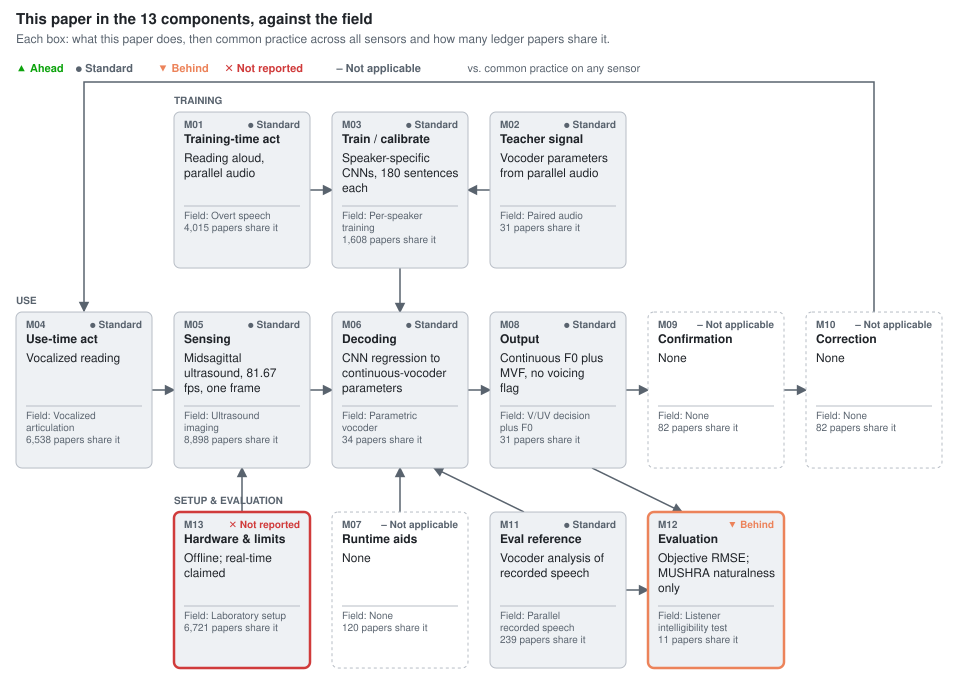

# Ultrasound-based Silent Speech Interface Built on a Continuous Vocoder

Csapó, T. G., Al-Radhi, M. S., Németh, G., Gosztolya, G., Grósz, T., Tóth, L., Markó, A. · Interspeech 2019 · 2019 · [doi:10.21437/Interspeech.2019-2046](https://doi.org/10.21437/Interspeech.2019-2046) · [arXiv:1906.09885](https://arxiv.org/abs/1906.09885)

**Section:** [Ultrasound & tongue imaging](../../README.md#ultrasound--tongue-imaging)

## Figures

### This paper in the 13 components, against the field

<picture><source media="(prefers-color-scheme: dark)" srcset="figures/components-dark.svg"></picture>

Verdicts compare the paper's choice for each component with common practice across 8,995 ledger entries on any sensor (silent speech, brain-to-text, lip reading).

Data

| Component | This paper | Common practice | Papers with this practice | Verdict |
| --- | --- | --- | --- | --- |
| M01 Training-time act | Reading aloud, parallel audio | Overt speech | 4,015 of 8,995 | ● Standard (Same recording protocol as the lineage [@grosz2018f0].) |
| M02 Teacher signal | Vocoder parameters from parallel audio | Paired audio | 31 of 8,995 | ● Standard (Paired-audio targets, as in [@liu2016articulatory] and [@taguchi2018articulatory].) |
| M03 Train / calibrate | Speaker-specific CNNs, 180 sentences each | Per-speaker training | 1,608 of 8,995 | ● Standard (About 15 minutes of recordings in total; CNN hyperparameters taken from an earlier MGC-LSP optimization.) |
| M04 Use-time act | Vocalized reading | Vocalized articulation | 6,538 of 8,995 | ● Standard (No silent articulation is tested, as in its lineage.) |
| M05 Sensing | Midsagittal ultrasound, 81.67 fps, one frame | Ultrasound imaging | 8,898 of 8,995 | ● Standard (Single frame by choice; five frames gave higher V/U accuracy in [@grosz2018f0].) |
| M06 Decoding | CNN regression to continuous-vocoder parameters | Parametric vocoder | 34 of 8,995 | ● Standard (Parametric vocoder like the field at the time; the lineage replaced it with mel-spectrogram plus WaveGlow a year later [@csapo2020waveglow] [later].) |
| M07 Runtime aids | None | None | 120 of 8,995 | – Not applicable (Direct synthesis without text decoding.) |
| M08 Output | Continuous F0 plus MVF, no voicing flag | V/UV decision plus F0 | 31 of 8,995 | ● Standard (Interpolated F0 targets are prior [@liu2016articulatory; @gonzalez2017evaluation; @taguchi2018articulatory]; carrying voicing by MVF instead of the flag is new to articulatory input, but its effect is not shown.) |
| M09 Confirmation | None | None | 82 of 8,995 | – Not applicable (Offline synthesis study.) |
| M10 Correction | None | None | 82 of 8,995 | – Not applicable (Offline synthesis study.) |
| M11 Eval reference | Vocoder analysis of recorded speech | Parallel recorded speech | 239 of 8,995 | ● Standard (Baseline and proposed are scored against different reference F0 contours (Sec. 4.2).) |
| M12 Evaluation | Objective RMSE; MUSHRA naturalness only | Listener intelligibility test | 11 of 8,995 | ▼ Behind (No intelligibility test, against 11 prior studies with one (best comparable work: [@taguchi2018articulatory]); the F0 RMSE comparison mixes reference contours; no listening difference is significant.) |
| M13 Hardware & limits | Offline; real-time claimed | Laboratory setup | 6,721 of 8,995 | ✕ Not reported (Real-time feasibility is asserted (Sec. 5) without latency or hardware figures.) |

## Verdict

The paper [[1]](#ref-1) swaps one parametric vocoder for another (M06) and changes the excitation (M08) of ultrasound-to-speech synthesis: interpolated continuous F0 and maximum voiced frequency (MVF) replace a voicing flag plus F0. M08 is standard: interpolated F0 targets predicted from articulation were prior practice [[2]](#ref-2), [[3]](#ref-3), [[4]](#ref-4); what is new is MVF from the group's speech-synthesis vocoder carrying voicing in place of the flag, with no evidence that it helps. The headline 31 Hz against 65 Hz F0 RMSE scores each system against a different reference contour, so it does not show that F0 is predicted better. Listeners hear no significant difference, and with no intelligibility test M12 is behind the best comparable work. M06 kept the field's parametric-vocoder default, which the same group abandoned for a neural vocoder a year later [[5]](#ref-5).

## Against the field, component by component

### M08 Output: excitation and voicing

**Usual approach:** an explicit voiced/unvoiced decision plus F0, in 31 of 138 studies (pattern match, 12 prior; Appendix), including the group's own separate V/U classifier and F0 regressor [[6]](#ref-6). This paper drops the decision and lets MVF carry voicing (Sec. 4.1).

**State of the art:** in 2018, EMA to continuous log F0 plus a v/uv flag reached 10.49 Hz F0 RMSE and 10.32% v/uv error on one speaker [[4]](#ref-4). More studies now leave F0 implicit in a mel-spectrogram for a neural vocoder (53, 35 [later]) than predict a flag (31; Appendix), for example 26.7 Hz on frames voiced in both signals from real-time MRI in 2023 [[7]](#ref-7) [later]. This paper's 30.56 Hz is over all frames against an interpolated contour and is not on that scale.

Liu et al. [[2]](#ref-2) and Gonzalez et al. [[3]](#ref-3) already interpolated F0 at unvoiced frames, and all three priors keep the flag. Of the 138 studies only the target and its follow-up [[5]](#ref-5) use MVF (Appendix); the vocoder comes from the group's speech-synthesis work (Sec. 1), so what is new is its use on articulatory input. No condition isolates it: continuous F0 with a flag is never tested. The authors report false voicing from the MVF predictions (Sec. 4.1). Verdict: standard.

### M06 Processing: acoustic target representation

**Usual approach:** parametric vocoder features, in 34 of 51 ultrasound-to-speech studies (pattern match, 10 prior; Appendix); none of the prior studies uses a neural vocoder. The paper stays in this default.

**State of the art:** in 2025, a Conformer with bi-LSTM predicting mel-spectrograms for HiFi-GAN was preferred by listeners over a 2D-CNN baseline (p = 0.037), with no significant MSE or MCD gain [[8]](#ref-8) [later]. In 2020 the same group replaced its continuous-vocoder baseline with WaveGlow: MCD 5.47 to 5.37 dB and a significant listener preference [[5]](#ref-5) [later]. Verdict: standard.

### M12 Evaluation: what the listening test can show

**Usual approach:** listener transcription or word identification of speech synthesized from non-acoustic signals, in 29 studies (confirmed, 11 prior), most often by crowd workers (15, pattern match; Appendix). This paper rates naturalness only.

**State of the art:** for articulation-driven speech, 30.1% listener transcription WER from EMA in 2018 [[4]](#ref-4); intracortical synthesis reached 43.75% median WER in 2025 [[9]](#ref-9) [later]. Here nothing shows whether the speech is understood.

With predicted excitation and original spectra ('g' against 'd') the continuous vocoder scores 43.45 against 40.87, not significant (Sec. 4.3), 21% below its 55.03 with original parameters (inference). Predicting the spectra too drops it to 18.59, a further 57% (inference), and both vocoders end about equal. Spectral mapping limits quality more than excitation does. Verdict: behind (best comparable work [[4]](#ref-4)).

## The 13 components

| Component | This paper | Usual approach (count) | State of the art | Verdict |
|---|---|---|---|---|
| M01 Training-time action | Reading aloud, parallel audio | Overt speech (slot-filled 4,015) | – | standard |
| M02 Training-only supervision | Vocoder parameters from parallel audio | Paired audio (slot-filled 31) | – | standard |
| M03 Training and adaptation | Speaker-specific CNNs, 180 sentences each | Per-speaker training (slot-filled 1,608) | – | standard |
| M04 Use-time action | Vocalized reading | Vocalized articulation (slot-filled 6,538) | – | standard |
| M05 Sensors | Midsagittal ultrasound, 81.67 fps, one frame | Ultrasound imaging (slot-filled 8,898) | – | standard |
| M06 Processing and decoding | CNN regression to continuous-vocoder parameters | Parametric vocoder (pattern match 34) | Mel-spectrogram, HiFi-GAN, 2025 [[8]](#ref-8) [later] | standard |
| M07 Lexicon and LM | None | None (slot-filled 120) | – | not applicable |
| M08 Output | Continuous F0 plus MVF, no voicing flag | V/UV decision plus F0 (pattern match 31) | 10.49 Hz F0 RMSE, 2018 [[4]](#ref-4) | standard |
| M09 Confirmation | None | None (slot-filled 82) | – | not applicable |
| M10 Correction | None | None (slot-filled 82) | – | not applicable |
| M11 Reference construction | Vocoder analysis of recorded speech | Parallel recorded speech (slot-filled 239) | – | standard |
| M12 Evaluation | Objective RMSE; MUSHRA naturalness only | Listener intelligibility test (confirmed 11) | Listener WER 30.1% from EMA, 2018 [[4]](#ref-4); 43.75% intracortical, 2025 [[9]](#ref-9) [later] | behind |
| M13 Device and cost | Offline; real-time claimed | Laboratory setup (slot-filled 6,721) | – | not reported |

## Where the claims outrun the evidence

- "Significantly lower RMSE (31 Hz as opposed to 65 Hz)" (Sec. 4.2, Sec. 5) compares different reference contours, names no test and gives no voiced-frame RMSE; the authors' own reason, that interpolated F0 is simpler to predict, concedes this.
- The listening test supports equality, not superiority; analysis-synthesis alone is 56.06 against 55.03 (Fig. 3).
- The baseline classifier's V/UV accuracy of 78.84% (Table 1) has no chance level or class balance.
- "A single CNN could be used" and real-time feasibility (Sec. 5) are untested: three CNNs are trained (Sec. 3.5) and no latency is measured.
- Nine test sentences per speaker (Sec. 4.2) and no reported seeds or repeated training runs (Secs. 3.4–3.5) cannot rank vocoders.

## What the field needs next

- M08: continuous F0 with a flag, with MVF, and implicit F0 from a mel-spectrogram on the same data, scored on frames voiced in both signals.
- M12: listener transcription or ASR WER on the synthesized speech.
- M06: the excitation question inside a neural-vocoder pipeline [[8]](#ref-8).

## Questions for the authors

- How do unvoiced frames enter the 65 Hz RMSE, and what are both RMSEs on frames voiced in both contours?
- Which test supports the significance of the RMSE difference?
- What is the V/UV class balance, and what accuracy does a thresholded MVF give?
- How were the test and validation sentences chosen, and were CNN hyperparameters tuned on them?
- Were the targets normalized, and what is the synthesis latency on which hardware?

## Appendix: literature search

- M08 articulatory-f0-prediction (new topic table). Inclusion rule: studies that generate speech from a non-acoustic speech signal (ultrasound, EMA, PMA, EMG, lip or face video, rtMRI, neural recordings) and predict or evaluate F0 or voicing of the output; acoustic-input conversion, talking heads, text-to-speech after text decoding and reviews excluded; versions counted once. Slot-filled 3,268 unique studies; pattern match 138 unique studies. Usual design: explicit V/UV decision plus F0, 31 (pattern match; 12 prior, 6 later, 13 date unresolved). Interpolated continuous F0: 16 (4 dated prior, plus Liu et al. 2016, undated in the ledger). Implicit F0 via mel-spectrogram or neural vocoder: 53 (1 prior, 35 later). Maximum voiced frequency: 2, the target and [[5]](#ref-5) [later]; its earlier use in text-to-speech lies outside the inclusion rule. Read in full: [[2]](#ref-2), [[3]](#ref-3), [[6]](#ref-6), [[4]](#ref-4), [[7]](#ref-7) [later], target. Known-item recall 1.0 (2 of 2 seeds).
- M06 ultrasound-tongue-to-speech-synthesis (new topic table). Inclusion rule: studies that synthesize a waveform or vocoder or spectral features from ultrasound tongue images, with or without lip video, and name the representation and waveform generator; recognition-only, contour tracking, ultrasound prediction and reviews excluded; versions counted once. Slot-filled 7,345 unique studies; pattern match 51 unique studies. Usual design: parametric vocoder features, 34 (pattern match; 10 prior, 12 later, 10 date unresolved); neural vocoder 23 (0 prior, 10 later, 13 date unresolved); continuous vocoder 9; Griffin-Lim 2. Read in full: [[6]](#ref-6), [[5]](#ref-5) [later], [[8]](#ref-8) [later], target. Known-item recall 1.0 (1 of 1 seed).
- M12 listener-intelligibility-test (published topic table, appended). Inclusion rule unchanged: speech synthesized from non-acoustic signals and evaluated by listener transcription or word identification; naturalness-only studies, acoustic-input conversion and ASR-only evaluation excluded; versions counted once. Slot-filled 6,960 unique studies; pattern match 37 unique studies. Confirmed includes 29 unique studies, of which 11 are first public more than 6 months before this paper. Usual design among them: crowd workers as listeners, 15 (pattern match). State of the art in the table: [[9]](#ref-9) [later], 43.75% median WER. Read in full: [[4]](#ref-4). Known-item recall 1.0 (published table).

## References

Numbered by first citation. BibTeX in the same order and keys: [refs.bib](refs.bib).

1. Csapó, T. G., Al-Radhi, M. S., Németh, G., Gosztolya, G., Grósz, T., Tóth, L., et al. “Ultrasound-based Silent Speech Interface Built on a Continuous Vocoder.” *Proc. Interspeech 2019*, 2019, 894–898. doi:[10.21437/Interspeech.2019-2046](https://doi.org/10.21437/Interspeech.2019-2046). arXiv:[1906.09885](https://arxiv.org/abs/1906.09885). Target. Read as arXiv v1. [review](https://github.com/supernaiter/silent-speech-review/tree/main/reviews/ultrasound-based-silent-speech-interface-built-on-a-continuous-vocoder) [wiki: arxiv-1906.09885](https://github.com/supernaiter/deep-research-wiki-for-silent-speech/blob/main/papers/arxiv-1906.09885/article.md) [wiki: doi-10.21437-interspeech.2019-2046](https://github.com/supernaiter/deep-research-wiki-for-silent-speech/blob/main/papers/doi-10.21437-interspeech.2019-2046/article.md) [wiki: isca-csapo19-usvocoder](https://github.com/supernaiter/deep-research-wiki-for-silent-speech/blob/main/papers/isca-csapo19-usvocoder/article.md) [wiki: isca-csapo19_interspeech](https://github.com/supernaiter/deep-research-wiki-for-silent-speech/blob/main/papers/isca-csapo19_interspeech/article.md)
2. Liu, Z., Ling, Z., Dai, L. “Articulatory-to-Acoustic Conversion with Cascaded Prediction of Spectral and Excitation Features Using Neural Networks.” *Proc. Interspeech 2016*, 2016. doi:[10.21437/Interspeech.2016-715](https://doi.org/10.21437/Interspeech.2016-715). [wiki: isca-liu16g_interspeech](https://github.com/supernaiter/deep-research-wiki-for-silent-speech/blob/main/papers/isca-liu16g_interspeech/article.md)
3. Gonzalez, J. A., Cheah, L. A., Green, P. D., Gilbert, J. M., Ell, S. R., Moore, R. K., et al. “Evaluation of a Silent Speech Interface Based on Magnetic Sensing and Deep Learning for a Phonetically Rich Vocabulary.” *Proc. Interspeech 2017*, 2017, 3986–3990. doi:[10.21437/Interspeech.2017-802](https://doi.org/10.21437/Interspeech.2017-802). [wiki: isca-gonzalez17_pmassl](https://github.com/supernaiter/deep-research-wiki-for-silent-speech/blob/main/papers/isca-gonzalez17_pmassl/article.md)
4. Taguchi, F., Kaburagi, T. “Articulatory-to-Speech Conversion Using Bi-directional Long Short-term Memory.” *Proc. Interspeech 2018*, 2018, 2499–2503. doi:[10.21437/Interspeech.2018-999](https://doi.org/10.21437/Interspeech.2018-999). [wiki: isca-taguchi18_interspeech](https://github.com/supernaiter/deep-research-wiki-for-silent-speech/blob/main/papers/isca-taguchi18_interspeech/article.md)
5. Csapó, T. G., Zainkó, C., Tóth, L., Gosztolya, G., Markó, A. “Ultrasound-based Articulatory-to-Acoustic Mapping with WaveGlow Speech Synthesis.” *Proc. Interspeech 2020*, 2020, 2727–2731. doi:[10.21437/Interspeech.2020-1031](https://doi.org/10.21437/Interspeech.2020-1031). arXiv:[2008.03152](https://arxiv.org/abs/2008.03152). [later] [wiki: isca-csapo20b_interspeech](https://github.com/supernaiter/deep-research-wiki-for-silent-speech/blob/main/papers/isca-csapo20b_interspeech/article.md) [wiki: arxiv-2008.03152](https://github.com/supernaiter/deep-research-wiki-for-silent-speech/blob/main/papers/arxiv-2008.03152/article.md) [wiki: isca-csapo20b-uswaveglow](https://github.com/supernaiter/deep-research-wiki-for-silent-speech/blob/main/papers/isca-csapo20b-uswaveglow/article.md)
6. Grósz, T., Gosztolya, G., Tóth, L., Csapó, T. G., Markó, A. “F0 Estimation for DNN-Based Ultrasound Silent Speech Interfaces.” *IEEE International Conference on Acoustics, Speech and Signal Processing (ICASSP)*, 2018, 291–295. doi:[10.1109/ICASSP.2018.8461732](https://doi.org/10.1109/ICASSP.2018.8461732). [wiki: doi-10-1109-icassp-2018-8461732](https://github.com/supernaiter/deep-research-wiki-for-silent-speech/blob/main/papers/doi-10-1109-icassp-2018-8461732/article.md)
7. Otani, Y., Sawada, S., Ohmura, H., Katsurada, K. “Speech Synthesis from Articulatory Movements Recorded by Real-time MRI.” *Proc. Interspeech 2023*, 2023, 127–131. doi:[10.21437/Interspeech.2023-286](https://doi.org/10.21437/Interspeech.2023-286). [later] [wiki: isca-otani23_interspeech](https://github.com/supernaiter/deep-research-wiki-for-silent-speech/blob/main/papers/isca-otani23_interspeech/article.md)
8. Ibrahimov, I., Zainkó, C., Gosztolya, G. “Conformer-based Ultrasound-to-Speech Conversion.” *Proc. Interspeech 2025*, 2025, 5578–5582. doi:[10.21437/Interspeech.2025-2147](https://doi.org/10.21437/Interspeech.2025-2147). arXiv:[2506.03831](https://arxiv.org/abs/2506.03831). [later] [review](https://github.com/supernaiter/silent-speech-review/tree/main/reviews/conformer-based-ultrasound-to-speech-conversion) [wiki: arxiv-2506.03831](https://github.com/supernaiter/deep-research-wiki-for-silent-speech/blob/main/papers/arxiv-2506.03831/article.md) [wiki: isca-ibrahimov25-usconformer](https://github.com/supernaiter/deep-research-wiki-for-silent-speech/blob/main/papers/isca-ibrahimov25-usconformer/article.md) [wiki: isca-ibrahimov25_interspeech](https://github.com/supernaiter/deep-research-wiki-for-silent-speech/blob/main/papers/isca-ibrahimov25_interspeech/article.md)
9. Wairagkar, M., Card, N. S., Singer-Clark, T., Hou, X., Iacobacci, C., Miller, L. M., et al. “An instantaneous voice-synthesis neuroprosthesis.” *Nature*, 2025, 644(8075), 145–152. doi:[10.1038/s41586-025-09127-3](https://doi.org/10.1038/s41586-025-09127-3). [later] [review](https://github.com/supernaiter/silent-speech-review/tree/main/reviews/an-instantaneous-voice-synthesis-neuroprosthesis) [wiki: pmc-12369848-voice-synth-np](https://github.com/supernaiter/deep-research-wiki-for-silent-speech/blob/main/papers/pmc-12369848-voice-synth-np/article.md) [wiki: pmc-12369848-voicesynth](https://github.com/supernaiter/deep-research-wiki-for-silent-speech/blob/main/papers/pmc-12369848-voicesynth/article.md)

## Materials

Data behind this review. Full texts of the papers are not included.

- [`review.md`](review.md): the review text (source)
- [`refs.bib`](refs.bib): references (BibTeX)
- [`slots.json`](slots.json): for each of the 13 components: this paper's choice, field practice, number of matching papers, verdict
- [`figures.json`](figures.json): figure definitions
- [`evaluation.md`](evaluation.md): independent evaluation by a second reviewer
- [`triage.md`](triage.md): how each evaluation finding was checked against the sources and resolved
- [`components/M06/ultrasound-tongue-to-speech-synthesis.csv`](../../components/M06/ultrasound-tongue-to-speech-synthesis.csv): M06 topic "ultrasound-tongue-to-speech-synthesis", every candidate paper with its decision (7345 slot-filled, 51 pattern match, usual design in 34, 3 read in full)
- [`components/M08/articulatory-f0-prediction.csv`](../../components/M08/articulatory-f0-prediction.csv): M08 topic "articulatory-f0-prediction", every candidate paper with its decision (3268 slot-filled, 138 pattern match, usual design in 31, 5 read in full)
- [`components/M12/listener-intelligibility-test.csv`](../../components/M12/listener-intelligibility-test.csv): M12 topic "listener-intelligibility-test", every candidate paper with its decision (6960 slot-filled, 37 pattern match, usual design in 15, 5 read in full)

## More reviews in Ultrasound & tongue imaging

- [Autoencoder-Based Articulatory-to-Acoustic Mapping for Ultrasound Silent Speech Interfaces](../autoencoder-based-articulatory-to-acoustic-mapping-for-ultrasound-silent-speech-interfaces/) (2019). Compresses ultrasound tongue images with an autoencoder bottleneck before predicting spectral parameters, giving more accurate prediction and more natural speech with smaller models on a single speaker.
- [Denoising convolutional autoencoder based B-mode ultrasound tongue image feature extraction](../denoising-convolutional-autoencoder-based-b-mode-ultrasound-tongue-image-feature-extraction/) (2019). Uses a denoising convolutional autoencoder to extract ultrasound tongue image features, improving silent speech recognition over prior feature extraction methods on the 2010 Silent Speech Challenge data.
- [SottoVoce: An Ultrasound Imaging-Based Silent Speech Interaction Using Deep Neural Networks](../sottovoce/) (2019). SottoVoce reconstructs speech audio from under-jaw ultrasound images with two DNNs to control unmodified smart speakers; command success rose from 42.5% to 65.0% with the second network, versus 90.0% for real audio.
- [Ultra2Speech -- A Deep Learning Framework for Formant Frequency Estimation and Tracking from Ultrasound Tongue Images](../ultra2speech-a-deep-learning-framework-for-formant-frequency-estimation-and-tracking-from-ultrasound-tongue-images/) (2020). Estimates and tracks formant frequencies from ultrasound tongue image sequences for speech synthesis; best U2F configuration reaches mean R2 99.96 on joint f1-f2 prediction versus 90.01 for a Conv-BiLSTM baseline.
- [Updating the Silent Speech Challenge benchmark with deep learning](../updating-the-silent-speech-challenge-benchmark-with-deep-learning/) (2018). Kaldi DNN-HMM cuts SSC WER from 17.4% to 6.45% (M06, M12: standard), but with the same bigram its own GMM gives 12.71%, so the DNN halves WER; one speaker, single runs.
- [3D Convolutional Neural Networks for Ultrasound-Based Silent Speech Interfaces](../3d-convolutional-neural-networks-for-ultrasound-based-silent-speech-interfaces/) (2021). Shows a compact (2+1)D 3D CNN outperforms 2D CNN and CNN+LSTM models for regressing 13 vocoder parameters from ultrasound tongue video, with lower complexity and training time.

---

Part of the [Silent Speech Interface Review](https://github.com/supernaiter/silent-speech-review). Found an error? [Open an issue](https://github.com/supernaiter/silent-speech-review/issues/new?template=correction.yml).
