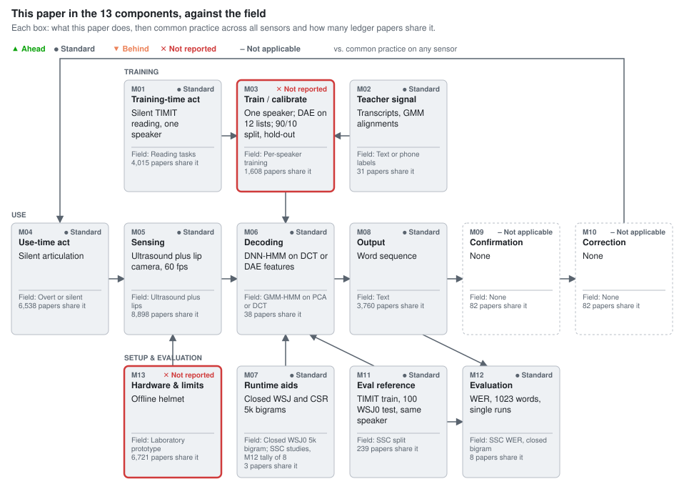

# Updating the Silent Speech Challenge benchmark with deep learning

Ji Y, Liu L, Wang H, Liu Z, Niu Z, Denby B. Speech Communication, 2018. [doi:10.1016/j.specom.2018.02.002](https://doi.org/10.1016/j.specom.2018.02.002) · [arXiv:1709.06818](https://arxiv.org/abs/1709.06818)

**Section:** [Ultrasound & tongue imaging](../../README.md#ultrasound--tongue-imaging)

## Figures

### This paper in the 13 components, against the field

<picture><source media="(prefers-color-scheme: dark)" srcset="figures/components-dark.svg"></picture>

Verdicts compare the paper's choice for each component with common practice across 8,995 ledger entries on any sensor (silent speech, brain-to-text, lip reading).

Data

| Component | This paper | Common practice | Papers with this practice | Verdict |
| --- | --- | --- | --- | --- |
| M01 Training-time act | Silent TIMIT reading, one speaker | Reading tasks | 4,015 of 8,995 | ● Standard (SSC archive.) |
| M02 Teacher signal | Transcripts, GMM alignments | Text or phone labels | 31 of 8,995 | ● Standard (No acoustic targets.) |
| M03 Train / calibrate | One speaker; DAE on 12 lists; 90/10 split, hold-out role not stated | Per-speaker training | 1,608 of 8,995 | ✕ Not reported (Hold-out role, seeds not stated.) |
| M04 Use-time act | Silent articulation | Overt or silent | 6,538 of 8,995 | ● Standard (–) |
| M05 Sensing | Ultrasound plus lip camera, 60 fps | Ultrasound plus lips | 8,898 of 8,995 | ● Standard (SSC hardware.) |
| M06 Decoding | DNN-HMM on DCT or DAE features | GMM-HMM on PCA or DCT | 38 of 8,995 | ● Standard (DNN share: 12.71% to 6.45%.) |
| M07 Runtime aids | Closed WSJ and CSR 5k bigrams | Closed WSJ0 5k bigram; SSC studies, M12 tally of 8 | 3 of 8,995 | ● Standard (No open-vocabulary condition; count from the M12 SSC tally.) |
| M08 Output | Word sequence | Text | 3,760 of 8,995 | ● Standard (–) |
| M09 Confirmation | None | None | 82 of 8,995 | – Not applicable (Offline study.) |
| M10 Correction | None | None | 82 of 8,995 | – Not applicable (Offline study.) |
| M11 Eval reference | TIMIT train, 100 WSJ0 test, same speaker | SSC split | 239 of 8,995 | ● Standard (Sessions not stated.) |
| M12 Evaluation | WER, 1023 words, single runs | SSC WER, closed bigram | 8 of 8,995 | ● Standard (No seeds or tests.) |
| M13 Hardware & limits | Offline helmet | Laboratory prototype | 6,721 of 8,995 | ✕ Not reported (No real-time factor, unlike the benchmark.) |

## Verdict

The paper [[1]](#ref-1) changes the recognizer (M06), a Kaldi DNN-HMM plus deep-autoencoder (DAE) features, and resets the Silent Speech Challenge (SSC) reference number (M12). Both are standard: the same group had already run a DNN-HMM on the SSC (38% WER, §1.2), and a multimodal DAE on tongue and lip images predates it [[2]](#ref-2). The drop from 17.4% to 6.45% WER holds, but with the same WSJ bigram the paper's own LDA+MLLT triphone GMM reaches 12.71% (Table 3), so against its best GMM the DNN halves the WER rather than cutting it by "almost a factor of 3" (inference). The number is tied to one speaker, 1023 test words, single runs and a closed 5,000-word bigram; an end-to-end model with a 65,000-word language model reached 20.5% on the same test [[3]](#ref-3). The DAE's advantage at 5 dimensions rests on DCT systems that fail outright (98.24% to 100% WER), a collapse the paper leaves unexplained, so it does not show the DAE keeps information DCT loses.

## Against the field, component by component

### M06 Processing: DNN-HMM decoding and autoencoder features

**Usual approach:** HMMs with Gaussian-mixture emissions over about 30 PCA (EigenTongue) or DCT coefficients per stream. Of 38 unique ultrasound recognition studies (pattern match, Appendix), 15 use GMM-HMMs and 8 DNN-HMMs, none of the 8 before the target, though §1.2 cites the group's own earlier SSC DNN-HMM; the benchmark used HTK triphones with 8 Gaussians per state [[4]](#ref-4). Of 39 unique ultrasound feature studies (pattern match, Appendix), 32 use PCA, 13 DCT and 13 autoencoders.

**State of the art:** 6.17% SSC WER (2019) [later], from denoising convolutional autoencoder features in the target's own DNN-HMM setting [[5]](#ref-5). End-to-end models trail: 20.5% on the SSC (2020) [[3]](#ref-3) and 37.6% on the same 100 sentences re-recorded, with 7,384 training and validation utterances (2022) [[6]](#ref-6).

Table 2's Kaldi GMM-HMM gives 17.4% without naming its stage or language model; that equals Table 3's triphone2b under the CSR bigram (17.40%), while the same triphone2b with the WSJ bigram behind the DNN's 6.45% gives 12.71%. DCT beats the DAE at K=30 (6.45% against 7.72%, 13 words of 1023; inference). The DAE wins only at K=5, where every DCT system sits at 98.24% to 100% (Table 4), worse than the DAE monophone (45.45%). Verdict: standard.

### M12 Evaluation: the SSC reference number

**Usual approach:** WER on 100 WSJ0 sentences (1023 words) read silently by the training speaker and decoded with the closed WSJ0 5k bigram; 3 of 8 unique SSC studies (pattern match, Appendix) use exactly this condition [[4]](#ref-4) [[5]](#ref-5).

**State of the art:** 6.17% (2019) [later] [[5]](#ref-5), 0.28 points below the target (inference). On TaL, a multi-speaker ultrasound-plus-lip corpus with an in-domain bigram, a Kaldi TDNN-HMM reaches 37.94% silent-speech WER speaker-dependent and 69.84% multi-speaker (2021) [[7]](#ref-7).

Holding features and decoding fixed is the paper's strength: later SSC work reproduces 6.45% [[5]](#ref-5) and cites it as the DNN-HMM benchmark [[3]](#ref-3). In the benchmark source, with PCA features, word accuracy falls from 79.08% to 43.50% when the WSJ bigram becomes a word-loop bigram (Table 1) [[4]](#ref-4); here the DNN goes from 6.45% to 11.44% with the CSR bigram. The authors concede that a closed vocabulary underestimates attainable WER (§4.2), yet both language models are 5k bigrams from the WSJ0 distribution (§4.2), so the acoustic model's share cannot be isolated. Verdict: standard.

## The 13 components

| Component | This paper | Usual approach (count) | State of the art | Verdict |
|---|---|---|---|---|
| M01 Training-time action | Silent TIMIT reading, one speaker | Reading tasks (slot-filled 4,015) | – | standard |
| M02 Training-only supervision | Transcripts, GMM alignments | Text or phone labels (slot-filled 31) | – | standard |
| M03 Training and adaptation | One speaker; DAE on 12 lists; 90/10 split, hold-out role not stated | Per-speaker training (slot-filled 1,608) | – | not reported |
| M04 Use-time action | Silent articulation | Overt or silent (slot-filled 6,538) | – | standard |
| M05 Sensors | Ultrasound plus lip camera, 60 fps | Ultrasound plus lips (slot-filled 8,898) | – | standard |
| M06 Processing and decoding | DNN-HMM on DCT or DAE features | GMM-HMM on PCA or DCT (pattern match 38) | 6.17% WER [[5]](#ref-5) | standard |
| M07 Lexicon and LM | Closed WSJ and CSR 5k bigrams | Closed WSJ0 5k bigram; SSC studies, M12 tally of 8 (pattern match 3) | 20.5% WER, 65k LM [[3]](#ref-3) | standard |
| M08 Output | Word sequence | Text (slot-filled 3,760) | – | standard |
| M09 Confirmation | None | None (slot-filled 82) | – | not applicable |
| M10 Correction | None | None (slot-filled 82) | – | not applicable |
| M11 Reference construction | TIMIT train, 100 WSJ0 test, same speaker | SSC split (slot-filled 239) | – | standard |
| M12 Evaluation | WER, 1023 words, single runs | SSC WER, closed bigram (pattern match 8) | 6.17% WER [[5]](#ref-5) | standard |
| M13 Device and cost | Offline helmet | Laboratory prototype (slot-filled 6,721) | – | not reported |

## Where the claims outrun the evidence

- "Almost a factor of 3" (§5) is measured against an HTK result that was not rerun and a Kaldi GMM whose 17.4% matches the CSR-bigram triphone (Table 3). The benchmark source reports 84.16% word "recognition accuracy" without defining it (Table 4) [[4]](#ref-4); Table 2 gives it 84.26% correct and 17.4% WER, i.e. 82.6% accuracy (inference).
- DCT triphone2b at K=30 differs between Table 3 (12.71% WSJ, 17.40% CSR) and Tables 4 and 5 (13.00%, 17.79%), unexplained.
- DAE effectiveness "at very low dimensionality" (§6) is a rise from 7.72% to 10.07% WER between K=30 and K=5 (30% relative; inference), set against DCT systems that fail at K=5 (Tables 4 and 5).
- The "first application" (§1.2) holds only with its qualifier on features and decoding; the paper does not explain the gap to the group's own 38%.
- "A highly attractive SSI modality" (§6) rests on one speaker; on a different, multi-speaker corpus with an in-domain bigram, silent-speech WER is 69.84% [[7]](#ref-7).
- No seeds, repeated runs or significance tests accompany any WER (§5; Table 2 to Table 5).

## What the field needs next

- M12 and M07: SSC results with an open-vocabulary or no-LM condition, with per-sentence errors for testing differences.
- M06: rerun the K=5 DCT systems and the DAE with several seeds before any feature-dimension claim.
- M06 and M11: compare acoustic models on multi-speaker silent data such as TaL [[7]](#ref-7).

## Questions for the authors

- Which Kaldi GMM-HMM stage and language model give the 17.4% in Table 2?
- Where do the HTK error counts in Table 2 come from?
- What changed between the 2016 DNN-HMM (38% WER) and this one?
- Why do all DCT systems, including the monophone, fail at K=5?
- Did the 10% DNN hold-out select models, and which data fixed the normalization statistics?
- Were training and test sentences recorded in separate sessions, and were the test sentences in the bigram training text?

## Appendix: literature search

- M06 ultrasound-tongue-speech-recognition. Inclusion rule: studies that recognize phones, words or sentences as text from ultrasound tongue images, with or without lip video, silent or vocalized, and report a recognition error or accuracy; synthesis-only studies, contour tracking, lip-only recognition and reviews excluded; versions counted once. Ledger counts: slot-filled 7,345 unique studies (M06); pattern match 38 unique studies. Usual design (pattern match, full text; a study can match several): GMM-HMM 15, CNN 15, CTC/attention 13, DNN-HMM 8, none of the DNN-HMM studies prior to the target; the target's 2016 predecessor (§1.2) is not in the ledger. Read in full: [[4]](#ref-4) (prior), [[5]](#ref-5), [[3]](#ref-3), [[7]](#ref-7), [[6]](#ref-6). Known-item recall 0.67 (two benchmark versions missed by the pattern and added by hand).
- M06 ultrasound-tongue-image-features. Inclusion rule: studies that compress ultrasound tongue images, with or without lip images, into feature vectors by DCT, PCA/EigenTongues, autoencoders or CNN encoders for recognition, synthesis or mapping; contour-only tracking, raw end-to-end models without a feature stage and reviews excluded; versions counted once. Ledger counts: slot-filled 7,345 unique studies (M06); pattern match 39 unique studies. Usual design (pattern match, full text): PCA/EigenTongue 32, DCT 13, autoencoder 13, raw-image CNN 2. Read in full: [[4]](#ref-4) (prior), [[2]](#ref-2) (prior), [[5]](#ref-5). Known-item recall 0.75.
- M12 silent-speech-challenge-benchmark. Inclusion rule: studies reporting results on the SSC archive or on the same 100 SSC test sentences re-recorded; mere citations and other ultrasound corpora excluded; surveys kept in the pattern count only; versions counted once. Ledger counts: slot-filled 6,960 unique studies (M12); pattern match 8 unique studies, of which 5 recognize the SSC test sentences and 3 decode with the closed WSJ0 5k bigram. Read in full: [[4]](#ref-4) (prior), [[5]](#ref-5), [[3]](#ref-3), [[6]](#ref-6). Known-item recall 1.0.

## References

Numbered by first citation. BibTeX in the same order and keys: [refs.bib](refs.bib).

1. Ji, Y., Liu, L., Wang, H., Liu, Z., Niu, Z., Denby, B. “Updating the Silent Speech Challenge benchmark with deep learning.” *Speech Communication*, 2018. doi:[10.1016/j.specom.2018.02.002](https://doi.org/10.1016/j.specom.2018.02.002). arXiv:[1709.06818](https://arxiv.org/abs/1709.06818). Target. Title and authors from the first page of arXiv:1709.06818 v1 (2017-09); journal version in Speech Communication, 2018. [review](https://github.com/supernaiter/silent-speech-review/tree/main/reviews/updating-the-silent-speech-challenge-benchmark-with-deep-learning) [wiki: arxiv-1709.06818](https://github.com/supernaiter/deep-research-wiki-for-silent-speech/blob/main/papers/arxiv-1709.06818/article.md) [wiki: doi-10.1016-j.specom.2018.02.002](https://github.com/supernaiter/deep-research-wiki-for-silent-speech/blob/main/papers/doi-10.1016-j.specom.2018.02.002/article.md)
2. Jaumard-Hakoun, A., Xu, K., Leboullenger, C., Roussel-Ragot, P., Denby, B. “An Articulatory-Based Singing Voice Synthesis Using Tongue and Lips Imaging.” *Proc. Interspeech 2016*, 2016. doi:[10.21437/Interspeech.2016-385](https://doi.org/10.21437/Interspeech.2016-385). Title, authors and DOI from the paper's first page; URL from the ISCA archive. [wiki: isca-jaumardhakoun16_interspeech](https://github.com/supernaiter/deep-research-wiki-for-silent-speech/blob/main/papers/isca-jaumardhakoun16_interspeech/article.md)
3. Kimura, N., Su, Z., Saeki, T. “End-to-End Deep Learning Speech Recognition Model for Silent Speech Challenge.” *Proc. Interspeech 2020 (Show and Tell)*, 2020. <https://www.isca-archive.org/interspeech_2020/kimura20_interspeech.html> Title and authors from the paper's first page; URL from the ISCA archive. [later] [wiki: isca-kimura20_interspeech](https://github.com/supernaiter/deep-research-wiki-for-silent-speech/blob/main/papers/isca-kimura20_interspeech/article.md) [wiki: isca-kimura20-sschallenge](https://github.com/supernaiter/deep-research-wiki-for-silent-speech/blob/main/papers/isca-kimura20-sschallenge/article.md)
4. Cai, J., Denby, B., Roussel, P., Dreyfus, G., Crevier-Buchman, L. “Recognition and Real Time Performances of a Lightweight Ultrasound Based Silent Speech Interface Employing a Language Model.” *Proc. Interspeech 2011*, 2011, 1005–1008. doi:[10.21437/Interspeech.2011-410](https://doi.org/10.21437/Interspeech.2011-410). Title and authors from the paper's first page; DOI and URL from the ISCA archive record. [wiki: isca-cai11_interspeech](https://github.com/supernaiter/deep-research-wiki-for-silent-speech/blob/main/papers/isca-cai11_interspeech/article.md) [wiki: isca-cai11-lightssi](https://github.com/supernaiter/deep-research-wiki-for-silent-speech/blob/main/papers/isca-cai11-lightssi/article.md)
5. Li, B., Xu, K., Feng, D., Mi, H., Wang, H., Zhu, J. “Denoising Convolutional Autoencoder Based B-mode Ultrasound Tongue Image Feature Extraction.” *arXiv preprint*, 2019. arXiv:[1903.00888](https://arxiv.org/abs/1903.00888). Title and authors from the first page of arXiv:1903.00888 v1. [later] [review](https://github.com/supernaiter/silent-speech-review/tree/main/reviews/denoising-convolutional-autoencoder-based-b-mode-ultrasound-tongue-image-feature-extraction) [wiki: arxiv-1903.00888](https://github.com/supernaiter/deep-research-wiki-for-silent-speech/blob/main/papers/arxiv-1903.00888/article.md)
6. Kimura, N., Su, Z., Saeki, T., Rekimoto, J. “SSR7000: A Synchronized Corpus of Ultrasound Tongue Imaging for End-to-End Silent Speech Recognition.” *Proceedings of the 13th Conference on Language Resources and Evaluation (LREC 2022)*, 2022, 6866–6873. <https://aclanthology.org/2022.lrec-1.741> Title, authors, venue and pages from the paper's first page. [later] [wiki: lrec22-ssr7000](https://github.com/supernaiter/deep-research-wiki-for-silent-speech/blob/main/papers/lrec22-ssr7000/article.md) [wiki: doi-10.63317-2b659u3p6oeh](https://github.com/supernaiter/deep-research-wiki-for-silent-speech/blob/main/papers/doi-10.63317-2b659u3p6oeh/article.md)
7. Ribeiro, M. S., Eshky, A., Richmond, K., Renals, S. “Silent versus modal multi-speaker speech recognition from ultrasound and video.” *Proc. Interspeech 2021*, 2021. arXiv:[2103.00333](https://arxiv.org/abs/2103.00333). Title and authors from the paper's first page; arXiv v1 posted 2021-02. [later] [review](https://github.com/supernaiter/silent-speech-review/tree/main/reviews/silent-versus-modal-multi-speaker-speech-recognition-from-ultrasound-and-video) [wiki: isca-ribeiro21-silentus](https://github.com/supernaiter/deep-research-wiki-for-silent-speech/blob/main/papers/isca-ribeiro21-silentus/article.md) [wiki: isca-ribeiro21_interspeech](https://github.com/supernaiter/deep-research-wiki-for-silent-speech/blob/main/papers/isca-ribeiro21_interspeech/article.md) [wiki: arxiv-2103.00333](https://github.com/supernaiter/deep-research-wiki-for-silent-speech/blob/main/papers/arxiv-2103.00333/article.md)

## Materials

Data behind this review. Full texts of the papers are not included.

- [`review.md`](review.md): the review text (source)
- [`refs.bib`](refs.bib): references (BibTeX)
- [`slots.json`](slots.json): for each of the 13 components: this paper's choice, field practice, number of matching papers, verdict
- [`figures.json`](figures.json): figure definitions
- [`evaluation.md`](evaluation.md): independent evaluation by a second reviewer
- [`triage.md`](triage.md): how each evaluation finding was checked against the sources and resolved
- [`components/M06/ultrasound-tongue-image-features.csv`](../../components/M06/ultrasound-tongue-image-features.csv): M06 topic "ultrasound-tongue-image-features", every candidate paper with its decision (7345 slot-filled, 39 pattern match, usual design in 32, 3 read in full)
- [`components/M06/ultrasound-tongue-speech-recognition.csv`](../../components/M06/ultrasound-tongue-speech-recognition.csv): M06 topic "ultrasound-tongue-speech-recognition", every candidate paper with its decision (7345 slot-filled, 38 pattern match, usual design in 15, 5 read in full)
- [`components/M12/silent-speech-challenge-benchmark.csv`](../../components/M12/silent-speech-challenge-benchmark.csv): M12 topic "silent-speech-challenge-benchmark", every candidate paper with its decision (6960 slot-filled, 8 pattern match, usual design in 3, 4 read in full)

## More reviews in Ultrasound & tongue imaging

- [Autoencoder-Based Articulatory-to-Acoustic Mapping for Ultrasound Silent Speech Interfaces](../autoencoder-based-articulatory-to-acoustic-mapping-for-ultrasound-silent-speech-interfaces/) (2019). Standard on the encoder: autoencoder features predate it and it is never compared with PCA or DCT; behind on F0, which is copied from the recording, so the listening test is not of a silent system.
- [Denoising Convolutional Autoencoder Based B-mode Ultrasound Tongue Image Feature Extraction](../denoising-convolutional-autoencoder-based-b-mode-ultrasound-tongue-image-feature-extraction/) (2019). Convolutional denoising AE features (M06) are standard: denoising and CNN features predate it; DCT margin 0.21-0.41 points (2-4 of 1023 words), one speaker, runs unstated.
- [SottoVoce: An Ultrasound Imaging-Based Silent Speech Interaction Using Deep Neural Networks](../sottovoce/) (2019). SottoVoce reconstructs speech audio from under-jaw ultrasound images with two DNNs to control unmodified smart speakers; command success rose from 42.5% to 65.0% with the second network, versus 90.0% for real audio.
- [Ultrasound-based Silent Speech Interface Built on a Continuous Vocoder](../ultrasound-based-silent-speech-interface-built-on-a-continuous-vocoder/) (2019). Continuous F0 targets from articulation were prior work; MVF carrying voicing instead of a flag is new but unproven: the F0 RMSE gain uses different reference contours and naturalness is not better.
- [3D Convolutional Neural Networks for Ultrasound-Based Silent Speech Interfaces](../3d-convolutional-neural-networks-for-ultrasound-based-silent-speech-interfaces/) (2020). (2+1)D front end (M06) is standard: established in lip reading, ported to ultrasound; a 6.3% MSE edge over CNN+LSTM, one speaker, one run; MSE-only evaluation (M12 behind).
- [Ultra2Speech - A Deep Learning Framework for Formant Frequency Estimation and Tracking from Ultrasound Tongue Images](../ultra2speech-a-deep-learning-framework-for-formant-frequency-estimation-and-tracking-from-ultrasound-tongue-images/) (2020). Formant target and hybrid front end (M06) are standard; evaluation (M12) is behind: random one-second clip split of one speaker, where earlier ultrasound work held out whole utterances.

---

Part of the [Silent Speech Interface Review](https://github.com/supernaiter/silent-speech-review). Found an error? [Open an issue](https://github.com/supernaiter/silent-speech-review/issues/new?template=correction.yml).
