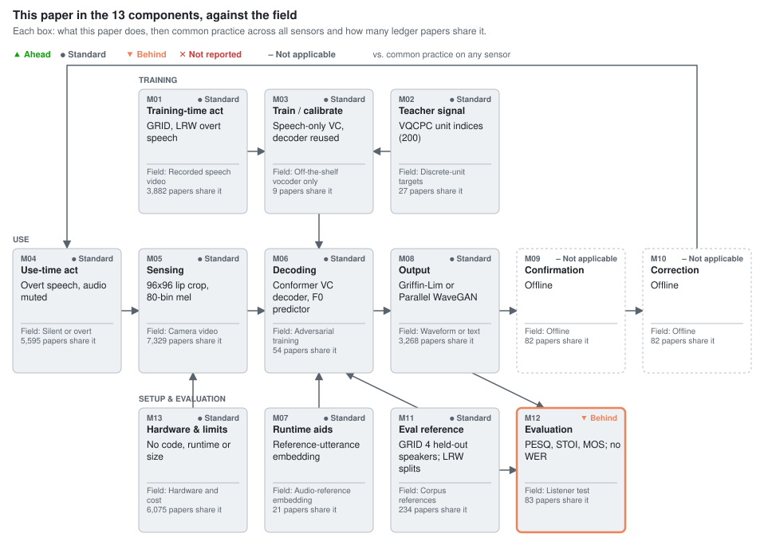

# VCVTS: Multi-Speaker Video-to-Speech Synthesis via Cross-Modal Knowledge Transfer from Voice Conversion

Wang, D., Yang, S., Su, D., Liu, X., Yu, D., Meng, H. · arXiv preprint · 2022 · [arXiv:2202.09081](https://arxiv.org/abs/2202.09081)

**Section:** [Lip & face video](../../README.md#lip--face-video)

## Figures

### This paper in the 13 components, against the field

<picture><source media="(prefers-color-scheme: dark)" srcset="figures/components-dark.svg"></picture>

Verdicts compare the paper's choice for each component with common practice across 8,995 ledger entries on any sensor (silent speech, brain-to-text, lip reading).

Data

| Component | This paper | Common practice | Papers with this practice | Verdict |
| --- | --- | --- | --- | --- |
| M01 Training-time act | GRID, LRW overt speech | Recorded speech video | 3,882 of 8,995 | ● Standard (Inherited.) |
| M02 Teacher signal | VQCPC unit indices (200) | Discrete-unit targets | 27 of 8,995 | ● Standard (Earliest video unit target; not ablated.) |
| M03 Train / calibrate | Speech-only VC, decoder reused | Off-the-shelf vocoder only | 9 of 8,995 | ● Standard (TaLNet transfer predates it.) |
| M04 Use-time act | Overt speech, audio muted | Silent or overt | 5,595 of 8,995 | ● Standard (Inherited.) |
| M05 Sensing | 96x96 lip crop, 80-bin mel | Camera video | 7,329 of 8,995 | ● Standard (Inherited.) |
| M06 Decoding | Conformer VC decoder, F0 predictor | Adversarial training | 54 of 8,995 | ● Standard (Separate F0 module; vid2voc decoded F0 earlier.) |
| M07 Runtime aids | Reference-utterance embedding | Audio-reference embedding | 21 of 8,995 | ● Standard (Usual design; MOS-SS only.) |
| M08 Output | Griffin-Lim or Parallel WaveGAN | Waveform or text | 3,268 of 8,995 | ● Standard (Inherited.) |
| M09 Confirmation | Offline | Offline | 82 of 8,995 | – Not applicable (Offline study.) |
| M10 Correction | Offline | Offline | 82 of 8,995 | – Not applicable (Offline study.) |
| M11 Eval reference | GRID 4 held-out speakers; LRW splits | Corpus references | 234 of 8,995 | ● Standard (LRW speaker disjointness assumed.) |
| M12 Evaluation | PESQ, STOI, MOS; no WER | Listener test | 83 of 8,995 | ▼ Behind (Earlier multi-speaker works report WER; VCVTS does not.) |
| M13 Hardware & limits | No code, runtime or size | Hardware and cost | 6,075 of 8,995 | ● Standard (Offline benchmark only.) |

## Verdict

VCVTS [[1]](#ref-1) changes three components: lips predict the codebook indices of a voice-conversion content encoder (M02), that system is trained on speech alone and reused as the synthesizer (M03), and its decoder adds an F0 predictor (M06). Unit targets reach video-to-speech here earlier than in any other ledger study (Appendix), F0 decoding from video follows vid2voc [[2]](#ref-2), decoder transfer follows TaLNet [[3]](#ref-3); unit targets became common from 2023 and the other two recur ([later]: [[4]](#ref-4), [[5]](#ref-5), [[6]](#ref-6)). Each is standard: Table 1 compares whole systems, with no ablation (§3). Evaluation (M12) is behind on protocol: intelligibility is claimed without any word error rate, although both baselines [[7]](#ref-7), [[8]](#ref-8) and the best comparable earlier study [[9]](#ref-9) score output with ASR. With Griffin-Lim on both sides, the GRID listener-test lead over Lip2Wav lies inside the 95% intervals (Table 1). Speaker control (M07) is the usual reference-audio embedding.

## Against the field, component by component

### M02 Training-only supervision: discrete unit targets

**Usual approach:** Of 54 non-acoustic-to-speech studies with self-supervised speech targets (pattern match, Appendix), 27 name discrete units; every video-to-speech one starts in 2022-12 or later (Appendix). VCVTS trains Lip2Ind as a 200-way classifier over VQCPC indices (§2.2, §3).

**State of the art:** V2SFlow (2024, [later]) predicts HuBERT tokens from video: 28.5% WER on unseen LRS3 speakers (Table I) [[10]](#ref-10).

The justifying ablation came 15 months later: units cut LRS3 WER from 72.5% to 50.7% (Table 3) [[4]](#ref-4), 30% relative (inference). VCVTS has no such row and no Lip2Ind accuracy (§3). Verdict: standard.

### M03 Training: speech-trained decoder reused

**Usual approach:** Of 30 studies pre-training the speech generator without the non-acoustic signal (pattern match, Appendix), 9 use only an off-the-shelf vocoder, 4 pre-train a decoder on audio (all 2023 or later) and 2 transfer a TTS decoder, TaLNet among them; VCVTS trains a voice-conversion system on GRID or LRW speech (§2.3).

**State of the art:** TaLNet (2021, prior) transfers a Tacotron 2 decoder into tongue-and-lip-to-speech: WER 36.5% with transfer, 55.9% without (Table 1) [[3]](#ref-3).

TaLNet decides the verdict: speech-only decoder transfer predates VCVTS and was ablated, 35% relative (inference); VCVTS ablates neither transfer nor fine-tuning (§3). Verdict: standard.

### M06 Decoding: F0 predictor

**Usual approach:** Of 165 video-to-speech studies (pattern match, Appendix), 54 name adversarial training and 9 a pitch or energy predictor, VCVTS the earliest of the 9 (Appendix), though vid2voc already decoded F0 from video [[2]](#ref-2).

**State of the art:** Faces to Voices (2025, [later]) adds pitch and energy predictors to a flow-matching decoder: 30.45% LRS3 WER (Table 2) [[6]](#ref-6).

The F0 gain credited to the predictor (§3.1) depends on the vocoder: GRID seen F0-RMSE is 43.16 with Griffin-Lim but 52.14 with Parallel WaveGAN, worse than Lip2Wav's 49.33 (Table 1). Verdict: standard.

### M07 Use-time speaker information

**Usual approach:** 21 of the 165 studies (pattern match, Appendix) name a reference-audio speaker embedding; VCVTS uses a 256-dimensional Resemblyzer embedding (§3), like Lip2Wav's multi-speaker variant [[7]](#ref-7) and XTS's embedding variant [[8]](#ref-8).

**State of the art:** V2SFlow (2024, [later]): speaker similarity 0.851 from reference audio, 0.664 from video, both at 28.5% WER (Table I) [[10]](#ref-10).

VCVTS scores identity by MOS and t-SNE, XTS by an embedding error rate [[8]](#ref-8); GRID MOS-SS falls from 4.38 to 2.66 for unseen speakers (Griffin-Lim), as the authors concede (§3.2). Verdict: standard.

### M12 Evaluation: no ASR test

**Usual approach:** Of the 165 studies (pattern match, Appendix), 83 name a listener test, 51 unseen speakers, 38 ASR WER; VCVTS's 20-listener MOS is common, but earlier multi-speaker work used WER (below).

**State of the art:** Kefalas et al. (2023, [later]) report PESQ, STOI, ESTOI and ASR WER on the speaker-disjoint 33-speaker GRID split and on LRW, recognizer WER on real audio stated (Tables VII, VIII) [[5]](#ref-5); VCVTS holds out four GRID speakers (§3).

Yardstick: protocol, ASR WER on output in the same multi-speaker setting. Lip2Wav's multi-speaker LRW model, XTS on GRID and Mira et al. on GRID and LRW all report it [[7]](#ref-7), [[8]](#ref-8), [[9]](#ref-9). VCVTS's Lip2Wav LRW row equals Lip2Wav's Table 7 (PESQ 1.197, STOI 0.543, ESTOI 0.344) minus its WER, 34.2% [[7]](#ref-7). Verdict: behind.

## The 13 components

| Component | This paper | Usual approach (count) | State of the art | Verdict |
|---|---|---|---|---|
| M01 Training-time action | GRID, LRW overt speech | Recorded speech video (slot-filled 3,882) | – | standard |
| M02 Training-only supervision | VQCPC unit indices (200) | Discrete-unit targets (pattern match 27) | [[10]](#ref-10) (2024): LRS3 WER 28.5% | standard |
| M03 Training and adaptation | Speech-only VC, decoder reused | Off-the-shelf vocoder only (pattern match 9) | [[3]](#ref-3) (2021): WER 36.5% | standard |
| M04 Use-time action | Overt speech, audio muted | Silent or overt (slot-filled 5,595) | – | standard |
| M05 Sensors | 96x96 lip crop, 80-bin mel | Camera video (slot-filled 7,329) | – | standard |
| M06 Processing and decoding | Conformer VC decoder, F0 predictor | Adversarial training (pattern match 54) | [[6]](#ref-6) (2025): LRS3 WER 30.45% | standard |
| M07 Lexicon and LM | Reference-utterance embedding | Audio-reference embedding (pattern match 21) | [[10]](#ref-10) (2024): SECS 0.664 | standard |
| M08 Output | Griffin-Lim or Parallel WaveGAN | Waveform or text (slot-filled 3,268) | – | standard |
| M09 Confirmation | Offline | Offline (slot-filled 82) | – | not applicable |
| M10 Correction | Offline | Offline (slot-filled 82) | – | not applicable |
| M11 Reference construction | GRID 4 held-out speakers; LRW splits | Corpus references (slot-filled 234) | – | standard |
| M12 Evaluation | PESQ, STOI, MOS; no WER | Listener test (pattern match 83) | [[5]](#ref-5) (2023): WER on disjoint GRID and LRW | behind |
| M13 Device and cost | No code, runtime or size | Hardware and cost (slot-filled 6,075) | – | standard |

## Where the claims outrun the evidence

- Subjective superiority (§3.2): with Griffin-Lim on GRID, MOS-SN is 3.46 ± 0.12 against 3.41 ± 0.11 (seen) and 3.25 ± 0.11 against 3.13 ± 0.12 (unseen) for Lip2Wav (Table 1); VCVTS's top scores use Parallel WaveGAN, denied to the baselines (§3).
- "Open vocabulary" (Abstract) is word-level LRW, more than 500 words, speaker disjointness assumed, and the LRW lead has no WER (§3).

## What the field needs next

- M02: unit target against mel regression, scored by WER.
- M03: voice conversion trained with and without held-out speakers' audio.
- M12: ASR WER and an embedding speaker score on the 33-speaker GRID split [[9]](#ref-9).

## Questions for the authors

- Was the unseen-condition voice-conversion model trained on audio of s1, s2, s4 and s29?
- Which reference audio conditions Table 1?
- How many test utterances and runs underlie the objective scores?

## Appendix: literature search

- M02, ssl-speech-unit-target (published table, reused). Inclusion rule: studies that synthesize speech from a non-acoustic signal and train the signal encoder to predict self-supervised speech representations derived from paired audio; recognition-only studies, self-generated targets and acoustic-input conversion excluded; versions once. Ledger: 31 unique studies slot-filled for M02; 54 unique studies pattern match. Usual design: supervision_kind=paired_audio 11 of 22 (slot-filled, M03); discrete-unit wording 27, video input 20 (pattern match). Video-to-speech unit-target studies in the table start in 2022-12; VCVTS (2022-02) is outside the published pattern and was added. Read in full: [[4]](#ref-4), [[10]](#ref-10). Known-item recall 1.0 (published seeds); VCVTS itself is missed by the pattern.
- M03, audio-only-decoder-pretraining (published table, reused). Inclusion rule: studies that pre-train the speech generator on speech without the non-acoustic signal and transfer it; an off-the-shelf vocoder alone counted separately; versions once. Ledger: 1,526 unique studies slot-filled for M03; 30 unique studies pattern match. Off-the-shelf vocoder only 9, audio-only decoder pre-training 4 (all 2023 or later), TTS decoder transfer 2 (pattern match, published counts); VCVTS added. Read in full: [[3]](#ref-3), [[5]](#ref-5). Known-item recall 0.67 (VCVTS missed by the pattern).
- M06, video-to-speech-one-to-many-decoder (published table, reused). Inclusion rule: the video-to-speech population (waveform from talking-face or lip video, audio muted at test) classified by how the decoder handles the one-to-many mapping; every named design counts (upper bound); versions once. Ledger: 7,345 unique studies slot-filled for M06; 165 unique studies pattern match. Adversarial training 54, SSL-unit conditioning 44, diffusion 22, flow 19, pitch or energy predictor 9 (pattern match, published counts). Read in full: [[6]](#ref-6), [[7]](#ref-7), [[2]](#ref-2). Known-item recall 1.0.
- M07, reference-speaker-conditioning-at-inference (published table, reused). Inclusion rule: the same 165 studies classified by use-time speaker information; training-only or scoring-only embeddings excluded; upper bound. Ledger: 119 unique studies slot-filled for M07; 165 unique studies pattern match. Reference-audio embedding 21, video- or face-derived 16 (pattern match, published counts). Read in full: [[7]](#ref-7), [[8]](#ref-8), [[10]](#ref-10). Known-item recall 1.0.
- M12, video-to-speech-output-evaluation (published table, reused). Inclusion rule: the same video-to-speech population, counting the evaluation protocols its full text names; upper bound; versions once. Ledger: 6,960 unique studies slot-filled for M12; 165 unique studies pattern match. Listener test 83, unseen speakers 51, ASR WER on output 38, GRID unseen split 19 (pattern match, published counts). Read in full: [[9]](#ref-9), [[7]](#ref-7), [[8]](#ref-8), [[5]](#ref-5). Yardstick: ASR WER in earlier multi-speaker GRID/LRW work. Known-item recall 1.0.

## References

Numbered by first citation. BibTeX in the same order and keys: [refs.bib](refs.bib).

1. Wang, D., Yang, S., Su, D., Liu, X., Yu, D., Meng, H. “VCVTS: Multi-Speaker Video-to-Speech Synthesis via Cross-Modal Knowledge Transfer from Voice Conversion.” *arXiv preprint*, 2022. arXiv:[2202.09081](https://arxiv.org/abs/2202.09081). Target. Read as arXiv v1 (18 Feb 2022). [review](https://github.com/supernaiter/silent-speech-review/tree/main/reviews/vcvts-multi-speaker-video-to-speech-synthesis-via-cross-modal-knowledge-transfer-from-voice-conversion) [wiki: arxiv-2202.09081-vcvts](https://github.com/supernaiter/deep-research-wiki-for-silent-speech/blob/main/papers/arxiv-2202.09081-vcvts/article.md)
2. Michelsanti, D., Slizovskaia, O., Haro, G., Gómez, E., Tan, Z., Jensen, J. “Vocoder-Based Speech Synthesis from Silent Videos.” *Proc. Interspeech 2020*, 2020, 3530-3534. doi:[10.21437/Interspeech.2020-1026](https://doi.org/10.21437/Interspeech.2020-1026). arXiv:[2004.02541](https://arxiv.org/abs/2004.02541). Prior; earlier F0 prediction from video (M06). [review](https://github.com/supernaiter/silent-speech-review/tree/main/reviews/vocoder-based-speech-synthesis-from-silent-videos) [wiki: isca-michelsanti20-vid2voc](https://github.com/supernaiter/deep-research-wiki-for-silent-speech/blob/main/papers/isca-michelsanti20-vid2voc/article.md)
3. Zhang, J., Richmond, K., Ling, Z., Dai, L. “TaLNet: Voice Reconstruction from Tongue and Lip Articulation with Transfer Learning from Text-to-Speech Synthesis.” *The Thirty-Fifth AAAI Conference on Artificial Intelligence (AAAI-21)*, 2021, 35(16), 14402-14410. doi:[10.1609/aaai.v35i16.17693](https://doi.org/10.1609/aaai.v35i16.17693). Prior; deciding prior for M03. [wiki: doi-10.1609-aaai.v35i16.17693](https://github.com/supernaiter/deep-research-wiki-for-silent-speech/blob/main/papers/doi-10.1609-aaai.v35i16.17693/article.md)
4. Choi, J., Kim, M., Ro, Y. M. “Intelligible Lip-to-Speech Synthesis with Speech Units.” *Interspeech 2023*, 2023, 4349-4353. doi:[10.21437/Interspeech.2023-194](https://doi.org/10.21437/Interspeech.2023-194). arXiv:[2305.19603](https://arxiv.org/abs/2305.19603). Later; unit-target ablation (Table 3) for M02. [later] [review](https://github.com/supernaiter/silent-speech-review/tree/main/reviews/intelligible-lip-to-speech-synthesis-with-speech-units) [wiki: arxiv-2305.19603](https://github.com/supernaiter/deep-research-wiki-for-silent-speech/blob/main/papers/arxiv-2305.19603/article.md) [wiki: isca-choi23-liptospeech](https://github.com/supernaiter/deep-research-wiki-for-silent-speech/blob/main/papers/isca-choi23-liptospeech/article.md) [wiki: isca-choi23_interspeech](https://github.com/supernaiter/deep-research-wiki-for-silent-speech/blob/main/papers/isca-choi23_interspeech/article.md)
5. Kefalas, T., Panagakis, Y., Pantic, M. “Large-scale unsupervised audio pre-training for video-to-speech synthesis.” *IEEE/ACM Transactions on Audio, Speech, and Language Processing*, 2024, 32, 2255-2268. doi:[10.1109/TASLP.2024.3382500](https://doi.org/10.1109/TASLP.2024.3382500). arXiv:[2306.15464](https://arxiv.org/abs/2306.15464). Later; audio-only decoder pre-training (M03) and the GRID unseen-speaker table (Table VII, M12). [later] [review](https://github.com/supernaiter/silent-speech-review/tree/main/reviews/large-scale-unsupervised-audio-pre-training-for-video-to-speech-synthesis) [wiki: arxiv-2306.15464-v2apretrain](https://github.com/supernaiter/deep-research-wiki-for-silent-speech/blob/main/papers/arxiv-2306.15464-v2apretrain/article.md)
6. Kim, J., Choi, J., Kim, J., Jung, C., Chung, J. S. “From Faces to Voices: Learning Hierarchical Representations for High-quality Video-to-Speech.” *Proceedings of the IEEE/CVF Conference on Computer Vision and Pattern Recognition (CVPR)*, 2025, 15874-15884. arXiv:[2503.16956](https://arxiv.org/abs/2503.16956). Later; state of the art for M06. [later] [wiki: arxiv-2503.16956](https://github.com/supernaiter/deep-research-wiki-for-silent-speech/blob/main/papers/arxiv-2503.16956/article.md)
7. Prajwal, K. R., Mukhopadhyay, R., Namboodiri, V. P., Jawahar, C. V. “Learning Individual Speaking Styles for Accurate Lip to Speech Synthesis.” *2020 IEEE/CVF Conference on Computer Vision and Pattern Recognition (CVPR)*, 2020, 13793-13802. doi:[10.1109/CVPR42600.2020.01381](https://doi.org/10.1109/CVPR42600.2020.01381). arXiv:[2005.08209](https://arxiv.org/abs/2005.08209). Prior; the target's baseline (Lip2Wav); deciding prior for M07 and M12. [wiki: arxiv-2005.08209](https://github.com/supernaiter/deep-research-wiki-for-silent-speech/blob/main/papers/arxiv-2005.08209/article.md) [wiki: cvf-prajwal20-lip2wav](https://github.com/supernaiter/deep-research-wiki-for-silent-speech/blob/main/papers/cvf-prajwal20-lip2wav/article.md)
8. Oneață, D., Stan, A., Cucu, H. “Speaker disentanglement in video-to-speech conversion.” *arXiv preprint*, 2021. arXiv:[2105.09652](https://arxiv.org/abs/2105.09652). Prior; the target's XTS baseline; deciding prior for M07 and M12. [review](https://github.com/supernaiter/silent-speech-review/tree/main/reviews/speaker-disentanglement-in-video-to-speech-conversion) [wiki: arxiv-2105.09652-spkdisent](https://github.com/supernaiter/deep-research-wiki-for-silent-speech/blob/main/papers/arxiv-2105.09652-spkdisent/article.md)
9. Mira, R., Vougioukas, K., Ma, P., Petridis, S., Schuller, B. W., Pantic, M. “End-to-End Video-To-Speech Synthesis using Generative Adversarial Networks.” *IEEE Transactions on Cybernetics*, 2023, 53(6), 3454-3466. doi:[10.1109/TCYB.2022.3162495](https://doi.org/10.1109/TCYB.2022.3162495). arXiv:[2104.13332](https://arxiv.org/abs/2104.13332). Prior; best comparable earlier study for M12 (GRID unseen-speaker and LRW WER). [wiki: arxiv-2104.13332](https://github.com/supernaiter/deep-research-wiki-for-silent-speech/blob/main/papers/arxiv-2104.13332/article.md)
10. Choi, J., Kim, J., Li, J., Chung, J. S., Liu, S. “V2SFlow: Video-to-Speech Generation with Speech Decomposition and Rectified Flow.” *arXiv preprint*, 2024. arXiv:[2411.19486](https://arxiv.org/abs/2411.19486). Later; state of the art for M02 and M07. Read as arXiv v2. [later] [wiki: arxiv-2411.19486](https://github.com/supernaiter/deep-research-wiki-for-silent-speech/blob/main/papers/arxiv-2411.19486/article.md)

## Materials

Data behind this review. Full texts of the papers are not included.

- [`review.md`](review.md): the review text (source)
- [`refs.bib`](refs.bib): references (BibTeX)
- [`slots.json`](slots.json): for each of the 13 components: this paper's choice, field practice, number of matching papers, verdict
- [`figures.json`](figures.json): figure definitions
- [`evaluation.md`](evaluation.md): independent evaluation by a second reviewer
- [`triage.md`](triage.md): how each evaluation finding was checked against the sources and resolved
- [`process/log.json`](process/log.json): process record: each step, who did it (reader, script, writer, evaluator), when, the checks run and the input versions
- [`process/notes.json`](process/notes.json): reading notes on the target and comparator papers: claims, numbers, conditions and what is not stated, with locations
- [`process/plan.json`](process/plan.json): plan: which components the paper changes and the topics it is compared on
- [`process/draft.md`](process/draft.md): the review as first written, before the independent evaluation
- [`process/claims-draft.md`](process/claims-draft.md): claim table of the draft: every claim mapped to a note or a count
- [`process/claims.md`](process/claims.md): claim table of the published review
- [`components/M02/ssl-speech-unit-target.csv`](../../components/M02/ssl-speech-unit-target.csv): M02 topic "ssl-speech-unit-target", every candidate paper with its decision (31 slot-filled, 54 pattern match, usual design in 11, 2 read in full)
- [`components/M03/audio-only-decoder-pretraining.csv`](../../components/M03/audio-only-decoder-pretraining.csv): M03 topic "audio-only-decoder-pretraining", every candidate paper with its decision (1526 slot-filled, 30 pattern match, usual design in 9, 3 read in full)
- [`components/M06/video-to-speech-one-to-many-decoder.csv`](../../components/M06/video-to-speech-one-to-many-decoder.csv): M06 topic "video-to-speech-one-to-many-decoder", every candidate paper with its decision (7345 slot-filled, 165 pattern match, usual design in 54, 4 read in full)
- [`components/M07/reference-speaker-conditioning-at-inference.csv`](../../components/M07/reference-speaker-conditioning-at-inference.csv): M07 topic "reference-speaker-conditioning-at-inference", every candidate paper with its decision (119 slot-filled, 165 pattern match, usual design in 21, 3 read in full)
- [`components/M12/video-to-speech-output-evaluation.csv`](../../components/M12/video-to-speech-output-evaluation.csv): M12 topic "video-to-speech-output-evaluation", every candidate paper with its decision (6960 slot-filled, 165 pattern match, usual design in 83, 5 read in full)

## More reviews in Lip & face video

- [FastLTS: Non-Autoregressive End-to-End Unconstrained Lip-to-Speech Synthesis](../fastlts-non-autoregressive-end-to-end-unconstrained-lip-to-speech-synthesis/) (2022). Parallel decoder, learned-feature GAN generator and transformer front end (M06) are standard; 9.14x mel speedup is real, but evaluation (M12) drops the STOI/ESTOI its Lip2Wav baseline reported.
- [Learning Audio-Visual Speech Representation by Masked Multimodal Cluster Prediction](../learning-audio-visual-speech-representation-by-masked-multimodal-cluster-prediction/) (2022). AV-HuBERT's masked audio-visual cluster pre-training (M03) was a large step past distillation, but its LRS3 gains lack repeated runs and later work beats it at matched budgets.
- [Lip-to-Speech Synthesis for Arbitrary Speakers in the Wild](../lip-to-speech-synthesis-for-arbitrary-speakers-in-the-wild/) (2022). VAE-GAN lip-to-speech with a reference-audio voice: a standard design whose gains are in distribution and sync metrics; no WER is reported, behind its own lineage on evaluation.
- [Sub-word Level Lip Reading With Visual Attention](../sub-word-level-lip-reading-with-visual-attention/) (2022). Attention pooling of the lip map (M06) was ahead in 2021 but not the route to later SOTA; WordPiece output (M08) was preceded by BPE in 2020; the SOTA table mixes data budgets.
- [SVTS: Scalable Video-to-Speech Synthesis](../svts-scalable-video-to-speech-synthesis/) (2022). Conformer mel predictor plus pretrained vocoder (M06) and data scaling (M03) are standard; GRID/LRW gains hold, but later tests put SVTS at 78-82% WER on LRS3.
- [VisageSynTalk: Unseen Speaker Video-to-Speech Synthesis via Speech-Visage Feature Selection](../visagesyntalk-unseen-speaker-video-to-speech-synthesis-via-speech-visage-feature-selection/) (2022). VisageSynTalk disentangles speech content and visage (identity) features for video-to-speech synthesis, yielding robust results for unseen speakers on benchmarks.

---

Part of the [Silent Speech Interface Review](https://github.com/supernaiter/silent-speech-review). Found an error? [Open an issue](https://github.com/supernaiter/silent-speech-review/issues/new?template=correction.yml).
