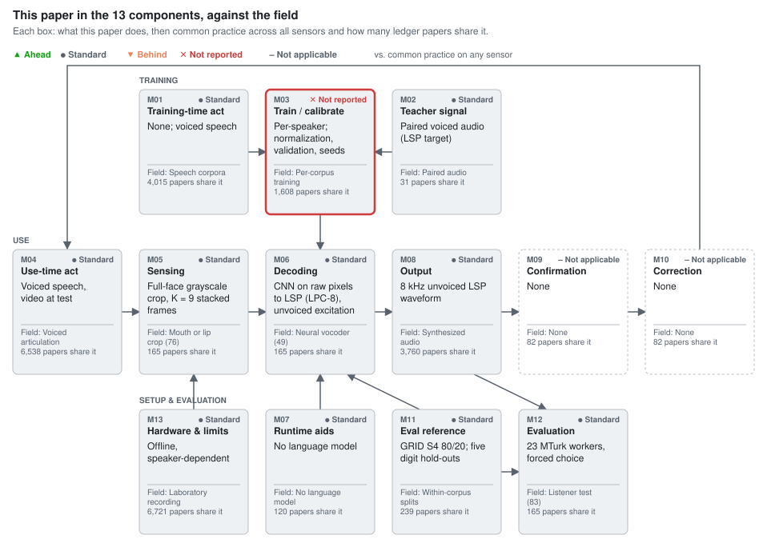

# Vid2speech: Speech Reconstruction from Silent Video

Ariel Ephrat, Shmuel Peleg. 2017 IEEE International Conference on Acoustics, Speech and Signal Processing (ICASSP), 2017. [doi:10.1109/ICASSP.2017.7953127](https://doi.org/10.1109/ICASSP.2017.7953127) · [arXiv:1701.00495](https://arxiv.org/abs/1701.00495)

**Section:** [Lip & face video](../../README.md#lip--face-video)

## Figures

### This paper in the 13 components, against the field

<picture><source media="(prefers-color-scheme: dark)" srcset="figures/components-dark.svg"></picture>

Verdicts compare the paper's choice for each component with common practice across 8,995 ledger entries on any sensor (silent speech, brain-to-text, lip reading).

Data

| Component | This paper | Common practice | Papers with this practice | Verdict |
| --- | --- | --- | --- | --- |
| M01 Training-time act | None; voiced speech | Speech corpora | 4,015 of 8,995 | ● Standard (Inherited.) |
| M02 Teacher signal | Paired voiced audio (LSP target) | Paired audio | 31 of 8,995 | ● Standard (Inherited from Le Cornu and Milner.) |
| M03 Train / calibrate | Per-speaker; normalization, validation, seeds unstated | Per-corpus training | 1,608 of 8,995 | ✕ Not reported (Normalization and validation sources not stated.) |
| M04 Use-time act | Voiced speech, video at test | Voiced articulation | 6,538 of 8,995 | ● Standard (Inherited.) |
| M05 Sensing | Full-face grayscale crop, K = 9 stacked frames | Mouth or lip crop (76) | 165 of 8,995 | ● Standard (Face 40% lower error, one figure, no protocol.) |
| M06 Decoding | CNN on raw pixels to LSP (LPC-8), unvoiced excitation | Neural vocoder (49) | 165 of 8,995 | ● Standard (82.6% vs 40.0% over GMM on AAM.) |
| M07 Runtime aids | No language model | No language model | 120 of 8,995 | ● Standard (Inherited; listeners given the GRID vocabulary (M12).) |
| M08 Output | 8 kHz unvoiced LSP waveform | Synthesized audio | 3,760 of 8,995 | ● Standard (Folded into M06.) |
| M09 Confirmation | None | None | 82 of 8,995 | – Not applicable (Offline study.) |
| M10 Correction | None | None | 82 of 8,995 | – Not applicable (Offline study.) |
| M11 Eval reference | GRID S4 80/20; five digit hold-outs | Within-corpus splits | 239 of 8,995 | ● Standard (Comparator protocol.) |
| M12 Evaluation | 23 MTurk workers, forced choice | Listener test (83) | 165 of 8,995 | ● Standard (Response format differs from comparator.) |
| M13 Hardware & limits | Offline, speaker-dependent | Laboratory recording | 6,721 of 8,995 | ● Standard (Inherited.) |

## Verdict

The paper [[1]](#ref-1) changes the visual input (M05: full-face frames stacked over K = 9 instead of mouth features) and the estimator (M06: a CNN from raw pixels to LSP, keeping the comparator's 8th-order LPC and unvoiced excitation). Both are standard. The gain over Le Cornu and Milner [[2]](#ref-2), 82.6% against 40.0% audio-only word intelligibility on GRID S4 (Table 2), holds in direction but is confounded by the evaluation (M12): Vid2speech listeners picked each word from the GRID vocabulary (Sec. 4.3); the comparator's listeners typed them. As a whole system under Lip2Wav's protocol (Google ASR, mean of 4 GRID speakers), it scores 44.92% WER against 14.08% for Lip2Wav [[3]](#ref-3) [later]. The OOV-digit test (51.6% against 10.0% chance, Table 3) is a ten-way choice, not open-vocabulary reconstruction.

## Against the field, component by component

### M05 Sensors: full face over several frames

**Usual approach:** Of 165 unique video-to-speech studies (pattern match, Appendix), 76 name a mouth or lip crop and 15 the full face. The comparator used mouth-centred DCT or lip AAM features [[2]](#ref-2); the paper stacks K grayscale face crops as channels (Sec. 3.1).

**State of the art:** Lip2Wav (2020) [[3]](#ref-3) [later] also uses face crops, calls this channel-stacked 2D-CNN "very inadequate" for real-world faces (Sec. 2.1), and scores 14.08% GRID WER against 44.92% for its re-run of Vid2speech (Table 2, mean of 4 speakers). The gap compares whole systems, not inputs.

The face-over-mouth result (40% lower test error, both at K = 9, Sec. 3.1) gives no split, metric definition or seed; the mouth arm is a hard-coded mask (Sec. 4). Verdict: standard: 15 studies name the full face (Appendix), and one unrepeated figure cannot support ahead.

### M06 Processing: CNN regression to LSP, unvoiced excitation

**Usual approach:** Of the 165 studies (pattern match, Appendix), 49 name a neural vocoder, 41 a parametric vocoder, 35 LPC or LSP, 35 hand-crafted visual features and 6 unvoiced or noise excitation. The paper replaces the comparator's GMM on AAM features with a CNN on raw pixels, but keeps its 8th-order LPC "to isolate the effect of using CNN-learned visual features" (Sec. 2) and its unvoiced Gaussian-noise excitation (Sec. 3.2), matching the comparator's GMM UNV row [[2]](#ref-2).

**State of the art:** The lowest WER in Table IV of Kefalas et al. (2023) [[4]](#ref-4) [later] is the end-to-end WGAN (2022) row at 4.07% (four seen GRID speakers, one ASR with 0.1% WER on real audio); their best own row is 4.54%. Its recognizer differs from Lip2Wav's Google ASR, so the WER scales are not comparable. Under Lip2Wav's protocol it trails Lip2Wav by 30.84 points on GRID (68.7% relative) and by 44.26 on TCD-TIMIT (75.52% against 31.26%, Table 3) (inference).

The matched target and excitation leave only the front end and estimator different from [[2]](#ref-2). The comparator's DNN on 2D-DCT features scored 26.9% (Tables 4–5). The cost is the excitation: the comparator measured a 7.5-point absolute gain from real voicing (Sec. 5.3), and the paper concedes "unnatural sounding" speech (Sec. 3.2). Verdict: standard.

### M12 Evaluation: closed-choice listeners and an OOV split

**Usual approach:** Of the 165 studies (pattern match, Appendix), 83 name a listener or opinion test, 51 an unseen-speaker test and 38 ASR WER on the output; 4 name a closed-choice listener format and 5 an out-of-vocabulary word test. The paper has 23 MTurk workers pick each word from the GRID options (Sec. 4.3).

**State of the art:** One fixed ASR checked on real audio (0.1% WER), unseen speakers and objective metrics: in Kefalas et al. (2023) [[4]](#ref-4) [later] the lowest unseen-GRID WER is 16.05% (WGAN row; best own row 17.08%, Table VII). Lip2Wav [[3]](#ref-3) [later] adds 15 raters for intelligibility and naturalness.

The 82.6% against 40.0% comparison crosses response formats: forced choice among GRID options here, free entry with replays in [[2]](#ref-2) (Sec. 5.2). Both state 19% chance (Table 2; Sec. 5.2 of [[2]](#ref-2)), but forced choice removes off-vocabulary errors (inference). Verdict: standard.

## The 13 components

| Component | This paper | Usual approach (count) | State of the art | Verdict |
|---|---|---|---|---|
| M01 Training-time action | None; voiced speech | Speech corpora (slot-filled 4,015) | – | standard |
| M02 Training-only supervision | Paired voiced audio (LSP target) | Paired audio (slot-filled 31) | – | standard |
| M03 Training and adaptation | Per-speaker; normalization, validation, seeds unstated | Per-corpus training (slot-filled 1,608) | – | not reported |
| M04 Use-time action | Voiced speech, video at test | Voiced articulation (slot-filled 6,538) | – | standard |
| M05 Sensors | Full-face grayscale crop, K = 9 stacked frames | Mouth or lip crop (76) (pattern match 165) | Lip2Wav: face crop; 14.08% vs 44.92% WER, whole systems [[3]](#ref-3) | standard |
| M06 Processing and decoding | CNN on raw pixels to LSP (LPC-8), unvoiced excitation | Neural vocoder (49) (pattern match 165) | 4.07% WER, GRID seen speakers [[4]](#ref-4) | standard |
| M07 Lexicon and LM | No language model | No language model (slot-filled 120) | – | standard |
| M08 Output | 8 kHz unvoiced LSP waveform | Synthesized audio (slot-filled 3,760) | – | standard |
| M09 Confirmation | None | None (slot-filled 82) | – | not applicable |
| M10 Correction | None | None (slot-filled 82) | – | not applicable |
| M11 Reference construction | GRID S4 80/20; five digit hold-outs | Within-corpus splits (slot-filled 239) | – | standard |
| M12 Evaluation | 23 MTurk workers, forced choice | Listener test (83) (pattern match 165) | Unseen GRID 16.05% WER [[4]](#ref-4); ASR plus raters [[3]](#ref-3) | standard |
| M13 Device and cost | Offline, speaker-dependent | Laboratory recording (slot-filled 6,721) | – | standard |

## Where the claims outrun the evidence

- "Significantly more intelligible" (Sec. 4.4) has no test, interval or per-condition count; 38 distinct sequences are pooled across three clip types (Sec. 4.3).
- Audio-visual scores 79.9% against 82.6% audio-only on S4 (Table 2): adding the real video cost 2.7 points, while the comparator gained 11.9 (inference); pooled counts give no way to show the two differ.
- "As done there" (Sec. 4.1) holds for speaker and training size (800 of 1,000 sentences in [[2]](#ref-2)), not for the listener task. Its "best results" are the unvoiced row; oracle voicing gave 48.6% (Table 5).
- "Vocabulary-agnostic" OOV reconstruction (Sec. 1) is 51.6% in a ten-digit choice against 93.4% with all digits trained (Table 3), a 44.8% relative drop (inference) the authors concede (Sec. 4.4).

## What the field needs next

- M12: the same clips scored by free transcription and by forced choice.
- M05: face against mouth crops on several speakers, with stated split and seed.
- M06: unvoiced against predicted voicing on fixed LSPs.

## Questions for the authors

- How many judgements underlie each Table 2 and 3 cell?
- Which data and error metric underlie Fig. 2?
- With which seed was the 80/20 split drawn, and was it repeated?

## Appendix: literature search

- M05 video-to-speech-visual-input-stream (published topic table, appended). Inclusion rule: the 165-study video-to-speech population of the published M06 synthesis table, counted by the visual input its full text names (mouth or lip crop, full face, optical-flow stream), reference list removed; a study counts under every input its text names (upper bound); versions counted once. Slot-filled 7,329 unique studies; pattern match 165 unique studies. Usual design: mouth or lip crop, 76 (pattern match). Design counts: mouth or lip crop 76, full face 15, optical flow 7. Read in full: [[2]](#ref-2), [[3]](#ref-3) [later], target. Known-item recall 1.0.
- M06 video-to-speech-synthesis (published topic table, appended). Inclusion rule: studies that synthesize a speech waveform from talking-face or lip video and report the acoustic representation and how it becomes a waveform; enhancement with noisy audio at test, talking-head generation, text-only lip reading and video-to-text-to-speech pipelines excluded; versions counted once. Slot-filled 7,345 unique studies; pattern match 165 unique studies. Usual design: neural vocoder, 49 (pattern match). Design counts: neural vocoder 49, parametric vocoder 41, Griffin-Lim 16; added here: LPC or LSP 35, hand-crafted visual features 35, unvoiced or noise excitation 6. Read in full: [[2]](#ref-2), [[3]](#ref-3) [later], [[4]](#ref-4) [later], target. Known-item recall 1.0.
- M12 video-to-speech-output-evaluation (published topic table, appended). Inclusion rule: the same population, compared by how the synthesized speech is evaluated (listener or opinion tests, ASR WER on the output, unseen-speaker tests); a study counts under every protocol its full text names (upper bound); versions counted once. Slot-filled 6,960 unique studies; pattern match 165 unique studies. Usual design: listener or opinion-score test, 83 (pattern match). Design counts: listener test 83, unseen-speaker test 51, ASR WER on the output 38; added here: closed-choice listener format 4, out-of-vocabulary word test 5. Read in full: [[2]](#ref-2), [[4]](#ref-4) [later], target. Known-item recall 1.0.

## References

Numbered by first citation. BibTeX in the same order and keys: [refs.bib](refs.bib).

1. Ephrat, A., Peleg, S. “Vid2speech: Speech Reconstruction from Silent Video.” *2017 IEEE International Conference on Acoustics, Speech and Signal Processing (ICASSP)*, 2017, 5095-5099. doi:[10.1109/ICASSP.2017.7953127](https://doi.org/10.1109/ICASSP.2017.7953127). arXiv:[1701.00495](https://arxiv.org/abs/1701.00495). Target. Read as arXiv v2; venue, pages and DOI from the ICASSP 2017 proceedings record. [review](https://github.com/supernaiter/silent-speech-review/tree/main/reviews/vid2speech-speech-reconstruction-from-silent-video) [wiki: arxiv-1701.00495](https://github.com/supernaiter/deep-research-wiki-for-silent-speech/blob/main/papers/arxiv-1701.00495/article.md)
2. Le Cornu, T., Milner, B. “Reconstructing intelligible audio speech from visual speech features.” *Interspeech 2015*, 2015. doi:[10.21437/Interspeech.2015-139](https://doi.org/10.21437/Interspeech.2015-139). Prior; the comparator [10] of the target; deciding prior for M05, M06 and M12. [wiki: isca-cornu15-v2speech](https://github.com/supernaiter/deep-research-wiki-for-silent-speech/blob/main/papers/isca-cornu15-v2speech/article.md) [wiki: isca-cornu15_interspeech](https://github.com/supernaiter/deep-research-wiki-for-silent-speech/blob/main/papers/isca-cornu15_interspeech/article.md)
3. Prajwal, K. R., Mukhopadhyay, R., Namboodiri, V. P., Jawahar, C. V. “Learning Individual Speaking Styles for Accurate Lip to Speech Synthesis.” *2020 IEEE/CVF Conference on Computer Vision and Pattern Recognition (CVPR)*, 2020. doi:[10.1109/CVPR42600.2020.01381](https://doi.org/10.1109/CVPR42600.2020.01381). arXiv:[2005.08209](https://arxiv.org/abs/2005.08209). Read as arXiv v1; re-runs the target in Tables 2-3. [later] [wiki: arxiv-2005.08209](https://github.com/supernaiter/deep-research-wiki-for-silent-speech/blob/main/papers/arxiv-2005.08209/article.md)
4. Kefalas, T., Panagakis, Y., Pantic, M. “Large-scale unsupervised audio pre-training for video-to-speech synthesis.” *IEEE/ACM Transactions on Audio, Speech, and Language Processing*, 2024, 32. doi:[10.1109/TASLP.2024.3382500](https://doi.org/10.1109/TASLP.2024.3382500). arXiv:[2306.15464](https://arxiv.org/abs/2306.15464). Read as arXiv v1 (2023); table numbers from that version. [later] [review](https://github.com/supernaiter/silent-speech-review/tree/main/reviews/large-scale-unsupervised-audio-pre-training-for-video-to-speech-synthesis) [wiki: arxiv-2306.15464-v2apretrain](https://github.com/supernaiter/deep-research-wiki-for-silent-speech/blob/main/papers/arxiv-2306.15464-v2apretrain/article.md)

## Materials

Data behind this review. Full texts of the papers are not included.

- [`review.md`](review.md): the review text (source)
- [`refs.bib`](refs.bib): references (BibTeX)
- [`slots.json`](slots.json): for each of the 13 components: this paper's choice, field practice, number of matching papers, verdict
- [`figures.json`](figures.json): figure definitions
- [`evaluation.md`](evaluation.md): independent evaluation by a second reviewer
- [`triage.md`](triage.md): how each evaluation finding was checked against the sources and resolved
- [`process/log.json`](process/log.json): process record: each step, who did it (reader, script, writer, evaluator), when, the checks run and the input versions
- [`process/notes.json`](process/notes.json): reading notes on the target and comparator papers: claims, numbers, conditions and what is not stated, with locations
- [`process/plan.json`](process/plan.json): plan: which components the paper changes and the topics it is compared on
- [`process/draft.md`](process/draft.md): the review as first written, before the independent evaluation
- [`process/claims-draft.md`](process/claims-draft.md): claim table of the draft: every claim mapped to a note or a count
- [`process/claims.md`](process/claims.md): claim table of the published review
- [`components/M05/video-to-speech-visual-input-stream.csv`](../../components/M05/video-to-speech-visual-input-stream.csv): M05 topic "video-to-speech-visual-input-stream", every candidate paper with its decision (7329 slot-filled, 165 pattern match, usual design in 76, 4 read in full)
- [`components/M06/video-to-speech-synthesis.csv`](../../components/M06/video-to-speech-synthesis.csv): M06 topic "video-to-speech-synthesis", every candidate paper with its decision (7345 slot-filled, 165 pattern match, usual design in 49, 3 read in full)
- [`components/M12/video-to-speech-output-evaluation.csv`](../../components/M12/video-to-speech-output-evaluation.csv): M12 topic "video-to-speech-output-evaluation", every candidate paper with its decision (6960 slot-filled, 165 pattern match, usual design in 83, 5 read in full)

## More reviews in Lip & face video

- [Improved Speech Reconstruction from Silent Video](../improved-speech-reconstruction-from-silent-video/) (2017). Optical-flow tower (M05) and mel-to-linear post-net (M06) are standard: no flow gain in Table 5; trails Le Cornu on S3; no listener test (M12); Lip2Wav's re-run: 27.83% vs 14.08% WER.
- [Lip Reading Sentences in the Wild](../lip-reading-sentences-in-the-wild/) (2017). Made sentence lipreading measurable with LRS, but its decoder and curriculum gains are confounded with data and augmentation, and the beats-a-lipreader claim is on unequal terms.
- [Seeing Through Noise: Visually Driven Speaker Separation and Enhancement](../seeing-through-noise-visually-driven-speaker-separation-and-enhancement/) (2017). Uses visual speech predictions from face video to build masks that separate or enhance a target speaker from audio mixtures, beating audio-only separation on GRID and TCD-TIMIT. Not an SSI paper.
- [Deep Audio-Visual Speech Recognition](../deep-audio-visual-speech-recognition/) (2018). LRS2-BBC outlasts the models: the CTC vs seq2seq comparison is confounded, the 22-point gain is not attributable to the new architecture, and test speaker overlap is unreported.
- [Harnessing AI for Speech Reconstruction using Multi-view Silent Video Feed](../harnessing-ai-for-speech-reconstruction-using-multi-view-silent-video-feed/) (2018). Multi-view input (M05) is new for video-to-speech but standard on its evidence: 2 speakers, gains overstated (11.4% in Table 1, 26% in text); PESQ only, no listener test (M12).
- [Lip2AudSpec: Speech Reconstruction from Silent Lip Movements Video](../lip2audspec-speech-reconstruction-from-silent-lip-movements-video/) (2018). Bottleneck target (M02) and auditory-spectrogram route (M06) are standard; gains rest on one speaker, a re-implemented baseline and a vocabulary-cued test on four seen GRID speakers.

---

Part of the [Silent Speech Interface Review](https://github.com/supernaiter/silent-speech-review). Found an error? [Open an issue](https://github.com/supernaiter/silent-speech-review/issues/new?template=correction.yml).
