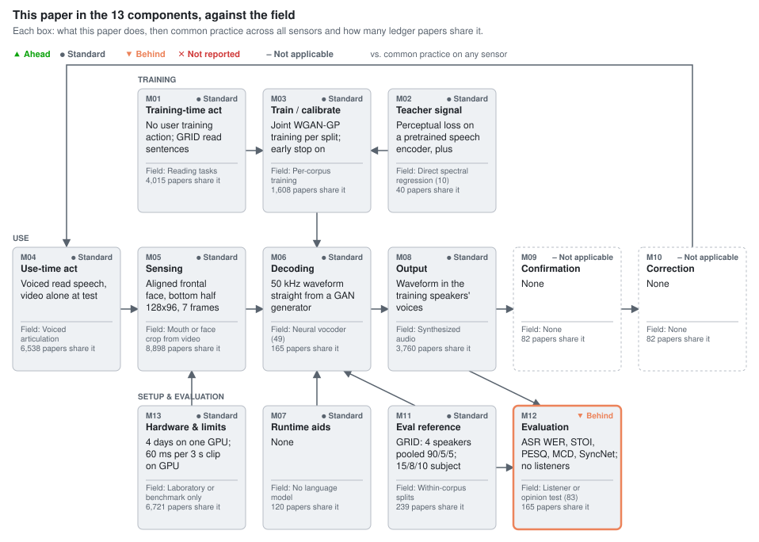

# Video-Driven Speech Reconstruction using Generative Adversarial Networks

Konstantinos Vougioukas, Pingchuan Ma, Stavros Petridis, Maja Pantic. Interspeech 2019 (arXiv June 2019). [DOI](https://doi.org/10.21437/Interspeech.2019-1445) · [arXiv:1906.06301](https://arxiv.org/abs/1906.06301)

**Section:** [Lip & face video](../../README.md#lip--face-video)

## Figures

### This paper in the 13 components, against the field

<picture><source media="(prefers-color-scheme: dark)" srcset="figures/components-dark.svg"></picture>

Verdicts compare the paper's choice for each component with common practice across 8,995 ledger entries on any sensor (silent speech, brain-to-text, lip reading).

Data

| Component | This paper | Common practice | Papers with this practice | Verdict |
| --- | --- | --- | --- | --- |
| M01 Training-time act | No user training action; GRID read sentences | Reading tasks | 4,015 of 8,995 | ● Standard (Inherited.) |
| M02 Teacher signal | Perceptual loss on a pretrained speech encoder, plus waveform L1 and TV | Direct spectral regression (10) | 40 of 8,995 | ● Standard (Without it WER 83.3% against 26.6% (Table 3), one run.) |
| M03 Train / calibrate | Joint WGAN-GP training per split; early stop on validation MCD | Per-corpus training | 1,608 of 8,995 | ● Standard (Inherited; no seeds or repeated runs.) |
| M04 Use-time act | Voiced read speech, video alone at test | Voiced articulation | 6,538 of 8,995 | ● Standard (Inherited.) |
| M05 Sensing | Aligned frontal face, bottom half 128x96, 7 frames | Mouth or face crop from video | 8,898 of 8,995 | ● Standard (Frontal faces only (Sec. 5).) |
| M06 Decoding | 50 kHz waveform straight from a GAN generator | Neural vocoder (49) | 165 of 8,995 | ● Standard (Beats Lip2AudSpec on WER and STOI, loses on PESQ; single run.) |
| M07 Runtime aids | None | No language model | 120 of 8,995 | ● Standard (Inherited.) |
| M08 Output | Waveform in the training speakers' voices | Synthesized audio | 3,760 of 8,995 | ● Standard (Wrong-gender and morphing voices on unseen speakers (Sec. 4.2).) |
| M09 Confirmation | None | None | 82 of 8,995 | – Not applicable (Offline study.) |
| M10 Correction | None | None | 82 of 8,995 | – Not applicable (Offline study.) |
| M11 Eval reference | GRID: 4 speakers pooled 90/5/5; 15/8/10 subject split | Within-corpus splits | 239 of 8,995 | ● Standard (Utterance split, seed and unseen subject IDs not stated.) |
| M12 Evaluation | ASR WER, STOI, PESQ, MCD, SyncNet; no listeners | Listener or opinion test (83) | 165 of 8,995 | ▼ Behind (Naturalness claimed without listeners; earlier work used them.) |
| M13 Hardware & limits | 4 days on one GPU; 60 ms per 3 s clip on GPU | Laboratory or benchmark only | 6,721 of 8,995 | ● Standard (Offline clip timing only.) |

## Verdict

The paper [[1]](#ref-1) changes two components, both standard on its evidence: waveform samples straight from a Wasserstein GAN (M06) and a perceptual loss through a pretrained speech encoder (M02). The perceptual loss carries the words: without it WER is 83.3%, near the 81% of random GRID slot choices (inference, for an ASR emitting only GRID words). Waveform output is not shown to help: a WORLD-vocoder system beat it on ESTOI within a year [[2]](#ref-2), and its successor's gain came with new critics and losses (M06). Its unseen-speaker test goes beyond its cited priors, but 40.5% WER is not shown intelligible without a chance level or listeners. Evaluation (M12) is behind: "natural sounding" rests on no listener test.

## Against the field, component by component

### M06 Processing: raw waveform from a Wasserstein GAN

**Usual approach:** Of 165 unique video-to-speech studies (pattern match, Appendix), 49 name a neural vocoder, 41 a parametric vocoder and 16 Griffin-Lim. The paper's cited predecessors pass through LSP [[3]](#ref-3), vocoder features [[4]](#ref-4) or an auditory spectrogram [[5]](#ref-5); it emits 50 kHz samples directly.

**State of the art:** On four seen GRID speakers, a 2023 scoring of released samples with one ASR lists this system at 19.94% WER and its raw-waveform successor [[6]](#ref-6) at 4.07% [[7]](#ref-7) [later], 80% lower (inference); a mel-spectrogram system there scores 5.62%.

Against Lip2AudSpec the paper reports 18% lower WER and 16% higher STOI but 6% lower PESQ (Table 2) (inference) in one run, with network, losses and output rate all different (Sec. 4.1). A WORLD-vocoder system on the same four speakers reached ESTOI 0.455 against 0.329 for this GAN, and 0.227 against 0.198 on unseen speakers [[2]](#ref-2) [later], 38% and 15% higher (inference). The successor also added waveform and power critics and new losses [[6]](#ref-6), so its gain is not one of output type. The other 4 of 5 Wasserstein-GAN studies in the set are from 2021 on (pattern match, Appendix). Verdict: standard.

### M02 Training-only supervision: speech-encoder perceptual loss

**Usual approach:** Of 40 unique studies supervising a non-acoustic synthesizer with paired speech (pattern match, Appendix), 10 regress spectra, 4 use a deep-feature loss and 3 an autoencoder latent (Lip2AudSpec [[5]](#ref-5)). The paper matches a pretrained speech encoder's features (Sec. 2.3).

**State of the art:** Speech-unit targets cut LRS3 ASR WER from 72.5% to 50.7% (2023) [[8]](#ref-8) [later], 30% relative (inference).

Without the perceptual loss seen-speaker WER rises from 26.6% to 83.3% (Table 3): 68% lower with it (inference). Without the adversarial loss the output is noise (Sec. 4.1). GRID's six-slot grammar and open LRS3 start from different points, so the gains are not comparable (inference). The other 6 of 7 video-to-speech studies naming a perceptual or deep-feature loss are from 2021 on (pattern match, Appendix). One run, no seeds. Verdict: standard.

### M12 Evaluation: listeners and unseen speakers

**Usual approach:** Of 165 unique video-to-speech studies (pattern match, Appendix), 83 name a listener or opinion test, 51 an unseen-speaker condition and 38 ASR WER on the output. The paper uses ASR WER (4% on real audio) and objective scores only (Sec. 3.2).

**State of the art:** On GRID unseen speakers the best 2023 row is the successor's 16.05% WER, against 32.76% for this paper [[7]](#ref-7) [later], 51% lower (inference).

ASR WER on the output is a useful addition; naturalness needs listeners, as earlier work used: 85% listener word accuracy on GRID [[4]](#ref-4), 23 MTurk transcribers [[3]](#ref-3), a transcription and naturalness survey [[5]](#ref-5). Earlier systems declare speaker independence out of scope [[3]](#ref-3), [[9]](#ref-9); two speaker-independent OuluVS2 systems are [concurrent], one scored by PESQ only [[10]](#ref-10), one by a four-option listener test [[11]](#ref-11). The scorer matters: 26.6% and 40.5% here, 19.94% and 32.76% later [[7]](#ref-7). Verdict: behind, against its own cited priors.

## The 13 components

| Component | This paper | Usual approach (count) | State of the art | Verdict |
|---|---|---|---|---|
| M01 Training-time action | No user training action; GRID read sentences | Reading tasks (slot-filled 4,015) | – | standard |
| M02 Training-only supervision | Perceptual loss on a pretrained speech encoder, plus waveform L1 and TV | Direct spectral regression (10) (pattern match 40) | LRS3 ASR WER 72.5% to 50.7% with speech-unit targets [[8]](#ref-8) | standard |
| M03 Training and adaptation | Joint WGAN-GP training per split; early stop on validation MCD | Per-corpus training (slot-filled 1,608) | – | standard |
| M04 Use-time action | Voiced read speech, video alone at test | Voiced articulation (slot-filled 6,538) | – | standard |
| M05 Sensors | Aligned frontal face, bottom half 128x96, 7 frames | Mouth or face crop from video (slot-filled 8,898) | – | standard |
| M06 Processing and decoding | 50 kHz waveform straight from a GAN generator | Neural vocoder (49) (pattern match 165) | GRID-4 WER 4.07% (successor) against 19.94% for this system [[7]](#ref-7) | standard |
| M07 Lexicon and LM | None | No language model (slot-filled 120) | – | standard |
| M08 Output | Waveform in the training speakers' voices | Synthesized audio (slot-filled 3,760) | – | standard |
| M09 Confirmation | None | None (slot-filled 82) | – | not applicable |
| M10 Correction | None | None (slot-filled 82) | – | not applicable |
| M11 Reference construction | GRID: 4 speakers pooled 90/5/5; 15/8/10 subject split | Within-corpus splits (slot-filled 239) | – | standard |
| M12 Evaluation | ASR WER, STOI, PESQ, MCD, SyncNet; no listeners | Listener or opinion test (83) (pattern match 165) | GRID unseen WER 16.05% against 32.76% for this system [[7]](#ref-7) | behind |
| M13 Device and cost | 4 days on one GPU; 60 ms per 3 s clip on GPU | Laboratory or benchmark only (slot-filled 6,721) | – | standard |

## Where the claims outrun the evidence

- "Intelligible speech" on unseen speakers (Abstract): 40.5% WER, 40% to 60% per speaker (Table 4, Sec. 4.2), no chance level, no baseline.
- The perceptual encoder comes from the authors' face-animation model, whose split the unseen test reuses (Sec. 2.3, 3.1); its training speakers are unstated, so leakage may inflate both results.
- "Natural sounding" (Abstract): no listeners, PESQ below Lip2AudSpec (Table 2), and a hum the authors concede: filtering it lifts PESQ to 1.80 but WER to 36% (Sec. 4.1); unseen speakers get wrong-gender or morphing voices (Sec. 4.2).
- STOI printed as 4.7 on a 0-to-1 scale (Sec. 4.1); MCD has no unit (Table 2).

## What the field needs next

- M06: raw waveform against mel plus neural vocoder behind one encoder.
- M02: the perceptual-loss ablation over seeds, encoder trained without test speakers.
- M12: a GRID chance level and listener transcription of the scored clips.

## Questions for the authors

- At what rate was Table 2 scored, and on which split was Lip2AudSpec trained?
- Which ten subjects form the unseen test set?
- What decoding and grammar does the ASR use?

## Appendix: literature search

- M06 video-to-speech-synthesis (published topic table, appended). Inclusion rule: studies that synthesize a speech waveform from talking-face or lip video and state the acoustic representation and how it becomes a waveform; audio-visual enhancement with noisy audio at test, talking-head generation, text-only lip reading and video-to-text-to-TTS pipelines excluded; versions counted once. Slot-filled 7,345 unique studies; pattern match 165 unique studies (187 folders). Usual design: neural vocoder, 49 (pattern match, full text). Design counts: neural vocoder 49, parametric vocoder 41, Griffin-Lim 16, auditory spectrogram 3. Appended full-text counts over the same 165: Wasserstein GAN 5, perceptual, deep-feature or feature-matching loss 7 (pattern match); hits other than the target are from 2021 or later. Read in full: [[7]](#ref-7) [later], [[2]](#ref-2) [later], target. Known-item recall 1.0 (3 of 3 seeds).
- M02 speech-latent-target (published topic table, appended). Inclusion rule: studies that synthesize speech from a non-acoustic signal and supervise the encoder with paired speech, by direct spectral regression or by matching the latent of a speech encoder or autoencoder unused at test time; acoustic-input conversion, recognition-only studies and self-generated targets excluded; versions counted once. Slot-filled 31 unique studies; pattern match 40 unique studies. Usual design: direct spectral regression, 10 (pattern match, full text). Design counts: direct spectral regression 10, deep feature loss 4, speech-autoencoder latent 3. Read in full: [[5]](#ref-5), [[8]](#ref-8) [later], target. Known-item recall 1.0.
- M12 video-to-speech-output-evaluation (new topic table). Inclusion rule: the video-to-speech studies of the M06 table, compared by evaluation protocol (listener or opinion test, ASR word error on the synthesized speech, unseen-speaker test); same exclusions; a study counts under every protocol its full text names, related-work mentions included (upper bound); versions counted once. Slot-filled 6,960 unique studies (M12); pattern match 165 unique studies. Usual design: listener or opinion-score test, 83 (pattern match, full text). Design counts: listener test 83, unseen-speaker condition 51, ASR WER on the output 38, GRID unseen-speaker split 19. Read in full: [[7]](#ref-7) [later], [[4]](#ref-4), [[5]](#ref-5), [[3]](#ref-3), [[10]](#ref-10) [concurrent], [[11]](#ref-11) [concurrent], target. Known-item recall 1.0 (3 of 3 seeds).

## References

Numbered by first citation. BibTeX in the same order and keys: [refs.bib](refs.bib).

1. Vougioukas, K., Ma, P., Petridis, S., Pantic, M. “Video-Driven Speech Reconstruction using Generative Adversarial Networks.” *Interspeech 2019*, 2019, 4125-4129. doi:[10.21437/Interspeech.2019-1445](https://doi.org/10.21437/Interspeech.2019-1445). arXiv:[1906.06301](https://arxiv.org/abs/1906.06301). Target. Read as the Interspeech 2019 proceedings version. [review](https://github.com/supernaiter/silent-speech-review/tree/main/reviews/video-driven-speech-reconstruction-using-generative-adversarial-networks) [wiki: isca-vougioukas19_ganv2s](https://github.com/supernaiter/deep-research-wiki-for-silent-speech/blob/main/papers/isca-vougioukas19_ganv2s/article.md)
2. Michelsanti, D., Slizovskaia, O., Haro, G., Gómez, E., Tan, Z., Jensen, J. “Vocoder-Based Speech Synthesis from Silent Videos.” *Proc. Interspeech 2020*, 2020, 3530-3534. doi:[10.21437/Interspeech.2020-1026](https://doi.org/10.21437/Interspeech.2020-1026). arXiv:[2004.02541](https://arxiv.org/abs/2004.02541). [later] [review](https://github.com/supernaiter/silent-speech-review/tree/main/reviews/vocoder-based-speech-synthesis-from-silent-videos) [wiki: isca-michelsanti20-vid2voc](https://github.com/supernaiter/deep-research-wiki-for-silent-speech/blob/main/papers/isca-michelsanti20-vid2voc/article.md) [wiki: isca-michelsanti20_interspeech](https://github.com/supernaiter/deep-research-wiki-for-silent-speech/blob/main/papers/isca-michelsanti20_interspeech/article.md)
3. Ephrat, A., Peleg, S. “Vid2speech: Speech Reconstruction from Silent Video.” *2017 IEEE International Conference on Acoustics, Speech and Signal Processing (ICASSP)*, 2017. arXiv:[1701.00495](https://arxiv.org/abs/1701.00495). [review](https://github.com/supernaiter/silent-speech-review/tree/main/reviews/vid2speech-speech-reconstruction-from-silent-video) [wiki: arxiv-1701.00495](https://github.com/supernaiter/deep-research-wiki-for-silent-speech/blob/main/papers/arxiv-1701.00495/article.md)
4. Le Cornu, T., Milner, B. “Generating Intelligible Audio Speech from Visual Speech.” *IEEE/ACM Transactions on Audio, Speech, and Language Processing*, 2017, 25(9), 1751-1761. doi:[10.1109/TASLP.2017.2716178](https://doi.org/10.1109/TASLP.2017.2716178). [wiki: doi-10.1109-taslp.2017.2716178](https://github.com/supernaiter/deep-research-wiki-for-silent-speech/blob/main/papers/doi-10.1109-taslp.2017.2716178/article.md) [wiki: doi-10.1109-taslp-2017-2716178](https://github.com/supernaiter/deep-research-wiki-for-silent-speech/blob/main/papers/doi-10.1109-taslp-2017-2716178/article.md)
5. Akbari, H., Arora, H., Cao, L., Mesgarani, N. “Lip2AudSpec: Speech Reconstruction from Silent Lip Movements Video.” *2018 IEEE International Conference on Acoustics, Speech and Signal Processing (ICASSP)*, 2018, 2516-2520. doi:[10.1109/ICASSP.2018.8461856](https://doi.org/10.1109/ICASSP.2018.8461856). arXiv:[1710.09798](https://arxiv.org/abs/1710.09798). [review](https://github.com/supernaiter/silent-speech-review/tree/main/reviews/lip2audspec-speech-reconstruction-from-silent-lip-movements-video) [wiki: arxiv-1710.09798](https://github.com/supernaiter/deep-research-wiki-for-silent-speech/blob/main/papers/arxiv-1710.09798/article.md)
6. Mira, R., Vougioukas, K., Ma, P., Petridis, S., Schuller, B. W., Pantic, M. “End-to-End Video-To-Speech Synthesis using Generative Adversarial Networks.” *IEEE Transactions on Cybernetics*, 2023, 53(6), 3454-3466. doi:[10.1109/TCYB.2022.3162495](https://doi.org/10.1109/TCYB.2022.3162495). arXiv:[2104.13332](https://arxiv.org/abs/2104.13332). Title and authors from the arXiv first page; journal, volume, pages and DOI confirmed against the Crossref record of the DOI. [later] [wiki: arxiv-2104.13332](https://github.com/supernaiter/deep-research-wiki-for-silent-speech/blob/main/papers/arxiv-2104.13332/article.md)
7. Kefalas, T., Panagakis, Y., Pantic, M. “Large-scale unsupervised audio pre-training for video-to-speech synthesis.” *IEEE/ACM Transactions on Audio, Speech, and Language Processing*, 2024, 32, 2255-2268. doi:[10.1109/TASLP.2024.3382500](https://doi.org/10.1109/TASLP.2024.3382500). arXiv:[2306.15464](https://arxiv.org/abs/2306.15464). Read as arXiv:2306.15464 v1; journal version cited. [later] [review](https://github.com/supernaiter/silent-speech-review/tree/main/reviews/large-scale-unsupervised-audio-pre-training-for-video-to-speech-synthesis) [wiki: arxiv-2306.15464-v2apretrain](https://github.com/supernaiter/deep-research-wiki-for-silent-speech/blob/main/papers/arxiv-2306.15464-v2apretrain/article.md)
8. Choi, J., Kim, M., Ro, Y. M. “Intelligible Lip-to-Speech Synthesis with Speech Units.” *Interspeech 2023*, 2023. arXiv:[2305.19603](https://arxiv.org/abs/2305.19603). [later] [review](https://github.com/supernaiter/silent-speech-review/tree/main/reviews/intelligible-lip-to-speech-synthesis-with-speech-units) [wiki: arxiv-2305.19603](https://github.com/supernaiter/deep-research-wiki-for-silent-speech/blob/main/papers/arxiv-2305.19603/article.md)
9. Ephrat, A., Halperin, T., Peleg, S. “Improved Speech Reconstruction from Silent Video.” *ICCV 2017 Workshop on Computer Vision for Audio-Visual Media*, 2017. arXiv:[1708.01204](https://arxiv.org/abs/1708.01204). [review](https://github.com/supernaiter/silent-speech-review/tree/main/reviews/improved-speech-reconstruction-from-silent-video) [wiki: arxiv-1708.01204](https://github.com/supernaiter/deep-research-wiki-for-silent-speech/blob/main/papers/arxiv-1708.01204/article.md)
10. Kumar, Y., Jain, R., Salik, K. M., Shah, R. R., Yin, Y., Zimmermann, R. “Lipper: Synthesizing Thy Speech using Multi-View Lipreading.” *Proceedings of the AAAI Conference on Artificial Intelligence*, 2019, 33. arXiv:[1907.01367](https://arxiv.org/abs/1907.01367). AAAI 2019 (copyright line on the first page); arXiv v1 July 2019. [concurrent] [review](https://github.com/supernaiter/silent-speech-review/tree/main/reviews/lipper-synthesizing-thy-speech-using-multi-view-lipreading) [wiki: arxiv-1907.01367](https://github.com/supernaiter/deep-research-wiki-for-silent-speech/blob/main/papers/arxiv-1907.01367/article.md)
11. Uttam, S., Kumar, Y., Sahrawat, D., Aggarwal, M., Shah, R. R., Mahata, D., et al. “Hush-Hush Speak: Speech Reconstruction Using Silent Videos.” *Interspeech 2019*, 2019. doi:[10.21437/Interspeech.2019-3269](https://doi.org/10.21437/Interspeech.2019-3269). Authors from the paper's first page (the wiki manifest lists other names). [concurrent] [wiki: isca-uttam19-hushhush](https://github.com/supernaiter/deep-research-wiki-for-silent-speech/blob/main/papers/isca-uttam19-hushhush/article.md)

## Materials

Data behind this review. Full texts of the papers are not included.

- [`review.md`](review.md): the review text (source)
- [`refs.bib`](refs.bib): references (BibTeX)
- [`slots.json`](slots.json): for each of the 13 components: this paper's choice, field practice, number of matching papers, verdict
- [`figures.json`](figures.json): figure definitions
- [`evaluation.md`](evaluation.md): independent evaluation by a second reviewer
- [`triage.md`](triage.md): how each evaluation finding was checked against the sources and resolved
- [`components/M02/speech-latent-target.csv`](../../components/M02/speech-latent-target.csv): M02 topic "speech-latent-target", every candidate paper with its decision (31 slot-filled, 40 pattern match, usual design in 10, 4 read in full)
- [`components/M06/video-to-speech-synthesis.csv`](../../components/M06/video-to-speech-synthesis.csv): M06 topic "video-to-speech-synthesis", every candidate paper with its decision (7345 slot-filled, 165 pattern match, usual design in 49, 3 read in full)
- [`components/M12/video-to-speech-output-evaluation.csv`](../../components/M12/video-to-speech-output-evaluation.csv): M12 topic "video-to-speech-output-evaluation", every candidate paper with its decision (6960 slot-filled, 165 pattern match, usual design in 83, 5 read in full)

## More reviews in Lip & face video

- [Lipper: Synthesizing Thy Speech using Multi-View Lipreading](../lipper-synthesizing-thy-speech-using-multi-view-lipreading/) (2019). Lipper reconstructs speech from multi-view lip video on OuluVS2 as a regression problem; the best three-view setting reaches PESQ 2.315 with 0.169 s end-to-end delay, though audio remains robotic.
- [Speech Prediction in Silent Videos using Variational Autoencoders](../speech-prediction-in-silent-videos-using-variational-autoencoders/) (2020). Variational autoencoder model for speech synthesis from silent lip video that models one-to-many ambiguity; on GRID reports STOI 0.724, ESTOI 0.540 and PESQ 1.932, leading Lip2Wav on ESTOI and PESQ.
- [Vocoder-Based Speech Synthesis from Silent Videos](../vocoder-based-speech-synthesis-from-silent-videos/) (2020). WORLD features (M06) beat the 2019 GAN on seen GRID speakers; on unseen ones PESQ ties and ESTOI is higher. The CTC text loss (M02) adds under 0.015 ESTOI; the WER is the text head's.
- [Deep Audio-Visual Speech Recognition](../deep-audio-visual-speech-recognition/) (2018). LRS2-BBC outlasts the models: the CTC vs seq2seq comparison is confounded, the 22-point gain is not attributable to the new architecture, and test speaker overlap is unreported.
- [Harnessing AI for Speech Reconstruction using Multi-view Silent Video Feed](../harnessing-ai-for-speech-reconstruction-using-multi-view-silent-video-feed/) (2018). Reconstructs speech audio from multi-view silent video on OuluVS2 with CNN-LSTM models, showing multi-view input improves PESQ over single view and that camera placement matters.
- [Lip2AudSpec: Speech Reconstruction from Silent Lip Movements Video](../lip2audspec-speech-reconstruction-from-silent-lip-movements-video/) (2018). Bottleneck target (M02) and auditory-spectrogram route (M06) are standard; gains rest on one speaker, a re-implemented baseline and a vocabulary-cued test on four seen GRID speakers.

---

Part of the [Silent Speech Interface Review](https://github.com/supernaiter/silent-speech-review). Found an error? [Open an issue](https://github.com/supernaiter/silent-speech-review/issues/new?template=correction.yml).
