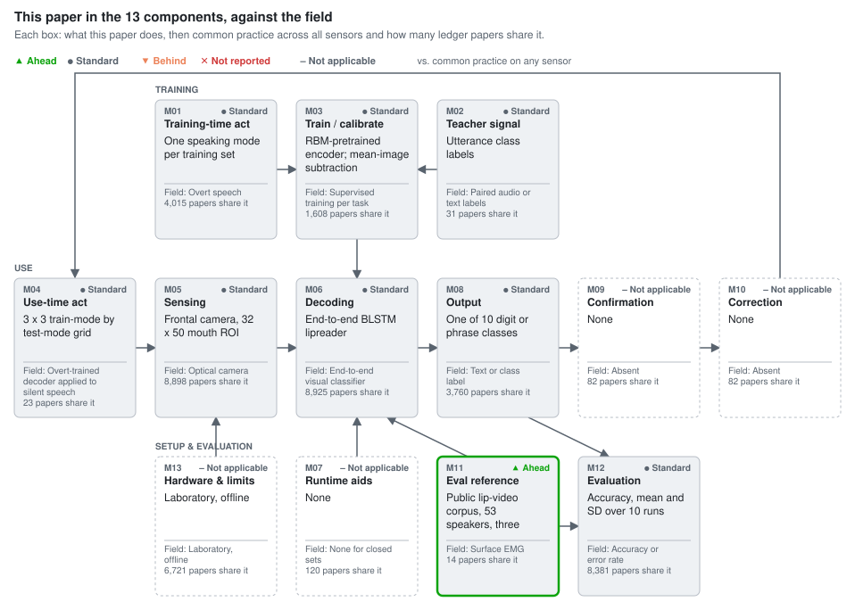

# Visual-Only Recognition of Normal, Whispered and Silent Speech

Petridis, S., Shen, J., Cetin, D., Pantic, M. · ICASSP 2018 · 2018 · [doi:10.1109/ICASSP.2018.8461596](https://doi.org/10.1109/ICASSP.2018.8461596) · [arXiv:1802.06399](https://arxiv.org/abs/1802.06399)

**Section:** [Lip & face video](../../README.md#lip--face-video)

## Figures

### This paper in the 13 components, against the field

<picture><source media="(prefers-color-scheme: dark)" srcset="figures/components-dark.svg"></picture>

Verdicts compare the paper's choice for each component with common practice across 8,995 ledger entries on any sensor (silent speech, brain-to-text, lip reading).

Data

| Component | This paper | Common practice | Papers with this practice | Verdict |
| --- | --- | --- | --- | --- |
| M01 Training-time act | One speaking mode per training set | Overt speech | 4,015 of 8,995 | ● Standard (Mixed-mode training is not tested.) |
| M02 Teacher signal | Utterance class labels | Paired audio or text labels | 31 of 8,995 | ● Standard (No audio supervision.) |
| M03 Train / calibrate | RBM-pretrained encoder; mean-image subtraction | Supervised training per task | 1,608 of 8,995 | ● Standard (Authors' end-to-end lipreading lineage.) |
| M04 Use-time act | 3 x 3 train-mode by test-mode grid | Overt-trained decoder applied to silent speech | 23 of 8,995 | ● Standard (Degradation known from ultrasound [@florescu2010silent] and visual whisper [@tao2014lipreading].) |
| M05 Sensing | Frontal camera, 32 x 50 mouth ROI | Optical camera | 8,898 of 8,995 | ● Standard (Side views recorded but unused.) |
| M06 Decoding | End-to-end BLSTM lipreader | End-to-end visual classifier | 8,925 of 8,995 | ● Standard (Authors' earlier model without its second stream.) |
| M07 Runtime aids | None | None for closed sets | 120 of 8,995 | – Not applicable (Closed set of 10 classes per task.) |
| M08 Output | One of 10 digit or phrase classes | Text or class label | 3,760 of 8,995 | ● Standard |
| M09 Confirmation | None | Absent | 82 of 8,995 | – Not applicable (Offline classification study.) |
| M10 Correction | None | Absent | 82 of 8,995 | – Not applicable (Offline classification study.) |
| M11 Eval reference | Public lip-video corpus, 53 speakers, three modes | Surface EMG | 14 of 8,995 | ▲ Ahead (Earlier three-mode corpora are EMG [@wand2014emguka]; utterance boundaries still being corrected at publication.) |
| M12 Evaluation | Accuracy, mean and SD over 10 runs | Accuracy or error rate | 8,381 of 8,995 | ● Standard (No chance level or significance test; train-mode and test-mode effects not separated.) |
| M13 Hardware & limits | Laboratory, offline | Laboratory, offline | 6,721 of 8,995 | – Not applicable (No device or deployment claim.) |

## Verdict

The paper [[1]](#ref-1) changes two components: a public lip-video corpus with normal, whispered and silent speech (M11), and training on one mode with testing on all three (M04). The corpus is ahead: earlier three-mode recordings were EMG [[2]](#ref-2), and in 2023 a later study still used it as the only public visual set with normal and silent speech [[3]](#ref-3). The transfer result is standard: the normal-to-silent drop was shown for ultrasound in 2010 [[4]](#ref-4), and the whisper drop for lipreading in 2014 [[5]](#ref-5). The headline 8.3- and 8.5-point drops mix two effects: on a fixed silent test set, silent training gains only 2.5 and 3.2 points over normal training, and whispered training does as well as silent training on silent tests (inference, Tables 1-2). The authors' "significant performance drop" from vocalised-only training (Sec. 5), stated without a significance test, therefore outruns this paper's evidence.

## Against the field, component by component

### M11 Evaluation data: three-mode lip-video corpus

**Usual approach:** three-mode recordings of the same material use surface EMG, 14 of 24 studies (pattern match; Appendix), as in EMG-UKA, 8 speakers and 63 sessions with a free trial subset [[2]](#ref-2). The paper records lip video of 53 speakers (Sec. 2).

**State of the art:** TaL (first public 2020, SLT 2021) released lip video with silent prompts for 82 speakers, but whispered speech for its one TaL1 speaker only [[6]](#ref-6) [later].

Of the 24 three-mode studies (pattern match, Appendix), 5 mention lip or face video, and none of the prior ones is a released lip-video corpus with all three modes, so the "first publicly available" claim (Sec. 1) holds against the Appendix. The closest priors are small or not visual: 4 speakers with ultrasound and lips [[4]](#ref-4), EMG with audio [[2]](#ref-2), and the 40-speaker audiovisual whisper corpus behind [[5]](#ref-5), which has no silent speech and was not public (Sec. 1). A later study followed its phrase split (20/8/11 speakers) [[3]](#ref-3) [later]. Verdict: ahead.

### M04 Use-time action: train on one mode, test on another

**Usual approach:** a decoder trained on overt speech applied to silent speech without retraining and reported as a degradation, 23 studies across neural, EMG, ultrasound and video (confirmed, 7 prior; Appendix). The paper follows it.

**State of the art:** on the target's phrase split, a 2023 viseme model with a pretrained front-end gives 22.55% silent WER trained on normal speech only (Table 1, first row), 12.91% with silent training data added, and 9.97% at best [[3]](#ref-3) [later].

The 2010 ultrasound system fell from 75.3% to 45.7% words correct, a 39% relative loss (inference), against 12.2% relative here for both tasks (inference); 4 speakers with template matching and 53 speakers with a BLSTM start from different points, so the gaps do not rank [[4]](#ref-4). The whisper result repeats [[5]](#ref-5): with 40 speakers held out one at a time, neutral-trained digits fell from 52.93% to 50.87% on whisper, against 3.3 points here.

On a fixed silent test set, silent training beats normal training by 2.5 points for digits (62.2 against 59.7) and 3.2 for phrases (64.4 against 61.2), with run SDs of 0.9 to 2.3; the other 5.8 and 5.3 points are test-mode difficulty that silent training does not remove (inference). The later 9.64-point WER gain from adding silent data (inference) [[3]](#ref-3) also adds data volume, so mode and amount stay confounded. Verdict: standard.

## The 13 components

| Component | This paper | Usual approach (count) | State of the art | Verdict |
|---|---|---|---|---|
| M01 Training-time action | One speaking mode per training set | Overt speech (slot-filled 4,015) | – | standard |
| M02 Training-only supervision | Utterance class labels | Paired audio or text labels (slot-filled 31) | – | standard |
| M03 Training and adaptation | RBM-pretrained encoder; mean-image subtraction | Supervised training per task (slot-filled 1,608) | – | standard |
| M04 Use-time action | 3 x 3 train-mode by test-mode grid | Overt-trained decoder applied to silent speech (confirmed 23) | Silent WER 22.55 normal-only, 12.91 with silent data, 2023 [[3]](#ref-3) [later] | standard |
| M05 Sensors | Frontal camera, 32 x 50 mouth ROI | Optical camera (slot-filled 8,898) | – | standard |
| M06 Processing and decoding | End-to-end BLSTM lipreader | End-to-end visual classifier (slot-filled 8,925) | – | standard |
| M07 Lexicon and LM | None | None for closed sets (slot-filled 120) | – | not applicable |
| M08 Output | One of 10 digit or phrase classes | Text or class label (slot-filled 3,760) | – | standard |
| M09 Confirmation | None | Absent (slot-filled 82) | – | not applicable |
| M10 Correction | None | Absent (slot-filled 82) | – | not applicable |
| M11 Reference construction | Public lip-video corpus, 53 speakers, three modes | Surface EMG (pattern match 14) | TaL, 82 speakers, whisper for 1, 2020 [[6]](#ref-6) [later] | ahead |
| M12 Evaluation | Accuracy, mean and SD over 10 runs | Accuracy or error rate (slot-filled 8,381) | – | standard |
| M13 Device and cost | Laboratory, offline | Laboratory, offline (slot-filled 6,721) | – | not applicable |

## Where the claims outrun the evidence

- The "significant performance drop" from vocalised-only training (Sec. 5) comes with no significance test and rests on test-mode differences; the train-mode effect on silent tests is 2.5 to 3.2 points (Table 1, Table 2).
- "The best performance in all 3 cases" for matched modes (Sec. 5) is not shown: on silent tests whispered training gives 62.8% against 62.2% matched for digits and 65.1% against 64.4% for phrases, inside the run SDs (Tables 1-2).
- Silent speech is lowest even with matched training (Sec. 1), as reported for EMG in 2014: silent WER 48.29% against 26.90% audible and 28.19% whispered [[2]](#ref-2); the paper cites only the same group's earlier EMG study (Sec. 1).
- Timestamps were still being manually corrected at publication (footnote 3), so released and scored data may differ; the authors attribute the gap to 91.8% on OuluVS2 phrases to segmentation and cropping (Sec. 5), and segmentation errors that differ by mode would also enter the test-mode gap (inference).
- Alignment names 6 stable points but lists 7 (Sec. 4.1).

## What the field needs next

- M04: report the full grid as two effects, train mode on a fixed test set and test mode under matched training, with per-speaker intervals.
- M01: mixed normal-plus-silent training at a fixed total data size, which separates data volume from mode, the confound in [[3]](#ref-3).
- M11: a three-mode visual corpus with open-vocabulary sentences, as TaL provides for ultrasound and lips [[6]](#ref-6).

## Questions for the authors

- Do the 10 runs differ only in initialization, and with which seeds?
- What metric and checkpoint rule does early stopping use on the validation speakers?
- Do the digit and phrase cohorts share participants?
- Over which region are the z-normalization statistics computed?
- Which released timestamps differ from those used in Tables 1-2?

## Appendix: literature search

- M11 multi-mode-speech-corpus (new topic table). Inclusion rule: studies or corpora that record the same material in normal, whispered and silent modes with any non-acoustic or visual channel (EMG, EMA, ultrasound, lip or face video, neural recordings), and use or release the recordings; acoustic-only whisper corpora, two-mode corpora without whisper and reviews are pattern matches only; versions counted once. Slot-filled 234 unique studies; pattern match 24 unique studies. Full-text pattern counts: surface EMG 14, neural 11, lip or face video 5, articulography 5, ultrasound 4. Usual design: surface EMG, 14 (pattern match). The non-target lip or face video hits are an EMG thesis, a low-frequency ultrasound activity detector, a review and a later normal-and-whisper corpus without silent speech. State of the art: [[6]](#ref-6) [later]. Read in full: [[2]](#ref-2), [[6]](#ref-6) [later], target. Known-item recall 0.67 (2 of 3 seeds; TaL missed by the ledger pattern).
- M04 overt-to-silent-transfer (published topic table, appended). Inclusion rule unchanged: decoders trained only on overt speech and applied to silent, mouthed, inner or imagined speech without retraining, any signal; versions counted once. Slot-filled 5,595 unique studies; pattern match 33 unique studies; confirmed 23 unique studies (7 prior) in the published table, 25 after this review's additions. Usual design: overt-trained decoder applied to silent speech and reported as a degradation, 23 (confirmed). Added: [[3]](#ref-3) [later]. Read in full: [[4]](#ref-4), [[5]](#ref-5), [[3]](#ref-3) [later], target. Known-item recall 1.0 (3 of 3 seeds).

## References

Numbered by first citation. BibTeX in the same order and keys: [refs.bib](refs.bib).

1. Petridis, S., Shen, J., Cetin, D., Pantic, M. “Visual-Only Recognition of Normal, Whispered and Silent Speech.” *2018 IEEE International Conference on Acoustics, Speech and Signal Processing (ICASSP)*, 2018, 6219–6223. doi:[10.1109/ICASSP.2018.8461596](https://doi.org/10.1109/ICASSP.2018.8461596). arXiv:[1802.06399](https://arxiv.org/abs/1802.06399). Target. Read as arXiv v1. [review](https://github.com/supernaiter/silent-speech-review/tree/main/reviews/visual-only-recognition-of-normal-whispered-and-silent-speech) [wiki: arxiv-1802.06399](https://github.com/supernaiter/deep-research-wiki-for-silent-speech/blob/main/papers/arxiv-1802.06399/article.md) [wiki: doi-10.1109-icassp.2018.8461596](https://github.com/supernaiter/deep-research-wiki-for-silent-speech/blob/main/papers/doi-10.1109-icassp.2018.8461596/article.md)
2. Wand, M., Janke, M., Schultz, T. “The EMG-UKA Corpus for Electromyographic Speech Processing.” *Proc. Interspeech 2014*, 2014, 1593–1597. doi:[10.21437/Interspeech.2014-379](https://doi.org/10.21437/Interspeech.2014-379). [wiki: isca-wand14b_interspeech](https://github.com/supernaiter/deep-research-wiki-for-silent-speech/blob/main/papers/isca-wand14b_interspeech/article.md)
3. Kashiwagi, S., Tanaka, K., Feng, Q., Morishima, S. “Improving the Gap in Visual Speech Recognition Between Normal and Silent Speech Based on Metric Learning.” *Proc. Interspeech 2023*, 2023, 3397–3401. doi:[10.21437/Interspeech.2023-370](https://doi.org/10.21437/Interspeech.2023-370). arXiv:[2305.14203](https://arxiv.org/abs/2305.14203). [later] [review](https://github.com/supernaiter/silent-speech-review/tree/main/reviews/improving-the-gap-in-visual-speech-recognition-between-normal-and-silent-speech-based-on-metric-learning) [wiki: arxiv-2305.14203](https://github.com/supernaiter/deep-research-wiki-for-silent-speech/blob/main/papers/arxiv-2305.14203/article.md) [wiki: isca-kashiwagi23_interspeech](https://github.com/supernaiter/deep-research-wiki-for-silent-speech/blob/main/papers/isca-kashiwagi23_interspeech/article.md) [wiki: isca-kashiwagi23-silentvsr](https://github.com/supernaiter/deep-research-wiki-for-silent-speech/blob/main/papers/isca-kashiwagi23-silentvsr/article.md)
4. Florescu, V., Crevier-Buchman, L., Denby, B., Hueber, T., Colazo-Simon, A., Pillot-Loiseau, C., et al. “Silent vs Vocalized Articulation for a Portable Ultrasound-Based Silent Speech Interface.” *Proc. Interspeech 2010*, 2010, 450–453. doi:[10.21437/Interspeech.2010-195](https://doi.org/10.21437/Interspeech.2010-195). [wiki: isca-florescu10](https://github.com/supernaiter/deep-research-wiki-for-silent-speech/blob/main/papers/isca-florescu10/article.md) [wiki: isca-florescu10_interspeech](https://github.com/supernaiter/deep-research-wiki-for-silent-speech/blob/main/papers/isca-florescu10_interspeech/article.md) [wiki: isca-florescu10-silentvocal](https://github.com/supernaiter/deep-research-wiki-for-silent-speech/blob/main/papers/isca-florescu10-silentvocal/article.md)
5. Tao, F., Busso, C. “Lipreading Approach for Isolated Digits Recognition under Whisper and Neutral Speech.” *Proc. Interspeech 2014*, 2014, 1154–1158. doi:[10.21437/Interspeech.2014-294](https://doi.org/10.21437/Interspeech.2014-294). [wiki: isca-tao14_interspeech](https://github.com/supernaiter/deep-research-wiki-for-silent-speech/blob/main/papers/isca-tao14_interspeech/article.md) [wiki: isca-tao14-digitlip](https://github.com/supernaiter/deep-research-wiki-for-silent-speech/blob/main/papers/isca-tao14-digitlip/article.md)
6. Ribeiro, M. S., Sanger, J., Zhang, J., Eshky, A., Wrench, A., Richmond, K., et al. “TaL: A Synchronised Multi-Speaker Corpus of Ultrasound Tongue Imaging, Audio, and Lip Videos.” *2021 IEEE Spoken Language Technology Workshop (SLT)*, 2021, 1109–1116. doi:[10.1109/SLT48900.2021.9383619](https://doi.org/10.1109/SLT48900.2021.9383619). arXiv:[2011.09804](https://arxiv.org/abs/2011.09804). [later] [wiki: arxiv-2011.09804](https://github.com/supernaiter/deep-research-wiki-for-silent-speech/blob/main/papers/arxiv-2011.09804/article.md) [wiki: doi-10.1109-slt48900.2021.9383619](https://github.com/supernaiter/deep-research-wiki-for-silent-speech/blob/main/papers/doi-10.1109-slt48900.2021.9383619/article.md)

## Materials

Data behind this review. Full texts of the papers are not included.

- [`review.md`](review.md): the review text (source)
- [`refs.bib`](refs.bib): references (BibTeX)
- [`slots.json`](slots.json): for each of the 13 components: this paper's choice, field practice, number of matching papers, verdict
- [`figures.json`](figures.json): figure definitions
- [`evaluation.md`](evaluation.md): independent evaluation by a second reviewer
- [`triage.md`](triage.md): how each evaluation finding was checked against the sources and resolved
- [`components/M04/overt-to-silent-transfer.csv`](../../components/M04/overt-to-silent-transfer.csv): M04 topic "overt-to-silent-transfer", every candidate paper with its decision (5595 slot-filled, 33 pattern match, usual design in 23, 104 read in full)
- [`components/M11/multi-mode-speech-corpus.csv`](../../components/M11/multi-mode-speech-corpus.csv): M11 topic "multi-mode-speech-corpus", every candidate paper with its decision (234 slot-filled, 24 pattern match, usual design in 14, 3 read in full)

## More reviews in Lip & face video

- [Deep Audio-Visual Speech Recognition](../deep-audio-visual-speech-recognition/) (2018). LRS2-BBC outlasts the models: the CTC vs seq2seq comparison is confounded, the 22-point gain is not attributable to the new architecture, and test speaker overlap is unreported.
- [Harnessing AI for Speech Reconstruction using Multi-view Silent Video Feed](../harnessing-ai-for-speech-reconstruction-using-multi-view-silent-video-feed/) (2018). Multi-view input (M05) is new for video-to-speech but standard on its evidence: 2 speakers, gains overstated (11.4% in Table 1, 26% in text); PESQ only, no listener test (M12).
- [Lip2AudSpec: Speech Reconstruction from Silent Lip Movements Video](../lip2audspec-speech-reconstruction-from-silent-lip-movements-video/) (2018). Bottleneck target (M02) and auditory-spectrogram route (M06) are standard; gains rest on one speaker, a re-implemented baseline and a vocabulary-cued test on four seen GRID speakers.
- [Lipper: Synthesizing Thy Speech using Multi-View Lipreading](../lipper-synthesizing-thy-speech-using-multi-view-lipreading/) (2019). Lipper reconstructs speech from multi-view lip video on OuluVS2 as a regression problem; the best three-view setting reaches PESQ 2.315 with 0.169 s end-to-end delay, though audio remains robotic.
- [Video-Driven Speech Reconstruction using Generative Adversarial Networks](../video-driven-speech-reconstruction-using-generative-adversarial-networks/) (2019). Direct-waveform GAN (M06) and speech-encoder perceptual loss (M02) are early but standard; the perceptual loss carries the words. Unseen-speaker WER 40.5% (successor 16%); no listener test.
- [Improved Speech Reconstruction from Silent Video](../improved-speech-reconstruction-from-silent-video/) (2017). Optical-flow tower (M05) and mel-to-linear post-net (M06) are standard: no flow gain in Table 5; trails Le Cornu on S3; no listener test (M12); Lip2Wav's re-run: 27.83% vs 14.08% WER.

---

Part of the [Silent Speech Interface Review](https://github.com/supernaiter/silent-speech-review). Found an error? [Open an issue](https://github.com/supernaiter/silent-speech-review/issues/new?template=correction.yml).
