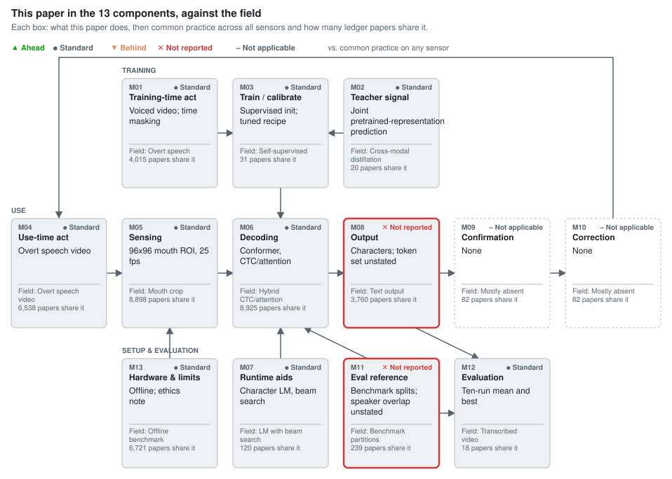

# Visual Speech Recognition for Multiple Languages in the Wild

Pingchuan Ma, Stavros Petridis, Maja Pantic. Nature Machine Intelligence 4, 930–939 (2022). [doi:10.1038/s42256-022-00550-z](https://doi.org/10.1038/s42256-022-00550-z) · [arXiv:2202.13084](https://arxiv.org/abs/2202.13084)

**Section:** [Lip & face video](../../README.md#lip--face-video)

## Figures

### This paper in the 13 components, against the field

<picture><source media="(prefers-color-scheme: dark)" srcset="figures/components-dark.svg"></picture>

Verdicts compare the paper's choice for each component with common practice across 8,995 ledger entries on any sensor (silent speech, brain-to-text, lip reading).

Data

| Component | This paper | Common practice | Papers with this practice | Verdict |
| --- | --- | --- | --- | --- |
| M01 Training-time act | Voiced video; time masking | Overt speech | 4,015 of 8,995 | ● Standard (Inherited recipe.) |
| M02 Teacher signal | Joint pretrained-representation prediction | Cross-modal distillation | 20 of 8,995 | ● Standard (Gain 1.5-2.0 LRS3 points.) |
| M03 Train / calibrate | Supervised init; tuned recipe | Self-supervised | 31 of 8,995 | ● Standard (Tuning gives 5.8 points.) |
| M04 Use-time act | Overt speech video | Overt speech video | 6,538 of 8,995 | ● Standard (Inherited.) |
| M05 Sensing | 96x96 mouth ROI, 25 fps | Mouth crop | 8,898 of 8,995 | ● Standard (Code differs.) |
| M06 Decoding | Conformer, CTC/attention | Hybrid CTC/attention | 8,925 of 8,995 | ● Standard (Inherited.) |
| M07 Runtime aids | Character LM, beam search | LM with beam search | 120 of 8,995 | ● Standard (Inherited.) |
| M08 Output | Characters; token set unstated | Text output | 3,760 of 8,995 | ✕ Not reported (Characters given; token set and OOV policy not reported.) |
| M09 Confirmation | None | Mostly absent | 82 of 8,995 | – Not applicable (Offline.) |
| M10 Correction | None | Mostly absent | 82 of 8,995 | – Not applicable (Offline.) |
| M11 Eval reference | Benchmark splits; speaker overlap unstated | Benchmark partitions | 239 of 8,995 | ✕ Not reported (Splits given; speaker overlap not reported.) |
| M12 Evaluation | Ten-run mean and best | Transcribed video | 18 of 8,995 | ● Standard (Best-run selection unstated.) |
| M13 Hardware & limits | Offline; ethics note | Offline benchmark | 6,721 of 8,995 | ● Standard (Inherited.) |

## Verdict

The paper [[1]](#ref-1) adds one new component, M02: joint losses that predict pretrained audio and visual representations from video. This is a standard variant of cross-modal distillation already used by LiRA, ASR-is-all-you-need and Hearing Lips [[2]](#ref-2), [[3]](#ref-3), [[4]](#ref-4); the ten-run ablation shows it helps, by 2.0 points on LRS3 at 595 h and 1.5 points at 1,459 h (Tables 5, S26; inference). The headline LRS3 gain rests more on the recipe (M03): tuning and an improved language model give 5.8 points (Table S9) and time masking 2.7 (Table 5), against 2.0 for both new losses together (inference). On LRS3 (M12) the 31.5% WER follows the field's usual supervised design and is 14.6 points behind a [later] system trained on public data only [[5]](#ref-5) (inference). The six-language state-of-the-art claim has published baselines only for English and Mandarin; the other four languages are compared only with a baseline the authors trained.

## Against the field, component by component

### M02 Training-only supervision: predicting pretrained representations

**Usual approach:** Of 104 studies on this topic (pattern match, unique studies; Appendix), 20 use cross-modal distillation and 5 regress audio features (pattern match); the read priors apply it as pretraining or as distillation from a recognizer [[3]](#ref-3), [[4]](#ref-4). The paper moves the loss into supervised training, at Conformer layer 6 (Supp. Sec. S7).

**State of the art:** The lowest LRS3 figure from public data only is 16.9% (2023), from pseudo-labels plus synthetic video [[5]](#ref-5); the closest teacher-student design reaches 17.6% (2026) adding about 2,500 h of pseudo-labelled video instead of a frozen teacher [[6]](#ref-6). The paper's best is 31.5% (Table 2).

LiRA already predicted PASE+ audio features from video and reached 38.8% on LRS2 [[2]](#ref-2). Over ten runs, removing both auxiliary losses raises LRS2 mean WER from 29.5±0.4 to 33.2±0.5 at 380 h (Table 5). On the LRS3 test set it raises 35.8 to 37.8 at 595 h (Table 5) and 32.1±0.3 to 33.6±0.6 at 1,459 h (Table S26), 5.6% and 4.7% relative (inference); the authors concede the shrinking effect (Supp. Sec. S9.8). Verdict: standard, a known idea in a new position worth 1.5 to 2.0 LRS3 points.

### M03 Training recipe and self-supervised pretraining

**Usual approach:** Self-supervised pretraining is the largest recorded supervision kind, 31 of 75 studies, ahead of paired audio at 17 (slot-filled; Appendix). The paper instead initializes from supervised LRW and LRW+LRS models (Sec. 1.4), with hyperparameters tuned on LRS2 validation data (Sec. 3.4).

**State of the art:** A [later] Large model reaches 23.7% on LRS3 with 30 h of labels plus unlabelled video (2026) [[6]](#ref-6), below the paper's 31.5% with 1,459 h.

Tuning and an improved language model move LRS3 mean WER from 44.9 to 39.1 (Table S9). Time masking alone is worth 2.7 points on LRS3 and 3.1 on LRS2, both auxiliary losses 2.0 and 3.7 (Table 5; inference). Verdict: standard; the ten-run reporting is better than usual.

### M12 Evaluation: LRS3 visual-only WER

**Usual approach:** Among LRS3 studies the largest recorded supervision kind is transcribed video, 18 of 141, barely ahead of paired audio at 17 (slot-filled; Appendix); the paper follows it and adds 641 h of machine-transcribed video (Sec. 3.1).

**State of the art:** 16.9% (2023) with public data only [[5]](#ref-5); 17.0% (2022) with 90,000 h of non-public video [[7]](#ref-7) [concurrent]. The paper is 14.6 and 14.5 points behind (inference).

At matched 595 h its best run (35.1%) beats the inherited Conformer system [[8]](#ref-8) (43.3%) by 8.2 points (Table 2; Sec. 1.5). Its 1,459 h model (31.5%) beats a 31,000-hour RNN-T at 33.6% [[9]](#ref-9) by 2.1 points. The abstract's "up to 21 times more data" leaves out the 90,000-hour system that beats the paper (disclosed in Sec. 1.5). Verdict: standard, the field's usual supervised design scaled to public data.

## The 13 components

| Component | This paper | Usual approach (count) | State of the art | Verdict |
|---|---|---|---|---|
| M01 Training-time action | Voiced video; time masking | Overt speech (slot-filled 4,015) | – | standard |
| M02 Training-only supervision | Joint pretrained-representation prediction | Cross-modal distillation (pattern match 20) | [[5]](#ref-5) 16.9%; [[6]](#ref-6) 17.6% | standard |
| M03 Training and adaptation | Supervised init; tuned recipe | Self-supervised (slot-filled 31) | [[6]](#ref-6) 23.7% (30 h) | standard |
| M04 Use-time action | Overt speech video | Overt speech video (slot-filled 6,538) | – | standard |
| M05 Sensors | 96x96 mouth ROI, 25 fps | Mouth crop (slot-filled 8,898) | – | standard |
| M06 Processing and decoding | Conformer, CTC/attention | Hybrid CTC/attention (slot-filled 8,925) | – | standard |
| M07 Lexicon and LM | Character LM, beam search | LM with beam search (slot-filled 120) | – | standard |
| M08 Output | Characters; token set unstated | Text output (slot-filled 3,760) | – | not reported |
| M09 Confirmation | None | Mostly absent (slot-filled 82) | – | not applicable |
| M10 Correction | None | Mostly absent (slot-filled 82) | – | not applicable |
| M11 Reference construction | Benchmark splits; speaker overlap unstated | Benchmark partitions (slot-filled 239) | – | not reported |
| M12 Evaluation | Ten-run mean and best | Transcribed video (slot-filled 18) | [[5]](#ref-5) 16.9%; [[7]](#ref-7) 17.0% (90,000 h) | standard |
| M13 Device and cost | Offline; ethics note | Offline benchmark (slot-filled 6,721) | – | standard |

## Where the claims outrun the evidence

- Best-of-ten runs are set against single published numbers (Tables 1–4); the split that selected the best run is not stated (Sec. 1.3), and mean and best differ by up to 0.8 points (Sec. 1.8).
- For Spanish, Italian, Portuguese and French the only comparator is CM-seq2seq trained by the authors, because no published results exist (Sec. 1.7; Tables 4, S13–S17), at 58.9% to 84.0% mean WER: a baseline, not a state of the art.
- The 1,459-hour setting adds AVSpeech machine transcripts filtered at 60% ASR disagreement (Sec. 3.1), so data size and label noise change together (Sec. 3.8).
- The released code sets a decoding length penalty (configs/LRS2_V_WER26.1.ini:12-18) absent from the paper (Sec. 3.5).
- The authors call subject-independent VSR an area that "deserves further attention" (Sec. 2.2), yet do not report whether test speakers are disjoint from training speakers in any corpus (Sec. 3.1).

## What the field needs next

- M02: joint auxiliary prediction on top of self-supervised pretraining at the 30 h LRS3 setting of [[6]](#ref-6).
- M12: seed-paired comparisons with a preset selection split and means as headline values.
- M11: a multilingual lip-reading benchmark with speaker-disjoint splits and external baselines.

## Questions for the authors

- Which data selected the best run, and were seeds paired across ablations?
- Are test speakers disjoint from training speakers in each corpus?
- Which decoding length penalty gave the reported numbers?
- What token set and out-of-vocabulary policy does each language use?

## Appendix: literature search

- M02 auxiliary-representation-prediction. Inclusion rule: visual or biosignal speech-recognition studies whose training adds a loss predicting or regressing representations of a pretrained audio or visual encoder, as pretraining or joint auxiliary task; excludes self-generated targets (masked cluster prediction, EMA self-distillation) and output-only distillation. Ledger counts: 31 slot-filled (unique studies), 104 pattern match (unique studies). Usual design: supervision kind "other", 8 (slot-filled); cross-modal distillation 20, auxiliary task 11, audio feature regression 5 (pattern match). Read in full: [[2]](#ref-2), [[3]](#ref-3), [[4]](#ref-4) (prior); [[6]](#ref-6) (state of the art).
- M03 self-supervised-pretraining (published topic table, appended). Inclusion rule: encoder pretraining on unlabelled non-audio-only input with a self-supervised or teacher-generated objective before supervised fine-tuning. Ledger counts: 1,526 slot-filled, 123 pattern match (unique studies). Usual design: self-supervised, 31 of 75 (slot-filled). Read in full: [[2]](#ref-2), [[3]](#ref-3) (prior); [[6]](#ref-6) (state of the art). Known-item recall 1.0.
- M12 lrs3-visual-only-wer (published topic table, appended). Inclusion rule: visual-only WER on the LRS3 test set, any training regime. Ledger counts: 6,960 slot-filled, 258 pattern match (unique studies). Usual design: transcribed-video supervision, 18 of 141 (slot-filled). Read in full: [[6]](#ref-6), [[5]](#ref-5) (state of the art). Known-item recall 1.0.

## References

Numbered by first citation. BibTeX in the same order and keys: [refs.bib](refs.bib).

1. Ma, P., Petridis, S., Pantic, M. “Visual Speech Recognition for Multiple Languages in the Wild.” *Nature Machine Intelligence*, 2022, 4, 930–939. doi:[10.1038/s42256-022-00550-z](https://doi.org/10.1038/s42256-022-00550-z). arXiv:[2202.13084](https://arxiv.org/abs/2202.13084). [review](https://github.com/supernaiter/silent-speech-review/tree/main/reviews/visual-speech-recognition-for-multiple-languages-in-the-wild) [wiki: doi-10.1038-s42256-022-00550-z](https://github.com/supernaiter/deep-research-wiki-for-silent-speech/blob/main/papers/doi-10.1038-s42256-022-00550-z/article.md) [wiki: doi-10.21203-rs.3.rs-1386805-v1](https://github.com/supernaiter/deep-research-wiki-for-silent-speech/blob/main/papers/doi-10.21203-rs.3.rs-1386805-v1/article.md)
2. Ma, P., Mira, R., Petridis, S., Schuller, B. W., Pantic, M. “LiRA: Learning Visual Speech Representations from Audio through Self-supervision.” *Interspeech*, 2021. doi:[10.21437/Interspeech.2021-1360](https://doi.org/10.21437/Interspeech.2021-1360). arXiv:[2106.09171](https://arxiv.org/abs/2106.09171). [wiki: isca-ma21c-lira](https://github.com/supernaiter/deep-research-wiki-for-silent-speech/blob/main/papers/isca-ma21c-lira/article.md)
3. Afouras, T., Chung, J. S., Zisserman, A. “ASR is all you need: cross-modal distillation for lip reading.” *IEEE International Conference on Acoustics, Speech and Signal Processing (ICASSP)*, 2020. arXiv:[1911.12747](https://arxiv.org/abs/1911.12747). [wiki: arxiv-1911.12747](https://github.com/supernaiter/deep-research-wiki-for-silent-speech/blob/main/papers/arxiv-1911.12747/article.md)
4. Zhao, Y., Xu, R., Wang, X., Hou, P., Tang, H., Song, M. “Hearing Lips: Improving Lip Reading by Distilling Speech Recognizers.” *AAAI Conference on Artificial Intelligence*, 2020, 34(04), 6917–6924. doi:[10.1609/aaai.v34i04.6174](https://doi.org/10.1609/aaai.v34i04.6174). [wiki: doi-10.1609-aaai.v34i04.6174](https://github.com/supernaiter/deep-research-wiki-for-silent-speech/blob/main/papers/doi-10.1609-aaai.v34i04.6174/article.md)
5. Liu, X., Lakomkin, E., Vougioukas, K., Ma, P., Chen, H., Xie, R., et al. “SynthVSR: Scaling Up Visual Speech Recognition With Synthetic Supervision.” *IEEE/CVF Conference on Computer Vision and Pattern Recognition (CVPR)*, 2023. doi:[10.1109/CVPR52729.2023.01806](https://doi.org/10.1109/CVPR52729.2023.01806). arXiv:[2303.17200](https://arxiv.org/abs/2303.17200). [later] [wiki: arxiv-2303.17200](https://github.com/supernaiter/deep-research-wiki-for-silent-speech/blob/main/papers/arxiv-2303.17200/article.md) [wiki: cvf23-liu_synthvsr](https://github.com/supernaiter/deep-research-wiki-for-silent-speech/blob/main/papers/cvf23-liu_synthvsr/article.md)
6. Haliassos, A., Mira, R., Petridis, S. “Pay Attention to CTC: Fast and Robust Pseudo-Labelling for Unified Speech Recognition.” *International Conference on Learning Representations (ICLR)*, 2026. arXiv:[2602.19316](https://arxiv.org/abs/2602.19316). [later] [wiki: arxiv-2602.19316](https://github.com/supernaiter/deep-research-wiki-for-silent-speech/blob/main/papers/arxiv-2602.19316/article.md)
7. Serdyuk, D., Braga, O., Siohan, O. “Transformer-Based Video Front-Ends for Audio-Visual Speech Recognition for Single and Multi-Person Video.” *Interspeech*, 2022. doi:[10.21437/Interspeech.2022-10920](https://doi.org/10.21437/Interspeech.2022-10920). arXiv:[2201.10439](https://arxiv.org/abs/2201.10439). [concurrent] [wiki: isca-serdyuk22_interspeech](https://github.com/supernaiter/deep-research-wiki-for-silent-speech/blob/main/papers/isca-serdyuk22_interspeech/article.md) [wiki: isca-serdyuk22-videofrontend](https://github.com/supernaiter/deep-research-wiki-for-silent-speech/blob/main/papers/isca-serdyuk22-videofrontend/article.md) [wiki: arxiv-2201.10439](https://github.com/supernaiter/deep-research-wiki-for-silent-speech/blob/main/papers/arxiv-2201.10439/article.md)
8. Ma, P., Petridis, S., Pantic, M. “End-to-End Audio-Visual Speech Recognition with Conformers.” *IEEE International Conference on Acoustics, Speech and Signal Processing (ICASSP)*, 2021. arXiv:[2102.06657](https://arxiv.org/abs/2102.06657). [wiki: arxiv-2102.06657](https://github.com/supernaiter/deep-research-wiki-for-silent-speech/blob/main/papers/arxiv-2102.06657/article.md)
9. Makino, T., Liao, H., Assael, Y., Shillingford, B., Garcia, B., Braga, O., et al. “Recurrent Neural Network Transducer for Audio-Visual Speech Recognition.” *IEEE Automatic Speech Recognition and Understanding Workshop (ASRU)*, 2019. doi:[10.1109/ASRU46091.2019.9004036](https://doi.org/10.1109/ASRU46091.2019.9004036). arXiv:[1911.04890](https://arxiv.org/abs/1911.04890). [wiki: doi-10.1109-asru46091.2019.9004036](https://github.com/supernaiter/deep-research-wiki-for-silent-speech/blob/main/papers/doi-10.1109-asru46091.2019.9004036/article.md)

## Materials

Data behind this review. Full texts of the papers are not included.

- [`review.md`](review.md): the review text (source)
- [`refs.bib`](refs.bib): references (BibTeX)
- [`slots.json`](slots.json): for each of the 13 components: this paper's choice, field practice, number of matching papers, verdict
- [`figures.json`](figures.json): figure definitions
- [`evaluation.md`](evaluation.md): independent evaluation by a second reviewer
- [`triage.md`](triage.md): how each evaluation finding was checked against the sources and resolved
- [`components/M02/auxiliary-representation-prediction.csv`](../../components/M02/auxiliary-representation-prediction.csv): M02 topic "auxiliary-representation-prediction", every candidate paper with its decision (31 slot-filled, 104 pattern match, usual design in 8, 6 read in full)
- [`components/M03/self-supervised-pretraining.csv`](../../components/M03/self-supervised-pretraining.csv): M03 topic "self-supervised-pretraining", every candidate paper with its decision (1526 slot-filled, 123 pattern match, usual design in 31, 3 read in full)
- [`components/M12/lrs3-visual-only-wer.csv`](../../components/M12/lrs3-visual-only-wer.csv): M12 topic "lrs3-visual-only-wer", every candidate paper with its decision (6960 slot-filled, 258 pattern match, usual design in 18, 1 read in full)

## More reviews in Lip & face video

- [FastLTS: Non-Autoregressive End-to-End Unconstrained Lip-to-Speech Synthesis](../fastlts-non-autoregressive-end-to-end-unconstrained-lip-to-speech-synthesis/) (2022). FastLTS is a non-autoregressive end-to-end lip-to-speech system that makes unconstrained synthesis substantially faster without obvious quality loss, evaluated on Lip2Wav and GRID.
- [Learning Audio-Visual Speech Representation by Masked Multimodal Cluster Prediction](../learning-audio-visual-speech-representation-by-masked-multimodal-cluster-prediction/) (2022). AV-HuBERT's masked audio-visual cluster pre-training (M03) was a large step past distillation, but its LRS3 gains lack repeated runs and later work beats it at matched budgets.
- [Lip-to-Speech Synthesis for Arbitrary Speakers in the Wild](../lip-to-speech-synthesis-for-arbitrary-speakers-in-the-wild/) (2022). VAE-GAN lip-to-speech with a reference-audio voice: a standard design whose gains are in distribution and sync metrics; no WER is reported, behind its own lineage on evaluation.
- [Sub-word Level Lip Reading With Visual Attention](../sub-word-level-lip-reading-with-visual-attention/) (2022). Attention pooling of the lip map (M06) was ahead in 2021 but not the route to later SOTA; WordPiece output (M08) was preceded by BPE in 2020; the SOTA table mixes data budgets.
- [SVTS: Scalable Video-to-Speech Synthesis](../svts-scalable-video-to-speech-synthesis/) (2022). SVTS shows a simple spectrogram predictor with a pretrained vocoder outperforms prior complex video-to-speech models and scales to large datasets such as LRS3+VoxCeleb2.
- [VCVTS: Multi-speaker Video-to-Speech synthesis via cross-modal knowledge transfer from voice conversion](../vcvts-multi-speaker-video-to-speech-synthesis-via-cross-modal-knowledge-transfer-from-voice-conversion/) (2022). VCVTS performs multi-speaker video-to-speech synthesis by transferring knowledge from voice conversion, with speaker control from reference speech, on GRID and LRW.

---

Part of the [Silent Speech Interface Review](https://github.com/supernaiter/silent-speech-review). Found an error? [Open an issue](https://github.com/supernaiter/silent-speech-review/issues/new?template=correction.yml).
