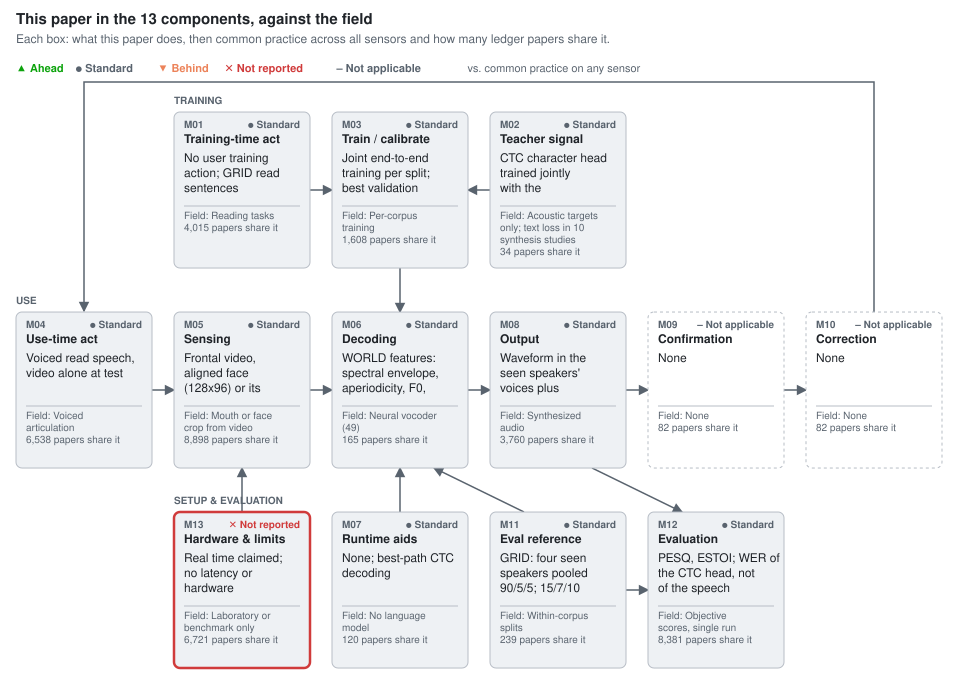

# Vocoder-Based Speech Synthesis from Silent Videos

Daniel Michelsanti, Olga Slizovskaia, Gloria Haro, Emilia Gómez, Zheng-Hua Tan, Jesper Jensen. Interspeech 2020 (arXiv April 2020). [DOI](https://doi.org/10.21437/Interspeech.2020-1026) · [arXiv:2004.02541](https://arxiv.org/abs/2004.02541)

**Section:** [Lip & face video](../../README.md#lip--face-video)

## Figures

### This paper in the 13 components, against the field

<picture><source media="(prefers-color-scheme: dark)" srcset="figures/components-dark.svg"></picture>

Verdicts compare the paper's choice for each component with common practice across 8,995 ledger entries on any sensor (silent speech, brain-to-text, lip reading).

Data

| Component | This paper | Common practice | Papers with this practice | Verdict |
| --- | --- | --- | --- | --- |
| M01 Training-time act | No user training action; GRID read sentences | Reading tasks | 4,015 of 8,995 | ● Standard (Inherited.) |
| M02 Teacher signal | CTC character head trained jointly with the vocoder-feature decoders | Acoustic targets only; text loss in 10 synthesis studies | 34 of 8,995 | ● Standard (Multi-task idea of a 2018 ultrasound system (HMM states); ESTOI +0.007 to +0.013, one run each.) |
| M03 Train / calibrate | Joint end-to-end training per split; best validation PESQ checkpoint | Per-corpus training | 1,608 of 8,995 | ● Standard (Inherited; no seeds or repeated runs.) |
| M04 Use-time act | Voiced read speech, video alone at test | Voiced articulation | 6,538 of 8,995 | ● Standard (Inherited.) |
| M05 Sensing | Frontal video, aligned face (128x96) or its lower half, 7 frames | Mouth or face crop from video | 8,898 of 8,995 | ● Standard (Mouth suffices on seen speakers.) |
| M06 Decoding | WORLD features: spectral envelope, aperiodicity, F0, voicing | Neural vocoder (49) | 165 of 8,995 | ● Standard (ESTOI 0.455 against 0.329 for the 2019 GAN on seen speakers; unseen: PESQ tie, higher ESTOI.) |
| M07 Runtime aids | None; best-path CTC decoding | No language model | 120 of 8,995 | ● Standard (Inherited.) |
| M08 Output | Waveform in the seen speakers' voices plus character text | Synthesized audio | 3,760 of 8,995 | ● Standard (Text output is a by-product of the PESQ-selected model.) |
| M09 Confirmation | None | None | 82 of 8,995 | – Not applicable (Offline study.) |
| M10 Correction | None | None | 82 of 8,995 | – Not applicable (Offline study.) |
| M11 Eval reference | GRID: four seen speakers pooled 90/5/5; 15/7/10 unseen-speaker split | Within-corpus splits | 239 of 8,995 | ● Standard (Utterance split and seed not stated.) |
| M12 Evaluation | PESQ, ESTOI; WER of the CTC head, not of the speech | Objective scores, single run | 8,381 of 8,995 | ● Standard (No ASR on synthesized speech, no chance level, one run.) |
| M13 Hardware & limits | Real time claimed; no latency or hardware | Laboratory or benchmark only | 6,721 of 8,995 | ✕ Not reported (Real-time claim unquantified.) |

## Verdict

The paper [[1]](#ref-1) changes two components: a CTC character head trained jointly with the acoustic decoders (M02), and WORLD vocoder features as the acoustic route (M06). Both are standard. The text loss follows the multi-task idea of a 2018 ultrasound system [[2]](#ref-2) (HMM states there, CTC characters here) and moves ESTOI by 0.007 to 0.013 in one run per configuration, too little to credit. The WORLD route beats the 2019 GAN on seen GRID speakers (ESTOI 0.455 against 0.329), and a later scoring of the released samples keeps that order [[3]](#ref-3); on unseen speakers PESQ ties and ESTOI is higher (0.227 against 0.198). The weakest claim is joint recognition: the 15.1% and 51.6% WER come from the CTC head of a PESQ-selected model, not from the speech. Today raw-waveform systems reach 4.07% ASR WER on seen speakers against 9.29% for this one [[3]](#ref-3).

## Against the field, component by component

### M02 Training-only supervision: auxiliary CTC text loss

**Usual approach:** Of 34 unique studies with an auxiliary phoneme, phone-state or CTC loss (pattern match, Appendix), 10 synthesize speech; the rest of synthesis uses acoustic targets only. The closest earlier design trains HMM-state and vocoder targets on one ultrasound network, with about 7% relative error reduction in both tasks [[2]](#ref-2); the paper applies it from video with a 28-character CTC loss (Table 1) and does not cite it.

**State of the art:** In a 2023 lip-to-speech system, removing the feature-level CTC loss, with ASR-based output supervision kept, raises ASR WER on LRS2 from 60.54% to 84.27% (Table 1 of [[4]](#ref-4)) [later]: a 28% relative reduction from that one text term, measured on the synthesized speech (inference).

Here the text head adds 0.01 and 0.03 PESQ and 0.007 and 0.008 ESTOI on seen speakers (Table 3), 1.6% and 1.8% relative, and 0.03 and 0.06 PESQ and 0.013 and 0.008 ESTOI on unseen speakers, 6.1% and 4.0% relative ESTOI (inference). All eight signs agree, but each is one run, checkpoint chosen by validation PESQ (Table 1). Verdict: standard.

### M06 Processing: WORLD vocoder features as the acoustic route

**Usual approach:** Of 165 unique video-to-speech studies (pattern match, Appendix), 49 name a neural vocoder, 41 a parametric vocoder, 16 Griffin-Lim and 3 an auditory spectrogram. The paper's departure within the parametric route is predicting F0, aperiodicity and voicing beside the envelope (Sec. 1).

**State of the art:** On the four seen GRID speakers a 2023 preprint (journal 2024) lists this system at ASR WER 9.29% and ESTOI 0.455, against 4.07% for an end-to-end WGAN (2022) [[3]](#ref-3) [later], 56% lower WER (inference). On unseen speakers it lists 38.15% WER against 16.05% (WGAN 2022), a 58% gap (inference).

Against its prior the route holds: seen-speaker ESTOI 0.455 against 0.329 for the GAN [[5]](#ref-5), 38% higher (inference). Scoring the released test samples, the later table reproduces both ESTOI values and lists PESQ 1.61 (1.47 for the GAN; Table IV of [[3]](#ref-3)), 14% to 15% below the originals, while unseen PESQ for this system rises (1.26 against 1.23): the PESQ order holds, the scorers differ (inference). Its ASR WER, never measured here, is 9.29% against 19.94% for the GAN. On unseen speakers PESQ ties (1.19 to 1.25 against 1.24) and every variant has higher ESTOI (0.202 to 0.227 against 0.198, up to 15%; Table 3), "slightly better" in the authors' words (Sec. 3.2) (inference). Verdict: standard.

## The 13 components

| Component | This paper | Usual approach (count) | State of the art | Verdict |
|---|---|---|---|---|
| M01 Training-time action | No user training action; GRID read sentences | Reading tasks (slot-filled 4,015) | – | standard |
| M02 Training-only supervision | CTC character head trained jointly with the vocoder-feature decoders | Acoustic targets only; text loss in 10 synthesis studies (pattern match 34) | LRS2 ASR WER 84.27% without, 60.54% with the feature-level CTC loss [[4]](#ref-4) | standard |
| M03 Training and adaptation | Joint end-to-end training per split; best validation PESQ checkpoint | Per-corpus training (slot-filled 1,608) | – | standard |
| M04 Use-time action | Voiced read speech, video alone at test | Voiced articulation (slot-filled 6,538) | – | standard |
| M05 Sensors | Frontal video, aligned face (128x96) or its lower half, 7 frames | Mouth or face crop from video (slot-filled 8,898) | – | standard |
| M06 Processing and decoding | WORLD features: spectral envelope, aperiodicity, F0, voicing | Neural vocoder (49) (pattern match 165) | GRID-4 WER 4.07% (WGAN) against 9.29% for this system [[3]](#ref-3) | standard |
| M07 Lexicon and LM | None; best-path CTC decoding | No language model (slot-filled 120) | – | standard |
| M08 Output | Waveform in the seen speakers' voices plus character text | Synthesized audio (slot-filled 3,760) | – | standard |
| M09 Confirmation | None | None (slot-filled 82) | – | not applicable |
| M10 Correction | None | None (slot-filled 82) | – | not applicable |
| M11 Reference construction | GRID: four seen speakers pooled 90/5/5; 15/7/10 unseen-speaker split | Within-corpus splits (slot-filled 239) | – | standard |
| M12 Evaluation | PESQ, ESTOI; WER of the CTC head, not of the speech | Objective scores, single run (slot-filled 8,381) | – | standard |
| M13 Device and cost | Real time claimed; no latency or hardware | Laboratory or benchmark only (slot-filled 6,721) | – | not reported |

## Where the claims outrun the evidence

- "Simultaneously reconstruct and recognise" (Abstract): the WER values (Table 3) come from best-path CTC decoding of the text head (Sec. 2.4), not from ASR on the synthesized audio, unlike the 26.6% ASR WER of the comparison system [[5]](#ref-5).
- The checkpoint is chosen by validation PESQ (Table 1); the authors concede this favours reconstruction over recognition on unseen speakers, where the face model reaches 69.3% WER against 51.6% (Sec. 3.2).
- "Improvement over existing video-to-speech approaches" (Abstract) holds clearly for seen speakers; on unseen speakers only ESTOI improves, in single runs (Table 3, Sec. 3.2).
- "Real time" (Abstract) rests on no latency or hardware figure in Sec. 2 or Sec. 3.
- No WER chance level is given for the six-word grammar (Sec. 2.1), so 51.6% on unseen speakers has no floor.

## What the field needs next

- M02: the same model with and without the CTC loss, three or more seeds, scored by ASR WER on the synthesized speech, on GRID and on an open-vocabulary corpus.
- M06: WORLD features against a mel-spectrogram with a neural vocoder behind one visual encoder, so the acoustic route is the only change.
- M12: one ASR scorer and one PESQ implementation for all systems, plus a GRID chance level.

## Questions for the authors

- Which utterances, drawn with which seed, form the seen-speaker 5% test set?
- What is the run-to-run spread of PESQ, ESTOI and WER?
- What ASR WER does the synthesized speech reach with and without the text head?
- What latency and hardware support real time?

## Appendix: literature search

- M02 auxiliary-phoneme-loss-in-speech-synthesis (published topic table, appended). Inclusion rule: speech synthesis from a non-acoustic signal (EMG, ultrasound, articulography, video, neural) whose training adds a phoneme, phone-state, CTC or text classification loss on a shared encoder; recognition-only models, recognize-then-TTS systems and regression-only auxiliary targets excluded; versions counted once. Slot-filled 31 unique studies; pattern match 34 unique studies (38 folders). Usual design: acoustic targets only; an auxiliary phoneme, phone-state or CTC loss in 10 synthesis studies (pattern match). Read in full: [[2]](#ref-2), [[4]](#ref-4) [later], target. Known-item recall 1.0 (2 of 2 seeds).
- M06 video-to-speech-synthesis (published topic table, appended). Inclusion rule: studies that synthesize a speech waveform from talking-face or lip video and state the acoustic representation and how it becomes a waveform; audio-visual enhancement with noisy audio at test, talking-head generation, text-only lip reading and video-to-text-to-TTS pipelines excluded; versions counted once. Slot-filled 7,345 unique studies; pattern match 165 unique studies (187 folders). Usual design: neural vocoder, 49 (pattern match, full text). Design counts: neural vocoder 49, parametric vocoder 41, Griffin-Lim 16, auditory spectrogram 3. Read in full: [[5]](#ref-5), [[3]](#ref-3) [later], target. Known-item recall 1.0 (3 of 3 seeds).

## References

Numbered by first citation. BibTeX in the same order and keys: [refs.bib](refs.bib).

1. Michelsanti, D., Slizovskaia, O., Haro, G., Gómez, E., Tan, Z., Jensen, J. “Vocoder-Based Speech Synthesis from Silent Videos.” *Proc. Interspeech 2020*, 2020, 3530-3534. doi:[10.21437/Interspeech.2020-1026](https://doi.org/10.21437/Interspeech.2020-1026). arXiv:[2004.02541](https://arxiv.org/abs/2004.02541). Target. Read as the Interspeech 2020 proceedings version. [review](https://github.com/supernaiter/silent-speech-review/tree/main/reviews/vocoder-based-speech-synthesis-from-silent-videos) [wiki: isca-michelsanti20-vid2voc](https://github.com/supernaiter/deep-research-wiki-for-silent-speech/blob/main/papers/isca-michelsanti20-vid2voc/article.md) [wiki: isca-michelsanti20_interspeech](https://github.com/supernaiter/deep-research-wiki-for-silent-speech/blob/main/papers/isca-michelsanti20_interspeech/article.md)
2. Tóth, L., Gosztolya, G., Grósz, T., Markó, A., Csapó, T. G. “Multi-Task Learning of Speech Recognition and Speech Synthesis Parameters for Ultrasound-based Silent Speech Interfaces.” *Proc. Interspeech 2018*, 2018, 3172–3176. doi:[10.21437/Interspeech.2018-1078](https://doi.org/10.21437/Interspeech.2018-1078). [wiki: isca-toth18-multitask](https://github.com/supernaiter/deep-research-wiki-for-silent-speech/blob/main/papers/isca-toth18-multitask/article.md) [wiki: isca-toth18_interspeech](https://github.com/supernaiter/deep-research-wiki-for-silent-speech/blob/main/papers/isca-toth18_interspeech/article.md) [wiki: isca-toth18_mtlussi](https://github.com/supernaiter/deep-research-wiki-for-silent-speech/blob/main/papers/isca-toth18_mtlussi/article.md)
3. Kefalas, T., Panagakis, Y., Pantic, M. “Large-scale unsupervised audio pre-training for video-to-speech synthesis.” *IEEE/ACM Transactions on Audio, Speech, and Language Processing*, 2024, 32, 2255-2268. doi:[10.1109/TASLP.2024.3382500](https://doi.org/10.1109/TASLP.2024.3382500). arXiv:[2306.15464](https://arxiv.org/abs/2306.15464). Read as arXiv:2306.15464 v1; journal version cited. [later] [review](https://github.com/supernaiter/silent-speech-review/tree/main/reviews/large-scale-unsupervised-audio-pre-training-for-video-to-speech-synthesis) [wiki: arxiv-2306.15464-v2apretrain](https://github.com/supernaiter/deep-research-wiki-for-silent-speech/blob/main/papers/arxiv-2306.15464-v2apretrain/article.md)
4. Kim, M., Hong, J., Ro, Y. M. “Lip-to-Speech Synthesis in the Wild with Multi-task Learning.” *2023 IEEE International Conference on Acoustics, Speech and Signal Processing (ICASSP)*, 2023. arXiv:[2302.08841](https://arxiv.org/abs/2302.08841). [later] [wiki: arxiv-2302.08841](https://github.com/supernaiter/deep-research-wiki-for-silent-speech/blob/main/papers/arxiv-2302.08841/article.md)
5. Vougioukas, K., Ma, P., Petridis, S., Pantic, M. “Video-Driven Speech Reconstruction using Generative Adversarial Networks.” *Interspeech 2019*, 2019. doi:[10.21437/Interspeech.2019-1445](https://doi.org/10.21437/Interspeech.2019-1445). [wiki: isca-vougioukas19_ganv2s](https://github.com/supernaiter/deep-research-wiki-for-silent-speech/blob/main/papers/isca-vougioukas19_ganv2s/article.md)

## Materials

Data behind this review. Full texts of the papers are not included.

- [`review.md`](review.md): the review text (source)
- [`refs.bib`](refs.bib): references (BibTeX)
- [`slots.json`](slots.json): for each of the 13 components: this paper's choice, field practice, number of matching papers, verdict
- [`figures.json`](figures.json): figure definitions
- [`evaluation.md`](evaluation.md): independent evaluation by a second reviewer
- [`triage.md`](triage.md): how each evaluation finding was checked against the sources and resolved
- [`components/M02/auxiliary-phoneme-loss-in-speech-synthesis.csv`](../../components/M02/auxiliary-phoneme-loss-in-speech-synthesis.csv): M02 topic "auxiliary-phoneme-loss-in-speech-synthesis", every candidate paper with its decision (31 slot-filled, 34 pattern match, usual design in 10, 3 read in full)
- [`components/M06/video-to-speech-synthesis.csv`](../../components/M06/video-to-speech-synthesis.csv): M06 topic "video-to-speech-synthesis", every candidate paper with its decision (7345 slot-filled, 165 pattern match, usual design in 49, 3 read in full)

## More reviews in Lip & face video

- [Speech Prediction in Silent Videos using Variational Autoencoders](../speech-prediction-in-silent-videos-using-variational-autoencoders/) (2020). Variational autoencoder model for speech synthesis from silent lip video that models one-to-many ambiguity; on GRID reports STOI 0.724, ESTOI 0.540 and PESQ 1.932, leading Lip2Wav on ESTOI and PESQ.
- [Multi-modality Associative Bridging through Memory: Speech Sound Recollected from Face Video](../multi-modality-associative-bridging-through-memory-speech-sound-recollected-from-face-video/) (2021). Audio memory recall (M02) is ahead as a design, but the LRW state-of-the-art claim misses a prior 87.9% model, the edge over distillation is one run, and GRID gains are small.
- [Speaker disentanglement in video-to-speech conversion](../speaker-disentanglement-in-video-to-speech-conversion/) (2021). Speaker-conditioned video-to-speech with adversarial identity removal: both standard (gradient reversal on GRID lips dates from 2017); EER uses the training embedding network; one run.
- [Lipper: Synthesizing Thy Speech using Multi-View Lipreading](../lipper-synthesizing-thy-speech-using-multi-view-lipreading/) (2019). Lipper reconstructs speech from multi-view lip video on OuluVS2 as a regression problem; the best three-view setting reaches PESQ 2.315 with 0.169 s end-to-end delay, though audio remains robotic.
- [Video-Driven Speech Reconstruction using Generative Adversarial Networks](../video-driven-speech-reconstruction-using-generative-adversarial-networks/) (2019). Direct-waveform GAN (M06) and speech-encoder perceptual loss (M02) are early but standard; the perceptual loss carries the words. Unseen-speaker WER 40.5% (successor 16%); no listener test.
- [FastLTS: Non-Autoregressive End-to-End Unconstrained Lip-to-Speech Synthesis](../fastlts-non-autoregressive-end-to-end-unconstrained-lip-to-speech-synthesis/) (2022). FastLTS is a non-autoregressive end-to-end lip-to-speech system that makes unconstrained synthesis substantially faster without obvious quality loss, evaluated on Lip2Wav and GRID.

---

Part of the [Silent Speech Interface Review](https://github.com/supernaiter/silent-speech-review). Found an error? [Open an issue](https://github.com/supernaiter/silent-speech-review/issues/new?template=correction.yml).
