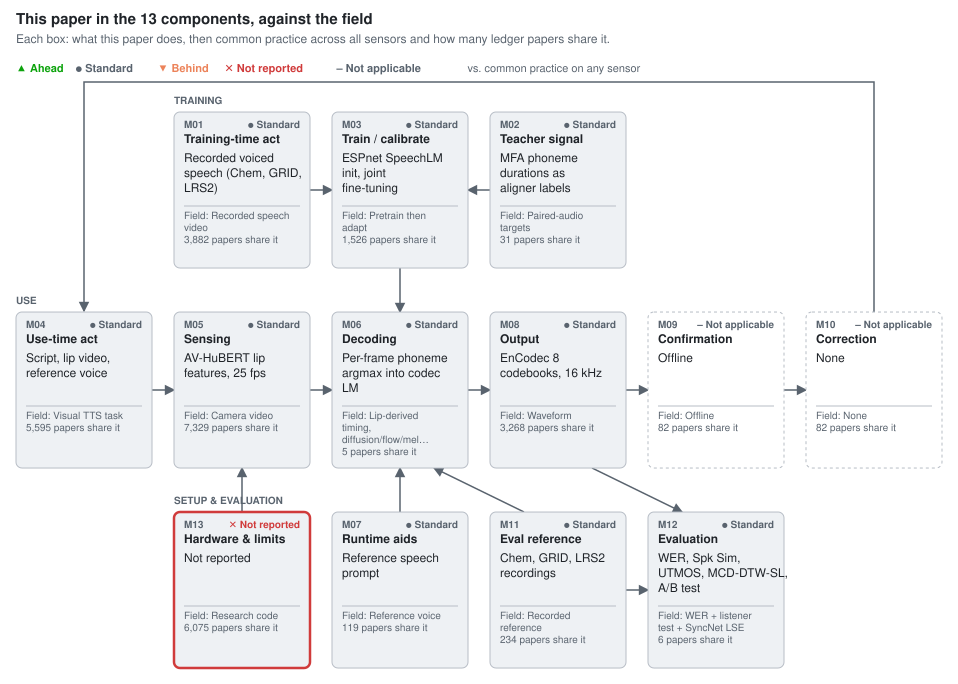

# VSpeechLM: A Visual Speech Language Model for Visual Text-to-Speech Task

Yuyue Wang, Xin Cheng, Yihan Wu, Xihua Wang, Jinchuan Tian, Ruihua Song. ACM Multimedia Asia (MMAsia '25), 2025. [DOI](https://doi.org/10.1145/3743093.3771012) · [arXiv:2511.22229](https://arxiv.org/abs/2511.22229)

**Section:** [Lip & face video](../../README.md#lip--face-video)

## Figures

### This paper in the 13 components, against the field

<picture><source media="(prefers-color-scheme: dark)" srcset="figures/components-dark.svg"></picture>

Verdicts compare the paper's choice for each component with common practice across 8,995 ledger entries on any sensor (silent speech, brain-to-text, lip reading).

Data

| Component | This paper | Common practice | Papers with this practice | Verdict |
| --- | --- | --- | --- | --- |
| M01 Training-time act | Recorded voiced speech (Chem, GRID, LRS2) | Recorded speech video | 3,882 of 8,995 | ● Standard (Inherited.) |
| M02 Teacher signal | MFA phoneme durations as aligner labels | Paired-audio targets | 31 of 8,995 | ● Standard (Inherited from duration-based dubbing.) |
| M03 Train / calibrate | ESPnet SpeechLM init, joint fine-tuning | Pretrain then adapt | 1,526 of 8,995 | ● Standard (Pretraining corpus not named; WER 151% without it.) |
| M04 Use-time act | Script, lip video, reference voice | Visual TTS task | 5,595 of 8,995 | ● Standard (Inherited task definition.) |
| M05 Sensing | AV-HuBERT lip features, 25 fps | Camera video | 7,329 of 8,995 | ● Standard (Inherited front end.) |
| M06 Decoding | Per-frame phoneme argmax into codec LM | Lip-derived timing, diffusion/flow/mel decoder | 5 of 8,995 | ● Standard (Lip-set durations predate it; no monotonic constraint.) |
| M07 Runtime aids | Reference speech prompt | Reference voice | 119 of 8,995 | ● Standard (Inherited; test-time reference utterance not stated.) |
| M08 Output | EnCodec 8 codebooks, 16 kHz | Waveform | 3,268 of 8,995 | ● Standard (Codec caps UTMOS (3.77 resynthesis vs 4.19 GT, Chem).) |
| M09 Confirmation | Offline | Offline | 82 of 8,995 | – Not applicable (Offline synthesis.) |
| M10 Correction | None | None | 82 of 8,995 | – Not applicable (Offline synthesis.) |
| M11 Eval reference | Chem, GRID, LRS2 recordings | Recorded reference | 234 of 8,995 | ● Standard (GRID split counts inconsistent.) |
| M12 Evaluation | WER, Spk Sim, UTMOS, MCD-DTW-SL, A/B test | WER + listener test + SyncNet LSE | 6 of 8,995 | ● Standard (No SyncNet LSE, unlike its dubbing baselines; mixed baseline provenance.) |
| M13 Hardware & limits | Not reported | Research code | 6,075 of 8,995 | ✕ Not reported (No speed, size or compute.) |

## Verdict

VSpeechLM [[1]](#ref-1) changes one component, synthesis (M06): a per-frame phoneme aligner feeds a pretrained codec language model instead of a duration-based, diffusion or flow decoder. Both halves are standard: lip-set phoneme durations without a duration predictor appear in Hegde et al. [[2]](#ref-2) (§3.2.2), and the authors cite an earlier speech-LLM dubbing system, DubWise, with global duration control only (§1). The content gain over the strongest baseline is small, 12.5% against 12.8% WER on Chem (Table 1); the baseline value is the non-ground-truth-reference row of the [concurrent] DiFlowDubber, which reports 11.12% against 12.81% in the same setting [[3]](#ref-3). The synchronization claim is the weakest: it rests on a length-weighted spectral distance (§4.1), and its headline reductions do not follow from Table 1. The evaluation (M12) omits the SyncNet scores that DiFlowDubber's tables give for six earlier dubbing systems, four of them this paper's baselines.

## Against the field, component by component

### M06 Synthesis: lip-timed phonemes into a codec language model

**Usual approach:** the authors put earlier visual TTS on FastSpeech2-style or flow-matching backbones (§2.1); in the Appendix population, 5 of the 7 studies that synthesize speech from lip video plus text take phoneme timing from the lips or from attention to the video (pattern match, upper bound, Appendix), and only this paper and the [concurrent] FunCineForge [[4]](#ref-4) mention a codec-token language model. VSpeechLM swaps in an ESPnet-initialised EnCodec language model (§4.1).

**State of the art:** the [concurrent] DiFlowDubber (2026) [[3]](#ref-3) reports, with a non-ground-truth reference, Chem WER 11.12% against 12.81% for EmoDubber and GRID 16.21% against 19.75% (Tables 1–2). VSpeechLM's EmoDubber values (12.8%, 19.8%) equal these rows to rounding, so the gap to the shared baseline is 13.2% relative on Chem for DiFlowDubber against 2.3% for VSpeechLM (inference).

Each lip frame takes its most similar phoneme, trained by cross-entropy on forced-alignment labels, with no monotonic constraint, and the decoder trains on ground-truth expansions but runs on predicted ones (§3.3.2, §3.5). Hegde et al. [[2]](#ref-2) (prior) let visual queries attend over phonemes and upsampled the result, so video-text alignment set durations (§3.2.2). DiFlowDubber and the [later] LipAdapter [[5]](#ref-5) add monotonic alignment search; argmax can reorder or skip phonemes, unmeasured. Visual timing helps (Chem WER 12.48% vs 15.02% without video, Table 2); without decoder pretraining WER is 151% (Table 3). Verdict: standard.

### M12 Evaluation: synchronization without a lip-sync score

**Usual approach:** 6 of the 7 text-and-video studies in the Appendix report SyncNet scores (LSE-C/LSE-D), including both priors, LipVoicer [[6]](#ref-6) and Hegde et al. [[2]](#ref-2), and the [later] Watch Your Speech [[7]](#ref-7) (pattern match, Appendix). DiFlowDubber's Table 1 also gives LSE-C/LSE-D for V2C-Net (2022), HPMDubbing (2023), StyleDubber and Speaker2Dubber (2024) and ProDubber (2025). VSpeechLM measures "duration synchronization" with MCD-DTW-SL alone (§4.1).

**State of the art:** DiFlowDubber (2026) [[3]](#ref-3) reports Chem LSE-C 8.31 and LSE-D 6.73 with a ground-truth reference (Table 1).

MCD-DTW-SL rewards matching the recording's duration, not the visible lips. Verdict: standard by the ledger rule (two prior studies in the Appendix); against the dubbing systems it compares with, the protocol is weaker on its own central claim.

## The 13 components

| Component | This paper | Usual approach (count) | State of the art | Verdict |
|---|---|---|---|---|
| M01 Training-time action | Recorded voiced speech (Chem, GRID, LRS2) | Recorded speech video (slot-filled 3,882) | – | standard |
| M02 Training-only supervision | MFA phoneme durations as aligner labels | Paired-audio targets (slot-filled 31) | – | standard |
| M03 Training and adaptation | ESPnet SpeechLM init, joint fine-tuning | Pretrain then adapt (slot-filled 1,526) | – | standard |
| M04 Use-time action | Script, lip video, reference voice | Visual TTS task (slot-filled 5,595) | – | standard |
| M05 Sensors | AV-HuBERT lip features, 25 fps | Camera video (slot-filled 7,329) | – | standard |
| M06 Processing and decoding | Per-frame phoneme argmax into codec LM | Lip-derived timing, diffusion/flow/mel decoder (pattern match 5) | [[3]](#ref-3) (2026): Chem WER 11.12% vs EmoDubber 12.81% (non-GT reference) | standard |
| M07 Lexicon and LM | Reference speech prompt | Reference voice (slot-filled 119) | – | standard |
| M08 Output | EnCodec 8 codebooks, 16 kHz | Waveform (slot-filled 3,268) | – | standard |
| M09 Confirmation | Offline | Offline (slot-filled 82) | – | not applicable |
| M10 Correction | None | None (slot-filled 82) | – | not applicable |
| M11 Reference construction | Chem, GRID, LRS2 recordings | Recorded reference (slot-filled 234) | – | standard |
| M12 Evaluation | WER, Spk Sim, UTMOS, MCD-DTW-SL, A/B test | WER + listener test + SyncNet LSE (pattern match 6) | [[3]](#ref-3) (2026): Chem LSE-C 8.31, LSE-D 6.73 | standard |
| M13 Device and cost | Not reported | Research code (slot-filled 6,075) | – | not reported |

## Where the claims outrun the evidence

- §4.2 claims MCD-DTW-SL reductions of 17.6% on Chem and 60.9% on GRID. Table 1 gives 6.51 to 5.28 against EmoDubber, 18.9%, and 6.42 to 3.90 against StyleDubber, 39.3% (inference); EmoDubber, the stronger GRID baseline, scores 3.92 against 3.90.
- Baseline WER and MCD are copied from earlier papers, while UTMOS and Spk Sim are regenerated (Table 1 caption). The copied WERs match DiFlowDubber's non-ground-truth-reference rows (StyleDubber 14.2 vs 14.18, Chem); if VSpeechLM used the target recording as reference (§3.2 does not say), the comparison favours it. ProDubber (2025), at 11.69% in that setting, is not compared.
- Chem UTMOS is 3.73 in Tables 1–2 but 3.87 in Table 3.
- The GRID split does not add up: 100 test clips per speaker for 33 speakers cannot give 900 test samples (§4.1).
- On GRID, ground truth scores 22.5% WER and VSpeechLM 18.3% (Table 1); as the authors note (footnote 2), the ASR bounds that column.
- The human study (10 experts, 50 clips per dataset) uses EmoDubber on Chem but StyleDubber on GRID (§4.3); Fig. 3 gives win-tie-loss ratios but no blinding or uncertainty.
- The LRS2 lead (16.1% vs 91.4–198% WER, Table 4) omits how baselines were trained and the decoder's pretraining corpus.

## What the field needs next

- M12: LSE-C/LSE-D in both reference settings, all baselines rescored with one ASR.
- M06: per-frame argmax against monotonic alignment search on the same decoder, with phoneme order errors.
- M03: the pretraining corpus, and LRS2 baselines on the same data.

## Questions for the authors

- Is the test reference the target recording or another utterance of the speaker?
- How are 900 GRID test samples obtained from 100 clips for each of 33 speakers?
- Why is Chem UTMOS 3.87 in Table 3 but 3.73 in Tables 1 and 2?
- How many seeds stand behind each table?

## Appendix: literature search

- M06 text-and-video-to-speech-decoder. Inclusion rule: studies that synthesize a speech waveform from talking-face or lip video together with text, either given (visual TTS, video dubbing) or predicted by a lip reader and used in synthesis; plain video-to-speech, talking-head generation, recognition and TTS-only cascades excluded; versions counted once. Ledger: 7,345 slot-filled unique studies; pattern match 9 unique studies, 7 included after the boundary check (one plain video-to-speech study and one talking-head synthesis study excluded). Full-text design counts over the 7 (upper bound, related-work mentions included): diffusion 5, lip-derived phoneme timing 5, flow matching 4, duration-based mel synthesis 4, codec-token language model 2. Read in full: [[2]](#ref-2), [[3]](#ref-3), [[5]](#ref-5). Known-item recall 1.0 (5 seeds).
- M12 text-and-video-to-speech-evaluation. Inclusion rule: same population; protocols counted from the full text. Ledger: 6,960 slot-filled unique studies; pattern match 9 unique studies, 7 included (same exclusions). Counts over the 7: ASR WER 7, listener test 7, SyncNet LSE 6, speaker similarity 4, MCD-DTW-SL 2. Read in full: [[3]](#ref-3), [[2]](#ref-2), [[5]](#ref-5).

## References

Numbered by first citation. BibTeX in the same order and keys: [refs.bib](refs.bib).

1. Wang, Y., Cheng, X., Wu, Y., Wang, X., Tian, J., Song, R. “VSpeechLM: A Visual Speech Language Model for Visual Text-to-Speech Task.” *ACM Multimedia Asia (MMAsia '25)*, 2025. doi:[10.1145/3743093.3771012](https://doi.org/10.1145/3743093.3771012). arXiv:[2511.22229](https://arxiv.org/abs/2511.22229). Target. Read as arXiv v1 (27 Nov 2025). [review](https://github.com/supernaiter/silent-speech-review/tree/main/reviews/vspeechlm-a-visual-speech-language-model-for-visual-text-to-speech-task) [wiki: arxiv-2511.22229](https://github.com/supernaiter/deep-research-wiki-for-silent-speech/blob/main/papers/arxiv-2511.22229/article.md)
2. Hegde, S., Mukhopadhyay, R., Jawahar, C. V., Namboodiri, V. “Towards Accurate Lip-to-Speech Synthesis in-the-Wild.” *Proceedings of the 31st ACM International Conference on Multimedia (MM '23)*, 2023. doi:[10.1145/3581783.3611787](https://doi.org/10.1145/3581783.3611787). arXiv:[2403.01087](https://arxiv.org/abs/2403.01087). Prior; deciding prior for the M06 aligner (video-text attention sets phoneme durations). [wiki: arxiv-2403.01087](https://github.com/supernaiter/deep-research-wiki-for-silent-speech/blob/main/papers/arxiv-2403.01087/article.md)
3. Nguyen, N., Tran, T. V. T., Choi, J., Huynh-Nguyen, H., Hy, T., Nguyen, V. “DiFlowDubber: Discrete Flow Matching for Automated Video Dubbing via Cross-Modal Alignment and Synchronization.” *arXiv preprint*, 2026. arXiv:[2603.14267](https://arxiv.org/abs/2603.14267). [concurrent]; state of the art on Chem and GRID. Read as arXiv v4. [concurrent] [wiki: arxiv-2603.14267](https://github.com/supernaiter/deep-research-wiki-for-silent-speech/blob/main/papers/arxiv-2603.14267/article.md)
4. Liu, J., Xiang, Y., Zhao, H., Li, X., Ling, Z. “FunCineForge: A Unified Dataset Toolkit and Model for Zero-Shot Movie Dubbing in Diverse Cinematic Scenes.” *arXiv preprint*, 2026. arXiv:[2601.14777](https://arxiv.org/abs/2601.14777). [concurrent]; in the text-and-video population (pattern match). [concurrent] [wiki: arxiv-2601.14777](https://github.com/supernaiter/deep-research-wiki-for-silent-speech/blob/main/papers/arxiv-2601.14777/article.md)
5. Ghosh, S., Jawahar, C. V., Namboodiri, V. “LipAdapter: Text-to-Video Alignment is All You Need for Lip-to-Speech.” *Proc. Interspeech 2026*, 2026, 3548. doi:[10.21437/Interspeech.2026-518](https://doi.org/10.21437/Interspeech.2026-518). [later]; MAS durations from lips into a pretrained TTS. [later] [wiki: isca-ghosh26b_interspeech](https://github.com/supernaiter/deep-research-wiki-for-silent-speech/blob/main/papers/isca-ghosh26b_interspeech/article.md) [wiki: isca-ghosh26b-lipadapt](https://github.com/supernaiter/deep-research-wiki-for-silent-speech/blob/main/papers/isca-ghosh26b-lipadapt/article.md)
6. Yemini, Y., Shamsian, A., Bracha, L., Gannot, S., Fetaya, E. “LipVoicer: Generating Speech from Silent Videos Guided by Lip Reading.” *International Conference on Learning Representations (ICLR)*, 2024. arXiv:[2306.03258](https://arxiv.org/abs/2306.03258). Prior; in the text-and-video population (pattern match). [review](https://github.com/supernaiter/silent-speech-review/tree/main/reviews/lipvoicer-generating-speech-from-silent-videos-guided-by-lip-reading) [wiki: arxiv-2306.03258](https://github.com/supernaiter/deep-research-wiki-for-silent-speech/blob/main/papers/arxiv-2306.03258/article.md)
7. Lee, G., Oh, Y., Han, Y. “Watch Your Speech: Text-aware Video-to-Speech Synthesis with Textual Conditioning.” *arXiv preprint*, 2026. arXiv:[2610.01012](https://arxiv.org/abs/2610.01012). [later]; in the text-and-video population (pattern match). [later] [wiki: arxiv-2610.01012-wys](https://github.com/supernaiter/deep-research-wiki-for-silent-speech/blob/main/papers/arxiv-2610.01012-wys/article.md) [wiki: arxiv-2610.01012](https://github.com/supernaiter/deep-research-wiki-for-silent-speech/blob/main/papers/arxiv-2610.01012/article.md)

## Materials

Data behind this review. Full texts of the papers are not included.

- [`review.md`](review.md): the review text (source)
- [`refs.bib`](refs.bib): references (BibTeX)
- [`slots.json`](slots.json): for each of the 13 components: this paper's choice, field practice, number of matching papers, verdict
- [`figures.json`](figures.json): figure definitions
- [`evaluation.md`](evaluation.md): independent evaluation by a second reviewer
- [`triage.md`](triage.md): how each evaluation finding was checked against the sources and resolved
- [`process/log.json`](process/log.json): process record: each step, who did it (reader, script, writer, evaluator), when, the checks run and the input versions
- [`process/notes.json`](process/notes.json): reading notes on the target and comparator papers: claims, numbers, conditions and what is not stated, with locations
- [`process/plan.json`](process/plan.json): plan: which components the paper changes and the topics it is compared on
- [`process/draft.md`](process/draft.md): the review as first written, before the independent evaluation
- [`process/claims-draft.md`](process/claims-draft.md): claim table of the draft: every claim mapped to a note or a count
- [`process/claims.md`](process/claims.md): claim table of the published review
- [`components/M06/text-and-video-to-speech-decoder.csv`](../../components/M06/text-and-video-to-speech-decoder.csv): M06 topic "text-and-video-to-speech-decoder", every candidate paper with its decision (7345 slot-filled, 9 pattern match, usual design in 5, 4 read in full)
- [`components/M12/text-and-video-to-speech-evaluation.csv`](../../components/M12/text-and-video-to-speech-evaluation.csv): M12 topic "text-and-video-to-speech-evaluation", every candidate paper with its decision (6960 slot-filled, 9 pattern match, usual design in 6, 4 read in full)

## More reviews in Lip & face video

- [Landmark Guided Visual Feature Extractor for Visual Speech Recognition with Limited Resource](../landmark-guided-visual-feature-extractor-for-visual-speech-recognition-with-limited-resource/) (2025). Lip-landmark graph plus pixel fusion is a standard design (2020 precedent); the 0.90-point low-data gain comes from one unseeded run, and LRW 91.69% stays below 95.0%.
- [LipDiffuser: Lip-to-Speech Generation with Conditional Diffusion Models](../lipdiffuser-lip-to-speech-generation-with-conditional-diffusion-models/) (2025). Diffusion decoder with per-frame MP-FiLM (M06) and audio-only pretraining (M02) are standard; quality and speaker-similarity leads rest on enhanced targets and a clean-reference enrollment.
- [LTA-L2S: Lexical Tone-Aware Lip-to-Speech Synthesis for Mandarin with Cross-Lingual Transfer Learning](../lta-l2s-lexical-tone-aware-lip-to-speech-synthesis-for-mandarin-with-cross-lingual-transfer-lear/) (2025). Mandarin lip-to-speech whose gain over Intelligible matches its English-initialization ablation; the tone components move CER little with no repeats reported, and pitch removal leaves TER at 40.9%.
- [NaturalL2S: End-to-End High-quality Multispeaker Lip-to-Speech Synthesis with Differential Digital Signal Processing](../naturall2s-end-to-end-high-quality-multispeaker-lip-to-speech-synthesis-with-differential-digita/) (2025). DDSP prior and jointly trained vocoder (M06) are standard: joint waveform training predates it; quality leads its baselines, but LRS3 WER 30.4% trails the uncompared LipVoicer (21.4%).
- [RESOUND: Speech Reconstruction from Silent Videos via Acoustic-Semantic Decomposed Modeling](../resound-speech-reconstruction-from-silent-videos-via-acoustic-semantic-decomposed-modeling/) (2025). Decoder split (M06) and lip-reader text plus audio prompt (M07) are standard; WER gain comes from the lip reader, LRS3 WER level with LipVoicer, prosody leads confounded by the prompt.
- [A First Exploration of Neuromorphic OT-CFM for Multi-Speaker VSR](../lipsflow-a-first-exploration-of-neuromorphic-ot-cfm-for-multi-speaker-vsr/) (2026). Event input and a two-step OT-CFM decoder are standard; the DVS-Lip evaluation is behind: WER on an isolated-word set with no split details or seeds, and baselines that do not match their sources.

---

Part of the [Silent Speech Interface Review](https://github.com/supernaiter/silent-speech-review). Found an error? [Open an issue](https://github.com/supernaiter/silent-speech-review/issues/new?template=correction.yml).
