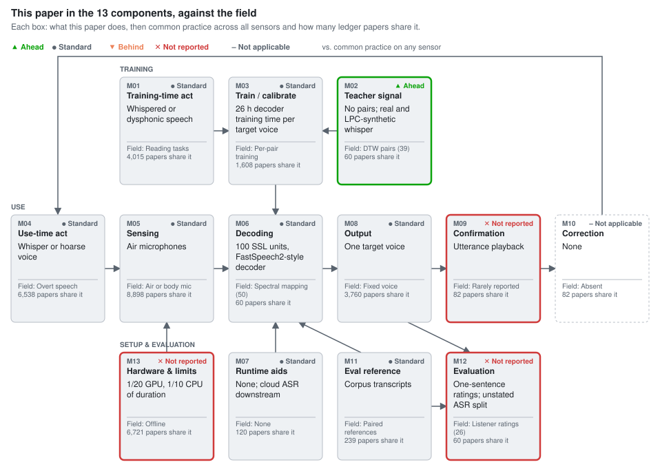

# WESPER: Zero-shot and Realtime Whisper to Normal Voice Conversion for Whisper-based Speech Interactions

Jun Rekimoto. CHI '23, 2023. DOI: [10.1145/3544548.3580706](https://doi.org/10.1145/3544548.3580706) · arXiv: [2303.01639](https://arxiv.org/abs/2303.01639)

**Section:** [Acoustic, whisper & wearable motion sensors](../../README.md#acoustic-whisper--wearable-motion-sensors)

## Figures

### This paper in the 13 components, against the field

<picture><source media="(prefers-color-scheme: dark)" srcset="figures/components-dark.svg"></picture>

Verdicts compare the paper's choice for each component with common practice across 8,995 ledger entries on any sensor (silent speech, brain-to-text, lip reading).

Data

| Component | This paper | Common practice | Papers with this practice | Verdict |
| --- | --- | --- | --- | --- |
| M01 Training-time act | Whispered or dysphonic speech | Reading tasks | 4,015 of 8,995 | ● Standard (Inherited.) |
| M02 Teacher signal | No pairs; real and LPC-synthetic whisper | DTW pairs (39) | 60 of 8,995 | ▲ Ahead (Earliest pair-free converter in the population; deciding priors all pair.) |
| M03 Train / calibrate | 26 h decoder training time per target voice | Per-pair training | 1,608 of 8,995 | ● Standard (Zero-shot for the input speaker only.) |
| M04 Use-time act | Whisper or hoarse voice | Overt speech | 6,538 of 8,995 | ● Standard (Inherited.) |
| M05 Sensing | Air microphones | Air or body mic | 8,898 of 8,995 | ● Standard (Inherited.) |
| M06 Decoding | 100 SSL units, FastSpeech2-style decoder | Spectral mapping (50) | 60 of 8,995 | ● Standard (Departs from spectral mapping; never compared with a conversion baseline.) |
| M07 Runtime aids | None; cloud ASR downstream | None | 120 of 8,995 | ● Standard (Inherited.) |
| M08 Output | One target voice | Fixed voice | 3,760 of 8,995 | ● Standard (Inherited.) |
| M09 Confirmation | Utterance playback | Rarely reported | 82 of 8,995 | ✕ Not reported (Push-to-talk playback described (§4); its use is never evaluated.) |
| M10 Correction | None | Absent | 82 of 8,995 | – Not applicable (No correction loop.) |
| M11 Eval reference | Corpus transcripts | Paired references | 239 of 8,995 | ● Standard (Inherited.) |
| M12 Evaluation | One-sentence ratings; unstated ASR split | Listener ratings (26) | 60 of 8,995 | ✕ Not reported (Split, utterance count and ASR setup missing.) |
| M13 Hardware & limits | 1/20 GPU, 1/10 CPU of duration | Offline | 6,721 of 8,995 | ✕ Not reported (No latency measured.) |

## Verdict

WESPER [[1]](#ref-1) changes two components: training without paired recordings (M02), which is ahead, and conversion through self-supervised units (M06), which is standard because it is never compared with a spectral or paired baseline. Later work also trains on synthetic whisper without real pairs [[2]](#ref-2). The speech-recognition claim is the weakest: conversion lowers cloud-ASR WER from 44.70% to 26.68% on an unstated wTIMIT subset that pretraining also used, while its own Table 2 gives 13.75% without conversion for a HuBERT recognizer fine-tuned on labelled wTIMIT speech. "Zero-shot" covers the input speaker only, since each target voice needs 26 hours of decoder training time, and "realtime" is an utterance-level processing ratio without latency (M13). The disorder results rest on five and four speakers, one sentence each, rated for quality rather than intelligibility.

## Against the field, component by component

### M02 Training-only supervision: whisper and normal pairing

**Usual approach:** Of 60 unique studies converting whispered, murmured or alaryngeal speech to voiced speech, 39 train on time-aligned parallel pairs (pattern match, Appendix). DTW is the usual alignment [[3]](#ref-3). WESPER uses none: its encoder is pretrained on 960 hours of Librispeech, an LPC-simulated whisper copy of it, and 58 hours of wTIMIT (§3.1).

**State of the art:** FlowW2N (2026) [[2]](#ref-2) [later] also avoids real pairs, training on synthetic whisper (one of four simulators is WESPER's LPC tool), and reaches 14.0% WER on 1,404 held-out wTIMIT utterances against 26.0% for QuickVC trained on real pairs (NeMo, Table 1); fine-tuning on real pairs fails (102% WER, 79.9% after DTW).

The deciding priors all pair: AGAN-W2SC [[3]](#ref-3) and its GMM, BLSTM and CycleGAN baselines train on DTW-aligned pairs (§III); Niranjan et al. [[4]](#ref-4) train on 18,620 parallel utterances and use non-parallel Librispeech only for pretraining (§4.1, §5.1); the [concurrent] converters of Wagner et al. [[5]](#ref-5) align pairs by DTW. Pre-WESPER studies among the 15 unpaired pattern matches (Appendix) mention non-parallel data only in related work or pretraining. WESPER's converter is tested on three corpora (§5.2–5.4) with 50 raters per study. Verdict: ahead. It shows pairs are unnecessary, not that dropping them is free: no paired baseline uses the same data.

### M06 Processing: intermediate representation

**Usual approach:** 50 of the 60 studies map frame-level spectral features (pattern match, Appendix). WESPER maps through 100 discrete units and 256-dimensional vectors every 20 ms (§3.1).

**State of the art:** FlowW2N (2026) [later] finds that SSL-unit converters such as WESPER raise WER above the input whisper; with NeMo on wTIMIT, its HuBERT-Soft comparator scores 37.5%, FlowW2N 14.0%, raw whisper 8.3% (Table 1).

Before WESPER, the only study in the population using self-supervised features is the [concurrent] Wagner et al., only for evaluation (Appendix). Verdict: standard. The design departs from spectral mapping, but is never isolated: no spectral baseline, no ablation of unit count or synthetic-whisper share, no repeated runs. Even FlowW2N, the strongest converter in the ledger, loses to raw whisper, 14.0% against 8.3%.

### M12 Evaluation: test conditions

**Usual approach:** Listener ratings appear in 26 of the 60 studies, ASR error in 20, listener transcription in 4 (pattern match, Appendix); WESPER uses ratings plus ASR.

**State of the art:** FlowW2N (2026) [later] scores the full wTIMIT US test set with two open recognizers and raw-whisper references [[2]](#ref-2).

WESPER does not state the wTIMIT split, utterance count, recognizer version or text normalization (§5.2), and rates one sentence across four speaker sets (§5.1). Verdict: not reported.

## The 13 components

| Component | This paper | Usual approach (count) | State of the art | Verdict |
|---|---|---|---|---|
| M01 Training-time action | Whispered or dysphonic speech | Reading tasks (slot-filled 4,015) | – | standard |
| M02 Training-only supervision | No pairs; real and LPC-synthetic whisper | DTW pairs (39) (pattern match 60) | 14.0% WER [[2]](#ref-2) | ahead |
| M03 Training and adaptation | 26 h decoder training time per target voice | Per-pair training (slot-filled 1,608) | – | standard |
| M04 Use-time action | Whisper or hoarse voice | Overt speech (slot-filled 6,538) | – | standard |
| M05 Sensors | Air microphones | Air or body mic (slot-filled 8,898) | – | standard |
| M06 Processing and decoding | 100 SSL units, FastSpeech2-style decoder | Spectral mapping (50) (pattern match 60) | 14.0% WER [[2]](#ref-2) | standard |
| M07 Lexicon and LM | None; cloud ASR downstream | None (slot-filled 120) | – | standard |
| M08 Output | One target voice | Fixed voice (slot-filled 3,760) | – | standard |
| M09 Confirmation | Utterance playback | Rarely reported (slot-filled 82) | – | not reported |
| M10 Correction | None | Absent (slot-filled 82) | – | not applicable |
| M11 Reference construction | Corpus transcripts | Paired references (slot-filled 239) | – | standard |
| M12 Evaluation | One-sentence ratings; unstated ASR split | Listener ratings (26) (pattern match 60) | 1,404-utterance test set [[2]](#ref-2) | not reported |
| M13 Device and cost | 1/20 GPU, 1/10 CPU of duration | Offline (slot-filled 6,721) | – | not reported |

## Where the claims outrun the evidence

- Conversion cuts Google WER by 40% relative, but HuBERT fine-tuned on labelled wTIMIT speech reaches 13.75% without conversion, about half the converted WER (inference); fine-tuned on Librispeech only, it gives 33.06% (Table 2). Recognizers differ, so no row isolates conversion; Niranjan et al. [[4]](#ref-4) had found whisper augmentation beneficial for ASR.
- wTIMIT whisper is in pretraining (§3.1), in the 13.75% recognizer's fine-tuning and in the ASR test (Table 2), with no stated split.
- "Natural prosody preserved" rests on 3.43 versus 3.31 for whisper (Table 3), not significant in Fig. 8.
- "Improved intelligibility" comes from quality ratings, not transcription (§5.3); for hearing-impaired speaker S2′, MUSHRA falls from 20.76 to 20.05 (Table 3), which also labels the converted S5 row WESPER[S4].
- The authors call language independence a possibility, from one German sentence (§5.3).

## What the field needs next

- M02: train one encoder with and without real pairs, and with real versus synthetic whisper, on a held-out wTIMIT test set.
- M06: score unit, spectral and flow converters against the raw-whisper WER of the same open recognizer.
- M12: test dysphonic and hearing-impaired speakers by listener transcription over many sentences.

## Questions for the authors

- Which wTIMIT utterances and speakers form the Table 2 test set, and were they in pretraining or fine-tuning?
- Which Google model and settings were used, and how was text normalized?
- How much speech trained the target-voice decoder, and is it disjoint from the rated sentences?
- How many trials per rater, in what order, with what exclusions?

## Appendix: literature search

- M02 whisper-to-normal-training-pairing. Inclusion rule: studies that convert whispered, non-audible-murmur or other unvoiced or alaryngeal speech, captured acoustically or by body conduction, into voiced speech audio, classified by supervision (time-aligned pairs, unpaired data, synthetic whisper); whispered-speech recognition without audio output, normal-to-whisper synthesis, speaker verification and non-acoustic inputs excluded; versions counted once. Slot-filled (M02 ledger slot) 31 unique studies; pattern match 60 unique studies. Usual design: parallel DTW-aligned pairs, 39 (pattern match). Design counts (pattern match, full text): parallel pairs 39, unpaired 15, synthetic whisper 8; M03 supervision_kind=paired_audio 15 (slot-filled). Read in full: [[2]](#ref-2), [[3]](#ref-3), [[4]](#ref-4), [[5]](#ref-5), target. Known-item recall 1.0.
- M06 whisper-conversion-intermediate-representation. Inclusion rule: the same population, classified by intermediate representation (spectral features, self-supervised units or features, ASR-to-TTS cascade); an SSL model used only for evaluation does not count. Slot-filled (M06 ledger slot, whole wiki) 7,345 unique studies; pattern match 60 unique studies. Usual design: spectral feature mapping, 50 (pattern match). Design counts (pattern match, full text): spectral mapping 50, self-supervised features 18, ASR-to-TTS cascade 7. Read in full: [[2]](#ref-2), [[3]](#ref-3), [[4]](#ref-4), [[5]](#ref-5), target. Known-item recall 1.0.
- M12 whisper-conversion-evaluation. Inclusion rule: the same population, classified by evaluation measure (listener ratings, spectral distance, ASR error, listener transcription); a study counts under every measure it reports. Slot-filled (M12 ledger slot, whole wiki) 6,960 unique studies; pattern match 60 unique studies. Usual design: listener ratings, 26 (pattern match). Design counts: listener ratings 26, spectral distance 20, ASR WER or CER 20, listener transcription 4. Read in full: [[2]](#ref-2), [[3]](#ref-3), [[4]](#ref-4), target.

## References

Numbered by first citation. BibTeX in the same order and keys: [refs.bib](refs.bib).

1. Rekimoto, J. “WESPER: Zero-shot and Realtime Whisper to Normal Voice Conversion for Whisper-based Speech Interactions.” *Proceedings of the 2023 CHI Conference on Human Factors in Computing Systems (CHI '23)*, 2023. doi:[10.1145/3544548.3580706](https://doi.org/10.1145/3544548.3580706). arXiv:[2303.01639](https://arxiv.org/abs/2303.01639). Target. arXiv v1. [review](https://github.com/supernaiter/silent-speech-review/tree/main/reviews/wesper-zero-shot-and-realtime-whisper-to-normal-voice-conversion-for-whisper-based-speech-interactions) [wiki: arxiv-2303.01639](https://github.com/supernaiter/deep-research-wiki-for-silent-speech/blob/main/papers/arxiv-2303.01639/article.md) [wiki: doi-10.1145-3544548.3580706](https://github.com/supernaiter/deep-research-wiki-for-silent-speech/blob/main/papers/doi-10.1145-3544548.3580706/article.md)
2. Ritter-Gutierrez, F., Jalal, M. A., Peso Parada, P., Saravanan, K., Shul, Y., Kim, M., et al. “FlowW2N: Whispered-to-Normal Speech Conversion via Flow-Matching.” *arXiv preprint*, 2026. arXiv:[2603.04296](https://arxiv.org/abs/2603.04296). [later] [wiki: arxiv-2603.04296](https://github.com/supernaiter/deep-research-wiki-for-silent-speech/blob/main/papers/arxiv-2603.04296/article.md)
3. Gao, T., Zhou, J., Wang, H., Tao, L., Kwan, H. K. “Attention-Guided Generative Adversarial Network for Whisper to Normal Speech Conversion.” *arXiv preprint*, 2021. arXiv:[2111.01342](https://arxiv.org/abs/2111.01342). [wiki: arxiv-2111.01342](https://github.com/supernaiter/deep-research-wiki-for-silent-speech/blob/main/papers/arxiv-2111.01342/article.md)
4. Niranjan, A., Sharma, M. C., Gutha, S. B. C., Shaik, M. A. B. “End-to-End Whisper to Natural Speech Conversion using Modified Transformer Network.” *arXiv preprint*, 2020. arXiv:[2004.09347](https://arxiv.org/abs/2004.09347). [wiki: arxiv-2004.09347](https://github.com/supernaiter/deep-research-wiki-for-silent-speech/blob/main/papers/arxiv-2004.09347/article.md)
5. Wagner, D., Bayerl, S. P., Cordourier Maruri, H. A., Bocklet, T. “Generative Models for Improved Naturalness, Intelligibility, and Voicing of Whispered Speech.” *2022 IEEE Spoken Language Technology Workshop (SLT)*, 2023. doi:[10.1109/SLT54892.2023.10022796](https://doi.org/10.1109/SLT54892.2023.10022796). arXiv:[2212.01775](https://arxiv.org/abs/2212.01775). [concurrent] [wiki: arxiv-2212.01775](https://github.com/supernaiter/deep-research-wiki-for-silent-speech/blob/main/papers/arxiv-2212.01775/article.md)

## Materials

Data behind this review. Full texts of the papers are not included.

- [`review.md`](review.md): the review text (source)
- [`refs.bib`](refs.bib): references (BibTeX)
- [`slots.json`](slots.json): for each of the 13 components: this paper's choice, field practice, number of matching papers, verdict
- [`figures.json`](figures.json): figure definitions
- [`evaluation.md`](evaluation.md): independent evaluation by a second reviewer
- [`triage.md`](triage.md): how each evaluation finding was checked against the sources and resolved
- [`components/M02/whisper-to-normal-training-pairing.csv`](../../components/M02/whisper-to-normal-training-pairing.csv): M02 topic "whisper-to-normal-training-pairing", every candidate paper with its decision (31 slot-filled, 60 pattern match, usual design in 39, 5 read in full)
- [`components/M06/whisper-conversion-intermediate-representation.csv`](../../components/M06/whisper-conversion-intermediate-representation.csv): M06 topic "whisper-conversion-intermediate-representation", every candidate paper with its decision (7345 slot-filled, 60 pattern match, usual design in 50, 5 read in full)
- [`components/M12/whisper-conversion-evaluation.csv`](../../components/M12/whisper-conversion-evaluation.csv): M12 topic "whisper-conversion-evaluation", every candidate paper with its decision (6960 slot-filled, 60 pattern match, usual design in 26, 4 read in full)

## More reviews in Acoustic, whisper & wearable motion sensors

- [EchoSpeech: Continuous Silent Speech Recognition on Minimally-obtrusive Eyewear Powered by Acoustic Sensing](../echospeech-continuous-silent-speech-recognition-on-minimally-obtrusive-eyewear-powered-by-acoustic/) (2023). Glasses-mounted inaudible FMCW sonar recognizes silent speech from facial skin echoes: 4.5% WER on 31 commands and 6.1% on connected digits in 12 users, with walking/noise tests and a 73.3 mW demo.
- [Unvoiced: Designing an LLM-assisted Unvoiced User Interface using Earables](../unvoiced-designing-an-llm-assisted-unvoiced-user-interface-using-earables/) (2024). Twin-IMU earable captures jaw motion during unvoiced speech; spectrograms are transcribed by Whisper and gaps filled by GPT-4, giving 93-99% task completion and 0.07-0.14 WER across 19 users.
- [EarCommand: "Hearing" Your Silent Speech Commands In Ear](../earcommand-hearing-your-silent-speech-commands-in-ear/) (2022). Earphone SSI senses ear-canal deformation with inaudible in-ear echoes to recognize silently mouthed commands; abstract reports 10.02% WER on 32 word commands and 12.33% on 25 sentence commands.
- [Poster: Recognizing Hidden-in-the-Ear Private Key for Reliable Silent Speech Interface Using Multi-Task Learning](../poster-recognizing-hidden-in-the-ear-private-key-for-reliable-silent-speech-interface-using-mult/) (2025). Sensing, shared model and joint word-plus-identity output are each standard; whisper adds nothing over the 91.4% ultrasonic-only baseline, and impostors are training participants (M12 behind).
- [Silent Speech Sentence Recognition with Six-Axis Accelerometers using Conformer and CTC Algorithm](../silent-speech-sentence-recognition-with-six-axis-accelerometers-using-conformer-and-ctc-algorith/) (2025). CTC decoder (M06), concatenated training sentences (M03) and six IMUs (M05) are standard: CTC silent-phrase decoding predates it; 97.17% is a word ratio on 4 people, split unstated.
- [End-to-End Silent Speech Recognition with Acoustic Sensing](../end-to-end-silent-speech-recognition-with-acoustic-sensing/) (2021). Standard on sensing and decoding: phone-sonar phase features and an attention decoder work on 54 mouthed sentences of 29 words; the cross-user claim rests on tuning data that include the test users.

---

Part of the [Silent Speech Interface Review](https://github.com/supernaiter/silent-speech-review). Found an error? [Open an issue](https://github.com/supernaiter/silent-speech-review/issues/new?template=correction.yml).
