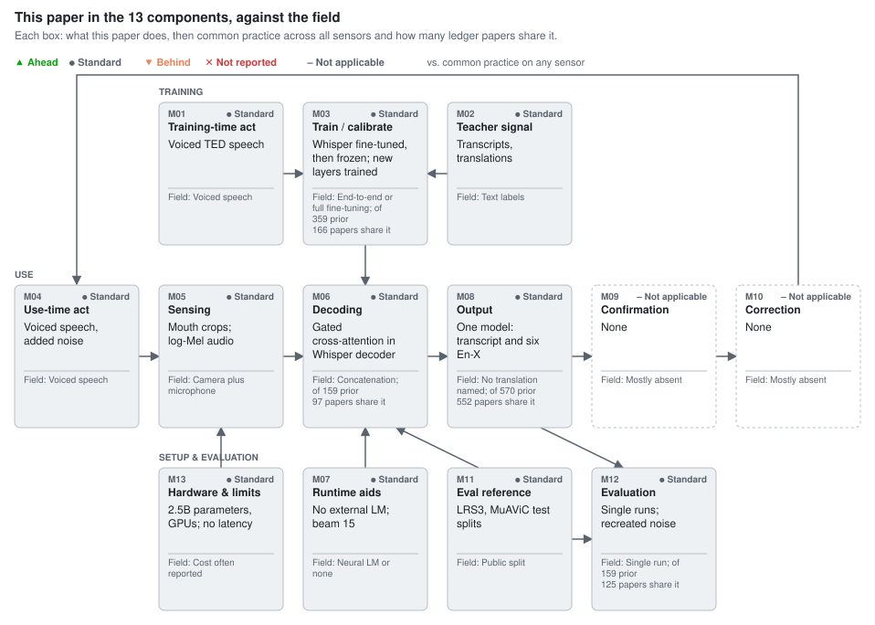

# Whisper-Flamingo: Integrating Visual Features into Whisper for Audio-Visual Speech Recognition and Translation

Andrew Rouditchenko, Yuan Gong, Samuel Thomas, Leonid Karlinsky, Hilde Kuehne, Rogerio Feris, James Glass. Interspeech 2024. [doi:10.21437/Interspeech.2024-322](https://doi.org/10.21437/Interspeech.2024-322) [arXiv:2406.10082](https://arxiv.org/abs/2406.10082)

**Section:** [Other sensors](../../README.md#other-sensors)

## Figures

### This paper in the 13 components, against the field

<picture><source media="(prefers-color-scheme: dark)" srcset="figures/components-dark.svg"></picture>

Verdicts compare the paper's choice for each component with common practice across 8,995 ledger entries on any sensor (silent speech, brain-to-text, lip reading).

Data

| Component | This paper | Common practice | Papers with this practice | Verdict |
| --- | --- | --- | --- | --- |
| M01 Training-time act | Voiced TED speech | Voiced speech |  | ● Standard (Inherited.) |
| M02 Teacher signal | Transcripts, translations | Text labels |  | ● Standard (Inherited.) |
| M03 Train / calibrate | Whisper fine-tuned, then frozen; new layers trained | End-to-end or full fine-tuning; of 359 prior | 166 of 359 | ● Standard (As [@seo2023avformer]; [@simic2024adaptiveav] [concurrent].) |
| M04 Use-time act | Voiced speech, added noise | Voiced speech |  | ● Standard (Inherited.) |
| M05 Sensing | Mouth crops; log-Mel audio | Camera plus microphone |  | ● Standard (Inherited.) |
| M06 Decoding | Gated cross-attention in Whisper decoder | Concatenation; of 159 prior | 97 of 159 | ● Standard (Fusion vs freezing confounded; one run.) |
| M07 Runtime aids | No external LM; beam 15 | Neural LM or none |  | ● Standard (Inherited.) |
| M08 Output | One model: transcript and six En-X | No translation named; of 570 prior | 552 of 570 | ● Standard (Per-pair prior [@anwar2023muavic].) |
| M09 Confirmation | None | Mostly absent |  | – Not applicable (Offline.) |
| M10 Correction | None | Mostly absent |  | – Not applicable (Offline.) |
| M11 Eval reference | LRS3, MuAViC test splits | Public split |  | ● Standard (Inherited.) |
| M12 Evaluation | Single runs; recreated noise | Single run; of 159 prior | 125 of 159 | ● Standard (Clean gain depends on beam.) |
| M13 Hardware & limits | 2.5B parameters, GPUs; no latency | Cost often reported |  | ● Standard (No inference latency.) |

## Verdict

The paper [[1]](#ref-1) changes three components, all standard. M06, gated cross-attention to lip features inside a frozen audio-only decoder, is new in that position (Appendix), but its edge over early fusion is one Whisper-Medium run in which only early fusion is unfrozen (Table 2, Sec. 3.2). M03, a frozen recognizer with trained visual layers, follows AVFormer [[2]](#ref-2) and the [concurrent] Adaptive AV [[3]](#ref-3). M08, one model for English and six En-X directions, widens scope over per-pair models [[4]](#ref-4), not noisy BLEU (20.5 against 20.8, non-identical noise, Table 4). The clean gain, 2.3% to 1.5% (Sec. 3.3), rested on beam 15; the authors' revision drops it, with near parity at beam 1 (arXiv v3, Table 3).

## Against the field, component by component

### M06 Processing: gated cross-attention into a pretrained decoder

**Usual approach:** Of 159 prior AVSR studies, 97 name concatenation, 14 cross-modal attention, none gated cross-attention (pattern match, Appendix), the common design per the authors (Sec. 2). Whisper-Flamingo adds zero-initialised tanh-gated attention to lip features in each decoder block of a frozen Whisper (Sec. 2).

**State of the art:** DoubleHelix (2026) [later] reports 3.8% WER at 0 dB babble on LRS3 (3B LLM over frozen encoders, 1,759 h, unspecified babble file, single runs), AVGER 3.7% in the same table [[5]](#ref-5); Whisper-Flamingo gives 5.6% at 433 h and 1,759 h (arXiv v3), on another noise file.

TM-seq2seq attended separately to audio and video in each decoder layer [[6]](#ref-6) (Sec. 3.4); AVFormer fed full-frame tokens to a frozen recognizer [[2]](#ref-2); Adaptive AV fuses lips and audio in front of a frozen Whisper [[3]](#ref-3). New is the place: gated attention inside the frozen decoder; 12 [later] AVSR studies name gated cross-attention (Appendix). At 0 dB, early fusion scores 10.0% and gated cross-attention 7.0%, one Medium run each (Table 2), design and freezing confounded; encoder insertion is only "significantly worse" (Sec. 2). The gain over audio-only repeats across sizes and datasets (Tables 2 to 4); over other fusions it does not. Verdict: standard.

### M03 Training: freeze the fine-tuned recognizer, train the new layers

**Usual approach:** Of 359 prior VSR/AVSR studies, 166 name end-to-end or full fine-tuning, 15 a frozen pretrained encoder, 9 adapters or prompt tuning (pattern match, Appendix). Whisper-Flamingo fine-tunes Whisper on noisy audio, freezes it and adds 630M trained parameters (Sec. 3.1).

**State of the art:** DoubleHelix (2026) [later] keeps both encoders frozen and reaches 0.68% clean LRS3 WER with 1,759 h [[5]](#ref-5); the revision's audio-only Whisper also reaches 0.68% (arXiv v3), so clean LRS3 does not rank training regimes.

AVFormer froze the speech model and trained adapters and a projection [[2]](#ref-2) (Sec. 3); Adaptive AV trains a lip fusion module before a frozen Whisper [[3]](#ref-3); FAVA adapts audio-only BEST-RQ by early fusion (Sec. 2). Freezing "helps retain its strong audio skills" (Sec. 3.2), but no unfrozen gated variant is shown. Verdict: standard.

### M08 Output: one model for transcription and En-X translation

**Usual approach:** 552 of 570 prior VSR/AVSR studies name no speech translation or BLEU (pattern match, lower bound, Appendix). The 2 prior translation systems are MuAViC's bilingual AV-HuBERT, fine-tuned per pair (Sec. 3.4) [[4]](#ref-4), and MixSpeech, from lip video [[7]](#ref-7). Whisper-Flamingo uses one parameter set (Table 4).

**State of the art:** MTC-AVSR (2026) [later] also uses one model, for four directions, trained with MUSAN babble; at 0 dB it reports BLEU 25.2, 23.5, 20.3, 20.5 (Es, Fr, It, Pt) against 25.4, 22.4, 19.3, 19.9 for Whisper-Flamingo Large (its table), ahead except Spanish, on non-identical noise [[8]](#ref-8).

[Concurrent] VSP-LLM, XLAVS-R and SynesLM translate too (Appendix). Video lifts noisy average BLEU from 18.6 to 20.5 (Table 4). The clean lead over bilingual AV-HuBERT, 22.9 against 21.9, the authors trace to Whisper, 22.7 audio-only (Sec. 3.4). Verdict: standard.

### M12 Evaluation: noise files, beam size, single runs (incidental)

**Usual approach:** 125 of 159 prior AVSR studies show no run-variability pattern (pattern match, lower bound, Appendix); so does this paper; its code fixes seed 3407.

**State of the art:** USR 2.0 (2026) [later] reports mean and standard deviation over three random seeds, for Base low-resource runs [[9]](#ref-9). Verdict: standard.

## The 13 components

| Component | This paper | Usual approach (count) | State of the art | Verdict |
|---|---|---|---|---|
| M01 Training-time action | Voiced TED speech | Voiced speech | – | standard |
| M02 Training-only supervision | Transcripts, translations | Text labels | – | standard |
| M03 Training and adaptation | Whisper fine-tuned, then frozen; new layers trained | End-to-end or full fine-tuning; of 359 prior (pattern match 166) | [[5]](#ref-5) 0.68%, frozen encoders [later] | standard |
| M04 Use-time action | Voiced speech, added noise | Voiced speech | – | standard |
| M05 Sensors | Mouth crops; log-Mel audio | Camera plus microphone | – | standard |
| M06 Processing and decoding | Gated cross-attention in Whisper decoder | Concatenation; of 159 prior (pattern match 97) | [[5]](#ref-5) 3.8% at 0 dB, other noise file [later] | standard |
| M07 Lexicon and LM | No external LM; beam 15 | Neural LM or none | – | standard |
| M08 Output | One model: transcript and six En-X | No translation named; of 570 prior (pattern match 552) | [[8]](#ref-8) one model, 4 directions, MUSAN babble [later] | standard |
| M09 Confirmation | None | Mostly absent | – | not applicable |
| M10 Correction | None | Mostly absent | – | not applicable |
| M11 Reference construction | LRS3, MuAViC test splits | Public split | – | standard |
| M12 Evaluation | Single runs; recreated noise | Single run; of 159 prior (pattern match 125) | [[9]](#ref-9) three seeds, Base [later] | standard |
| M13 Device and cost | 2.5B parameters, GPUs; no latency | Cost often reported | – | standard |

## Where the claims outrun the evidence

- The clean LRS3 gain (2.3% to 1.5%, Sec. 3.3) compared beam-15 decodes; at beam 1 the authors' revision gives 1.1% against 1.0% and drops the claim (arXiv v3, Table 3).
- "Slightly better" than AV-HuBERT (5.6% against 5.8%, Sec. 3.3) uses recreated noise, as the authors note; their revision finds AV-HuBERT and CMA ahead at SNR ≤ 0 (arXiv v3, App. 8.2).
- "Significantly" (Sec. 1) has no test or seeds; the revision allows seed effects (arXiv v3, App. 8.2).
- u-HuBERT (4.6%) is best but untested, its weights being private, as the authors say (Sec. 3.3).

## What the field needs next

- M06: early fusion, encoder insertion and gated decoder attention under one freezing regime, with seeds.
- M12: other groups testing on the authors' released noise files, at beam 1 and beam N.
- M03: an unfrozen gated variant at equal steps.

## Questions for the authors

- Unfrozen, does gated attention still beat early fusion?
- How many MuAViC test utterances per language enter Table 4?
- How much do results vary across seeds?

## Appendix: literature search

- Setting: sentence-level AVSR on LRS3 and audio-visual En-X translation on MuAViC. Dated against 2024-06 at month level: prior before 2023-12, [concurrent] 2023-12 to 2024-12, [later] after 2024-12. Counts are full-text pattern matches with related-work mentions; positive counts are upper bounds, complements (552, 125) lower bounds; versions once by key, target excluded.
- M06, avsr-stream-fusion-and-weighting (published table, appended). Inclusion rule: the published rule (AVSR studies classified by fusion design). Ledger counts: 7,345 unique studies slot-filled for M06; 349 unique studies pattern match (348 without the target). Prior 159: concatenation 97, cross-modal attention 14, gated cross-attention 0, Whisper, USM or BEST-RQ named 5. [Concurrent] 29: gated cross-attention 0. [Later] 100: gated cross-attention 12. Read: [[6]](#ref-6), [[2]](#ref-2), [[10]](#ref-10) (prior); [[3]](#ref-3) ([concurrent]); [[5]](#ref-5) (state of the art). Known-item recall 1.0.
- M03, frozen-encoder-parameter-efficient-training-vsr (published table, appended). Inclusion rule: the published rule (VSR/AVSR studies classified by training regime). Ledger counts: 1,526 unique studies slot-filled for M03; 740 unique studies pattern match (739 without the target). Prior 359: end-to-end or full fine-tuning 166, frozen encoder 15, adapters or prompt tuning 9, LoRA 1. Read: [[2]](#ref-2) (prior); [[3]](#ref-3) ([concurrent]); [[5]](#ref-5) (state of the art). Known-item recall 1.0.
- M08, audio-visual-speech-translation-output (new). Inclusion rule: VSR/AVSR studies whose full text names speech-to-text translation or BLEU, classified by hand into translation systems from lip or audio-visual input versus BLEU as a transcription metric or a mention; speech-to-speech and sign-language translation are out. Ledger counts: 3,268 unique studies slot-filled for M08; 1,049 unique studies pattern match. Prior 570: translation pattern 18, translation systems 2. [Concurrent] 53: translation pattern 7, including VSP-LLM, XLAVS-R and SynesLM. Read: [[4]](#ref-4), [[7]](#ref-7) (prior); [[8]](#ref-8) (state of the art). Known-item recall 1.0.
- M12, avsr-noise-and-run-variability-protocol (published table, appended). Inclusion rule: the published rule and regexes over the AVSR population. Ledger counts: 6,960 unique studies slot-filled for M12; 349 unique studies pattern match. Prior 159: run-variability pattern 34, babble 54, LRS3 38. Read: [[9]](#ref-9) (state of the art). Known-item recall 1.0.

## References

Numbered by first citation. BibTeX in the same order and keys: [refs.bib](refs.bib).

1. Rouditchenko, A., Gong, Y., Thomas, S., Karlinsky, L., Kuehne, H., Feris, R., et al. “Whisper-Flamingo: Integrating Visual Features into Whisper for Audio-Visual Speech Recognition and Translation.” *Interspeech 2024*, 2024, 2420-2424. doi:[10.21437/Interspeech.2024-322](https://doi.org/10.21437/Interspeech.2024-322). arXiv:[2406.10082](https://arxiv.org/abs/2406.10082). Reviewed version: Interspeech 2024 proceedings. arXiv v3 (2024-11-19) adds beam-1 and 1,759 h rows and an appendix on noise types; cited as 'arXiv v3'. [wiki: in24-whisperflamingo](https://github.com/supernaiter/deep-research-wiki-for-silent-speech/blob/main/papers/in24-whisperflamingo/article.md) [wiki: isca-rouditchenko24-whisperflamingo](https://github.com/supernaiter/deep-research-wiki-for-silent-speech/blob/main/papers/isca-rouditchenko24-whisperflamingo/article.md) [wiki: isca-rouditchenko24_interspeech](https://github.com/supernaiter/deep-research-wiki-for-silent-speech/blob/main/papers/isca-rouditchenko24_interspeech/article.md) [wiki: arxiv-2406.10082](https://github.com/supernaiter/deep-research-wiki-for-silent-speech/blob/main/papers/arxiv-2406.10082/article.md)
2. Seo, P. H., Nagrani, A., Schmid, C. “AVFormer: Injecting Vision into Frozen Speech Models for Zero-Shot AV-ASR.” *IEEE/CVF Conference on Computer Vision and Pattern Recognition (CVPR)*, 2023. <https://openaccess.thecvf.com/content/CVPR2023/papers/Seo_AVFormer_Injecting_Vision_Into_Frozen_Speech_Models_for_Zero-Shot_AV-ASR_CVPR_2023_paper.pdf> Prior; deciding prior for M03 and M06 (frozen ASR, adapters, full-frame visual tokens). [wiki: cvf-seo23-avformer](https://github.com/supernaiter/deep-research-wiki-for-silent-speech/blob/main/papers/cvf-seo23-avformer/article.md)
3. Simic, C., Bocklet, T. “Self-Supervised Adaptive AV Fusion Module for Pre-Trained ASR Models.” *IEEE International Conference on Acoustics, Speech and Signal Processing (ICASSP)*, 2024. arXiv:[2312.13873](https://arxiv.org/abs/2312.13873). [concurrent]; cited and tabulated by the target as Adaptive AV; frozen Whisper with a trained lip-audio fusion module (M03, M06). [concurrent] [wiki: arxiv-2312.13873](https://github.com/supernaiter/deep-research-wiki-for-silent-speech/blob/main/papers/arxiv-2312.13873/article.md)
4. Anwar, M., Shi, B., Goswami, V., Hsu, W., Pino, J., Wang, C. “MuAViC: A Multilingual Audio-Visual Corpus for Robust Speech Recognition and Robust Speech-to-Text Translation.” *Interspeech 2023*, 2023. doi:[10.21437/Interspeech.2023-2279](https://doi.org/10.21437/Interspeech.2023-2279). arXiv:[2303.00628](https://arxiv.org/abs/2303.00628). Prior; deciding prior for M08 (bilingual AV-HuBERT per language pair). [wiki: arxiv-2303.00628](https://github.com/supernaiter/deep-research-wiki-for-silent-speech/blob/main/papers/arxiv-2303.00628/article.md) [wiki: isca-anwar23-muavic](https://github.com/supernaiter/deep-research-wiki-for-silent-speech/blob/main/papers/isca-anwar23-muavic/article.md) [wiki: isca-anwar23_interspeech](https://github.com/supernaiter/deep-research-wiki-for-silent-speech/blob/main/papers/isca-anwar23_interspeech/article.md)
5. Cheng, Z., Tan, Z., Zhu, Z. “DoubleHelix: Structured Cross-Modal Fusion for Audio-Visual Speech Recognition with LLMs.” *arXiv preprint*, 2026. arXiv:[2607.29112](https://arxiv.org/abs/2607.29112). State of the art for M06 and M03 (LRS3 AVSR). Preprint, v1. [later] [wiki: arxiv-2607.29112](https://github.com/supernaiter/deep-research-wiki-for-silent-speech/blob/main/papers/arxiv-2607.29112/article.md) [wiki: arxiv-2607-29112-doublehelix](https://github.com/supernaiter/deep-research-wiki-for-silent-speech/blob/main/papers/arxiv-2607-29112-doublehelix/article.md) [wiki: arxiv-2607.29112-doublehelix](https://github.com/supernaiter/deep-research-wiki-for-silent-speech/blob/main/papers/arxiv-2607.29112-doublehelix/article.md)
6. Afouras, T., Chung, J. S., Senior, A., Vinyals, O., Zisserman, A. “Deep Audio-Visual Speech Recognition.” *IEEE Transactions on Pattern Analysis and Machine Intelligence*, 2018. doi:[10.1109/TPAMI.2018.2889052](https://doi.org/10.1109/TPAMI.2018.2889052). arXiv:[1809.02108](https://arxiv.org/abs/1809.02108). Prior; deciding prior for M06 (separate audio and video attention in every decoder layer). [review](https://github.com/supernaiter/silent-speech-review/tree/main/reviews/deep-audio-visual-speech-recognition) [wiki: arxiv-1809.02108](https://github.com/supernaiter/deep-research-wiki-for-silent-speech/blob/main/papers/arxiv-1809.02108/article.md) [wiki: doi-10.1109-tpami.2018.2889052](https://github.com/supernaiter/deep-research-wiki-for-silent-speech/blob/main/papers/doi-10.1109-tpami.2018.2889052/article.md)
7. Cheng, X., Jin, T., Huang, R., Li, L., Lin, W., Wang, Z., et al. “MixSpeech: Cross-Modality Self-Learning with Audio-Visual Stream Mixup for Visual Speech Translation and Recognition.” *IEEE/CVF International Conference on Computer Vision (ICCV)*, 2023. doi:[10.1109/ICCV51070.2023.01495](https://doi.org/10.1109/ICCV51070.2023.01495). arXiv:[2303.05309](https://arxiv.org/abs/2303.05309). Prior; deciding prior for M08 (translation from lip video). [wiki: arxiv-2303.05309](https://github.com/supernaiter/deep-research-wiki-for-silent-speech/blob/main/papers/arxiv-2303.05309/article.md) [wiki: cvf23-cheng_mixspeech](https://github.com/supernaiter/deep-research-wiki-for-silent-speech/blob/main/papers/cvf23-cheng_mixspeech/article.md)
8. A, L., Duan, Z., Li, J., Bao, F. “MTC-AVSR: Compressed-Token-based Audio-Visual Speech Recognition and Translation with Contrastive Language Alignment.” *Interspeech 2026*, 2026. doi:[10.21437/Interspeech.2026-266](https://doi.org/10.21437/Interspeech.2026-266). State of the art for M08 (MuAViC En-X, one model). [later] [wiki: isca-a26-mtcavsr](https://github.com/supernaiter/deep-research-wiki-for-silent-speech/blob/main/papers/isca-a26-mtcavsr/article.md) [wiki: doi-10.21437-interspeech.2026-266](https://github.com/supernaiter/deep-research-wiki-for-silent-speech/blob/main/papers/doi-10.21437-interspeech.2026-266/article.md)
9. Haliassos, A., Mira, R., Petridis, S. “Pay Attention to CTC: Fast and Robust Pseudo-Labelling for Unified Speech Recognition.” *International Conference on Learning Representations (ICLR)*, 2026. arXiv:[2602.19316](https://arxiv.org/abs/2602.19316). State of the art for the M12 run-variability protocol. [later] [wiki: arxiv-2602.19316](https://github.com/supernaiter/deep-research-wiki-for-silent-speech/blob/main/papers/arxiv-2602.19316/article.md)
10. Peng, P., Yan, B., Watanabe, S., Harwath, D. “Prompting the Hidden Talent of Web-Scale Speech Models for Zero-Shot Task Generalization.” *Interspeech 2023*, 2023. arXiv:[2305.11095](https://arxiv.org/abs/2305.11095). Prior; deciding prior for M06 (visual prompts into Whisper). [wiki: arxiv-2305.11095](https://github.com/supernaiter/deep-research-wiki-for-silent-speech/blob/main/papers/arxiv-2305.11095/article.md)

## Materials

Data behind this review. Full texts of the papers are not included.

- [`review.md`](review.md): the review text (source)
- [`refs.bib`](refs.bib): references (BibTeX)
- [`slots.json`](slots.json): for each of the 13 components: this paper's choice, field practice, number of matching papers, verdict
- [`figures.json`](figures.json): figure definitions
- [`evaluation.md`](evaluation.md): independent evaluation by a second reviewer
- [`triage.md`](triage.md): how each evaluation finding was checked against the sources and resolved
- [`process/log.json`](process/log.json): process record: each step, who did it (reader, script, writer, evaluator), when, the checks run and the input versions
- [`process/notes.json`](process/notes.json): reading notes on the target and comparator papers: claims, numbers, conditions and what is not stated, with locations
- [`process/plan.json`](process/plan.json): plan: which components the paper changes and the topics it is compared on
- [`process/draft.md`](process/draft.md): the review as first written, before the independent evaluation
- [`process/claims-draft.md`](process/claims-draft.md): claim table of the draft: every claim mapped to a note or a count
- [`process/claims.md`](process/claims.md): claim table of the published review
- [`components/M03/frozen-encoder-parameter-efficient-training-vsr.csv`](../../components/M03/frozen-encoder-parameter-efficient-training-vsr.csv): M03 topic "frozen-encoder-parameter-efficient-training-vsr", every candidate paper with its decision (1526 slot-filled, 740 pattern match, usual design in 193, 3 read in full)
- [`components/M06/avsr-stream-fusion-and-weighting.csv`](../../components/M06/avsr-stream-fusion-and-weighting.csv): M06 topic "avsr-stream-fusion-and-weighting", every candidate paper with its decision (7345 slot-filled, 349 pattern match, usual design in 26, 5 read in full)
- [`components/M08/audio-visual-speech-translation-output.csv`](../../components/M08/audio-visual-speech-translation-output.csv): M08 topic "audio-visual-speech-translation-output", every candidate paper with its decision (3268 slot-filled, 1049 pattern match, usual design in 552, 3 read in full)
- [`components/M12/avsr-noise-and-run-variability-protocol.csv`](../../components/M12/avsr-noise-and-run-variability-protocol.csv): M12 topic "avsr-noise-and-run-variability-protocol", every candidate paper with its decision (6960 slot-filled, 349 pattern match, usual design in 183, 3 read in full)

## More reviews in Other sensors

- [Online speech synthesis using a chronically implanted brain–computer interface in an individual with ALS](../online-speech-synthesis-using-a-chronically-implanted-brain-computer-interface-in-an-individual-with/) (2024). Closed-loop word synthesis (M06) from a chronic ECoG implant in ALS (M13) holds on six keywords at 80% listener accuracy; standard designs, one participant, stability untested.
- [Ultrasensitive Textile Strain Sensors Redefine Wearable Silent Speech Interfaces with High Machine Learning Efficiency](../ultrasensitive-textile-strain-sensors-redefine-wearable-silent-speech-interfaces-with-high-machine-learning-efficiency/) (2024). Standard sensor (M05) and decoder (M06): one throat strain channel, small CNN. 95.25% on 20 words, with split grouping and production mode unstated, does not show silent, session-independent decoding.
- [Large Language Models are Strong Audio-Visual Speech Recognition Learners](../large-language-models-are-strong-audio-visual-speech-recognition-learners/) (2025). Llama-AVSR is a strong engineering result but not a new design: VSP-LLM already had a frozen-encoder LoRA LLM decoder; SOTA margins are single-run and under 0.1 WER points.
- [Jointly Learning Visual and Auditory Speech Representations from Raw Data](../jointly-learning-visual-and-auditory-speech-representations-from-raw-data/) (2023). RAVEn's asymmetric momentum-teacher objective (M03) ties AV-HuBERT at Large with 30 h (32.5%); its lead comes with self-training (M02), whose pseudo-label decoding is not stated.
- [Semantic reconstruction of continuous language from non-invasive brain recordings](../semantic-reconstruction-of-continuous-language-from-non-invasive-brain-recordings/) (2023). LM candidates scored by encoding-model likelihood (M06) were ahead in 2022, as the authors claim; the scorer is now overtaken. GPT prior (M07) is standard; one pilot-touched test story limits M12.
- [Generalizable spelling using a speech neuroprosthesis in an individual with severe limb and vocal paralysis](../generalizable-spelling-using-a-speech-neuroprosthesis-in-an-individual-with-severe-limb-and-vocal-pa/) (2022). Silent NATO code-word spelling (M04), closed-lexicon beam search (M07) and a hand-squeeze stop (M09) are standard; one participant, and >9,000 words only offline.

---

Part of the [Silent Speech Interface Review](https://github.com/supernaiter/silent-speech-review). Found an error? [Open an issue](https://github.com/supernaiter/silent-speech-review/issues/new?template=correction.yml).
