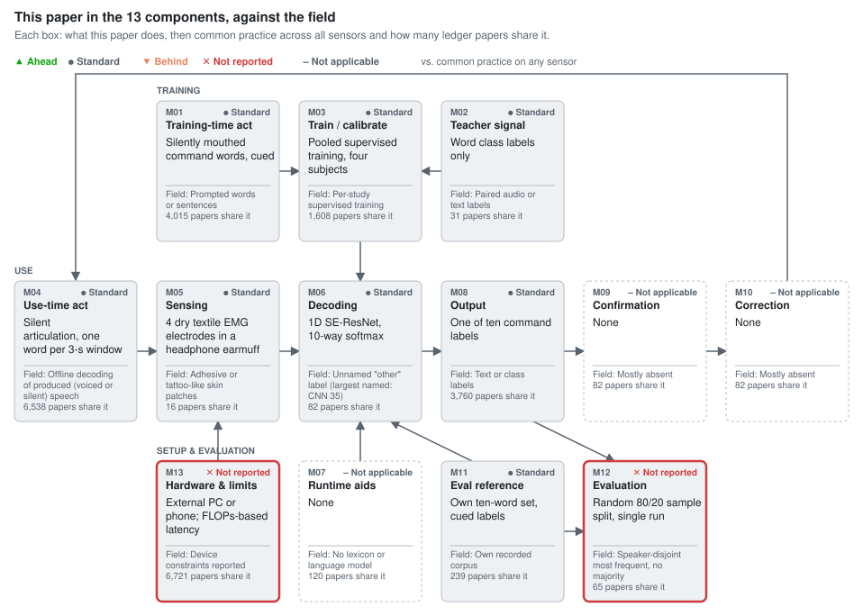

# Wireless Silent Speech Interface Using Multi-Channel Textile EMG Sensors Integrated into Headphones

Tang, C., Mallah, J., Kazieczko, D., Yi, W., Kandukuri, T. R., Occhipinti, E., Mishra, B., Mehta, S., Occhipinti, L. G. · arXiv preprint · 2025 · [arXiv:2504.13921](https://arxiv.org/abs/2504.13921)

**Section:** [Surface EMG](../../README.md#surface-emg)

## Figures

### This paper in the 13 components, against the field

<picture><source media="(prefers-color-scheme: dark)" srcset="figures/components-dark.svg"></picture>

Verdicts compare the paper's choice for each component with common practice across 8,995 ledger entries on any sensor (silent speech, brain-to-text, lip reading).

Data

| Component | This paper | Common practice | Papers with this practice | Verdict |
| --- | --- | --- | --- | --- |
| M01 Training-time act | Silently mouthed command words, cued | Prompted words or sentences | 4,015 of 8,995 | ● Standard (Shift, noise and scaling augmentation.) |
| M02 Teacher signal | Word class labels only | Paired audio or text labels | 31 of 8,995 | ● Standard (No audio or articulatory target.) |
| M03 Train / calibrate | Pooled supervised training, four subjects | Per-study supervised training | 1,608 of 8,995 | ● Standard (No calibration or adaptation step described.) |
| M04 Use-time act | Silent articulation, one word per 3-s window | Offline decoding of produced (voiced or silent) speech | 6,538 of 8,995 | ● Standard (Window alignment to each word not stated.) |
| M05 Sensing | 4 dry textile EMG electrodes in a headphone earmuff | Adhesive or tattoo-like skin patches | 16 of 8,995 | ● Standard (After a dry-electrode necklace [@wu2024necklace]; no same-word wet-electrode comparison.) |
| M06 Decoding | 1D SE-ResNet, 10-way softmax | Unnamed "other" label (largest named: CNN 35) | 82 of 8,995 | ● Standard (Attention-to-contact claim from one example (Fig. 5).) |
| M07 Runtime aids | None | No lexicon or language model | 120 of 8,995 | – Not applicable (Closed-set classifier.) |
| M08 Output | One of ten command labels | Text or class labels | 3,760 of 8,995 | ● Standard (Discrete commands only.) |
| M09 Confirmation | None | Mostly absent | 82 of 8,995 | – Not applicable (Offline study.) |
| M10 Correction | None | Mostly absent | 82 of 8,995 | – Not applicable (Offline study.) |
| M11 Eval reference | Own ten-word set, cued labels | Own recorded corpus | 239 of 8,995 | ● Standard (Per-subject counts unclear (Sec. III.A).) |
| M12 Evaluation | Random 80/20 sample split, single run | Speaker-disjoint most frequent, no majority | 65 of 8,995 | ✕ Not reported (Speaker or session separation, seeds and chance level not stated.) |
| M13 Hardware & limits | External PC or phone; FLOPs-based latency | Device constraints reported | 6,721 of 8,995 | ✕ Not reported (Measured latency and power not reported; latency is a FLOPs estimate.) |

## Verdict

The paper [[1]](#ref-1) changes the sensor (M05): four dry textile EMG electrodes in a headphone earmuff. This is standard: moving dry electrodes from the face into a worn object follows a dry-electrode necklace [[2]](#ref-2), and no condition compares the earmuff with conventional electrodes on the same words. The decoder (M06), a 1D SE-ResNet, is standard; its claimed adaptation to contact quality rests on one example (Fig. 5). The 96% on ten words comes from one random 80/20 sample split pooled over four people, without seeds, repeated runs or stated speaker separation (Sec. III.A), and rests on about 200 test samples (inference from Fig. 4). "Real-time" and "low-power" are not measured.

## Against the field, component by component

### M05 Sensors: electrodes in a worn object

**Usual approach:** among 21 speech-sensing studies whose ledger names dry, textile or worn-object electrodes (pattern match, an upper bound, non-EMG wearables included; Appendix), the most frequent electrode wording is adhesive or tattoo-like patches, 16; neck-worn objects 7, ear-worn 7, glasses or mask 5 (overlapping mentions). The paper mounts towel electrodes in an earmuff instead.

**State of the art:** in 2026 a textile scarf reaches 98.7% on five silent phrases, half the target's ten classes, in its baseline configuration (Fig. 5); its leave-one-subject-out tests on 10 subjects sit in the supplement [[3]](#ref-3) [later].

Nine months earlier, [[2]](#ref-2) put dry electrodes around the neck instead of adhesive facial ones and reported 93.9% on 11 voiced words from two speakers with all 13 electrodes (the target has four) over 10 random splits with a 95% confidence interval (Sec. 4.1); the earmuff is another worn object on that path. Its electrode evidence is impedance against wet electrodes (Sec. II.A.1), not accuracy on the words. The authors concede that earmuff contact pressure varies more than with adhesive electrodes (Sec. IV), the quantity the design must control. Verdict: standard.

### M06 Decoder: closed-set classifier with channel attention

**Usual approach:** no family dominates among the 355 of 360 closed-vocabulary word-classification studies with a ledger model family: "other" covers 82, CNN 35 (slot-filled; Appendix).

**State of the art:** in 2024, 99.6% word accuracy on day-one prompted sentences from a 50-word vocabulary, intracortical [[4]](#ref-4); a cross-signal ceiling on sentences, not isolated words. The closest surface-EMG closed-set figure here is 93.9% on 11 words [[2]](#ref-2).

The paper reads the SE weights as favouring channels 1 and 2 with stable coupling over channels 3 and 4 (Sec. III.C, Fig. 5): one example, contact quality judged from the signals rather than measured, and SE acts on feature maps, whose mapping to the four electrodes is not given (inference). The SE-ResNet against ResNet gap (Fig. 6) comes from one split without spread. Verdict: standard.

### M12 Evaluation: test split

**Usual approach:** no split protocol dominates among 143 wearable-sensor word-classification studies (pattern match, overlapping; Appendix): speaker-disjoint 65, random or k-fold 58, separate session or day 44.

**State of the art:** in 2026, 85.8% on 26 words with subject-independent folds and a re-test after re-attachment [[5]](#ref-5) [later].

Whether a subject or session sits on both sides of the split is not stated (Sec. III.A). Fig. 4 rates move in 5% steps and the off-diagonal cells sum to eight errors, consistent with 20 test samples per class, 200 in total (inference). [[2]](#ref-2) gave confidence intervals over 10 splits, a chance level of about 9% and a cross-speaker one-shot test (Sec. 4.1-4.2); the target reports neither, and chance here is 10% (inference). Verdict: not reported.

## The 13 components

| Component | This paper | Usual approach (count) | State of the art | Verdict |
|---|---|---|---|---|
| M01 Training-time action | Silently mouthed command words, cued | Prompted words or sentences (slot-filled 4,015) | – | standard |
| M02 Training-only supervision | Word class labels only | Paired audio or text labels (slot-filled 31) | – | standard |
| M03 Training and adaptation | Pooled supervised training, four subjects | Per-study supervised training (slot-filled 1,608) | – | standard |
| M04 Use-time action | Silent articulation, one word per 3-s window | Offline decoding of produced (voiced or silent) speech (slot-filled 6,538) | – | standard |
| M05 Sensors | 4 dry textile EMG electrodes in a headphone earmuff | Adhesive or tattoo-like skin patches (pattern match 16) | [[3]](#ref-3) [later]: 98.7%, five phrases, baseline configuration | standard |
| M06 Processing and decoding | 1D SE-ResNet, 10-way softmax | Unnamed "other" label (largest named: CNN 35) (slot-filled 82) | [[4]](#ref-4): 99.6%, sentences from a 50-word vocabulary, intracortical | standard |
| M07 Lexicon and LM | None | No lexicon or language model (slot-filled 120) | – | not applicable |
| M08 Output | One of ten command labels | Text or class labels (slot-filled 3,760) | – | standard |
| M09 Confirmation | None | Mostly absent (slot-filled 82) | – | not applicable |
| M10 Correction | None | Mostly absent (slot-filled 82) | – | not applicable |
| M11 Reference construction | Own ten-word set, cued labels | Own recorded corpus (slot-filled 239) | – | standard |
| M12 Evaluation | Random 80/20 sample split, single run | Speaker-disjoint most frequent, no majority (pattern match 65) | [[5]](#ref-5) [later]: 85.8%, 26 words, subject-independent | not reported |
| M13 Device and cost | External PC or phone; FLOPs-based latency | Device constraints reported (slot-filled 6,721) | – | not reported |

## Where the claims outrun the evidence

- Superiority over single-channel and non-adaptive baselines (Abstract) rests on one split with unstated baseline settings (Fig. 6, §III.D.1).
- Removing the 20-450 Hz filter lowers SE-ResNet accuracy from 96% to 76.5%, 19.5 points or 20.3% relative (inference): filtering matters, but no walking or head-movement condition tests motion robustness (Fig. 6).
- The single-channel drop of "nearly 40%" does not say points or relative (§III.D.1).
- Decoding runs on an external PC or phone over Wi-Fi; latency is a FLOPs estimate at an assumed 10 GFLOPs/ms, and no power figure backs "low-power" (§II.A.2).
- The authors name the small vocabulary and participant pool and silver-paste adhesion as limits (§IV).

## What the field needs next

- M05: the same words recorded with earmuff and wet facial electrodes, including after re-wearing.
- M12: speaker- and session-disjoint tests with repeated splits and chance level, as in [[5]](#ref-5) [later].
- M06: SE against plain ResNet over seeds, with per-channel contact impedance logged.
- M13: measured end-to-end latency and power.

## Questions for the authors

- Is "100 times among the 4 subjects" a total per word or per subject?
- Did any subject or session contribute to both training and test sets?
- What validation data selected the checkpoint in Algorithm 1?
- How were inputs normalized?

## Appendix: literature search

- M05 wearable-integrated-dry-emg-speech-sensing (new topic table). Inclusion rule: surface-EMG speech or silent-speech decoding studies whose electrodes are dry, textile or printed and mounted on a worn object or garment (headphones, earphones, around-ear frame, glasses, mask, collar or choker, headband) rather than adhesive gel electrodes placed one by one; tattoo-like or adhesive dry patches count as dry but not as integrated; wet adhesive arrays, non-speech EMG and non-EMG wearables are excluded when read; versions count once. Slot-filled 7,329 unique studies; pattern match 21 unique studies, the target's journal version included. Full-text pattern counts: adhesive or tattoo-like patch 16 (upper bound), textile or fabric 11, ear-worn 7, neck collar, choker, necklace or neckband 7, glasses or mask 5. Usual design: adhesive or tattoo-like patch, 16 (pattern match). The pattern counts are full-text mentions and overlap; adhesive wording also matches papers that name adhesives as what they avoid, and the 21 studies include non-EMG wearables (radar headset, around-ear EEG, strain sensors) that the inclusion rule excludes when read. State of the art: [[3]](#ref-3) [later]. Read in full for this topic: [[2]](#ref-2), [[3]](#ref-3). Known-item recall 0.5.
- M06 closed-vocabulary-word-classification (published topic table, reused). Inclusion rule: studies that decode words or utterances from non-acoustic signals by classifying each segment into a closed set of at most a few hundred words or utterances; the design compared is the model family. Slot-filled 7,345 unique studies; pattern match 360 unique studies. Model families among 355 classifiers: other 82, CNN 35 (slot-filled). Usual design: other model family, 82 (slot-filled). State of the art: [[4]](#ref-4). Known-item recall 0.5.
- M12 wearable-sensor-word-test-split (published topic table, reused). Inclusion rule: word or command classification studies whose ledger names a wearable non-acoustic sensor on the face or neck (strain, piezo or triboelectric sensor, surface EMG, accelerometer); the design compared is how test samples are separated from training: speaker-disjoint, session- or day-disjoint, or a random or per-class split; a paper counts under every split it reports. Slot-filled 6,960 unique studies; pattern match 143 unique studies. Full-text pattern counts: speaker-disjoint 65, random or k-fold split 58, session- or day-disjoint 44. Usual design: speaker-disjoint, 65 (pattern match), the most frequent protocol but not a majority. State of the art: [[5]](#ref-5) [later].

## References

Numbered by first citation. BibTeX in the same order and keys: [refs.bib](refs.bib).

1. Tang, C., Mallah, J., Kazieczko, D., Yi, W., Kandukuri, T. R., Occhipinti, E., et al. “Wireless Silent Speech Interface Using Multi-Channel Textile EMG Sensors Integrated into Headphones.” *arXiv preprint*, 2025. arXiv:[2504.13921](https://arxiv.org/abs/2504.13921). Target. Read as arXiv v1. [review](https://github.com/supernaiter/silent-speech-review/tree/main/reviews/wireless-silent-speech-interface-using-multi-channel-textile-emg-sensors-integrated-into-headpho) [wiki: arxiv-2504.13921](https://github.com/supernaiter/deep-research-wiki-for-silent-speech/blob/main/papers/arxiv-2504.13921/article.md) [wiki: doi-10.1109-tim.2025.3583386](https://github.com/supernaiter/deep-research-wiki-for-silent-speech/blob/main/papers/doi-10.1109-tim.2025.3583386/article.md)
2. Wu, P., Kaveh, R., Nautiyal, R., Zhang, C., Guo, A., Kachinthaya, A., et al. “Towards EMG-to-Speech with a Necklace Form Factor.” *Proc. Interspeech 2024*, 2024, 402-406. doi:[10.21437/Interspeech.2024-1568](https://doi.org/10.21437/Interspeech.2024-1568). arXiv:[2407.21345](https://arxiv.org/abs/2407.21345). Prior; deciding prior for M05 and M12. [wiki: isca-wu24k_interspeech](https://github.com/supernaiter/deep-research-wiki-for-silent-speech/blob/main/papers/isca-wu24k_interspeech/article.md) [wiki: arxiv-2407.21345](https://github.com/supernaiter/deep-research-wiki-for-silent-speech/blob/main/papers/arxiv-2407.21345/article.md) [wiki: doi-10.48550-arxiv.2407.21345](https://github.com/supernaiter/deep-research-wiki-for-silent-speech/blob/main/papers/doi-10.48550-arxiv.2407.21345/article.md)
3. Lin, Y., Yu, S., Liu, L., Wang, H., Wang, Y., Jiang, M., et al. “An in-sensor communication electronic textile for imperceptible and ultrarobust silent speech communication.” *Nature Communications*, 2026. doi:[10.1038/s41467-026-74035-7](https://doi.org/10.1038/s41467-026-74035-7). Later; accepted 2026-05-22. [later] [wiki: pmc-13396449-insensortextile](https://github.com/supernaiter/deep-research-wiki-for-silent-speech/blob/main/papers/pmc-13396449-insensortextile/article.md) [wiki: pmc-13396449-etextile](https://github.com/supernaiter/deep-research-wiki-for-silent-speech/blob/main/papers/pmc-13396449-etextile/article.md) [wiki: doi-10.1038-s41467-026-74035-7](https://github.com/supernaiter/deep-research-wiki-for-silent-speech/blob/main/papers/doi-10.1038-s41467-026-74035-7/article.md)
4. Card, N. S., Wairagkar, M., Iacobacci, C., Hou, X., Singer-Clark, T., Willett, F. R., et al. “An Accurate and Rapidly Calibrating Speech Neuroprosthesis.” *New England Journal of Medicine*, 2024, 391(7), 609–618. doi:[10.1056/NEJMoa2314132](https://doi.org/10.1056/NEJMoa2314132). Prior; state of the art of the published M06 closed-vocabulary table. [review](https://github.com/supernaiter/silent-speech-review/tree/main/reviews/an-accurate-and-rapidly-calibrating-speech-neuroprosthesis) [wiki: pmc-11328962-rapidcal](https://github.com/supernaiter/deep-research-wiki-for-silent-speech/blob/main/papers/pmc-11328962-rapidcal/article.md) [wiki: doi-10.1056-nejmoa2314132](https://github.com/supernaiter/deep-research-wiki-for-silent-speech/blob/main/papers/doi-10.1056-nejmoa2314132/article.md)
5. Hong, S., Yoo, J., Park, S. “Soft Multiaxial Strain Mapping Interface with AI-Driven Decoding for Silent Speech in Noise.” *Cyborg and Bionic Systems*, 2026, 7, 0536. doi:[10.34133/cbsystems.0536](https://doi.org/10.34133/cbsystems.0536). Later; published online 2026-03-23. [later] [wiki: pmc-13006734-cvos-ssi](https://github.com/supernaiter/deep-research-wiki-for-silent-speech/blob/main/papers/pmc-13006734-cvos-ssi/article.md) [wiki: pmc-13006734-strainssi](https://github.com/supernaiter/deep-research-wiki-for-silent-speech/blob/main/papers/pmc-13006734-strainssi/article.md) [wiki: doi-10.34133-cbsystems.0536](https://github.com/supernaiter/deep-research-wiki-for-silent-speech/blob/main/papers/doi-10.34133-cbsystems.0536/article.md)

## Materials

Data behind this review. Full texts of the papers are not included.

- [`review.md`](review.md): the review text (source)
- [`refs.bib`](refs.bib): references (BibTeX)
- [`slots.json`](slots.json): for each of the 13 components: this paper's choice, field practice, number of matching papers, verdict
- [`figures.json`](figures.json): figure definitions
- [`evaluation.md`](evaluation.md): independent evaluation by a second reviewer
- [`triage.md`](triage.md): how each evaluation finding was checked against the sources and resolved
- [`components/M05/wearable-integrated-dry-emg-speech-sensing.csv`](../../components/M05/wearable-integrated-dry-emg-speech-sensing.csv): M05 topic "wearable-integrated-dry-emg-speech-sensing", every candidate paper with its decision (7329 slot-filled, 21 pattern match, usual design in 16, 2 read in full)
- [`components/M06/closed-vocabulary-word-classification.csv`](../../components/M06/closed-vocabulary-word-classification.csv): M06 topic "closed-vocabulary-word-classification", every candidate paper with its decision (7345 slot-filled, 360 pattern match, usual design in 82, 2 read in full)
- [`components/M12/wearable-sensor-word-test-split.csv`](../../components/M12/wearable-sensor-word-test-split.csv): M12 topic "wearable-sensor-word-test-split", every candidate paper with its decision (6960 slot-filled, 143 pattern match, usual design in 65, 3 read in full)

## More reviews in Surface EMG

- [A Parallel Ultra-Low Power Silent Speech Interface based on a Wearable, Fully-dry EMG Neckband](../a-parallel-ultra-low-power-silent-speech-interface-based-on-a-wearable-fully-dry-emg-neckband/) (2025). A fully dry wearable EMG neckband with ultra-low-power BioGAP-Ultra classifies 8 silently articulated words for one healthy user at 68% accuracy, dropping to 54% on an unseen re-wearing session; acquisition plus BLE uses 22.2 mW.
- [A Silent Speech Decoding System from EEG and EMG with Heterogenous Electrode Configurations](../a-silent-speech-decoding-system-from-eeg-and-emg-with-heterogenous-electrode-configurations/) (2025). Pooled EEG/EMG pretraining lifts 64-word accuracy, but each test subject's training sessions, the patient's included, are in pretraining; the coordinate kernel is neither new nor best.
- [Articulatory Feature Prediction from Surface EMG during Speech Production](../articulatory-feature-prediction-from-surface-emg-during-speech-production/) (2025). Articulatory route works on vocalized EMG but trails the mel baseline on WER; it exists for ECoG since 2019, and the electrode subset is never tested against equal-size alternatives.
- [CAT-Net: A Cross-Attention Tone Network for Cross-Subject EEG-EMG Fusion Tone Decoding](../cat-net-a-cross-attention-tone-network-for-cross-subject-eeg-emg-fusion-tone-decoding/) (2025). Cross-attention EEG-EMG fusion is new among EEG-EMG decoders but rests on a five-fold ablation with no seed count; no EEG-only result, and the subject adversary adds 0.41 points.
- [Confidence-Based Self-Training for EMG-to-Speech: Leveraging Synthetic EMG for Robust Modeling](../confidence-based-self-training-for-emg-to-speech-leveraging-synthetic-emg-for-robust-modeling/) (2025). Synthetic EMG with confidence filtering (M03, standard) gives a small real-EMG gain, 23.30% to 21.87% WER on one speaker; large gains appear only on synthetic test EMG.
- [emg2speech: Synthesizing speech from electromyography using self-supervised speech models](../emg2speech-synthesizing-speech-from-electromyography-using-self-supervised-speech-models/) (2025). Ports a 2023 ECoG recipe (text-to-speech HuBERT units, CTC) to EMG; phoneme guidance (M02) and covariance input (M06) are standard. Table 6 mixes listener and decoder scoring, so it ranks no route.

---

Part of the [Silent Speech Interface Review](https://github.com/supernaiter/silent-speech-review). Found an error? [Open an issue](https://github.com/supernaiter/silent-speech-review/issues/new?template=correction.yml).
