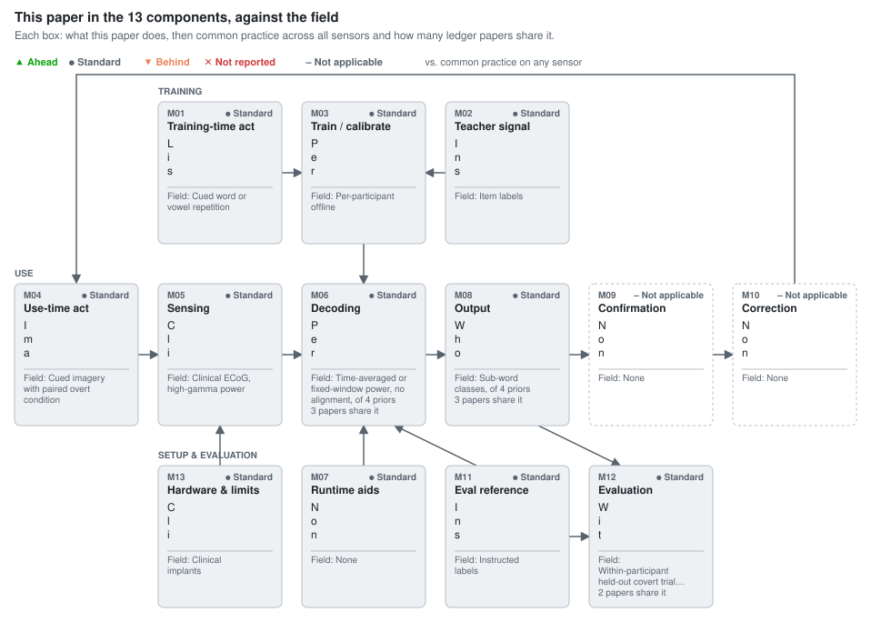

# Word pair classification during imagined speech using direct brain recordings

Martin, Brunner, Iturrate, Millán, Schalk, Knight, Pasley. Scientific Reports 6, 25803 (2016). DOI: [10.1038/srep25803](https://doi.org/10.1038/srep25803).

**Section:** [Other sensors](../../README.md#other-sensors)

## Figures

### This paper in the 13 components, against the field

<picture><source media="(prefers-color-scheme: dark)" srcset="figures/components-dark.svg"></picture>

Verdicts compare the paper's choice for each component with common practice across 8,995 ledger entries on any sensor (silent speech, brain-to-text, lip reading).

Data

| Component | This paper | Common practice | Papers with this practice | Verdict |
| --- | --- | --- | --- | --- |
| M01 Training-time act | L i s t e n ,   i m a g i n e   h e a r i n g ,   r e p e a t   a l o u d | Cued word or vowel repetition |  | ● Standard (Inherited from the Pei 2011 / Martin 2014 covert repetition lineage.) |
| M02 Teacher signal | I n s t r u c t e d   w o r d   l a b e l s | Item labels |  | ● Standard (No training-only signal.) |
| M03 Train / calibrate | P e r - s u b j e c t   o f f l i n e   t r a i n i n g ,   i n n e r   L O O   g r i d   s e a r c h | Per-participant offline |  | ● Standard (Weights and parameters from training folds.) |
| M04 Use-time act | I m a g i n e   h e a r i n g   t h e   j u s t - h e a r d   w o r d | Cued imagery with paired overt condition |  | ● Standard (No same-delay no-imagery control.) |
| M05 Sensing | C l i n i c a l   E C o G ,   5   p a t i e n t s ,   h i g h   g a m m a   7 0 - 1 5 0   H z | Clinical ECoG, high-gamma power |  | ● Standard (Placement clinically determined.) |
| M06 Decoding | P e r - e l e c t r o d e   D T W   k e r n e l s   i n   a n   S V M | Time-averaged or fixed-window power, no alignment, of 4 priors | 3 of 3 | ● Standard (New to neural decoding; DTW-kernel SVM (2005) and EMG DTW (2012) predate; no per-subject gain, unit unstated.) |
| M07 Runtime aids | N o n e | None |  | ● Standard (Closed binary choice.) |
| M08 Output | W h o l e - w o r d   i d e n t i t y ,   1 5   b i n a r y   p a i r s | Sub-word classes, of 4 priors | 3 of 3 | ● Standard (First intracranial whole-word result; scalp EEG/MEG precedent (Suppes 1997); imagery not separated from heard-word trace or overt preparation.) |
| M09 Confirmation | N o n e | None |  | – Not applicable (Offline.) |
| M10 Correction | N o n e | None |  | – Not applicable (Offline.) |
| M11 Eval reference | I n s t r u c t e d   w o r d   i d e n t i t y ,   e p o c h s   a t   c u e   o n s e t | Instructed labels |  | ● Standard (Imagery onset unmeasured.) |
| M12 Evaluation | W i t h i n - s u b j e c t   l e a v e - o n e - o u t ,   1 , 0 0 0   l a b e l   s h u f f l e s | Within-participant held-out covert trials, of 4 priors | 2 of 2 | ● Standard (No held-out session or block grouping stated.) |
| M13 Hardware & limits | C l i n i c a l   i m p l a n t s ,   o f f l i n e | Clinical implants |  | ● Standard (Short-term epilepsy monitoring.) |

## Verdict

Both changed components are standard when judged over any signal, as in the published Martin 2014 review [[1]](#ref-1). Whole-word output (M08) is new to intracranial recordings, where none of 4 earlier decoders classifies words (Appendix), but Suppes et al. recognised single internal-speech word trials from scalp EEG/MEG in 1997 [[2]](#ref-2). DTW inside the SVM kernel (M06) is new to neural decoding but was used for acoustic words [[3]](#ref-3) and silent-speech EMG [[4]](#ref-4), and its gain has no stated unit and no per-subject result. The test partition (M12) is the usual within-participant cross-validation. The protocol cannot attribute the result to imagery: the 1.5 s window sits between hearing a word and repeating it aloud, with no control epoch [[1]](#ref-1). The claim of "the first demonstration of single-trial neural decoding of words during imagined speech production" fails on scope and task: subjects imagined hearing, not saying [[1]](#ref-1).

## Against the field, component by component

### M08 Output: whole-word identity from imagined speech

**Usual approach:** 3 of 4 prior intracranial imagined-speech decoders output sub-word classes (confirmed, Appendix): imagined phoneme versus rest [[5]](#ref-5), vowel or consonant classes inside imagined words [[6]](#ref-6), covert vowels [[7]](#ref-7); the fourth reconstructs spectrotemporal features [[8]](#ref-8). Over any signal, Suppes et al. recognised internal-speech words from scalp EEG/MEG [[2]](#ref-2). The paper classifies six words in 15 binary pairs.

**State of the art:** Kunz et al. (2025) [later] decode inner-speech sentences online from a 50-word vocabulary at 24%, 14% and 33% word error rate in three intracortical participants, in the sessions used for training and with T15's decoder retrained online [[9]](#ref-9).

What is new is the first intracranial whole-word result (Appendix). Its repetition figures: imagined accuracy is significant in 4 of 5 subjects, the fifth at 49.8%; 8 of 15 pairs pass, a count reported right after the subject 4 result with its scope unstated; temporal electrodes alone pass in 4 of 5 subjects at 58.0% [[1]](#ref-1). Each subject test pools 15 pairs sharing trials (inference). Verdict: standard.

### M06 Processing: temporal alignment inside the decoder

**Usual approach:** 3 of 4 priors feed time-averaged or fixed-window power without alignment (confirmed, Appendix) [[5]](#ref-5), [[6]](#ref-6), [[7]](#ref-7); Martin et al. use DTW only to score covert reconstructions [[8]](#ref-8). The paper puts per-electrode DTW distances into SVM kernels weighted by discriminative power.

**State of the art:** Kunz et al. (2025) [later] train their inner-speech decoder with a CTC loss, which needs no per-trial timing labels or alignment [[9]](#ref-9).

The authors credit DTW kernels to speech recognition [[3]](#ref-3); silent-speech EMG also used DTW [[4]](#ref-4). Of 72 full-text DTW hits up to 2016 (pattern match), 8 use neural recordings and none other aligns imagined trials inside a decoder (Appendix). The gain is given only as "p < 0.05; two-sample t-test" for overt and imagined speech, with no stated unit (subjects or pairs), no per-subject result and its size only in Supplementary Fig. S3 [[1]](#ref-1). Verdict: standard.

### M12 Evaluation: within-participant leave-one-out

**Usual approach:** at the target's time 2 of 4 priors hold out covert trials within participant (confirmed, Appendix) [[6]](#ref-6), [[7]](#ref-7); Leuthardt et al. test online after a separate screening run [[5]](#ref-5); none holds out a session or subject. The paper uses leave-one-out with one trial per class per fold and 1,000 label shuffles.

**State of the art:** Kunz et al. (2025) [later] test online on sentences absent from training blocks [[9]](#ref-9).

Trial counts and fold grouping are not stated [[1]](#ref-1). Verdict: standard.

## The 13 components

| Component | This paper | Usual approach (count) | State of the art | Verdict |
|---|---|---|---|---|
| M01 Training-time action | Listen, imagine hearing, repeat aloud | Cued word or vowel repetition | – | standard |
| M02 Training-only supervision | Instructed word labels | Item labels | – | standard |
| M03 Training and adaptation | Per-subject offline training, inner LOO grid search | Per-participant offline | – | standard |
| M04 Use-time action | Imagine hearing the just-heard word | Cued imagery with paired overt condition | – | standard |
| M05 Sensors | Clinical ECoG, 5 patients, high gamma 70-150 Hz | Clinical ECoG, high-gamma power | – | standard |
| M06 Processing and decoding | Per-electrode DTW kernels in an SVM | Time-averaged or fixed-window power, no alignment, of 4 priors (confirmed 3) | [[9]](#ref-9) (2025): CTC-trained decoder, no per-trial timing labels | standard |
| M07 Lexicon and LM | None | None | – | standard |
| M08 Output | Whole-word identity, 15 binary pairs | Sub-word classes, of 4 priors (confirmed 3) | [[9]](#ref-9) (2025): online inner-speech sentences, 50-word WER 14-33%, same sessions | standard |
| M09 Confirmation | None | None | – | not applicable |
| M10 Correction | None | None | – | not applicable |
| M11 Reference construction | Instructed word identity, epochs at cue onset | Instructed labels | – | standard |
| M12 Evaluation | Within-subject leave-one-out, 1,000 label shuffles | Within-participant held-out covert trials, of 4 priors (confirmed 2) | [[9]](#ref-9) (2025): online test, sentences absent from training blocks, same sessions | standard |
| M13 Device and cost | Clinical implants, offline | Clinical implants | – | standard |

## Where the claims outrun the evidence

- The window confounds imagery with the heard word and with the coming overt repetition: the cue follows the word's end, the epoch lasts 1.5 s, and 500 ms later the same word is spoken; no listen-then-rest epoch or rest-label test is reported [[1]](#ref-1). Temporal electrodes alone give 58.0% against 57.7% for all.
- The claim names imagined speech production, but subjects were told to "imagine hearing", explicitly not imagine saying [[1]](#ref-1).
- Suppes et al. recognised single internal-speech trials of 7 words at 46%, 39% and 43% in three 105-trial blocks for one subject, using prototypes from the same subject and condition [[2]](#ref-2); the target cites neither it nor Leuthardt et al. [[5]](#ref-5).
- The abstract's 88% is one pair in subject 4 [[1]](#ref-1).
- Listening and overt accuracy are called significant "in all four subjects" of five, and a repeated-measures ANOVA on 5 subjects reports F(2,12), where 8 error degrees of freedom are expected (inference) [[1]](#ref-1).
- No analysis relates pair accuracy to syllable count or duration [[1]](#ref-1).

## What the field needs next

- M04/M11: listen-then-rest and listen-then-speak epochs at the same delay, classified with the identical pipeline.
- M06: per-subject tests of DTW against fixed-window kernels on imagined trials with a measured imagery onset.
- M08/M12: multiclass imagine-saying word sets on held-out sessions [[9]](#ref-9).

## Questions for the authors

- What are per-subject accuracies with and without DTW?
- Does the 8 of 15 pair count refer to subject 4 or to the group?
- How many imagined trials per class remained, and how many electrodes per subject?
- Were folds grouped by recording block?

## Appendix: literature search

Design counts use one population for all three topics: human intracranial (ECoG, sEEG, depth, intracortical) decoders of imagined, covert or inner speech; attempted speech decoded from unit firing, scalp EEG/MEG, listening-only reconstruction, overt-only studies, analyses without a decoder and reviews are outside; versions count once. Novelty is judged over any signal with full-text checks. Priors: first public before 2015-11. Topic population: 89 unique studies (pattern match, all years); 8 first public up to 2015; excluded listening-only (2), no decoder (1), overt-only (1), leaving 4 decoders, all read in full: [[5]](#ref-5), [[6]](#ref-6), [[8]](#ref-8), [[7]](#ref-7). Whole-wiki slot-filled totals (not topic sizes): M06 7,345, M08 3,268, M12 6,960 unique studies.

M06, topic intracranial-imagined-speech-decoder-time-alignment. Inclusion rule: the population above; design of interest is how the decoder handles trial timing variability (time-averaged or fixed-window features, lagged linear model, HMM, or alignment such as DTW inside the classifier); DTW used only for scoring counts as evaluation. Usual design at the target's time: time-averaged or fixed-window power without alignment 3 of 4; lagged linear model 1 of 4; alignment inside the decoder 0 of 4 (confirmed). All-years full-text counts over the 89 studies (pattern match, mentions included): DTW or time warping 23, hidden Markov model 17, lagged or temporal receptive field 12. Any-signal DTW check (DTW or time-warp terms with EEG, ECoG, MEG, cortical or EMG terms; whole wiki, first public up to 2016): 72 unique studies (pattern match), 8 with neural recordings including the target, none other aligning trials inside an imagined- or covert-speech decoder; DTW word classifiers outside neural recordings: [[3]](#ref-3), [[4]](#ref-4). Read: the 4 priors, [[3]](#ref-3), [[4]](#ref-4), [[9]](#ref-9). Known-item recall 1.0 (5 of 5 seeds).

M08, topic intracranial-imagined-speech-output-unit. Inclusion rule: the population above; design of interest is the decoded unit of imagined trials (task versus rest, phoneme, vowel or consonant class, whole word, continuous acoustic features, sentence text); sub-word units classified inside word stimuli count as sub-word output. Usual design at the target's time: sub-word class 3 of 4; continuous spectrotemporal features 1 of 4; whole-word identity 0 of 4 (confirmed). All-years full-text counts over the 89 studies (pattern match, mentions included): continuous spectrotemporal output 51, vowel, phoneme or syllable classes 43, whole-word classification 20. Intracranial full-text check (whole wiki, up to 2016): 44 unique studies (pattern match), no intracranial imagined-word classifier besides the target. Any-signal full-text pattern (imagined, unspoken, internal, inner, covert or silent speech near word recognition, classification or decoding): 120 unique studies (pattern match), 6 first public up to 2016, 19 undated; up to 2016 the whole-word precedent is [[2]](#ref-2); the 30-snippet recall sample holds no study first public before 2016-05. Read: the 4 priors, [[2]](#ref-2), [[9]](#ref-9). Known-item recall 1.0 (6 of 6 seeds).

M12, topic intracranial-imagined-speech-test-partition (published table, appended). Inclusion rule: the population above; design of interest is how test data are separated from training data. Usual design at the target's time: within-participant held-out covert trials 2 of 4; overt-trained model tested on covert trials 1 of 4; online test after screening 1 of 4; held-out session or subject 0 of 4 (confirmed). Read: the 4 priors and [[9]](#ref-9). Known-item recall 1.0 (5 of 5 seeds).

## References

Numbered by first citation. BibTeX in the same order and keys: [refs.bib](refs.bib).

1. Martin, S., Brunner, P., Iturrate, I., Millán, J. d. R., Schalk, G., Knight, R. T., et al. “Word pair classification during imagined speech using direct brain recordings.” *Scientific Reports*, 2016, 6, 25803. doi:[10.1038/srep25803](https://doi.org/10.1038/srep25803). Target. Read as the published Scientific Reports article (with the 2017 corrigendum notice). [wiki: doi-10.1038-srep25803](https://github.com/supernaiter/deep-research-wiki-for-silent-speech/blob/main/papers/doi-10.1038-srep25803/article.md) [wiki: pmc-4863149-ecog-word-pairs](https://github.com/supernaiter/deep-research-wiki-for-silent-speech/blob/main/papers/pmc-4863149-ecog-word-pairs/article.md) [wiki: pmc-pmc4863149](https://github.com/supernaiter/deep-research-wiki-for-silent-speech/blob/main/papers/pmc-pmc4863149/article.md) [wiki: pmc-4863149-wordpair](https://github.com/supernaiter/deep-research-wiki-for-silent-speech/blob/main/papers/pmc-4863149-wordpair/article.md)
2. Suppes, P., Lu, Z., Han, B. “Brain wave recognition of words.” *Proceedings of the National Academy of Sciences of the USA*, 1997, 94(26), 14965–14969. doi:[10.1073/pnas.94.26.14965](https://doi.org/10.1073/pnas.94.26.14965). Prior, not cited by the target; scalp EEG/MEG word recognition during internal speech, including single trials; deciding prior for M08 under the any-signal rule. Read in full. [wiki: pmc-25146-brainwave](https://github.com/supernaiter/deep-research-wiki-for-silent-speech/blob/main/papers/pmc-25146-brainwave/article.md)
3. Wan, V., Carmichael, J. “Polynomial Dynamic Time Warping Kernel Support Vector Machines for Dysarthric Speech Recognition with Sparse Training Data.” *Proceedings of Interspeech 2005*, 2005. doi:[10.21437/Interspeech.2005-853](https://doi.org/10.21437/Interspeech.2005-853). Prior (acoustic); DTW kernel in an SVM for isolated words; deciding prior for M06 under the any-signal rule. Abstract and method read. [wiki: isca-wan05b_interspeech](https://github.com/supernaiter/deep-research-wiki-for-silent-speech/blob/main/papers/isca-wan05b_interspeech/article.md)
4. Freitas, J., Teixeira, A., Dias, M. S. “Towards a silent speech interface for Portuguese: Surface electromyography and the nasality challenge.” *Proceedings of the International Conference on Bio-inspired Systems and Signal Processing (BIOSIGNALS 2012)*, 2012, 91–100. doi:[10.5220/0003786100910100](https://doi.org/10.5220/0003786100910100). Prior (surface EMG); DTW word classification of silent speech; deciding prior for M06 under the any-signal rule. Classification section read. [wiki: doi-10.5220-0003786100910100](https://github.com/supernaiter/deep-research-wiki-for-silent-speech/blob/main/papers/doi-10.5220-0003786100910100/article.md)
5. Leuthardt, E. C., Gaona, C., Sharma, M., Szrama, N., Roland, J., Freudenberg, Z., et al. “Using the electrocorticographic speech network to control a brain-computer interface in humans.” *Journal of Neural Engineering*, 2011, 8(3), 036004. doi:[10.1088/1741-2560/8/3/036004](https://doi.org/10.1088/1741-2560/8/3/036004). Prior, not cited by the target; online control with imagined phonemes versus rest; deciding prior for M06, M08 and M12. Read in full. [wiki: doi-10.1088-1741-2560-8-3-036004](https://github.com/supernaiter/deep-research-wiki-for-silent-speech/blob/main/papers/doi-10.1088-1741-2560-8-3-036004/article.md)
6. Pei, X., Barbour, D., Leuthardt, E. C., Schalk, G. “Decoding Vowels and Consonants in Spoken and Imagined Words Using Electrocorticographic Signals in Humans.” *Journal of Neural Engineering*, 2011, 8(4), 046028. doi:[10.1088/1741-2560/8/4/046028](https://doi.org/10.1088/1741-2560/8/4/046028). Prior; vowel and consonant classes inside imagined words; deciding prior for M06, M08 and M12. Read in full. [review](https://github.com/supernaiter/silent-speech-review/tree/main/reviews/decoding-vowels-and-consonants-in-spoken-and-imagined-words-using-electrocorticographic-signals-in-h) [wiki: doi-10.1088-1741-2560-8-4-046028](https://github.com/supernaiter/deep-research-wiki-for-silent-speech/blob/main/papers/doi-10.1088-1741-2560-8-4-046028/article.md) [wiki: pmc-3772685-vowelcons](https://github.com/supernaiter/deep-research-wiki-for-silent-speech/blob/main/papers/pmc-3772685-vowelcons/article.md)
7. Ikeda, S., Shibata, T., Nakano, N., Okada, R., Tsuyuguchi, N., Ikeda, K., et al. “Neural decoding of single vowels during covert articulation using electrocorticography.” *Frontiers in Human Neuroscience*, 2014, 8, 125. doi:[10.3389/fnhum.2014.00125](https://doi.org/10.3389/fnhum.2014.00125). Prior, cited by the target; linear SVM on covert vowels; deciding prior for M06, M08 and M12. Read in full. [wiki: doi-10.3389-fnhum.2014.00125](https://github.com/supernaiter/deep-research-wiki-for-silent-speech/blob/main/papers/doi-10.3389-fnhum.2014.00125/article.md) [wiki: pmc-3945950-covertvowel](https://github.com/supernaiter/deep-research-wiki-for-silent-speech/blob/main/papers/pmc-3945950-covertvowel/article.md) [wiki: pmc-3945950-covertvowl](https://github.com/supernaiter/deep-research-wiki-for-silent-speech/blob/main/papers/pmc-3945950-covertvowl/article.md)
8. Martin, S., Brunner, P., Holdgraf, C., Heinze, H., Crone, N. E., Rieger, J., et al. “Decoding spectrotemporal features of overt and covert speech from the human cortex.” *Frontiers in Neuroengineering*, 2014, 7, 14. doi:[10.3389/fneng.2014.00014](https://doi.org/10.3389/fneng.2014.00014). Prior; lagged linear reconstruction of covert speech, DTW used only for scoring; deciding prior for M06, M08 and M12. Read in full. [review](https://github.com/supernaiter/silent-speech-review/tree/main/reviews/decoding-spectrotemporal-features-of-overt-and-covert-speech-from-the-human-cortex) [wiki: doi-10.3389-fneng.2014.00014](https://github.com/supernaiter/deep-research-wiki-for-silent-speech/blob/main/papers/doi-10.3389-fneng.2014.00014/article.md) [wiki: pmc-4034498-overtcovert](https://github.com/supernaiter/deep-research-wiki-for-silent-speech/blob/main/papers/pmc-4034498-overtcovert/article.md) [wiki: pmc-4034498-spectemp](https://github.com/supernaiter/deep-research-wiki-for-silent-speech/blob/main/papers/pmc-4034498-spectemp/article.md)
9. Kunz, E. M., Krasa, B. A., Kamdar, F., Avansino, D., Hahn, N., Yoon, S., et al. “Inner speech in motor cortex and implications for speech neuroprostheses.” *Cell*, 2025, 188(17), 4658–4673.e17. doi:[10.1016/j.cell.2025.06.015](https://doi.org/10.1016/j.cell.2025.06.015). Later; state of the art for M06, M08 and M12. Read for the reported values and the decoder training. [later] [wiki: doi-10.1016-j.cell.2025.06.015](https://github.com/supernaiter/deep-research-wiki-for-silent-speech/blob/main/papers/doi-10.1016-j.cell.2025.06.015/article.md) [wiki: cell-40816265-innersp](https://github.com/supernaiter/deep-research-wiki-for-silent-speech/blob/main/papers/cell-40816265-innersp/article.md) [wiki: pmc-12360486-inner-motor](https://github.com/supernaiter/deep-research-wiki-for-silent-speech/blob/main/papers/pmc-12360486-inner-motor/article.md) [wiki: pmc-12360486-innercell](https://github.com/supernaiter/deep-research-wiki-for-silent-speech/blob/main/papers/pmc-12360486-innercell/article.md) [wiki: pmc-12360486-innermtrcx](https://github.com/supernaiter/deep-research-wiki-for-silent-speech/blob/main/papers/pmc-12360486-innermtrcx/article.md)

## Materials

Data behind this review. Full texts of the papers are not included.

- [`review.md`](review.md): the review text (source)
- [`refs.bib`](refs.bib): references (BibTeX)
- [`slots.json`](slots.json): for each of the 13 components: this paper's choice, field practice, number of matching papers, verdict
- [`figures.json`](figures.json): figure definitions
- [`evaluation.md`](evaluation.md): independent evaluation by a second reviewer
- [`triage.md`](triage.md): how each evaluation finding was checked against the sources and resolved
- [`process/log.json`](process/log.json): process record: each step, who did it (reader, script, writer, evaluator), when, the checks run and the input versions
- [`process/notes.json`](process/notes.json): reading notes on the target and comparator papers: claims, numbers, conditions and what is not stated, with locations
- [`process/plan.json`](process/plan.json): plan: which components the paper changes and the topics it is compared on
- [`process/draft.md`](process/draft.md): the review as first written, before the independent evaluation
- [`process/claims-draft.md`](process/claims-draft.md): claim table of the draft: every claim mapped to a note or a count
- [`process/claims.md`](process/claims.md): claim table of the published review
- [`components/M06/intracranial-imagined-speech-decoder-time-alignment.csv`](../../components/M06/intracranial-imagined-speech-decoder-time-alignment.csv): M06 topic "intracranial-imagined-speech-decoder-time-alignment", every candidate paper with its decision (7345 slot-filled, 89 pattern match, usual design in 3, 7 read in full)
- [`components/M08/intracranial-imagined-speech-output-unit.csv`](../../components/M08/intracranial-imagined-speech-output-unit.csv): M08 topic "intracranial-imagined-speech-output-unit", every candidate paper with its decision (3268 slot-filled, 89 pattern match, usual design in 3, 6 read in full)
- [`components/M12/intracranial-imagined-speech-test-partition.csv`](../../components/M12/intracranial-imagined-speech-test-partition.csv): M12 topic "intracranial-imagined-speech-test-partition", every candidate paper with its decision (6960 slot-filled, 89 pattern match, usual design in 3, 6 read in full)

## More reviews in Other sensors

- [Fully Implanted Brain-Computer Interface in a Locked-In Patient with ALS](../fully-implanted-brain-computer-interface-in-a-locked-in-patient-with-als/) (2016). Skin-closed ECoG implant used at home without investigators (M13): standard, one user, skin-closed telemetry predates it; main-text 89% spelling accuracy pools inactive steps, no chance level.
- [Lipreading with Long Short-Term Memory](../lipreading-with-long-short-term-memory/) (2016). Joint LSTM + pixel front end (M06) is ahead of 2015 lipreading, but pixel-input and recurrent word models predate it, and the 8.3-point gain is over linear SVMs, not HMMs.
- [Combining Residual Networks with LSTMs for Lipreading](../combining-residual-networks-with-lstms-for-lipreading/) (2017). 3D-conv + ResNet + Bi-LSTM (M06), which became the field default, and per-step training (M03) are standard only for lack of run counts; 83.0% trails audio-supervised 93.2% today.
- [EMG-to-Speech: Direct Generation of Speech from Facial Electromyographic Signals](../emg-to-speech-direct-generation-of-speech-from-facial-electromyographic-signals/) (2017). Only new mapping work (M06) is a BLSTM and a 4-way ranking, standard; direct route (M08) inherited; no silent test (M04) or listener transcription (M12), behind; identity/mood retention unmeasured.
- [High performance communication by people with paralysis using an intracortical brain-computer interface](../high-performance-communication-by-people-with-paralysis-using-an-intracortical-brain-computer-interf/) (2017). ReFIT-KF + HMM click (M06) and ccpm/bitrate protocol (M12) are standard for 2017; 1.4-4.2x record gains are cross-study and the HMM is never isolated; later decoders reach 110 chars/min.
- [Brain-to-text: decoding spoken phrases from phone representations in the brain](../brain-to-text-decoding-spoken-phrases-from-phone-representations-in-the-brain/) (2015). Phone-model decoder (M06) is the EMG recognizer moved to ECoG: standard. 25% WER uses per-phrase dictionaries holding the spoken words (M07); the time-shift null (M12) is sound.

---

Part of the [Silent Speech Interface Review](https://github.com/supernaiter/silent-speech-review). Found an error? [Open an issue](https://github.com/supernaiter/silent-speech-review/issues/new?template=correction.yml).
