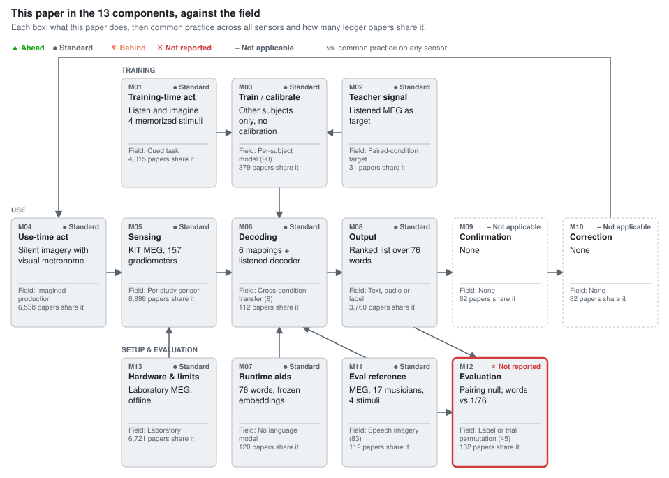

# Zero-Shot Imagined Speech Decoding via Imagined-to-Listened MEG Mapping

Maryam Maghsoudi, Shihab Shamma · arXiv preprint, 2026 · [arXiv:2605.08075](https://arxiv.org/abs/2605.08075)

**Section:** [Brain signals (EEG, MEG, intracortical)](../../README.md#brain-signals-eeg-meg-intracortical)

## Figures

### This paper in the 13 components, against the field

<picture><source media="(prefers-color-scheme: dark)" srcset="figures/components-dark.svg"></picture>

Verdicts compare the paper's choice for each component with common practice across 8,995 ledger entries on any sensor (silent speech, brain-to-text, lip reading).

Data

| Component | This paper | Common practice | Papers with this practice | Verdict |
| --- | --- | --- | --- | --- |
| M01 Training-time act | Listen and imagine 4 memorized stimuli | Cued task | 4,015 of 8,995 | ● Standard (Inherited from the 2025 paradigm.) |
| M02 Teacher signal | Listened MEG as target | Paired-condition target | 31 of 8,995 | ● Standard (Other subjects' imagined MEG trains the mapping (Fig. 1).) |
| M03 Train / calibrate | Other subjects only, no calibration | Per-subject model (90) | 379 of 8,995 | ● Standard (LOSO without calibration exists since 2018 [@halme2018across].) |
| M04 Use-time act | Silent imagery with visual metronome | Imagined production | 6,538 of 8,995 | ● Standard (Inherited.) |
| M05 Sensing | KIT MEG, 157 gradiometers | Per-study sensor | 8,898 of 8,995 | ● Standard (Inherited; target normalization unstated.) |
| M06 Decoding | 6 mappings + listened decoder | Cross-condition transfer (8) | 112 of 8,995 | ● Standard (New only as a pipeline; no word-level control without the mapping.) |
| M07 Runtime aids | 76 words, frozen embeddings | No language model | 120 of 8,995 | ● Standard (Contrastive retrieval of [@defossez2023decoding]; encoders tie in the pipeline.) |
| M08 Output | Ranked list over 76 words | Text, audio or label | 3,760 of 8,995 | ● Standard (Closed set.) |
| M09 Confirmation | None | None | 82 of 8,995 | – Not applicable (Offline.) |
| M10 Correction | None | None | 82 of 8,995 | – Not applicable (Offline.) |
| M11 Eval reference | MEG, 17 musicians, 4 stimuli | Speech imagery (83) | 112 of 8,995 | ● Standard (13 subjects shown in Fig. A7.) |
| M12 Evaluation | Pairing null; words vs 1/76 | Label or trial permutation (45) | 132 of 8,995 | ✕ Not reported (No word-level test; top-20 post hoc subsets.) |
| M13 Hardware & limits | Laboratory MEG, offline | Laboratory | 6,721 of 8,995 | ● Standard (Bidirectional RNN mapping; no online test.) |

## Verdict

The paper [[1]](#ref-1) changes the decoding route (M06), the training regime (M03) and the recording (M11), all standard, and under-reports its word-level evaluation (M12). Mapping imagined MEG into listened-response space before a listened-trained word decoder is new only as a pipeline (Appendix): the authors' earlier mapping decodes nothing [[2]](#ref-2). M06 stays standard because no control passes unmapped imagined MEG or a null-mapping output through the same decoder (Sec. 3.4), so the mapping's contribution to word retrieval is not shown. The strongest confound is the closed stimulus set: every participant imagines the same two poems, whose 76 words are the candidates (Sec. 2.4), so poem identity alone lifts ranks above 1/76 (inference). "Zero-shot" holds across subjects, not across stimuli or words, and the word-level result called significant names no test (Fig. 4A).

## Against the field, component by component

### M06 Decoding route: mapping before a listened-trained decoder

**Usual approach:** the commonest transfer design among 112 unique studies (pattern match) applies a decoder across conditions: cross-condition generalization (8) or training on perception or overt speech and testing on imagery (6), as in MEG melody classifiers [[3]](#ref-3) and overt-trained ECoG decoders [[4]](#ref-4), [[5]](#ref-5).

**State of the art:** intracortical decoders trained on inner plus earlier attempted speech decode inner speech in real time at 14-33% word error rate (50 words) and 26-54% (125,000 words) (2025, prior) [[6]](#ref-6), using inner-speech labels; direct overt-to-covert transfer reaches 46.3% token error rate (46.6% covert-trained) over eight sentences in 16 ECoG participants (2024, prior) [[5]](#ref-5). Only rank curves are given (Fig. 4A, A7): no like-for-like gap.

Of 5 mapping studies (pattern match, Appendix), the one earlier example is the authors' own, which decodes nothing and calibrates on the held-out subject [[2]](#ref-2); earlier transfer work aligns time [[4]](#ref-4) or a shared subspace [[7]](#ref-7), not responses into perceived-response space. Evidence that the mapping helps is stimulus-level only: four-way accuracy is 34% from predicted-listened against 30% from imagined MEG (Sec. 3.2), a 13% relative gain, untested (inference). Encoder differences vanish in the pipeline (Discussion), as expected if it carries poem identity only (inference). Verdict: standard; new as a pipeline, its effect over direct transfer unmeasured.

### M03 Training: zero-shot across subjects

**Usual approach:** one model per participant (90 of 379 unique studies, pattern match). Calibration-free testing on unseen participants is established in MEG motor imagery [[8]](#ref-8); here neither stage touches the held-out subject (Sec. 2.5).

**State of the art:** other-subject pre-training plus target fine-tuning reaches 61.3% Top-10 over 1024 segments on 3-subject perceived-speech MEG (2026, [concurrent]) [[9]](#ref-9), with target data.

Held-out mapping beats its null (RNN t = 9.59, Table 2), but on the training subjects' four stimuli (Sec. 2.1), where stimulus templates suffice (inference). Verdict: standard.

### M11 Recording: paired imagined and listened MEG

**Usual approach:** paired imagery-perception recordings mostly use speech (83 of 112, pattern match); music appears in 9, MEG in 26.

**State of the art:** listened and imagined melodies recorded with MEG in 71 participants (2023, prior) [[3]](#ref-3), against 17 recruited here (Sec. 2.1), 13 of them shown in Fig. A7. Verdict: standard.

### M12 Evaluation: word-level null and test

**Usual approach:** permute labels or trial pairings (45 of 132 unique studies, pattern match), as the paper does for the mapping (Sec. 2.3).

**State of the art:** a shuffle-trained model run through the full decoder (2024, prior; effect size 1.34) [[5]](#ref-5). Here the word stage meets only analytic chance and the listened ceiling (Sec. 3.4). Verdict: not reported; the word-level test, decoder split unit and seeds are absent (Appendix C).

## The 13 components

| Component | This paper | Usual approach (count) | State of the art | Verdict |
|---|---|---|---|---|
| M01 Training-time action | Listen and imagine 4 memorized stimuli | Cued task (slot-filled 4,015) | – | standard |
| M02 Training-only supervision | Listened MEG as target | Paired-condition target (slot-filled 31) | – | standard |
| M03 Training and adaptation | Other subjects only, no calibration | Per-subject model (90) (pattern match 379) | 61.3% Top-10 of 1024, fine-tuned [[9]](#ref-9) | standard |
| M04 Use-time action | Silent imagery with visual metronome | Imagined production (slot-filled 6,538) | – | standard |
| M05 Sensors | KIT MEG, 157 gradiometers | Per-study sensor (slot-filled 8,898) | – | standard |
| M06 Processing and decoding | 6 mappings + listened decoder | Cross-condition transfer (8) (pattern match 112) | 14-33% WER, 50-word inner speech, intracortical [[6]](#ref-6) | standard |
| M07 Lexicon and LM | 76 words, frozen embeddings | No language model (slot-filled 120) | – | standard |
| M08 Output | Ranked list over 76 words | Text, audio or label (slot-filled 3,760) | – | standard |
| M09 Confirmation | None | None (slot-filled 82) | – | not applicable |
| M10 Correction | None | None (slot-filled 82) | – | not applicable |
| M11 Reference construction | MEG, 17 musicians, 4 stimuli | Speech imagery (83) (pattern match 112) | 71 participants, MEG [[3]](#ref-3) | standard |
| M12 Evaluation | Pairing null; words vs 1/76 | Label or trial permutation (45) (pattern match 132) | Shuffle-model null [[5]](#ref-5) | not reported |
| M13 Device and cost | Laboratory MEG, offline | Laboratory (slot-filled 6,721) | – | standard |

## Where the claims outrun the evidence

- "Significant above chance decoding" (Fig. 4A) names no test, null or p-value; Sec. 3.4 and Appendix D test only top-20 overlap (Wilcoxon, D.3).
- Figs. A5-A6 restrict rank curves to the top-20 most decodable words (Appendix D.1), ranked from the same pipeline outputs (D.3), so they overstate decoding (inference).
- Consistent top-20 words (Fig. 4B-C) can also come from decoder bias toward some words; no input-shuffled control is run (inference).
- The p-value for raw imagined four-way classification is 0.10 in Sec. 3.2 and 0.12 in the Fig. 2 caption.
- Table 3 ranks BERT above BERT+Wav2Vec2 at Recall@5 and Recall@10, yet the latter is called best overall (Appendix C).
- The abstract claims direct applicability to realistic BCIs; the study is offline, with a bidirectional RNN (Appendix A.1).

## What the field needs next

- M06: pass unmapped imagined MEG and null-mapping outputs through the frozen decoder, with a permutation test.
- M11: test on poems held out from mapping and decoder training.
- M12: report per-subject Recall@k over all 76 words, with seeds.

## Questions for the authors

- Is the Table 2 "Seen (Test)" split by session or trial, and how many sessions were there?
- Is Table 3 on validation or held-out data, and do word tokens cross partitions?
- How are word windows placed in imagined trials?

## Appendix: literature search

- M06, perception-imagery-cross-condition-model (published topic table, appended). Inclusion rule: neural studies that use perception (listening or overt production) responses to model, decode or transform imagery or covert-speech responses of the same material (cross-condition training and testing, joint training, or mapping imagined into perceived responses); descriptive comparisons, reviews and model-free datasets excluded. Ledger: 7345 slot-filled; 112 unique studies by pattern match. Designs (pattern match): cross-condition generalization 8, train on perception and apply to imagery 6, imagery-to-perception mapping 5 (this paper and its versions, the authors' 2025 study, [concurrent] and [later] work), joint training 0. Read in full: [[2]](#ref-2), [[5]](#ref-5), [[3]](#ref-3), [[4]](#ref-4) and [[7]](#ref-7) (deciding priors), [[6]](#ref-6) and [[5]](#ref-5) (state of the art). Known-item recall 1.0.
- M03, cross-subject-pooled-training (published topic table, appended). Inclusion rule: decoders trained on data pooled across participants, with or without participant-specific layers; per-participant models averaged over participants excluded. Ledger: 1526 slot-filled; 370 unique studies by ledger pattern match, 379 with full-text subject-layer hits. Usual design: per-subject model, 90 of 379 (pattern match). Read in full: [[8]](#ref-8) (prior), [[9]](#ref-9) (state of the art), [[10]](#ref-10). Known-item recall 1.0.
- M11, paired-imagery-perception-neural-recordings (published topic table, appended). Inclusion rule: recordings in which the same participants perceive and imagine the same speech or music stimuli in matched trials; imagery-only, perception-only and overt-versus-covert-only recordings excluded. Ledger: 234 slot-filled; 112 unique studies by pattern match. Designs (pattern match): speech imagery 83, MEG recording 26, music imagery 9. Read in full: [[3]](#ref-3) (state of the art), [[2]](#ref-2).
- M12, null-model-construction-neural-decoding (published topic table, appended). Inclusion rule: studies that test against an empirical null built by shuffling or permuting labels, trials, time or channels; studies with theoretical chance only excluded. Ledger: 6960 slot-filled; 132 unique studies by pattern match. Designs (pattern match): label or trial permutation 45, time shift or phase randomization 17, channel shuffle 10. Read in full: [[5]](#ref-5) (state of the art).

## References

Numbered by first citation. BibTeX in the same order and keys: [refs.bib](refs.bib).

1. Maghsoudi, M., Shamma, S. “Zero-Shot Imagined Speech Decoding via Imagined-to-Listened MEG Mapping.” *arXiv preprint*, 2026. arXiv:[2605.08075](https://arxiv.org/abs/2605.08075). Target. Read as arXiv 2605.08075v1. [review](https://github.com/supernaiter/silent-speech-review/tree/main/reviews/zero-shot-imagined-speech-decoding-via-imagined-to-listened-meg-mapping) [wiki: arxiv-2605.08075](https://github.com/supernaiter/deep-research-wiki-for-silent-speech/blob/main/papers/arxiv-2605.08075/article.md) [wiki: arxiv-2605-08075-zeromeg](https://github.com/supernaiter/deep-research-wiki-for-silent-speech/blob/main/papers/arxiv-2605-08075-zeromeg/article.md) [wiki: arxiv-2605.08075-i2lmeg](https://github.com/supernaiter/deep-research-wiki-for-silent-speech/blob/main/papers/arxiv-2605.08075-i2lmeg/article.md)
2. Maghsoudi, M., Rezaeizadeh, M., Shamma, S. “A Convolutional Framework for Mapping Imagined Auditory MEG into Listened Brain Responses.” *2025 59th Asilomar Conference on Signals, Systems, and Computers*, 2025, 1582–1586. doi:[10.1109/IEEECONF67917.2025.11443775](https://doi.org/10.1109/IEEECONF67917.2025.11443775). arXiv:[2512.03458](https://arxiv.org/abs/2512.03458). [review](https://github.com/supernaiter/silent-speech-review/tree/main/reviews/a-convolutional-framework-for-mapping-imagined-auditory-meg-into-listened-brain-responses) [wiki: arxiv-2512.03458](https://github.com/supernaiter/deep-research-wiki-for-silent-speech/blob/main/papers/arxiv-2512.03458/article.md) [wiki: arxiv-2512.03458-imaud](https://github.com/supernaiter/deep-research-wiki-for-silent-speech/blob/main/papers/arxiv-2512.03458-imaud/article.md)
3. Quiroga Martinez, D. R., Fernández Rubio, G., Bonetti, L., Achyutuni, K. G., Tzovara, A., Knight, R. T., et al. “Decoding reveals the neural representation of perceived and imagined musical sounds.” *bioRxiv*, 2023. doi:[10.1101/2023.08.15.553456](https://doi.org/10.1101/2023.08.15.553456). [wiki: pmc-10462096-imaginedmusic](https://github.com/supernaiter/deep-research-wiki-for-silent-speech/blob/main/papers/pmc-10462096-imaginedmusic/article.md)
4. Martin, S., Brunner, P., Holdgraf, C., Heinze, H., Crone, N. E., Rieger, J., et al. “Decoding spectrotemporal features of overt and covert speech from the human cortex.” *Frontiers in Neuroengineering*, 2014, 7, 14. doi:[10.3389/fneng.2014.00014](https://doi.org/10.3389/fneng.2014.00014). [wiki: pmc-4034498-spectemp](https://github.com/supernaiter/deep-research-wiki-for-silent-speech/blob/main/papers/pmc-4034498-spectemp/article.md)
5. Komeiji, S., Mitsuhashi, T., Iimura, Y., Suzuki, H., Sugano, H., Shinoda, K., et al. “Feasibility of decoding covert speech in ECoG with a Transformer trained on overt speech.” *Scientific Reports*, 2024, 14, 11491. doi:[10.1038/s41598-024-62230-9](https://doi.org/10.1038/s41598-024-62230-9). [wiki: doi-10.1101-2024.02.05.578911](https://github.com/supernaiter/deep-research-wiki-for-silent-speech/blob/main/papers/doi-10.1101-2024.02.05.578911/article.md)
6. Kunz, E. M., Krasa, B. A., Kamdar, F., Avansino, D., Hahn, N., Yoon, S., et al. “Inner speech in motor cortex and implications for speech neuroprostheses.” *Cell*, 2025, 188(17), 4658–4673.e17. doi:[10.1016/j.cell.2025.06.015](https://doi.org/10.1016/j.cell.2025.06.015). [wiki: doi-10.1016-j.cell.2025.06.015](https://github.com/supernaiter/deep-research-wiki-for-silent-speech/blob/main/papers/doi-10.1016-j.cell.2025.06.015/article.md) [wiki: cell-40816265-innersp](https://github.com/supernaiter/deep-research-wiki-for-silent-speech/blob/main/papers/cell-40816265-innersp/article.md) [wiki: pmc-12360486-inner-motor](https://github.com/supernaiter/deep-research-wiki-for-silent-speech/blob/main/papers/pmc-12360486-inner-motor/article.md) [wiki: pmc-12360486-innercell](https://github.com/supernaiter/deep-research-wiki-for-silent-speech/blob/main/papers/pmc-12360486-innercell/article.md) [wiki: pmc-12360486-innermtrcx](https://github.com/supernaiter/deep-research-wiki-for-silent-speech/blob/main/papers/pmc-12360486-innermtrcx/article.md)
7. Lee, Y., Lee, S., Kim, S., Lee, S. “Towards Voice Reconstruction from EEG during Imagined Speech.” *Proceedings of the AAAI Conference on Artificial Intelligence*, 2023, 37(5), 6030–6038. doi:[10.1609/aaai.v37i5.25745](https://doi.org/10.1609/aaai.v37i5.25745). arXiv:[2301.07173](https://arxiv.org/abs/2301.07173). [wiki: arxiv-2301.07173](https://github.com/supernaiter/deep-research-wiki-for-silent-speech/blob/main/papers/arxiv-2301.07173/article.md) [wiki: arxiv-2301-07173-neurotalk](https://github.com/supernaiter/deep-research-wiki-for-silent-speech/blob/main/papers/arxiv-2301-07173-neurotalk/article.md) [wiki: doi-10.1609-aaai.v37i5.25745](https://github.com/supernaiter/deep-research-wiki-for-silent-speech/blob/main/papers/doi-10.1609-aaai.v37i5.25745/article.md)
8. Halme, H., Parkkonen, L. “Across-subject offline decoding of motor imagery from MEG and EEG.” *Scientific Reports*, 2018, 8. doi:[10.1038/s41598-018-28295-z](https://doi.org/10.1038/s41598-018-28295-z). [wiki: pmc-6031658-megeegmi](https://github.com/supernaiter/deep-research-wiki-for-silent-speech/blob/main/papers/pmc-6031658-megeegmi/article.md)
9. Zhang, A., Wang, B., Wu, X., Cheng, H., Chen, J. “Cross-Subject Generalization in Decoding Perceived Speech from Non-Invasive Brain Recordings.” *arXiv preprint*, 2026. arXiv:[2608.22420](https://arxiv.org/abs/2608.22420). [concurrent] [wiki: arxiv-2608.22420](https://github.com/supernaiter/deep-research-wiki-for-silent-speech/blob/main/papers/arxiv-2608.22420/article.md)
10. Défossez, A., Caucheteux, C., Rapin, J., Kabeli, O., King, J. “Decoding speech perception from non-invasive brain recordings.” *Nature Machine Intelligence*, 2023, 5, 1097–1107. doi:[10.1038/s42256-023-00714-5](https://doi.org/10.1038/s42256-023-00714-5). arXiv:[2208.12266](https://arxiv.org/abs/2208.12266). [review](https://github.com/supernaiter/silent-speech-review/tree/main/reviews/decoding-speech-perception-from-non-invasive-brain-recordings) [wiki: arxiv-2208.12266-natmi](https://github.com/supernaiter/deep-research-wiki-for-silent-speech/blob/main/papers/arxiv-2208.12266-natmi/article.md)

## Materials

Data behind this review. Full texts of the papers are not included.

- [`review.md`](review.md): the review text (source)
- [`refs.bib`](refs.bib): references (BibTeX)
- [`slots.json`](slots.json): for each of the 13 components: this paper's choice, field practice, number of matching papers, verdict
- [`figures.json`](figures.json): figure definitions
- [`evaluation.md`](evaluation.md): independent evaluation by a second reviewer
- [`triage.md`](triage.md): how each evaluation finding was checked against the sources and resolved
- [`components/M03/cross-subject-pooled-training.csv`](../../components/M03/cross-subject-pooled-training.csv): M03 topic "cross-subject-pooled-training", every candidate paper with its decision (1526 slot-filled, 370 pattern match, usual design in 90, 4 read in full)
- [`components/M06/perception-imagery-cross-condition-model.csv`](../../components/M06/perception-imagery-cross-condition-model.csv): M06 topic "perception-imagery-cross-condition-model", every candidate paper with its decision (7345 slot-filled, 112 pattern match, usual design in 8, 5 read in full)
- [`components/M11/paired-imagery-perception-neural-recordings.csv`](../../components/M11/paired-imagery-perception-neural-recordings.csv): M11 topic "paired-imagery-perception-neural-recordings", every candidate paper with its decision (234 slot-filled, 112 pattern match, usual design in 83, 3 read in full)
- [`components/M12/null-model-construction-neural-decoding.csv`](../../components/M12/null-model-construction-neural-decoding.csv): M12 topic "null-model-construction-neural-decoding", every candidate paper with its decision (6960 slot-filled, 132 pattern match, usual design in 45, 2 read in full)

## More reviews in Brain signals (EEG, MEG, intracortical)

- [A cross-species neural foundation model for end-to-end speech decoding](../a-cross-species-neural-foundation-model-for-end-to-end-speech-decoding/) (2026). Cascaded decoding with the pretrained encoder is a strong standard result; the end-to-end audio-LLM path beats the prior end-to-end entry but trails RNN cascades, and the cross-species gain is small.
- [Brain-to-Speech: Prosody Feature Engineering and Transformer-Based Reconstruction](../brain-to-speech-prosody-feature-engineering-and-transformer-based-reconstruction/) (2026). Same three parts and same Table 1 values as MiSTR (2025, same first two authors), not cited. Features (M06) and phase vocoder (M08) standard, unablated; no listener test (M12, behind).
- [Brain2Speech-Net: Fast and Intelligible Brain-to-Speech Synthesis Without Text Decoding](../brain2speech-net-intelligible-real-time-brain-to-speech-synthesis-without-text-decoding/) (2026). Text-free synthesis is shown, but its real time is throughput, not causal synthesis, unseen-sentence WER is 2.3 times the cascade, and intelligibility rests on ratings and ASR.
- [Do EEG Foundation Models Transfer to Speech? A Benchmark on Overt and Imagined Speech Decoding](../do-eeg-foundation-models-transfer-to-speech-a-benchmark-on-overt-and-imagined-speech-decoding/) (2026). Benchmark of EEG foundation models versus conventional models for overt and imagined speech decoding on two datasets; general EEG pretraining shows no consistent advantage and word decoding stays near chance.
- [EEG-Based Imagined Speech Decoding Using a Hybrid CNN-SNN Architecture](../eeg-based-imagined-speech-decoding-using-a-hybrid-cnn-snn-architecture/) (2026). Hybrid CNN-SNN classifier for five-class EEG imagined speech; reports 80.13% accuracy and 80.14% F1 in offline subject-dependent evaluation, about 98 ms GPU prediction time per trial.
- [iPhoneme: Brain-to-Text Communication for ALS Using ConformerXL Decoding](../iphoneme-brain-to-text-communication-for-als-using-conformerxl-decoding/) (2026). ConformerXL-based intracortical brain-to-text decoding for ALS with a proposed gaze-confirmation interface; WFST decoding reaches 7.86% phoneme error rate retrospectively in one participant.

---

Part of the [Silent Speech Interface Review](https://github.com/supernaiter/silent-speech-review). Found an error? [Open an issue](https://github.com/supernaiter/silent-speech-review/issues/new?template=correction.yml).
