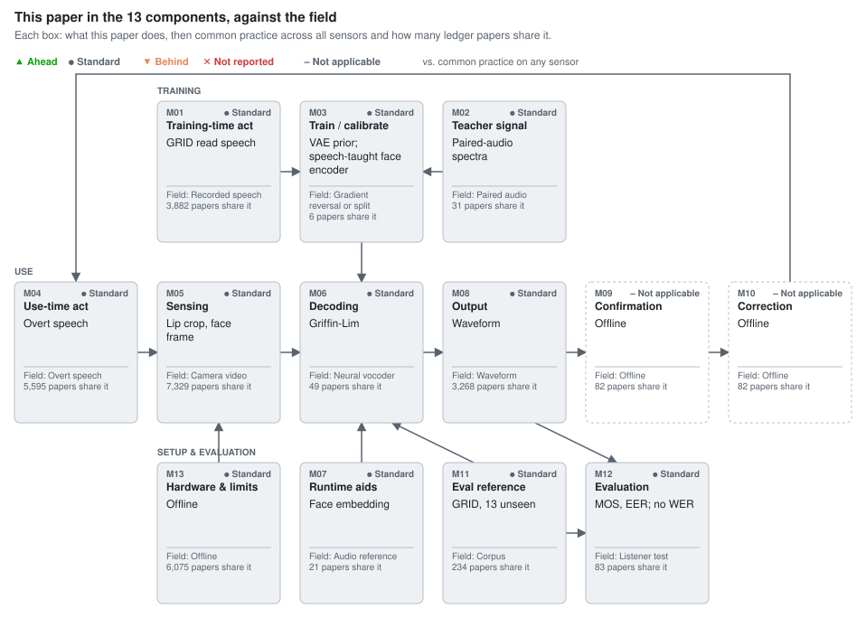

# Zero-Shot Personalized Lip-to-Speech Synthesis with Face Image Based Voice Control

Zheng-Yan Sheng, Yang Ai, Zhen-Hua Ling. arXiv preprint, 2023. [arXiv:2305.14359](https://arxiv.org/abs/2305.14359)

**Section:** [Lip & face video](../../README.md#lip--face-video)

## Figures

### This paper in the 13 components, against the field

<picture><source media="(prefers-color-scheme: dark)" srcset="figures/components-dark.svg"></picture>

Verdicts compare the paper's choice for each component with common practice across 8,995 ledger entries on any sensor (silent speech, brain-to-text, lip reading).

Data

| Component | This paper | Common practice | Papers with this practice | Verdict |
| --- | --- | --- | --- | --- |
| M01 Training-time act | GRID read speech | Recorded speech | 3,882 of 8,995 | ● Standard (Inherited.) |
| M02 Teacher signal | Paired-audio spectra | Paired audio | 31 of 8,995 | ● Standard (Inherited.) |
| M03 Train / calibrate | VAE prior; speech-taught face encoder | Gradient reversal or split | 6 of 8,995 | ● Standard (Predated (2017, 2021).) |
| M04 Use-time act | Overt speech | Overt speech | 5,595 of 8,995 | ● Standard (Inherited.) |
| M05 Sensing | Lip crop, face frame | Camera video | 7,329 of 8,995 | ● Standard (Inherited.) |
| M06 Decoding | Griffin-Lim | Neural vocoder | 49 of 8,995 | ● Standard (GT PESQ 3.293 ceiling.) |
| M07 Runtime aids | Face embedding | Audio reference | 21 of 8,995 | ● Standard (Facetron 2021 first.) |
| M08 Output | Waveform | Waveform | 3,268 of 8,995 | ● Standard (Inherited.) |
| M09 Confirmation | Offline | Offline | 82 of 8,995 | – Not applicable (Offline study.) |
| M10 Correction | Offline | Offline | 82 of 8,995 | – Not applicable (Offline study.) |
| M11 Eval reference | GRID, 13 unseen | Corpus | 234 of 8,995 | ● Standard (Pretraining overlap unstated.) |
| M12 Evaluation | MOS, EER; no WER | Listener test | 83 of 8,995 | ● Standard (No WER; no seeds.) |
| M13 Hardware & limits | Offline | Offline | 6,075 of 8,995 | ● Standard (No runtime.) |

## Verdict

The paper [[1]](#ref-1) changes two components: a face embedding instead of reference audio sets the voice at use time (M07), and training separates content from identity with a VAE prior and teaches the face encoder from a speech speaker encoder (M03). Both are standard. Facetron already predicted speaker features from face images with an encoder trained by cosine similarity to a pre-trained prosody embedding, tested on held-out GRID speakers [[2]](#ref-2); it is not cited, so the "first attempt" claim (Abstract) fails. The face route trails the audio route it replaces: unseen-speaker EER 36.72 against 26.57 (Table 1), 38% higher (inference). The ablations do support both training pieces. No ASR word error is reported, though Table 2's baselines have published word error on that split [[3]](#ref-3), and Table 2 scores the reference-speech model, not the zero-shot one.

## Against the field, component by component

### M07 Use-time information: face image instead of reference audio

**Usual approach:** Of 165 unique video-to-speech studies (pattern match, Appendix), 21 name a reference-audio speaker embedding, as the cited VCVTS does [[4]](#ref-4), and 16 a face- or video-derived one; the paper joins the minority (Sec. 2).

**State of the art:** In 2024 V2SFlow [[5]](#ref-5) [later] reached SECS 0.664 on unseen LRS3 speakers with a video-derived embedding against 0.851 with an audio-derived one, both at 28.5% WER (Table I): the gap shown here on GRID persists (inference).

Facetron is the deciding prior: its speaker features "are predicted from face images using a face encoder trained through cross-modal learning with a pre-trained acoustic model" (Abstract), with four GRID speakers held out (Sec. V-B) [[2]](#ref-2). The increments are a speaker-verification teacher, two added losses (Sec. 2.2), and an identity-level test on 13 unseen speakers where Facetron tested gender recognition (99.22%). DiffV2S [[6]](#ref-6) [concurrent] also uses video.

Listeners rate the face voice near the reference-speech voice (MOS-FVM 3.133 against 3.172; ground truth 3.783), but the verifier does not (EER 36.72 against 26.57; ground truth 6.751) (Table 1). The face recovers part of the voice, not the speaker's own (inference). Verdict: standard.

### M03 Training: VAE disentanglement and face-voice learning

**Usual approach:** Of 18 unique studies training a non-acoustic speech encoder against identity (pattern match, Appendix), 6 use gradient reversal and 5 a content-identity split, the paper's category; none dominates. Oneață et al. added losses to "dispel the identity from the video embeddings" on GRID in 2021 [[7]](#ref-7), as Wand and Schmidhuber did for a lipreader [[8]](#ref-8); neither is cited. The paper uses a KL prior on the content posterior instead (Sec. 3.2).

**State of the art:** In 2024 V2SFlow [[5]](#ref-5) [later] kept identity in a separate speaker attribute; removing it lowers SECS from 0.664 to 0.587 at WER 28.5% against 28.7% (Table III).

The ablations are the best evidence: unseen, removing the VAE raises EER from 36.72 to 43.13 and removing cross-modal learning to 44.71, with MOS-FVM 2.378 and 2.611 against 3.133 (Table 1; paired t-tests, p<0.05, Sec. 3.4). The VAE costs seen-speaker MOS-SN (3.049 against 3.246), as conceded (Sec. 3.4). One dataset; no seeds. Verdict: standard.

### M06 Waveform generation (incidental)

**Usual approach:** Of the 165 studies, 49 name a neural vocoder and 16 Griffin-Lim (pattern match, Appendix). The paper uses Griffin-Lim (Sec. 2.1); VCVTS [[4]](#ref-4) and Facetron [[2]](#ref-2) had neural vocoders.

**State of the art:** On GRID unseen speakers the lowest WER is the end-to-end WGAN (arXiv 2021) [[9]](#ref-9), 16.05%, in Table VII of [[3]](#ref-3) [concurrent], whose own best is 17.08%.

Ground truth through Griffin-Lim reaches only PESQ 3.293 (Table 1), which bounds PESQ. Verdict: standard.

### M12 Evaluation (incidental)

**Usual approach:** Of the 165 studies, 83 run a listener test, 51 test unseen speakers and 38 score ASR word error on the output (pattern match, Appendix); the paper lacks the third.

**State of the art:** 16.05% WER (arXiv 2021) [[9]](#ref-9), as above; Facetron reported 14.7% on its own four held-out speakers [[2]](#ref-2).

Table 2's End-to-End GAN (0.568/0.289/1.370) and SVTS (0.588/0.318/1.400) values appear beside WERs of 16.05% and 17.84% in [[3]](#ref-3); the paper drops the WER column. Verdict: standard.

## The 13 components

| Component | This paper | Usual approach (count) | State of the art | Verdict |
|---|---|---|---|---|
| M01 Training-time action | GRID read speech | Recorded speech (slot-filled 3,882) | – | standard |
| M02 Training-only supervision | Paired-audio spectra | Paired audio (slot-filled 31) | – | standard |
| M03 Training and adaptation | VAE prior; speech-taught face encoder | Gradient reversal or split (pattern match 6) | [[5]](#ref-5) (2024): SECS 0.664 | standard |
| M04 Use-time action | Overt speech | Overt speech (slot-filled 5,595) | – | standard |
| M05 Sensors | Lip crop, face frame | Camera video (slot-filled 7,329) | – | standard |
| M06 Processing and decoding | Griffin-Lim | Neural vocoder (pattern match 49) | [[9]](#ref-9) (arXiv 2021): WER 16.05% | standard |
| M07 Lexicon and LM | Face embedding | Audio reference (pattern match 21) | [[5]](#ref-5) (2024): SECS 0.664 | standard |
| M08 Output | Waveform | Waveform (slot-filled 3,268) | – | standard |
| M09 Confirmation | Offline | Offline (slot-filled 82) | – | not applicable |
| M10 Correction | Offline | Offline (slot-filled 82) | – | not applicable |
| M11 Reference construction | GRID, 13 unseen | Corpus (slot-filled 234) | – | standard |
| M12 Evaluation | MOS, EER; no WER | Listener test (pattern match 83) | [[9]](#ref-9) (arXiv 2021): WER 16.05% | standard |
| M13 Device and cost | Offline | Offline (slot-filled 6,075) | – | standard |

## Where the claims outrun the evidence

- "First attempt" (Abstract): Facetron [[2]](#ref-2) has the same input and an unseen-speaker test.
- "Outperformed all other methods" (Sec. 3.5) covers three scores of "Proposed Speech*", which needs reference speech; the zero-shot system is never compared with a prior system (Tables 1-2).
- "Matching with the personality of input video" (Abstract) rests on 20 sentences and 20 listeners (Sec. 3.4); EER (36.72, ground truth 6.751) shows the own voice is not recovered.
- Speaker-independent content rests on t-SNE alone (Fig. 2).

## What the field needs next

- M07: face- against audio-derived embeddings at equal WER on open-vocabulary unseen speakers, with a no-embedding floor [[5]](#ref-5).
- M12: ASR WER for the zero-shot system against same-split baselines [[3]](#ref-3).
- M03: the VAE prior against gradient reversal [[7]](#ref-7) on one encoder, over several seeds.

## Questions for the authors

- How many trials enter EER, which verifier scores it, in what unit?
- How many runs lie behind Table 1, and which split chose the checkpoints?
- Were MOS sentences drawn per test set, and what do the t-tests pair?
- How many reference utterances feed "Proposed Speech"?
- Do any GRID speakers appear in the identity-encoder pretraining sets (Sec. 3.1)?

## Appendix: literature search

- M07, reference-speaker-conditioning-at-inference (published table, reused). Inclusion rule: the 165-study video-to-speech population, classified by the speaker information supplied at use time (reference-audio embedding, face- or video-derived embedding, none); training-only or scoring-only embeddings excluded; a study counts under every design its full text names (upper bound); versions once. Ledger: 119 unique studies slot-filled for M07; 165 unique studies pattern match. Reference-audio embedding 21, face- or video-derived 16, none claimed 2 (pattern match). Read in full: [[2]](#ref-2), [[4]](#ref-4), [[6]](#ref-6), [[5]](#ref-5). Known-item recall 1.0.
- M03, adversarial-speaker-removal-from-signal-encoder (published table, reused). Inclusion rule: studies decoding speech or text from a non-acoustic speech signal that train the encoder against a speaker, subject or session classifier, a mutual-information penalty or a VAE split of identity and content; GAN discriminators on output audio, plain multi-speaker training and evaluation-only classifiers excluded; versions once. Ledger: 1,526 unique studies slot-filled for M03; 18 unique studies pattern match. Gradient reversal 6, content-identity disentanglement 5, speaker adversary 2 (pattern match). Read in full: [[7]](#ref-7), [[8]](#ref-8), [[5]](#ref-5). Known-item recall 1.0.
- M06, video-to-speech-synthesis (published table, reused). Inclusion rule: studies that synthesize a waveform from talking-face or lip video and report the acoustic representation and its waveform generation; enhancement with noisy audio at test, talking-head generation and text-to-speech pipelines excluded. Ledger: 7,345 unique studies slot-filled for M06; 165 unique studies pattern match. Neural vocoder 49, parametric vocoder 41, Griffin-Lim 16 (pattern match). Read in full: [[3]](#ref-3), [[9]](#ref-9), [[2]](#ref-2). Known-item recall 1.0.
- M12, video-to-speech-output-evaluation (published table, reused). Inclusion rule: the same population, counting the evaluation protocols its full text names. Ledger: 6,960 unique studies slot-filled for M12; 165 unique studies pattern match. Listener test 83, unseen speakers 51, ASR WER on output 38 (pattern match). Read in full: [[3]](#ref-3), [[2]](#ref-2). Known-item recall 1.0.

## References

Numbered by first citation. BibTeX in the same order and keys: [refs.bib](refs.bib).

1. Sheng, Z., Ai, Y., Ling, Z. “Zero-Shot Personalized Lip-to-Speech Synthesis with Face Image Based Voice Control.” *arXiv preprint*, 2023. doi:[10.48550/arXiv.2305.14359](https://doi.org/10.48550/arXiv.2305.14359). arXiv:[2305.14359](https://arxiv.org/abs/2305.14359). Target. Read as arXiv v1. [review](https://github.com/supernaiter/silent-speech-review/tree/main/reviews/zero-shot-personalized-lip-to-speech-synthesis-with-face-image-based-voice-control) [wiki: arxiv-2305.14359](https://github.com/supernaiter/deep-research-wiki-for-silent-speech/blob/main/papers/arxiv-2305.14359/article.md)
2. Um, S., Kim, J., Lee, J., Kang, H. “Facetron: A Multi-speaker Face-to-Speech Model based on Cross-Modal Latent Representations.” *arXiv preprint*, 2021. arXiv:[2107.12003](https://arxiv.org/abs/2107.12003). Prior; deciding prior for M07 (face-derived speaker features, GRID unseen speakers). Read as arXiv v3. [wiki: arxiv-2107.12003](https://github.com/supernaiter/deep-research-wiki-for-silent-speech/blob/main/papers/arxiv-2107.12003/article.md)
3. Kefalas, T., Panagakis, Y., Pantic, M. “Large-scale unsupervised audio pre-training for video-to-speech synthesis.” *IEEE/ACM Transactions on Audio, Speech, and Language Processing*, 2024, 32, 2255-2268. doi:[10.1109/TASLP.2024.3382500](https://doi.org/10.1109/TASLP.2024.3382500). arXiv:[2306.15464](https://arxiv.org/abs/2306.15464). Table VII (GRID unseen speakers). [concurrent] [review](https://github.com/supernaiter/silent-speech-review/tree/main/reviews/large-scale-unsupervised-audio-pre-training-for-video-to-speech-synthesis) [wiki: arxiv-2306.15464-v2apretrain](https://github.com/supernaiter/deep-research-wiki-for-silent-speech/blob/main/papers/arxiv-2306.15464-v2apretrain/article.md)
4. Wang, D., Yang, S., Su, D., Liu, X., Yu, D., Meng, H. “VCVTS: Multi-Speaker Video-to-Speech Synthesis via Cross-Modal Knowledge Transfer from Voice Conversion.” *arXiv preprint*, 2022. arXiv:[2202.09081](https://arxiv.org/abs/2202.09081). Prior; cited by the target. [review](https://github.com/supernaiter/silent-speech-review/tree/main/reviews/vcvts-multi-speaker-video-to-speech-synthesis-via-cross-modal-knowledge-transfer-from-voice-conversion) [wiki: arxiv-2202.09081-vcvts](https://github.com/supernaiter/deep-research-wiki-for-silent-speech/blob/main/papers/arxiv-2202.09081-vcvts/article.md)
5. Choi, J., Kim, J., Li, J., Chung, J. S., Liu, S. “V2SFlow: Video-to-Speech Generation with Speech Decomposition and Rectified Flow.” *arXiv preprint*, 2024. arXiv:[2411.19486](https://arxiv.org/abs/2411.19486). Read as arXiv v2 (30 May 2025); Tables I and III. [later] [wiki: arxiv-2411.19486](https://github.com/supernaiter/deep-research-wiki-for-silent-speech/blob/main/papers/arxiv-2411.19486/article.md)
6. Choi, J., Hong, J., Ro, Y. M. “DiffV2S: Diffusion-based Video-to-Speech Synthesis with Vision-guided Speaker Embedding.” *2023 IEEE/CVF International Conference on Computer Vision (ICCV)*, 2023, 6692-6701. doi:[10.1109/ICCV51070.2023.00618](https://doi.org/10.1109/ICCV51070.2023.00618). arXiv:[2308.07787](https://arxiv.org/abs/2308.07787). [concurrent] [wiki: arxiv-2308.07787-diffv2s](https://github.com/supernaiter/deep-research-wiki-for-silent-speech/blob/main/papers/arxiv-2308.07787-diffv2s/article.md) [wiki: cvf23-choi_diffv2s](https://github.com/supernaiter/deep-research-wiki-for-silent-speech/blob/main/papers/cvf23-choi_diffv2s/article.md)
7. Oneață, D., Stan, A., Cucu, H. “Speaker disentanglement in video-to-speech conversion.” *arXiv preprint*, 2021. arXiv:[2105.09652](https://arxiv.org/abs/2105.09652). Prior; deciding prior for M03. Read as arXiv v1. [review](https://github.com/supernaiter/silent-speech-review/tree/main/reviews/speaker-disentanglement-in-video-to-speech-conversion) [wiki: arxiv-2105.09652-spkdisent](https://github.com/supernaiter/deep-research-wiki-for-silent-speech/blob/main/papers/arxiv-2105.09652-spkdisent/article.md)
8. Wand, M., Schmidhuber, J. “Improving Speaker-Independent Lipreading with Domain-Adversarial Training.” *Proc. Interspeech 2017*, 2017. doi:[10.21437/Interspeech.2017-421](https://doi.org/10.21437/Interspeech.2017-421). arXiv:[1708.01565](https://arxiv.org/abs/1708.01565). [wiki: arxiv-1708.01565](https://github.com/supernaiter/deep-research-wiki-for-silent-speech/blob/main/papers/arxiv-1708.01565/article.md) [wiki: isca-wand17_dalip](https://github.com/supernaiter/deep-research-wiki-for-silent-speech/blob/main/papers/isca-wand17_dalip/article.md) [wiki: isca-wand17-domainadv](https://github.com/supernaiter/deep-research-wiki-for-silent-speech/blob/main/papers/isca-wand17-domainadv/article.md) [wiki: isca-wand17_lipread](https://github.com/supernaiter/deep-research-wiki-for-silent-speech/blob/main/papers/isca-wand17_lipread/article.md)
9. Mira, R., Vougioukas, K., Ma, P., Petridis, S., Schuller, B. W., Pantic, M. “End-to-End Video-To-Speech Synthesis using Generative Adversarial Networks.” *IEEE Transactions on Cybernetics*, 2023, 53(6), 3454-3466. doi:[10.1109/TCYB.2022.3162495](https://doi.org/10.1109/TCYB.2022.3162495). arXiv:[2104.13332](https://arxiv.org/abs/2104.13332). Prior; cited by the target ([4]). [wiki: arxiv-2104.13332](https://github.com/supernaiter/deep-research-wiki-for-silent-speech/blob/main/papers/arxiv-2104.13332/article.md)

## Materials

Data behind this review. Full texts of the papers are not included.

- [`review.md`](review.md): the review text (source)
- [`refs.bib`](refs.bib): references (BibTeX)
- [`slots.json`](slots.json): for each of the 13 components: this paper's choice, field practice, number of matching papers, verdict
- [`figures.json`](figures.json): figure definitions
- [`evaluation.md`](evaluation.md): independent evaluation by a second reviewer
- [`triage.md`](triage.md): how each evaluation finding was checked against the sources and resolved
- [`process/log.json`](process/log.json): process record: each step, who did it (reader, script, writer, evaluator), when, the checks run and the input versions
- [`process/notes.json`](process/notes.json): reading notes on the target and comparator papers: claims, numbers, conditions and what is not stated, with locations
- [`process/plan.json`](process/plan.json): plan: which components the paper changes and the topics it is compared on
- [`process/draft.md`](process/draft.md): the review as first written, before the independent evaluation
- [`process/claims-draft.md`](process/claims-draft.md): claim table of the draft: every claim mapped to a note or a count
- [`process/claims.md`](process/claims.md): claim table of the published review
- [`components/M03/adversarial-speaker-removal-from-signal-encoder.csv`](../../components/M03/adversarial-speaker-removal-from-signal-encoder.csv): M03 topic "adversarial-speaker-removal-from-signal-encoder", every candidate paper with its decision (1526 slot-filled, 18 pattern match, usual design in 6, 3 read in full)
- [`components/M06/video-to-speech-synthesis.csv`](../../components/M06/video-to-speech-synthesis.csv): M06 topic "video-to-speech-synthesis", every candidate paper with its decision (7345 slot-filled, 165 pattern match, usual design in 49, 3 read in full)
- [`components/M07/reference-speaker-conditioning-at-inference.csv`](../../components/M07/reference-speaker-conditioning-at-inference.csv): M07 topic "reference-speaker-conditioning-at-inference", every candidate paper with its decision (119 slot-filled, 165 pattern match, usual design in 21, 3 read in full)
- [`components/M12/video-to-speech-output-evaluation.csv`](../../components/M12/video-to-speech-output-evaluation.csv): M12 topic "video-to-speech-output-evaluation", every candidate paper with its decision (6960 slot-filled, 165 pattern match, usual design in 83, 5 read in full)

## More reviews in Lip & face video

- [Audio-visual video-to-speech synthesis with synthesized input audio](../audio-visual-video-to-speech-synthesis-with-synthesized-input-audio/) (2023). A second synthesis pass on first-pass speech (M06) and modality dropout (M03) are standard; gains are small and inconsistent, earlier systems keep lower WER, and no equal-training control exists.
- [Auto-AVSR: Audio-Visual Speech Recognition with Automatic Labels](../auto-avsr-audio-visual-speech-recognition-with-automatic-labels/) (2023). ASR transcripts as training labels (M02) are standard (Afouras 2020, Ma 2022); scale cuts LRS3 VSR WER to 19.1%, but no run spread is reported and USR 2.0 reaches 17.6%.
- [High-Quality Automatic Voice Over with Accurate Alignment: Supervision through Self-Supervised Discrete Speech Units](../high-quality-automatic-voice-over-with-accurate-alignment-supervision-through-self-supervised-discrete-speech-units/) (2023). An automatic voice-over system that supervises alignment by predicting self-supervised discrete speech units from text and lip video, improving lip-sync and speech quality on a single-speaker dataset. Not an SSI paper.
- [Improving the Gap in Visual Speech Recognition Between Normal and Silent Speech Based on Metric Learning](../improving-the-gap-in-visual-speech-recognition-between-normal-and-silent-speech-based-on-metric-learning/) (2023). Joint normal-silent training does most of the gap closing; the viseme KL terms add 0.93 WER points with no run count reported, so the metric-learning gain is not established.
- [Intelligible Lip-to-Speech Synthesis with Speech Units](../intelligible-lip-to-speech-synthesis-with-speech-units/) (2023). Unit target (M02) and unit-conditioned vocoder (M06) are standard; units cut LRS3 WER 21.8 points, AV-HuBERT 20.4 more, the vocoder 0.3; unit gain untested on AV-HuBERT, single runs.
- [Large-scale unsupervised audio pre-training for video-to-speech synthesis](../large-scale-unsupervised-audio-pre-training-for-video-to-speech-synthesis/) (2023). Audio-only decoder pre-training (M03) is standard after TTS decoder transfer; it lowers WER in 7 of 16 pairs, earlier systems keep lower WER, and no equal-training control or listener test exists.

---

Part of the [Silent Speech Interface Review](https://github.com/supernaiter/silent-speech-review). Found an error? [Open an issue](https://github.com/supernaiter/silent-speech-review/issues/new?template=correction.yml).
